<!-- Estimates are computed on the cluster (`./hpc extract`, see server/estimates.R) and read from models/estimates/. -->

## Data Preparation


::: {.cell}

```{.r .cell-code}
library(tidyverse)
library(easystats)
library(patchwork)

df <- read.csv("../data/data_participants.csv")
dftask <- read.csv("../data/data_task.csv") |>
  merge(read.csv("../data/data_eyetracking.csv"), all.x = TRUE) |>
  mutate(Condition = fct_relevel(Condition, "Human Original", "Human Forgery", "AI-Generated"),
         Emotion = fct_relevel(Emotion, "Positive - Low intensity", "Negative - Low intensity", "Positive - High intensity", "Negative - High intensity"),
         Meaning = Meaning * 6,
         Valence = Valence * 6 + 1,
         Extremity = abs(round(Valence) - 4), # distance from the scale centre, 0..3 (ValenceExtremity)
         Worth = factor(Worth * 6, ordered = TRUE),
         SelfRelevance = SelfRelevance * 6)
levels(dftask$Worth) <- c("0", "10", "100", "1000", "10000", "100000")

cols <- c(
  # Condition
  "Human Original" = "#F51D56",
  "Human Forgery" = "#F5A41D",
  "AI-Generated" = "#1D9AF5",
  "AI Original" = "#1D9AF5",
  "AI Copy" = "#4CAF50",
  "Not recognized" = "#607D8B")

source("server/estimates.R") # outcome_info, prep_contrasts()
source("report.R")           # make_asis(), make_tables(), make_markdown(), read_estimates()

# Models added after the main extraction (`optional` in outcome_info) are
# read only once their estimates exist; their sections print a note until then
optional <- names(Filter(\(x) isTRUE(x$optional), outcome_info))
has_optional <- setNames(file.exists(file.path("models", "estimates", paste0(optional, ".rds"))), optional)
estimates <- read_estimates(c(setdiff(names(outcome_info), optional), optional[has_optional]))
provenance_table(estimates)
```

::: {.cell-output-display}


Table: Provenance of the estimates read by this report.

|Model         |Fit               | Draws| Max_Rhat|Extracted        |
|:-------------|:-----------------|-----:|--------:|:----------------|
|Beauty        |Beauty.rds        |  4000|    1.068|2026-09-26 09:12 |
|Beauty2       |Beauty2.rds       |  4000|    1.088|2026-09-22 19:57 |
|Reality       |Reality.rds       |  4000|    1.071|2026-09-26 09:12 |
|Authenticity  |Authenticity.rds  |  4000|    1.065|2026-09-26 09:13 |
|Artificiality |Artificiality.rds |  4000|    1.038|2026-09-22 19:57 |
|Valence       |Valence.rds       |  4000|    1.039|2026-09-25 22:33 |
|Meaning       |Meaning.rds       |  4000|    1.041|2026-09-25 22:34 |
|Worth         |Worth.rds         |  4000|    1.037|2026-09-25 22:34 |
|SelfRelevance |SelfRelevance.rds |  4000|    1.085|2026-09-22 20:32 |
|Entropy       |Entropy.rds       |  4000|    1.021|2026-09-22 19:57 |
|pLeft         |pLeft.rds         |  4000|    1.058|2026-09-22 19:57 |
|pCenter       |pCenter.rds       |  4000|    1.037|2026-09-22 19:57 |
|Shift         |Shift.rds         |  4000|    1.018|2026-09-22 19:57 |


:::
:::


## How to read this report

Each model is a Bayesian mixed model of one outcome on `Condition * Emotion`
(**Condition**: label shown before the artwork, all of which were human
originals; **Emotion**: normative valence x arousal quadrant), with
`(Condition * Emotion | Participant)` and `(Condition | Item)`.

Each section: model-implied distributions (figures), convergence, marginal
means per condition (response scale), all contrasts between conditions for
every distributional parameter (green = credibly positive, red = credibly
negative, grey = CI includes 0), the same within each emotion quadrant, and an
auto-generated summary. Every table has a folded Markdown twin; the Summary
section writes `data/results_contrasts.csv` and `data/results_means.csv`.

Contrasts (`Level1 - Level2`) are posterior medians with 95% CI and probability
of direction (`pd`). "Credible" = CI excludes 0 (no multiplicity correction).

**Units.** Differences on a bounded scale are in **% of the scale range**: 0-1
sliders and gaze proportions, probabilities (`mu`, `confright`, `confleft`,
`pex`, `bex`, `pmid`, `pzero`, `zoi`, `coi`, ordinal categories) x 100;
Valence and Meaning `response` / 6 x 100. Unbounded parameters (`phi`,
`precright`, `precleft`, `sigma`, `disc`, Shift in stimulus widths) are
marked `raw`. The CSVs carry both.


::: {.cell}

```{.r .cell-code  code-summary="Reporting helpers (tables, prose, plots)"}
# get_*() returns data, make_*() returns output.

param_glossary <- c(
  response = "expected value on the response scale",
  mu = "CHOCO: probability of choosing the upper half of the scale (logit link). Discrete Beta / Beta: mean of the latent Beta",
  confright = "CHOCO: mean confidence (position within the upper half) when the upper half is chosen",
  confleft = "CHOCO: mean confidence within the lower half when the lower half is chosen",
  precright = "CHOCO: precision (inverse spread) of ratings within the upper half",
  precleft = "CHOCO: precision of ratings within the lower half",
  pex = "CHOCO: probability of an extreme response (exactly 0 or 1)",
  bex = "CHOCO: balance of the extreme mass towards 1 (> 0.5) or 0 (< 0.5)",
  pmid = "CHOCO: probability of answering exactly at the midpoint",
  phi = "precision of the latent Beta (higher = more agreement / less dispersion)",
  pzero = "probability of the hurdle category 0",
  sigma = "LogNormal: scale (spread) parameter on the log scale",
  zoi = "probability of an exact 0 or 1", coi = "conditional probability that an extreme is 1 rather than 0",
  disc = "ordinal discrimination"
)

# Generated summary of the credible effects
make_summary <- function(dat, dat_emo, outcome) {
  info <- outcome_info[[outcome]]
  main_pars <- c("response", "mu")
  out <- c(sprintf("**%s** (%s). Scale: %s. Differences are posterior medians with 95%% CI, in %% of the scale range for bounded parameters and on the parameter's own scale for those marked `raw`; `pd` is the probability of direction. An effect is called credible when the CI excludes 0.", info$label, info$family, info$scale), "")
  for (con in levels(dat$Contrast)) {
    d <- dat[dat$Contrast == con, ]
    if (nrow(d) == 0) next
    cred <- d[d$Credible, ]
    if (nrow(cred) == 0) {
      out <- c(out, sprintf("- **%s**: no credible difference on any parameter (%s).", con, paste(unique(d$Parameter), collapse = ", ")))
      next
    }
    cred <- cred[order(!cred$Parameter %in% main_pars & !grepl("^response", cred$Parameter), cred$Parameter), ]
    up <- cred[cred$Difference > 0, ]; down <- cred[cred$Difference < 0, ]
    fmt <- function(x) paste(sprintf("`%s` %s%s %s", x$Parameter, x$Diff, ifelse(x$Unit == "%", "%", ""), x$CI), collapse = "; ")
    parts <- c(if (nrow(down)) sprintf("lower %s", fmt(down)), if (nrow(up)) sprintf("higher %s", fmt(up)))
    ns <- setdiff(unique(d$Parameter), cred$Parameter)
    out <- c(out, sprintf("- **%s**: %s.%s", con, paste(parts, collapse = "; "),
                          if (length(ns)) sprintf(" No credible difference on %s.", paste0("`", ns, "`", collapse = ", ")) else ""))
  }
  if (!is.null(dat_emo) && nrow(dat_emo) > 0 && "Emotion" %in% names(dat_emo)) {
    out <- c(out, "", "By stimulus emotion (same contrasts within each valence x arousal quadrant, main parameter only):")
    for (con in levels(dat$Contrast)) {
      d <- dat_emo[dat_emo$Contrast == con & (dat_emo$Parameter %in% main_pars | grepl("^response", dat_emo$Parameter)), ]
      if (nrow(d) == 0) next
      d <- d[d$Parameter == d$Parameter[1], ] # first main parameter available
      cred <- d[d$Credible, ]
      out <- c(out, sprintf("- **%s** on `%s`: credible in %s%s.", con, d$Parameter[1],
                            if (nrow(cred)) paste(sprintf("%s (%s%s %s)", cred$Emotion, cred$Diff, ifelse(cred$Unit == "%", "%", ""), cred$CI), collapse = ", ") else "no quadrant",
                            if (nrow(cred) && nrow(cred) < nrow(d)) sprintf("; not in %s", paste(setdiff(d$Emotion, cred$Emotion), collapse = ", ")) else ""))
    }
  }
  make_asis("", '::: {.callout-tip title="Summary of credible effects (generated from the tables above)"}', "", out, "", ":::", "")
}

# One model section's tables and summary. prep_contrasts() is re-run locally
# so scaling/labelling changes need no re-extraction.
make_report <- function(est) {
  rep <- est$report
  info <- outcome_info[[rep$outcome]]
  dat <- prep_contrasts(rep$contrasts, rep$outcome)
  dat_emo <- prep_contrasts(rep$contrasts_emo, rep$outcome)
  extra <- if (!is.null(rep$contrasts_extra)) prep_contrasts(rep$contrasts_extra, rep$outcome) else NULL
  means_fmt <- rep$means
  num <- vapply(means_fmt, is.numeric, logical(1))
  means_fmt[num] <- lapply(means_fmt[num], insight::format_value, zap_small = TRUE)
  cols <- c("Contrast", "Parameter", "Diff", "CI", "Unit", "pd_fmt", "Effect")
  # Digest of credible parameters per contrast, then the full tables
  credible <- list(est$contrasts_credible, est$contrasts_extra_credible)
  credible <- credible[!vapply(credible, is.null, logical(1))]
  make_asis(
    vapply(credible, function(x) as.character(knitr::knit_print(gt::gt(x))), ""),
    "",
    make_tables(rep$diag, c("Model", "Family", "N_obs", "N_participants", "Chains", "Draws", "Max_Rhat", "Min_ESS_ratio", "Divergent_pct", "Criterion"),
                sprintf("%s: convergence", info$label)),
    make_tables(means_fmt, names(means_fmt),
                sprintf("%s: marginal means per label condition (response scale)", info$label)),
    make_tables(dat, cols, sprintf("%s: all contrasts between label conditions", info$label)),
    if (!is.null(extra)) make_tables(extra, cols, sprintf("%s: %s", info$label, rep$extra_title)) else "",
    # Markdown only (36-72 rows)
    make_markdown(dat_emo[c("Emotion", cols)],
                  sprintf("%s: contrasts within each stimulus emotion", info$label)),
    make_summary(dat, dat_emo, rep$outcome)
  )
}


# Figures -------------------------------------------------------------------

# get_marginal_densities(), get_marginal_densities_emo() and get_choco_plot()
# (CHOCO figures) are in report.R, shared with 5_realitydeterminants.qmd.

# `pred_long` = est$discrete(_emo): predicted proportion per response category.
# `shift` = 1 maps ordinal category indices 1..k onto a 0-based scale.
get_discrete_plot <- function(pred_long, title = "Valence", observed = title, facet = NULL, shift = 0, ...) {
   dat_obs <- dftask
   dat_obs$obs <- dat_obs[[observed]]
   dat_obs <- dat_obs[!is.na(dat_obs$obs), ]

   if(title == "Worth") dat_obs$obs <- as.numeric(dat_obs$obs)

  pred_long$iter_value <- pred_long$iter_value - shift

  p <- dat_obs |>
    ggplot(aes(x = obs)) +
    geom_bar(alpha = 0.1, aes(y = after_stat(prop))) +
    geom_line(
    data = pred_long,
    aes(x = iter_value, y = median, group = Condition, colour = Condition),
    position = position_dodge(width = 0.25, reverse = TRUE), linewidth = 1.3
  )  +
    geom_pointrange(
    data = pred_long,
    aes(x = iter_value, y = median,  ymin = lower,  ymax = upper,  color = Condition),
    position = position_dodge(width = 0.25, reverse = TRUE)
  ) +
    labs(y = "Likelihood of Response", title = title) +
    scale_size_identity() +
    scale_color_manual(values = cols) +
    theme_minimal() +
    theme(axis.text.y = element_blank(),
          axis.title.x = element_blank(),
          axis.title.y = element_blank(),
          plot.title = element_text(face = "bold"))

  if(!is.null(facet)) p <- p + facet_wrap(facet, ...)
  p
}

# `dens` = est$density: one posterior-predictive density per draw
get_density_plot <- function(dens, observed, bins = 40, alpha = 0.5, facet = NULL, xlim = NULL) {
  p <- dftask |>
    ggplot(aes(x = .data[[observed]])) +
    geom_histogram(aes(y = after_stat(density)), bins = bins) +
    geom_line(data = dens, alpha = alpha,
              aes(x = x, y = y, group = interaction(Condition, iter_group), color = Condition))
  if (!is.null(xlim)) p <- p + coord_cartesian(xlim = xlim)
  if (!is.null(facet)) p <- p + facet_wrap(facet)
  p
}
```
:::


::: {.cell}

```{.r .cell-code}
knitr::kable(
  data.frame(
    Model = vapply(outcome_info, `[[`, "", "label"),
    Outcome = names(outcome_info),
    Family = vapply(outcome_info, `[[`, "", "family"),
    Scale = vapply(outcome_info, `[[`, "", "scale"),
    row.names = NULL
  ),
  caption = "Outcomes, model families and response scales.", format = "pipe"
)
```

::: {.cell-output-display}


Table: Outcomes, model families and response scales.

|Model                       |Outcome          |Family                                 |Scale                                                                                                                                                                                                                                                                                                                  |
|:---------------------------|:----------------|:--------------------------------------|:----------------------------------------------------------------------------------------------------------------------------------------------------------------------------------------------------------------------------------------------------------------------------------------------------------------------|
|Beauty                      |Beauty           |CHOCO                                  |analog slider rescaled to 0 (Ugly) - 1 (Beautiful)                                                                                                                                                                                                                                                                     |
|Beauty (follow-up)          |Beauty2          |CHOCO                                  |analog slider rescaled to 0 (Ugly) - 1 (Beautiful), rated again in the follow-up session after the debrief                                                                                                                                                                                                             |
|Syntheticness               |Reality          |CHOCO                                  |slider rescaled to 0 (AI-Generated) - 1 (Human Creation); higher = judged more human                                                                                                                                                                                                                                   |
|Authenticity                |Authenticity     |CHOCO                                  |slider rescaled to 0 (Copy / Forgery) - 1 (Original Creation)                                                                                                                                                                                                                                                          |
|Perceived Artificiality     |Artificiality    |CHOCO                                  |slider rescaled to 0 (Very Human) - 1 (Very Artificial), follow-up, items judged 'new' only                                                                                                                                                                                                                            |
|Valence                     |Valence          |Discrete Beta (k = 7)                  |7-point pictorial scale coded 1 (Negative) - 7 (Positive); `response` differences are reported in % of the 6-point range                                                                                                                                                                                               |
|Meaning                     |Meaning          |Discrete Beta (k = 6) with zero hurdle |0 (Not at all) - 6 (Very much); `response` differences are reported in % of the 6-point range; `pzero` is the probability of answering exactly 0                                                                                                                                                                       |
|Worth                       |Worth            |Cumulative (ordinal)                   |6 ordered categories $0, $10, $100, $1,000, $10,000, $100,000; `response - <k>` rows are differences in the probability of choosing category k                                                                                                                                                                         |
|Valence extremity           |ValenceExtremity |Cumulative (ordinal)                   |distance of the 1-7 Valence rating from the scale centre, 0 (neutral midpoint) - 3 (either end); preregistered test of attenuated valence (H1.1); `response - <k>` rows are differences in the probability of a distance of k, `expected` is the mean distance in scale points and `mu` the latent location (both raw) |
|Self-Relevance              |SelfRelevance    |Cumulative (ordinal)                   |7 ordered categories 0 (Not at all) - 6 (Very much); `response - <k>` rows are differences in the probability of choosing category k                                                                                                                                                                                   |
|Gaze Entropy                |Entropy          |Beta                                   |normalised spatial entropy of gaze in (0, 1); higher = more dispersed gaze                                                                                                                                                                                                                                             |
|Gaze Laterality (pLeft)     |pLeft            |Zero-one-inflated Beta                 |proportion of gaze samples on the left half of the image (0 - 1)                                                                                                                                                                                                                                                       |
|Gaze Centeredness (pCenter) |pCenter          |Zero-one-inflated Beta                 |proportion of gaze samples in the central region of the image (0 - 1)                                                                                                                                                                                                                                                  |
|Gaze Max. Shift             |Shift            |LogNormal                              |largest within-trial relocation of the gaze centroid, in stimulus widths                                                                                                                                                                                                                                               |


:::

```{.r .cell-code}
knitr::kable(
  data.frame(Parameter = names(param_glossary), Meaning = unname(param_glossary)),
  caption = "Distributional parameters that appear in the contrast tables.", format = "pipe"
)
```

::: {.cell-output-display}


Table: Distributional parameters that appear in the contrast tables.

|Parameter |Meaning                                                                                                                |
|:---------|:----------------------------------------------------------------------------------------------------------------------|
|response  |expected value on the response scale                                                                                   |
|mu        |CHOCO: probability of choosing the upper half of the scale (logit link). Discrete Beta / Beta: mean of the latent Beta |
|confright |CHOCO: mean confidence (position within the upper half) when the upper half is chosen                                  |
|confleft  |CHOCO: mean confidence within the lower half when the lower half is chosen                                             |
|precright |CHOCO: precision (inverse spread) of ratings within the upper half                                                     |
|precleft  |CHOCO: precision of ratings within the lower half                                                                      |
|pex       |CHOCO: probability of an extreme response (exactly 0 or 1)                                                             |
|bex       |CHOCO: balance of the extreme mass towards 1 (> 0.5) or 0 (< 0.5)                                                      |
|pmid      |CHOCO: probability of answering exactly at the midpoint                                                                |
|phi       |precision of the latent Beta (higher = more agreement / less dispersion)                                               |
|pzero     |probability of the hurdle category 0                                                                                   |
|sigma     |LogNormal: scale (spread) parameter on the log scale                                                                   |
|zoi       |probability of an exact 0 or 1                                                                                         |
|coi       |conditional probability that an extreme is 1 rather than 0                                                             |
|disc      |ordinal discrimination                                                                                                 |


:::
:::


## Distributions

::: {.panel-tabset}

### Phase 1


::: {.cell}

```{.r .cell-code}
p_dist_beauty <- dftask |> 
  ggplot(aes(x=Beauty)) +
  geom_histogram(aes(y=after_stat(density)), bins = 47, fill = colorRampPalette(c("#1976D2", "#0D47A1"))(47))

p_dist_valence <- dftask |> 
  ggplot(aes(x=Valence)) +
  geom_bar(fill = colorRampPalette(c("#388E3C", "#1B5E20"))(7)) 
  
p_dist_meaning <- dftask |> 
  ggplot(aes(x=Meaning)) +
  geom_bar(fill = colorRampPalette(c("#512DA8", "#311B92"))(7))

p_dist_worth <- dftask |> 
  ggplot(aes(x=Worth)) +
  geom_bar(fill = colorRampPalette(c("#FBC02D", "#F57F17"))(6)) 

p_dist_entropy <- dftask |> 
  ggplot(aes(x=Gaze_Entropy)) +
  geom_histogram(aes(y=after_stat(density)), bins = 100, fill = colorRampPalette(c("#455A64", "#263238"))(100)) 

p_dist_shift <- dftask |> 
  ggplot(aes(x=Gaze_Shift)) +
  geom_histogram(aes(y=after_stat(density)), bins = 100, fill = colorRampPalette(c("#455A64", "#263238"))(100)) 

p_dist_pleft <- dftask |> 
  ggplot(aes(x=Gaze_pLeft)) +
  geom_histogram(aes(y=after_stat(density)), bins = 51, fill = colorRampPalette(c("#455A64", "#263238"))(51)) 

p_dist_pcenter <- dftask |> 
  ggplot(aes(x=Gaze_pCenter)) +
  geom_histogram(aes(y=after_stat(density)), bins = 51, fill = colorRampPalette(c("#455A64", "#263238"))(51))

wrap_plots(
  (p_dist_beauty + labs(title = "Beauty")), 
    (p_dist_valence + labs(title = "Valence")),
    (p_dist_meaning + labs(title = "Meaning")), 
    (p_dist_worth + labs(title = "Worth")),
    (p_dist_entropy + labs(title = "Entropy")),
    (p_dist_shift + labs(title = "Shift")),
    (p_dist_pleft + labs(title = "pLeft")),
    (p_dist_pcenter + labs(title = "pCenter")),
  ncol = 4
)
```

::: {.cell-output-display}
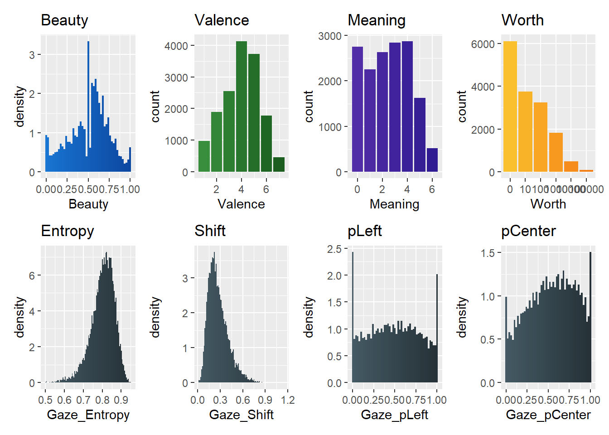{#fig-dist-phase1 fig-alt='Observed distributions of the Phase 1 ratings (Beauty 0-1, Valence 1-7, Meaning 0-6, Worth in 6 money categories) and of the four gaze features, pooled over conditions.' width=672}
:::
:::


::: {.cell}

```{.r .cell-code}
# Run by hand: bare panels for figures/figure1.pptx
# (ppt/media/image7,8,9,13,15,16,17,18).

dist_theme <- list(
  scale_x_continuous(expand = c(0, 0)),
  scale_y_continuous(expand = c(0, 0)),
  theme_void(),
  theme(axis.title.x = element_blank(),
        axis.title.y = element_blank(),
        axis.text.x = element_blank(),
        axis.text.y = element_blank(),
        plot.title = element_text(face = "bold"))
)


ggsave(p_dist_beauty + dist_theme, filename = "figures/dist_beauty.png", width = 6, height = 4, dpi = 300)
ggsave(p_dist_valence + dist_theme, filename = "figures/dist_valence.png", width = 6, height = 4, dpi = 300)
ggsave(p_dist_meaning + dist_theme, filename = "figures/dist_meaning.png", width = 6, height = 4, dpi = 300)
ggsave(p_dist_worth + dist_theme[-1] + scale_x_discrete(expand = c(0, 0)), filename = "figures/dist_worth.png", width = 6, height = 4, dpi = 300) # Worth is a factor: discrete x scale
ggsave(p_dist_entropy + dist_theme, filename = "figures/dist_entropy.png", width = 6, height = 1.5, dpi = 300)
ggsave(p_dist_shift + dist_theme, filename = "figures/dist_shift.png", width = 6, height = 1.5, dpi = 300)
ggsave(p_dist_pleft + dist_theme, filename = "figures/dist_pleft.png", width = 6, height = 1.5, dpi = 300)
ggsave(p_dist_pcenter + dist_theme, filename = "figures/dist_pcenter.png", width = 6, height = 1.5, dpi = 300)
```
:::


### Phase 2 and Follow-Up


::: {.cell}

```{.r .cell-code}
p_dist_reality <- dftask |> 
  ggplot(aes(x=Reality)) +
  geom_histogram(aes(y=after_stat(density)), bins = 51, fill = colorRampPalette(c("#C2185B", "#880E4F"))(51))

p_dist_authenticity <- dftask |> 
  ggplot(aes(x=Authenticity)) +
  geom_histogram(aes(y=after_stat(density)), bins = 51, fill = colorRampPalette(c("#E64A19", "#BF360C"))(51))

p_dist_beauty2 <- dftask |> 
  ggplot(aes(x=Beauty2)) +
  geom_histogram(aes(y=after_stat(density)), bins = 47, fill = colorRampPalette(c("#0097A7", "#006064"))(47))

p_dist_selfrel <- dftask |> 
  ggplot(aes(x=SelfRelevance)) +
  geom_bar(fill = colorRampPalette(c("#00796B", "#004D40"))(7))  

p_dist_artificiality <- dftask |> 
  ggplot(aes(x=PerceivedArtificiality)) +
  geom_histogram(aes(y=after_stat(density)), bins = 21, fill = colorRampPalette(c("#AFB42B", "#827717"))(21))

wrap_plots(
  (p_dist_reality + labs(title = "Syntheticness")), 
    (p_dist_authenticity + labs(title = "Authenticity")),
    (p_dist_beauty2 + labs(title = "Beauty (follow-up)")), 
    (p_dist_selfrel + labs(title = "Self-Relevance")),
    (p_dist_artificiality + labs(title = "Artificiality")),
  ncol = 3
)
```

::: {.cell-output-display}
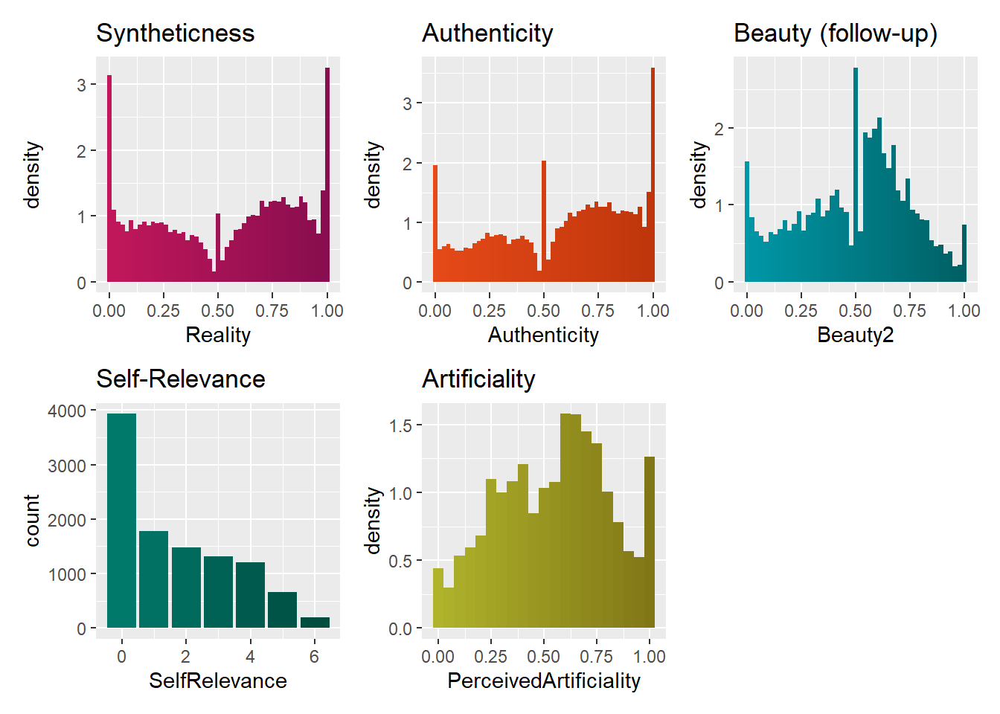{#fig-dist-phase2 fig-alt='Observed distributions of the Phase 2 sliders (Syntheticness: 0 = AI-Generated, 1 = Human; Authenticity: 0 = Copy, 1 = Original) and of the follow-up outcomes (Beauty rated again, Self-Relevance 0-6, Perceived Artificiality 0-1).' width=672}
:::
:::


:::


## Phase 1 - Ratings

::: {.panel-tabset}

### Beauty


::: {.cell}

```{.r .cell-code}
make_report(estimates$Beauty)
```

::: {.cell-output-display}

```{=html}
<div id="nsfonqjoiw" style="padding-left:0px;padding-right:0px;padding-top:10px;padding-bottom:10px;overflow-x:auto;overflow-y:auto;width:auto;height:auto;">
<style>#nsfonqjoiw table {
  font-family: system-ui, 'Segoe UI', Roboto, Helvetica, Arial, sans-serif, 'Apple Color Emoji', 'Segoe UI Emoji', 'Segoe UI Symbol', 'Noto Color Emoji';
  -webkit-font-smoothing: antialiased;
  -moz-osx-font-smoothing: grayscale;
}

#nsfonqjoiw thead, #nsfonqjoiw tbody, #nsfonqjoiw tfoot, #nsfonqjoiw tr, #nsfonqjoiw td, #nsfonqjoiw th {
  border-style: none;
}

#nsfonqjoiw p {
  margin: 0;
  padding: 0;
}

#nsfonqjoiw .gt_table {
  display: table;
  border-collapse: collapse;
  line-height: normal;
  margin-left: auto;
  margin-right: auto;
  color: #333333;
  font-size: 16px;
  font-weight: normal;
  font-style: normal;
  background-color: #FFFFFF;
  width: auto;
  border-top-style: solid;
  border-top-width: 2px;
  border-top-color: #A8A8A8;
  border-right-style: none;
  border-right-width: 2px;
  border-right-color: #D3D3D3;
  border-bottom-style: solid;
  border-bottom-width: 2px;
  border-bottom-color: #A8A8A8;
  border-left-style: none;
  border-left-width: 2px;
  border-left-color: #D3D3D3;
}

#nsfonqjoiw .gt_caption {
  padding-top: 4px;
  padding-bottom: 4px;
}

#nsfonqjoiw .gt_title {
  color: #333333;
  font-size: 125%;
  font-weight: initial;
  padding-top: 4px;
  padding-bottom: 4px;
  padding-left: 5px;
  padding-right: 5px;
  border-bottom-color: #FFFFFF;
  border-bottom-width: 0;
}

#nsfonqjoiw .gt_subtitle {
  color: #333333;
  font-size: 85%;
  font-weight: initial;
  padding-top: 3px;
  padding-bottom: 5px;
  padding-left: 5px;
  padding-right: 5px;
  border-top-color: #FFFFFF;
  border-top-width: 0;
}

#nsfonqjoiw .gt_heading {
  background-color: #FFFFFF;
  text-align: center;
  border-bottom-color: #FFFFFF;
  border-left-style: none;
  border-left-width: 1px;
  border-left-color: #D3D3D3;
  border-right-style: none;
  border-right-width: 1px;
  border-right-color: #D3D3D3;
}

#nsfonqjoiw .gt_bottom_border {
  border-bottom-style: solid;
  border-bottom-width: 2px;
  border-bottom-color: #D3D3D3;
}

#nsfonqjoiw .gt_col_headings {
  border-top-style: solid;
  border-top-width: 2px;
  border-top-color: #D3D3D3;
  border-bottom-style: solid;
  border-bottom-width: 2px;
  border-bottom-color: #D3D3D3;
  border-left-style: none;
  border-left-width: 1px;
  border-left-color: #D3D3D3;
  border-right-style: none;
  border-right-width: 1px;
  border-right-color: #D3D3D3;
}

#nsfonqjoiw .gt_col_heading {
  color: #333333;
  background-color: #FFFFFF;
  font-size: 100%;
  font-weight: normal;
  text-transform: inherit;
  border-left-style: none;
  border-left-width: 1px;
  border-left-color: #D3D3D3;
  border-right-style: none;
  border-right-width: 1px;
  border-right-color: #D3D3D3;
  vertical-align: bottom;
  padding-top: 5px;
  padding-bottom: 6px;
  padding-left: 5px;
  padding-right: 5px;
  overflow-x: hidden;
}

#nsfonqjoiw .gt_column_spanner_outer {
  color: #333333;
  background-color: #FFFFFF;
  font-size: 100%;
  font-weight: normal;
  text-transform: inherit;
  padding-top: 0;
  padding-bottom: 0;
  padding-left: 4px;
  padding-right: 4px;
}

#nsfonqjoiw .gt_column_spanner_outer:first-child {
  padding-left: 0;
}

#nsfonqjoiw .gt_column_spanner_outer:last-child {
  padding-right: 0;
}

#nsfonqjoiw .gt_column_spanner {
  border-bottom-style: solid;
  border-bottom-width: 2px;
  border-bottom-color: #D3D3D3;
  vertical-align: bottom;
  padding-top: 5px;
  padding-bottom: 5px;
  overflow-x: hidden;
  display: inline-block;
  width: 100%;
}

#nsfonqjoiw .gt_spanner_row {
  border-bottom-style: hidden;
}

#nsfonqjoiw .gt_group_heading {
  padding-top: 8px;
  padding-bottom: 8px;
  padding-left: 5px;
  padding-right: 5px;
  color: #333333;
  background-color: #FFFFFF;
  font-size: 100%;
  font-weight: initial;
  text-transform: inherit;
  border-top-style: solid;
  border-top-width: 2px;
  border-top-color: #D3D3D3;
  border-bottom-style: solid;
  border-bottom-width: 2px;
  border-bottom-color: #D3D3D3;
  border-left-style: none;
  border-left-width: 1px;
  border-left-color: #D3D3D3;
  border-right-style: none;
  border-right-width: 1px;
  border-right-color: #D3D3D3;
  vertical-align: middle;
  text-align: left;
}

#nsfonqjoiw .gt_empty_group_heading {
  padding: 0.5px;
  color: #333333;
  background-color: #FFFFFF;
  font-size: 100%;
  font-weight: initial;
  border-top-style: solid;
  border-top-width: 2px;
  border-top-color: #D3D3D3;
  border-bottom-style: solid;
  border-bottom-width: 2px;
  border-bottom-color: #D3D3D3;
  vertical-align: middle;
}

#nsfonqjoiw .gt_from_md > :first-child {
  margin-top: 0;
}

#nsfonqjoiw .gt_from_md > :last-child {
  margin-bottom: 0;
}

#nsfonqjoiw .gt_row {
  padding-top: 8px;
  padding-bottom: 8px;
  padding-left: 5px;
  padding-right: 5px;
  margin: 10px;
  border-top-style: solid;
  border-top-width: 1px;
  border-top-color: #D3D3D3;
  border-left-style: none;
  border-left-width: 1px;
  border-left-color: #D3D3D3;
  border-right-style: none;
  border-right-width: 1px;
  border-right-color: #D3D3D3;
  vertical-align: middle;
  overflow-x: hidden;
}

#nsfonqjoiw .gt_stub {
  color: #333333;
  background-color: #FFFFFF;
  font-size: 100%;
  font-weight: initial;
  text-transform: inherit;
  border-right-style: solid;
  border-right-width: 2px;
  border-right-color: #D3D3D3;
  padding-left: 5px;
  padding-right: 5px;
}

#nsfonqjoiw .gt_stub_row_group {
  color: #333333;
  background-color: #FFFFFF;
  font-size: 100%;
  font-weight: initial;
  text-transform: inherit;
  border-right-style: solid;
  border-right-width: 2px;
  border-right-color: #D3D3D3;
  padding-left: 5px;
  padding-right: 5px;
  vertical-align: top;
}

#nsfonqjoiw .gt_row_group_first td {
  border-top-width: 2px;
}

#nsfonqjoiw .gt_row_group_first th {
  border-top-width: 2px;
}

#nsfonqjoiw .gt_summary_row {
  color: #333333;
  background-color: #FFFFFF;
  text-transform: inherit;
  padding-top: 8px;
  padding-bottom: 8px;
  padding-left: 5px;
  padding-right: 5px;
}

#nsfonqjoiw .gt_first_summary_row {
  border-top-style: solid;
  border-top-color: #D3D3D3;
}

#nsfonqjoiw .gt_first_summary_row.thick {
  border-top-width: 2px;
}

#nsfonqjoiw .gt_last_summary_row {
  padding-top: 8px;
  padding-bottom: 8px;
  padding-left: 5px;
  padding-right: 5px;
  border-bottom-style: solid;
  border-bottom-width: 2px;
  border-bottom-color: #D3D3D3;
}

#nsfonqjoiw .gt_grand_summary_row {
  color: #333333;
  background-color: #FFFFFF;
  text-transform: inherit;
  padding-top: 8px;
  padding-bottom: 8px;
  padding-left: 5px;
  padding-right: 5px;
}

#nsfonqjoiw .gt_first_grand_summary_row {
  padding-top: 8px;
  padding-bottom: 8px;
  padding-left: 5px;
  padding-right: 5px;
  border-top-style: double;
  border-top-width: 6px;
  border-top-color: #D3D3D3;
}

#nsfonqjoiw .gt_last_grand_summary_row_top {
  padding-top: 8px;
  padding-bottom: 8px;
  padding-left: 5px;
  padding-right: 5px;
  border-bottom-style: double;
  border-bottom-width: 6px;
  border-bottom-color: #D3D3D3;
}

#nsfonqjoiw .gt_striped {
  background-color: rgba(128, 128, 128, 0.05);
}

#nsfonqjoiw .gt_table_body {
  border-top-style: solid;
  border-top-width: 2px;
  border-top-color: #D3D3D3;
  border-bottom-style: solid;
  border-bottom-width: 2px;
  border-bottom-color: #D3D3D3;
}

#nsfonqjoiw .gt_footnotes {
  color: #333333;
  background-color: #FFFFFF;
  border-bottom-style: none;
  border-bottom-width: 2px;
  border-bottom-color: #D3D3D3;
  border-left-style: none;
  border-left-width: 2px;
  border-left-color: #D3D3D3;
  border-right-style: none;
  border-right-width: 2px;
  border-right-color: #D3D3D3;
}

#nsfonqjoiw .gt_footnote {
  margin: 0px;
  font-size: 90%;
  padding-top: 4px;
  padding-bottom: 4px;
  padding-left: 5px;
  padding-right: 5px;
}

#nsfonqjoiw .gt_sourcenotes {
  color: #333333;
  background-color: #FFFFFF;
  border-bottom-style: none;
  border-bottom-width: 2px;
  border-bottom-color: #D3D3D3;
  border-left-style: none;
  border-left-width: 2px;
  border-left-color: #D3D3D3;
  border-right-style: none;
  border-right-width: 2px;
  border-right-color: #D3D3D3;
}

#nsfonqjoiw .gt_sourcenote {
  font-size: 90%;
  padding-top: 4px;
  padding-bottom: 4px;
  padding-left: 5px;
  padding-right: 5px;
}

#nsfonqjoiw .gt_left {
  text-align: left;
}

#nsfonqjoiw .gt_center {
  text-align: center;
}

#nsfonqjoiw .gt_right {
  text-align: right;
  font-variant-numeric: tabular-nums;
}

#nsfonqjoiw .gt_font_normal {
  font-weight: normal;
}

#nsfonqjoiw .gt_font_bold {
  font-weight: bold;
}

#nsfonqjoiw .gt_font_italic {
  font-style: italic;
}

#nsfonqjoiw .gt_super {
  font-size: 65%;
}

#nsfonqjoiw .gt_footnote_marks {
  font-size: 75%;
  vertical-align: 0.4em;
  position: initial;
}

#nsfonqjoiw .gt_asterisk {
  font-size: 100%;
  vertical-align: 0;
}

#nsfonqjoiw .gt_indent_1 {
  text-indent: 5px;
}

#nsfonqjoiw .gt_indent_2 {
  text-indent: 10px;
}

#nsfonqjoiw .gt_indent_3 {
  text-indent: 15px;
}

#nsfonqjoiw .gt_indent_4 {
  text-indent: 20px;
}

#nsfonqjoiw .gt_indent_5 {
  text-indent: 25px;
}

#nsfonqjoiw .katex-display {
  display: inline-flex !important;
  margin-bottom: 0.75em !important;
}

#nsfonqjoiw div.Reactable > div.rt-table > div.rt-thead > div.rt-tr.rt-tr-group-header > div.rt-th-group:after {
  height: 0px !important;
}
</style>
<table class="gt_table" data-quarto-disable-processing="false" data-quarto-bootstrap="false">
  <thead>
    <tr class="gt_col_headings">
      <th class="gt_col_heading gt_columns_bottom_border gt_left" rowspan="1" colspan="1" scope="col" id="Contrast">Contrast</th>
      <th class="gt_col_heading gt_columns_bottom_border gt_left" rowspan="1" colspan="1" scope="col" id="Parameters">Parameters</th>
    </tr>
  </thead>
  <tbody class="gt_table_body">
    <tr><td headers="Contrast" class="gt_row gt_left">Human Forgery - Human Original</td>
<td headers="Parameters" class="gt_row gt_left">response (-0.04, [-0.05, -0.03]); mu (-0.07, [-0.10, -0.04]); confright (-0.04, [-0.05, -0.03]); confleft (0.02, [ 0.01,  0.04]); precright (0.74, [ 0.38,  1.12]); precleft (0.27, [ 0.03,  0.55])</td></tr>
    <tr><td headers="Contrast" class="gt_row gt_left">AI-Generated - Human Original</td>
<td headers="Parameters" class="gt_row gt_left">response (-0.07, [-0.08, -0.06]); mu (-0.16, [-0.19, -0.13]); confright (-0.06, [-0.07, -0.05]); confleft (0.04, [ 0.02,  0.06]); precright (0.82, [ 0.52,  1.15]); pex (0.00, [-0.01,  0.00])</td></tr>
    <tr><td headers="Contrast" class="gt_row gt_left">AI-Generated - Human Forgery</td>
<td headers="Parameters" class="gt_row gt_left">response (-0.03, [-0.04, -0.02]); mu (-0.09, [-0.13, -0.06]); confright (-0.02, [-0.03, -0.01]); precleft (-0.29, [-0.57, -0.03]); pmid (0.01, [ 0.00,  0.01])</td></tr>
  </tbody>
  
</table>
</div>
```

```{=html}
<div id="zyowuwpkon" style="padding-left:0px;padding-right:0px;padding-top:10px;padding-bottom:10px;overflow-x:auto;overflow-y:auto;width:auto;height:auto;">
<style>#zyowuwpkon table {
  font-family: system-ui, 'Segoe UI', Roboto, Helvetica, Arial, sans-serif, 'Apple Color Emoji', 'Segoe UI Emoji', 'Segoe UI Symbol', 'Noto Color Emoji';
  -webkit-font-smoothing: antialiased;
  -moz-osx-font-smoothing: grayscale;
}

#zyowuwpkon thead, #zyowuwpkon tbody, #zyowuwpkon tfoot, #zyowuwpkon tr, #zyowuwpkon td, #zyowuwpkon th {
  border-style: none;
}

#zyowuwpkon p {
  margin: 0;
  padding: 0;
}

#zyowuwpkon .gt_table {
  display: table;
  border-collapse: collapse;
  line-height: normal;
  margin-left: auto;
  margin-right: auto;
  color: #333333;
  font-size: 16px;
  font-weight: normal;
  font-style: normal;
  background-color: #FFFFFF;
  width: auto;
  border-top-style: solid;
  border-top-width: 2px;
  border-top-color: #A8A8A8;
  border-right-style: none;
  border-right-width: 2px;
  border-right-color: #D3D3D3;
  border-bottom-style: solid;
  border-bottom-width: 2px;
  border-bottom-color: #A8A8A8;
  border-left-style: none;
  border-left-width: 2px;
  border-left-color: #D3D3D3;
}

#zyowuwpkon .gt_caption {
  padding-top: 4px;
  padding-bottom: 4px;
}

#zyowuwpkon .gt_title {
  color: #333333;
  font-size: 125%;
  font-weight: initial;
  padding-top: 4px;
  padding-bottom: 4px;
  padding-left: 5px;
  padding-right: 5px;
  border-bottom-color: #FFFFFF;
  border-bottom-width: 0;
}

#zyowuwpkon .gt_subtitle {
  color: #333333;
  font-size: 85%;
  font-weight: initial;
  padding-top: 3px;
  padding-bottom: 5px;
  padding-left: 5px;
  padding-right: 5px;
  border-top-color: #FFFFFF;
  border-top-width: 0;
}

#zyowuwpkon .gt_heading {
  background-color: #FFFFFF;
  text-align: center;
  border-bottom-color: #FFFFFF;
  border-left-style: none;
  border-left-width: 1px;
  border-left-color: #D3D3D3;
  border-right-style: none;
  border-right-width: 1px;
  border-right-color: #D3D3D3;
}

#zyowuwpkon .gt_bottom_border {
  border-bottom-style: solid;
  border-bottom-width: 2px;
  border-bottom-color: #D3D3D3;
}

#zyowuwpkon .gt_col_headings {
  border-top-style: solid;
  border-top-width: 2px;
  border-top-color: #D3D3D3;
  border-bottom-style: solid;
  border-bottom-width: 2px;
  border-bottom-color: #D3D3D3;
  border-left-style: none;
  border-left-width: 1px;
  border-left-color: #D3D3D3;
  border-right-style: none;
  border-right-width: 1px;
  border-right-color: #D3D3D3;
}

#zyowuwpkon .gt_col_heading {
  color: #333333;
  background-color: #FFFFFF;
  font-size: 100%;
  font-weight: normal;
  text-transform: inherit;
  border-left-style: none;
  border-left-width: 1px;
  border-left-color: #D3D3D3;
  border-right-style: none;
  border-right-width: 1px;
  border-right-color: #D3D3D3;
  vertical-align: bottom;
  padding-top: 5px;
  padding-bottom: 6px;
  padding-left: 5px;
  padding-right: 5px;
  overflow-x: hidden;
}

#zyowuwpkon .gt_column_spanner_outer {
  color: #333333;
  background-color: #FFFFFF;
  font-size: 100%;
  font-weight: normal;
  text-transform: inherit;
  padding-top: 0;
  padding-bottom: 0;
  padding-left: 4px;
  padding-right: 4px;
}

#zyowuwpkon .gt_column_spanner_outer:first-child {
  padding-left: 0;
}

#zyowuwpkon .gt_column_spanner_outer:last-child {
  padding-right: 0;
}

#zyowuwpkon .gt_column_spanner {
  border-bottom-style: solid;
  border-bottom-width: 2px;
  border-bottom-color: #D3D3D3;
  vertical-align: bottom;
  padding-top: 5px;
  padding-bottom: 5px;
  overflow-x: hidden;
  display: inline-block;
  width: 100%;
}

#zyowuwpkon .gt_spanner_row {
  border-bottom-style: hidden;
}

#zyowuwpkon .gt_group_heading {
  padding-top: 8px;
  padding-bottom: 8px;
  padding-left: 5px;
  padding-right: 5px;
  color: #333333;
  background-color: #FFFFFF;
  font-size: 100%;
  font-weight: initial;
  text-transform: inherit;
  border-top-style: solid;
  border-top-width: 2px;
  border-top-color: #D3D3D3;
  border-bottom-style: solid;
  border-bottom-width: 2px;
  border-bottom-color: #D3D3D3;
  border-left-style: none;
  border-left-width: 1px;
  border-left-color: #D3D3D3;
  border-right-style: none;
  border-right-width: 1px;
  border-right-color: #D3D3D3;
  vertical-align: middle;
  text-align: left;
}

#zyowuwpkon .gt_empty_group_heading {
  padding: 0.5px;
  color: #333333;
  background-color: #FFFFFF;
  font-size: 100%;
  font-weight: initial;
  border-top-style: solid;
  border-top-width: 2px;
  border-top-color: #D3D3D3;
  border-bottom-style: solid;
  border-bottom-width: 2px;
  border-bottom-color: #D3D3D3;
  vertical-align: middle;
}

#zyowuwpkon .gt_from_md > :first-child {
  margin-top: 0;
}

#zyowuwpkon .gt_from_md > :last-child {
  margin-bottom: 0;
}

#zyowuwpkon .gt_row {
  padding-top: 8px;
  padding-bottom: 8px;
  padding-left: 5px;
  padding-right: 5px;
  margin: 10px;
  border-top-style: solid;
  border-top-width: 1px;
  border-top-color: #D3D3D3;
  border-left-style: none;
  border-left-width: 1px;
  border-left-color: #D3D3D3;
  border-right-style: none;
  border-right-width: 1px;
  border-right-color: #D3D3D3;
  vertical-align: middle;
  overflow-x: hidden;
}

#zyowuwpkon .gt_stub {
  color: #333333;
  background-color: #FFFFFF;
  font-size: 100%;
  font-weight: initial;
  text-transform: inherit;
  border-right-style: solid;
  border-right-width: 2px;
  border-right-color: #D3D3D3;
  padding-left: 5px;
  padding-right: 5px;
}

#zyowuwpkon .gt_stub_row_group {
  color: #333333;
  background-color: #FFFFFF;
  font-size: 100%;
  font-weight: initial;
  text-transform: inherit;
  border-right-style: solid;
  border-right-width: 2px;
  border-right-color: #D3D3D3;
  padding-left: 5px;
  padding-right: 5px;
  vertical-align: top;
}

#zyowuwpkon .gt_row_group_first td {
  border-top-width: 2px;
}

#zyowuwpkon .gt_row_group_first th {
  border-top-width: 2px;
}

#zyowuwpkon .gt_summary_row {
  color: #333333;
  background-color: #FFFFFF;
  text-transform: inherit;
  padding-top: 8px;
  padding-bottom: 8px;
  padding-left: 5px;
  padding-right: 5px;
}

#zyowuwpkon .gt_first_summary_row {
  border-top-style: solid;
  border-top-color: #D3D3D3;
}

#zyowuwpkon .gt_first_summary_row.thick {
  border-top-width: 2px;
}

#zyowuwpkon .gt_last_summary_row {
  padding-top: 8px;
  padding-bottom: 8px;
  padding-left: 5px;
  padding-right: 5px;
  border-bottom-style: solid;
  border-bottom-width: 2px;
  border-bottom-color: #D3D3D3;
}

#zyowuwpkon .gt_grand_summary_row {
  color: #333333;
  background-color: #FFFFFF;
  text-transform: inherit;
  padding-top: 8px;
  padding-bottom: 8px;
  padding-left: 5px;
  padding-right: 5px;
}

#zyowuwpkon .gt_first_grand_summary_row {
  padding-top: 8px;
  padding-bottom: 8px;
  padding-left: 5px;
  padding-right: 5px;
  border-top-style: double;
  border-top-width: 6px;
  border-top-color: #D3D3D3;
}

#zyowuwpkon .gt_last_grand_summary_row_top {
  padding-top: 8px;
  padding-bottom: 8px;
  padding-left: 5px;
  padding-right: 5px;
  border-bottom-style: double;
  border-bottom-width: 6px;
  border-bottom-color: #D3D3D3;
}

#zyowuwpkon .gt_striped {
  background-color: rgba(128, 128, 128, 0.05);
}

#zyowuwpkon .gt_table_body {
  border-top-style: solid;
  border-top-width: 2px;
  border-top-color: #D3D3D3;
  border-bottom-style: solid;
  border-bottom-width: 2px;
  border-bottom-color: #D3D3D3;
}

#zyowuwpkon .gt_footnotes {
  color: #333333;
  background-color: #FFFFFF;
  border-bottom-style: none;
  border-bottom-width: 2px;
  border-bottom-color: #D3D3D3;
  border-left-style: none;
  border-left-width: 2px;
  border-left-color: #D3D3D3;
  border-right-style: none;
  border-right-width: 2px;
  border-right-color: #D3D3D3;
}

#zyowuwpkon .gt_footnote {
  margin: 0px;
  font-size: 90%;
  padding-top: 4px;
  padding-bottom: 4px;
  padding-left: 5px;
  padding-right: 5px;
}

#zyowuwpkon .gt_sourcenotes {
  color: #333333;
  background-color: #FFFFFF;
  border-bottom-style: none;
  border-bottom-width: 2px;
  border-bottom-color: #D3D3D3;
  border-left-style: none;
  border-left-width: 2px;
  border-left-color: #D3D3D3;
  border-right-style: none;
  border-right-width: 2px;
  border-right-color: #D3D3D3;
}

#zyowuwpkon .gt_sourcenote {
  font-size: 90%;
  padding-top: 4px;
  padding-bottom: 4px;
  padding-left: 5px;
  padding-right: 5px;
}

#zyowuwpkon .gt_left {
  text-align: left;
}

#zyowuwpkon .gt_center {
  text-align: center;
}

#zyowuwpkon .gt_right {
  text-align: right;
  font-variant-numeric: tabular-nums;
}

#zyowuwpkon .gt_font_normal {
  font-weight: normal;
}

#zyowuwpkon .gt_font_bold {
  font-weight: bold;
}

#zyowuwpkon .gt_font_italic {
  font-style: italic;
}

#zyowuwpkon .gt_super {
  font-size: 65%;
}

#zyowuwpkon .gt_footnote_marks {
  font-size: 75%;
  vertical-align: 0.4em;
  position: initial;
}

#zyowuwpkon .gt_asterisk {
  font-size: 100%;
  vertical-align: 0;
}

#zyowuwpkon .gt_indent_1 {
  text-indent: 5px;
}

#zyowuwpkon .gt_indent_2 {
  text-indent: 10px;
}

#zyowuwpkon .gt_indent_3 {
  text-indent: 15px;
}

#zyowuwpkon .gt_indent_4 {
  text-indent: 20px;
}

#zyowuwpkon .gt_indent_5 {
  text-indent: 25px;
}

#zyowuwpkon .katex-display {
  display: inline-flex !important;
  margin-bottom: 0.75em !important;
}

#zyowuwpkon div.Reactable > div.rt-table > div.rt-thead > div.rt-tr.rt-tr-group-header > div.rt-th-group:after {
  height: 0px !important;
}
</style>
<table class="gt_table" data-quarto-disable-processing="false" data-quarto-bootstrap="false">
  <thead>
    <tr class="gt_col_headings">
      <th class="gt_col_heading gt_columns_bottom_border gt_left" rowspan="1" colspan="1" scope="col" id="Contrast">Contrast</th>
      <th class="gt_col_heading gt_columns_bottom_border gt_left" rowspan="1" colspan="1" scope="col" id="Parameters">Parameters</th>
    </tr>
  </thead>
  <tbody class="gt_table_body">
    <tr><td headers="Contrast" class="gt_row gt_left">Negative - Low intensity - Positive - Low intensity</td>
<td headers="Parameters" class="gt_row gt_left">response (-0.13, [-0.19, -0.07]); mu (-0.31, [-0.48, -0.13]); confright (-0.08, [-0.12, -0.04]); precright (0.71, [ 0.32,  1.14])</td></tr>
    <tr><td headers="Contrast" class="gt_row gt_left">Positive - High intensity - Negative - Low intensity</td>
<td headers="Parameters" class="gt_row gt_left">response (0.09, [ 0.03,  0.15]); mu (0.21, [ 0.02,  0.40]); confright (0.05, [ 0.01,  0.10]); precright (-0.59, [-1.05, -0.17])</td></tr>
    <tr><td headers="Contrast" class="gt_row gt_left">Negative - High intensity - Positive - Low intensity</td>
<td headers="Parameters" class="gt_row gt_left">response (-0.24, [-0.29, -0.17]); mu (-0.55, [-0.69, -0.37]); confright (-0.07, [-0.11, -0.03]); confleft (0.13, [ 0.07,  0.19]); precright (0.50, [ 0.09,  0.95])</td></tr>
    <tr><td headers="Contrast" class="gt_row gt_left">Negative - High intensity - Negative - Low intensity</td>
<td headers="Parameters" class="gt_row gt_left">response (-0.11, [-0.17, -0.03]); mu (-0.24, [-0.42, -0.03]); confleft (0.10, [ 0.04,  0.16])</td></tr>
    <tr><td headers="Contrast" class="gt_row gt_left">Negative - High intensity - Positive - High intensity</td>
<td headers="Parameters" class="gt_row gt_left">response (-0.20, [-0.26, -0.13]); mu (-0.46, [-0.61, -0.28]); confleft (0.13, [ 0.07,  0.19])</td></tr>
  </tbody>
  
</table>
</div>
```

```{=html}
<div id="nxaavukysy" style="padding-left:0px;padding-right:0px;padding-top:10px;padding-bottom:10px;overflow-x:auto;overflow-y:auto;width:auto;height:auto;">
<style>#nxaavukysy table {
  font-family: system-ui, 'Segoe UI', Roboto, Helvetica, Arial, sans-serif, 'Apple Color Emoji', 'Segoe UI Emoji', 'Segoe UI Symbol', 'Noto Color Emoji';
  -webkit-font-smoothing: antialiased;
  -moz-osx-font-smoothing: grayscale;
}

#nxaavukysy thead, #nxaavukysy tbody, #nxaavukysy tfoot, #nxaavukysy tr, #nxaavukysy td, #nxaavukysy th {
  border-style: none;
}

#nxaavukysy p {
  margin: 0;
  padding: 0;
}

#nxaavukysy .gt_table {
  display: table;
  border-collapse: collapse;
  line-height: normal;
  margin-left: auto;
  margin-right: auto;
  color: #333333;
  font-size: 13px;
  font-weight: normal;
  font-style: normal;
  background-color: #FFFFFF;
  width: auto;
  border-top-style: solid;
  border-top-width: 3px;
  border-top-color: #D5D5D5;
  border-right-style: solid;
  border-right-width: 3px;
  border-right-color: #D5D5D5;
  border-bottom-style: solid;
  border-bottom-width: 3px;
  border-bottom-color: #D5D5D5;
  border-left-style: solid;
  border-left-width: 3px;
  border-left-color: #D5D5D5;
}

#nxaavukysy .gt_caption {
  padding-top: 4px;
  padding-bottom: 4px;
}

#nxaavukysy .gt_title {
  color: #333333;
  font-size: 125%;
  font-weight: initial;
  padding-top: 4px;
  padding-bottom: 4px;
  padding-left: 5px;
  padding-right: 5px;
  border-bottom-color: #FFFFFF;
  border-bottom-width: 0;
}

#nxaavukysy .gt_subtitle {
  color: #333333;
  font-size: 85%;
  font-weight: initial;
  padding-top: 3px;
  padding-bottom: 5px;
  padding-left: 5px;
  padding-right: 5px;
  border-top-color: #FFFFFF;
  border-top-width: 0;
}

#nxaavukysy .gt_heading {
  background-color: #FFFFFF;
  text-align: left;
  border-bottom-color: #FFFFFF;
  border-left-style: none;
  border-left-width: 1px;
  border-left-color: #D3D3D3;
  border-right-style: none;
  border-right-width: 1px;
  border-right-color: #D3D3D3;
}

#nxaavukysy .gt_bottom_border {
  border-bottom-style: solid;
  border-bottom-width: 2px;
  border-bottom-color: #D5D5D5;
}

#nxaavukysy .gt_col_headings {
  border-top-style: solid;
  border-top-width: 2px;
  border-top-color: #D5D5D5;
  border-bottom-style: solid;
  border-bottom-width: 2px;
  border-bottom-color: #D5D5D5;
  border-left-style: none;
  border-left-width: 1px;
  border-left-color: #D3D3D3;
  border-right-style: none;
  border-right-width: 1px;
  border-right-color: #D3D3D3;
}

#nxaavukysy .gt_col_heading {
  color: #FFFFFF;
  background-color: #000000;
  font-size: 100%;
  font-weight: normal;
  text-transform: inherit;
  border-left-style: none;
  border-left-width: 1px;
  border-left-color: #D3D3D3;
  border-right-style: none;
  border-right-width: 1px;
  border-right-color: #D3D3D3;
  vertical-align: bottom;
  padding-top: 5px;
  padding-bottom: 6px;
  padding-left: 5px;
  padding-right: 5px;
  overflow-x: hidden;
}

#nxaavukysy .gt_column_spanner_outer {
  color: #FFFFFF;
  background-color: #000000;
  font-size: 100%;
  font-weight: normal;
  text-transform: inherit;
  padding-top: 0;
  padding-bottom: 0;
  padding-left: 4px;
  padding-right: 4px;
}

#nxaavukysy .gt_column_spanner_outer:first-child {
  padding-left: 0;
}

#nxaavukysy .gt_column_spanner_outer:last-child {
  padding-right: 0;
}

#nxaavukysy .gt_column_spanner {
  border-bottom-style: solid;
  border-bottom-width: 2px;
  border-bottom-color: #D5D5D5;
  vertical-align: bottom;
  padding-top: 5px;
  padding-bottom: 5px;
  overflow-x: hidden;
  display: inline-block;
  width: 100%;
}

#nxaavukysy .gt_spanner_row {
  border-bottom-style: hidden;
}

#nxaavukysy .gt_group_heading {
  padding-top: 8px;
  padding-bottom: 8px;
  padding-left: 5px;
  padding-right: 5px;
  color: #333333;
  background-color: #FFFFFF;
  font-size: 100%;
  font-weight: initial;
  text-transform: inherit;
  border-top-style: solid;
  border-top-width: 2px;
  border-top-color: #D5D5D5;
  border-bottom-style: solid;
  border-bottom-width: 2px;
  border-bottom-color: #D5D5D5;
  border-left-style: none;
  border-left-width: 1px;
  border-left-color: #D3D3D3;
  border-right-style: none;
  border-right-width: 1px;
  border-right-color: #D3D3D3;
  vertical-align: middle;
  text-align: left;
}

#nxaavukysy .gt_empty_group_heading {
  padding: 0.5px;
  color: #333333;
  background-color: #FFFFFF;
  font-size: 100%;
  font-weight: initial;
  border-top-style: solid;
  border-top-width: 2px;
  border-top-color: #D5D5D5;
  border-bottom-style: solid;
  border-bottom-width: 2px;
  border-bottom-color: #D5D5D5;
  vertical-align: middle;
}

#nxaavukysy .gt_from_md > :first-child {
  margin-top: 0;
}

#nxaavukysy .gt_from_md > :last-child {
  margin-bottom: 0;
}

#nxaavukysy .gt_row {
  padding-top: 8px;
  padding-bottom: 8px;
  padding-left: 5px;
  padding-right: 5px;
  margin: 10px;
  border-top-style: solid;
  border-top-width: 1px;
  border-top-color: #D5D5D5;
  border-left-style: solid;
  border-left-width: 1px;
  border-left-color: #D5D5D5;
  border-right-style: solid;
  border-right-width: 1px;
  border-right-color: #D5D5D5;
  vertical-align: middle;
  overflow-x: hidden;
}

#nxaavukysy .gt_stub {
  color: #333333;
  background-color: #FFFFFF;
  font-size: 100%;
  font-weight: initial;
  text-transform: inherit;
  border-right-style: solid;
  border-right-width: 2px;
  border-right-color: #5F5F5F;
  padding-left: 5px;
  padding-right: 5px;
}

#nxaavukysy .gt_stub_row_group {
  color: #333333;
  background-color: #FFFFFF;
  font-size: 100%;
  font-weight: initial;
  text-transform: inherit;
  border-right-style: solid;
  border-right-width: 2px;
  border-right-color: #D3D3D3;
  padding-left: 5px;
  padding-right: 5px;
  vertical-align: top;
}

#nxaavukysy .gt_row_group_first td {
  border-top-width: 2px;
}

#nxaavukysy .gt_row_group_first th {
  border-top-width: 2px;
}

#nxaavukysy .gt_summary_row {
  color: #333333;
  background-color: #D5D5D5;
  text-transform: inherit;
  padding-top: 8px;
  padding-bottom: 8px;
  padding-left: 5px;
  padding-right: 5px;
}

#nxaavukysy .gt_first_summary_row {
  border-top-style: solid;
  border-top-color: #D5D5D5;
}

#nxaavukysy .gt_first_summary_row.thick {
  border-top-width: 2px;
}

#nxaavukysy .gt_last_summary_row {
  padding-top: 8px;
  padding-bottom: 8px;
  padding-left: 5px;
  padding-right: 5px;
  border-bottom-style: solid;
  border-bottom-width: 2px;
  border-bottom-color: #D5D5D5;
}

#nxaavukysy .gt_grand_summary_row {
  color: #FFFFFF;
  background-color: #929292;
  text-transform: inherit;
  padding-top: 8px;
  padding-bottom: 8px;
  padding-left: 5px;
  padding-right: 5px;
}

#nxaavukysy .gt_first_grand_summary_row {
  padding-top: 8px;
  padding-bottom: 8px;
  padding-left: 5px;
  padding-right: 5px;
  border-top-style: double;
  border-top-width: 6px;
  border-top-color: #D5D5D5;
}

#nxaavukysy .gt_last_grand_summary_row_top {
  padding-top: 8px;
  padding-bottom: 8px;
  padding-left: 5px;
  padding-right: 5px;
  border-bottom-style: double;
  border-bottom-width: 6px;
  border-bottom-color: #D5D5D5;
}

#nxaavukysy .gt_striped {
  background-color: #F4F4F4;
}

#nxaavukysy .gt_table_body {
  border-top-style: solid;
  border-top-width: 2px;
  border-top-color: #D5D5D5;
  border-bottom-style: solid;
  border-bottom-width: 2px;
  border-bottom-color: #D5D5D5;
}

#nxaavukysy .gt_footnotes {
  color: #333333;
  background-color: #FFFFFF;
  border-bottom-style: none;
  border-bottom-width: 2px;
  border-bottom-color: #D3D3D3;
  border-left-style: none;
  border-left-width: 2px;
  border-left-color: #D3D3D3;
  border-right-style: none;
  border-right-width: 2px;
  border-right-color: #D3D3D3;
}

#nxaavukysy .gt_footnote {
  margin: 0px;
  font-size: 90%;
  padding-top: 4px;
  padding-bottom: 4px;
  padding-left: 5px;
  padding-right: 5px;
}

#nxaavukysy .gt_sourcenotes {
  color: #333333;
  background-color: #FFFFFF;
  border-bottom-style: none;
  border-bottom-width: 2px;
  border-bottom-color: #D3D3D3;
  border-left-style: none;
  border-left-width: 2px;
  border-left-color: #D3D3D3;
  border-right-style: none;
  border-right-width: 2px;
  border-right-color: #D3D3D3;
}

#nxaavukysy .gt_sourcenote {
  font-size: 90%;
  padding-top: 4px;
  padding-bottom: 4px;
  padding-left: 5px;
  padding-right: 5px;
}

#nxaavukysy .gt_left {
  text-align: left;
}

#nxaavukysy .gt_center {
  text-align: center;
}

#nxaavukysy .gt_right {
  text-align: right;
  font-variant-numeric: tabular-nums;
}

#nxaavukysy .gt_font_normal {
  font-weight: normal;
}

#nxaavukysy .gt_font_bold {
  font-weight: bold;
}

#nxaavukysy .gt_font_italic {
  font-style: italic;
}

#nxaavukysy .gt_super {
  font-size: 65%;
}

#nxaavukysy .gt_footnote_marks {
  font-size: 75%;
  vertical-align: 0.4em;
  position: initial;
}

#nxaavukysy .gt_asterisk {
  font-size: 100%;
  vertical-align: 0;
}

#nxaavukysy .gt_indent_1 {
  text-indent: 5px;
}

#nxaavukysy .gt_indent_2 {
  text-indent: 10px;
}

#nxaavukysy .gt_indent_3 {
  text-indent: 15px;
}

#nxaavukysy .gt_indent_4 {
  text-indent: 20px;
}

#nxaavukysy .gt_indent_5 {
  text-indent: 25px;
}

#nxaavukysy .katex-display {
  display: inline-flex !important;
  margin-bottom: 0.75em !important;
}

#nxaavukysy div.Reactable > div.rt-table > div.rt-thead > div.rt-tr.rt-tr-group-header > div.rt-th-group:after {
  height: 0px !important;
}
</style>
<table class="gt_table" data-quarto-disable-processing="false" data-quarto-bootstrap="false">
  <thead>
    <tr class="gt_heading">
      <td colspan="10" class="gt_heading gt_title gt_font_normal gt_bottom_border" style>Beauty: convergence</td>
    </tr>
    
    <tr class="gt_col_headings">
      <th class="gt_col_heading gt_columns_bottom_border gt_left" rowspan="1" colspan="1" scope="col" id="Model">Model</th>
      <th class="gt_col_heading gt_columns_bottom_border gt_left" rowspan="1" colspan="1" scope="col" id="Family">Family</th>
      <th class="gt_col_heading gt_columns_bottom_border gt_right" rowspan="1" colspan="1" scope="col" id="N_obs">N_obs</th>
      <th class="gt_col_heading gt_columns_bottom_border gt_right" rowspan="1" colspan="1" scope="col" id="N_participants">N_participants</th>
      <th class="gt_col_heading gt_columns_bottom_border gt_right" rowspan="1" colspan="1" scope="col" id="Chains">Chains</th>
      <th class="gt_col_heading gt_columns_bottom_border gt_right" rowspan="1" colspan="1" scope="col" id="Draws">Draws</th>
      <th class="gt_col_heading gt_columns_bottom_border gt_right" rowspan="1" colspan="1" scope="col" id="Max_Rhat">Max_Rhat</th>
      <th class="gt_col_heading gt_columns_bottom_border gt_right" rowspan="1" colspan="1" scope="col" id="Min_ESS_ratio">Min_ESS_ratio</th>
      <th class="gt_col_heading gt_columns_bottom_border gt_right" rowspan="1" colspan="1" scope="col" id="Divergent_pct">Divergent_pct</th>
      <th class="gt_col_heading gt_columns_bottom_border gt_left" rowspan="1" colspan="1" scope="col" id="Criterion">Criterion</th>
    </tr>
  </thead>
  <tbody class="gt_table_body">
    <tr><td headers="Model" class="gt_row gt_left">Beauty</td>
<td headers="Family" class="gt_row gt_left">CHOCO</td>
<td headers="N_obs" class="gt_row gt_right">15552</td>
<td headers="N_participants" class="gt_row gt_right">324</td>
<td headers="Chains" class="gt_row gt_right">8</td>
<td headers="Draws" class="gt_row gt_right">4000</td>
<td headers="Max_Rhat" class="gt_row gt_right">1.068</td>
<td headers="Min_ESS_ratio" class="gt_row gt_right">0.023</td>
<td headers="Divergent_pct" class="gt_row gt_right">0</td>
<td headers="Criterion" class="gt_row gt_left">loo</td></tr>
  </tbody>
  
</table>
</div>
```


::: {.callout-note collapse="true" title="Beauty: convergence (Markdown table, for text readers)"}

|Model  |Family | N_obs| N_participants| Chains| Draws| Max_Rhat| Min_ESS_ratio| Divergent_pct|Criterion |
|:------|:------|-----:|--------------:|------:|-----:|--------:|-------------:|-------------:|:---------|
|Beauty |CHOCO  | 15552|            324|      8|  4000|    1.068|         0.023|             0|loo       |

:::

```{=html}
<div id="iybwgevxux" style="padding-left:0px;padding-right:0px;padding-top:10px;padding-bottom:10px;overflow-x:auto;overflow-y:auto;width:auto;height:auto;">
<style>#iybwgevxux table {
  font-family: system-ui, 'Segoe UI', Roboto, Helvetica, Arial, sans-serif, 'Apple Color Emoji', 'Segoe UI Emoji', 'Segoe UI Symbol', 'Noto Color Emoji';
  -webkit-font-smoothing: antialiased;
  -moz-osx-font-smoothing: grayscale;
}

#iybwgevxux thead, #iybwgevxux tbody, #iybwgevxux tfoot, #iybwgevxux tr, #iybwgevxux td, #iybwgevxux th {
  border-style: none;
}

#iybwgevxux p {
  margin: 0;
  padding: 0;
}

#iybwgevxux .gt_table {
  display: table;
  border-collapse: collapse;
  line-height: normal;
  margin-left: auto;
  margin-right: auto;
  color: #333333;
  font-size: 13px;
  font-weight: normal;
  font-style: normal;
  background-color: #FFFFFF;
  width: auto;
  border-top-style: solid;
  border-top-width: 3px;
  border-top-color: #D5D5D5;
  border-right-style: solid;
  border-right-width: 3px;
  border-right-color: #D5D5D5;
  border-bottom-style: solid;
  border-bottom-width: 3px;
  border-bottom-color: #D5D5D5;
  border-left-style: solid;
  border-left-width: 3px;
  border-left-color: #D5D5D5;
}

#iybwgevxux .gt_caption {
  padding-top: 4px;
  padding-bottom: 4px;
}

#iybwgevxux .gt_title {
  color: #333333;
  font-size: 125%;
  font-weight: initial;
  padding-top: 4px;
  padding-bottom: 4px;
  padding-left: 5px;
  padding-right: 5px;
  border-bottom-color: #FFFFFF;
  border-bottom-width: 0;
}

#iybwgevxux .gt_subtitle {
  color: #333333;
  font-size: 85%;
  font-weight: initial;
  padding-top: 3px;
  padding-bottom: 5px;
  padding-left: 5px;
  padding-right: 5px;
  border-top-color: #FFFFFF;
  border-top-width: 0;
}

#iybwgevxux .gt_heading {
  background-color: #FFFFFF;
  text-align: left;
  border-bottom-color: #FFFFFF;
  border-left-style: none;
  border-left-width: 1px;
  border-left-color: #D3D3D3;
  border-right-style: none;
  border-right-width: 1px;
  border-right-color: #D3D3D3;
}

#iybwgevxux .gt_bottom_border {
  border-bottom-style: solid;
  border-bottom-width: 2px;
  border-bottom-color: #D5D5D5;
}

#iybwgevxux .gt_col_headings {
  border-top-style: solid;
  border-top-width: 2px;
  border-top-color: #D5D5D5;
  border-bottom-style: solid;
  border-bottom-width: 2px;
  border-bottom-color: #D5D5D5;
  border-left-style: none;
  border-left-width: 1px;
  border-left-color: #D3D3D3;
  border-right-style: none;
  border-right-width: 1px;
  border-right-color: #D3D3D3;
}

#iybwgevxux .gt_col_heading {
  color: #FFFFFF;
  background-color: #000000;
  font-size: 100%;
  font-weight: normal;
  text-transform: inherit;
  border-left-style: none;
  border-left-width: 1px;
  border-left-color: #D3D3D3;
  border-right-style: none;
  border-right-width: 1px;
  border-right-color: #D3D3D3;
  vertical-align: bottom;
  padding-top: 5px;
  padding-bottom: 6px;
  padding-left: 5px;
  padding-right: 5px;
  overflow-x: hidden;
}

#iybwgevxux .gt_column_spanner_outer {
  color: #FFFFFF;
  background-color: #000000;
  font-size: 100%;
  font-weight: normal;
  text-transform: inherit;
  padding-top: 0;
  padding-bottom: 0;
  padding-left: 4px;
  padding-right: 4px;
}

#iybwgevxux .gt_column_spanner_outer:first-child {
  padding-left: 0;
}

#iybwgevxux .gt_column_spanner_outer:last-child {
  padding-right: 0;
}

#iybwgevxux .gt_column_spanner {
  border-bottom-style: solid;
  border-bottom-width: 2px;
  border-bottom-color: #D5D5D5;
  vertical-align: bottom;
  padding-top: 5px;
  padding-bottom: 5px;
  overflow-x: hidden;
  display: inline-block;
  width: 100%;
}

#iybwgevxux .gt_spanner_row {
  border-bottom-style: hidden;
}

#iybwgevxux .gt_group_heading {
  padding-top: 8px;
  padding-bottom: 8px;
  padding-left: 5px;
  padding-right: 5px;
  color: #333333;
  background-color: #FFFFFF;
  font-size: 100%;
  font-weight: initial;
  text-transform: inherit;
  border-top-style: solid;
  border-top-width: 2px;
  border-top-color: #D5D5D5;
  border-bottom-style: solid;
  border-bottom-width: 2px;
  border-bottom-color: #D5D5D5;
  border-left-style: none;
  border-left-width: 1px;
  border-left-color: #D3D3D3;
  border-right-style: none;
  border-right-width: 1px;
  border-right-color: #D3D3D3;
  vertical-align: middle;
  text-align: left;
}

#iybwgevxux .gt_empty_group_heading {
  padding: 0.5px;
  color: #333333;
  background-color: #FFFFFF;
  font-size: 100%;
  font-weight: initial;
  border-top-style: solid;
  border-top-width: 2px;
  border-top-color: #D5D5D5;
  border-bottom-style: solid;
  border-bottom-width: 2px;
  border-bottom-color: #D5D5D5;
  vertical-align: middle;
}

#iybwgevxux .gt_from_md > :first-child {
  margin-top: 0;
}

#iybwgevxux .gt_from_md > :last-child {
  margin-bottom: 0;
}

#iybwgevxux .gt_row {
  padding-top: 8px;
  padding-bottom: 8px;
  padding-left: 5px;
  padding-right: 5px;
  margin: 10px;
  border-top-style: solid;
  border-top-width: 1px;
  border-top-color: #D5D5D5;
  border-left-style: solid;
  border-left-width: 1px;
  border-left-color: #D5D5D5;
  border-right-style: solid;
  border-right-width: 1px;
  border-right-color: #D5D5D5;
  vertical-align: middle;
  overflow-x: hidden;
}

#iybwgevxux .gt_stub {
  color: #333333;
  background-color: #FFFFFF;
  font-size: 100%;
  font-weight: initial;
  text-transform: inherit;
  border-right-style: solid;
  border-right-width: 2px;
  border-right-color: #5F5F5F;
  padding-left: 5px;
  padding-right: 5px;
}

#iybwgevxux .gt_stub_row_group {
  color: #333333;
  background-color: #FFFFFF;
  font-size: 100%;
  font-weight: initial;
  text-transform: inherit;
  border-right-style: solid;
  border-right-width: 2px;
  border-right-color: #D3D3D3;
  padding-left: 5px;
  padding-right: 5px;
  vertical-align: top;
}

#iybwgevxux .gt_row_group_first td {
  border-top-width: 2px;
}

#iybwgevxux .gt_row_group_first th {
  border-top-width: 2px;
}

#iybwgevxux .gt_summary_row {
  color: #333333;
  background-color: #D5D5D5;
  text-transform: inherit;
  padding-top: 8px;
  padding-bottom: 8px;
  padding-left: 5px;
  padding-right: 5px;
}

#iybwgevxux .gt_first_summary_row {
  border-top-style: solid;
  border-top-color: #D5D5D5;
}

#iybwgevxux .gt_first_summary_row.thick {
  border-top-width: 2px;
}

#iybwgevxux .gt_last_summary_row {
  padding-top: 8px;
  padding-bottom: 8px;
  padding-left: 5px;
  padding-right: 5px;
  border-bottom-style: solid;
  border-bottom-width: 2px;
  border-bottom-color: #D5D5D5;
}

#iybwgevxux .gt_grand_summary_row {
  color: #FFFFFF;
  background-color: #929292;
  text-transform: inherit;
  padding-top: 8px;
  padding-bottom: 8px;
  padding-left: 5px;
  padding-right: 5px;
}

#iybwgevxux .gt_first_grand_summary_row {
  padding-top: 8px;
  padding-bottom: 8px;
  padding-left: 5px;
  padding-right: 5px;
  border-top-style: double;
  border-top-width: 6px;
  border-top-color: #D5D5D5;
}

#iybwgevxux .gt_last_grand_summary_row_top {
  padding-top: 8px;
  padding-bottom: 8px;
  padding-left: 5px;
  padding-right: 5px;
  border-bottom-style: double;
  border-bottom-width: 6px;
  border-bottom-color: #D5D5D5;
}

#iybwgevxux .gt_striped {
  background-color: #F4F4F4;
}

#iybwgevxux .gt_table_body {
  border-top-style: solid;
  border-top-width: 2px;
  border-top-color: #D5D5D5;
  border-bottom-style: solid;
  border-bottom-width: 2px;
  border-bottom-color: #D5D5D5;
}

#iybwgevxux .gt_footnotes {
  color: #333333;
  background-color: #FFFFFF;
  border-bottom-style: none;
  border-bottom-width: 2px;
  border-bottom-color: #D3D3D3;
  border-left-style: none;
  border-left-width: 2px;
  border-left-color: #D3D3D3;
  border-right-style: none;
  border-right-width: 2px;
  border-right-color: #D3D3D3;
}

#iybwgevxux .gt_footnote {
  margin: 0px;
  font-size: 90%;
  padding-top: 4px;
  padding-bottom: 4px;
  padding-left: 5px;
  padding-right: 5px;
}

#iybwgevxux .gt_sourcenotes {
  color: #333333;
  background-color: #FFFFFF;
  border-bottom-style: none;
  border-bottom-width: 2px;
  border-bottom-color: #D3D3D3;
  border-left-style: none;
  border-left-width: 2px;
  border-left-color: #D3D3D3;
  border-right-style: none;
  border-right-width: 2px;
  border-right-color: #D3D3D3;
}

#iybwgevxux .gt_sourcenote {
  font-size: 90%;
  padding-top: 4px;
  padding-bottom: 4px;
  padding-left: 5px;
  padding-right: 5px;
}

#iybwgevxux .gt_left {
  text-align: left;
}

#iybwgevxux .gt_center {
  text-align: center;
}

#iybwgevxux .gt_right {
  text-align: right;
  font-variant-numeric: tabular-nums;
}

#iybwgevxux .gt_font_normal {
  font-weight: normal;
}

#iybwgevxux .gt_font_bold {
  font-weight: bold;
}

#iybwgevxux .gt_font_italic {
  font-style: italic;
}

#iybwgevxux .gt_super {
  font-size: 65%;
}

#iybwgevxux .gt_footnote_marks {
  font-size: 75%;
  vertical-align: 0.4em;
  position: initial;
}

#iybwgevxux .gt_asterisk {
  font-size: 100%;
  vertical-align: 0;
}

#iybwgevxux .gt_indent_1 {
  text-indent: 5px;
}

#iybwgevxux .gt_indent_2 {
  text-indent: 10px;
}

#iybwgevxux .gt_indent_3 {
  text-indent: 15px;
}

#iybwgevxux .gt_indent_4 {
  text-indent: 20px;
}

#iybwgevxux .gt_indent_5 {
  text-indent: 25px;
}

#iybwgevxux .katex-display {
  display: inline-flex !important;
  margin-bottom: 0.75em !important;
}

#iybwgevxux div.Reactable > div.rt-table > div.rt-thead > div.rt-tr.rt-tr-group-header > div.rt-th-group:after {
  height: 0px !important;
}
</style>
<table class="gt_table" data-quarto-disable-processing="false" data-quarto-bootstrap="false">
  <thead>
    <tr class="gt_heading">
      <td colspan="4" class="gt_heading gt_title gt_font_normal gt_bottom_border" style>Beauty: marginal means per label condition (response scale)</td>
    </tr>
    
    <tr class="gt_col_headings">
      <th class="gt_col_heading gt_columns_bottom_border gt_center" rowspan="1" colspan="1" scope="col" id="Condition">Condition</th>
      <th class="gt_col_heading gt_columns_bottom_border gt_right" rowspan="1" colspan="1" scope="col" id="Estimate">Estimate</th>
      <th class="gt_col_heading gt_columns_bottom_border gt_right" rowspan="1" colspan="1" scope="col" id="CI_low">CI_low</th>
      <th class="gt_col_heading gt_columns_bottom_border gt_right" rowspan="1" colspan="1" scope="col" id="CI_high">CI_high</th>
    </tr>
  </thead>
  <tbody class="gt_table_body">
    <tr><td headers="Condition" class="gt_row gt_center">Human Original</td>
<td headers="Estimate" class="gt_row gt_right">0.55</td>
<td headers="CI_low" class="gt_row gt_right">0.52</td>
<td headers="CI_high" class="gt_row gt_right">0.57</td></tr>
    <tr><td headers="Condition" class="gt_row gt_center gt_striped">Human Forgery</td>
<td headers="Estimate" class="gt_row gt_right gt_striped">0.51</td>
<td headers="CI_low" class="gt_row gt_right gt_striped">0.49</td>
<td headers="CI_high" class="gt_row gt_right gt_striped">0.54</td></tr>
    <tr><td headers="Condition" class="gt_row gt_center">AI-Generated</td>
<td headers="Estimate" class="gt_row gt_right">0.48</td>
<td headers="CI_low" class="gt_row gt_right">0.45</td>
<td headers="CI_high" class="gt_row gt_right">0.50</td></tr>
  </tbody>
  
</table>
</div>
```


::: {.callout-note collapse="true" title="Beauty: marginal means per label condition (response scale) (Markdown table, for text readers)"}

|Condition      |Estimate |CI_low |CI_high |
|:--------------|:--------|:------|:-------|
|Human Original |0.55     |0.52   |0.57    |
|Human Forgery  |0.51     |0.49   |0.54    |
|AI-Generated   |0.48     |0.45   |0.50    |

:::

```{=html}
<div id="swykmxihpp" style="padding-left:0px;padding-right:0px;padding-top:10px;padding-bottom:10px;overflow-x:auto;overflow-y:auto;width:auto;height:auto;">
<style>#swykmxihpp table {
  font-family: system-ui, 'Segoe UI', Roboto, Helvetica, Arial, sans-serif, 'Apple Color Emoji', 'Segoe UI Emoji', 'Segoe UI Symbol', 'Noto Color Emoji';
  -webkit-font-smoothing: antialiased;
  -moz-osx-font-smoothing: grayscale;
}

#swykmxihpp thead, #swykmxihpp tbody, #swykmxihpp tfoot, #swykmxihpp tr, #swykmxihpp td, #swykmxihpp th {
  border-style: none;
}

#swykmxihpp p {
  margin: 0;
  padding: 0;
}

#swykmxihpp .gt_table {
  display: table;
  border-collapse: collapse;
  line-height: normal;
  margin-left: auto;
  margin-right: auto;
  color: #333333;
  font-size: 13px;
  font-weight: normal;
  font-style: normal;
  background-color: #FFFFFF;
  width: auto;
  border-top-style: solid;
  border-top-width: 3px;
  border-top-color: #D5D5D5;
  border-right-style: solid;
  border-right-width: 3px;
  border-right-color: #D5D5D5;
  border-bottom-style: solid;
  border-bottom-width: 3px;
  border-bottom-color: #D5D5D5;
  border-left-style: solid;
  border-left-width: 3px;
  border-left-color: #D5D5D5;
}

#swykmxihpp .gt_caption {
  padding-top: 4px;
  padding-bottom: 4px;
}

#swykmxihpp .gt_title {
  color: #333333;
  font-size: 125%;
  font-weight: initial;
  padding-top: 4px;
  padding-bottom: 4px;
  padding-left: 5px;
  padding-right: 5px;
  border-bottom-color: #FFFFFF;
  border-bottom-width: 0;
}

#swykmxihpp .gt_subtitle {
  color: #333333;
  font-size: 85%;
  font-weight: initial;
  padding-top: 3px;
  padding-bottom: 5px;
  padding-left: 5px;
  padding-right: 5px;
  border-top-color: #FFFFFF;
  border-top-width: 0;
}

#swykmxihpp .gt_heading {
  background-color: #FFFFFF;
  text-align: left;
  border-bottom-color: #FFFFFF;
  border-left-style: none;
  border-left-width: 1px;
  border-left-color: #D3D3D3;
  border-right-style: none;
  border-right-width: 1px;
  border-right-color: #D3D3D3;
}

#swykmxihpp .gt_bottom_border {
  border-bottom-style: solid;
  border-bottom-width: 2px;
  border-bottom-color: #D5D5D5;
}

#swykmxihpp .gt_col_headings {
  border-top-style: solid;
  border-top-width: 2px;
  border-top-color: #D5D5D5;
  border-bottom-style: solid;
  border-bottom-width: 2px;
  border-bottom-color: #D5D5D5;
  border-left-style: none;
  border-left-width: 1px;
  border-left-color: #D3D3D3;
  border-right-style: none;
  border-right-width: 1px;
  border-right-color: #D3D3D3;
}

#swykmxihpp .gt_col_heading {
  color: #FFFFFF;
  background-color: #000000;
  font-size: 100%;
  font-weight: normal;
  text-transform: inherit;
  border-left-style: none;
  border-left-width: 1px;
  border-left-color: #D3D3D3;
  border-right-style: none;
  border-right-width: 1px;
  border-right-color: #D3D3D3;
  vertical-align: bottom;
  padding-top: 5px;
  padding-bottom: 6px;
  padding-left: 5px;
  padding-right: 5px;
  overflow-x: hidden;
}

#swykmxihpp .gt_column_spanner_outer {
  color: #FFFFFF;
  background-color: #000000;
  font-size: 100%;
  font-weight: normal;
  text-transform: inherit;
  padding-top: 0;
  padding-bottom: 0;
  padding-left: 4px;
  padding-right: 4px;
}

#swykmxihpp .gt_column_spanner_outer:first-child {
  padding-left: 0;
}

#swykmxihpp .gt_column_spanner_outer:last-child {
  padding-right: 0;
}

#swykmxihpp .gt_column_spanner {
  border-bottom-style: solid;
  border-bottom-width: 2px;
  border-bottom-color: #D5D5D5;
  vertical-align: bottom;
  padding-top: 5px;
  padding-bottom: 5px;
  overflow-x: hidden;
  display: inline-block;
  width: 100%;
}

#swykmxihpp .gt_spanner_row {
  border-bottom-style: hidden;
}

#swykmxihpp .gt_group_heading {
  padding-top: 8px;
  padding-bottom: 8px;
  padding-left: 5px;
  padding-right: 5px;
  color: #333333;
  background-color: #FFFFFF;
  font-size: 100%;
  font-weight: initial;
  text-transform: inherit;
  border-top-style: solid;
  border-top-width: 2px;
  border-top-color: #D5D5D5;
  border-bottom-style: solid;
  border-bottom-width: 2px;
  border-bottom-color: #D5D5D5;
  border-left-style: none;
  border-left-width: 1px;
  border-left-color: #D3D3D3;
  border-right-style: none;
  border-right-width: 1px;
  border-right-color: #D3D3D3;
  vertical-align: middle;
  text-align: left;
}

#swykmxihpp .gt_empty_group_heading {
  padding: 0.5px;
  color: #333333;
  background-color: #FFFFFF;
  font-size: 100%;
  font-weight: initial;
  border-top-style: solid;
  border-top-width: 2px;
  border-top-color: #D5D5D5;
  border-bottom-style: solid;
  border-bottom-width: 2px;
  border-bottom-color: #D5D5D5;
  vertical-align: middle;
}

#swykmxihpp .gt_from_md > :first-child {
  margin-top: 0;
}

#swykmxihpp .gt_from_md > :last-child {
  margin-bottom: 0;
}

#swykmxihpp .gt_row {
  padding-top: 8px;
  padding-bottom: 8px;
  padding-left: 5px;
  padding-right: 5px;
  margin: 10px;
  border-top-style: solid;
  border-top-width: 1px;
  border-top-color: #D5D5D5;
  border-left-style: solid;
  border-left-width: 1px;
  border-left-color: #D5D5D5;
  border-right-style: solid;
  border-right-width: 1px;
  border-right-color: #D5D5D5;
  vertical-align: middle;
  overflow-x: hidden;
}

#swykmxihpp .gt_stub {
  color: #333333;
  background-color: #FFFFFF;
  font-size: 100%;
  font-weight: initial;
  text-transform: inherit;
  border-right-style: solid;
  border-right-width: 2px;
  border-right-color: #5F5F5F;
  padding-left: 5px;
  padding-right: 5px;
}

#swykmxihpp .gt_stub_row_group {
  color: #333333;
  background-color: #FFFFFF;
  font-size: 100%;
  font-weight: initial;
  text-transform: inherit;
  border-right-style: solid;
  border-right-width: 2px;
  border-right-color: #D3D3D3;
  padding-left: 5px;
  padding-right: 5px;
  vertical-align: top;
}

#swykmxihpp .gt_row_group_first td {
  border-top-width: 2px;
}

#swykmxihpp .gt_row_group_first th {
  border-top-width: 2px;
}

#swykmxihpp .gt_summary_row {
  color: #333333;
  background-color: #D5D5D5;
  text-transform: inherit;
  padding-top: 8px;
  padding-bottom: 8px;
  padding-left: 5px;
  padding-right: 5px;
}

#swykmxihpp .gt_first_summary_row {
  border-top-style: solid;
  border-top-color: #D5D5D5;
}

#swykmxihpp .gt_first_summary_row.thick {
  border-top-width: 2px;
}

#swykmxihpp .gt_last_summary_row {
  padding-top: 8px;
  padding-bottom: 8px;
  padding-left: 5px;
  padding-right: 5px;
  border-bottom-style: solid;
  border-bottom-width: 2px;
  border-bottom-color: #D5D5D5;
}

#swykmxihpp .gt_grand_summary_row {
  color: #FFFFFF;
  background-color: #929292;
  text-transform: inherit;
  padding-top: 8px;
  padding-bottom: 8px;
  padding-left: 5px;
  padding-right: 5px;
}

#swykmxihpp .gt_first_grand_summary_row {
  padding-top: 8px;
  padding-bottom: 8px;
  padding-left: 5px;
  padding-right: 5px;
  border-top-style: double;
  border-top-width: 6px;
  border-top-color: #D5D5D5;
}

#swykmxihpp .gt_last_grand_summary_row_top {
  padding-top: 8px;
  padding-bottom: 8px;
  padding-left: 5px;
  padding-right: 5px;
  border-bottom-style: double;
  border-bottom-width: 6px;
  border-bottom-color: #D5D5D5;
}

#swykmxihpp .gt_striped {
  background-color: #F4F4F4;
}

#swykmxihpp .gt_table_body {
  border-top-style: solid;
  border-top-width: 2px;
  border-top-color: #D5D5D5;
  border-bottom-style: solid;
  border-bottom-width: 2px;
  border-bottom-color: #D5D5D5;
}

#swykmxihpp .gt_footnotes {
  color: #333333;
  background-color: #FFFFFF;
  border-bottom-style: none;
  border-bottom-width: 2px;
  border-bottom-color: #D3D3D3;
  border-left-style: none;
  border-left-width: 2px;
  border-left-color: #D3D3D3;
  border-right-style: none;
  border-right-width: 2px;
  border-right-color: #D3D3D3;
}

#swykmxihpp .gt_footnote {
  margin: 0px;
  font-size: 90%;
  padding-top: 4px;
  padding-bottom: 4px;
  padding-left: 5px;
  padding-right: 5px;
}

#swykmxihpp .gt_sourcenotes {
  color: #333333;
  background-color: #FFFFFF;
  border-bottom-style: none;
  border-bottom-width: 2px;
  border-bottom-color: #D3D3D3;
  border-left-style: none;
  border-left-width: 2px;
  border-left-color: #D3D3D3;
  border-right-style: none;
  border-right-width: 2px;
  border-right-color: #D3D3D3;
}

#swykmxihpp .gt_sourcenote {
  font-size: 90%;
  padding-top: 4px;
  padding-bottom: 4px;
  padding-left: 5px;
  padding-right: 5px;
}

#swykmxihpp .gt_left {
  text-align: left;
}

#swykmxihpp .gt_center {
  text-align: center;
}

#swykmxihpp .gt_right {
  text-align: right;
  font-variant-numeric: tabular-nums;
}

#swykmxihpp .gt_font_normal {
  font-weight: normal;
}

#swykmxihpp .gt_font_bold {
  font-weight: bold;
}

#swykmxihpp .gt_font_italic {
  font-style: italic;
}

#swykmxihpp .gt_super {
  font-size: 65%;
}

#swykmxihpp .gt_footnote_marks {
  font-size: 75%;
  vertical-align: 0.4em;
  position: initial;
}

#swykmxihpp .gt_asterisk {
  font-size: 100%;
  vertical-align: 0;
}

#swykmxihpp .gt_indent_1 {
  text-indent: 5px;
}

#swykmxihpp .gt_indent_2 {
  text-indent: 10px;
}

#swykmxihpp .gt_indent_3 {
  text-indent: 15px;
}

#swykmxihpp .gt_indent_4 {
  text-indent: 20px;
}

#swykmxihpp .gt_indent_5 {
  text-indent: 25px;
}

#swykmxihpp .katex-display {
  display: inline-flex !important;
  margin-bottom: 0.75em !important;
}

#swykmxihpp div.Reactable > div.rt-table > div.rt-thead > div.rt-tr.rt-tr-group-header > div.rt-th-group:after {
  height: 0px !important;
}
</style>
<table class="gt_table" data-quarto-disable-processing="false" data-quarto-bootstrap="false">
  <thead>
    <tr class="gt_heading">
      <td colspan="6" class="gt_heading gt_title gt_font_normal gt_bottom_border" style>Beauty: all contrasts between label conditions</td>
    </tr>
    
    <tr class="gt_col_headings">
      <th class="gt_col_heading gt_columns_bottom_border gt_left" rowspan="1" colspan="1" scope="col" id="Parameter">Parameter</th>
      <th class="gt_col_heading gt_columns_bottom_border gt_right" rowspan="1" colspan="1" scope="col" id="Diff">Diff</th>
      <th class="gt_col_heading gt_columns_bottom_border gt_left" rowspan="1" colspan="1" scope="col" id="CI">CI</th>
      <th class="gt_col_heading gt_columns_bottom_border gt_left" rowspan="1" colspan="1" scope="col" id="Unit">Unit</th>
      <th class="gt_col_heading gt_columns_bottom_border gt_right" rowspan="1" colspan="1" scope="col" id="pd_fmt">pd_fmt</th>
      <th class="gt_col_heading gt_columns_bottom_border gt_left" rowspan="1" colspan="1" scope="col" id="Effect">Effect</th>
    </tr>
  </thead>
  <tbody class="gt_table_body">
    <tr class="gt_group_heading_row">
      <th colspan="6" class="gt_group_heading" scope="colgroup" id="AI-Generated - Human Original">AI-Generated - Human Original</th>
    </tr>
    <tr class="gt_row_group_first"><td headers="AI-Generated - Human Original  Parameter" class="gt_row gt_left" style="background-color: #FFEBEE;">response</td>
<td headers="AI-Generated - Human Original  Diff" class="gt_row gt_right" style="background-color: #FFEBEE;">-7.06</td>
<td headers="AI-Generated - Human Original  CI" class="gt_row gt_left" style="background-color: #FFEBEE;">[-8.22, -5.92]</td>
<td headers="AI-Generated - Human Original  Unit" class="gt_row gt_left" style="background-color: #FFEBEE;">%</td>
<td headers="AI-Generated - Human Original  pd_fmt" class="gt_row gt_right" style="background-color: #FFEBEE;">100%</td>
<td headers="AI-Generated - Human Original  Effect" class="gt_row gt_left" style="background-color: #FFEBEE;">Negative</td></tr>
    <tr><td headers="AI-Generated - Human Original  Parameter" class="gt_row gt_left gt_striped" style="background-color: #FFEBEE;">mu</td>
<td headers="AI-Generated - Human Original  Diff" class="gt_row gt_right gt_striped" style="background-color: #FFEBEE;">-15.92</td>
<td headers="AI-Generated - Human Original  CI" class="gt_row gt_left gt_striped" style="background-color: #FFEBEE;">[-19.33, -12.53]</td>
<td headers="AI-Generated - Human Original  Unit" class="gt_row gt_left gt_striped" style="background-color: #FFEBEE;">%</td>
<td headers="AI-Generated - Human Original  pd_fmt" class="gt_row gt_right gt_striped" style="background-color: #FFEBEE;">100%</td>
<td headers="AI-Generated - Human Original  Effect" class="gt_row gt_left gt_striped" style="background-color: #FFEBEE;">Negative</td></tr>
    <tr><td headers="AI-Generated - Human Original  Parameter" class="gt_row gt_left" style="background-color: #FFEBEE;">confright</td>
<td headers="AI-Generated - Human Original  Diff" class="gt_row gt_right" style="background-color: #FFEBEE;">-6.39</td>
<td headers="AI-Generated - Human Original  CI" class="gt_row gt_left" style="background-color: #FFEBEE;">[-7.48, -5.19]</td>
<td headers="AI-Generated - Human Original  Unit" class="gt_row gt_left" style="background-color: #FFEBEE;">%</td>
<td headers="AI-Generated - Human Original  pd_fmt" class="gt_row gt_right" style="background-color: #FFEBEE;">100%</td>
<td headers="AI-Generated - Human Original  Effect" class="gt_row gt_left" style="background-color: #FFEBEE;">Negative</td></tr>
    <tr><td headers="AI-Generated - Human Original  Parameter" class="gt_row gt_left gt_striped" style="background-color: #E8F5E9;">confleft</td>
<td headers="AI-Generated - Human Original  Diff" class="gt_row gt_right gt_striped" style="background-color: #E8F5E9;">4.06</td>
<td headers="AI-Generated - Human Original  CI" class="gt_row gt_left gt_striped" style="background-color: #E8F5E9;">[2.40, 5.61]</td>
<td headers="AI-Generated - Human Original  Unit" class="gt_row gt_left gt_striped" style="background-color: #E8F5E9;">%</td>
<td headers="AI-Generated - Human Original  pd_fmt" class="gt_row gt_right gt_striped" style="background-color: #E8F5E9;">100%</td>
<td headers="AI-Generated - Human Original  Effect" class="gt_row gt_left gt_striped" style="background-color: #E8F5E9;">Positive</td></tr>
    <tr><td headers="AI-Generated - Human Original  Parameter" class="gt_row gt_left" style="background-color: #E8F5E9;">precright</td>
<td headers="AI-Generated - Human Original  Diff" class="gt_row gt_right" style="background-color: #E8F5E9;">0.82</td>
<td headers="AI-Generated - Human Original  CI" class="gt_row gt_left" style="background-color: #E8F5E9;">[0.52, 1.15]</td>
<td headers="AI-Generated - Human Original  Unit" class="gt_row gt_left" style="background-color: #E8F5E9;">raw</td>
<td headers="AI-Generated - Human Original  pd_fmt" class="gt_row gt_right" style="background-color: #E8F5E9;">100%</td>
<td headers="AI-Generated - Human Original  Effect" class="gt_row gt_left" style="background-color: #E8F5E9;">Positive</td></tr>
    <tr><td headers="AI-Generated - Human Original  Parameter" class="gt_row gt_left gt_striped" style="color: #9E9E9E;">precleft</td>
<td headers="AI-Generated - Human Original  Diff" class="gt_row gt_right gt_striped" style="color: #9E9E9E;">-0.02</td>
<td headers="AI-Generated - Human Original  CI" class="gt_row gt_left gt_striped" style="color: #9E9E9E;">[-0.24, 0.21]</td>
<td headers="AI-Generated - Human Original  Unit" class="gt_row gt_left gt_striped" style="color: #9E9E9E;">raw</td>
<td headers="AI-Generated - Human Original  pd_fmt" class="gt_row gt_right gt_striped" style="color: #9E9E9E;">55.88%</td>
<td headers="AI-Generated - Human Original  Effect" class="gt_row gt_left gt_striped" style="color: #9E9E9E;">n.s.</td></tr>
    <tr><td headers="AI-Generated - Human Original  Parameter" class="gt_row gt_left" style="background-color: #FFEBEE;">pex</td>
<td headers="AI-Generated - Human Original  Diff" class="gt_row gt_right" style="background-color: #FFEBEE;">-0.28</td>
<td headers="AI-Generated - Human Original  CI" class="gt_row gt_left" style="background-color: #FFEBEE;">[-0.62, -0.05]</td>
<td headers="AI-Generated - Human Original  Unit" class="gt_row gt_left" style="background-color: #FFEBEE;">%</td>
<td headers="AI-Generated - Human Original  pd_fmt" class="gt_row gt_right" style="background-color: #FFEBEE;">99.45%</td>
<td headers="AI-Generated - Human Original  Effect" class="gt_row gt_left" style="background-color: #FFEBEE;">Negative</td></tr>
    <tr><td headers="AI-Generated - Human Original  Parameter" class="gt_row gt_left gt_striped" style="color: #9E9E9E;">bex</td>
<td headers="AI-Generated - Human Original  Diff" class="gt_row gt_right gt_striped" style="color: #9E9E9E;">5.31</td>
<td headers="AI-Generated - Human Original  CI" class="gt_row gt_left gt_striped" style="color: #9E9E9E;">[-3.85, 14.73]</td>
<td headers="AI-Generated - Human Original  Unit" class="gt_row gt_left gt_striped" style="color: #9E9E9E;">%</td>
<td headers="AI-Generated - Human Original  pd_fmt" class="gt_row gt_right gt_striped" style="color: #9E9E9E;">86.78%</td>
<td headers="AI-Generated - Human Original  Effect" class="gt_row gt_left gt_striped" style="color: #9E9E9E;">n.s.</td></tr>
    <tr><td headers="AI-Generated - Human Original  Parameter" class="gt_row gt_left" style="color: #9E9E9E;">pmid</td>
<td headers="AI-Generated - Human Original  Diff" class="gt_row gt_right" style="color: #9E9E9E;">0.44</td>
<td headers="AI-Generated - Human Original  CI" class="gt_row gt_left" style="color: #9E9E9E;">[-0.07, 0.98]</td>
<td headers="AI-Generated - Human Original  Unit" class="gt_row gt_left" style="color: #9E9E9E;">%</td>
<td headers="AI-Generated - Human Original  pd_fmt" class="gt_row gt_right" style="color: #9E9E9E;">95.73%</td>
<td headers="AI-Generated - Human Original  Effect" class="gt_row gt_left" style="color: #9E9E9E;">n.s.</td></tr>
    <tr class="gt_group_heading_row">
      <th colspan="6" class="gt_group_heading" scope="colgroup" id="Human Forgery - Human Original">Human Forgery - Human Original</th>
    </tr>
    <tr class="gt_row_group_first"><td headers="Human Forgery - Human Original  Parameter" class="gt_row gt_left gt_striped" style="background-color: #FFEBEE;">response</td>
<td headers="Human Forgery - Human Original  Diff" class="gt_row gt_right gt_striped" style="background-color: #FFEBEE;">-3.66</td>
<td headers="Human Forgery - Human Original  CI" class="gt_row gt_left gt_striped" style="background-color: #FFEBEE;">[-4.59, -2.80]</td>
<td headers="Human Forgery - Human Original  Unit" class="gt_row gt_left gt_striped" style="background-color: #FFEBEE;">%</td>
<td headers="Human Forgery - Human Original  pd_fmt" class="gt_row gt_right gt_striped" style="background-color: #FFEBEE;">100%</td>
<td headers="Human Forgery - Human Original  Effect" class="gt_row gt_left gt_striped" style="background-color: #FFEBEE;">Negative</td></tr>
    <tr><td headers="Human Forgery - Human Original  Parameter" class="gt_row gt_left" style="background-color: #FFEBEE;">mu</td>
<td headers="Human Forgery - Human Original  Diff" class="gt_row gt_right" style="background-color: #FFEBEE;">-6.76</td>
<td headers="Human Forgery - Human Original  CI" class="gt_row gt_left" style="background-color: #FFEBEE;">[-9.57, -4.04]</td>
<td headers="Human Forgery - Human Original  Unit" class="gt_row gt_left" style="background-color: #FFEBEE;">%</td>
<td headers="Human Forgery - Human Original  pd_fmt" class="gt_row gt_right" style="background-color: #FFEBEE;">100%</td>
<td headers="Human Forgery - Human Original  Effect" class="gt_row gt_left" style="background-color: #FFEBEE;">Negative</td></tr>
    <tr><td headers="Human Forgery - Human Original  Parameter" class="gt_row gt_left gt_striped" style="background-color: #FFEBEE;">confright</td>
<td headers="Human Forgery - Human Original  Diff" class="gt_row gt_right gt_striped" style="background-color: #FFEBEE;">-4.26</td>
<td headers="Human Forgery - Human Original  CI" class="gt_row gt_left gt_striped" style="background-color: #FFEBEE;">[-5.25, -3.20]</td>
<td headers="Human Forgery - Human Original  Unit" class="gt_row gt_left gt_striped" style="background-color: #FFEBEE;">%</td>
<td headers="Human Forgery - Human Original  pd_fmt" class="gt_row gt_right gt_striped" style="background-color: #FFEBEE;">100%</td>
<td headers="Human Forgery - Human Original  Effect" class="gt_row gt_left gt_striped" style="background-color: #FFEBEE;">Negative</td></tr>
    <tr><td headers="Human Forgery - Human Original  Parameter" class="gt_row gt_left" style="background-color: #E8F5E9;">confleft</td>
<td headers="Human Forgery - Human Original  Diff" class="gt_row gt_right" style="background-color: #E8F5E9;">2.39</td>
<td headers="Human Forgery - Human Original  CI" class="gt_row gt_left" style="background-color: #E8F5E9;">[0.74, 4.06]</td>
<td headers="Human Forgery - Human Original  Unit" class="gt_row gt_left" style="background-color: #E8F5E9;">%</td>
<td headers="Human Forgery - Human Original  pd_fmt" class="gt_row gt_right" style="background-color: #E8F5E9;">99.67%</td>
<td headers="Human Forgery - Human Original  Effect" class="gt_row gt_left" style="background-color: #E8F5E9;">Positive</td></tr>
    <tr><td headers="Human Forgery - Human Original  Parameter" class="gt_row gt_left gt_striped" style="background-color: #E8F5E9;">precright</td>
<td headers="Human Forgery - Human Original  Diff" class="gt_row gt_right gt_striped" style="background-color: #E8F5E9;">0.74</td>
<td headers="Human Forgery - Human Original  CI" class="gt_row gt_left gt_striped" style="background-color: #E8F5E9;">[0.38, 1.12]</td>
<td headers="Human Forgery - Human Original  Unit" class="gt_row gt_left gt_striped" style="background-color: #E8F5E9;">raw</td>
<td headers="Human Forgery - Human Original  pd_fmt" class="gt_row gt_right gt_striped" style="background-color: #E8F5E9;">100%</td>
<td headers="Human Forgery - Human Original  Effect" class="gt_row gt_left gt_striped" style="background-color: #E8F5E9;">Positive</td></tr>
    <tr><td headers="Human Forgery - Human Original  Parameter" class="gt_row gt_left" style="background-color: #E8F5E9;">precleft</td>
<td headers="Human Forgery - Human Original  Diff" class="gt_row gt_right" style="background-color: #E8F5E9;">0.27</td>
<td headers="Human Forgery - Human Original  CI" class="gt_row gt_left" style="background-color: #E8F5E9;">[0.03, 0.55]</td>
<td headers="Human Forgery - Human Original  Unit" class="gt_row gt_left" style="background-color: #E8F5E9;">raw</td>
<td headers="Human Forgery - Human Original  pd_fmt" class="gt_row gt_right" style="background-color: #E8F5E9;">98.40%</td>
<td headers="Human Forgery - Human Original  Effect" class="gt_row gt_left" style="background-color: #E8F5E9;">Positive</td></tr>
    <tr><td headers="Human Forgery - Human Original  Parameter" class="gt_row gt_left gt_striped" style="color: #9E9E9E;">pex</td>
<td headers="Human Forgery - Human Original  Diff" class="gt_row gt_right gt_striped" style="color: #9E9E9E;">-0.10</td>
<td headers="Human Forgery - Human Original  CI" class="gt_row gt_left gt_striped" style="color: #9E9E9E;">[-0.40, 0.15]</td>
<td headers="Human Forgery - Human Original  Unit" class="gt_row gt_left gt_striped" style="color: #9E9E9E;">%</td>
<td headers="Human Forgery - Human Original  pd_fmt" class="gt_row gt_right gt_striped" style="color: #9E9E9E;">78.88%</td>
<td headers="Human Forgery - Human Original  Effect" class="gt_row gt_left gt_striped" style="color: #9E9E9E;">n.s.</td></tr>
    <tr><td headers="Human Forgery - Human Original  Parameter" class="gt_row gt_left" style="color: #9E9E9E;">bex</td>
<td headers="Human Forgery - Human Original  Diff" class="gt_row gt_right" style="color: #9E9E9E;">0.77</td>
<td headers="Human Forgery - Human Original  CI" class="gt_row gt_left" style="color: #9E9E9E;">[-7.22, 9.46]</td>
<td headers="Human Forgery - Human Original  Unit" class="gt_row gt_left" style="color: #9E9E9E;">%</td>
<td headers="Human Forgery - Human Original  pd_fmt" class="gt_row gt_right" style="color: #9E9E9E;">57.67%</td>
<td headers="Human Forgery - Human Original  Effect" class="gt_row gt_left" style="color: #9E9E9E;">n.s.</td></tr>
    <tr><td headers="Human Forgery - Human Original  Parameter" class="gt_row gt_left gt_striped" style="color: #9E9E9E;">pmid</td>
<td headers="Human Forgery - Human Original  Diff" class="gt_row gt_right gt_striped" style="color: #9E9E9E;">-0.26</td>
<td headers="Human Forgery - Human Original  CI" class="gt_row gt_left gt_striped" style="color: #9E9E9E;">[-0.73, 0.24]</td>
<td headers="Human Forgery - Human Original  Unit" class="gt_row gt_left gt_striped" style="color: #9E9E9E;">%</td>
<td headers="Human Forgery - Human Original  pd_fmt" class="gt_row gt_right gt_striped" style="color: #9E9E9E;">84.97%</td>
<td headers="Human Forgery - Human Original  Effect" class="gt_row gt_left gt_striped" style="color: #9E9E9E;">n.s.</td></tr>
    <tr class="gt_group_heading_row">
      <th colspan="6" class="gt_group_heading" scope="colgroup" id="AI-Generated - Human Forgery">AI-Generated - Human Forgery</th>
    </tr>
    <tr class="gt_row_group_first"><td headers="AI-Generated - Human Forgery  Parameter" class="gt_row gt_left" style="background-color: #FFEBEE;">response</td>
<td headers="AI-Generated - Human Forgery  Diff" class="gt_row gt_right" style="background-color: #FFEBEE;">-3.39</td>
<td headers="AI-Generated - Human Forgery  CI" class="gt_row gt_left" style="background-color: #FFEBEE;">[-4.49, -2.32]</td>
<td headers="AI-Generated - Human Forgery  Unit" class="gt_row gt_left" style="background-color: #FFEBEE;">%</td>
<td headers="AI-Generated - Human Forgery  pd_fmt" class="gt_row gt_right" style="background-color: #FFEBEE;">100%</td>
<td headers="AI-Generated - Human Forgery  Effect" class="gt_row gt_left" style="background-color: #FFEBEE;">Negative</td></tr>
    <tr><td headers="AI-Generated - Human Forgery  Parameter" class="gt_row gt_left gt_striped" style="background-color: #FFEBEE;">mu</td>
<td headers="AI-Generated - Human Forgery  Diff" class="gt_row gt_right gt_striped" style="background-color: #FFEBEE;">-9.18</td>
<td headers="AI-Generated - Human Forgery  CI" class="gt_row gt_left gt_striped" style="background-color: #FFEBEE;">[-12.58, -5.86]</td>
<td headers="AI-Generated - Human Forgery  Unit" class="gt_row gt_left gt_striped" style="background-color: #FFEBEE;">%</td>
<td headers="AI-Generated - Human Forgery  pd_fmt" class="gt_row gt_right gt_striped" style="background-color: #FFEBEE;">100%</td>
<td headers="AI-Generated - Human Forgery  Effect" class="gt_row gt_left gt_striped" style="background-color: #FFEBEE;">Negative</td></tr>
    <tr><td headers="AI-Generated - Human Forgery  Parameter" class="gt_row gt_left" style="background-color: #FFEBEE;">confright</td>
<td headers="AI-Generated - Human Forgery  Diff" class="gt_row gt_right" style="background-color: #FFEBEE;">-2.11</td>
<td headers="AI-Generated - Human Forgery  CI" class="gt_row gt_left" style="background-color: #FFEBEE;">[-3.20, -1.03]</td>
<td headers="AI-Generated - Human Forgery  Unit" class="gt_row gt_left" style="background-color: #FFEBEE;">%</td>
<td headers="AI-Generated - Human Forgery  pd_fmt" class="gt_row gt_right" style="background-color: #FFEBEE;">99.98%</td>
<td headers="AI-Generated - Human Forgery  Effect" class="gt_row gt_left" style="background-color: #FFEBEE;">Negative</td></tr>
    <tr><td headers="AI-Generated - Human Forgery  Parameter" class="gt_row gt_left gt_striped" style="color: #9E9E9E;">confleft</td>
<td headers="AI-Generated - Human Forgery  Diff" class="gt_row gt_right gt_striped" style="color: #9E9E9E;">1.64</td>
<td headers="AI-Generated - Human Forgery  CI" class="gt_row gt_left gt_striped" style="color: #9E9E9E;">[-0.06, 3.32]</td>
<td headers="AI-Generated - Human Forgery  Unit" class="gt_row gt_left gt_striped" style="color: #9E9E9E;">%</td>
<td headers="AI-Generated - Human Forgery  pd_fmt" class="gt_row gt_right gt_striped" style="color: #9E9E9E;">97.02%</td>
<td headers="AI-Generated - Human Forgery  Effect" class="gt_row gt_left gt_striped" style="color: #9E9E9E;">n.s.</td></tr>
    <tr><td headers="AI-Generated - Human Forgery  Parameter" class="gt_row gt_left" style="color: #9E9E9E;">precright</td>
<td headers="AI-Generated - Human Forgery  Diff" class="gt_row gt_right" style="color: #9E9E9E;">0.08</td>
<td headers="AI-Generated - Human Forgery  CI" class="gt_row gt_left" style="color: #9E9E9E;">[-0.35, 0.52]</td>
<td headers="AI-Generated - Human Forgery  Unit" class="gt_row gt_left" style="color: #9E9E9E;">raw</td>
<td headers="AI-Generated - Human Forgery  pd_fmt" class="gt_row gt_right" style="color: #9E9E9E;">65.38%</td>
<td headers="AI-Generated - Human Forgery  Effect" class="gt_row gt_left" style="color: #9E9E9E;">n.s.</td></tr>
    <tr><td headers="AI-Generated - Human Forgery  Parameter" class="gt_row gt_left gt_striped" style="background-color: #FFEBEE;">precleft</td>
<td headers="AI-Generated - Human Forgery  Diff" class="gt_row gt_right gt_striped" style="background-color: #FFEBEE;">-0.29</td>
<td headers="AI-Generated - Human Forgery  CI" class="gt_row gt_left gt_striped" style="background-color: #FFEBEE;">[-0.57, -0.03]</td>
<td headers="AI-Generated - Human Forgery  Unit" class="gt_row gt_left gt_striped" style="background-color: #FFEBEE;">raw</td>
<td headers="AI-Generated - Human Forgery  pd_fmt" class="gt_row gt_right gt_striped" style="background-color: #FFEBEE;">98.40%</td>
<td headers="AI-Generated - Human Forgery  Effect" class="gt_row gt_left gt_striped" style="background-color: #FFEBEE;">Negative</td></tr>
    <tr><td headers="AI-Generated - Human Forgery  Parameter" class="gt_row gt_left" style="color: #9E9E9E;">pex</td>
<td headers="AI-Generated - Human Forgery  Diff" class="gt_row gt_right" style="color: #9E9E9E;">-0.18</td>
<td headers="AI-Generated - Human Forgery  CI" class="gt_row gt_left" style="color: #9E9E9E;">[-0.48, 0.04]</td>
<td headers="AI-Generated - Human Forgery  Unit" class="gt_row gt_left" style="color: #9E9E9E;">%</td>
<td headers="AI-Generated - Human Forgery  pd_fmt" class="gt_row gt_right" style="color: #9E9E9E;">94.65%</td>
<td headers="AI-Generated - Human Forgery  Effect" class="gt_row gt_left" style="color: #9E9E9E;">n.s.</td></tr>
    <tr><td headers="AI-Generated - Human Forgery  Parameter" class="gt_row gt_left gt_striped" style="color: #9E9E9E;">bex</td>
<td headers="AI-Generated - Human Forgery  Diff" class="gt_row gt_right gt_striped" style="color: #9E9E9E;">4.41</td>
<td headers="AI-Generated - Human Forgery  CI" class="gt_row gt_left gt_striped" style="color: #9E9E9E;">[-5.36, 14.42]</td>
<td headers="AI-Generated - Human Forgery  Unit" class="gt_row gt_left gt_striped" style="color: #9E9E9E;">%</td>
<td headers="AI-Generated - Human Forgery  pd_fmt" class="gt_row gt_right gt_striped" style="color: #9E9E9E;">80.77%</td>
<td headers="AI-Generated - Human Forgery  Effect" class="gt_row gt_left gt_striped" style="color: #9E9E9E;">n.s.</td></tr>
    <tr><td headers="AI-Generated - Human Forgery  Parameter" class="gt_row gt_left" style="background-color: #E8F5E9;">pmid</td>
<td headers="AI-Generated - Human Forgery  Diff" class="gt_row gt_right" style="background-color: #E8F5E9;">0.70</td>
<td headers="AI-Generated - Human Forgery  CI" class="gt_row gt_left" style="background-color: #E8F5E9;">[0.17, 1.24]</td>
<td headers="AI-Generated - Human Forgery  Unit" class="gt_row gt_left" style="background-color: #E8F5E9;">%</td>
<td headers="AI-Generated - Human Forgery  pd_fmt" class="gt_row gt_right" style="background-color: #E8F5E9;">99.52%</td>
<td headers="AI-Generated - Human Forgery  Effect" class="gt_row gt_left" style="background-color: #E8F5E9;">Positive</td></tr>
  </tbody>
  
</table>
</div>
```


::: {.callout-note collapse="true" title="Beauty: all contrasts between label conditions (Markdown table, for text readers)"}

|Contrast                       |Parameter |Diff   |CI               |Unit |pd_fmt |Effect   |
|:------------------------------|:---------|:------|:----------------|:----|:------|:--------|
|AI-Generated - Human Original  |response  |-7.06  |[-8.22, -5.92]   |%    |100%   |Negative |
|AI-Generated - Human Original  |mu        |-15.92 |[-19.33, -12.53] |%    |100%   |Negative |
|AI-Generated - Human Original  |confright |-6.39  |[-7.48, -5.19]   |%    |100%   |Negative |
|AI-Generated - Human Original  |confleft  |4.06   |[2.40, 5.61]     |%    |100%   |Positive |
|AI-Generated - Human Original  |precright |0.82   |[0.52, 1.15]     |raw  |100%   |Positive |
|AI-Generated - Human Original  |precleft  |-0.02  |[-0.24, 0.21]    |raw  |55.88% |n.s.     |
|AI-Generated - Human Original  |pex       |-0.28  |[-0.62, -0.05]   |%    |99.45% |Negative |
|AI-Generated - Human Original  |bex       |5.31   |[-3.85, 14.73]   |%    |86.78% |n.s.     |
|AI-Generated - Human Original  |pmid      |0.44   |[-0.07, 0.98]    |%    |95.73% |n.s.     |
|Human Forgery - Human Original |response  |-3.66  |[-4.59, -2.80]   |%    |100%   |Negative |
|Human Forgery - Human Original |mu        |-6.76  |[-9.57, -4.04]   |%    |100%   |Negative |
|Human Forgery - Human Original |confright |-4.26  |[-5.25, -3.20]   |%    |100%   |Negative |
|Human Forgery - Human Original |confleft  |2.39   |[0.74, 4.06]     |%    |99.67% |Positive |
|Human Forgery - Human Original |precright |0.74   |[0.38, 1.12]     |raw  |100%   |Positive |
|Human Forgery - Human Original |precleft  |0.27   |[0.03, 0.55]     |raw  |98.40% |Positive |
|Human Forgery - Human Original |pex       |-0.10  |[-0.40, 0.15]    |%    |78.88% |n.s.     |
|Human Forgery - Human Original |bex       |0.77   |[-7.22, 9.46]    |%    |57.67% |n.s.     |
|Human Forgery - Human Original |pmid      |-0.26  |[-0.73, 0.24]    |%    |84.97% |n.s.     |
|AI-Generated - Human Forgery   |response  |-3.39  |[-4.49, -2.32]   |%    |100%   |Negative |
|AI-Generated - Human Forgery   |mu        |-9.18  |[-12.58, -5.86]  |%    |100%   |Negative |
|AI-Generated - Human Forgery   |confright |-2.11  |[-3.20, -1.03]   |%    |99.98% |Negative |
|AI-Generated - Human Forgery   |confleft  |1.64   |[-0.06, 3.32]    |%    |97.02% |n.s.     |
|AI-Generated - Human Forgery   |precright |0.08   |[-0.35, 0.52]    |raw  |65.38% |n.s.     |
|AI-Generated - Human Forgery   |precleft  |-0.29  |[-0.57, -0.03]   |raw  |98.40% |Negative |
|AI-Generated - Human Forgery   |pex       |-0.18  |[-0.48, 0.04]    |%    |94.65% |n.s.     |
|AI-Generated - Human Forgery   |bex       |4.41   |[-5.36, 14.42]   |%    |80.77% |n.s.     |
|AI-Generated - Human Forgery   |pmid      |0.70   |[0.17, 1.24]     |%    |99.52% |Positive |

:::

```{=html}
<div id="gsececkred" style="padding-left:0px;padding-right:0px;padding-top:10px;padding-bottom:10px;overflow-x:auto;overflow-y:auto;width:auto;height:auto;">
<style>#gsececkred table {
  font-family: system-ui, 'Segoe UI', Roboto, Helvetica, Arial, sans-serif, 'Apple Color Emoji', 'Segoe UI Emoji', 'Segoe UI Symbol', 'Noto Color Emoji';
  -webkit-font-smoothing: antialiased;
  -moz-osx-font-smoothing: grayscale;
}

#gsececkred thead, #gsececkred tbody, #gsececkred tfoot, #gsececkred tr, #gsececkred td, #gsececkred th {
  border-style: none;
}

#gsececkred p {
  margin: 0;
  padding: 0;
}

#gsececkred .gt_table {
  display: table;
  border-collapse: collapse;
  line-height: normal;
  margin-left: auto;
  margin-right: auto;
  color: #333333;
  font-size: 13px;
  font-weight: normal;
  font-style: normal;
  background-color: #FFFFFF;
  width: auto;
  border-top-style: solid;
  border-top-width: 3px;
  border-top-color: #D5D5D5;
  border-right-style: solid;
  border-right-width: 3px;
  border-right-color: #D5D5D5;
  border-bottom-style: solid;
  border-bottom-width: 3px;
  border-bottom-color: #D5D5D5;
  border-left-style: solid;
  border-left-width: 3px;
  border-left-color: #D5D5D5;
}

#gsececkred .gt_caption {
  padding-top: 4px;
  padding-bottom: 4px;
}

#gsececkred .gt_title {
  color: #333333;
  font-size: 125%;
  font-weight: initial;
  padding-top: 4px;
  padding-bottom: 4px;
  padding-left: 5px;
  padding-right: 5px;
  border-bottom-color: #FFFFFF;
  border-bottom-width: 0;
}

#gsececkred .gt_subtitle {
  color: #333333;
  font-size: 85%;
  font-weight: initial;
  padding-top: 3px;
  padding-bottom: 5px;
  padding-left: 5px;
  padding-right: 5px;
  border-top-color: #FFFFFF;
  border-top-width: 0;
}

#gsececkred .gt_heading {
  background-color: #FFFFFF;
  text-align: left;
  border-bottom-color: #FFFFFF;
  border-left-style: none;
  border-left-width: 1px;
  border-left-color: #D3D3D3;
  border-right-style: none;
  border-right-width: 1px;
  border-right-color: #D3D3D3;
}

#gsececkred .gt_bottom_border {
  border-bottom-style: solid;
  border-bottom-width: 2px;
  border-bottom-color: #D5D5D5;
}

#gsececkred .gt_col_headings {
  border-top-style: solid;
  border-top-width: 2px;
  border-top-color: #D5D5D5;
  border-bottom-style: solid;
  border-bottom-width: 2px;
  border-bottom-color: #D5D5D5;
  border-left-style: none;
  border-left-width: 1px;
  border-left-color: #D3D3D3;
  border-right-style: none;
  border-right-width: 1px;
  border-right-color: #D3D3D3;
}

#gsececkred .gt_col_heading {
  color: #FFFFFF;
  background-color: #000000;
  font-size: 100%;
  font-weight: normal;
  text-transform: inherit;
  border-left-style: none;
  border-left-width: 1px;
  border-left-color: #D3D3D3;
  border-right-style: none;
  border-right-width: 1px;
  border-right-color: #D3D3D3;
  vertical-align: bottom;
  padding-top: 5px;
  padding-bottom: 6px;
  padding-left: 5px;
  padding-right: 5px;
  overflow-x: hidden;
}

#gsececkred .gt_column_spanner_outer {
  color: #FFFFFF;
  background-color: #000000;
  font-size: 100%;
  font-weight: normal;
  text-transform: inherit;
  padding-top: 0;
  padding-bottom: 0;
  padding-left: 4px;
  padding-right: 4px;
}

#gsececkred .gt_column_spanner_outer:first-child {
  padding-left: 0;
}

#gsececkred .gt_column_spanner_outer:last-child {
  padding-right: 0;
}

#gsececkred .gt_column_spanner {
  border-bottom-style: solid;
  border-bottom-width: 2px;
  border-bottom-color: #D5D5D5;
  vertical-align: bottom;
  padding-top: 5px;
  padding-bottom: 5px;
  overflow-x: hidden;
  display: inline-block;
  width: 100%;
}

#gsececkred .gt_spanner_row {
  border-bottom-style: hidden;
}

#gsececkred .gt_group_heading {
  padding-top: 8px;
  padding-bottom: 8px;
  padding-left: 5px;
  padding-right: 5px;
  color: #333333;
  background-color: #FFFFFF;
  font-size: 100%;
  font-weight: initial;
  text-transform: inherit;
  border-top-style: solid;
  border-top-width: 2px;
  border-top-color: #D5D5D5;
  border-bottom-style: solid;
  border-bottom-width: 2px;
  border-bottom-color: #D5D5D5;
  border-left-style: none;
  border-left-width: 1px;
  border-left-color: #D3D3D3;
  border-right-style: none;
  border-right-width: 1px;
  border-right-color: #D3D3D3;
  vertical-align: middle;
  text-align: left;
}

#gsececkred .gt_empty_group_heading {
  padding: 0.5px;
  color: #333333;
  background-color: #FFFFFF;
  font-size: 100%;
  font-weight: initial;
  border-top-style: solid;
  border-top-width: 2px;
  border-top-color: #D5D5D5;
  border-bottom-style: solid;
  border-bottom-width: 2px;
  border-bottom-color: #D5D5D5;
  vertical-align: middle;
}

#gsececkred .gt_from_md > :first-child {
  margin-top: 0;
}

#gsececkred .gt_from_md > :last-child {
  margin-bottom: 0;
}

#gsececkred .gt_row {
  padding-top: 8px;
  padding-bottom: 8px;
  padding-left: 5px;
  padding-right: 5px;
  margin: 10px;
  border-top-style: solid;
  border-top-width: 1px;
  border-top-color: #D5D5D5;
  border-left-style: solid;
  border-left-width: 1px;
  border-left-color: #D5D5D5;
  border-right-style: solid;
  border-right-width: 1px;
  border-right-color: #D5D5D5;
  vertical-align: middle;
  overflow-x: hidden;
}

#gsececkred .gt_stub {
  color: #333333;
  background-color: #FFFFFF;
  font-size: 100%;
  font-weight: initial;
  text-transform: inherit;
  border-right-style: solid;
  border-right-width: 2px;
  border-right-color: #5F5F5F;
  padding-left: 5px;
  padding-right: 5px;
}

#gsececkred .gt_stub_row_group {
  color: #333333;
  background-color: #FFFFFF;
  font-size: 100%;
  font-weight: initial;
  text-transform: inherit;
  border-right-style: solid;
  border-right-width: 2px;
  border-right-color: #D3D3D3;
  padding-left: 5px;
  padding-right: 5px;
  vertical-align: top;
}

#gsececkred .gt_row_group_first td {
  border-top-width: 2px;
}

#gsececkred .gt_row_group_first th {
  border-top-width: 2px;
}

#gsececkred .gt_summary_row {
  color: #333333;
  background-color: #D5D5D5;
  text-transform: inherit;
  padding-top: 8px;
  padding-bottom: 8px;
  padding-left: 5px;
  padding-right: 5px;
}

#gsececkred .gt_first_summary_row {
  border-top-style: solid;
  border-top-color: #D5D5D5;
}

#gsececkred .gt_first_summary_row.thick {
  border-top-width: 2px;
}

#gsececkred .gt_last_summary_row {
  padding-top: 8px;
  padding-bottom: 8px;
  padding-left: 5px;
  padding-right: 5px;
  border-bottom-style: solid;
  border-bottom-width: 2px;
  border-bottom-color: #D5D5D5;
}

#gsececkred .gt_grand_summary_row {
  color: #FFFFFF;
  background-color: #929292;
  text-transform: inherit;
  padding-top: 8px;
  padding-bottom: 8px;
  padding-left: 5px;
  padding-right: 5px;
}

#gsececkred .gt_first_grand_summary_row {
  padding-top: 8px;
  padding-bottom: 8px;
  padding-left: 5px;
  padding-right: 5px;
  border-top-style: double;
  border-top-width: 6px;
  border-top-color: #D5D5D5;
}

#gsececkred .gt_last_grand_summary_row_top {
  padding-top: 8px;
  padding-bottom: 8px;
  padding-left: 5px;
  padding-right: 5px;
  border-bottom-style: double;
  border-bottom-width: 6px;
  border-bottom-color: #D5D5D5;
}

#gsececkred .gt_striped {
  background-color: #F4F4F4;
}

#gsececkred .gt_table_body {
  border-top-style: solid;
  border-top-width: 2px;
  border-top-color: #D5D5D5;
  border-bottom-style: solid;
  border-bottom-width: 2px;
  border-bottom-color: #D5D5D5;
}

#gsececkred .gt_footnotes {
  color: #333333;
  background-color: #FFFFFF;
  border-bottom-style: none;
  border-bottom-width: 2px;
  border-bottom-color: #D3D3D3;
  border-left-style: none;
  border-left-width: 2px;
  border-left-color: #D3D3D3;
  border-right-style: none;
  border-right-width: 2px;
  border-right-color: #D3D3D3;
}

#gsececkred .gt_footnote {
  margin: 0px;
  font-size: 90%;
  padding-top: 4px;
  padding-bottom: 4px;
  padding-left: 5px;
  padding-right: 5px;
}

#gsececkred .gt_sourcenotes {
  color: #333333;
  background-color: #FFFFFF;
  border-bottom-style: none;
  border-bottom-width: 2px;
  border-bottom-color: #D3D3D3;
  border-left-style: none;
  border-left-width: 2px;
  border-left-color: #D3D3D3;
  border-right-style: none;
  border-right-width: 2px;
  border-right-color: #D3D3D3;
}

#gsececkred .gt_sourcenote {
  font-size: 90%;
  padding-top: 4px;
  padding-bottom: 4px;
  padding-left: 5px;
  padding-right: 5px;
}

#gsececkred .gt_left {
  text-align: left;
}

#gsececkred .gt_center {
  text-align: center;
}

#gsececkred .gt_right {
  text-align: right;
  font-variant-numeric: tabular-nums;
}

#gsececkred .gt_font_normal {
  font-weight: normal;
}

#gsececkred .gt_font_bold {
  font-weight: bold;
}

#gsececkred .gt_font_italic {
  font-style: italic;
}

#gsececkred .gt_super {
  font-size: 65%;
}

#gsececkred .gt_footnote_marks {
  font-size: 75%;
  vertical-align: 0.4em;
  position: initial;
}

#gsececkred .gt_asterisk {
  font-size: 100%;
  vertical-align: 0;
}

#gsececkred .gt_indent_1 {
  text-indent: 5px;
}

#gsececkred .gt_indent_2 {
  text-indent: 10px;
}

#gsececkred .gt_indent_3 {
  text-indent: 15px;
}

#gsececkred .gt_indent_4 {
  text-indent: 20px;
}

#gsececkred .gt_indent_5 {
  text-indent: 25px;
}

#gsececkred .katex-display {
  display: inline-flex !important;
  margin-bottom: 0.75em !important;
}

#gsececkred div.Reactable > div.rt-table > div.rt-thead > div.rt-tr.rt-tr-group-header > div.rt-th-group:after {
  height: 0px !important;
}
</style>
<table class="gt_table" data-quarto-disable-processing="false" data-quarto-bootstrap="false">
  <thead>
    <tr class="gt_heading">
      <td colspan="6" class="gt_heading gt_title gt_font_normal gt_bottom_border" style>Beauty: contrasts between stimulus emotion quadrants</td>
    </tr>
    
    <tr class="gt_col_headings">
      <th class="gt_col_heading gt_columns_bottom_border gt_left" rowspan="1" colspan="1" scope="col" id="Parameter">Parameter</th>
      <th class="gt_col_heading gt_columns_bottom_border gt_right" rowspan="1" colspan="1" scope="col" id="Diff">Diff</th>
      <th class="gt_col_heading gt_columns_bottom_border gt_left" rowspan="1" colspan="1" scope="col" id="CI">CI</th>
      <th class="gt_col_heading gt_columns_bottom_border gt_left" rowspan="1" colspan="1" scope="col" id="Unit">Unit</th>
      <th class="gt_col_heading gt_columns_bottom_border gt_right" rowspan="1" colspan="1" scope="col" id="pd_fmt">pd_fmt</th>
      <th class="gt_col_heading gt_columns_bottom_border gt_left" rowspan="1" colspan="1" scope="col" id="Effect">Effect</th>
    </tr>
  </thead>
  <tbody class="gt_table_body">
    <tr class="gt_group_heading_row">
      <th colspan="6" class="gt_group_heading" scope="colgroup" id="NA">NA</th>
    </tr>
    <tr class="gt_row_group_first"><td headers="NA  Parameter" class="gt_row gt_left" style="background-color: #FFEBEE;">response</td>
<td headers="NA  Diff" class="gt_row gt_right" style="background-color: #FFEBEE;">-13.20</td>
<td headers="NA  CI" class="gt_row gt_left" style="background-color: #FFEBEE;">[-18.83, -7.13]</td>
<td headers="NA  Unit" class="gt_row gt_left" style="background-color: #FFEBEE;">%</td>
<td headers="NA  pd_fmt" class="gt_row gt_right" style="background-color: #FFEBEE;">99.92%</td>
<td headers="NA  Effect" class="gt_row gt_left" style="background-color: #FFEBEE;">Negative</td></tr>
    <tr><td headers="NA  Parameter" class="gt_row gt_left gt_striped" style="background-color: #FFEBEE;">mu</td>
<td headers="NA  Diff" class="gt_row gt_right gt_striped" style="background-color: #FFEBEE;">-31.05</td>
<td headers="NA  CI" class="gt_row gt_left gt_striped" style="background-color: #FFEBEE;">[-47.99, -13.39]</td>
<td headers="NA  Unit" class="gt_row gt_left gt_striped" style="background-color: #FFEBEE;">%</td>
<td headers="NA  pd_fmt" class="gt_row gt_right gt_striped" style="background-color: #FFEBEE;">99.88%</td>
<td headers="NA  Effect" class="gt_row gt_left gt_striped" style="background-color: #FFEBEE;">Negative</td></tr>
    <tr><td headers="NA  Parameter" class="gt_row gt_left" style="background-color: #FFEBEE;">confright</td>
<td headers="NA  Diff" class="gt_row gt_right" style="background-color: #FFEBEE;">-8.07</td>
<td headers="NA  CI" class="gt_row gt_left" style="background-color: #FFEBEE;">[-12.20, -3.79]</td>
<td headers="NA  Unit" class="gt_row gt_left" style="background-color: #FFEBEE;">%</td>
<td headers="NA  pd_fmt" class="gt_row gt_right" style="background-color: #FFEBEE;">100%</td>
<td headers="NA  Effect" class="gt_row gt_left" style="background-color: #FFEBEE;">Negative</td></tr>
    <tr><td headers="NA  Parameter" class="gt_row gt_left gt_striped" style="color: #9E9E9E;">confleft</td>
<td headers="NA  Diff" class="gt_row gt_right gt_striped" style="color: #9E9E9E;">3.10</td>
<td headers="NA  CI" class="gt_row gt_left gt_striped" style="color: #9E9E9E;">[-2.43, 8.95]</td>
<td headers="NA  Unit" class="gt_row gt_left gt_striped" style="color: #9E9E9E;">%</td>
<td headers="NA  pd_fmt" class="gt_row gt_right gt_striped" style="color: #9E9E9E;">86.08%</td>
<td headers="NA  Effect" class="gt_row gt_left gt_striped" style="color: #9E9E9E;">n.s.</td></tr>
    <tr><td headers="NA  Parameter" class="gt_row gt_left" style="background-color: #E8F5E9;">precright</td>
<td headers="NA  Diff" class="gt_row gt_right" style="background-color: #E8F5E9;">0.71</td>
<td headers="NA  CI" class="gt_row gt_left" style="background-color: #E8F5E9;">[0.32, 1.14]</td>
<td headers="NA  Unit" class="gt_row gt_left" style="background-color: #E8F5E9;">raw</td>
<td headers="NA  pd_fmt" class="gt_row gt_right" style="background-color: #E8F5E9;">99.95%</td>
<td headers="NA  Effect" class="gt_row gt_left" style="background-color: #E8F5E9;">Positive</td></tr>
    <tr><td headers="NA  Parameter" class="gt_row gt_left gt_striped" style="color: #9E9E9E;">precleft</td>
<td headers="NA  Diff" class="gt_row gt_right gt_striped" style="color: #9E9E9E;">0.11</td>
<td headers="NA  CI" class="gt_row gt_left gt_striped" style="color: #9E9E9E;">[-0.30, 0.51]</td>
<td headers="NA  Unit" class="gt_row gt_left gt_striped" style="color: #9E9E9E;">raw</td>
<td headers="NA  pd_fmt" class="gt_row gt_right gt_striped" style="color: #9E9E9E;">68.80%</td>
<td headers="NA  Effect" class="gt_row gt_left gt_striped" style="color: #9E9E9E;">n.s.</td></tr>
    <tr><td headers="NA  Parameter" class="gt_row gt_left" style="color: #9E9E9E;">response</td>
<td headers="NA  Diff" class="gt_row gt_right" style="color: #9E9E9E;">-4.11</td>
<td headers="NA  CI" class="gt_row gt_left" style="color: #9E9E9E;">[-9.00, 0.65]</td>
<td headers="NA  Unit" class="gt_row gt_left" style="color: #9E9E9E;">%</td>
<td headers="NA  pd_fmt" class="gt_row gt_right" style="color: #9E9E9E;">95.60%</td>
<td headers="NA  Effect" class="gt_row gt_left" style="color: #9E9E9E;">n.s.</td></tr>
    <tr><td headers="NA  Parameter" class="gt_row gt_left gt_striped" style="color: #9E9E9E;">mu</td>
<td headers="NA  Diff" class="gt_row gt_right gt_striped" style="color: #9E9E9E;">-9.57</td>
<td headers="NA  CI" class="gt_row gt_left gt_striped" style="color: #9E9E9E;">[-23.50, 4.74]</td>
<td headers="NA  Unit" class="gt_row gt_left gt_striped" style="color: #9E9E9E;">%</td>
<td headers="NA  pd_fmt" class="gt_row gt_right gt_striped" style="color: #9E9E9E;">91.53%</td>
<td headers="NA  Effect" class="gt_row gt_left gt_striped" style="color: #9E9E9E;">n.s.</td></tr>
    <tr><td headers="NA  Parameter" class="gt_row gt_left" style="color: #9E9E9E;">confright</td>
<td headers="NA  Diff" class="gt_row gt_right" style="color: #9E9E9E;">-2.60</td>
<td headers="NA  CI" class="gt_row gt_left" style="color: #9E9E9E;">[-7.04, 1.52]</td>
<td headers="NA  Unit" class="gt_row gt_left" style="color: #9E9E9E;">%</td>
<td headers="NA  pd_fmt" class="gt_row gt_right" style="color: #9E9E9E;">89.42%</td>
<td headers="NA  Effect" class="gt_row gt_left" style="color: #9E9E9E;">n.s.</td></tr>
    <tr><td headers="NA  Parameter" class="gt_row gt_left gt_striped" style="color: #9E9E9E;">confleft</td>
<td headers="NA  Diff" class="gt_row gt_right gt_striped" style="color: #9E9E9E;">-0.22</td>
<td headers="NA  CI" class="gt_row gt_left gt_striped" style="color: #9E9E9E;">[-5.64, 5.33]</td>
<td headers="NA  Unit" class="gt_row gt_left gt_striped" style="color: #9E9E9E;">%</td>
<td headers="NA  pd_fmt" class="gt_row gt_right gt_striped" style="color: #9E9E9E;">53.33%</td>
<td headers="NA  Effect" class="gt_row gt_left gt_striped" style="color: #9E9E9E;">n.s.</td></tr>
    <tr><td headers="NA  Parameter" class="gt_row gt_left" style="color: #9E9E9E;">precright</td>
<td headers="NA  Diff" class="gt_row gt_right" style="color: #9E9E9E;">0.12</td>
<td headers="NA  CI" class="gt_row gt_left" style="color: #9E9E9E;">[-0.19, 0.43]</td>
<td headers="NA  Unit" class="gt_row gt_left" style="color: #9E9E9E;">raw</td>
<td headers="NA  pd_fmt" class="gt_row gt_right" style="color: #9E9E9E;">77.53%</td>
<td headers="NA  Effect" class="gt_row gt_left" style="color: #9E9E9E;">n.s.</td></tr>
    <tr><td headers="NA  Parameter" class="gt_row gt_left gt_striped" style="color: #9E9E9E;">precleft</td>
<td headers="NA  Diff" class="gt_row gt_right gt_striped" style="color: #9E9E9E;">0.30</td>
<td headers="NA  CI" class="gt_row gt_left gt_striped" style="color: #9E9E9E;">[-0.15, 0.74]</td>
<td headers="NA  Unit" class="gt_row gt_left gt_striped" style="color: #9E9E9E;">raw</td>
<td headers="NA  pd_fmt" class="gt_row gt_right gt_striped" style="color: #9E9E9E;">90.70%</td>
<td headers="NA  Effect" class="gt_row gt_left gt_striped" style="color: #9E9E9E;">n.s.</td></tr>
    <tr><td headers="NA  Parameter" class="gt_row gt_left" style="background-color: #E8F5E9;">response</td>
<td headers="NA  Diff" class="gt_row gt_right" style="background-color: #E8F5E9;">8.87</td>
<td headers="NA  CI" class="gt_row gt_left" style="background-color: #E8F5E9;">[2.64, 15.18]</td>
<td headers="NA  Unit" class="gt_row gt_left" style="background-color: #E8F5E9;">%</td>
<td headers="NA  pd_fmt" class="gt_row gt_right" style="background-color: #E8F5E9;">99.72%</td>
<td headers="NA  Effect" class="gt_row gt_left" style="background-color: #E8F5E9;">Positive</td></tr>
    <tr><td headers="NA  Parameter" class="gt_row gt_left gt_striped" style="background-color: #E8F5E9;">mu</td>
<td headers="NA  Diff" class="gt_row gt_right gt_striped" style="background-color: #E8F5E9;">21.24</td>
<td headers="NA  CI" class="gt_row gt_left gt_striped" style="background-color: #E8F5E9;">[2.11, 40.10]</td>
<td headers="NA  Unit" class="gt_row gt_left gt_striped" style="background-color: #E8F5E9;">%</td>
<td headers="NA  pd_fmt" class="gt_row gt_right gt_striped" style="background-color: #E8F5E9;">98.62%</td>
<td headers="NA  Effect" class="gt_row gt_left gt_striped" style="background-color: #E8F5E9;">Positive</td></tr>
    <tr><td headers="NA  Parameter" class="gt_row gt_left" style="background-color: #E8F5E9;">confright</td>
<td headers="NA  Diff" class="gt_row gt_right" style="background-color: #E8F5E9;">5.38</td>
<td headers="NA  CI" class="gt_row gt_left" style="background-color: #E8F5E9;">[1.30, 9.73]</td>
<td headers="NA  Unit" class="gt_row gt_left" style="background-color: #E8F5E9;">%</td>
<td headers="NA  pd_fmt" class="gt_row gt_right" style="background-color: #E8F5E9;">99.35%</td>
<td headers="NA  Effect" class="gt_row gt_left" style="background-color: #E8F5E9;">Positive</td></tr>
    <tr><td headers="NA  Parameter" class="gt_row gt_left gt_striped" style="color: #9E9E9E;">confleft</td>
<td headers="NA  Diff" class="gt_row gt_right gt_striped" style="color: #9E9E9E;">-3.37</td>
<td headers="NA  CI" class="gt_row gt_left gt_striped" style="color: #9E9E9E;">[-9.13, 2.60]</td>
<td headers="NA  Unit" class="gt_row gt_left gt_striped" style="color: #9E9E9E;">%</td>
<td headers="NA  pd_fmt" class="gt_row gt_right gt_striped" style="color: #9E9E9E;">87.02%</td>
<td headers="NA  Effect" class="gt_row gt_left gt_striped" style="color: #9E9E9E;">n.s.</td></tr>
    <tr><td headers="NA  Parameter" class="gt_row gt_left" style="background-color: #FFEBEE;">precright</td>
<td headers="NA  Diff" class="gt_row gt_right" style="background-color: #FFEBEE;">-0.59</td>
<td headers="NA  CI" class="gt_row gt_left" style="background-color: #FFEBEE;">[-1.05, -0.17]</td>
<td headers="NA  Unit" class="gt_row gt_left" style="background-color: #FFEBEE;">raw</td>
<td headers="NA  pd_fmt" class="gt_row gt_right" style="background-color: #FFEBEE;">99.72%</td>
<td headers="NA  Effect" class="gt_row gt_left" style="background-color: #FFEBEE;">Negative</td></tr>
    <tr><td headers="NA  Parameter" class="gt_row gt_left gt_striped" style="color: #9E9E9E;">precleft</td>
<td headers="NA  Diff" class="gt_row gt_right gt_striped" style="color: #9E9E9E;">0.19</td>
<td headers="NA  CI" class="gt_row gt_left gt_striped" style="color: #9E9E9E;">[-0.26, 0.67]</td>
<td headers="NA  Unit" class="gt_row gt_left gt_striped" style="color: #9E9E9E;">raw</td>
<td headers="NA  pd_fmt" class="gt_row gt_right gt_striped" style="color: #9E9E9E;">79.60%</td>
<td headers="NA  Effect" class="gt_row gt_left gt_striped" style="color: #9E9E9E;">n.s.</td></tr>
    <tr><td headers="NA  Parameter" class="gt_row gt_left" style="background-color: #FFEBEE;">response</td>
<td headers="NA  Diff" class="gt_row gt_right" style="background-color: #FFEBEE;">-23.78</td>
<td headers="NA  CI" class="gt_row gt_left" style="background-color: #FFEBEE;">[-29.17, -17.00]</td>
<td headers="NA  Unit" class="gt_row gt_left" style="background-color: #FFEBEE;">%</td>
<td headers="NA  pd_fmt" class="gt_row gt_right" style="background-color: #FFEBEE;">100%</td>
<td headers="NA  Effect" class="gt_row gt_left" style="background-color: #FFEBEE;">Negative</td></tr>
    <tr><td headers="NA  Parameter" class="gt_row gt_left gt_striped" style="background-color: #FFEBEE;">mu</td>
<td headers="NA  Diff" class="gt_row gt_right gt_striped" style="background-color: #FFEBEE;">-55.33</td>
<td headers="NA  CI" class="gt_row gt_left gt_striped" style="background-color: #FFEBEE;">[-68.75, -37.16]</td>
<td headers="NA  Unit" class="gt_row gt_left gt_striped" style="background-color: #FFEBEE;">%</td>
<td headers="NA  pd_fmt" class="gt_row gt_right gt_striped" style="background-color: #FFEBEE;">100%</td>
<td headers="NA  Effect" class="gt_row gt_left gt_striped" style="background-color: #FFEBEE;">Negative</td></tr>
    <tr><td headers="NA  Parameter" class="gt_row gt_left" style="background-color: #FFEBEE;">confright</td>
<td headers="NA  Diff" class="gt_row gt_right" style="background-color: #FFEBEE;">-6.55</td>
<td headers="NA  CI" class="gt_row gt_left" style="background-color: #FFEBEE;">[-10.89, -2.51]</td>
<td headers="NA  Unit" class="gt_row gt_left" style="background-color: #FFEBEE;">%</td>
<td headers="NA  pd_fmt" class="gt_row gt_right" style="background-color: #FFEBEE;">99.88%</td>
<td headers="NA  Effect" class="gt_row gt_left" style="background-color: #FFEBEE;">Negative</td></tr>
    <tr><td headers="NA  Parameter" class="gt_row gt_left gt_striped" style="background-color: #E8F5E9;">confleft</td>
<td headers="NA  Diff" class="gt_row gt_right gt_striped" style="background-color: #E8F5E9;">13.20</td>
<td headers="NA  CI" class="gt_row gt_left gt_striped" style="background-color: #E8F5E9;">[7.08, 18.77]</td>
<td headers="NA  Unit" class="gt_row gt_left gt_striped" style="background-color: #E8F5E9;">%</td>
<td headers="NA  pd_fmt" class="gt_row gt_right gt_striped" style="background-color: #E8F5E9;">100%</td>
<td headers="NA  Effect" class="gt_row gt_left gt_striped" style="background-color: #E8F5E9;">Positive</td></tr>
    <tr><td headers="NA  Parameter" class="gt_row gt_left" style="background-color: #E8F5E9;">precright</td>
<td headers="NA  Diff" class="gt_row gt_right" style="background-color: #E8F5E9;">0.50</td>
<td headers="NA  CI" class="gt_row gt_left" style="background-color: #E8F5E9;">[0.09, 0.95]</td>
<td headers="NA  Unit" class="gt_row gt_left" style="background-color: #E8F5E9;">raw</td>
<td headers="NA  pd_fmt" class="gt_row gt_right" style="background-color: #E8F5E9;">99.10%</td>
<td headers="NA  Effect" class="gt_row gt_left" style="background-color: #E8F5E9;">Positive</td></tr>
    <tr><td headers="NA  Parameter" class="gt_row gt_left gt_striped" style="color: #9E9E9E;">precleft</td>
<td headers="NA  Diff" class="gt_row gt_right gt_striped" style="color: #9E9E9E;">0.11</td>
<td headers="NA  CI" class="gt_row gt_left gt_striped" style="color: #9E9E9E;">[-0.31, 0.50]</td>
<td headers="NA  Unit" class="gt_row gt_left gt_striped" style="color: #9E9E9E;">raw</td>
<td headers="NA  pd_fmt" class="gt_row gt_right gt_striped" style="color: #9E9E9E;">69.77%</td>
<td headers="NA  Effect" class="gt_row gt_left gt_striped" style="color: #9E9E9E;">n.s.</td></tr>
    <tr><td headers="NA  Parameter" class="gt_row gt_left" style="background-color: #FFEBEE;">response</td>
<td headers="NA  Diff" class="gt_row gt_right" style="background-color: #FFEBEE;">-10.52</td>
<td headers="NA  CI" class="gt_row gt_left" style="background-color: #FFEBEE;">[-16.98, -3.48]</td>
<td headers="NA  Unit" class="gt_row gt_left" style="background-color: #FFEBEE;">%</td>
<td headers="NA  pd_fmt" class="gt_row gt_right" style="background-color: #FFEBEE;">99.72%</td>
<td headers="NA  Effect" class="gt_row gt_left" style="background-color: #FFEBEE;">Negative</td></tr>
    <tr><td headers="NA  Parameter" class="gt_row gt_left gt_striped" style="background-color: #FFEBEE;">mu</td>
<td headers="NA  Diff" class="gt_row gt_right gt_striped" style="background-color: #FFEBEE;">-24.25</td>
<td headers="NA  CI" class="gt_row gt_left gt_striped" style="background-color: #FFEBEE;">[-42.35, -3.00]</td>
<td headers="NA  Unit" class="gt_row gt_left gt_striped" style="background-color: #FFEBEE;">%</td>
<td headers="NA  pd_fmt" class="gt_row gt_right gt_striped" style="background-color: #FFEBEE;">98.80%</td>
<td headers="NA  Effect" class="gt_row gt_left gt_striped" style="background-color: #FFEBEE;">Negative</td></tr>
    <tr><td headers="NA  Parameter" class="gt_row gt_left" style="color: #9E9E9E;">confright</td>
<td headers="NA  Diff" class="gt_row gt_right" style="color: #9E9E9E;">1.49</td>
<td headers="NA  CI" class="gt_row gt_left" style="color: #9E9E9E;">[-2.49, 5.49]</td>
<td headers="NA  Unit" class="gt_row gt_left" style="color: #9E9E9E;">%</td>
<td headers="NA  pd_fmt" class="gt_row gt_right" style="color: #9E9E9E;">76.60%</td>
<td headers="NA  Effect" class="gt_row gt_left" style="color: #9E9E9E;">n.s.</td></tr>
    <tr><td headers="NA  Parameter" class="gt_row gt_left gt_striped" style="background-color: #E8F5E9;">confleft</td>
<td headers="NA  Diff" class="gt_row gt_right gt_striped" style="background-color: #E8F5E9;">10.04</td>
<td headers="NA  CI" class="gt_row gt_left gt_striped" style="background-color: #E8F5E9;">[3.78, 16.15]</td>
<td headers="NA  Unit" class="gt_row gt_left gt_striped" style="background-color: #E8F5E9;">%</td>
<td headers="NA  pd_fmt" class="gt_row gt_right gt_striped" style="background-color: #E8F5E9;">99.90%</td>
<td headers="NA  Effect" class="gt_row gt_left gt_striped" style="background-color: #E8F5E9;">Positive</td></tr>
    <tr><td headers="NA  Parameter" class="gt_row gt_left" style="color: #9E9E9E;">precright</td>
<td headers="NA  Diff" class="gt_row gt_right" style="color: #9E9E9E;">-0.21</td>
<td headers="NA  CI" class="gt_row gt_left" style="color: #9E9E9E;">[-0.75, 0.31]</td>
<td headers="NA  Unit" class="gt_row gt_left" style="color: #9E9E9E;">raw</td>
<td headers="NA  pd_fmt" class="gt_row gt_right" style="color: #9E9E9E;">78.38%</td>
<td headers="NA  Effect" class="gt_row gt_left" style="color: #9E9E9E;">n.s.</td></tr>
    <tr><td headers="NA  Parameter" class="gt_row gt_left gt_striped" style="color: #9E9E9E;">precleft</td>
<td headers="NA  Diff" class="gt_row gt_right gt_striped" style="color: #9E9E9E;">0.00</td>
<td headers="NA  CI" class="gt_row gt_left gt_striped" style="color: #9E9E9E;">[-0.41, 0.42]</td>
<td headers="NA  Unit" class="gt_row gt_left gt_striped" style="color: #9E9E9E;">raw</td>
<td headers="NA  pd_fmt" class="gt_row gt_right gt_striped" style="color: #9E9E9E;">50.00%</td>
<td headers="NA  Effect" class="gt_row gt_left gt_striped" style="color: #9E9E9E;">n.s.</td></tr>
    <tr><td headers="NA  Parameter" class="gt_row gt_left" style="background-color: #FFEBEE;">response</td>
<td headers="NA  Diff" class="gt_row gt_right" style="background-color: #FFEBEE;">-19.55</td>
<td headers="NA  CI" class="gt_row gt_left" style="background-color: #FFEBEE;">[-25.52, -13.13]</td>
<td headers="NA  Unit" class="gt_row gt_left" style="background-color: #FFEBEE;">%</td>
<td headers="NA  pd_fmt" class="gt_row gt_right" style="background-color: #FFEBEE;">100%</td>
<td headers="NA  Effect" class="gt_row gt_left" style="background-color: #FFEBEE;">Negative</td></tr>
    <tr><td headers="NA  Parameter" class="gt_row gt_left gt_striped" style="background-color: #FFEBEE;">mu</td>
<td headers="NA  Diff" class="gt_row gt_right gt_striped" style="background-color: #FFEBEE;">-45.61</td>
<td headers="NA  CI" class="gt_row gt_left gt_striped" style="background-color: #FFEBEE;">[-61.27, -27.91]</td>
<td headers="NA  Unit" class="gt_row gt_left gt_striped" style="background-color: #FFEBEE;">%</td>
<td headers="NA  pd_fmt" class="gt_row gt_right gt_striped" style="background-color: #FFEBEE;">100%</td>
<td headers="NA  Effect" class="gt_row gt_left gt_striped" style="background-color: #FFEBEE;">Negative</td></tr>
    <tr><td headers="NA  Parameter" class="gt_row gt_left" style="color: #9E9E9E;">confright</td>
<td headers="NA  Diff" class="gt_row gt_right" style="color: #9E9E9E;">-3.90</td>
<td headers="NA  CI" class="gt_row gt_left" style="color: #9E9E9E;">[-8.19, 0.23]</td>
<td headers="NA  Unit" class="gt_row gt_left" style="color: #9E9E9E;">%</td>
<td headers="NA  pd_fmt" class="gt_row gt_right" style="color: #9E9E9E;">96.60%</td>
<td headers="NA  Effect" class="gt_row gt_left" style="color: #9E9E9E;">n.s.</td></tr>
    <tr><td headers="NA  Parameter" class="gt_row gt_left gt_striped" style="background-color: #E8F5E9;">confleft</td>
<td headers="NA  Diff" class="gt_row gt_right gt_striped" style="background-color: #E8F5E9;">13.41</td>
<td headers="NA  CI" class="gt_row gt_left gt_striped" style="background-color: #E8F5E9;">[7.33, 19.30]</td>
<td headers="NA  Unit" class="gt_row gt_left gt_striped" style="background-color: #E8F5E9;">%</td>
<td headers="NA  pd_fmt" class="gt_row gt_right gt_striped" style="background-color: #E8F5E9;">100%</td>
<td headers="NA  Effect" class="gt_row gt_left gt_striped" style="background-color: #E8F5E9;">Positive</td></tr>
    <tr><td headers="NA  Parameter" class="gt_row gt_left" style="color: #9E9E9E;">precright</td>
<td headers="NA  Diff" class="gt_row gt_right" style="color: #9E9E9E;">0.38</td>
<td headers="NA  CI" class="gt_row gt_left" style="color: #9E9E9E;">[-0.06, 0.85]</td>
<td headers="NA  Unit" class="gt_row gt_left" style="color: #9E9E9E;">raw</td>
<td headers="NA  pd_fmt" class="gt_row gt_right" style="color: #9E9E9E;">95.15%</td>
<td headers="NA  Effect" class="gt_row gt_left" style="color: #9E9E9E;">n.s.</td></tr>
    <tr><td headers="NA  Parameter" class="gt_row gt_left gt_striped" style="color: #9E9E9E;">precleft</td>
<td headers="NA  Diff" class="gt_row gt_right gt_striped" style="color: #9E9E9E;">-0.18</td>
<td headers="NA  CI" class="gt_row gt_left gt_striped" style="color: #9E9E9E;">[-0.66, 0.26]</td>
<td headers="NA  Unit" class="gt_row gt_left gt_striped" style="color: #9E9E9E;">raw</td>
<td headers="NA  pd_fmt" class="gt_row gt_right gt_striped" style="color: #9E9E9E;">78.97%</td>
<td headers="NA  Effect" class="gt_row gt_left gt_striped" style="color: #9E9E9E;">n.s.</td></tr>
  </tbody>
  
</table>
</div>
```


::: {.callout-note collapse="true" title="Beauty: contrasts between stimulus emotion quadrants (Markdown table, for text readers)"}

|Contrast |Parameter |Diff   |CI               |Unit |pd_fmt |Effect   |
|:--------|:---------|:------|:----------------|:----|:------|:--------|
|NA       |response  |-13.20 |[-18.83, -7.13]  |%    |99.92% |Negative |
|NA       |mu        |-31.05 |[-47.99, -13.39] |%    |99.88% |Negative |
|NA       |confright |-8.07  |[-12.20, -3.79]  |%    |100%   |Negative |
|NA       |confleft  |3.10   |[-2.43, 8.95]    |%    |86.08% |n.s.     |
|NA       |precright |0.71   |[0.32, 1.14]     |raw  |99.95% |Positive |
|NA       |precleft  |0.11   |[-0.30, 0.51]    |raw  |68.80% |n.s.     |
|NA       |response  |-4.11  |[-9.00, 0.65]    |%    |95.60% |n.s.     |
|NA       |mu        |-9.57  |[-23.50, 4.74]   |%    |91.53% |n.s.     |
|NA       |confright |-2.60  |[-7.04, 1.52]    |%    |89.42% |n.s.     |
|NA       |confleft  |-0.22  |[-5.64, 5.33]    |%    |53.33% |n.s.     |
|NA       |precright |0.12   |[-0.19, 0.43]    |raw  |77.53% |n.s.     |
|NA       |precleft  |0.30   |[-0.15, 0.74]    |raw  |90.70% |n.s.     |
|NA       |response  |8.87   |[2.64, 15.18]    |%    |99.72% |Positive |
|NA       |mu        |21.24  |[2.11, 40.10]    |%    |98.62% |Positive |
|NA       |confright |5.38   |[1.30, 9.73]     |%    |99.35% |Positive |
|NA       |confleft  |-3.37  |[-9.13, 2.60]    |%    |87.02% |n.s.     |
|NA       |precright |-0.59  |[-1.05, -0.17]   |raw  |99.72% |Negative |
|NA       |precleft  |0.19   |[-0.26, 0.67]    |raw  |79.60% |n.s.     |
|NA       |response  |-23.78 |[-29.17, -17.00] |%    |100%   |Negative |
|NA       |mu        |-55.33 |[-68.75, -37.16] |%    |100%   |Negative |
|NA       |confright |-6.55  |[-10.89, -2.51]  |%    |99.88% |Negative |
|NA       |confleft  |13.20  |[7.08, 18.77]    |%    |100%   |Positive |
|NA       |precright |0.50   |[0.09, 0.95]     |raw  |99.10% |Positive |
|NA       |precleft  |0.11   |[-0.31, 0.50]    |raw  |69.77% |n.s.     |
|NA       |response  |-10.52 |[-16.98, -3.48]  |%    |99.72% |Negative |
|NA       |mu        |-24.25 |[-42.35, -3.00]  |%    |98.80% |Negative |
|NA       |confright |1.49   |[-2.49, 5.49]    |%    |76.60% |n.s.     |
|NA       |confleft  |10.04  |[3.78, 16.15]    |%    |99.90% |Positive |
|NA       |precright |-0.21  |[-0.75, 0.31]    |raw  |78.38% |n.s.     |
|NA       |precleft  |0.00   |[-0.41, 0.42]    |raw  |50.00% |n.s.     |
|NA       |response  |-19.55 |[-25.52, -13.13] |%    |100%   |Negative |
|NA       |mu        |-45.61 |[-61.27, -27.91] |%    |100%   |Negative |
|NA       |confright |-3.90  |[-8.19, 0.23]    |%    |96.60% |n.s.     |
|NA       |confleft  |13.41  |[7.33, 19.30]    |%    |100%   |Positive |
|NA       |precright |0.38   |[-0.06, 0.85]    |raw  |95.15% |n.s.     |
|NA       |precleft  |-0.18  |[-0.66, 0.26]    |raw  |78.97% |n.s.     |

:::

::: {.callout-note collapse="true" title="Beauty: contrasts within each stimulus emotion (Markdown table, for text readers)"}

|Emotion                   |Contrast                       |Parameter |Diff   |CI               |Unit |pd_fmt |Effect   |
|:-------------------------|:------------------------------|:---------|:------|:----------------|:----|:------|:--------|
|Positive - Low intensity  |AI-Generated - Human Original  |response  |-5.37  |[-7.33, -3.75]   |%    |100%   |Negative |
|Negative - Low intensity  |AI-Generated - Human Original  |response  |-8.80  |[-10.76, -6.82]  |%    |100%   |Negative |
|Positive - High intensity |AI-Generated - Human Original  |response  |-6.60  |[-8.65, -4.81]   |%    |100%   |Negative |
|Negative - High intensity |AI-Generated - Human Original  |response  |-7.36  |[-9.98, -4.82]   |%    |100%   |Negative |
|Positive - Low intensity  |AI-Generated - Human Original  |mu        |-7.32  |[-12.78, -3.36]  |%    |100%   |Negative |
|Negative - Low intensity  |AI-Generated - Human Original  |mu        |-19.48 |[-24.99, -14.00] |%    |100%   |Negative |
|Positive - High intensity |AI-Generated - Human Original  |mu        |-12.11 |[-18.25, -7.03]  |%    |100%   |Negative |
|Negative - High intensity |AI-Generated - Human Original  |mu        |-13.96 |[-20.38, -7.97]  |%    |100%   |Negative |
|Positive - Low intensity  |AI-Generated - Human Original  |confright |-6.40  |[-8.31, -4.32]   |%    |100%   |Negative |
|Negative - Low intensity  |AI-Generated - Human Original  |confright |-6.42  |[-8.51, -4.36]   |%    |100%   |Negative |
|Positive - High intensity |AI-Generated - Human Original  |confright |-6.27  |[-8.26, -4.40]   |%    |100%   |Negative |
|Negative - High intensity |AI-Generated - Human Original  |confright |-6.18  |[-8.66, -3.79]   |%    |100%   |Negative |
|Positive - Low intensity  |AI-Generated - Human Original  |confleft  |3.32   |[-0.23, 6.68]    |%    |96.50% |n.s.     |
|Negative - Low intensity  |AI-Generated - Human Original  |confleft  |4.98   |[2.25, 7.78]     |%    |100%   |Positive |
|Positive - High intensity |AI-Generated - Human Original  |confleft  |3.44   |[0.36, 6.71]     |%    |98.35% |Positive |
|Negative - High intensity |AI-Generated - Human Original  |confleft  |4.20   |[1.55, 6.64]     |%    |99.92% |Positive |
|Positive - Low intensity  |AI-Generated - Human Original  |precright |0.62   |[0.29, 0.98]     |raw  |99.98% |Positive |
|Negative - Low intensity  |AI-Generated - Human Original  |precright |0.90   |[0.33, 1.57]     |raw  |99.85% |Positive |
|Positive - High intensity |AI-Generated - Human Original  |precright |0.75   |[0.32, 1.18]     |raw  |99.98% |Positive |
|Negative - High intensity |AI-Generated - Human Original  |precright |1.00   |[0.40, 1.73]     |raw  |99.98% |Positive |
|Positive - Low intensity  |AI-Generated - Human Original  |precleft  |-0.11  |[-0.46, 0.24]    |raw  |73.90% |n.s.     |
|Negative - Low intensity  |AI-Generated - Human Original  |precleft  |0.00   |[-0.36, 0.38]    |raw  |50.62% |n.s.     |
|Positive - High intensity |AI-Generated - Human Original  |precleft  |-0.14  |[-0.60, 0.36]    |raw  |71.43% |n.s.     |
|Negative - High intensity |AI-Generated - Human Original  |precleft  |0.18   |[-0.16, 0.52]    |raw  |84.33% |n.s.     |
|Positive - Low intensity  |Human Forgery - Human Original |response  |-3.55  |[-5.11, -2.21]   |%    |100%   |Negative |
|Negative - Low intensity  |Human Forgery - Human Original |response  |-4.69  |[-6.59, -2.84]   |%    |100%   |Negative |
|Positive - High intensity |Human Forgery - Human Original |response  |-3.66  |[-5.32, -2.20]   |%    |100%   |Negative |
|Negative - High intensity |Human Forgery - Human Original |response  |-2.72  |[-4.79, -0.61]   |%    |99.42% |Negative |
|Positive - Low intensity  |Human Forgery - Human Original |mu        |-3.42  |[-7.60, -0.34]   |%    |98.58% |Negative |
|Negative - Low intensity  |Human Forgery - Human Original |mu        |-9.44  |[-14.97, -4.14]  |%    |100%   |Negative |
|Positive - High intensity |Human Forgery - Human Original |mu        |-4.72  |[-9.26, -0.89]   |%    |99.35% |Negative |
|Negative - High intensity |Human Forgery - Human Original |mu        |-5.21  |[-10.37, -0.24]  |%    |98.02% |Negative |
|Positive - Low intensity  |Human Forgery - Human Original |confright |-5.37  |[-7.12, -3.42]   |%    |100%   |Negative |
|Negative - Low intensity  |Human Forgery - Human Original |confright |-3.73  |[-5.59, -1.83]   |%    |100%   |Negative |
|Positive - High intensity |Human Forgery - Human Original |confright |-4.92  |[-6.72, -3.12]   |%    |100%   |Negative |
|Negative - High intensity |Human Forgery - Human Original |confright |-3.05  |[-5.34, -0.73]   |%    |99.58% |Negative |
|Positive - Low intensity  |Human Forgery - Human Original |confleft  |2.49   |[-0.85, 6.02]    |%    |92.50% |n.s.     |
|Negative - Low intensity  |Human Forgery - Human Original |confleft  |3.28   |[0.52, 6.16]     |%    |99.08% |Positive |
|Positive - High intensity |Human Forgery - Human Original |confleft  |2.72   |[-0.58, 6.01]    |%    |94.58% |n.s.     |
|Negative - High intensity |Human Forgery - Human Original |confleft  |0.86   |[-1.83, 3.53]    |%    |74.02% |n.s.     |
|Positive - Low intensity  |Human Forgery - Human Original |precright |0.60   |[0.21, 1.03]     |raw  |99.83% |Positive |
|Negative - Low intensity  |Human Forgery - Human Original |precright |0.97   |[0.39, 1.56]     |raw  |99.95% |Positive |
|Positive - High intensity |Human Forgery - Human Original |precright |0.80   |[0.33, 1.34]     |raw  |99.98% |Positive |
|Negative - High intensity |Human Forgery - Human Original |precright |0.58   |[-0.05, 1.27]    |raw  |96.53% |n.s.     |
|Positive - Low intensity  |Human Forgery - Human Original |precleft  |0.11   |[-0.25, 0.48]    |raw  |71.65% |n.s.     |
|Negative - Low intensity  |Human Forgery - Human Original |precleft  |0.33   |[-0.06, 0.76]    |raw  |94.92% |n.s.     |
|Positive - High intensity |Human Forgery - Human Original |precleft  |0.18   |[-0.32, 0.71]    |raw  |74.80% |n.s.     |
|Negative - High intensity |Human Forgery - Human Original |precleft  |0.48   |[0.11, 0.88]     |raw  |99.33% |Positive |
|Positive - Low intensity  |AI-Generated - Human Forgery   |response  |-1.81  |[-3.51, -0.33]   |%    |99.12% |Negative |
|Negative - Low intensity  |AI-Generated - Human Forgery   |response  |-4.09  |[-6.14, -2.16]   |%    |100%   |Negative |
|Positive - High intensity |AI-Generated - Human Forgery   |response  |-2.93  |[-4.90, -1.21]   |%    |100%   |Negative |
|Negative - High intensity |AI-Generated - Human Forgery   |response  |-4.61  |[-7.08, -2.35]   |%    |100%   |Negative |
|Positive - Low intensity  |AI-Generated - Human Forgery   |mu        |-3.81  |[-8.49, -0.11]   |%    |97.82% |Negative |
|Negative - Low intensity  |AI-Generated - Human Forgery   |mu        |-10.05 |[-15.70, -4.52]  |%    |99.98% |Negative |
|Positive - High intensity |AI-Generated - Human Forgery   |mu        |-7.33  |[-12.90, -2.54]  |%    |99.83% |Negative |
|Negative - High intensity |AI-Generated - Human Forgery   |mu        |-8.68  |[-14.85, -3.41]  |%    |100%   |Negative |
|Positive - Low intensity  |AI-Generated - Human Forgery   |confright |-0.98  |[-2.87, 0.90]    |%    |86.40% |n.s.     |
|Negative - Low intensity  |AI-Generated - Human Forgery   |confright |-2.71  |[-4.66, -0.62]   |%    |99.52% |Negative |
|Positive - High intensity |AI-Generated - Human Forgery   |confright |-1.38  |[-3.22, 0.46]    |%    |93.10% |n.s.     |
|Negative - High intensity |AI-Generated - Human Forgery   |confright |-3.15  |[-5.57, -0.80]   |%    |99.60% |Negative |
|Positive - Low intensity  |AI-Generated - Human Forgery   |confleft  |0.86   |[-2.89, 4.42]    |%    |66.05% |n.s.     |
|Negative - Low intensity  |AI-Generated - Human Forgery   |confleft  |1.71   |[-1.28, 4.60]    |%    |87.05% |n.s.     |
|Positive - High intensity |AI-Generated - Human Forgery   |confleft  |0.78   |[-2.63, 4.10]    |%    |67.33% |n.s.     |
|Negative - High intensity |AI-Generated - Human Forgery   |confleft  |3.33   |[0.47, 6.11]     |%    |98.88% |Positive |
|Positive - Low intensity  |AI-Generated - Human Forgery   |precright |0.02   |[-0.46, 0.50]    |raw  |53.62% |n.s.     |
|Negative - Low intensity  |AI-Generated - Human Forgery   |precright |-0.07  |[-0.83, 0.74]    |raw  |56.95% |n.s.     |
|Positive - High intensity |AI-Generated - Human Forgery   |precright |-0.06  |[-0.66, 0.50]    |raw  |57.77% |n.s.     |
|Negative - High intensity |AI-Generated - Human Forgery   |precright |0.43   |[-0.42, 1.30]    |raw  |84.33% |n.s.     |
|Positive - Low intensity  |AI-Generated - Human Forgery   |precleft  |-0.22  |[-0.65, 0.19]    |raw  |84.90% |n.s.     |
|Negative - Low intensity  |AI-Generated - Human Forgery   |precleft  |-0.33  |[-0.75, 0.10]    |raw  |93.47% |n.s.     |
|Positive - High intensity |AI-Generated - Human Forgery   |precleft  |-0.32  |[-0.87, 0.25]    |raw  |86.72% |n.s.     |
|Negative - High intensity |AI-Generated - Human Forgery   |precleft  |-0.31  |[-0.74, 0.10]    |raw  |92.67% |n.s.     |

:::

::: {.callout-tip title="Summary of credible effects (generated from the tables above)"}

**Beauty** (CHOCO). Scale: analog slider rescaled to 0 (Ugly) - 1 (Beautiful). Differences are posterior medians with 95% CI, in % of the scale range for bounded parameters and on the parameter's own scale for those marked `raw`; `pd` is the probability of direction. An effect is called credible when the CI excludes 0.

- **AI-Generated - Human Original**: lower `mu` -15.92% [-19.33, -12.53]; `response` -7.06% [-8.22, -5.92]; `confright` -6.39% [-7.48, -5.19]; `pex` -0.28% [-0.62, -0.05]; higher `confleft` 4.06% [2.40, 5.61]; `precright` 0.82 [0.52, 1.15]. No credible difference on `precleft`, `bex`, `pmid`.
- **Human Forgery - Human Original**: lower `mu` -6.76% [-9.57, -4.04]; `response` -3.66% [-4.59, -2.80]; `confright` -4.26% [-5.25, -3.20]; higher `confleft` 2.39% [0.74, 4.06]; `precleft` 0.27 [0.03, 0.55]; `precright` 0.74 [0.38, 1.12]. No credible difference on `pex`, `bex`, `pmid`.
- **AI-Generated - Human Forgery**: lower `mu` -9.18% [-12.58, -5.86]; `response` -3.39% [-4.49, -2.32]; `confright` -2.11% [-3.20, -1.03]; `precleft` -0.29 [-0.57, -0.03]; higher `pmid` 0.70% [0.17, 1.24]. No credible difference on `confleft`, `precright`, `pex`, `bex`.

By stimulus emotion (same contrasts within each valence x arousal quadrant, main parameter only):
- **AI-Generated - Human Original** on `response`: credible in Positive - Low intensity (-5.37% [-7.33, -3.75]), Negative - Low intensity (-8.80% [-10.76, -6.82]), Positive - High intensity (-6.60% [-8.65, -4.81]), Negative - High intensity (-7.36% [-9.98, -4.82]).
- **Human Forgery - Human Original** on `response`: credible in Positive - Low intensity (-3.55% [-5.11, -2.21]), Negative - Low intensity (-4.69% [-6.59, -2.84]), Positive - High intensity (-3.66% [-5.32, -2.20]), Negative - High intensity (-2.72% [-4.79, -0.61]).
- **AI-Generated - Human Forgery** on `response`: credible in Positive - Low intensity (-1.81% [-3.51, -0.33]), Negative - Low intensity (-4.09% [-6.14, -2.16]), Positive - High intensity (-2.93% [-4.90, -1.21]), Negative - High intensity (-4.61% [-7.08, -2.35]).

:::

:::
:::


::: {.cell}

```{.r .cell-code}
dens_beauty <- get_marginal_densities(estimates$Beauty$marginal, adjust = 0.8)
p_beauty <- get_choco_plot(dens_beauty, title = "Beauty", xlabs = c("0%\nUgly", "100%\nBeautiful"))
p_beauty
```

::: {.cell-output-display}
{#fig-beauty fig-alt='Beauty: observed ratings (grey histogram, 0 = Ugly, 1 = Beautiful) with the model-implied CHOCO density for each label condition. The two dots per condition on the x-axis mark the modal rating within the lower and upper half of the scale, sized by the probability of choosing that half (mu); the point-ranges above are the marginal means with 95% CI.' width=960}
:::
:::


::: {.cell}

```{.r .cell-code}
dens_beauty_emo <- get_marginal_densities_emo(estimates$Beauty$marginal_emo, adjust = 0.8)
p_beauty_emo <- get_choco_plot(dens_beauty_emo, title = "Beauty",
                               xlabs = c("0%\nUgly", "100%\nBeautiful"), facet = ~Emotion)
p_beauty_emo
```

::: {.cell-output-display}
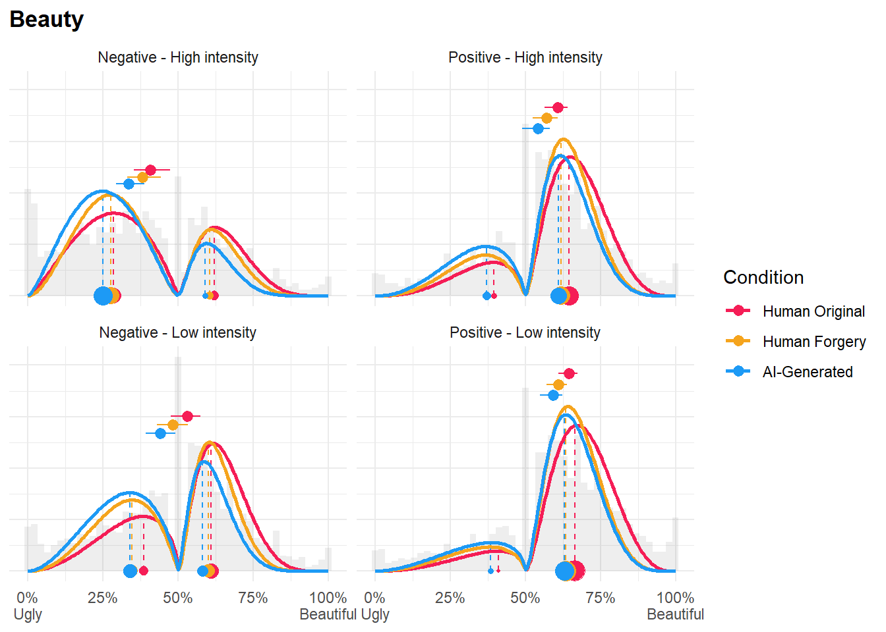{#fig-beauty-emotion fig-alt='Beauty by stimulus emotion quadrant: as the previous figure, one panel per valence x arousal quadrant of the artworks.' width=672}
:::
:::


### Valence


::: {.cell}

```{.r .cell-code}
make_report(estimates$Valence)
```

::: {.cell-output-display}

```{=html}
<div id="mraxcxwwuv" style="padding-left:0px;padding-right:0px;padding-top:10px;padding-bottom:10px;overflow-x:auto;overflow-y:auto;width:auto;height:auto;">
<style>#mraxcxwwuv table {
  font-family: system-ui, 'Segoe UI', Roboto, Helvetica, Arial, sans-serif, 'Apple Color Emoji', 'Segoe UI Emoji', 'Segoe UI Symbol', 'Noto Color Emoji';
  -webkit-font-smoothing: antialiased;
  -moz-osx-font-smoothing: grayscale;
}

#mraxcxwwuv thead, #mraxcxwwuv tbody, #mraxcxwwuv tfoot, #mraxcxwwuv tr, #mraxcxwwuv td, #mraxcxwwuv th {
  border-style: none;
}

#mraxcxwwuv p {
  margin: 0;
  padding: 0;
}

#mraxcxwwuv .gt_table {
  display: table;
  border-collapse: collapse;
  line-height: normal;
  margin-left: auto;
  margin-right: auto;
  color: #333333;
  font-size: 16px;
  font-weight: normal;
  font-style: normal;
  background-color: #FFFFFF;
  width: auto;
  border-top-style: solid;
  border-top-width: 2px;
  border-top-color: #A8A8A8;
  border-right-style: none;
  border-right-width: 2px;
  border-right-color: #D3D3D3;
  border-bottom-style: solid;
  border-bottom-width: 2px;
  border-bottom-color: #A8A8A8;
  border-left-style: none;
  border-left-width: 2px;
  border-left-color: #D3D3D3;
}

#mraxcxwwuv .gt_caption {
  padding-top: 4px;
  padding-bottom: 4px;
}

#mraxcxwwuv .gt_title {
  color: #333333;
  font-size: 125%;
  font-weight: initial;
  padding-top: 4px;
  padding-bottom: 4px;
  padding-left: 5px;
  padding-right: 5px;
  border-bottom-color: #FFFFFF;
  border-bottom-width: 0;
}

#mraxcxwwuv .gt_subtitle {
  color: #333333;
  font-size: 85%;
  font-weight: initial;
  padding-top: 3px;
  padding-bottom: 5px;
  padding-left: 5px;
  padding-right: 5px;
  border-top-color: #FFFFFF;
  border-top-width: 0;
}

#mraxcxwwuv .gt_heading {
  background-color: #FFFFFF;
  text-align: center;
  border-bottom-color: #FFFFFF;
  border-left-style: none;
  border-left-width: 1px;
  border-left-color: #D3D3D3;
  border-right-style: none;
  border-right-width: 1px;
  border-right-color: #D3D3D3;
}

#mraxcxwwuv .gt_bottom_border {
  border-bottom-style: solid;
  border-bottom-width: 2px;
  border-bottom-color: #D3D3D3;
}

#mraxcxwwuv .gt_col_headings {
  border-top-style: solid;
  border-top-width: 2px;
  border-top-color: #D3D3D3;
  border-bottom-style: solid;
  border-bottom-width: 2px;
  border-bottom-color: #D3D3D3;
  border-left-style: none;
  border-left-width: 1px;
  border-left-color: #D3D3D3;
  border-right-style: none;
  border-right-width: 1px;
  border-right-color: #D3D3D3;
}

#mraxcxwwuv .gt_col_heading {
  color: #333333;
  background-color: #FFFFFF;
  font-size: 100%;
  font-weight: normal;
  text-transform: inherit;
  border-left-style: none;
  border-left-width: 1px;
  border-left-color: #D3D3D3;
  border-right-style: none;
  border-right-width: 1px;
  border-right-color: #D3D3D3;
  vertical-align: bottom;
  padding-top: 5px;
  padding-bottom: 6px;
  padding-left: 5px;
  padding-right: 5px;
  overflow-x: hidden;
}

#mraxcxwwuv .gt_column_spanner_outer {
  color: #333333;
  background-color: #FFFFFF;
  font-size: 100%;
  font-weight: normal;
  text-transform: inherit;
  padding-top: 0;
  padding-bottom: 0;
  padding-left: 4px;
  padding-right: 4px;
}

#mraxcxwwuv .gt_column_spanner_outer:first-child {
  padding-left: 0;
}

#mraxcxwwuv .gt_column_spanner_outer:last-child {
  padding-right: 0;
}

#mraxcxwwuv .gt_column_spanner {
  border-bottom-style: solid;
  border-bottom-width: 2px;
  border-bottom-color: #D3D3D3;
  vertical-align: bottom;
  padding-top: 5px;
  padding-bottom: 5px;
  overflow-x: hidden;
  display: inline-block;
  width: 100%;
}

#mraxcxwwuv .gt_spanner_row {
  border-bottom-style: hidden;
}

#mraxcxwwuv .gt_group_heading {
  padding-top: 8px;
  padding-bottom: 8px;
  padding-left: 5px;
  padding-right: 5px;
  color: #333333;
  background-color: #FFFFFF;
  font-size: 100%;
  font-weight: initial;
  text-transform: inherit;
  border-top-style: solid;
  border-top-width: 2px;
  border-top-color: #D3D3D3;
  border-bottom-style: solid;
  border-bottom-width: 2px;
  border-bottom-color: #D3D3D3;
  border-left-style: none;
  border-left-width: 1px;
  border-left-color: #D3D3D3;
  border-right-style: none;
  border-right-width: 1px;
  border-right-color: #D3D3D3;
  vertical-align: middle;
  text-align: left;
}

#mraxcxwwuv .gt_empty_group_heading {
  padding: 0.5px;
  color: #333333;
  background-color: #FFFFFF;
  font-size: 100%;
  font-weight: initial;
  border-top-style: solid;
  border-top-width: 2px;
  border-top-color: #D3D3D3;
  border-bottom-style: solid;
  border-bottom-width: 2px;
  border-bottom-color: #D3D3D3;
  vertical-align: middle;
}

#mraxcxwwuv .gt_from_md > :first-child {
  margin-top: 0;
}

#mraxcxwwuv .gt_from_md > :last-child {
  margin-bottom: 0;
}

#mraxcxwwuv .gt_row {
  padding-top: 8px;
  padding-bottom: 8px;
  padding-left: 5px;
  padding-right: 5px;
  margin: 10px;
  border-top-style: solid;
  border-top-width: 1px;
  border-top-color: #D3D3D3;
  border-left-style: none;
  border-left-width: 1px;
  border-left-color: #D3D3D3;
  border-right-style: none;
  border-right-width: 1px;
  border-right-color: #D3D3D3;
  vertical-align: middle;
  overflow-x: hidden;
}

#mraxcxwwuv .gt_stub {
  color: #333333;
  background-color: #FFFFFF;
  font-size: 100%;
  font-weight: initial;
  text-transform: inherit;
  border-right-style: solid;
  border-right-width: 2px;
  border-right-color: #D3D3D3;
  padding-left: 5px;
  padding-right: 5px;
}

#mraxcxwwuv .gt_stub_row_group {
  color: #333333;
  background-color: #FFFFFF;
  font-size: 100%;
  font-weight: initial;
  text-transform: inherit;
  border-right-style: solid;
  border-right-width: 2px;
  border-right-color: #D3D3D3;
  padding-left: 5px;
  padding-right: 5px;
  vertical-align: top;
}

#mraxcxwwuv .gt_row_group_first td {
  border-top-width: 2px;
}

#mraxcxwwuv .gt_row_group_first th {
  border-top-width: 2px;
}

#mraxcxwwuv .gt_summary_row {
  color: #333333;
  background-color: #FFFFFF;
  text-transform: inherit;
  padding-top: 8px;
  padding-bottom: 8px;
  padding-left: 5px;
  padding-right: 5px;
}

#mraxcxwwuv .gt_first_summary_row {
  border-top-style: solid;
  border-top-color: #D3D3D3;
}

#mraxcxwwuv .gt_first_summary_row.thick {
  border-top-width: 2px;
}

#mraxcxwwuv .gt_last_summary_row {
  padding-top: 8px;
  padding-bottom: 8px;
  padding-left: 5px;
  padding-right: 5px;
  border-bottom-style: solid;
  border-bottom-width: 2px;
  border-bottom-color: #D3D3D3;
}

#mraxcxwwuv .gt_grand_summary_row {
  color: #333333;
  background-color: #FFFFFF;
  text-transform: inherit;
  padding-top: 8px;
  padding-bottom: 8px;
  padding-left: 5px;
  padding-right: 5px;
}

#mraxcxwwuv .gt_first_grand_summary_row {
  padding-top: 8px;
  padding-bottom: 8px;
  padding-left: 5px;
  padding-right: 5px;
  border-top-style: double;
  border-top-width: 6px;
  border-top-color: #D3D3D3;
}

#mraxcxwwuv .gt_last_grand_summary_row_top {
  padding-top: 8px;
  padding-bottom: 8px;
  padding-left: 5px;
  padding-right: 5px;
  border-bottom-style: double;
  border-bottom-width: 6px;
  border-bottom-color: #D3D3D3;
}

#mraxcxwwuv .gt_striped {
  background-color: rgba(128, 128, 128, 0.05);
}

#mraxcxwwuv .gt_table_body {
  border-top-style: solid;
  border-top-width: 2px;
  border-top-color: #D3D3D3;
  border-bottom-style: solid;
  border-bottom-width: 2px;
  border-bottom-color: #D3D3D3;
}

#mraxcxwwuv .gt_footnotes {
  color: #333333;
  background-color: #FFFFFF;
  border-bottom-style: none;
  border-bottom-width: 2px;
  border-bottom-color: #D3D3D3;
  border-left-style: none;
  border-left-width: 2px;
  border-left-color: #D3D3D3;
  border-right-style: none;
  border-right-width: 2px;
  border-right-color: #D3D3D3;
}

#mraxcxwwuv .gt_footnote {
  margin: 0px;
  font-size: 90%;
  padding-top: 4px;
  padding-bottom: 4px;
  padding-left: 5px;
  padding-right: 5px;
}

#mraxcxwwuv .gt_sourcenotes {
  color: #333333;
  background-color: #FFFFFF;
  border-bottom-style: none;
  border-bottom-width: 2px;
  border-bottom-color: #D3D3D3;
  border-left-style: none;
  border-left-width: 2px;
  border-left-color: #D3D3D3;
  border-right-style: none;
  border-right-width: 2px;
  border-right-color: #D3D3D3;
}

#mraxcxwwuv .gt_sourcenote {
  font-size: 90%;
  padding-top: 4px;
  padding-bottom: 4px;
  padding-left: 5px;
  padding-right: 5px;
}

#mraxcxwwuv .gt_left {
  text-align: left;
}

#mraxcxwwuv .gt_center {
  text-align: center;
}

#mraxcxwwuv .gt_right {
  text-align: right;
  font-variant-numeric: tabular-nums;
}

#mraxcxwwuv .gt_font_normal {
  font-weight: normal;
}

#mraxcxwwuv .gt_font_bold {
  font-weight: bold;
}

#mraxcxwwuv .gt_font_italic {
  font-style: italic;
}

#mraxcxwwuv .gt_super {
  font-size: 65%;
}

#mraxcxwwuv .gt_footnote_marks {
  font-size: 75%;
  vertical-align: 0.4em;
  position: initial;
}

#mraxcxwwuv .gt_asterisk {
  font-size: 100%;
  vertical-align: 0;
}

#mraxcxwwuv .gt_indent_1 {
  text-indent: 5px;
}

#mraxcxwwuv .gt_indent_2 {
  text-indent: 10px;
}

#mraxcxwwuv .gt_indent_3 {
  text-indent: 15px;
}

#mraxcxwwuv .gt_indent_4 {
  text-indent: 20px;
}

#mraxcxwwuv .gt_indent_5 {
  text-indent: 25px;
}

#mraxcxwwuv .katex-display {
  display: inline-flex !important;
  margin-bottom: 0.75em !important;
}

#mraxcxwwuv div.Reactable > div.rt-table > div.rt-thead > div.rt-tr.rt-tr-group-header > div.rt-th-group:after {
  height: 0px !important;
}
</style>
<table class="gt_table" data-quarto-disable-processing="false" data-quarto-bootstrap="false">
  <thead>
    <tr class="gt_col_headings">
      <th class="gt_col_heading gt_columns_bottom_border gt_left" rowspan="1" colspan="1" scope="col" id="Contrast">Contrast</th>
      <th class="gt_col_heading gt_columns_bottom_border gt_left" rowspan="1" colspan="1" scope="col" id="Parameters">Parameters</th>
    </tr>
  </thead>
  <tbody class="gt_table_body">
    <tr><td headers="Contrast" class="gt_row gt_left">Human Forgery - Human Original</td>
<td headers="Parameters" class="gt_row gt_left">response (-0.21, [-0.26, -0.16]); mu (-0.03, [-0.04, -0.02]); phi (0.49, [ 0.05,  0.91])</td></tr>
    <tr><td headers="Contrast" class="gt_row gt_left">AI-Generated - Human Original</td>
<td headers="Parameters" class="gt_row gt_left">response (-0.37, [-0.43, -0.31]); mu (-0.05, [-0.06, -0.05]); phi (0.46, [ 0.04,  0.92])</td></tr>
    <tr><td headers="Contrast" class="gt_row gt_left">AI-Generated - Human Forgery</td>
<td headers="Parameters" class="gt_row gt_left">response (-0.16, [-0.22, -0.10]); mu (-0.02, [-0.03, -0.01])</td></tr>
  </tbody>
  
</table>
</div>
```

```{=html}
<div id="kqxnijvtbe" style="padding-left:0px;padding-right:0px;padding-top:10px;padding-bottom:10px;overflow-x:auto;overflow-y:auto;width:auto;height:auto;">
<style>#kqxnijvtbe table {
  font-family: system-ui, 'Segoe UI', Roboto, Helvetica, Arial, sans-serif, 'Apple Color Emoji', 'Segoe UI Emoji', 'Segoe UI Symbol', 'Noto Color Emoji';
  -webkit-font-smoothing: antialiased;
  -moz-osx-font-smoothing: grayscale;
}

#kqxnijvtbe thead, #kqxnijvtbe tbody, #kqxnijvtbe tfoot, #kqxnijvtbe tr, #kqxnijvtbe td, #kqxnijvtbe th {
  border-style: none;
}

#kqxnijvtbe p {
  margin: 0;
  padding: 0;
}

#kqxnijvtbe .gt_table {
  display: table;
  border-collapse: collapse;
  line-height: normal;
  margin-left: auto;
  margin-right: auto;
  color: #333333;
  font-size: 16px;
  font-weight: normal;
  font-style: normal;
  background-color: #FFFFFF;
  width: auto;
  border-top-style: solid;
  border-top-width: 2px;
  border-top-color: #A8A8A8;
  border-right-style: none;
  border-right-width: 2px;
  border-right-color: #D3D3D3;
  border-bottom-style: solid;
  border-bottom-width: 2px;
  border-bottom-color: #A8A8A8;
  border-left-style: none;
  border-left-width: 2px;
  border-left-color: #D3D3D3;
}

#kqxnijvtbe .gt_caption {
  padding-top: 4px;
  padding-bottom: 4px;
}

#kqxnijvtbe .gt_title {
  color: #333333;
  font-size: 125%;
  font-weight: initial;
  padding-top: 4px;
  padding-bottom: 4px;
  padding-left: 5px;
  padding-right: 5px;
  border-bottom-color: #FFFFFF;
  border-bottom-width: 0;
}

#kqxnijvtbe .gt_subtitle {
  color: #333333;
  font-size: 85%;
  font-weight: initial;
  padding-top: 3px;
  padding-bottom: 5px;
  padding-left: 5px;
  padding-right: 5px;
  border-top-color: #FFFFFF;
  border-top-width: 0;
}

#kqxnijvtbe .gt_heading {
  background-color: #FFFFFF;
  text-align: center;
  border-bottom-color: #FFFFFF;
  border-left-style: none;
  border-left-width: 1px;
  border-left-color: #D3D3D3;
  border-right-style: none;
  border-right-width: 1px;
  border-right-color: #D3D3D3;
}

#kqxnijvtbe .gt_bottom_border {
  border-bottom-style: solid;
  border-bottom-width: 2px;
  border-bottom-color: #D3D3D3;
}

#kqxnijvtbe .gt_col_headings {
  border-top-style: solid;
  border-top-width: 2px;
  border-top-color: #D3D3D3;
  border-bottom-style: solid;
  border-bottom-width: 2px;
  border-bottom-color: #D3D3D3;
  border-left-style: none;
  border-left-width: 1px;
  border-left-color: #D3D3D3;
  border-right-style: none;
  border-right-width: 1px;
  border-right-color: #D3D3D3;
}

#kqxnijvtbe .gt_col_heading {
  color: #333333;
  background-color: #FFFFFF;
  font-size: 100%;
  font-weight: normal;
  text-transform: inherit;
  border-left-style: none;
  border-left-width: 1px;
  border-left-color: #D3D3D3;
  border-right-style: none;
  border-right-width: 1px;
  border-right-color: #D3D3D3;
  vertical-align: bottom;
  padding-top: 5px;
  padding-bottom: 6px;
  padding-left: 5px;
  padding-right: 5px;
  overflow-x: hidden;
}

#kqxnijvtbe .gt_column_spanner_outer {
  color: #333333;
  background-color: #FFFFFF;
  font-size: 100%;
  font-weight: normal;
  text-transform: inherit;
  padding-top: 0;
  padding-bottom: 0;
  padding-left: 4px;
  padding-right: 4px;
}

#kqxnijvtbe .gt_column_spanner_outer:first-child {
  padding-left: 0;
}

#kqxnijvtbe .gt_column_spanner_outer:last-child {
  padding-right: 0;
}

#kqxnijvtbe .gt_column_spanner {
  border-bottom-style: solid;
  border-bottom-width: 2px;
  border-bottom-color: #D3D3D3;
  vertical-align: bottom;
  padding-top: 5px;
  padding-bottom: 5px;
  overflow-x: hidden;
  display: inline-block;
  width: 100%;
}

#kqxnijvtbe .gt_spanner_row {
  border-bottom-style: hidden;
}

#kqxnijvtbe .gt_group_heading {
  padding-top: 8px;
  padding-bottom: 8px;
  padding-left: 5px;
  padding-right: 5px;
  color: #333333;
  background-color: #FFFFFF;
  font-size: 100%;
  font-weight: initial;
  text-transform: inherit;
  border-top-style: solid;
  border-top-width: 2px;
  border-top-color: #D3D3D3;
  border-bottom-style: solid;
  border-bottom-width: 2px;
  border-bottom-color: #D3D3D3;
  border-left-style: none;
  border-left-width: 1px;
  border-left-color: #D3D3D3;
  border-right-style: none;
  border-right-width: 1px;
  border-right-color: #D3D3D3;
  vertical-align: middle;
  text-align: left;
}

#kqxnijvtbe .gt_empty_group_heading {
  padding: 0.5px;
  color: #333333;
  background-color: #FFFFFF;
  font-size: 100%;
  font-weight: initial;
  border-top-style: solid;
  border-top-width: 2px;
  border-top-color: #D3D3D3;
  border-bottom-style: solid;
  border-bottom-width: 2px;
  border-bottom-color: #D3D3D3;
  vertical-align: middle;
}

#kqxnijvtbe .gt_from_md > :first-child {
  margin-top: 0;
}

#kqxnijvtbe .gt_from_md > :last-child {
  margin-bottom: 0;
}

#kqxnijvtbe .gt_row {
  padding-top: 8px;
  padding-bottom: 8px;
  padding-left: 5px;
  padding-right: 5px;
  margin: 10px;
  border-top-style: solid;
  border-top-width: 1px;
  border-top-color: #D3D3D3;
  border-left-style: none;
  border-left-width: 1px;
  border-left-color: #D3D3D3;
  border-right-style: none;
  border-right-width: 1px;
  border-right-color: #D3D3D3;
  vertical-align: middle;
  overflow-x: hidden;
}

#kqxnijvtbe .gt_stub {
  color: #333333;
  background-color: #FFFFFF;
  font-size: 100%;
  font-weight: initial;
  text-transform: inherit;
  border-right-style: solid;
  border-right-width: 2px;
  border-right-color: #D3D3D3;
  padding-left: 5px;
  padding-right: 5px;
}

#kqxnijvtbe .gt_stub_row_group {
  color: #333333;
  background-color: #FFFFFF;
  font-size: 100%;
  font-weight: initial;
  text-transform: inherit;
  border-right-style: solid;
  border-right-width: 2px;
  border-right-color: #D3D3D3;
  padding-left: 5px;
  padding-right: 5px;
  vertical-align: top;
}

#kqxnijvtbe .gt_row_group_first td {
  border-top-width: 2px;
}

#kqxnijvtbe .gt_row_group_first th {
  border-top-width: 2px;
}

#kqxnijvtbe .gt_summary_row {
  color: #333333;
  background-color: #FFFFFF;
  text-transform: inherit;
  padding-top: 8px;
  padding-bottom: 8px;
  padding-left: 5px;
  padding-right: 5px;
}

#kqxnijvtbe .gt_first_summary_row {
  border-top-style: solid;
  border-top-color: #D3D3D3;
}

#kqxnijvtbe .gt_first_summary_row.thick {
  border-top-width: 2px;
}

#kqxnijvtbe .gt_last_summary_row {
  padding-top: 8px;
  padding-bottom: 8px;
  padding-left: 5px;
  padding-right: 5px;
  border-bottom-style: solid;
  border-bottom-width: 2px;
  border-bottom-color: #D3D3D3;
}

#kqxnijvtbe .gt_grand_summary_row {
  color: #333333;
  background-color: #FFFFFF;
  text-transform: inherit;
  padding-top: 8px;
  padding-bottom: 8px;
  padding-left: 5px;
  padding-right: 5px;
}

#kqxnijvtbe .gt_first_grand_summary_row {
  padding-top: 8px;
  padding-bottom: 8px;
  padding-left: 5px;
  padding-right: 5px;
  border-top-style: double;
  border-top-width: 6px;
  border-top-color: #D3D3D3;
}

#kqxnijvtbe .gt_last_grand_summary_row_top {
  padding-top: 8px;
  padding-bottom: 8px;
  padding-left: 5px;
  padding-right: 5px;
  border-bottom-style: double;
  border-bottom-width: 6px;
  border-bottom-color: #D3D3D3;
}

#kqxnijvtbe .gt_striped {
  background-color: rgba(128, 128, 128, 0.05);
}

#kqxnijvtbe .gt_table_body {
  border-top-style: solid;
  border-top-width: 2px;
  border-top-color: #D3D3D3;
  border-bottom-style: solid;
  border-bottom-width: 2px;
  border-bottom-color: #D3D3D3;
}

#kqxnijvtbe .gt_footnotes {
  color: #333333;
  background-color: #FFFFFF;
  border-bottom-style: none;
  border-bottom-width: 2px;
  border-bottom-color: #D3D3D3;
  border-left-style: none;
  border-left-width: 2px;
  border-left-color: #D3D3D3;
  border-right-style: none;
  border-right-width: 2px;
  border-right-color: #D3D3D3;
}

#kqxnijvtbe .gt_footnote {
  margin: 0px;
  font-size: 90%;
  padding-top: 4px;
  padding-bottom: 4px;
  padding-left: 5px;
  padding-right: 5px;
}

#kqxnijvtbe .gt_sourcenotes {
  color: #333333;
  background-color: #FFFFFF;
  border-bottom-style: none;
  border-bottom-width: 2px;
  border-bottom-color: #D3D3D3;
  border-left-style: none;
  border-left-width: 2px;
  border-left-color: #D3D3D3;
  border-right-style: none;
  border-right-width: 2px;
  border-right-color: #D3D3D3;
}

#kqxnijvtbe .gt_sourcenote {
  font-size: 90%;
  padding-top: 4px;
  padding-bottom: 4px;
  padding-left: 5px;
  padding-right: 5px;
}

#kqxnijvtbe .gt_left {
  text-align: left;
}

#kqxnijvtbe .gt_center {
  text-align: center;
}

#kqxnijvtbe .gt_right {
  text-align: right;
  font-variant-numeric: tabular-nums;
}

#kqxnijvtbe .gt_font_normal {
  font-weight: normal;
}

#kqxnijvtbe .gt_font_bold {
  font-weight: bold;
}

#kqxnijvtbe .gt_font_italic {
  font-style: italic;
}

#kqxnijvtbe .gt_super {
  font-size: 65%;
}

#kqxnijvtbe .gt_footnote_marks {
  font-size: 75%;
  vertical-align: 0.4em;
  position: initial;
}

#kqxnijvtbe .gt_asterisk {
  font-size: 100%;
  vertical-align: 0;
}

#kqxnijvtbe .gt_indent_1 {
  text-indent: 5px;
}

#kqxnijvtbe .gt_indent_2 {
  text-indent: 10px;
}

#kqxnijvtbe .gt_indent_3 {
  text-indent: 15px;
}

#kqxnijvtbe .gt_indent_4 {
  text-indent: 20px;
}

#kqxnijvtbe .gt_indent_5 {
  text-indent: 25px;
}

#kqxnijvtbe .katex-display {
  display: inline-flex !important;
  margin-bottom: 0.75em !important;
}

#kqxnijvtbe div.Reactable > div.rt-table > div.rt-thead > div.rt-tr.rt-tr-group-header > div.rt-th-group:after {
  height: 0px !important;
}
</style>
<table class="gt_table" data-quarto-disable-processing="false" data-quarto-bootstrap="false">
  <thead>
    <tr class="gt_col_headings">
      <th class="gt_col_heading gt_columns_bottom_border gt_left" rowspan="1" colspan="1" scope="col" id="Contrast">Contrast</th>
      <th class="gt_col_heading gt_columns_bottom_border gt_left" rowspan="1" colspan="1" scope="col" id="Parameters">Parameters</th>
    </tr>
  </thead>
  <tbody class="gt_table_body">
    <tr><td headers="Contrast" class="gt_row gt_left">Negative - Low intensity - Positive - Low intensity</td>
<td headers="Parameters" class="gt_row gt_left">response (-0.79, [-1.15, -0.39]); mu (-0.11, [-0.16, -0.06])</td></tr>
    <tr><td headers="Contrast" class="gt_row gt_left">Positive - High intensity - Negative - Low intensity</td>
<td headers="Parameters" class="gt_row gt_left">response (0.56, [ 0.18,  0.94]); mu (0.08, [ 0.03,  0.13])</td></tr>
    <tr><td headers="Contrast" class="gt_row gt_left">Negative - High intensity - Positive - Low intensity</td>
<td headers="Parameters" class="gt_row gt_left">response (-1.68, [-2.04, -1.27]); mu (-0.24, [-0.29, -0.18]); phi (-3.04, [-4.49, -1.69])</td></tr>
    <tr><td headers="Contrast" class="gt_row gt_left">Negative - High intensity - Negative - Low intensity</td>
<td headers="Parameters" class="gt_row gt_left">response (-0.89, [-1.26, -0.52]); mu (-0.13, [-0.18, -0.08]); phi (-1.76, [-3.09, -0.52])</td></tr>
    <tr><td headers="Contrast" class="gt_row gt_left">Negative - High intensity - Positive - High intensity</td>
<td headers="Parameters" class="gt_row gt_left">response (-1.45, [-1.83, -1.05]); mu (-0.21, [-0.26, -0.15])</td></tr>
    <tr><td headers="Contrast" class="gt_row gt_left">Positive - High intensity - Positive - Low intensity</td>
<td headers="Parameters" class="gt_row gt_left">phi (-2.09, [-3.63, -0.63])</td></tr>
  </tbody>
  
</table>
</div>
```

```{=html}
<div id="asszjmpwmd" style="padding-left:0px;padding-right:0px;padding-top:10px;padding-bottom:10px;overflow-x:auto;overflow-y:auto;width:auto;height:auto;">
<style>#asszjmpwmd table {
  font-family: system-ui, 'Segoe UI', Roboto, Helvetica, Arial, sans-serif, 'Apple Color Emoji', 'Segoe UI Emoji', 'Segoe UI Symbol', 'Noto Color Emoji';
  -webkit-font-smoothing: antialiased;
  -moz-osx-font-smoothing: grayscale;
}

#asszjmpwmd thead, #asszjmpwmd tbody, #asszjmpwmd tfoot, #asszjmpwmd tr, #asszjmpwmd td, #asszjmpwmd th {
  border-style: none;
}

#asszjmpwmd p {
  margin: 0;
  padding: 0;
}

#asszjmpwmd .gt_table {
  display: table;
  border-collapse: collapse;
  line-height: normal;
  margin-left: auto;
  margin-right: auto;
  color: #333333;
  font-size: 13px;
  font-weight: normal;
  font-style: normal;
  background-color: #FFFFFF;
  width: auto;
  border-top-style: solid;
  border-top-width: 3px;
  border-top-color: #D5D5D5;
  border-right-style: solid;
  border-right-width: 3px;
  border-right-color: #D5D5D5;
  border-bottom-style: solid;
  border-bottom-width: 3px;
  border-bottom-color: #D5D5D5;
  border-left-style: solid;
  border-left-width: 3px;
  border-left-color: #D5D5D5;
}

#asszjmpwmd .gt_caption {
  padding-top: 4px;
  padding-bottom: 4px;
}

#asszjmpwmd .gt_title {
  color: #333333;
  font-size: 125%;
  font-weight: initial;
  padding-top: 4px;
  padding-bottom: 4px;
  padding-left: 5px;
  padding-right: 5px;
  border-bottom-color: #FFFFFF;
  border-bottom-width: 0;
}

#asszjmpwmd .gt_subtitle {
  color: #333333;
  font-size: 85%;
  font-weight: initial;
  padding-top: 3px;
  padding-bottom: 5px;
  padding-left: 5px;
  padding-right: 5px;
  border-top-color: #FFFFFF;
  border-top-width: 0;
}

#asszjmpwmd .gt_heading {
  background-color: #FFFFFF;
  text-align: left;
  border-bottom-color: #FFFFFF;
  border-left-style: none;
  border-left-width: 1px;
  border-left-color: #D3D3D3;
  border-right-style: none;
  border-right-width: 1px;
  border-right-color: #D3D3D3;
}

#asszjmpwmd .gt_bottom_border {
  border-bottom-style: solid;
  border-bottom-width: 2px;
  border-bottom-color: #D5D5D5;
}

#asszjmpwmd .gt_col_headings {
  border-top-style: solid;
  border-top-width: 2px;
  border-top-color: #D5D5D5;
  border-bottom-style: solid;
  border-bottom-width: 2px;
  border-bottom-color: #D5D5D5;
  border-left-style: none;
  border-left-width: 1px;
  border-left-color: #D3D3D3;
  border-right-style: none;
  border-right-width: 1px;
  border-right-color: #D3D3D3;
}

#asszjmpwmd .gt_col_heading {
  color: #FFFFFF;
  background-color: #000000;
  font-size: 100%;
  font-weight: normal;
  text-transform: inherit;
  border-left-style: none;
  border-left-width: 1px;
  border-left-color: #D3D3D3;
  border-right-style: none;
  border-right-width: 1px;
  border-right-color: #D3D3D3;
  vertical-align: bottom;
  padding-top: 5px;
  padding-bottom: 6px;
  padding-left: 5px;
  padding-right: 5px;
  overflow-x: hidden;
}

#asszjmpwmd .gt_column_spanner_outer {
  color: #FFFFFF;
  background-color: #000000;
  font-size: 100%;
  font-weight: normal;
  text-transform: inherit;
  padding-top: 0;
  padding-bottom: 0;
  padding-left: 4px;
  padding-right: 4px;
}

#asszjmpwmd .gt_column_spanner_outer:first-child {
  padding-left: 0;
}

#asszjmpwmd .gt_column_spanner_outer:last-child {
  padding-right: 0;
}

#asszjmpwmd .gt_column_spanner {
  border-bottom-style: solid;
  border-bottom-width: 2px;
  border-bottom-color: #D5D5D5;
  vertical-align: bottom;
  padding-top: 5px;
  padding-bottom: 5px;
  overflow-x: hidden;
  display: inline-block;
  width: 100%;
}

#asszjmpwmd .gt_spanner_row {
  border-bottom-style: hidden;
}

#asszjmpwmd .gt_group_heading {
  padding-top: 8px;
  padding-bottom: 8px;
  padding-left: 5px;
  padding-right: 5px;
  color: #333333;
  background-color: #FFFFFF;
  font-size: 100%;
  font-weight: initial;
  text-transform: inherit;
  border-top-style: solid;
  border-top-width: 2px;
  border-top-color: #D5D5D5;
  border-bottom-style: solid;
  border-bottom-width: 2px;
  border-bottom-color: #D5D5D5;
  border-left-style: none;
  border-left-width: 1px;
  border-left-color: #D3D3D3;
  border-right-style: none;
  border-right-width: 1px;
  border-right-color: #D3D3D3;
  vertical-align: middle;
  text-align: left;
}

#asszjmpwmd .gt_empty_group_heading {
  padding: 0.5px;
  color: #333333;
  background-color: #FFFFFF;
  font-size: 100%;
  font-weight: initial;
  border-top-style: solid;
  border-top-width: 2px;
  border-top-color: #D5D5D5;
  border-bottom-style: solid;
  border-bottom-width: 2px;
  border-bottom-color: #D5D5D5;
  vertical-align: middle;
}

#asszjmpwmd .gt_from_md > :first-child {
  margin-top: 0;
}

#asszjmpwmd .gt_from_md > :last-child {
  margin-bottom: 0;
}

#asszjmpwmd .gt_row {
  padding-top: 8px;
  padding-bottom: 8px;
  padding-left: 5px;
  padding-right: 5px;
  margin: 10px;
  border-top-style: solid;
  border-top-width: 1px;
  border-top-color: #D5D5D5;
  border-left-style: solid;
  border-left-width: 1px;
  border-left-color: #D5D5D5;
  border-right-style: solid;
  border-right-width: 1px;
  border-right-color: #D5D5D5;
  vertical-align: middle;
  overflow-x: hidden;
}

#asszjmpwmd .gt_stub {
  color: #333333;
  background-color: #FFFFFF;
  font-size: 100%;
  font-weight: initial;
  text-transform: inherit;
  border-right-style: solid;
  border-right-width: 2px;
  border-right-color: #5F5F5F;
  padding-left: 5px;
  padding-right: 5px;
}

#asszjmpwmd .gt_stub_row_group {
  color: #333333;
  background-color: #FFFFFF;
  font-size: 100%;
  font-weight: initial;
  text-transform: inherit;
  border-right-style: solid;
  border-right-width: 2px;
  border-right-color: #D3D3D3;
  padding-left: 5px;
  padding-right: 5px;
  vertical-align: top;
}

#asszjmpwmd .gt_row_group_first td {
  border-top-width: 2px;
}

#asszjmpwmd .gt_row_group_first th {
  border-top-width: 2px;
}

#asszjmpwmd .gt_summary_row {
  color: #333333;
  background-color: #D5D5D5;
  text-transform: inherit;
  padding-top: 8px;
  padding-bottom: 8px;
  padding-left: 5px;
  padding-right: 5px;
}

#asszjmpwmd .gt_first_summary_row {
  border-top-style: solid;
  border-top-color: #D5D5D5;
}

#asszjmpwmd .gt_first_summary_row.thick {
  border-top-width: 2px;
}

#asszjmpwmd .gt_last_summary_row {
  padding-top: 8px;
  padding-bottom: 8px;
  padding-left: 5px;
  padding-right: 5px;
  border-bottom-style: solid;
  border-bottom-width: 2px;
  border-bottom-color: #D5D5D5;
}

#asszjmpwmd .gt_grand_summary_row {
  color: #FFFFFF;
  background-color: #929292;
  text-transform: inherit;
  padding-top: 8px;
  padding-bottom: 8px;
  padding-left: 5px;
  padding-right: 5px;
}

#asszjmpwmd .gt_first_grand_summary_row {
  padding-top: 8px;
  padding-bottom: 8px;
  padding-left: 5px;
  padding-right: 5px;
  border-top-style: double;
  border-top-width: 6px;
  border-top-color: #D5D5D5;
}

#asszjmpwmd .gt_last_grand_summary_row_top {
  padding-top: 8px;
  padding-bottom: 8px;
  padding-left: 5px;
  padding-right: 5px;
  border-bottom-style: double;
  border-bottom-width: 6px;
  border-bottom-color: #D5D5D5;
}

#asszjmpwmd .gt_striped {
  background-color: #F4F4F4;
}

#asszjmpwmd .gt_table_body {
  border-top-style: solid;
  border-top-width: 2px;
  border-top-color: #D5D5D5;
  border-bottom-style: solid;
  border-bottom-width: 2px;
  border-bottom-color: #D5D5D5;
}

#asszjmpwmd .gt_footnotes {
  color: #333333;
  background-color: #FFFFFF;
  border-bottom-style: none;
  border-bottom-width: 2px;
  border-bottom-color: #D3D3D3;
  border-left-style: none;
  border-left-width: 2px;
  border-left-color: #D3D3D3;
  border-right-style: none;
  border-right-width: 2px;
  border-right-color: #D3D3D3;
}

#asszjmpwmd .gt_footnote {
  margin: 0px;
  font-size: 90%;
  padding-top: 4px;
  padding-bottom: 4px;
  padding-left: 5px;
  padding-right: 5px;
}

#asszjmpwmd .gt_sourcenotes {
  color: #333333;
  background-color: #FFFFFF;
  border-bottom-style: none;
  border-bottom-width: 2px;
  border-bottom-color: #D3D3D3;
  border-left-style: none;
  border-left-width: 2px;
  border-left-color: #D3D3D3;
  border-right-style: none;
  border-right-width: 2px;
  border-right-color: #D3D3D3;
}

#asszjmpwmd .gt_sourcenote {
  font-size: 90%;
  padding-top: 4px;
  padding-bottom: 4px;
  padding-left: 5px;
  padding-right: 5px;
}

#asszjmpwmd .gt_left {
  text-align: left;
}

#asszjmpwmd .gt_center {
  text-align: center;
}

#asszjmpwmd .gt_right {
  text-align: right;
  font-variant-numeric: tabular-nums;
}

#asszjmpwmd .gt_font_normal {
  font-weight: normal;
}

#asszjmpwmd .gt_font_bold {
  font-weight: bold;
}

#asszjmpwmd .gt_font_italic {
  font-style: italic;
}

#asszjmpwmd .gt_super {
  font-size: 65%;
}

#asszjmpwmd .gt_footnote_marks {
  font-size: 75%;
  vertical-align: 0.4em;
  position: initial;
}

#asszjmpwmd .gt_asterisk {
  font-size: 100%;
  vertical-align: 0;
}

#asszjmpwmd .gt_indent_1 {
  text-indent: 5px;
}

#asszjmpwmd .gt_indent_2 {
  text-indent: 10px;
}

#asszjmpwmd .gt_indent_3 {
  text-indent: 15px;
}

#asszjmpwmd .gt_indent_4 {
  text-indent: 20px;
}

#asszjmpwmd .gt_indent_5 {
  text-indent: 25px;
}

#asszjmpwmd .katex-display {
  display: inline-flex !important;
  margin-bottom: 0.75em !important;
}

#asszjmpwmd div.Reactable > div.rt-table > div.rt-thead > div.rt-tr.rt-tr-group-header > div.rt-th-group:after {
  height: 0px !important;
}
</style>
<table class="gt_table" data-quarto-disable-processing="false" data-quarto-bootstrap="false">
  <thead>
    <tr class="gt_heading">
      <td colspan="10" class="gt_heading gt_title gt_font_normal gt_bottom_border" style>Valence: convergence</td>
    </tr>
    
    <tr class="gt_col_headings">
      <th class="gt_col_heading gt_columns_bottom_border gt_left" rowspan="1" colspan="1" scope="col" id="Model">Model</th>
      <th class="gt_col_heading gt_columns_bottom_border gt_left" rowspan="1" colspan="1" scope="col" id="Family">Family</th>
      <th class="gt_col_heading gt_columns_bottom_border gt_right" rowspan="1" colspan="1" scope="col" id="N_obs">N_obs</th>
      <th class="gt_col_heading gt_columns_bottom_border gt_right" rowspan="1" colspan="1" scope="col" id="N_participants">N_participants</th>
      <th class="gt_col_heading gt_columns_bottom_border gt_right" rowspan="1" colspan="1" scope="col" id="Chains">Chains</th>
      <th class="gt_col_heading gt_columns_bottom_border gt_right" rowspan="1" colspan="1" scope="col" id="Draws">Draws</th>
      <th class="gt_col_heading gt_columns_bottom_border gt_right" rowspan="1" colspan="1" scope="col" id="Max_Rhat">Max_Rhat</th>
      <th class="gt_col_heading gt_columns_bottom_border gt_right" rowspan="1" colspan="1" scope="col" id="Min_ESS_ratio">Min_ESS_ratio</th>
      <th class="gt_col_heading gt_columns_bottom_border gt_right" rowspan="1" colspan="1" scope="col" id="Divergent_pct">Divergent_pct</th>
      <th class="gt_col_heading gt_columns_bottom_border gt_left" rowspan="1" colspan="1" scope="col" id="Criterion">Criterion</th>
    </tr>
  </thead>
  <tbody class="gt_table_body">
    <tr><td headers="Model" class="gt_row gt_left">Valence</td>
<td headers="Family" class="gt_row gt_left">Discrete Beta (k = 7)</td>
<td headers="N_obs" class="gt_row gt_right">15552</td>
<td headers="N_participants" class="gt_row gt_right">324</td>
<td headers="Chains" class="gt_row gt_right">8</td>
<td headers="Draws" class="gt_row gt_right">4000</td>
<td headers="Max_Rhat" class="gt_row gt_right">1.039</td>
<td headers="Min_ESS_ratio" class="gt_row gt_right">0.035</td>
<td headers="Divergent_pct" class="gt_row gt_right">0.1</td>
<td headers="Criterion" class="gt_row gt_left">loo</td></tr>
  </tbody>
  
</table>
</div>
```


::: {.callout-note collapse="true" title="Valence: convergence (Markdown table, for text readers)"}

|Model   |Family                | N_obs| N_participants| Chains| Draws| Max_Rhat| Min_ESS_ratio| Divergent_pct|Criterion |
|:-------|:---------------------|-----:|--------------:|------:|-----:|--------:|-------------:|-------------:|:---------|
|Valence |Discrete Beta (k = 7) | 15552|            324|      8|  4000|    1.039|         0.035|           0.1|loo       |

:::

```{=html}
<div id="ixxnhtiafy" style="padding-left:0px;padding-right:0px;padding-top:10px;padding-bottom:10px;overflow-x:auto;overflow-y:auto;width:auto;height:auto;">
<style>#ixxnhtiafy table {
  font-family: system-ui, 'Segoe UI', Roboto, Helvetica, Arial, sans-serif, 'Apple Color Emoji', 'Segoe UI Emoji', 'Segoe UI Symbol', 'Noto Color Emoji';
  -webkit-font-smoothing: antialiased;
  -moz-osx-font-smoothing: grayscale;
}

#ixxnhtiafy thead, #ixxnhtiafy tbody, #ixxnhtiafy tfoot, #ixxnhtiafy tr, #ixxnhtiafy td, #ixxnhtiafy th {
  border-style: none;
}

#ixxnhtiafy p {
  margin: 0;
  padding: 0;
}

#ixxnhtiafy .gt_table {
  display: table;
  border-collapse: collapse;
  line-height: normal;
  margin-left: auto;
  margin-right: auto;
  color: #333333;
  font-size: 13px;
  font-weight: normal;
  font-style: normal;
  background-color: #FFFFFF;
  width: auto;
  border-top-style: solid;
  border-top-width: 3px;
  border-top-color: #D5D5D5;
  border-right-style: solid;
  border-right-width: 3px;
  border-right-color: #D5D5D5;
  border-bottom-style: solid;
  border-bottom-width: 3px;
  border-bottom-color: #D5D5D5;
  border-left-style: solid;
  border-left-width: 3px;
  border-left-color: #D5D5D5;
}

#ixxnhtiafy .gt_caption {
  padding-top: 4px;
  padding-bottom: 4px;
}

#ixxnhtiafy .gt_title {
  color: #333333;
  font-size: 125%;
  font-weight: initial;
  padding-top: 4px;
  padding-bottom: 4px;
  padding-left: 5px;
  padding-right: 5px;
  border-bottom-color: #FFFFFF;
  border-bottom-width: 0;
}

#ixxnhtiafy .gt_subtitle {
  color: #333333;
  font-size: 85%;
  font-weight: initial;
  padding-top: 3px;
  padding-bottom: 5px;
  padding-left: 5px;
  padding-right: 5px;
  border-top-color: #FFFFFF;
  border-top-width: 0;
}

#ixxnhtiafy .gt_heading {
  background-color: #FFFFFF;
  text-align: left;
  border-bottom-color: #FFFFFF;
  border-left-style: none;
  border-left-width: 1px;
  border-left-color: #D3D3D3;
  border-right-style: none;
  border-right-width: 1px;
  border-right-color: #D3D3D3;
}

#ixxnhtiafy .gt_bottom_border {
  border-bottom-style: solid;
  border-bottom-width: 2px;
  border-bottom-color: #D5D5D5;
}

#ixxnhtiafy .gt_col_headings {
  border-top-style: solid;
  border-top-width: 2px;
  border-top-color: #D5D5D5;
  border-bottom-style: solid;
  border-bottom-width: 2px;
  border-bottom-color: #D5D5D5;
  border-left-style: none;
  border-left-width: 1px;
  border-left-color: #D3D3D3;
  border-right-style: none;
  border-right-width: 1px;
  border-right-color: #D3D3D3;
}

#ixxnhtiafy .gt_col_heading {
  color: #FFFFFF;
  background-color: #000000;
  font-size: 100%;
  font-weight: normal;
  text-transform: inherit;
  border-left-style: none;
  border-left-width: 1px;
  border-left-color: #D3D3D3;
  border-right-style: none;
  border-right-width: 1px;
  border-right-color: #D3D3D3;
  vertical-align: bottom;
  padding-top: 5px;
  padding-bottom: 6px;
  padding-left: 5px;
  padding-right: 5px;
  overflow-x: hidden;
}

#ixxnhtiafy .gt_column_spanner_outer {
  color: #FFFFFF;
  background-color: #000000;
  font-size: 100%;
  font-weight: normal;
  text-transform: inherit;
  padding-top: 0;
  padding-bottom: 0;
  padding-left: 4px;
  padding-right: 4px;
}

#ixxnhtiafy .gt_column_spanner_outer:first-child {
  padding-left: 0;
}

#ixxnhtiafy .gt_column_spanner_outer:last-child {
  padding-right: 0;
}

#ixxnhtiafy .gt_column_spanner {
  border-bottom-style: solid;
  border-bottom-width: 2px;
  border-bottom-color: #D5D5D5;
  vertical-align: bottom;
  padding-top: 5px;
  padding-bottom: 5px;
  overflow-x: hidden;
  display: inline-block;
  width: 100%;
}

#ixxnhtiafy .gt_spanner_row {
  border-bottom-style: hidden;
}

#ixxnhtiafy .gt_group_heading {
  padding-top: 8px;
  padding-bottom: 8px;
  padding-left: 5px;
  padding-right: 5px;
  color: #333333;
  background-color: #FFFFFF;
  font-size: 100%;
  font-weight: initial;
  text-transform: inherit;
  border-top-style: solid;
  border-top-width: 2px;
  border-top-color: #D5D5D5;
  border-bottom-style: solid;
  border-bottom-width: 2px;
  border-bottom-color: #D5D5D5;
  border-left-style: none;
  border-left-width: 1px;
  border-left-color: #D3D3D3;
  border-right-style: none;
  border-right-width: 1px;
  border-right-color: #D3D3D3;
  vertical-align: middle;
  text-align: left;
}

#ixxnhtiafy .gt_empty_group_heading {
  padding: 0.5px;
  color: #333333;
  background-color: #FFFFFF;
  font-size: 100%;
  font-weight: initial;
  border-top-style: solid;
  border-top-width: 2px;
  border-top-color: #D5D5D5;
  border-bottom-style: solid;
  border-bottom-width: 2px;
  border-bottom-color: #D5D5D5;
  vertical-align: middle;
}

#ixxnhtiafy .gt_from_md > :first-child {
  margin-top: 0;
}

#ixxnhtiafy .gt_from_md > :last-child {
  margin-bottom: 0;
}

#ixxnhtiafy .gt_row {
  padding-top: 8px;
  padding-bottom: 8px;
  padding-left: 5px;
  padding-right: 5px;
  margin: 10px;
  border-top-style: solid;
  border-top-width: 1px;
  border-top-color: #D5D5D5;
  border-left-style: solid;
  border-left-width: 1px;
  border-left-color: #D5D5D5;
  border-right-style: solid;
  border-right-width: 1px;
  border-right-color: #D5D5D5;
  vertical-align: middle;
  overflow-x: hidden;
}

#ixxnhtiafy .gt_stub {
  color: #333333;
  background-color: #FFFFFF;
  font-size: 100%;
  font-weight: initial;
  text-transform: inherit;
  border-right-style: solid;
  border-right-width: 2px;
  border-right-color: #5F5F5F;
  padding-left: 5px;
  padding-right: 5px;
}

#ixxnhtiafy .gt_stub_row_group {
  color: #333333;
  background-color: #FFFFFF;
  font-size: 100%;
  font-weight: initial;
  text-transform: inherit;
  border-right-style: solid;
  border-right-width: 2px;
  border-right-color: #D3D3D3;
  padding-left: 5px;
  padding-right: 5px;
  vertical-align: top;
}

#ixxnhtiafy .gt_row_group_first td {
  border-top-width: 2px;
}

#ixxnhtiafy .gt_row_group_first th {
  border-top-width: 2px;
}

#ixxnhtiafy .gt_summary_row {
  color: #333333;
  background-color: #D5D5D5;
  text-transform: inherit;
  padding-top: 8px;
  padding-bottom: 8px;
  padding-left: 5px;
  padding-right: 5px;
}

#ixxnhtiafy .gt_first_summary_row {
  border-top-style: solid;
  border-top-color: #D5D5D5;
}

#ixxnhtiafy .gt_first_summary_row.thick {
  border-top-width: 2px;
}

#ixxnhtiafy .gt_last_summary_row {
  padding-top: 8px;
  padding-bottom: 8px;
  padding-left: 5px;
  padding-right: 5px;
  border-bottom-style: solid;
  border-bottom-width: 2px;
  border-bottom-color: #D5D5D5;
}

#ixxnhtiafy .gt_grand_summary_row {
  color: #FFFFFF;
  background-color: #929292;
  text-transform: inherit;
  padding-top: 8px;
  padding-bottom: 8px;
  padding-left: 5px;
  padding-right: 5px;
}

#ixxnhtiafy .gt_first_grand_summary_row {
  padding-top: 8px;
  padding-bottom: 8px;
  padding-left: 5px;
  padding-right: 5px;
  border-top-style: double;
  border-top-width: 6px;
  border-top-color: #D5D5D5;
}

#ixxnhtiafy .gt_last_grand_summary_row_top {
  padding-top: 8px;
  padding-bottom: 8px;
  padding-left: 5px;
  padding-right: 5px;
  border-bottom-style: double;
  border-bottom-width: 6px;
  border-bottom-color: #D5D5D5;
}

#ixxnhtiafy .gt_striped {
  background-color: #F4F4F4;
}

#ixxnhtiafy .gt_table_body {
  border-top-style: solid;
  border-top-width: 2px;
  border-top-color: #D5D5D5;
  border-bottom-style: solid;
  border-bottom-width: 2px;
  border-bottom-color: #D5D5D5;
}

#ixxnhtiafy .gt_footnotes {
  color: #333333;
  background-color: #FFFFFF;
  border-bottom-style: none;
  border-bottom-width: 2px;
  border-bottom-color: #D3D3D3;
  border-left-style: none;
  border-left-width: 2px;
  border-left-color: #D3D3D3;
  border-right-style: none;
  border-right-width: 2px;
  border-right-color: #D3D3D3;
}

#ixxnhtiafy .gt_footnote {
  margin: 0px;
  font-size: 90%;
  padding-top: 4px;
  padding-bottom: 4px;
  padding-left: 5px;
  padding-right: 5px;
}

#ixxnhtiafy .gt_sourcenotes {
  color: #333333;
  background-color: #FFFFFF;
  border-bottom-style: none;
  border-bottom-width: 2px;
  border-bottom-color: #D3D3D3;
  border-left-style: none;
  border-left-width: 2px;
  border-left-color: #D3D3D3;
  border-right-style: none;
  border-right-width: 2px;
  border-right-color: #D3D3D3;
}

#ixxnhtiafy .gt_sourcenote {
  font-size: 90%;
  padding-top: 4px;
  padding-bottom: 4px;
  padding-left: 5px;
  padding-right: 5px;
}

#ixxnhtiafy .gt_left {
  text-align: left;
}

#ixxnhtiafy .gt_center {
  text-align: center;
}

#ixxnhtiafy .gt_right {
  text-align: right;
  font-variant-numeric: tabular-nums;
}

#ixxnhtiafy .gt_font_normal {
  font-weight: normal;
}

#ixxnhtiafy .gt_font_bold {
  font-weight: bold;
}

#ixxnhtiafy .gt_font_italic {
  font-style: italic;
}

#ixxnhtiafy .gt_super {
  font-size: 65%;
}

#ixxnhtiafy .gt_footnote_marks {
  font-size: 75%;
  vertical-align: 0.4em;
  position: initial;
}

#ixxnhtiafy .gt_asterisk {
  font-size: 100%;
  vertical-align: 0;
}

#ixxnhtiafy .gt_indent_1 {
  text-indent: 5px;
}

#ixxnhtiafy .gt_indent_2 {
  text-indent: 10px;
}

#ixxnhtiafy .gt_indent_3 {
  text-indent: 15px;
}

#ixxnhtiafy .gt_indent_4 {
  text-indent: 20px;
}

#ixxnhtiafy .gt_indent_5 {
  text-indent: 25px;
}

#ixxnhtiafy .katex-display {
  display: inline-flex !important;
  margin-bottom: 0.75em !important;
}

#ixxnhtiafy div.Reactable > div.rt-table > div.rt-thead > div.rt-tr.rt-tr-group-header > div.rt-th-group:after {
  height: 0px !important;
}
</style>
<table class="gt_table" data-quarto-disable-processing="false" data-quarto-bootstrap="false">
  <thead>
    <tr class="gt_heading">
      <td colspan="4" class="gt_heading gt_title gt_font_normal gt_bottom_border" style>Valence: marginal means per label condition (response scale)</td>
    </tr>
    
    <tr class="gt_col_headings">
      <th class="gt_col_heading gt_columns_bottom_border gt_center" rowspan="1" colspan="1" scope="col" id="Condition">Condition</th>
      <th class="gt_col_heading gt_columns_bottom_border gt_right" rowspan="1" colspan="1" scope="col" id="Estimate">Estimate</th>
      <th class="gt_col_heading gt_columns_bottom_border gt_right" rowspan="1" colspan="1" scope="col" id="CI_low">CI_low</th>
      <th class="gt_col_heading gt_columns_bottom_border gt_right" rowspan="1" colspan="1" scope="col" id="CI_high">CI_high</th>
    </tr>
  </thead>
  <tbody class="gt_table_body">
    <tr><td headers="Condition" class="gt_row gt_center">Human Original</td>
<td headers="Estimate" class="gt_row gt_right">4.14</td>
<td headers="CI_low" class="gt_row gt_right">3.99</td>
<td headers="CI_high" class="gt_row gt_right">4.28</td></tr>
    <tr><td headers="Condition" class="gt_row gt_center gt_striped">Human Forgery</td>
<td headers="Estimate" class="gt_row gt_right gt_striped">3.92</td>
<td headers="CI_low" class="gt_row gt_right gt_striped">3.78</td>
<td headers="CI_high" class="gt_row gt_right gt_striped">4.07</td></tr>
    <tr><td headers="Condition" class="gt_row gt_center">AI-Generated</td>
<td headers="Estimate" class="gt_row gt_right">3.77</td>
<td headers="CI_low" class="gt_row gt_right">3.63</td>
<td headers="CI_high" class="gt_row gt_right">3.90</td></tr>
  </tbody>
  
</table>
</div>
```


::: {.callout-note collapse="true" title="Valence: marginal means per label condition (response scale) (Markdown table, for text readers)"}

|Condition      |Estimate |CI_low |CI_high |
|:--------------|:--------|:------|:-------|
|Human Original |4.14     |3.99   |4.28    |
|Human Forgery  |3.92     |3.78   |4.07    |
|AI-Generated   |3.77     |3.63   |3.90    |

:::

```{=html}
<div id="btdkyqlxrp" style="padding-left:0px;padding-right:0px;padding-top:10px;padding-bottom:10px;overflow-x:auto;overflow-y:auto;width:auto;height:auto;">
<style>#btdkyqlxrp table {
  font-family: system-ui, 'Segoe UI', Roboto, Helvetica, Arial, sans-serif, 'Apple Color Emoji', 'Segoe UI Emoji', 'Segoe UI Symbol', 'Noto Color Emoji';
  -webkit-font-smoothing: antialiased;
  -moz-osx-font-smoothing: grayscale;
}

#btdkyqlxrp thead, #btdkyqlxrp tbody, #btdkyqlxrp tfoot, #btdkyqlxrp tr, #btdkyqlxrp td, #btdkyqlxrp th {
  border-style: none;
}

#btdkyqlxrp p {
  margin: 0;
  padding: 0;
}

#btdkyqlxrp .gt_table {
  display: table;
  border-collapse: collapse;
  line-height: normal;
  margin-left: auto;
  margin-right: auto;
  color: #333333;
  font-size: 13px;
  font-weight: normal;
  font-style: normal;
  background-color: #FFFFFF;
  width: auto;
  border-top-style: solid;
  border-top-width: 3px;
  border-top-color: #D5D5D5;
  border-right-style: solid;
  border-right-width: 3px;
  border-right-color: #D5D5D5;
  border-bottom-style: solid;
  border-bottom-width: 3px;
  border-bottom-color: #D5D5D5;
  border-left-style: solid;
  border-left-width: 3px;
  border-left-color: #D5D5D5;
}

#btdkyqlxrp .gt_caption {
  padding-top: 4px;
  padding-bottom: 4px;
}

#btdkyqlxrp .gt_title {
  color: #333333;
  font-size: 125%;
  font-weight: initial;
  padding-top: 4px;
  padding-bottom: 4px;
  padding-left: 5px;
  padding-right: 5px;
  border-bottom-color: #FFFFFF;
  border-bottom-width: 0;
}

#btdkyqlxrp .gt_subtitle {
  color: #333333;
  font-size: 85%;
  font-weight: initial;
  padding-top: 3px;
  padding-bottom: 5px;
  padding-left: 5px;
  padding-right: 5px;
  border-top-color: #FFFFFF;
  border-top-width: 0;
}

#btdkyqlxrp .gt_heading {
  background-color: #FFFFFF;
  text-align: left;
  border-bottom-color: #FFFFFF;
  border-left-style: none;
  border-left-width: 1px;
  border-left-color: #D3D3D3;
  border-right-style: none;
  border-right-width: 1px;
  border-right-color: #D3D3D3;
}

#btdkyqlxrp .gt_bottom_border {
  border-bottom-style: solid;
  border-bottom-width: 2px;
  border-bottom-color: #D5D5D5;
}

#btdkyqlxrp .gt_col_headings {
  border-top-style: solid;
  border-top-width: 2px;
  border-top-color: #D5D5D5;
  border-bottom-style: solid;
  border-bottom-width: 2px;
  border-bottom-color: #D5D5D5;
  border-left-style: none;
  border-left-width: 1px;
  border-left-color: #D3D3D3;
  border-right-style: none;
  border-right-width: 1px;
  border-right-color: #D3D3D3;
}

#btdkyqlxrp .gt_col_heading {
  color: #FFFFFF;
  background-color: #000000;
  font-size: 100%;
  font-weight: normal;
  text-transform: inherit;
  border-left-style: none;
  border-left-width: 1px;
  border-left-color: #D3D3D3;
  border-right-style: none;
  border-right-width: 1px;
  border-right-color: #D3D3D3;
  vertical-align: bottom;
  padding-top: 5px;
  padding-bottom: 6px;
  padding-left: 5px;
  padding-right: 5px;
  overflow-x: hidden;
}

#btdkyqlxrp .gt_column_spanner_outer {
  color: #FFFFFF;
  background-color: #000000;
  font-size: 100%;
  font-weight: normal;
  text-transform: inherit;
  padding-top: 0;
  padding-bottom: 0;
  padding-left: 4px;
  padding-right: 4px;
}

#btdkyqlxrp .gt_column_spanner_outer:first-child {
  padding-left: 0;
}

#btdkyqlxrp .gt_column_spanner_outer:last-child {
  padding-right: 0;
}

#btdkyqlxrp .gt_column_spanner {
  border-bottom-style: solid;
  border-bottom-width: 2px;
  border-bottom-color: #D5D5D5;
  vertical-align: bottom;
  padding-top: 5px;
  padding-bottom: 5px;
  overflow-x: hidden;
  display: inline-block;
  width: 100%;
}

#btdkyqlxrp .gt_spanner_row {
  border-bottom-style: hidden;
}

#btdkyqlxrp .gt_group_heading {
  padding-top: 8px;
  padding-bottom: 8px;
  padding-left: 5px;
  padding-right: 5px;
  color: #333333;
  background-color: #FFFFFF;
  font-size: 100%;
  font-weight: initial;
  text-transform: inherit;
  border-top-style: solid;
  border-top-width: 2px;
  border-top-color: #D5D5D5;
  border-bottom-style: solid;
  border-bottom-width: 2px;
  border-bottom-color: #D5D5D5;
  border-left-style: none;
  border-left-width: 1px;
  border-left-color: #D3D3D3;
  border-right-style: none;
  border-right-width: 1px;
  border-right-color: #D3D3D3;
  vertical-align: middle;
  text-align: left;
}

#btdkyqlxrp .gt_empty_group_heading {
  padding: 0.5px;
  color: #333333;
  background-color: #FFFFFF;
  font-size: 100%;
  font-weight: initial;
  border-top-style: solid;
  border-top-width: 2px;
  border-top-color: #D5D5D5;
  border-bottom-style: solid;
  border-bottom-width: 2px;
  border-bottom-color: #D5D5D5;
  vertical-align: middle;
}

#btdkyqlxrp .gt_from_md > :first-child {
  margin-top: 0;
}

#btdkyqlxrp .gt_from_md > :last-child {
  margin-bottom: 0;
}

#btdkyqlxrp .gt_row {
  padding-top: 8px;
  padding-bottom: 8px;
  padding-left: 5px;
  padding-right: 5px;
  margin: 10px;
  border-top-style: solid;
  border-top-width: 1px;
  border-top-color: #D5D5D5;
  border-left-style: solid;
  border-left-width: 1px;
  border-left-color: #D5D5D5;
  border-right-style: solid;
  border-right-width: 1px;
  border-right-color: #D5D5D5;
  vertical-align: middle;
  overflow-x: hidden;
}

#btdkyqlxrp .gt_stub {
  color: #333333;
  background-color: #FFFFFF;
  font-size: 100%;
  font-weight: initial;
  text-transform: inherit;
  border-right-style: solid;
  border-right-width: 2px;
  border-right-color: #5F5F5F;
  padding-left: 5px;
  padding-right: 5px;
}

#btdkyqlxrp .gt_stub_row_group {
  color: #333333;
  background-color: #FFFFFF;
  font-size: 100%;
  font-weight: initial;
  text-transform: inherit;
  border-right-style: solid;
  border-right-width: 2px;
  border-right-color: #D3D3D3;
  padding-left: 5px;
  padding-right: 5px;
  vertical-align: top;
}

#btdkyqlxrp .gt_row_group_first td {
  border-top-width: 2px;
}

#btdkyqlxrp .gt_row_group_first th {
  border-top-width: 2px;
}

#btdkyqlxrp .gt_summary_row {
  color: #333333;
  background-color: #D5D5D5;
  text-transform: inherit;
  padding-top: 8px;
  padding-bottom: 8px;
  padding-left: 5px;
  padding-right: 5px;
}

#btdkyqlxrp .gt_first_summary_row {
  border-top-style: solid;
  border-top-color: #D5D5D5;
}

#btdkyqlxrp .gt_first_summary_row.thick {
  border-top-width: 2px;
}

#btdkyqlxrp .gt_last_summary_row {
  padding-top: 8px;
  padding-bottom: 8px;
  padding-left: 5px;
  padding-right: 5px;
  border-bottom-style: solid;
  border-bottom-width: 2px;
  border-bottom-color: #D5D5D5;
}

#btdkyqlxrp .gt_grand_summary_row {
  color: #FFFFFF;
  background-color: #929292;
  text-transform: inherit;
  padding-top: 8px;
  padding-bottom: 8px;
  padding-left: 5px;
  padding-right: 5px;
}

#btdkyqlxrp .gt_first_grand_summary_row {
  padding-top: 8px;
  padding-bottom: 8px;
  padding-left: 5px;
  padding-right: 5px;
  border-top-style: double;
  border-top-width: 6px;
  border-top-color: #D5D5D5;
}

#btdkyqlxrp .gt_last_grand_summary_row_top {
  padding-top: 8px;
  padding-bottom: 8px;
  padding-left: 5px;
  padding-right: 5px;
  border-bottom-style: double;
  border-bottom-width: 6px;
  border-bottom-color: #D5D5D5;
}

#btdkyqlxrp .gt_striped {
  background-color: #F4F4F4;
}

#btdkyqlxrp .gt_table_body {
  border-top-style: solid;
  border-top-width: 2px;
  border-top-color: #D5D5D5;
  border-bottom-style: solid;
  border-bottom-width: 2px;
  border-bottom-color: #D5D5D5;
}

#btdkyqlxrp .gt_footnotes {
  color: #333333;
  background-color: #FFFFFF;
  border-bottom-style: none;
  border-bottom-width: 2px;
  border-bottom-color: #D3D3D3;
  border-left-style: none;
  border-left-width: 2px;
  border-left-color: #D3D3D3;
  border-right-style: none;
  border-right-width: 2px;
  border-right-color: #D3D3D3;
}

#btdkyqlxrp .gt_footnote {
  margin: 0px;
  font-size: 90%;
  padding-top: 4px;
  padding-bottom: 4px;
  padding-left: 5px;
  padding-right: 5px;
}

#btdkyqlxrp .gt_sourcenotes {
  color: #333333;
  background-color: #FFFFFF;
  border-bottom-style: none;
  border-bottom-width: 2px;
  border-bottom-color: #D3D3D3;
  border-left-style: none;
  border-left-width: 2px;
  border-left-color: #D3D3D3;
  border-right-style: none;
  border-right-width: 2px;
  border-right-color: #D3D3D3;
}

#btdkyqlxrp .gt_sourcenote {
  font-size: 90%;
  padding-top: 4px;
  padding-bottom: 4px;
  padding-left: 5px;
  padding-right: 5px;
}

#btdkyqlxrp .gt_left {
  text-align: left;
}

#btdkyqlxrp .gt_center {
  text-align: center;
}

#btdkyqlxrp .gt_right {
  text-align: right;
  font-variant-numeric: tabular-nums;
}

#btdkyqlxrp .gt_font_normal {
  font-weight: normal;
}

#btdkyqlxrp .gt_font_bold {
  font-weight: bold;
}

#btdkyqlxrp .gt_font_italic {
  font-style: italic;
}

#btdkyqlxrp .gt_super {
  font-size: 65%;
}

#btdkyqlxrp .gt_footnote_marks {
  font-size: 75%;
  vertical-align: 0.4em;
  position: initial;
}

#btdkyqlxrp .gt_asterisk {
  font-size: 100%;
  vertical-align: 0;
}

#btdkyqlxrp .gt_indent_1 {
  text-indent: 5px;
}

#btdkyqlxrp .gt_indent_2 {
  text-indent: 10px;
}

#btdkyqlxrp .gt_indent_3 {
  text-indent: 15px;
}

#btdkyqlxrp .gt_indent_4 {
  text-indent: 20px;
}

#btdkyqlxrp .gt_indent_5 {
  text-indent: 25px;
}

#btdkyqlxrp .katex-display {
  display: inline-flex !important;
  margin-bottom: 0.75em !important;
}

#btdkyqlxrp div.Reactable > div.rt-table > div.rt-thead > div.rt-tr.rt-tr-group-header > div.rt-th-group:after {
  height: 0px !important;
}
</style>
<table class="gt_table" data-quarto-disable-processing="false" data-quarto-bootstrap="false">
  <thead>
    <tr class="gt_heading">
      <td colspan="6" class="gt_heading gt_title gt_font_normal gt_bottom_border" style>Valence: all contrasts between label conditions</td>
    </tr>
    
    <tr class="gt_col_headings">
      <th class="gt_col_heading gt_columns_bottom_border gt_left" rowspan="1" colspan="1" scope="col" id="Parameter">Parameter</th>
      <th class="gt_col_heading gt_columns_bottom_border gt_right" rowspan="1" colspan="1" scope="col" id="Diff">Diff</th>
      <th class="gt_col_heading gt_columns_bottom_border gt_left" rowspan="1" colspan="1" scope="col" id="CI">CI</th>
      <th class="gt_col_heading gt_columns_bottom_border gt_left" rowspan="1" colspan="1" scope="col" id="Unit">Unit</th>
      <th class="gt_col_heading gt_columns_bottom_border gt_right" rowspan="1" colspan="1" scope="col" id="pd_fmt">pd_fmt</th>
      <th class="gt_col_heading gt_columns_bottom_border gt_left" rowspan="1" colspan="1" scope="col" id="Effect">Effect</th>
    </tr>
  </thead>
  <tbody class="gt_table_body">
    <tr class="gt_group_heading_row">
      <th colspan="6" class="gt_group_heading" scope="colgroup" id="AI-Generated - Human Original">AI-Generated - Human Original</th>
    </tr>
    <tr class="gt_row_group_first"><td headers="AI-Generated - Human Original  Parameter" class="gt_row gt_left" style="background-color: #FFEBEE;">response</td>
<td headers="AI-Generated - Human Original  Diff" class="gt_row gt_right" style="background-color: #FFEBEE;">-6.17</td>
<td headers="AI-Generated - Human Original  CI" class="gt_row gt_left" style="background-color: #FFEBEE;">[-7.23, -5.13]</td>
<td headers="AI-Generated - Human Original  Unit" class="gt_row gt_left" style="background-color: #FFEBEE;">%</td>
<td headers="AI-Generated - Human Original  pd_fmt" class="gt_row gt_right" style="background-color: #FFEBEE;">100%</td>
<td headers="AI-Generated - Human Original  Effect" class="gt_row gt_left" style="background-color: #FFEBEE;">Negative</td></tr>
    <tr><td headers="AI-Generated - Human Original  Parameter" class="gt_row gt_left gt_striped" style="background-color: #FFEBEE;">mu</td>
<td headers="AI-Generated - Human Original  Diff" class="gt_row gt_right gt_striped" style="background-color: #FFEBEE;">-5.47</td>
<td headers="AI-Generated - Human Original  CI" class="gt_row gt_left gt_striped" style="background-color: #FFEBEE;">[-6.40, -4.54]</td>
<td headers="AI-Generated - Human Original  Unit" class="gt_row gt_left gt_striped" style="background-color: #FFEBEE;">%</td>
<td headers="AI-Generated - Human Original  pd_fmt" class="gt_row gt_right gt_striped" style="background-color: #FFEBEE;">100%</td>
<td headers="AI-Generated - Human Original  Effect" class="gt_row gt_left gt_striped" style="background-color: #FFEBEE;">Negative</td></tr>
    <tr><td headers="AI-Generated - Human Original  Parameter" class="gt_row gt_left" style="background-color: #E8F5E9;">phi</td>
<td headers="AI-Generated - Human Original  Diff" class="gt_row gt_right" style="background-color: #E8F5E9;">0.46</td>
<td headers="AI-Generated - Human Original  CI" class="gt_row gt_left" style="background-color: #E8F5E9;">[0.04, 0.92]</td>
<td headers="AI-Generated - Human Original  Unit" class="gt_row gt_left" style="background-color: #E8F5E9;">raw</td>
<td headers="AI-Generated - Human Original  pd_fmt" class="gt_row gt_right" style="background-color: #E8F5E9;">98.42%</td>
<td headers="AI-Generated - Human Original  Effect" class="gt_row gt_left" style="background-color: #E8F5E9;">Positive</td></tr>
    <tr class="gt_group_heading_row">
      <th colspan="6" class="gt_group_heading" scope="colgroup" id="Human Forgery - Human Original">Human Forgery - Human Original</th>
    </tr>
    <tr class="gt_row_group_first"><td headers="Human Forgery - Human Original  Parameter" class="gt_row gt_left gt_striped" style="background-color: #FFEBEE;">response</td>
<td headers="Human Forgery - Human Original  Diff" class="gt_row gt_right gt_striped" style="background-color: #FFEBEE;">-3.51</td>
<td headers="Human Forgery - Human Original  CI" class="gt_row gt_left gt_striped" style="background-color: #FFEBEE;">[-4.35, -2.71]</td>
<td headers="Human Forgery - Human Original  Unit" class="gt_row gt_left gt_striped" style="background-color: #FFEBEE;">%</td>
<td headers="Human Forgery - Human Original  pd_fmt" class="gt_row gt_right gt_striped" style="background-color: #FFEBEE;">100%</td>
<td headers="Human Forgery - Human Original  Effect" class="gt_row gt_left gt_striped" style="background-color: #FFEBEE;">Negative</td></tr>
    <tr><td headers="Human Forgery - Human Original  Parameter" class="gt_row gt_left" style="background-color: #FFEBEE;">mu</td>
<td headers="Human Forgery - Human Original  Diff" class="gt_row gt_right" style="background-color: #FFEBEE;">-3.10</td>
<td headers="Human Forgery - Human Original  CI" class="gt_row gt_left" style="background-color: #FFEBEE;">[-3.86, -2.38]</td>
<td headers="Human Forgery - Human Original  Unit" class="gt_row gt_left" style="background-color: #FFEBEE;">%</td>
<td headers="Human Forgery - Human Original  pd_fmt" class="gt_row gt_right" style="background-color: #FFEBEE;">100%</td>
<td headers="Human Forgery - Human Original  Effect" class="gt_row gt_left" style="background-color: #FFEBEE;">Negative</td></tr>
    <tr><td headers="Human Forgery - Human Original  Parameter" class="gt_row gt_left gt_striped" style="background-color: #E8F5E9;">phi</td>
<td headers="Human Forgery - Human Original  Diff" class="gt_row gt_right gt_striped" style="background-color: #E8F5E9;">0.49</td>
<td headers="Human Forgery - Human Original  CI" class="gt_row gt_left gt_striped" style="background-color: #E8F5E9;">[0.05, 0.91]</td>
<td headers="Human Forgery - Human Original  Unit" class="gt_row gt_left gt_striped" style="background-color: #E8F5E9;">raw</td>
<td headers="Human Forgery - Human Original  pd_fmt" class="gt_row gt_right gt_striped" style="background-color: #E8F5E9;">98.72%</td>
<td headers="Human Forgery - Human Original  Effect" class="gt_row gt_left gt_striped" style="background-color: #E8F5E9;">Positive</td></tr>
    <tr class="gt_group_heading_row">
      <th colspan="6" class="gt_group_heading" scope="colgroup" id="AI-Generated - Human Forgery">AI-Generated - Human Forgery</th>
    </tr>
    <tr class="gt_row_group_first"><td headers="AI-Generated - Human Forgery  Parameter" class="gt_row gt_left" style="background-color: #FFEBEE;">response</td>
<td headers="AI-Generated - Human Forgery  Diff" class="gt_row gt_right" style="background-color: #FFEBEE;">-2.67</td>
<td headers="AI-Generated - Human Forgery  CI" class="gt_row gt_left" style="background-color: #FFEBEE;">[-3.60, -1.67]</td>
<td headers="AI-Generated - Human Forgery  Unit" class="gt_row gt_left" style="background-color: #FFEBEE;">%</td>
<td headers="AI-Generated - Human Forgery  pd_fmt" class="gt_row gt_right" style="background-color: #FFEBEE;">100%</td>
<td headers="AI-Generated - Human Forgery  Effect" class="gt_row gt_left" style="background-color: #FFEBEE;">Negative</td></tr>
    <tr><td headers="AI-Generated - Human Forgery  Parameter" class="gt_row gt_left gt_striped" style="background-color: #FFEBEE;">mu</td>
<td headers="AI-Generated - Human Forgery  Diff" class="gt_row gt_right gt_striped" style="background-color: #FFEBEE;">-2.37</td>
<td headers="AI-Generated - Human Forgery  CI" class="gt_row gt_left gt_striped" style="background-color: #FFEBEE;">[-3.19, -1.49]</td>
<td headers="AI-Generated - Human Forgery  Unit" class="gt_row gt_left gt_striped" style="background-color: #FFEBEE;">%</td>
<td headers="AI-Generated - Human Forgery  pd_fmt" class="gt_row gt_right gt_striped" style="background-color: #FFEBEE;">100%</td>
<td headers="AI-Generated - Human Forgery  Effect" class="gt_row gt_left gt_striped" style="background-color: #FFEBEE;">Negative</td></tr>
    <tr><td headers="AI-Generated - Human Forgery  Parameter" class="gt_row gt_left" style="color: #9E9E9E;">phi</td>
<td headers="AI-Generated - Human Forgery  Diff" class="gt_row gt_right" style="color: #9E9E9E;">-0.01</td>
<td headers="AI-Generated - Human Forgery  CI" class="gt_row gt_left" style="color: #9E9E9E;">[-0.48, 0.47]</td>
<td headers="AI-Generated - Human Forgery  Unit" class="gt_row gt_left" style="color: #9E9E9E;">raw</td>
<td headers="AI-Generated - Human Forgery  pd_fmt" class="gt_row gt_right" style="color: #9E9E9E;">51.90%</td>
<td headers="AI-Generated - Human Forgery  Effect" class="gt_row gt_left" style="color: #9E9E9E;">n.s.</td></tr>
  </tbody>
  
</table>
</div>
```


::: {.callout-note collapse="true" title="Valence: all contrasts between label conditions (Markdown table, for text readers)"}

|Contrast                       |Parameter |Diff  |CI             |Unit |pd_fmt |Effect   |
|:------------------------------|:---------|:-----|:--------------|:----|:------|:--------|
|AI-Generated - Human Original  |response  |-6.17 |[-7.23, -5.13] |%    |100%   |Negative |
|AI-Generated - Human Original  |mu        |-5.47 |[-6.40, -4.54] |%    |100%   |Negative |
|AI-Generated - Human Original  |phi       |0.46  |[0.04, 0.92]   |raw  |98.42% |Positive |
|Human Forgery - Human Original |response  |-3.51 |[-4.35, -2.71] |%    |100%   |Negative |
|Human Forgery - Human Original |mu        |-3.10 |[-3.86, -2.38] |%    |100%   |Negative |
|Human Forgery - Human Original |phi       |0.49  |[0.05, 0.91]   |raw  |98.72% |Positive |
|AI-Generated - Human Forgery   |response  |-2.67 |[-3.60, -1.67] |%    |100%   |Negative |
|AI-Generated - Human Forgery   |mu        |-2.37 |[-3.19, -1.49] |%    |100%   |Negative |
|AI-Generated - Human Forgery   |phi       |-0.01 |[-0.48, 0.47]  |raw  |51.90% |n.s.     |

:::

```{=html}
<div id="huajxmpumo" style="padding-left:0px;padding-right:0px;padding-top:10px;padding-bottom:10px;overflow-x:auto;overflow-y:auto;width:auto;height:auto;">
<style>#huajxmpumo table {
  font-family: system-ui, 'Segoe UI', Roboto, Helvetica, Arial, sans-serif, 'Apple Color Emoji', 'Segoe UI Emoji', 'Segoe UI Symbol', 'Noto Color Emoji';
  -webkit-font-smoothing: antialiased;
  -moz-osx-font-smoothing: grayscale;
}

#huajxmpumo thead, #huajxmpumo tbody, #huajxmpumo tfoot, #huajxmpumo tr, #huajxmpumo td, #huajxmpumo th {
  border-style: none;
}

#huajxmpumo p {
  margin: 0;
  padding: 0;
}

#huajxmpumo .gt_table {
  display: table;
  border-collapse: collapse;
  line-height: normal;
  margin-left: auto;
  margin-right: auto;
  color: #333333;
  font-size: 13px;
  font-weight: normal;
  font-style: normal;
  background-color: #FFFFFF;
  width: auto;
  border-top-style: solid;
  border-top-width: 3px;
  border-top-color: #D5D5D5;
  border-right-style: solid;
  border-right-width: 3px;
  border-right-color: #D5D5D5;
  border-bottom-style: solid;
  border-bottom-width: 3px;
  border-bottom-color: #D5D5D5;
  border-left-style: solid;
  border-left-width: 3px;
  border-left-color: #D5D5D5;
}

#huajxmpumo .gt_caption {
  padding-top: 4px;
  padding-bottom: 4px;
}

#huajxmpumo .gt_title {
  color: #333333;
  font-size: 125%;
  font-weight: initial;
  padding-top: 4px;
  padding-bottom: 4px;
  padding-left: 5px;
  padding-right: 5px;
  border-bottom-color: #FFFFFF;
  border-bottom-width: 0;
}

#huajxmpumo .gt_subtitle {
  color: #333333;
  font-size: 85%;
  font-weight: initial;
  padding-top: 3px;
  padding-bottom: 5px;
  padding-left: 5px;
  padding-right: 5px;
  border-top-color: #FFFFFF;
  border-top-width: 0;
}

#huajxmpumo .gt_heading {
  background-color: #FFFFFF;
  text-align: left;
  border-bottom-color: #FFFFFF;
  border-left-style: none;
  border-left-width: 1px;
  border-left-color: #D3D3D3;
  border-right-style: none;
  border-right-width: 1px;
  border-right-color: #D3D3D3;
}

#huajxmpumo .gt_bottom_border {
  border-bottom-style: solid;
  border-bottom-width: 2px;
  border-bottom-color: #D5D5D5;
}

#huajxmpumo .gt_col_headings {
  border-top-style: solid;
  border-top-width: 2px;
  border-top-color: #D5D5D5;
  border-bottom-style: solid;
  border-bottom-width: 2px;
  border-bottom-color: #D5D5D5;
  border-left-style: none;
  border-left-width: 1px;
  border-left-color: #D3D3D3;
  border-right-style: none;
  border-right-width: 1px;
  border-right-color: #D3D3D3;
}

#huajxmpumo .gt_col_heading {
  color: #FFFFFF;
  background-color: #000000;
  font-size: 100%;
  font-weight: normal;
  text-transform: inherit;
  border-left-style: none;
  border-left-width: 1px;
  border-left-color: #D3D3D3;
  border-right-style: none;
  border-right-width: 1px;
  border-right-color: #D3D3D3;
  vertical-align: bottom;
  padding-top: 5px;
  padding-bottom: 6px;
  padding-left: 5px;
  padding-right: 5px;
  overflow-x: hidden;
}

#huajxmpumo .gt_column_spanner_outer {
  color: #FFFFFF;
  background-color: #000000;
  font-size: 100%;
  font-weight: normal;
  text-transform: inherit;
  padding-top: 0;
  padding-bottom: 0;
  padding-left: 4px;
  padding-right: 4px;
}

#huajxmpumo .gt_column_spanner_outer:first-child {
  padding-left: 0;
}

#huajxmpumo .gt_column_spanner_outer:last-child {
  padding-right: 0;
}

#huajxmpumo .gt_column_spanner {
  border-bottom-style: solid;
  border-bottom-width: 2px;
  border-bottom-color: #D5D5D5;
  vertical-align: bottom;
  padding-top: 5px;
  padding-bottom: 5px;
  overflow-x: hidden;
  display: inline-block;
  width: 100%;
}

#huajxmpumo .gt_spanner_row {
  border-bottom-style: hidden;
}

#huajxmpumo .gt_group_heading {
  padding-top: 8px;
  padding-bottom: 8px;
  padding-left: 5px;
  padding-right: 5px;
  color: #333333;
  background-color: #FFFFFF;
  font-size: 100%;
  font-weight: initial;
  text-transform: inherit;
  border-top-style: solid;
  border-top-width: 2px;
  border-top-color: #D5D5D5;
  border-bottom-style: solid;
  border-bottom-width: 2px;
  border-bottom-color: #D5D5D5;
  border-left-style: none;
  border-left-width: 1px;
  border-left-color: #D3D3D3;
  border-right-style: none;
  border-right-width: 1px;
  border-right-color: #D3D3D3;
  vertical-align: middle;
  text-align: left;
}

#huajxmpumo .gt_empty_group_heading {
  padding: 0.5px;
  color: #333333;
  background-color: #FFFFFF;
  font-size: 100%;
  font-weight: initial;
  border-top-style: solid;
  border-top-width: 2px;
  border-top-color: #D5D5D5;
  border-bottom-style: solid;
  border-bottom-width: 2px;
  border-bottom-color: #D5D5D5;
  vertical-align: middle;
}

#huajxmpumo .gt_from_md > :first-child {
  margin-top: 0;
}

#huajxmpumo .gt_from_md > :last-child {
  margin-bottom: 0;
}

#huajxmpumo .gt_row {
  padding-top: 8px;
  padding-bottom: 8px;
  padding-left: 5px;
  padding-right: 5px;
  margin: 10px;
  border-top-style: solid;
  border-top-width: 1px;
  border-top-color: #D5D5D5;
  border-left-style: solid;
  border-left-width: 1px;
  border-left-color: #D5D5D5;
  border-right-style: solid;
  border-right-width: 1px;
  border-right-color: #D5D5D5;
  vertical-align: middle;
  overflow-x: hidden;
}

#huajxmpumo .gt_stub {
  color: #333333;
  background-color: #FFFFFF;
  font-size: 100%;
  font-weight: initial;
  text-transform: inherit;
  border-right-style: solid;
  border-right-width: 2px;
  border-right-color: #5F5F5F;
  padding-left: 5px;
  padding-right: 5px;
}

#huajxmpumo .gt_stub_row_group {
  color: #333333;
  background-color: #FFFFFF;
  font-size: 100%;
  font-weight: initial;
  text-transform: inherit;
  border-right-style: solid;
  border-right-width: 2px;
  border-right-color: #D3D3D3;
  padding-left: 5px;
  padding-right: 5px;
  vertical-align: top;
}

#huajxmpumo .gt_row_group_first td {
  border-top-width: 2px;
}

#huajxmpumo .gt_row_group_first th {
  border-top-width: 2px;
}

#huajxmpumo .gt_summary_row {
  color: #333333;
  background-color: #D5D5D5;
  text-transform: inherit;
  padding-top: 8px;
  padding-bottom: 8px;
  padding-left: 5px;
  padding-right: 5px;
}

#huajxmpumo .gt_first_summary_row {
  border-top-style: solid;
  border-top-color: #D5D5D5;
}

#huajxmpumo .gt_first_summary_row.thick {
  border-top-width: 2px;
}

#huajxmpumo .gt_last_summary_row {
  padding-top: 8px;
  padding-bottom: 8px;
  padding-left: 5px;
  padding-right: 5px;
  border-bottom-style: solid;
  border-bottom-width: 2px;
  border-bottom-color: #D5D5D5;
}

#huajxmpumo .gt_grand_summary_row {
  color: #FFFFFF;
  background-color: #929292;
  text-transform: inherit;
  padding-top: 8px;
  padding-bottom: 8px;
  padding-left: 5px;
  padding-right: 5px;
}

#huajxmpumo .gt_first_grand_summary_row {
  padding-top: 8px;
  padding-bottom: 8px;
  padding-left: 5px;
  padding-right: 5px;
  border-top-style: double;
  border-top-width: 6px;
  border-top-color: #D5D5D5;
}

#huajxmpumo .gt_last_grand_summary_row_top {
  padding-top: 8px;
  padding-bottom: 8px;
  padding-left: 5px;
  padding-right: 5px;
  border-bottom-style: double;
  border-bottom-width: 6px;
  border-bottom-color: #D5D5D5;
}

#huajxmpumo .gt_striped {
  background-color: #F4F4F4;
}

#huajxmpumo .gt_table_body {
  border-top-style: solid;
  border-top-width: 2px;
  border-top-color: #D5D5D5;
  border-bottom-style: solid;
  border-bottom-width: 2px;
  border-bottom-color: #D5D5D5;
}

#huajxmpumo .gt_footnotes {
  color: #333333;
  background-color: #FFFFFF;
  border-bottom-style: none;
  border-bottom-width: 2px;
  border-bottom-color: #D3D3D3;
  border-left-style: none;
  border-left-width: 2px;
  border-left-color: #D3D3D3;
  border-right-style: none;
  border-right-width: 2px;
  border-right-color: #D3D3D3;
}

#huajxmpumo .gt_footnote {
  margin: 0px;
  font-size: 90%;
  padding-top: 4px;
  padding-bottom: 4px;
  padding-left: 5px;
  padding-right: 5px;
}

#huajxmpumo .gt_sourcenotes {
  color: #333333;
  background-color: #FFFFFF;
  border-bottom-style: none;
  border-bottom-width: 2px;
  border-bottom-color: #D3D3D3;
  border-left-style: none;
  border-left-width: 2px;
  border-left-color: #D3D3D3;
  border-right-style: none;
  border-right-width: 2px;
  border-right-color: #D3D3D3;
}

#huajxmpumo .gt_sourcenote {
  font-size: 90%;
  padding-top: 4px;
  padding-bottom: 4px;
  padding-left: 5px;
  padding-right: 5px;
}

#huajxmpumo .gt_left {
  text-align: left;
}

#huajxmpumo .gt_center {
  text-align: center;
}

#huajxmpumo .gt_right {
  text-align: right;
  font-variant-numeric: tabular-nums;
}

#huajxmpumo .gt_font_normal {
  font-weight: normal;
}

#huajxmpumo .gt_font_bold {
  font-weight: bold;
}

#huajxmpumo .gt_font_italic {
  font-style: italic;
}

#huajxmpumo .gt_super {
  font-size: 65%;
}

#huajxmpumo .gt_footnote_marks {
  font-size: 75%;
  vertical-align: 0.4em;
  position: initial;
}

#huajxmpumo .gt_asterisk {
  font-size: 100%;
  vertical-align: 0;
}

#huajxmpumo .gt_indent_1 {
  text-indent: 5px;
}

#huajxmpumo .gt_indent_2 {
  text-indent: 10px;
}

#huajxmpumo .gt_indent_3 {
  text-indent: 15px;
}

#huajxmpumo .gt_indent_4 {
  text-indent: 20px;
}

#huajxmpumo .gt_indent_5 {
  text-indent: 25px;
}

#huajxmpumo .katex-display {
  display: inline-flex !important;
  margin-bottom: 0.75em !important;
}

#huajxmpumo div.Reactable > div.rt-table > div.rt-thead > div.rt-tr.rt-tr-group-header > div.rt-th-group:after {
  height: 0px !important;
}
</style>
<table class="gt_table" data-quarto-disable-processing="false" data-quarto-bootstrap="false">
  <thead>
    <tr class="gt_heading">
      <td colspan="6" class="gt_heading gt_title gt_font_normal gt_bottom_border" style>Valence: contrasts between stimulus emotion quadrants</td>
    </tr>
    
    <tr class="gt_col_headings">
      <th class="gt_col_heading gt_columns_bottom_border gt_left" rowspan="1" colspan="1" scope="col" id="Parameter">Parameter</th>
      <th class="gt_col_heading gt_columns_bottom_border gt_right" rowspan="1" colspan="1" scope="col" id="Diff">Diff</th>
      <th class="gt_col_heading gt_columns_bottom_border gt_left" rowspan="1" colspan="1" scope="col" id="CI">CI</th>
      <th class="gt_col_heading gt_columns_bottom_border gt_left" rowspan="1" colspan="1" scope="col" id="Unit">Unit</th>
      <th class="gt_col_heading gt_columns_bottom_border gt_right" rowspan="1" colspan="1" scope="col" id="pd_fmt">pd_fmt</th>
      <th class="gt_col_heading gt_columns_bottom_border gt_left" rowspan="1" colspan="1" scope="col" id="Effect">Effect</th>
    </tr>
  </thead>
  <tbody class="gt_table_body">
    <tr class="gt_group_heading_row">
      <th colspan="6" class="gt_group_heading" scope="colgroup" id="NA">NA</th>
    </tr>
    <tr class="gt_row_group_first"><td headers="NA  Parameter" class="gt_row gt_left" style="background-color: #FFEBEE;">response</td>
<td headers="NA  Diff" class="gt_row gt_right" style="background-color: #FFEBEE;">-13.12</td>
<td headers="NA  CI" class="gt_row gt_left" style="background-color: #FFEBEE;">[-19.19, -6.53]</td>
<td headers="NA  Unit" class="gt_row gt_left" style="background-color: #FFEBEE;">%</td>
<td headers="NA  pd_fmt" class="gt_row gt_right" style="background-color: #FFEBEE;">100%</td>
<td headers="NA  Effect" class="gt_row gt_left" style="background-color: #FFEBEE;">Negative</td></tr>
    <tr><td headers="NA  Parameter" class="gt_row gt_left gt_striped" style="background-color: #FFEBEE;">mu</td>
<td headers="NA  Diff" class="gt_row gt_right gt_striped" style="background-color: #FFEBEE;">-11.27</td>
<td headers="NA  CI" class="gt_row gt_left gt_striped" style="background-color: #FFEBEE;">[-16.48, -5.60]</td>
<td headers="NA  Unit" class="gt_row gt_left gt_striped" style="background-color: #FFEBEE;">%</td>
<td headers="NA  pd_fmt" class="gt_row gt_right gt_striped" style="background-color: #FFEBEE;">100%</td>
<td headers="NA  Effect" class="gt_row gt_left gt_striped" style="background-color: #FFEBEE;">Negative</td></tr>
    <tr><td headers="NA  Parameter" class="gt_row gt_left" style="color: #9E9E9E;">phi</td>
<td headers="NA  Diff" class="gt_row gt_right" style="color: #9E9E9E;">-1.28</td>
<td headers="NA  CI" class="gt_row gt_left" style="color: #9E9E9E;">[-2.82, 0.27]</td>
<td headers="NA  Unit" class="gt_row gt_left" style="color: #9E9E9E;">raw</td>
<td headers="NA  pd_fmt" class="gt_row gt_right" style="color: #9E9E9E;">95.28%</td>
<td headers="NA  Effect" class="gt_row gt_left" style="color: #9E9E9E;">n.s.</td></tr>
    <tr><td headers="NA  Parameter" class="gt_row gt_left gt_striped" style="color: #9E9E9E;">response</td>
<td headers="NA  Diff" class="gt_row gt_right gt_striped" style="color: #9E9E9E;">-3.72</td>
<td headers="NA  CI" class="gt_row gt_left gt_striped" style="color: #9E9E9E;">[-9.85, 2.37]</td>
<td headers="NA  Unit" class="gt_row gt_left gt_striped" style="color: #9E9E9E;">%</td>
<td headers="NA  pd_fmt" class="gt_row gt_right gt_striped" style="color: #9E9E9E;">88.38%</td>
<td headers="NA  Effect" class="gt_row gt_left gt_striped" style="color: #9E9E9E;">n.s.</td></tr>
    <tr><td headers="NA  Parameter" class="gt_row gt_left" style="color: #9E9E9E;">mu</td>
<td headers="NA  Diff" class="gt_row gt_right" style="color: #9E9E9E;">-3.20</td>
<td headers="NA  CI" class="gt_row gt_left" style="color: #9E9E9E;">[-8.47, 2.04]</td>
<td headers="NA  Unit" class="gt_row gt_left" style="color: #9E9E9E;">%</td>
<td headers="NA  pd_fmt" class="gt_row gt_right" style="color: #9E9E9E;">88.35%</td>
<td headers="NA  Effect" class="gt_row gt_left" style="color: #9E9E9E;">n.s.</td></tr>
    <tr><td headers="NA  Parameter" class="gt_row gt_left gt_striped" style="background-color: #FFEBEE;">phi</td>
<td headers="NA  Diff" class="gt_row gt_right gt_striped" style="background-color: #FFEBEE;">-2.09</td>
<td headers="NA  CI" class="gt_row gt_left gt_striped" style="background-color: #FFEBEE;">[-3.63, -0.63]</td>
<td headers="NA  Unit" class="gt_row gt_left gt_striped" style="background-color: #FFEBEE;">raw</td>
<td headers="NA  pd_fmt" class="gt_row gt_right gt_striped" style="background-color: #FFEBEE;">99.85%</td>
<td headers="NA  Effect" class="gt_row gt_left gt_striped" style="background-color: #FFEBEE;">Negative</td></tr>
    <tr><td headers="NA  Parameter" class="gt_row gt_left" style="background-color: #E8F5E9;">response</td>
<td headers="NA  Diff" class="gt_row gt_right" style="background-color: #E8F5E9;">9.32</td>
<td headers="NA  CI" class="gt_row gt_left" style="background-color: #E8F5E9;">[2.95, 15.60]</td>
<td headers="NA  Unit" class="gt_row gt_left" style="background-color: #E8F5E9;">%</td>
<td headers="NA  pd_fmt" class="gt_row gt_right" style="background-color: #E8F5E9;">99.48%</td>
<td headers="NA  Effect" class="gt_row gt_left" style="background-color: #E8F5E9;">Positive</td></tr>
    <tr><td headers="NA  Parameter" class="gt_row gt_left gt_striped" style="background-color: #E8F5E9;">mu</td>
<td headers="NA  Diff" class="gt_row gt_right gt_striped" style="background-color: #E8F5E9;">8.01</td>
<td headers="NA  CI" class="gt_row gt_left gt_striped" style="background-color: #E8F5E9;">[2.53, 13.42]</td>
<td headers="NA  Unit" class="gt_row gt_left gt_striped" style="background-color: #E8F5E9;">%</td>
<td headers="NA  pd_fmt" class="gt_row gt_right gt_striped" style="background-color: #E8F5E9;">99.48%</td>
<td headers="NA  Effect" class="gt_row gt_left gt_striped" style="background-color: #E8F5E9;">Positive</td></tr>
    <tr><td headers="NA  Parameter" class="gt_row gt_left" style="color: #9E9E9E;">phi</td>
<td headers="NA  Diff" class="gt_row gt_right" style="color: #9E9E9E;">-0.81</td>
<td headers="NA  CI" class="gt_row gt_left" style="color: #9E9E9E;">[-2.21, 0.52]</td>
<td headers="NA  Unit" class="gt_row gt_left" style="color: #9E9E9E;">raw</td>
<td headers="NA  pd_fmt" class="gt_row gt_right" style="color: #9E9E9E;">87.83%</td>
<td headers="NA  Effect" class="gt_row gt_left" style="color: #9E9E9E;">n.s.</td></tr>
    <tr><td headers="NA  Parameter" class="gt_row gt_left gt_striped" style="background-color: #FFEBEE;">response</td>
<td headers="NA  Diff" class="gt_row gt_right gt_striped" style="background-color: #FFEBEE;">-27.94</td>
<td headers="NA  CI" class="gt_row gt_left gt_striped" style="background-color: #FFEBEE;">[-33.94, -21.15]</td>
<td headers="NA  Unit" class="gt_row gt_left gt_striped" style="background-color: #FFEBEE;">%</td>
<td headers="NA  pd_fmt" class="gt_row gt_right gt_striped" style="background-color: #FFEBEE;">100%</td>
<td headers="NA  Effect" class="gt_row gt_left gt_striped" style="background-color: #FFEBEE;">Negative</td></tr>
    <tr><td headers="NA  Parameter" class="gt_row gt_left" style="background-color: #FFEBEE;">mu</td>
<td headers="NA  Diff" class="gt_row gt_right" style="background-color: #FFEBEE;">-23.98</td>
<td headers="NA  CI" class="gt_row gt_left" style="background-color: #FFEBEE;">[-29.12, -18.15]</td>
<td headers="NA  Unit" class="gt_row gt_left" style="background-color: #FFEBEE;">%</td>
<td headers="NA  pd_fmt" class="gt_row gt_right" style="background-color: #FFEBEE;">100%</td>
<td headers="NA  Effect" class="gt_row gt_left" style="background-color: #FFEBEE;">Negative</td></tr>
    <tr><td headers="NA  Parameter" class="gt_row gt_left gt_striped" style="background-color: #FFEBEE;">phi</td>
<td headers="NA  Diff" class="gt_row gt_right gt_striped" style="background-color: #FFEBEE;">-3.04</td>
<td headers="NA  CI" class="gt_row gt_left gt_striped" style="background-color: #FFEBEE;">[-4.49, -1.69]</td>
<td headers="NA  Unit" class="gt_row gt_left gt_striped" style="background-color: #FFEBEE;">raw</td>
<td headers="NA  pd_fmt" class="gt_row gt_right gt_striped" style="background-color: #FFEBEE;">100%</td>
<td headers="NA  Effect" class="gt_row gt_left gt_striped" style="background-color: #FFEBEE;">Negative</td></tr>
    <tr><td headers="NA  Parameter" class="gt_row gt_left" style="background-color: #FFEBEE;">response</td>
<td headers="NA  Diff" class="gt_row gt_right" style="background-color: #FFEBEE;">-14.82</td>
<td headers="NA  CI" class="gt_row gt_left" style="background-color: #FFEBEE;">[-21.00, -8.74]</td>
<td headers="NA  Unit" class="gt_row gt_left" style="background-color: #FFEBEE;">%</td>
<td headers="NA  pd_fmt" class="gt_row gt_right" style="background-color: #FFEBEE;">100%</td>
<td headers="NA  Effect" class="gt_row gt_left" style="background-color: #FFEBEE;">Negative</td></tr>
    <tr><td headers="NA  Parameter" class="gt_row gt_left gt_striped" style="background-color: #FFEBEE;">mu</td>
<td headers="NA  Diff" class="gt_row gt_right gt_striped" style="background-color: #FFEBEE;">-12.69</td>
<td headers="NA  CI" class="gt_row gt_left gt_striped" style="background-color: #FFEBEE;">[-18.00, -7.50]</td>
<td headers="NA  Unit" class="gt_row gt_left gt_striped" style="background-color: #FFEBEE;">%</td>
<td headers="NA  pd_fmt" class="gt_row gt_right gt_striped" style="background-color: #FFEBEE;">100%</td>
<td headers="NA  Effect" class="gt_row gt_left gt_striped" style="background-color: #FFEBEE;">Negative</td></tr>
    <tr><td headers="NA  Parameter" class="gt_row gt_left" style="background-color: #FFEBEE;">phi</td>
<td headers="NA  Diff" class="gt_row gt_right" style="background-color: #FFEBEE;">-1.76</td>
<td headers="NA  CI" class="gt_row gt_left" style="background-color: #FFEBEE;">[-3.09, -0.52]</td>
<td headers="NA  Unit" class="gt_row gt_left" style="background-color: #FFEBEE;">raw</td>
<td headers="NA  pd_fmt" class="gt_row gt_right" style="background-color: #FFEBEE;">99.67%</td>
<td headers="NA  Effect" class="gt_row gt_left" style="background-color: #FFEBEE;">Negative</td></tr>
    <tr><td headers="NA  Parameter" class="gt_row gt_left gt_striped" style="background-color: #FFEBEE;">response</td>
<td headers="NA  Diff" class="gt_row gt_right gt_striped" style="background-color: #FFEBEE;">-24.11</td>
<td headers="NA  CI" class="gt_row gt_left gt_striped" style="background-color: #FFEBEE;">[-30.57, -17.57]</td>
<td headers="NA  Unit" class="gt_row gt_left gt_striped" style="background-color: #FFEBEE;">%</td>
<td headers="NA  pd_fmt" class="gt_row gt_right gt_striped" style="background-color: #FFEBEE;">100%</td>
<td headers="NA  Effect" class="gt_row gt_left gt_striped" style="background-color: #FFEBEE;">Negative</td></tr>
    <tr><td headers="NA  Parameter" class="gt_row gt_left" style="background-color: #FFEBEE;">mu</td>
<td headers="NA  Diff" class="gt_row gt_right" style="background-color: #FFEBEE;">-20.69</td>
<td headers="NA  CI" class="gt_row gt_left" style="background-color: #FFEBEE;">[-26.21, -15.08]</td>
<td headers="NA  Unit" class="gt_row gt_left" style="background-color: #FFEBEE;">%</td>
<td headers="NA  pd_fmt" class="gt_row gt_right" style="background-color: #FFEBEE;">100%</td>
<td headers="NA  Effect" class="gt_row gt_left" style="background-color: #FFEBEE;">Negative</td></tr>
    <tr><td headers="NA  Parameter" class="gt_row gt_left gt_striped" style="color: #9E9E9E;">phi</td>
<td headers="NA  Diff" class="gt_row gt_right gt_striped" style="color: #9E9E9E;">-0.94</td>
<td headers="NA  CI" class="gt_row gt_left gt_striped" style="color: #9E9E9E;">[-2.18, 0.24]</td>
<td headers="NA  Unit" class="gt_row gt_left gt_striped" style="color: #9E9E9E;">raw</td>
<td headers="NA  pd_fmt" class="gt_row gt_right gt_striped" style="color: #9E9E9E;">94.08%</td>
<td headers="NA  Effect" class="gt_row gt_left gt_striped" style="color: #9E9E9E;">n.s.</td></tr>
  </tbody>
  
</table>
</div>
```


::: {.callout-note collapse="true" title="Valence: contrasts between stimulus emotion quadrants (Markdown table, for text readers)"}

|Contrast |Parameter |Diff   |CI               |Unit |pd_fmt |Effect   |
|:--------|:---------|:------|:----------------|:----|:------|:--------|
|NA       |response  |-13.12 |[-19.19, -6.53]  |%    |100%   |Negative |
|NA       |mu        |-11.27 |[-16.48, -5.60]  |%    |100%   |Negative |
|NA       |phi       |-1.28  |[-2.82, 0.27]    |raw  |95.28% |n.s.     |
|NA       |response  |-3.72  |[-9.85, 2.37]    |%    |88.38% |n.s.     |
|NA       |mu        |-3.20  |[-8.47, 2.04]    |%    |88.35% |n.s.     |
|NA       |phi       |-2.09  |[-3.63, -0.63]   |raw  |99.85% |Negative |
|NA       |response  |9.32   |[2.95, 15.60]    |%    |99.48% |Positive |
|NA       |mu        |8.01   |[2.53, 13.42]    |%    |99.48% |Positive |
|NA       |phi       |-0.81  |[-2.21, 0.52]    |raw  |87.83% |n.s.     |
|NA       |response  |-27.94 |[-33.94, -21.15] |%    |100%   |Negative |
|NA       |mu        |-23.98 |[-29.12, -18.15] |%    |100%   |Negative |
|NA       |phi       |-3.04  |[-4.49, -1.69]   |raw  |100%   |Negative |
|NA       |response  |-14.82 |[-21.00, -8.74]  |%    |100%   |Negative |
|NA       |mu        |-12.69 |[-18.00, -7.50]  |%    |100%   |Negative |
|NA       |phi       |-1.76  |[-3.09, -0.52]   |raw  |99.67% |Negative |
|NA       |response  |-24.11 |[-30.57, -17.57] |%    |100%   |Negative |
|NA       |mu        |-20.69 |[-26.21, -15.08] |%    |100%   |Negative |
|NA       |phi       |-0.94  |[-2.18, 0.24]    |raw  |94.08% |n.s.     |

:::

::: {.callout-note collapse="true" title="Valence: contrasts within each stimulus emotion (Markdown table, for text readers)"}

|Emotion                   |Contrast                       |Parameter |Diff  |CI             |Unit |pd_fmt |Effect   |
|:-------------------------|:------------------------------|:---------|:-----|:--------------|:----|:------|:--------|
|Positive - Low intensity  |AI-Generated - Human Original  |response  |-6.46 |[-8.01, -4.95] |%    |100%   |Negative |
|Negative - Low intensity  |AI-Generated - Human Original  |response  |-6.32 |[-8.00, -4.67] |%    |100%   |Negative |
|Positive - High intensity |AI-Generated - Human Original  |response  |-7.17 |[-8.89, -5.52] |%    |100%   |Negative |
|Negative - High intensity |AI-Generated - Human Original  |response  |-4.72 |[-6.59, -2.91] |%    |100%   |Negative |
|Positive - Low intensity  |AI-Generated - Human Original  |mu        |-5.53 |[-6.87, -4.25] |%    |100%   |Negative |
|Negative - Low intensity  |AI-Generated - Human Original  |mu        |-5.42 |[-6.86, -4.01] |%    |100%   |Negative |
|Positive - High intensity |AI-Generated - Human Original  |mu        |-6.14 |[-7.62, -4.73] |%    |100%   |Negative |
|Negative - High intensity |AI-Generated - Human Original  |mu        |-4.04 |[-5.64, -2.49] |%    |100%   |Negative |
|Positive - Low intensity  |AI-Generated - Human Original  |phi       |1.15  |[0.19, 2.25]   |raw  |99.02% |Positive |
|Negative - Low intensity  |AI-Generated - Human Original  |phi       |0.41  |[-0.47, 1.39]  |raw  |81.10% |n.s.     |
|Positive - High intensity |AI-Generated - Human Original  |phi       |0.36  |[-0.41, 1.25]  |raw  |81.33% |n.s.     |
|Negative - High intensity |AI-Generated - Human Original  |phi       |0.15  |[-0.55, 0.85]  |raw  |67.15% |n.s.     |
|Positive - Low intensity  |Human Forgery - Human Original |response  |-3.84 |[-5.22, -2.51] |%    |100%   |Negative |
|Negative - Low intensity  |Human Forgery - Human Original |response  |-3.87 |[-5.36, -2.38] |%    |100%   |Negative |
|Positive - High intensity |Human Forgery - Human Original |response  |-4.54 |[-6.01, -3.08] |%    |100%   |Negative |
|Negative - High intensity |Human Forgery - Human Original |response  |-1.83 |[-3.50, -0.20] |%    |98.55% |Negative |
|Positive - Low intensity  |Human Forgery - Human Original |mu        |-3.29 |[-4.48, -2.15] |%    |100%   |Negative |
|Negative - Low intensity  |Human Forgery - Human Original |mu        |-3.31 |[-4.59, -2.04] |%    |100%   |Negative |
|Positive - High intensity |Human Forgery - Human Original |mu        |-3.89 |[-5.14, -2.64] |%    |100%   |Negative |
|Negative - High intensity |Human Forgery - Human Original |mu        |-1.57 |[-2.99, -0.17] |%    |98.58% |Negative |
|Positive - Low intensity  |Human Forgery - Human Original |phi       |1.80  |[0.74, 2.90]   |raw  |99.98% |Positive |
|Negative - Low intensity  |Human Forgery - Human Original |phi       |-0.06 |[-0.89, 0.81]  |raw  |55.65% |n.s.     |
|Positive - High intensity |Human Forgery - Human Original |phi       |0.29  |[-0.44, 1.09]  |raw  |78.10% |n.s.     |
|Negative - High intensity |Human Forgery - Human Original |phi       |0.22  |[-0.43, 0.87]  |raw  |74.70% |n.s.     |
|Positive - Low intensity  |AI-Generated - Human Forgery   |response  |-2.62 |[-4.05, -1.20] |%    |99.95% |Negative |
|Negative - Low intensity  |AI-Generated - Human Forgery   |response  |-2.47 |[-4.05, -0.81] |%    |99.65% |Negative |
|Positive - High intensity |AI-Generated - Human Forgery   |response  |-2.65 |[-4.26, -1.06] |%    |99.90% |Negative |
|Negative - High intensity |AI-Generated - Human Forgery   |response  |-2.88 |[-4.66, -1.12] |%    |99.92% |Negative |
|Positive - Low intensity  |AI-Generated - Human Forgery   |mu        |-2.25 |[-3.47, -1.02] |%    |99.95% |Negative |
|Negative - Low intensity  |AI-Generated - Human Forgery   |mu        |-2.12 |[-3.47, -0.70] |%    |99.65% |Negative |
|Positive - High intensity |AI-Generated - Human Forgery   |mu        |-2.27 |[-3.65, -0.91] |%    |99.90% |Negative |
|Negative - High intensity |AI-Generated - Human Forgery   |mu        |-2.47 |[-3.98, -0.96] |%    |99.92% |Negative |
|Positive - Low intensity  |AI-Generated - Human Forgery   |phi       |-0.65 |[-1.82, 0.57]  |raw  |85.62% |n.s.     |
|Negative - Low intensity  |AI-Generated - Human Forgery   |phi       |0.47  |[-0.48, 1.48]  |raw  |83.40% |n.s.     |
|Positive - High intensity |AI-Generated - Human Forgery   |phi       |0.07  |[-0.77, 0.96]  |raw  |55.85% |n.s.     |
|Negative - High intensity |AI-Generated - Human Forgery   |phi       |-0.08 |[-0.79, 0.65]  |raw  |58.17% |n.s.     |

:::

::: {.callout-tip title="Summary of credible effects (generated from the tables above)"}

**Valence** (Discrete Beta (k = 7)). Scale: 7-point pictorial scale coded 1 (Negative) - 7 (Positive); `response` differences are reported in % of the 6-point range. Differences are posterior medians with 95% CI, in % of the scale range for bounded parameters and on the parameter's own scale for those marked `raw`; `pd` is the probability of direction. An effect is called credible when the CI excludes 0.

- **AI-Generated - Human Original**: lower `mu` -5.47% [-6.40, -4.54]; `response` -6.17% [-7.23, -5.13]; higher `phi` 0.46 [0.04, 0.92].
- **Human Forgery - Human Original**: lower `mu` -3.10% [-3.86, -2.38]; `response` -3.51% [-4.35, -2.71]; higher `phi` 0.49 [0.05, 0.91].
- **AI-Generated - Human Forgery**: lower `mu` -2.37% [-3.19, -1.49]; `response` -2.67% [-3.60, -1.67]. No credible difference on `phi`.

By stimulus emotion (same contrasts within each valence x arousal quadrant, main parameter only):
- **AI-Generated - Human Original** on `response`: credible in Positive - Low intensity (-6.46% [-8.01, -4.95]), Negative - Low intensity (-6.32% [-8.00, -4.67]), Positive - High intensity (-7.17% [-8.89, -5.52]), Negative - High intensity (-4.72% [-6.59, -2.91]).
- **Human Forgery - Human Original** on `response`: credible in Positive - Low intensity (-3.84% [-5.22, -2.51]), Negative - Low intensity (-3.87% [-5.36, -2.38]), Positive - High intensity (-4.54% [-6.01, -3.08]), Negative - High intensity (-1.83% [-3.50, -0.20]).
- **AI-Generated - Human Forgery** on `response`: credible in Positive - Low intensity (-2.62% [-4.05, -1.20]), Negative - Low intensity (-2.47% [-4.05, -0.81]), Positive - High intensity (-2.65% [-4.26, -1.06]), Negative - High intensity (-2.88% [-4.66, -1.12]).

:::

:::
:::


::: {#fig-valence .cell layout-ncol="1"}

```{.r .cell-code}
p_valence <- get_discrete_plot(estimates$Valence$discrete, title = "Valence") +
    scale_x_continuous(breaks = 1:7, labels = c("-3\nNegative", "-2", "-1", "0", "+1", "+2", "+3\nPositive"))
p_valence

get_discrete_plot(estimates$Valence$discrete_emo, title = "Valence", facet = ~Emotion) +
    scale_x_continuous(breaks = 1:7, labels = c("-3\nNegative", "-2", "-1", "0", "+1", "+2", "+3\nPositive"))
```

::: {.cell-output-display}
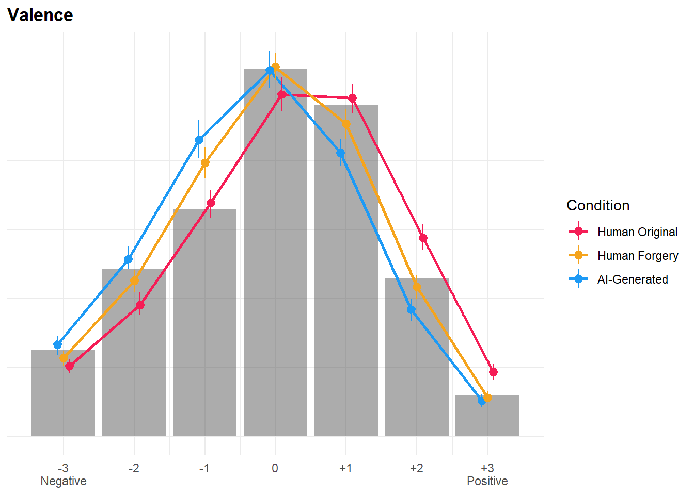{#fig-valence-1 width=672}
:::

::: {.cell-output-display}
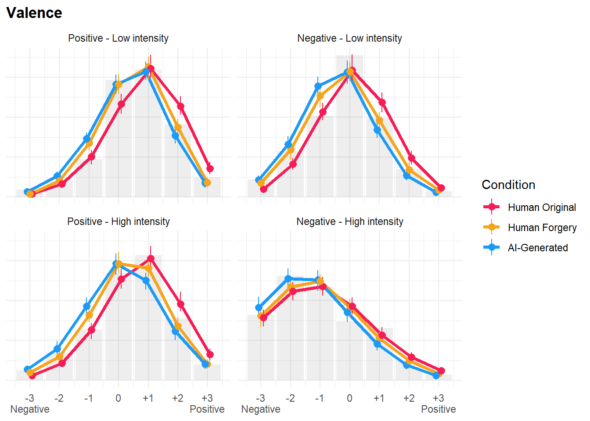{#fig-valence-2 width=672}
:::

Valence (1 = Negative, 7 = Positive): observed proportion of each response (grey bars) and the model-implied probability of each response per label condition (points with 95% CI).
:::


#### Valence Extremity (preregistered attenuation, H1.1)

The preregistration predicted an *attenuated* valence for AI-Generated
images, i.e. ratings closer to the centre of the scale. The Valence model
above is on the signed rating, so this is tested separately on the distance
of each rating from the centre, $|Valence - 4|$: 0 (the neutral midpoint) to
3 (either end of the scale), in a cumulative ordinal model with the same
structure as Worth (`ValenceExtremity` in `server/models.R`). Attenuation is a
lower `expected` distance (and a higher probability of a distance of 0) for
the AI-Generated label. Folding the scale mixes two effects: a uniform
downward shift of the signed rating makes positive ratings less extreme and
negative ones more extreme, so the contrasts within each emotion category
matter as much as the overall one.


::: {.cell}

```{.r .cell-code}
make_asis(
  "",
  '::: {.callout-warning title="Estimates not available yet"}',
  "`ValenceExtremity` is not fitted yet. In `analysis/server`: `./hpc push`, `./hpc fit ValenceExtremity`, then `./hpc combine ValenceExtremity` (check 4,000 draws), `./hpc extract ValenceExtremity` and `./hpc pull 'estimates/*.rds'`. This section fills in on the next render.",
  "",
  ":::",
  ""
)
```

::: {.cell-output-display}

::: {.callout-warning title="Estimates not available yet"}
`ValenceExtremity` is not fitted yet. In `analysis/server`: `./hpc push`, `./hpc fit ValenceExtremity`, then `./hpc combine ValenceExtremity` (check 4,000 draws), `./hpc extract ValenceExtremity` and `./hpc pull 'estimates/*.rds'`. This section fills in on the next render.

:::

:::
:::


::: {.cell}

```{.r .cell-code}
make_report(estimates$ValenceExtremity)
```
:::


::: {.cell}

```{.r .cell-code}
make_tables(
  mutate(estimates$ValenceExtremity$means_expected, across(where(is.numeric), \(x) insight::format_value(x, zap_small = TRUE))),
  c("Condition", "Estimate", "CI_low", "CI_high"),
  "Valence extremity: mean distance from the scale centre (0-3) per label condition"
)
```
:::


::: {.cell}

```{.r .cell-code}
get_discrete_plot(estimates$ValenceExtremity$discrete_emo, title = "Valence extremity", observed = "Extremity",
                  facet = ~Emotion, shift = 1) +
    scale_x_continuous(breaks = 0:3, labels = c("0\nNeutral", "1", "2", "3\nExtreme"))
```
:::


### Meaning


::: {.cell}

```{.r .cell-code}
make_report(estimates$Meaning)
```

::: {.cell-output-display}

```{=html}
<div id="chesxofelp" style="padding-left:0px;padding-right:0px;padding-top:10px;padding-bottom:10px;overflow-x:auto;overflow-y:auto;width:auto;height:auto;">
<style>#chesxofelp table {
  font-family: system-ui, 'Segoe UI', Roboto, Helvetica, Arial, sans-serif, 'Apple Color Emoji', 'Segoe UI Emoji', 'Segoe UI Symbol', 'Noto Color Emoji';
  -webkit-font-smoothing: antialiased;
  -moz-osx-font-smoothing: grayscale;
}

#chesxofelp thead, #chesxofelp tbody, #chesxofelp tfoot, #chesxofelp tr, #chesxofelp td, #chesxofelp th {
  border-style: none;
}

#chesxofelp p {
  margin: 0;
  padding: 0;
}

#chesxofelp .gt_table {
  display: table;
  border-collapse: collapse;
  line-height: normal;
  margin-left: auto;
  margin-right: auto;
  color: #333333;
  font-size: 16px;
  font-weight: normal;
  font-style: normal;
  background-color: #FFFFFF;
  width: auto;
  border-top-style: solid;
  border-top-width: 2px;
  border-top-color: #A8A8A8;
  border-right-style: none;
  border-right-width: 2px;
  border-right-color: #D3D3D3;
  border-bottom-style: solid;
  border-bottom-width: 2px;
  border-bottom-color: #A8A8A8;
  border-left-style: none;
  border-left-width: 2px;
  border-left-color: #D3D3D3;
}

#chesxofelp .gt_caption {
  padding-top: 4px;
  padding-bottom: 4px;
}

#chesxofelp .gt_title {
  color: #333333;
  font-size: 125%;
  font-weight: initial;
  padding-top: 4px;
  padding-bottom: 4px;
  padding-left: 5px;
  padding-right: 5px;
  border-bottom-color: #FFFFFF;
  border-bottom-width: 0;
}

#chesxofelp .gt_subtitle {
  color: #333333;
  font-size: 85%;
  font-weight: initial;
  padding-top: 3px;
  padding-bottom: 5px;
  padding-left: 5px;
  padding-right: 5px;
  border-top-color: #FFFFFF;
  border-top-width: 0;
}

#chesxofelp .gt_heading {
  background-color: #FFFFFF;
  text-align: center;
  border-bottom-color: #FFFFFF;
  border-left-style: none;
  border-left-width: 1px;
  border-left-color: #D3D3D3;
  border-right-style: none;
  border-right-width: 1px;
  border-right-color: #D3D3D3;
}

#chesxofelp .gt_bottom_border {
  border-bottom-style: solid;
  border-bottom-width: 2px;
  border-bottom-color: #D3D3D3;
}

#chesxofelp .gt_col_headings {
  border-top-style: solid;
  border-top-width: 2px;
  border-top-color: #D3D3D3;
  border-bottom-style: solid;
  border-bottom-width: 2px;
  border-bottom-color: #D3D3D3;
  border-left-style: none;
  border-left-width: 1px;
  border-left-color: #D3D3D3;
  border-right-style: none;
  border-right-width: 1px;
  border-right-color: #D3D3D3;
}

#chesxofelp .gt_col_heading {
  color: #333333;
  background-color: #FFFFFF;
  font-size: 100%;
  font-weight: normal;
  text-transform: inherit;
  border-left-style: none;
  border-left-width: 1px;
  border-left-color: #D3D3D3;
  border-right-style: none;
  border-right-width: 1px;
  border-right-color: #D3D3D3;
  vertical-align: bottom;
  padding-top: 5px;
  padding-bottom: 6px;
  padding-left: 5px;
  padding-right: 5px;
  overflow-x: hidden;
}

#chesxofelp .gt_column_spanner_outer {
  color: #333333;
  background-color: #FFFFFF;
  font-size: 100%;
  font-weight: normal;
  text-transform: inherit;
  padding-top: 0;
  padding-bottom: 0;
  padding-left: 4px;
  padding-right: 4px;
}

#chesxofelp .gt_column_spanner_outer:first-child {
  padding-left: 0;
}

#chesxofelp .gt_column_spanner_outer:last-child {
  padding-right: 0;
}

#chesxofelp .gt_column_spanner {
  border-bottom-style: solid;
  border-bottom-width: 2px;
  border-bottom-color: #D3D3D3;
  vertical-align: bottom;
  padding-top: 5px;
  padding-bottom: 5px;
  overflow-x: hidden;
  display: inline-block;
  width: 100%;
}

#chesxofelp .gt_spanner_row {
  border-bottom-style: hidden;
}

#chesxofelp .gt_group_heading {
  padding-top: 8px;
  padding-bottom: 8px;
  padding-left: 5px;
  padding-right: 5px;
  color: #333333;
  background-color: #FFFFFF;
  font-size: 100%;
  font-weight: initial;
  text-transform: inherit;
  border-top-style: solid;
  border-top-width: 2px;
  border-top-color: #D3D3D3;
  border-bottom-style: solid;
  border-bottom-width: 2px;
  border-bottom-color: #D3D3D3;
  border-left-style: none;
  border-left-width: 1px;
  border-left-color: #D3D3D3;
  border-right-style: none;
  border-right-width: 1px;
  border-right-color: #D3D3D3;
  vertical-align: middle;
  text-align: left;
}

#chesxofelp .gt_empty_group_heading {
  padding: 0.5px;
  color: #333333;
  background-color: #FFFFFF;
  font-size: 100%;
  font-weight: initial;
  border-top-style: solid;
  border-top-width: 2px;
  border-top-color: #D3D3D3;
  border-bottom-style: solid;
  border-bottom-width: 2px;
  border-bottom-color: #D3D3D3;
  vertical-align: middle;
}

#chesxofelp .gt_from_md > :first-child {
  margin-top: 0;
}

#chesxofelp .gt_from_md > :last-child {
  margin-bottom: 0;
}

#chesxofelp .gt_row {
  padding-top: 8px;
  padding-bottom: 8px;
  padding-left: 5px;
  padding-right: 5px;
  margin: 10px;
  border-top-style: solid;
  border-top-width: 1px;
  border-top-color: #D3D3D3;
  border-left-style: none;
  border-left-width: 1px;
  border-left-color: #D3D3D3;
  border-right-style: none;
  border-right-width: 1px;
  border-right-color: #D3D3D3;
  vertical-align: middle;
  overflow-x: hidden;
}

#chesxofelp .gt_stub {
  color: #333333;
  background-color: #FFFFFF;
  font-size: 100%;
  font-weight: initial;
  text-transform: inherit;
  border-right-style: solid;
  border-right-width: 2px;
  border-right-color: #D3D3D3;
  padding-left: 5px;
  padding-right: 5px;
}

#chesxofelp .gt_stub_row_group {
  color: #333333;
  background-color: #FFFFFF;
  font-size: 100%;
  font-weight: initial;
  text-transform: inherit;
  border-right-style: solid;
  border-right-width: 2px;
  border-right-color: #D3D3D3;
  padding-left: 5px;
  padding-right: 5px;
  vertical-align: top;
}

#chesxofelp .gt_row_group_first td {
  border-top-width: 2px;
}

#chesxofelp .gt_row_group_first th {
  border-top-width: 2px;
}

#chesxofelp .gt_summary_row {
  color: #333333;
  background-color: #FFFFFF;
  text-transform: inherit;
  padding-top: 8px;
  padding-bottom: 8px;
  padding-left: 5px;
  padding-right: 5px;
}

#chesxofelp .gt_first_summary_row {
  border-top-style: solid;
  border-top-color: #D3D3D3;
}

#chesxofelp .gt_first_summary_row.thick {
  border-top-width: 2px;
}

#chesxofelp .gt_last_summary_row {
  padding-top: 8px;
  padding-bottom: 8px;
  padding-left: 5px;
  padding-right: 5px;
  border-bottom-style: solid;
  border-bottom-width: 2px;
  border-bottom-color: #D3D3D3;
}

#chesxofelp .gt_grand_summary_row {
  color: #333333;
  background-color: #FFFFFF;
  text-transform: inherit;
  padding-top: 8px;
  padding-bottom: 8px;
  padding-left: 5px;
  padding-right: 5px;
}

#chesxofelp .gt_first_grand_summary_row {
  padding-top: 8px;
  padding-bottom: 8px;
  padding-left: 5px;
  padding-right: 5px;
  border-top-style: double;
  border-top-width: 6px;
  border-top-color: #D3D3D3;
}

#chesxofelp .gt_last_grand_summary_row_top {
  padding-top: 8px;
  padding-bottom: 8px;
  padding-left: 5px;
  padding-right: 5px;
  border-bottom-style: double;
  border-bottom-width: 6px;
  border-bottom-color: #D3D3D3;
}

#chesxofelp .gt_striped {
  background-color: rgba(128, 128, 128, 0.05);
}

#chesxofelp .gt_table_body {
  border-top-style: solid;
  border-top-width: 2px;
  border-top-color: #D3D3D3;
  border-bottom-style: solid;
  border-bottom-width: 2px;
  border-bottom-color: #D3D3D3;
}

#chesxofelp .gt_footnotes {
  color: #333333;
  background-color: #FFFFFF;
  border-bottom-style: none;
  border-bottom-width: 2px;
  border-bottom-color: #D3D3D3;
  border-left-style: none;
  border-left-width: 2px;
  border-left-color: #D3D3D3;
  border-right-style: none;
  border-right-width: 2px;
  border-right-color: #D3D3D3;
}

#chesxofelp .gt_footnote {
  margin: 0px;
  font-size: 90%;
  padding-top: 4px;
  padding-bottom: 4px;
  padding-left: 5px;
  padding-right: 5px;
}

#chesxofelp .gt_sourcenotes {
  color: #333333;
  background-color: #FFFFFF;
  border-bottom-style: none;
  border-bottom-width: 2px;
  border-bottom-color: #D3D3D3;
  border-left-style: none;
  border-left-width: 2px;
  border-left-color: #D3D3D3;
  border-right-style: none;
  border-right-width: 2px;
  border-right-color: #D3D3D3;
}

#chesxofelp .gt_sourcenote {
  font-size: 90%;
  padding-top: 4px;
  padding-bottom: 4px;
  padding-left: 5px;
  padding-right: 5px;
}

#chesxofelp .gt_left {
  text-align: left;
}

#chesxofelp .gt_center {
  text-align: center;
}

#chesxofelp .gt_right {
  text-align: right;
  font-variant-numeric: tabular-nums;
}

#chesxofelp .gt_font_normal {
  font-weight: normal;
}

#chesxofelp .gt_font_bold {
  font-weight: bold;
}

#chesxofelp .gt_font_italic {
  font-style: italic;
}

#chesxofelp .gt_super {
  font-size: 65%;
}

#chesxofelp .gt_footnote_marks {
  font-size: 75%;
  vertical-align: 0.4em;
  position: initial;
}

#chesxofelp .gt_asterisk {
  font-size: 100%;
  vertical-align: 0;
}

#chesxofelp .gt_indent_1 {
  text-indent: 5px;
}

#chesxofelp .gt_indent_2 {
  text-indent: 10px;
}

#chesxofelp .gt_indent_3 {
  text-indent: 15px;
}

#chesxofelp .gt_indent_4 {
  text-indent: 20px;
}

#chesxofelp .gt_indent_5 {
  text-indent: 25px;
}

#chesxofelp .katex-display {
  display: inline-flex !important;
  margin-bottom: 0.75em !important;
}

#chesxofelp div.Reactable > div.rt-table > div.rt-thead > div.rt-tr.rt-tr-group-header > div.rt-th-group:after {
  height: 0px !important;
}
</style>
<table class="gt_table" data-quarto-disable-processing="false" data-quarto-bootstrap="false">
  <thead>
    <tr class="gt_col_headings">
      <th class="gt_col_heading gt_columns_bottom_border gt_left" rowspan="1" colspan="1" scope="col" id="Contrast">Contrast</th>
      <th class="gt_col_heading gt_columns_bottom_border gt_left" rowspan="1" colspan="1" scope="col" id="Parameters">Parameters</th>
    </tr>
  </thead>
  <tbody class="gt_table_body">
    <tr><td headers="Contrast" class="gt_row gt_left">Human Forgery - Human Original</td>
<td headers="Parameters" class="gt_row gt_left">response (-0.26, [-0.32, -0.20]); mu (-0.04, [-0.05, -0.03]); pzero (0.01, [ 0.00,  0.02])</td></tr>
    <tr><td headers="Contrast" class="gt_row gt_left">AI-Generated - Human Original</td>
<td headers="Parameters" class="gt_row gt_left">response (-0.62, [-0.72, -0.54]); mu (-0.09, [-0.10, -0.07]); pzero (0.05, [ 0.03,  0.07])</td></tr>
    <tr><td headers="Contrast" class="gt_row gt_left">AI-Generated - Human Forgery</td>
<td headers="Parameters" class="gt_row gt_left">response (-0.37, [-0.45, -0.29]); mu (-0.05, [-0.06, -0.03]); phi (-0.35, [-0.70, -0.01]); pzero (0.04, [ 0.02,  0.06])</td></tr>
  </tbody>
  
</table>
</div>
```

```{=html}
<div id="vpsmqqegyz" style="padding-left:0px;padding-right:0px;padding-top:10px;padding-bottom:10px;overflow-x:auto;overflow-y:auto;width:auto;height:auto;">
<style>#vpsmqqegyz table {
  font-family: system-ui, 'Segoe UI', Roboto, Helvetica, Arial, sans-serif, 'Apple Color Emoji', 'Segoe UI Emoji', 'Segoe UI Symbol', 'Noto Color Emoji';
  -webkit-font-smoothing: antialiased;
  -moz-osx-font-smoothing: grayscale;
}

#vpsmqqegyz thead, #vpsmqqegyz tbody, #vpsmqqegyz tfoot, #vpsmqqegyz tr, #vpsmqqegyz td, #vpsmqqegyz th {
  border-style: none;
}

#vpsmqqegyz p {
  margin: 0;
  padding: 0;
}

#vpsmqqegyz .gt_table {
  display: table;
  border-collapse: collapse;
  line-height: normal;
  margin-left: auto;
  margin-right: auto;
  color: #333333;
  font-size: 16px;
  font-weight: normal;
  font-style: normal;
  background-color: #FFFFFF;
  width: auto;
  border-top-style: solid;
  border-top-width: 2px;
  border-top-color: #A8A8A8;
  border-right-style: none;
  border-right-width: 2px;
  border-right-color: #D3D3D3;
  border-bottom-style: solid;
  border-bottom-width: 2px;
  border-bottom-color: #A8A8A8;
  border-left-style: none;
  border-left-width: 2px;
  border-left-color: #D3D3D3;
}

#vpsmqqegyz .gt_caption {
  padding-top: 4px;
  padding-bottom: 4px;
}

#vpsmqqegyz .gt_title {
  color: #333333;
  font-size: 125%;
  font-weight: initial;
  padding-top: 4px;
  padding-bottom: 4px;
  padding-left: 5px;
  padding-right: 5px;
  border-bottom-color: #FFFFFF;
  border-bottom-width: 0;
}

#vpsmqqegyz .gt_subtitle {
  color: #333333;
  font-size: 85%;
  font-weight: initial;
  padding-top: 3px;
  padding-bottom: 5px;
  padding-left: 5px;
  padding-right: 5px;
  border-top-color: #FFFFFF;
  border-top-width: 0;
}

#vpsmqqegyz .gt_heading {
  background-color: #FFFFFF;
  text-align: center;
  border-bottom-color: #FFFFFF;
  border-left-style: none;
  border-left-width: 1px;
  border-left-color: #D3D3D3;
  border-right-style: none;
  border-right-width: 1px;
  border-right-color: #D3D3D3;
}

#vpsmqqegyz .gt_bottom_border {
  border-bottom-style: solid;
  border-bottom-width: 2px;
  border-bottom-color: #D3D3D3;
}

#vpsmqqegyz .gt_col_headings {
  border-top-style: solid;
  border-top-width: 2px;
  border-top-color: #D3D3D3;
  border-bottom-style: solid;
  border-bottom-width: 2px;
  border-bottom-color: #D3D3D3;
  border-left-style: none;
  border-left-width: 1px;
  border-left-color: #D3D3D3;
  border-right-style: none;
  border-right-width: 1px;
  border-right-color: #D3D3D3;
}

#vpsmqqegyz .gt_col_heading {
  color: #333333;
  background-color: #FFFFFF;
  font-size: 100%;
  font-weight: normal;
  text-transform: inherit;
  border-left-style: none;
  border-left-width: 1px;
  border-left-color: #D3D3D3;
  border-right-style: none;
  border-right-width: 1px;
  border-right-color: #D3D3D3;
  vertical-align: bottom;
  padding-top: 5px;
  padding-bottom: 6px;
  padding-left: 5px;
  padding-right: 5px;
  overflow-x: hidden;
}

#vpsmqqegyz .gt_column_spanner_outer {
  color: #333333;
  background-color: #FFFFFF;
  font-size: 100%;
  font-weight: normal;
  text-transform: inherit;
  padding-top: 0;
  padding-bottom: 0;
  padding-left: 4px;
  padding-right: 4px;
}

#vpsmqqegyz .gt_column_spanner_outer:first-child {
  padding-left: 0;
}

#vpsmqqegyz .gt_column_spanner_outer:last-child {
  padding-right: 0;
}

#vpsmqqegyz .gt_column_spanner {
  border-bottom-style: solid;
  border-bottom-width: 2px;
  border-bottom-color: #D3D3D3;
  vertical-align: bottom;
  padding-top: 5px;
  padding-bottom: 5px;
  overflow-x: hidden;
  display: inline-block;
  width: 100%;
}

#vpsmqqegyz .gt_spanner_row {
  border-bottom-style: hidden;
}

#vpsmqqegyz .gt_group_heading {
  padding-top: 8px;
  padding-bottom: 8px;
  padding-left: 5px;
  padding-right: 5px;
  color: #333333;
  background-color: #FFFFFF;
  font-size: 100%;
  font-weight: initial;
  text-transform: inherit;
  border-top-style: solid;
  border-top-width: 2px;
  border-top-color: #D3D3D3;
  border-bottom-style: solid;
  border-bottom-width: 2px;
  border-bottom-color: #D3D3D3;
  border-left-style: none;
  border-left-width: 1px;
  border-left-color: #D3D3D3;
  border-right-style: none;
  border-right-width: 1px;
  border-right-color: #D3D3D3;
  vertical-align: middle;
  text-align: left;
}

#vpsmqqegyz .gt_empty_group_heading {
  padding: 0.5px;
  color: #333333;
  background-color: #FFFFFF;
  font-size: 100%;
  font-weight: initial;
  border-top-style: solid;
  border-top-width: 2px;
  border-top-color: #D3D3D3;
  border-bottom-style: solid;
  border-bottom-width: 2px;
  border-bottom-color: #D3D3D3;
  vertical-align: middle;
}

#vpsmqqegyz .gt_from_md > :first-child {
  margin-top: 0;
}

#vpsmqqegyz .gt_from_md > :last-child {
  margin-bottom: 0;
}

#vpsmqqegyz .gt_row {
  padding-top: 8px;
  padding-bottom: 8px;
  padding-left: 5px;
  padding-right: 5px;
  margin: 10px;
  border-top-style: solid;
  border-top-width: 1px;
  border-top-color: #D3D3D3;
  border-left-style: none;
  border-left-width: 1px;
  border-left-color: #D3D3D3;
  border-right-style: none;
  border-right-width: 1px;
  border-right-color: #D3D3D3;
  vertical-align: middle;
  overflow-x: hidden;
}

#vpsmqqegyz .gt_stub {
  color: #333333;
  background-color: #FFFFFF;
  font-size: 100%;
  font-weight: initial;
  text-transform: inherit;
  border-right-style: solid;
  border-right-width: 2px;
  border-right-color: #D3D3D3;
  padding-left: 5px;
  padding-right: 5px;
}

#vpsmqqegyz .gt_stub_row_group {
  color: #333333;
  background-color: #FFFFFF;
  font-size: 100%;
  font-weight: initial;
  text-transform: inherit;
  border-right-style: solid;
  border-right-width: 2px;
  border-right-color: #D3D3D3;
  padding-left: 5px;
  padding-right: 5px;
  vertical-align: top;
}

#vpsmqqegyz .gt_row_group_first td {
  border-top-width: 2px;
}

#vpsmqqegyz .gt_row_group_first th {
  border-top-width: 2px;
}

#vpsmqqegyz .gt_summary_row {
  color: #333333;
  background-color: #FFFFFF;
  text-transform: inherit;
  padding-top: 8px;
  padding-bottom: 8px;
  padding-left: 5px;
  padding-right: 5px;
}

#vpsmqqegyz .gt_first_summary_row {
  border-top-style: solid;
  border-top-color: #D3D3D3;
}

#vpsmqqegyz .gt_first_summary_row.thick {
  border-top-width: 2px;
}

#vpsmqqegyz .gt_last_summary_row {
  padding-top: 8px;
  padding-bottom: 8px;
  padding-left: 5px;
  padding-right: 5px;
  border-bottom-style: solid;
  border-bottom-width: 2px;
  border-bottom-color: #D3D3D3;
}

#vpsmqqegyz .gt_grand_summary_row {
  color: #333333;
  background-color: #FFFFFF;
  text-transform: inherit;
  padding-top: 8px;
  padding-bottom: 8px;
  padding-left: 5px;
  padding-right: 5px;
}

#vpsmqqegyz .gt_first_grand_summary_row {
  padding-top: 8px;
  padding-bottom: 8px;
  padding-left: 5px;
  padding-right: 5px;
  border-top-style: double;
  border-top-width: 6px;
  border-top-color: #D3D3D3;
}

#vpsmqqegyz .gt_last_grand_summary_row_top {
  padding-top: 8px;
  padding-bottom: 8px;
  padding-left: 5px;
  padding-right: 5px;
  border-bottom-style: double;
  border-bottom-width: 6px;
  border-bottom-color: #D3D3D3;
}

#vpsmqqegyz .gt_striped {
  background-color: rgba(128, 128, 128, 0.05);
}

#vpsmqqegyz .gt_table_body {
  border-top-style: solid;
  border-top-width: 2px;
  border-top-color: #D3D3D3;
  border-bottom-style: solid;
  border-bottom-width: 2px;
  border-bottom-color: #D3D3D3;
}

#vpsmqqegyz .gt_footnotes {
  color: #333333;
  background-color: #FFFFFF;
  border-bottom-style: none;
  border-bottom-width: 2px;
  border-bottom-color: #D3D3D3;
  border-left-style: none;
  border-left-width: 2px;
  border-left-color: #D3D3D3;
  border-right-style: none;
  border-right-width: 2px;
  border-right-color: #D3D3D3;
}

#vpsmqqegyz .gt_footnote {
  margin: 0px;
  font-size: 90%;
  padding-top: 4px;
  padding-bottom: 4px;
  padding-left: 5px;
  padding-right: 5px;
}

#vpsmqqegyz .gt_sourcenotes {
  color: #333333;
  background-color: #FFFFFF;
  border-bottom-style: none;
  border-bottom-width: 2px;
  border-bottom-color: #D3D3D3;
  border-left-style: none;
  border-left-width: 2px;
  border-left-color: #D3D3D3;
  border-right-style: none;
  border-right-width: 2px;
  border-right-color: #D3D3D3;
}

#vpsmqqegyz .gt_sourcenote {
  font-size: 90%;
  padding-top: 4px;
  padding-bottom: 4px;
  padding-left: 5px;
  padding-right: 5px;
}

#vpsmqqegyz .gt_left {
  text-align: left;
}

#vpsmqqegyz .gt_center {
  text-align: center;
}

#vpsmqqegyz .gt_right {
  text-align: right;
  font-variant-numeric: tabular-nums;
}

#vpsmqqegyz .gt_font_normal {
  font-weight: normal;
}

#vpsmqqegyz .gt_font_bold {
  font-weight: bold;
}

#vpsmqqegyz .gt_font_italic {
  font-style: italic;
}

#vpsmqqegyz .gt_super {
  font-size: 65%;
}

#vpsmqqegyz .gt_footnote_marks {
  font-size: 75%;
  vertical-align: 0.4em;
  position: initial;
}

#vpsmqqegyz .gt_asterisk {
  font-size: 100%;
  vertical-align: 0;
}

#vpsmqqegyz .gt_indent_1 {
  text-indent: 5px;
}

#vpsmqqegyz .gt_indent_2 {
  text-indent: 10px;
}

#vpsmqqegyz .gt_indent_3 {
  text-indent: 15px;
}

#vpsmqqegyz .gt_indent_4 {
  text-indent: 20px;
}

#vpsmqqegyz .gt_indent_5 {
  text-indent: 25px;
}

#vpsmqqegyz .katex-display {
  display: inline-flex !important;
  margin-bottom: 0.75em !important;
}

#vpsmqqegyz div.Reactable > div.rt-table > div.rt-thead > div.rt-tr.rt-tr-group-header > div.rt-th-group:after {
  height: 0px !important;
}
</style>
<table class="gt_table" data-quarto-disable-processing="false" data-quarto-bootstrap="false">
  <thead>
    <tr class="gt_col_headings">
      <th class="gt_col_heading gt_columns_bottom_border gt_left" rowspan="1" colspan="1" scope="col" id="Contrast">Contrast</th>
      <th class="gt_col_heading gt_columns_bottom_border gt_left" rowspan="1" colspan="1" scope="col" id="Parameters">Parameters</th>
    </tr>
  </thead>
  <tbody class="gt_table_body">
    <tr><td headers="Contrast" class="gt_row gt_left">Negative - High intensity - Positive - Low intensity</td>
<td headers="Parameters" class="gt_row gt_left">response (0.70, [0.31, 1.10]); mu (0.12, [0.05, 0.19])</td></tr>
    <tr><td headers="Contrast" class="gt_row gt_left">Negative - High intensity - Negative - Low intensity</td>
<td headers="Parameters" class="gt_row gt_left">response (0.72, [0.33, 1.11]); mu (0.12, [0.05, 0.19])</td></tr>
    <tr><td headers="Contrast" class="gt_row gt_left">Negative - High intensity - Positive - High intensity</td>
<td headers="Parameters" class="gt_row gt_left">response (0.56, [0.16, 0.94]); mu (0.09, [0.03, 0.16])</td></tr>
  </tbody>
  
</table>
</div>
```

```{=html}
<div id="bimgnusayo" style="padding-left:0px;padding-right:0px;padding-top:10px;padding-bottom:10px;overflow-x:auto;overflow-y:auto;width:auto;height:auto;">
<style>#bimgnusayo table {
  font-family: system-ui, 'Segoe UI', Roboto, Helvetica, Arial, sans-serif, 'Apple Color Emoji', 'Segoe UI Emoji', 'Segoe UI Symbol', 'Noto Color Emoji';
  -webkit-font-smoothing: antialiased;
  -moz-osx-font-smoothing: grayscale;
}

#bimgnusayo thead, #bimgnusayo tbody, #bimgnusayo tfoot, #bimgnusayo tr, #bimgnusayo td, #bimgnusayo th {
  border-style: none;
}

#bimgnusayo p {
  margin: 0;
  padding: 0;
}

#bimgnusayo .gt_table {
  display: table;
  border-collapse: collapse;
  line-height: normal;
  margin-left: auto;
  margin-right: auto;
  color: #333333;
  font-size: 13px;
  font-weight: normal;
  font-style: normal;
  background-color: #FFFFFF;
  width: auto;
  border-top-style: solid;
  border-top-width: 3px;
  border-top-color: #D5D5D5;
  border-right-style: solid;
  border-right-width: 3px;
  border-right-color: #D5D5D5;
  border-bottom-style: solid;
  border-bottom-width: 3px;
  border-bottom-color: #D5D5D5;
  border-left-style: solid;
  border-left-width: 3px;
  border-left-color: #D5D5D5;
}

#bimgnusayo .gt_caption {
  padding-top: 4px;
  padding-bottom: 4px;
}

#bimgnusayo .gt_title {
  color: #333333;
  font-size: 125%;
  font-weight: initial;
  padding-top: 4px;
  padding-bottom: 4px;
  padding-left: 5px;
  padding-right: 5px;
  border-bottom-color: #FFFFFF;
  border-bottom-width: 0;
}

#bimgnusayo .gt_subtitle {
  color: #333333;
  font-size: 85%;
  font-weight: initial;
  padding-top: 3px;
  padding-bottom: 5px;
  padding-left: 5px;
  padding-right: 5px;
  border-top-color: #FFFFFF;
  border-top-width: 0;
}

#bimgnusayo .gt_heading {
  background-color: #FFFFFF;
  text-align: left;
  border-bottom-color: #FFFFFF;
  border-left-style: none;
  border-left-width: 1px;
  border-left-color: #D3D3D3;
  border-right-style: none;
  border-right-width: 1px;
  border-right-color: #D3D3D3;
}

#bimgnusayo .gt_bottom_border {
  border-bottom-style: solid;
  border-bottom-width: 2px;
  border-bottom-color: #D5D5D5;
}

#bimgnusayo .gt_col_headings {
  border-top-style: solid;
  border-top-width: 2px;
  border-top-color: #D5D5D5;
  border-bottom-style: solid;
  border-bottom-width: 2px;
  border-bottom-color: #D5D5D5;
  border-left-style: none;
  border-left-width: 1px;
  border-left-color: #D3D3D3;
  border-right-style: none;
  border-right-width: 1px;
  border-right-color: #D3D3D3;
}

#bimgnusayo .gt_col_heading {
  color: #FFFFFF;
  background-color: #000000;
  font-size: 100%;
  font-weight: normal;
  text-transform: inherit;
  border-left-style: none;
  border-left-width: 1px;
  border-left-color: #D3D3D3;
  border-right-style: none;
  border-right-width: 1px;
  border-right-color: #D3D3D3;
  vertical-align: bottom;
  padding-top: 5px;
  padding-bottom: 6px;
  padding-left: 5px;
  padding-right: 5px;
  overflow-x: hidden;
}

#bimgnusayo .gt_column_spanner_outer {
  color: #FFFFFF;
  background-color: #000000;
  font-size: 100%;
  font-weight: normal;
  text-transform: inherit;
  padding-top: 0;
  padding-bottom: 0;
  padding-left: 4px;
  padding-right: 4px;
}

#bimgnusayo .gt_column_spanner_outer:first-child {
  padding-left: 0;
}

#bimgnusayo .gt_column_spanner_outer:last-child {
  padding-right: 0;
}

#bimgnusayo .gt_column_spanner {
  border-bottom-style: solid;
  border-bottom-width: 2px;
  border-bottom-color: #D5D5D5;
  vertical-align: bottom;
  padding-top: 5px;
  padding-bottom: 5px;
  overflow-x: hidden;
  display: inline-block;
  width: 100%;
}

#bimgnusayo .gt_spanner_row {
  border-bottom-style: hidden;
}

#bimgnusayo .gt_group_heading {
  padding-top: 8px;
  padding-bottom: 8px;
  padding-left: 5px;
  padding-right: 5px;
  color: #333333;
  background-color: #FFFFFF;
  font-size: 100%;
  font-weight: initial;
  text-transform: inherit;
  border-top-style: solid;
  border-top-width: 2px;
  border-top-color: #D5D5D5;
  border-bottom-style: solid;
  border-bottom-width: 2px;
  border-bottom-color: #D5D5D5;
  border-left-style: none;
  border-left-width: 1px;
  border-left-color: #D3D3D3;
  border-right-style: none;
  border-right-width: 1px;
  border-right-color: #D3D3D3;
  vertical-align: middle;
  text-align: left;
}

#bimgnusayo .gt_empty_group_heading {
  padding: 0.5px;
  color: #333333;
  background-color: #FFFFFF;
  font-size: 100%;
  font-weight: initial;
  border-top-style: solid;
  border-top-width: 2px;
  border-top-color: #D5D5D5;
  border-bottom-style: solid;
  border-bottom-width: 2px;
  border-bottom-color: #D5D5D5;
  vertical-align: middle;
}

#bimgnusayo .gt_from_md > :first-child {
  margin-top: 0;
}

#bimgnusayo .gt_from_md > :last-child {
  margin-bottom: 0;
}

#bimgnusayo .gt_row {
  padding-top: 8px;
  padding-bottom: 8px;
  padding-left: 5px;
  padding-right: 5px;
  margin: 10px;
  border-top-style: solid;
  border-top-width: 1px;
  border-top-color: #D5D5D5;
  border-left-style: solid;
  border-left-width: 1px;
  border-left-color: #D5D5D5;
  border-right-style: solid;
  border-right-width: 1px;
  border-right-color: #D5D5D5;
  vertical-align: middle;
  overflow-x: hidden;
}

#bimgnusayo .gt_stub {
  color: #333333;
  background-color: #FFFFFF;
  font-size: 100%;
  font-weight: initial;
  text-transform: inherit;
  border-right-style: solid;
  border-right-width: 2px;
  border-right-color: #5F5F5F;
  padding-left: 5px;
  padding-right: 5px;
}

#bimgnusayo .gt_stub_row_group {
  color: #333333;
  background-color: #FFFFFF;
  font-size: 100%;
  font-weight: initial;
  text-transform: inherit;
  border-right-style: solid;
  border-right-width: 2px;
  border-right-color: #D3D3D3;
  padding-left: 5px;
  padding-right: 5px;
  vertical-align: top;
}

#bimgnusayo .gt_row_group_first td {
  border-top-width: 2px;
}

#bimgnusayo .gt_row_group_first th {
  border-top-width: 2px;
}

#bimgnusayo .gt_summary_row {
  color: #333333;
  background-color: #D5D5D5;
  text-transform: inherit;
  padding-top: 8px;
  padding-bottom: 8px;
  padding-left: 5px;
  padding-right: 5px;
}

#bimgnusayo .gt_first_summary_row {
  border-top-style: solid;
  border-top-color: #D5D5D5;
}

#bimgnusayo .gt_first_summary_row.thick {
  border-top-width: 2px;
}

#bimgnusayo .gt_last_summary_row {
  padding-top: 8px;
  padding-bottom: 8px;
  padding-left: 5px;
  padding-right: 5px;
  border-bottom-style: solid;
  border-bottom-width: 2px;
  border-bottom-color: #D5D5D5;
}

#bimgnusayo .gt_grand_summary_row {
  color: #FFFFFF;
  background-color: #929292;
  text-transform: inherit;
  padding-top: 8px;
  padding-bottom: 8px;
  padding-left: 5px;
  padding-right: 5px;
}

#bimgnusayo .gt_first_grand_summary_row {
  padding-top: 8px;
  padding-bottom: 8px;
  padding-left: 5px;
  padding-right: 5px;
  border-top-style: double;
  border-top-width: 6px;
  border-top-color: #D5D5D5;
}

#bimgnusayo .gt_last_grand_summary_row_top {
  padding-top: 8px;
  padding-bottom: 8px;
  padding-left: 5px;
  padding-right: 5px;
  border-bottom-style: double;
  border-bottom-width: 6px;
  border-bottom-color: #D5D5D5;
}

#bimgnusayo .gt_striped {
  background-color: #F4F4F4;
}

#bimgnusayo .gt_table_body {
  border-top-style: solid;
  border-top-width: 2px;
  border-top-color: #D5D5D5;
  border-bottom-style: solid;
  border-bottom-width: 2px;
  border-bottom-color: #D5D5D5;
}

#bimgnusayo .gt_footnotes {
  color: #333333;
  background-color: #FFFFFF;
  border-bottom-style: none;
  border-bottom-width: 2px;
  border-bottom-color: #D3D3D3;
  border-left-style: none;
  border-left-width: 2px;
  border-left-color: #D3D3D3;
  border-right-style: none;
  border-right-width: 2px;
  border-right-color: #D3D3D3;
}

#bimgnusayo .gt_footnote {
  margin: 0px;
  font-size: 90%;
  padding-top: 4px;
  padding-bottom: 4px;
  padding-left: 5px;
  padding-right: 5px;
}

#bimgnusayo .gt_sourcenotes {
  color: #333333;
  background-color: #FFFFFF;
  border-bottom-style: none;
  border-bottom-width: 2px;
  border-bottom-color: #D3D3D3;
  border-left-style: none;
  border-left-width: 2px;
  border-left-color: #D3D3D3;
  border-right-style: none;
  border-right-width: 2px;
  border-right-color: #D3D3D3;
}

#bimgnusayo .gt_sourcenote {
  font-size: 90%;
  padding-top: 4px;
  padding-bottom: 4px;
  padding-left: 5px;
  padding-right: 5px;
}

#bimgnusayo .gt_left {
  text-align: left;
}

#bimgnusayo .gt_center {
  text-align: center;
}

#bimgnusayo .gt_right {
  text-align: right;
  font-variant-numeric: tabular-nums;
}

#bimgnusayo .gt_font_normal {
  font-weight: normal;
}

#bimgnusayo .gt_font_bold {
  font-weight: bold;
}

#bimgnusayo .gt_font_italic {
  font-style: italic;
}

#bimgnusayo .gt_super {
  font-size: 65%;
}

#bimgnusayo .gt_footnote_marks {
  font-size: 75%;
  vertical-align: 0.4em;
  position: initial;
}

#bimgnusayo .gt_asterisk {
  font-size: 100%;
  vertical-align: 0;
}

#bimgnusayo .gt_indent_1 {
  text-indent: 5px;
}

#bimgnusayo .gt_indent_2 {
  text-indent: 10px;
}

#bimgnusayo .gt_indent_3 {
  text-indent: 15px;
}

#bimgnusayo .gt_indent_4 {
  text-indent: 20px;
}

#bimgnusayo .gt_indent_5 {
  text-indent: 25px;
}

#bimgnusayo .katex-display {
  display: inline-flex !important;
  margin-bottom: 0.75em !important;
}

#bimgnusayo div.Reactable > div.rt-table > div.rt-thead > div.rt-tr.rt-tr-group-header > div.rt-th-group:after {
  height: 0px !important;
}
</style>
<table class="gt_table" data-quarto-disable-processing="false" data-quarto-bootstrap="false">
  <thead>
    <tr class="gt_heading">
      <td colspan="10" class="gt_heading gt_title gt_font_normal gt_bottom_border" style>Meaning: convergence</td>
    </tr>
    
    <tr class="gt_col_headings">
      <th class="gt_col_heading gt_columns_bottom_border gt_left" rowspan="1" colspan="1" scope="col" id="Model">Model</th>
      <th class="gt_col_heading gt_columns_bottom_border gt_left" rowspan="1" colspan="1" scope="col" id="Family">Family</th>
      <th class="gt_col_heading gt_columns_bottom_border gt_right" rowspan="1" colspan="1" scope="col" id="N_obs">N_obs</th>
      <th class="gt_col_heading gt_columns_bottom_border gt_right" rowspan="1" colspan="1" scope="col" id="N_participants">N_participants</th>
      <th class="gt_col_heading gt_columns_bottom_border gt_right" rowspan="1" colspan="1" scope="col" id="Chains">Chains</th>
      <th class="gt_col_heading gt_columns_bottom_border gt_right" rowspan="1" colspan="1" scope="col" id="Draws">Draws</th>
      <th class="gt_col_heading gt_columns_bottom_border gt_right" rowspan="1" colspan="1" scope="col" id="Max_Rhat">Max_Rhat</th>
      <th class="gt_col_heading gt_columns_bottom_border gt_right" rowspan="1" colspan="1" scope="col" id="Min_ESS_ratio">Min_ESS_ratio</th>
      <th class="gt_col_heading gt_columns_bottom_border gt_right" rowspan="1" colspan="1" scope="col" id="Divergent_pct">Divergent_pct</th>
      <th class="gt_col_heading gt_columns_bottom_border gt_left" rowspan="1" colspan="1" scope="col" id="Criterion">Criterion</th>
    </tr>
  </thead>
  <tbody class="gt_table_body">
    <tr><td headers="Model" class="gt_row gt_left">Meaning</td>
<td headers="Family" class="gt_row gt_left">Discrete Beta (k = 6) with zero hurdle</td>
<td headers="N_obs" class="gt_row gt_right">15552</td>
<td headers="N_participants" class="gt_row gt_right">324</td>
<td headers="Chains" class="gt_row gt_right">8</td>
<td headers="Draws" class="gt_row gt_right">4000</td>
<td headers="Max_Rhat" class="gt_row gt_right">1.041</td>
<td headers="Min_ESS_ratio" class="gt_row gt_right">0.05</td>
<td headers="Divergent_pct" class="gt_row gt_right">0.1</td>
<td headers="Criterion" class="gt_row gt_left">loo</td></tr>
  </tbody>
  
</table>
</div>
```


::: {.callout-note collapse="true" title="Meaning: convergence (Markdown table, for text readers)"}

|Model   |Family                                 | N_obs| N_participants| Chains| Draws| Max_Rhat| Min_ESS_ratio| Divergent_pct|Criterion |
|:-------|:--------------------------------------|-----:|--------------:|------:|-----:|--------:|-------------:|-------------:|:---------|
|Meaning |Discrete Beta (k = 6) with zero hurdle | 15552|            324|      8|  4000|    1.041|          0.05|           0.1|loo       |

:::

```{=html}
<div id="cydyytyijl" style="padding-left:0px;padding-right:0px;padding-top:10px;padding-bottom:10px;overflow-x:auto;overflow-y:auto;width:auto;height:auto;">
<style>#cydyytyijl table {
  font-family: system-ui, 'Segoe UI', Roboto, Helvetica, Arial, sans-serif, 'Apple Color Emoji', 'Segoe UI Emoji', 'Segoe UI Symbol', 'Noto Color Emoji';
  -webkit-font-smoothing: antialiased;
  -moz-osx-font-smoothing: grayscale;
}

#cydyytyijl thead, #cydyytyijl tbody, #cydyytyijl tfoot, #cydyytyijl tr, #cydyytyijl td, #cydyytyijl th {
  border-style: none;
}

#cydyytyijl p {
  margin: 0;
  padding: 0;
}

#cydyytyijl .gt_table {
  display: table;
  border-collapse: collapse;
  line-height: normal;
  margin-left: auto;
  margin-right: auto;
  color: #333333;
  font-size: 13px;
  font-weight: normal;
  font-style: normal;
  background-color: #FFFFFF;
  width: auto;
  border-top-style: solid;
  border-top-width: 3px;
  border-top-color: #D5D5D5;
  border-right-style: solid;
  border-right-width: 3px;
  border-right-color: #D5D5D5;
  border-bottom-style: solid;
  border-bottom-width: 3px;
  border-bottom-color: #D5D5D5;
  border-left-style: solid;
  border-left-width: 3px;
  border-left-color: #D5D5D5;
}

#cydyytyijl .gt_caption {
  padding-top: 4px;
  padding-bottom: 4px;
}

#cydyytyijl .gt_title {
  color: #333333;
  font-size: 125%;
  font-weight: initial;
  padding-top: 4px;
  padding-bottom: 4px;
  padding-left: 5px;
  padding-right: 5px;
  border-bottom-color: #FFFFFF;
  border-bottom-width: 0;
}

#cydyytyijl .gt_subtitle {
  color: #333333;
  font-size: 85%;
  font-weight: initial;
  padding-top: 3px;
  padding-bottom: 5px;
  padding-left: 5px;
  padding-right: 5px;
  border-top-color: #FFFFFF;
  border-top-width: 0;
}

#cydyytyijl .gt_heading {
  background-color: #FFFFFF;
  text-align: left;
  border-bottom-color: #FFFFFF;
  border-left-style: none;
  border-left-width: 1px;
  border-left-color: #D3D3D3;
  border-right-style: none;
  border-right-width: 1px;
  border-right-color: #D3D3D3;
}

#cydyytyijl .gt_bottom_border {
  border-bottom-style: solid;
  border-bottom-width: 2px;
  border-bottom-color: #D5D5D5;
}

#cydyytyijl .gt_col_headings {
  border-top-style: solid;
  border-top-width: 2px;
  border-top-color: #D5D5D5;
  border-bottom-style: solid;
  border-bottom-width: 2px;
  border-bottom-color: #D5D5D5;
  border-left-style: none;
  border-left-width: 1px;
  border-left-color: #D3D3D3;
  border-right-style: none;
  border-right-width: 1px;
  border-right-color: #D3D3D3;
}

#cydyytyijl .gt_col_heading {
  color: #FFFFFF;
  background-color: #000000;
  font-size: 100%;
  font-weight: normal;
  text-transform: inherit;
  border-left-style: none;
  border-left-width: 1px;
  border-left-color: #D3D3D3;
  border-right-style: none;
  border-right-width: 1px;
  border-right-color: #D3D3D3;
  vertical-align: bottom;
  padding-top: 5px;
  padding-bottom: 6px;
  padding-left: 5px;
  padding-right: 5px;
  overflow-x: hidden;
}

#cydyytyijl .gt_column_spanner_outer {
  color: #FFFFFF;
  background-color: #000000;
  font-size: 100%;
  font-weight: normal;
  text-transform: inherit;
  padding-top: 0;
  padding-bottom: 0;
  padding-left: 4px;
  padding-right: 4px;
}

#cydyytyijl .gt_column_spanner_outer:first-child {
  padding-left: 0;
}

#cydyytyijl .gt_column_spanner_outer:last-child {
  padding-right: 0;
}

#cydyytyijl .gt_column_spanner {
  border-bottom-style: solid;
  border-bottom-width: 2px;
  border-bottom-color: #D5D5D5;
  vertical-align: bottom;
  padding-top: 5px;
  padding-bottom: 5px;
  overflow-x: hidden;
  display: inline-block;
  width: 100%;
}

#cydyytyijl .gt_spanner_row {
  border-bottom-style: hidden;
}

#cydyytyijl .gt_group_heading {
  padding-top: 8px;
  padding-bottom: 8px;
  padding-left: 5px;
  padding-right: 5px;
  color: #333333;
  background-color: #FFFFFF;
  font-size: 100%;
  font-weight: initial;
  text-transform: inherit;
  border-top-style: solid;
  border-top-width: 2px;
  border-top-color: #D5D5D5;
  border-bottom-style: solid;
  border-bottom-width: 2px;
  border-bottom-color: #D5D5D5;
  border-left-style: none;
  border-left-width: 1px;
  border-left-color: #D3D3D3;
  border-right-style: none;
  border-right-width: 1px;
  border-right-color: #D3D3D3;
  vertical-align: middle;
  text-align: left;
}

#cydyytyijl .gt_empty_group_heading {
  padding: 0.5px;
  color: #333333;
  background-color: #FFFFFF;
  font-size: 100%;
  font-weight: initial;
  border-top-style: solid;
  border-top-width: 2px;
  border-top-color: #D5D5D5;
  border-bottom-style: solid;
  border-bottom-width: 2px;
  border-bottom-color: #D5D5D5;
  vertical-align: middle;
}

#cydyytyijl .gt_from_md > :first-child {
  margin-top: 0;
}

#cydyytyijl .gt_from_md > :last-child {
  margin-bottom: 0;
}

#cydyytyijl .gt_row {
  padding-top: 8px;
  padding-bottom: 8px;
  padding-left: 5px;
  padding-right: 5px;
  margin: 10px;
  border-top-style: solid;
  border-top-width: 1px;
  border-top-color: #D5D5D5;
  border-left-style: solid;
  border-left-width: 1px;
  border-left-color: #D5D5D5;
  border-right-style: solid;
  border-right-width: 1px;
  border-right-color: #D5D5D5;
  vertical-align: middle;
  overflow-x: hidden;
}

#cydyytyijl .gt_stub {
  color: #333333;
  background-color: #FFFFFF;
  font-size: 100%;
  font-weight: initial;
  text-transform: inherit;
  border-right-style: solid;
  border-right-width: 2px;
  border-right-color: #5F5F5F;
  padding-left: 5px;
  padding-right: 5px;
}

#cydyytyijl .gt_stub_row_group {
  color: #333333;
  background-color: #FFFFFF;
  font-size: 100%;
  font-weight: initial;
  text-transform: inherit;
  border-right-style: solid;
  border-right-width: 2px;
  border-right-color: #D3D3D3;
  padding-left: 5px;
  padding-right: 5px;
  vertical-align: top;
}

#cydyytyijl .gt_row_group_first td {
  border-top-width: 2px;
}

#cydyytyijl .gt_row_group_first th {
  border-top-width: 2px;
}

#cydyytyijl .gt_summary_row {
  color: #333333;
  background-color: #D5D5D5;
  text-transform: inherit;
  padding-top: 8px;
  padding-bottom: 8px;
  padding-left: 5px;
  padding-right: 5px;
}

#cydyytyijl .gt_first_summary_row {
  border-top-style: solid;
  border-top-color: #D5D5D5;
}

#cydyytyijl .gt_first_summary_row.thick {
  border-top-width: 2px;
}

#cydyytyijl .gt_last_summary_row {
  padding-top: 8px;
  padding-bottom: 8px;
  padding-left: 5px;
  padding-right: 5px;
  border-bottom-style: solid;
  border-bottom-width: 2px;
  border-bottom-color: #D5D5D5;
}

#cydyytyijl .gt_grand_summary_row {
  color: #FFFFFF;
  background-color: #929292;
  text-transform: inherit;
  padding-top: 8px;
  padding-bottom: 8px;
  padding-left: 5px;
  padding-right: 5px;
}

#cydyytyijl .gt_first_grand_summary_row {
  padding-top: 8px;
  padding-bottom: 8px;
  padding-left: 5px;
  padding-right: 5px;
  border-top-style: double;
  border-top-width: 6px;
  border-top-color: #D5D5D5;
}

#cydyytyijl .gt_last_grand_summary_row_top {
  padding-top: 8px;
  padding-bottom: 8px;
  padding-left: 5px;
  padding-right: 5px;
  border-bottom-style: double;
  border-bottom-width: 6px;
  border-bottom-color: #D5D5D5;
}

#cydyytyijl .gt_striped {
  background-color: #F4F4F4;
}

#cydyytyijl .gt_table_body {
  border-top-style: solid;
  border-top-width: 2px;
  border-top-color: #D5D5D5;
  border-bottom-style: solid;
  border-bottom-width: 2px;
  border-bottom-color: #D5D5D5;
}

#cydyytyijl .gt_footnotes {
  color: #333333;
  background-color: #FFFFFF;
  border-bottom-style: none;
  border-bottom-width: 2px;
  border-bottom-color: #D3D3D3;
  border-left-style: none;
  border-left-width: 2px;
  border-left-color: #D3D3D3;
  border-right-style: none;
  border-right-width: 2px;
  border-right-color: #D3D3D3;
}

#cydyytyijl .gt_footnote {
  margin: 0px;
  font-size: 90%;
  padding-top: 4px;
  padding-bottom: 4px;
  padding-left: 5px;
  padding-right: 5px;
}

#cydyytyijl .gt_sourcenotes {
  color: #333333;
  background-color: #FFFFFF;
  border-bottom-style: none;
  border-bottom-width: 2px;
  border-bottom-color: #D3D3D3;
  border-left-style: none;
  border-left-width: 2px;
  border-left-color: #D3D3D3;
  border-right-style: none;
  border-right-width: 2px;
  border-right-color: #D3D3D3;
}

#cydyytyijl .gt_sourcenote {
  font-size: 90%;
  padding-top: 4px;
  padding-bottom: 4px;
  padding-left: 5px;
  padding-right: 5px;
}

#cydyytyijl .gt_left {
  text-align: left;
}

#cydyytyijl .gt_center {
  text-align: center;
}

#cydyytyijl .gt_right {
  text-align: right;
  font-variant-numeric: tabular-nums;
}

#cydyytyijl .gt_font_normal {
  font-weight: normal;
}

#cydyytyijl .gt_font_bold {
  font-weight: bold;
}

#cydyytyijl .gt_font_italic {
  font-style: italic;
}

#cydyytyijl .gt_super {
  font-size: 65%;
}

#cydyytyijl .gt_footnote_marks {
  font-size: 75%;
  vertical-align: 0.4em;
  position: initial;
}

#cydyytyijl .gt_asterisk {
  font-size: 100%;
  vertical-align: 0;
}

#cydyytyijl .gt_indent_1 {
  text-indent: 5px;
}

#cydyytyijl .gt_indent_2 {
  text-indent: 10px;
}

#cydyytyijl .gt_indent_3 {
  text-indent: 15px;
}

#cydyytyijl .gt_indent_4 {
  text-indent: 20px;
}

#cydyytyijl .gt_indent_5 {
  text-indent: 25px;
}

#cydyytyijl .katex-display {
  display: inline-flex !important;
  margin-bottom: 0.75em !important;
}

#cydyytyijl div.Reactable > div.rt-table > div.rt-thead > div.rt-tr.rt-tr-group-header > div.rt-th-group:after {
  height: 0px !important;
}
</style>
<table class="gt_table" data-quarto-disable-processing="false" data-quarto-bootstrap="false">
  <thead>
    <tr class="gt_heading">
      <td colspan="4" class="gt_heading gt_title gt_font_normal gt_bottom_border" style>Meaning: marginal means per label condition (response scale)</td>
    </tr>
    
    <tr class="gt_col_headings">
      <th class="gt_col_heading gt_columns_bottom_border gt_center" rowspan="1" colspan="1" scope="col" id="Condition">Condition</th>
      <th class="gt_col_heading gt_columns_bottom_border gt_right" rowspan="1" colspan="1" scope="col" id="Estimate">Estimate</th>
      <th class="gt_col_heading gt_columns_bottom_border gt_right" rowspan="1" colspan="1" scope="col" id="CI_low">CI_low</th>
      <th class="gt_col_heading gt_columns_bottom_border gt_right" rowspan="1" colspan="1" scope="col" id="CI_high">CI_high</th>
    </tr>
  </thead>
  <tbody class="gt_table_body">
    <tr><td headers="Condition" class="gt_row gt_center">Human Original</td>
<td headers="Estimate" class="gt_row gt_right">2.95</td>
<td headers="CI_low" class="gt_row gt_right">2.77</td>
<td headers="CI_high" class="gt_row gt_right">3.13</td></tr>
    <tr><td headers="Condition" class="gt_row gt_center gt_striped">Human Forgery</td>
<td headers="Estimate" class="gt_row gt_right gt_striped">2.70</td>
<td headers="CI_low" class="gt_row gt_right gt_striped">2.52</td>
<td headers="CI_high" class="gt_row gt_right gt_striped">2.87</td></tr>
    <tr><td headers="Condition" class="gt_row gt_center">AI-Generated</td>
<td headers="Estimate" class="gt_row gt_right">2.33</td>
<td headers="CI_low" class="gt_row gt_right">2.15</td>
<td headers="CI_high" class="gt_row gt_right">2.50</td></tr>
  </tbody>
  
</table>
</div>
```


::: {.callout-note collapse="true" title="Meaning: marginal means per label condition (response scale) (Markdown table, for text readers)"}

|Condition      |Estimate |CI_low |CI_high |
|:--------------|:--------|:------|:-------|
|Human Original |2.95     |2.77   |3.13    |
|Human Forgery  |2.70     |2.52   |2.87    |
|AI-Generated   |2.33     |2.15   |2.50    |

:::

```{=html}
<div id="wyqxjpszwf" style="padding-left:0px;padding-right:0px;padding-top:10px;padding-bottom:10px;overflow-x:auto;overflow-y:auto;width:auto;height:auto;">
<style>#wyqxjpszwf table {
  font-family: system-ui, 'Segoe UI', Roboto, Helvetica, Arial, sans-serif, 'Apple Color Emoji', 'Segoe UI Emoji', 'Segoe UI Symbol', 'Noto Color Emoji';
  -webkit-font-smoothing: antialiased;
  -moz-osx-font-smoothing: grayscale;
}

#wyqxjpszwf thead, #wyqxjpszwf tbody, #wyqxjpszwf tfoot, #wyqxjpszwf tr, #wyqxjpszwf td, #wyqxjpszwf th {
  border-style: none;
}

#wyqxjpszwf p {
  margin: 0;
  padding: 0;
}

#wyqxjpszwf .gt_table {
  display: table;
  border-collapse: collapse;
  line-height: normal;
  margin-left: auto;
  margin-right: auto;
  color: #333333;
  font-size: 13px;
  font-weight: normal;
  font-style: normal;
  background-color: #FFFFFF;
  width: auto;
  border-top-style: solid;
  border-top-width: 3px;
  border-top-color: #D5D5D5;
  border-right-style: solid;
  border-right-width: 3px;
  border-right-color: #D5D5D5;
  border-bottom-style: solid;
  border-bottom-width: 3px;
  border-bottom-color: #D5D5D5;
  border-left-style: solid;
  border-left-width: 3px;
  border-left-color: #D5D5D5;
}

#wyqxjpszwf .gt_caption {
  padding-top: 4px;
  padding-bottom: 4px;
}

#wyqxjpszwf .gt_title {
  color: #333333;
  font-size: 125%;
  font-weight: initial;
  padding-top: 4px;
  padding-bottom: 4px;
  padding-left: 5px;
  padding-right: 5px;
  border-bottom-color: #FFFFFF;
  border-bottom-width: 0;
}

#wyqxjpszwf .gt_subtitle {
  color: #333333;
  font-size: 85%;
  font-weight: initial;
  padding-top: 3px;
  padding-bottom: 5px;
  padding-left: 5px;
  padding-right: 5px;
  border-top-color: #FFFFFF;
  border-top-width: 0;
}

#wyqxjpszwf .gt_heading {
  background-color: #FFFFFF;
  text-align: left;
  border-bottom-color: #FFFFFF;
  border-left-style: none;
  border-left-width: 1px;
  border-left-color: #D3D3D3;
  border-right-style: none;
  border-right-width: 1px;
  border-right-color: #D3D3D3;
}

#wyqxjpszwf .gt_bottom_border {
  border-bottom-style: solid;
  border-bottom-width: 2px;
  border-bottom-color: #D5D5D5;
}

#wyqxjpszwf .gt_col_headings {
  border-top-style: solid;
  border-top-width: 2px;
  border-top-color: #D5D5D5;
  border-bottom-style: solid;
  border-bottom-width: 2px;
  border-bottom-color: #D5D5D5;
  border-left-style: none;
  border-left-width: 1px;
  border-left-color: #D3D3D3;
  border-right-style: none;
  border-right-width: 1px;
  border-right-color: #D3D3D3;
}

#wyqxjpszwf .gt_col_heading {
  color: #FFFFFF;
  background-color: #000000;
  font-size: 100%;
  font-weight: normal;
  text-transform: inherit;
  border-left-style: none;
  border-left-width: 1px;
  border-left-color: #D3D3D3;
  border-right-style: none;
  border-right-width: 1px;
  border-right-color: #D3D3D3;
  vertical-align: bottom;
  padding-top: 5px;
  padding-bottom: 6px;
  padding-left: 5px;
  padding-right: 5px;
  overflow-x: hidden;
}

#wyqxjpszwf .gt_column_spanner_outer {
  color: #FFFFFF;
  background-color: #000000;
  font-size: 100%;
  font-weight: normal;
  text-transform: inherit;
  padding-top: 0;
  padding-bottom: 0;
  padding-left: 4px;
  padding-right: 4px;
}

#wyqxjpszwf .gt_column_spanner_outer:first-child {
  padding-left: 0;
}

#wyqxjpszwf .gt_column_spanner_outer:last-child {
  padding-right: 0;
}

#wyqxjpszwf .gt_column_spanner {
  border-bottom-style: solid;
  border-bottom-width: 2px;
  border-bottom-color: #D5D5D5;
  vertical-align: bottom;
  padding-top: 5px;
  padding-bottom: 5px;
  overflow-x: hidden;
  display: inline-block;
  width: 100%;
}

#wyqxjpszwf .gt_spanner_row {
  border-bottom-style: hidden;
}

#wyqxjpszwf .gt_group_heading {
  padding-top: 8px;
  padding-bottom: 8px;
  padding-left: 5px;
  padding-right: 5px;
  color: #333333;
  background-color: #FFFFFF;
  font-size: 100%;
  font-weight: initial;
  text-transform: inherit;
  border-top-style: solid;
  border-top-width: 2px;
  border-top-color: #D5D5D5;
  border-bottom-style: solid;
  border-bottom-width: 2px;
  border-bottom-color: #D5D5D5;
  border-left-style: none;
  border-left-width: 1px;
  border-left-color: #D3D3D3;
  border-right-style: none;
  border-right-width: 1px;
  border-right-color: #D3D3D3;
  vertical-align: middle;
  text-align: left;
}

#wyqxjpszwf .gt_empty_group_heading {
  padding: 0.5px;
  color: #333333;
  background-color: #FFFFFF;
  font-size: 100%;
  font-weight: initial;
  border-top-style: solid;
  border-top-width: 2px;
  border-top-color: #D5D5D5;
  border-bottom-style: solid;
  border-bottom-width: 2px;
  border-bottom-color: #D5D5D5;
  vertical-align: middle;
}

#wyqxjpszwf .gt_from_md > :first-child {
  margin-top: 0;
}

#wyqxjpszwf .gt_from_md > :last-child {
  margin-bottom: 0;
}

#wyqxjpszwf .gt_row {
  padding-top: 8px;
  padding-bottom: 8px;
  padding-left: 5px;
  padding-right: 5px;
  margin: 10px;
  border-top-style: solid;
  border-top-width: 1px;
  border-top-color: #D5D5D5;
  border-left-style: solid;
  border-left-width: 1px;
  border-left-color: #D5D5D5;
  border-right-style: solid;
  border-right-width: 1px;
  border-right-color: #D5D5D5;
  vertical-align: middle;
  overflow-x: hidden;
}

#wyqxjpszwf .gt_stub {
  color: #333333;
  background-color: #FFFFFF;
  font-size: 100%;
  font-weight: initial;
  text-transform: inherit;
  border-right-style: solid;
  border-right-width: 2px;
  border-right-color: #5F5F5F;
  padding-left: 5px;
  padding-right: 5px;
}

#wyqxjpszwf .gt_stub_row_group {
  color: #333333;
  background-color: #FFFFFF;
  font-size: 100%;
  font-weight: initial;
  text-transform: inherit;
  border-right-style: solid;
  border-right-width: 2px;
  border-right-color: #D3D3D3;
  padding-left: 5px;
  padding-right: 5px;
  vertical-align: top;
}

#wyqxjpszwf .gt_row_group_first td {
  border-top-width: 2px;
}

#wyqxjpszwf .gt_row_group_first th {
  border-top-width: 2px;
}

#wyqxjpszwf .gt_summary_row {
  color: #333333;
  background-color: #D5D5D5;
  text-transform: inherit;
  padding-top: 8px;
  padding-bottom: 8px;
  padding-left: 5px;
  padding-right: 5px;
}

#wyqxjpszwf .gt_first_summary_row {
  border-top-style: solid;
  border-top-color: #D5D5D5;
}

#wyqxjpszwf .gt_first_summary_row.thick {
  border-top-width: 2px;
}

#wyqxjpszwf .gt_last_summary_row {
  padding-top: 8px;
  padding-bottom: 8px;
  padding-left: 5px;
  padding-right: 5px;
  border-bottom-style: solid;
  border-bottom-width: 2px;
  border-bottom-color: #D5D5D5;
}

#wyqxjpszwf .gt_grand_summary_row {
  color: #FFFFFF;
  background-color: #929292;
  text-transform: inherit;
  padding-top: 8px;
  padding-bottom: 8px;
  padding-left: 5px;
  padding-right: 5px;
}

#wyqxjpszwf .gt_first_grand_summary_row {
  padding-top: 8px;
  padding-bottom: 8px;
  padding-left: 5px;
  padding-right: 5px;
  border-top-style: double;
  border-top-width: 6px;
  border-top-color: #D5D5D5;
}

#wyqxjpszwf .gt_last_grand_summary_row_top {
  padding-top: 8px;
  padding-bottom: 8px;
  padding-left: 5px;
  padding-right: 5px;
  border-bottom-style: double;
  border-bottom-width: 6px;
  border-bottom-color: #D5D5D5;
}

#wyqxjpszwf .gt_striped {
  background-color: #F4F4F4;
}

#wyqxjpszwf .gt_table_body {
  border-top-style: solid;
  border-top-width: 2px;
  border-top-color: #D5D5D5;
  border-bottom-style: solid;
  border-bottom-width: 2px;
  border-bottom-color: #D5D5D5;
}

#wyqxjpszwf .gt_footnotes {
  color: #333333;
  background-color: #FFFFFF;
  border-bottom-style: none;
  border-bottom-width: 2px;
  border-bottom-color: #D3D3D3;
  border-left-style: none;
  border-left-width: 2px;
  border-left-color: #D3D3D3;
  border-right-style: none;
  border-right-width: 2px;
  border-right-color: #D3D3D3;
}

#wyqxjpszwf .gt_footnote {
  margin: 0px;
  font-size: 90%;
  padding-top: 4px;
  padding-bottom: 4px;
  padding-left: 5px;
  padding-right: 5px;
}

#wyqxjpszwf .gt_sourcenotes {
  color: #333333;
  background-color: #FFFFFF;
  border-bottom-style: none;
  border-bottom-width: 2px;
  border-bottom-color: #D3D3D3;
  border-left-style: none;
  border-left-width: 2px;
  border-left-color: #D3D3D3;
  border-right-style: none;
  border-right-width: 2px;
  border-right-color: #D3D3D3;
}

#wyqxjpszwf .gt_sourcenote {
  font-size: 90%;
  padding-top: 4px;
  padding-bottom: 4px;
  padding-left: 5px;
  padding-right: 5px;
}

#wyqxjpszwf .gt_left {
  text-align: left;
}

#wyqxjpszwf .gt_center {
  text-align: center;
}

#wyqxjpszwf .gt_right {
  text-align: right;
  font-variant-numeric: tabular-nums;
}

#wyqxjpszwf .gt_font_normal {
  font-weight: normal;
}

#wyqxjpszwf .gt_font_bold {
  font-weight: bold;
}

#wyqxjpszwf .gt_font_italic {
  font-style: italic;
}

#wyqxjpszwf .gt_super {
  font-size: 65%;
}

#wyqxjpszwf .gt_footnote_marks {
  font-size: 75%;
  vertical-align: 0.4em;
  position: initial;
}

#wyqxjpszwf .gt_asterisk {
  font-size: 100%;
  vertical-align: 0;
}

#wyqxjpszwf .gt_indent_1 {
  text-indent: 5px;
}

#wyqxjpszwf .gt_indent_2 {
  text-indent: 10px;
}

#wyqxjpszwf .gt_indent_3 {
  text-indent: 15px;
}

#wyqxjpszwf .gt_indent_4 {
  text-indent: 20px;
}

#wyqxjpszwf .gt_indent_5 {
  text-indent: 25px;
}

#wyqxjpszwf .katex-display {
  display: inline-flex !important;
  margin-bottom: 0.75em !important;
}

#wyqxjpszwf div.Reactable > div.rt-table > div.rt-thead > div.rt-tr.rt-tr-group-header > div.rt-th-group:after {
  height: 0px !important;
}
</style>
<table class="gt_table" data-quarto-disable-processing="false" data-quarto-bootstrap="false">
  <thead>
    <tr class="gt_heading">
      <td colspan="6" class="gt_heading gt_title gt_font_normal gt_bottom_border" style>Meaning: all contrasts between label conditions</td>
    </tr>
    
    <tr class="gt_col_headings">
      <th class="gt_col_heading gt_columns_bottom_border gt_left" rowspan="1" colspan="1" scope="col" id="Parameter">Parameter</th>
      <th class="gt_col_heading gt_columns_bottom_border gt_right" rowspan="1" colspan="1" scope="col" id="Diff">Diff</th>
      <th class="gt_col_heading gt_columns_bottom_border gt_left" rowspan="1" colspan="1" scope="col" id="CI">CI</th>
      <th class="gt_col_heading gt_columns_bottom_border gt_left" rowspan="1" colspan="1" scope="col" id="Unit">Unit</th>
      <th class="gt_col_heading gt_columns_bottom_border gt_right" rowspan="1" colspan="1" scope="col" id="pd_fmt">pd_fmt</th>
      <th class="gt_col_heading gt_columns_bottom_border gt_left" rowspan="1" colspan="1" scope="col" id="Effect">Effect</th>
    </tr>
  </thead>
  <tbody class="gt_table_body">
    <tr class="gt_group_heading_row">
      <th colspan="6" class="gt_group_heading" scope="colgroup" id="AI-Generated - Human Original">AI-Generated - Human Original</th>
    </tr>
    <tr class="gt_row_group_first"><td headers="AI-Generated - Human Original  Parameter" class="gt_row gt_left" style="background-color: #FFEBEE;">response</td>
<td headers="AI-Generated - Human Original  Diff" class="gt_row gt_right" style="background-color: #FFEBEE;">-10.40</td>
<td headers="AI-Generated - Human Original  CI" class="gt_row gt_left" style="background-color: #FFEBEE;">[-11.93, -8.96]</td>
<td headers="AI-Generated - Human Original  Unit" class="gt_row gt_left" style="background-color: #FFEBEE;">%</td>
<td headers="AI-Generated - Human Original  pd_fmt" class="gt_row gt_right" style="background-color: #FFEBEE;">100%</td>
<td headers="AI-Generated - Human Original  Effect" class="gt_row gt_left" style="background-color: #FFEBEE;">Negative</td></tr>
    <tr><td headers="AI-Generated - Human Original  Parameter" class="gt_row gt_left gt_striped" style="background-color: #FFEBEE;">mu</td>
<td headers="AI-Generated - Human Original  Diff" class="gt_row gt_right gt_striped" style="background-color: #FFEBEE;">-8.60</td>
<td headers="AI-Generated - Human Original  CI" class="gt_row gt_left gt_striped" style="background-color: #FFEBEE;">[-9.87, -7.32]</td>
<td headers="AI-Generated - Human Original  Unit" class="gt_row gt_left gt_striped" style="background-color: #FFEBEE;">%</td>
<td headers="AI-Generated - Human Original  pd_fmt" class="gt_row gt_right gt_striped" style="background-color: #FFEBEE;">100%</td>
<td headers="AI-Generated - Human Original  Effect" class="gt_row gt_left gt_striped" style="background-color: #FFEBEE;">Negative</td></tr>
    <tr><td headers="AI-Generated - Human Original  Parameter" class="gt_row gt_left" style="color: #9E9E9E;">phi</td>
<td headers="AI-Generated - Human Original  Diff" class="gt_row gt_right" style="color: #9E9E9E;">-0.07</td>
<td headers="AI-Generated - Human Original  CI" class="gt_row gt_left" style="color: #9E9E9E;">[-0.38, 0.24]</td>
<td headers="AI-Generated - Human Original  Unit" class="gt_row gt_left" style="color: #9E9E9E;">raw</td>
<td headers="AI-Generated - Human Original  pd_fmt" class="gt_row gt_right" style="color: #9E9E9E;">68.27%</td>
<td headers="AI-Generated - Human Original  Effect" class="gt_row gt_left" style="color: #9E9E9E;">n.s.</td></tr>
    <tr><td headers="AI-Generated - Human Original  Parameter" class="gt_row gt_left gt_striped" style="background-color: #E8F5E9;">pzero</td>
<td headers="AI-Generated - Human Original  Diff" class="gt_row gt_right gt_striped" style="background-color: #E8F5E9;">4.92</td>
<td headers="AI-Generated - Human Original  CI" class="gt_row gt_left gt_striped" style="background-color: #E8F5E9;">[3.07, 7.44]</td>
<td headers="AI-Generated - Human Original  Unit" class="gt_row gt_left gt_striped" style="background-color: #E8F5E9;">%</td>
<td headers="AI-Generated - Human Original  pd_fmt" class="gt_row gt_right gt_striped" style="background-color: #E8F5E9;">100%</td>
<td headers="AI-Generated - Human Original  Effect" class="gt_row gt_left gt_striped" style="background-color: #E8F5E9;">Positive</td></tr>
    <tr class="gt_group_heading_row">
      <th colspan="6" class="gt_group_heading" scope="colgroup" id="Human Forgery - Human Original">Human Forgery - Human Original</th>
    </tr>
    <tr class="gt_row_group_first"><td headers="Human Forgery - Human Original  Parameter" class="gt_row gt_left" style="background-color: #FFEBEE;">response</td>
<td headers="Human Forgery - Human Original  Diff" class="gt_row gt_right" style="background-color: #FFEBEE;">-4.26</td>
<td headers="Human Forgery - Human Original  CI" class="gt_row gt_left" style="background-color: #FFEBEE;">[-5.27, -3.27]</td>
<td headers="Human Forgery - Human Original  Unit" class="gt_row gt_left" style="background-color: #FFEBEE;">%</td>
<td headers="Human Forgery - Human Original  pd_fmt" class="gt_row gt_right" style="background-color: #FFEBEE;">100%</td>
<td headers="Human Forgery - Human Original  Effect" class="gt_row gt_left" style="background-color: #FFEBEE;">Negative</td></tr>
    <tr><td headers="Human Forgery - Human Original  Parameter" class="gt_row gt_left gt_striped" style="background-color: #FFEBEE;">mu</td>
<td headers="Human Forgery - Human Original  Diff" class="gt_row gt_right gt_striped" style="background-color: #FFEBEE;">-3.98</td>
<td headers="Human Forgery - Human Original  CI" class="gt_row gt_left gt_striped" style="background-color: #FFEBEE;">[-4.96, -3.01]</td>
<td headers="Human Forgery - Human Original  Unit" class="gt_row gt_left gt_striped" style="background-color: #FFEBEE;">%</td>
<td headers="Human Forgery - Human Original  pd_fmt" class="gt_row gt_right gt_striped" style="background-color: #FFEBEE;">100%</td>
<td headers="Human Forgery - Human Original  Effect" class="gt_row gt_left gt_striped" style="background-color: #FFEBEE;">Negative</td></tr>
    <tr><td headers="Human Forgery - Human Original  Parameter" class="gt_row gt_left" style="color: #9E9E9E;">phi</td>
<td headers="Human Forgery - Human Original  Diff" class="gt_row gt_right" style="color: #9E9E9E;">0.28</td>
<td headers="Human Forgery - Human Original  CI" class="gt_row gt_left" style="color: #9E9E9E;">[-0.04, 0.59]</td>
<td headers="Human Forgery - Human Original  Unit" class="gt_row gt_left" style="color: #9E9E9E;">raw</td>
<td headers="Human Forgery - Human Original  pd_fmt" class="gt_row gt_right" style="color: #9E9E9E;">96.05%</td>
<td headers="Human Forgery - Human Original  Effect" class="gt_row gt_left" style="color: #9E9E9E;">n.s.</td></tr>
    <tr><td headers="Human Forgery - Human Original  Parameter" class="gt_row gt_left gt_striped" style="background-color: #E8F5E9;">pzero</td>
<td headers="Human Forgery - Human Original  Diff" class="gt_row gt_right gt_striped" style="background-color: #E8F5E9;">0.92</td>
<td headers="Human Forgery - Human Original  CI" class="gt_row gt_left gt_striped" style="background-color: #E8F5E9;">[0.24, 1.81]</td>
<td headers="Human Forgery - Human Original  Unit" class="gt_row gt_left gt_striped" style="background-color: #E8F5E9;">%</td>
<td headers="Human Forgery - Human Original  pd_fmt" class="gt_row gt_right gt_striped" style="background-color: #E8F5E9;">99.70%</td>
<td headers="Human Forgery - Human Original  Effect" class="gt_row gt_left gt_striped" style="background-color: #E8F5E9;">Positive</td></tr>
    <tr class="gt_group_heading_row">
      <th colspan="6" class="gt_group_heading" scope="colgroup" id="AI-Generated - Human Forgery">AI-Generated - Human Forgery</th>
    </tr>
    <tr class="gt_row_group_first"><td headers="AI-Generated - Human Forgery  Parameter" class="gt_row gt_left" style="background-color: #FFEBEE;">response</td>
<td headers="AI-Generated - Human Forgery  Diff" class="gt_row gt_right" style="background-color: #FFEBEE;">-6.16</td>
<td headers="AI-Generated - Human Forgery  CI" class="gt_row gt_left" style="background-color: #FFEBEE;">[-7.58, -4.77]</td>
<td headers="AI-Generated - Human Forgery  Unit" class="gt_row gt_left" style="background-color: #FFEBEE;">%</td>
<td headers="AI-Generated - Human Forgery  pd_fmt" class="gt_row gt_right" style="background-color: #FFEBEE;">100%</td>
<td headers="AI-Generated - Human Forgery  Effect" class="gt_row gt_left" style="background-color: #FFEBEE;">Negative</td></tr>
    <tr><td headers="AI-Generated - Human Forgery  Parameter" class="gt_row gt_left gt_striped" style="background-color: #FFEBEE;">mu</td>
<td headers="AI-Generated - Human Forgery  Diff" class="gt_row gt_right gt_striped" style="background-color: #FFEBEE;">-4.63</td>
<td headers="AI-Generated - Human Forgery  CI" class="gt_row gt_left gt_striped" style="background-color: #FFEBEE;">[-5.79, -3.40]</td>
<td headers="AI-Generated - Human Forgery  Unit" class="gt_row gt_left gt_striped" style="background-color: #FFEBEE;">%</td>
<td headers="AI-Generated - Human Forgery  pd_fmt" class="gt_row gt_right gt_striped" style="background-color: #FFEBEE;">100%</td>
<td headers="AI-Generated - Human Forgery  Effect" class="gt_row gt_left gt_striped" style="background-color: #FFEBEE;">Negative</td></tr>
    <tr><td headers="AI-Generated - Human Forgery  Parameter" class="gt_row gt_left" style="background-color: #FFEBEE;">phi</td>
<td headers="AI-Generated - Human Forgery  Diff" class="gt_row gt_right" style="background-color: #FFEBEE;">-0.35</td>
<td headers="AI-Generated - Human Forgery  CI" class="gt_row gt_left" style="background-color: #FFEBEE;">[-0.70, -0.01]</td>
<td headers="AI-Generated - Human Forgery  Unit" class="gt_row gt_left" style="background-color: #FFEBEE;">raw</td>
<td headers="AI-Generated - Human Forgery  pd_fmt" class="gt_row gt_right" style="background-color: #FFEBEE;">97.88%</td>
<td headers="AI-Generated - Human Forgery  Effect" class="gt_row gt_left" style="background-color: #FFEBEE;">Negative</td></tr>
    <tr><td headers="AI-Generated - Human Forgery  Parameter" class="gt_row gt_left gt_striped" style="background-color: #E8F5E9;">pzero</td>
<td headers="AI-Generated - Human Forgery  Diff" class="gt_row gt_right gt_striped" style="background-color: #E8F5E9;">4.02</td>
<td headers="AI-Generated - Human Forgery  CI" class="gt_row gt_left gt_striped" style="background-color: #E8F5E9;">[2.28, 6.35]</td>
<td headers="AI-Generated - Human Forgery  Unit" class="gt_row gt_left gt_striped" style="background-color: #E8F5E9;">%</td>
<td headers="AI-Generated - Human Forgery  pd_fmt" class="gt_row gt_right gt_striped" style="background-color: #E8F5E9;">100%</td>
<td headers="AI-Generated - Human Forgery  Effect" class="gt_row gt_left gt_striped" style="background-color: #E8F5E9;">Positive</td></tr>
  </tbody>
  
</table>
</div>
```


::: {.callout-note collapse="true" title="Meaning: all contrasts between label conditions (Markdown table, for text readers)"}

|Contrast                       |Parameter |Diff   |CI              |Unit |pd_fmt |Effect   |
|:------------------------------|:---------|:------|:---------------|:----|:------|:--------|
|AI-Generated - Human Original  |response  |-10.40 |[-11.93, -8.96] |%    |100%   |Negative |
|AI-Generated - Human Original  |mu        |-8.60  |[-9.87, -7.32]  |%    |100%   |Negative |
|AI-Generated - Human Original  |phi       |-0.07  |[-0.38, 0.24]   |raw  |68.27% |n.s.     |
|AI-Generated - Human Original  |pzero     |4.92   |[3.07, 7.44]    |%    |100%   |Positive |
|Human Forgery - Human Original |response  |-4.26  |[-5.27, -3.27]  |%    |100%   |Negative |
|Human Forgery - Human Original |mu        |-3.98  |[-4.96, -3.01]  |%    |100%   |Negative |
|Human Forgery - Human Original |phi       |0.28   |[-0.04, 0.59]   |raw  |96.05% |n.s.     |
|Human Forgery - Human Original |pzero     |0.92   |[0.24, 1.81]    |%    |99.70% |Positive |
|AI-Generated - Human Forgery   |response  |-6.16  |[-7.58, -4.77]  |%    |100%   |Negative |
|AI-Generated - Human Forgery   |mu        |-4.63  |[-5.79, -3.40]  |%    |100%   |Negative |
|AI-Generated - Human Forgery   |phi       |-0.35  |[-0.70, -0.01]  |raw  |97.88% |Negative |
|AI-Generated - Human Forgery   |pzero     |4.02   |[2.28, 6.35]    |%    |100%   |Positive |

:::

```{=html}
<div id="wtrzbcccas" style="padding-left:0px;padding-right:0px;padding-top:10px;padding-bottom:10px;overflow-x:auto;overflow-y:auto;width:auto;height:auto;">
<style>#wtrzbcccas table {
  font-family: system-ui, 'Segoe UI', Roboto, Helvetica, Arial, sans-serif, 'Apple Color Emoji', 'Segoe UI Emoji', 'Segoe UI Symbol', 'Noto Color Emoji';
  -webkit-font-smoothing: antialiased;
  -moz-osx-font-smoothing: grayscale;
}

#wtrzbcccas thead, #wtrzbcccas tbody, #wtrzbcccas tfoot, #wtrzbcccas tr, #wtrzbcccas td, #wtrzbcccas th {
  border-style: none;
}

#wtrzbcccas p {
  margin: 0;
  padding: 0;
}

#wtrzbcccas .gt_table {
  display: table;
  border-collapse: collapse;
  line-height: normal;
  margin-left: auto;
  margin-right: auto;
  color: #333333;
  font-size: 13px;
  font-weight: normal;
  font-style: normal;
  background-color: #FFFFFF;
  width: auto;
  border-top-style: solid;
  border-top-width: 3px;
  border-top-color: #D5D5D5;
  border-right-style: solid;
  border-right-width: 3px;
  border-right-color: #D5D5D5;
  border-bottom-style: solid;
  border-bottom-width: 3px;
  border-bottom-color: #D5D5D5;
  border-left-style: solid;
  border-left-width: 3px;
  border-left-color: #D5D5D5;
}

#wtrzbcccas .gt_caption {
  padding-top: 4px;
  padding-bottom: 4px;
}

#wtrzbcccas .gt_title {
  color: #333333;
  font-size: 125%;
  font-weight: initial;
  padding-top: 4px;
  padding-bottom: 4px;
  padding-left: 5px;
  padding-right: 5px;
  border-bottom-color: #FFFFFF;
  border-bottom-width: 0;
}

#wtrzbcccas .gt_subtitle {
  color: #333333;
  font-size: 85%;
  font-weight: initial;
  padding-top: 3px;
  padding-bottom: 5px;
  padding-left: 5px;
  padding-right: 5px;
  border-top-color: #FFFFFF;
  border-top-width: 0;
}

#wtrzbcccas .gt_heading {
  background-color: #FFFFFF;
  text-align: left;
  border-bottom-color: #FFFFFF;
  border-left-style: none;
  border-left-width: 1px;
  border-left-color: #D3D3D3;
  border-right-style: none;
  border-right-width: 1px;
  border-right-color: #D3D3D3;
}

#wtrzbcccas .gt_bottom_border {
  border-bottom-style: solid;
  border-bottom-width: 2px;
  border-bottom-color: #D5D5D5;
}

#wtrzbcccas .gt_col_headings {
  border-top-style: solid;
  border-top-width: 2px;
  border-top-color: #D5D5D5;
  border-bottom-style: solid;
  border-bottom-width: 2px;
  border-bottom-color: #D5D5D5;
  border-left-style: none;
  border-left-width: 1px;
  border-left-color: #D3D3D3;
  border-right-style: none;
  border-right-width: 1px;
  border-right-color: #D3D3D3;
}

#wtrzbcccas .gt_col_heading {
  color: #FFFFFF;
  background-color: #000000;
  font-size: 100%;
  font-weight: normal;
  text-transform: inherit;
  border-left-style: none;
  border-left-width: 1px;
  border-left-color: #D3D3D3;
  border-right-style: none;
  border-right-width: 1px;
  border-right-color: #D3D3D3;
  vertical-align: bottom;
  padding-top: 5px;
  padding-bottom: 6px;
  padding-left: 5px;
  padding-right: 5px;
  overflow-x: hidden;
}

#wtrzbcccas .gt_column_spanner_outer {
  color: #FFFFFF;
  background-color: #000000;
  font-size: 100%;
  font-weight: normal;
  text-transform: inherit;
  padding-top: 0;
  padding-bottom: 0;
  padding-left: 4px;
  padding-right: 4px;
}

#wtrzbcccas .gt_column_spanner_outer:first-child {
  padding-left: 0;
}

#wtrzbcccas .gt_column_spanner_outer:last-child {
  padding-right: 0;
}

#wtrzbcccas .gt_column_spanner {
  border-bottom-style: solid;
  border-bottom-width: 2px;
  border-bottom-color: #D5D5D5;
  vertical-align: bottom;
  padding-top: 5px;
  padding-bottom: 5px;
  overflow-x: hidden;
  display: inline-block;
  width: 100%;
}

#wtrzbcccas .gt_spanner_row {
  border-bottom-style: hidden;
}

#wtrzbcccas .gt_group_heading {
  padding-top: 8px;
  padding-bottom: 8px;
  padding-left: 5px;
  padding-right: 5px;
  color: #333333;
  background-color: #FFFFFF;
  font-size: 100%;
  font-weight: initial;
  text-transform: inherit;
  border-top-style: solid;
  border-top-width: 2px;
  border-top-color: #D5D5D5;
  border-bottom-style: solid;
  border-bottom-width: 2px;
  border-bottom-color: #D5D5D5;
  border-left-style: none;
  border-left-width: 1px;
  border-left-color: #D3D3D3;
  border-right-style: none;
  border-right-width: 1px;
  border-right-color: #D3D3D3;
  vertical-align: middle;
  text-align: left;
}

#wtrzbcccas .gt_empty_group_heading {
  padding: 0.5px;
  color: #333333;
  background-color: #FFFFFF;
  font-size: 100%;
  font-weight: initial;
  border-top-style: solid;
  border-top-width: 2px;
  border-top-color: #D5D5D5;
  border-bottom-style: solid;
  border-bottom-width: 2px;
  border-bottom-color: #D5D5D5;
  vertical-align: middle;
}

#wtrzbcccas .gt_from_md > :first-child {
  margin-top: 0;
}

#wtrzbcccas .gt_from_md > :last-child {
  margin-bottom: 0;
}

#wtrzbcccas .gt_row {
  padding-top: 8px;
  padding-bottom: 8px;
  padding-left: 5px;
  padding-right: 5px;
  margin: 10px;
  border-top-style: solid;
  border-top-width: 1px;
  border-top-color: #D5D5D5;
  border-left-style: solid;
  border-left-width: 1px;
  border-left-color: #D5D5D5;
  border-right-style: solid;
  border-right-width: 1px;
  border-right-color: #D5D5D5;
  vertical-align: middle;
  overflow-x: hidden;
}

#wtrzbcccas .gt_stub {
  color: #333333;
  background-color: #FFFFFF;
  font-size: 100%;
  font-weight: initial;
  text-transform: inherit;
  border-right-style: solid;
  border-right-width: 2px;
  border-right-color: #5F5F5F;
  padding-left: 5px;
  padding-right: 5px;
}

#wtrzbcccas .gt_stub_row_group {
  color: #333333;
  background-color: #FFFFFF;
  font-size: 100%;
  font-weight: initial;
  text-transform: inherit;
  border-right-style: solid;
  border-right-width: 2px;
  border-right-color: #D3D3D3;
  padding-left: 5px;
  padding-right: 5px;
  vertical-align: top;
}

#wtrzbcccas .gt_row_group_first td {
  border-top-width: 2px;
}

#wtrzbcccas .gt_row_group_first th {
  border-top-width: 2px;
}

#wtrzbcccas .gt_summary_row {
  color: #333333;
  background-color: #D5D5D5;
  text-transform: inherit;
  padding-top: 8px;
  padding-bottom: 8px;
  padding-left: 5px;
  padding-right: 5px;
}

#wtrzbcccas .gt_first_summary_row {
  border-top-style: solid;
  border-top-color: #D5D5D5;
}

#wtrzbcccas .gt_first_summary_row.thick {
  border-top-width: 2px;
}

#wtrzbcccas .gt_last_summary_row {
  padding-top: 8px;
  padding-bottom: 8px;
  padding-left: 5px;
  padding-right: 5px;
  border-bottom-style: solid;
  border-bottom-width: 2px;
  border-bottom-color: #D5D5D5;
}

#wtrzbcccas .gt_grand_summary_row {
  color: #FFFFFF;
  background-color: #929292;
  text-transform: inherit;
  padding-top: 8px;
  padding-bottom: 8px;
  padding-left: 5px;
  padding-right: 5px;
}

#wtrzbcccas .gt_first_grand_summary_row {
  padding-top: 8px;
  padding-bottom: 8px;
  padding-left: 5px;
  padding-right: 5px;
  border-top-style: double;
  border-top-width: 6px;
  border-top-color: #D5D5D5;
}

#wtrzbcccas .gt_last_grand_summary_row_top {
  padding-top: 8px;
  padding-bottom: 8px;
  padding-left: 5px;
  padding-right: 5px;
  border-bottom-style: double;
  border-bottom-width: 6px;
  border-bottom-color: #D5D5D5;
}

#wtrzbcccas .gt_striped {
  background-color: #F4F4F4;
}

#wtrzbcccas .gt_table_body {
  border-top-style: solid;
  border-top-width: 2px;
  border-top-color: #D5D5D5;
  border-bottom-style: solid;
  border-bottom-width: 2px;
  border-bottom-color: #D5D5D5;
}

#wtrzbcccas .gt_footnotes {
  color: #333333;
  background-color: #FFFFFF;
  border-bottom-style: none;
  border-bottom-width: 2px;
  border-bottom-color: #D3D3D3;
  border-left-style: none;
  border-left-width: 2px;
  border-left-color: #D3D3D3;
  border-right-style: none;
  border-right-width: 2px;
  border-right-color: #D3D3D3;
}

#wtrzbcccas .gt_footnote {
  margin: 0px;
  font-size: 90%;
  padding-top: 4px;
  padding-bottom: 4px;
  padding-left: 5px;
  padding-right: 5px;
}

#wtrzbcccas .gt_sourcenotes {
  color: #333333;
  background-color: #FFFFFF;
  border-bottom-style: none;
  border-bottom-width: 2px;
  border-bottom-color: #D3D3D3;
  border-left-style: none;
  border-left-width: 2px;
  border-left-color: #D3D3D3;
  border-right-style: none;
  border-right-width: 2px;
  border-right-color: #D3D3D3;
}

#wtrzbcccas .gt_sourcenote {
  font-size: 90%;
  padding-top: 4px;
  padding-bottom: 4px;
  padding-left: 5px;
  padding-right: 5px;
}

#wtrzbcccas .gt_left {
  text-align: left;
}

#wtrzbcccas .gt_center {
  text-align: center;
}

#wtrzbcccas .gt_right {
  text-align: right;
  font-variant-numeric: tabular-nums;
}

#wtrzbcccas .gt_font_normal {
  font-weight: normal;
}

#wtrzbcccas .gt_font_bold {
  font-weight: bold;
}

#wtrzbcccas .gt_font_italic {
  font-style: italic;
}

#wtrzbcccas .gt_super {
  font-size: 65%;
}

#wtrzbcccas .gt_footnote_marks {
  font-size: 75%;
  vertical-align: 0.4em;
  position: initial;
}

#wtrzbcccas .gt_asterisk {
  font-size: 100%;
  vertical-align: 0;
}

#wtrzbcccas .gt_indent_1 {
  text-indent: 5px;
}

#wtrzbcccas .gt_indent_2 {
  text-indent: 10px;
}

#wtrzbcccas .gt_indent_3 {
  text-indent: 15px;
}

#wtrzbcccas .gt_indent_4 {
  text-indent: 20px;
}

#wtrzbcccas .gt_indent_5 {
  text-indent: 25px;
}

#wtrzbcccas .katex-display {
  display: inline-flex !important;
  margin-bottom: 0.75em !important;
}

#wtrzbcccas div.Reactable > div.rt-table > div.rt-thead > div.rt-tr.rt-tr-group-header > div.rt-th-group:after {
  height: 0px !important;
}
</style>
<table class="gt_table" data-quarto-disable-processing="false" data-quarto-bootstrap="false">
  <thead>
    <tr class="gt_heading">
      <td colspan="6" class="gt_heading gt_title gt_font_normal gt_bottom_border" style>Meaning: contrasts between stimulus emotion quadrants</td>
    </tr>
    
    <tr class="gt_col_headings">
      <th class="gt_col_heading gt_columns_bottom_border gt_left" rowspan="1" colspan="1" scope="col" id="Parameter">Parameter</th>
      <th class="gt_col_heading gt_columns_bottom_border gt_right" rowspan="1" colspan="1" scope="col" id="Diff">Diff</th>
      <th class="gt_col_heading gt_columns_bottom_border gt_left" rowspan="1" colspan="1" scope="col" id="CI">CI</th>
      <th class="gt_col_heading gt_columns_bottom_border gt_left" rowspan="1" colspan="1" scope="col" id="Unit">Unit</th>
      <th class="gt_col_heading gt_columns_bottom_border gt_right" rowspan="1" colspan="1" scope="col" id="pd_fmt">pd_fmt</th>
      <th class="gt_col_heading gt_columns_bottom_border gt_left" rowspan="1" colspan="1" scope="col" id="Effect">Effect</th>
    </tr>
  </thead>
  <tbody class="gt_table_body">
    <tr class="gt_group_heading_row">
      <th colspan="6" class="gt_group_heading" scope="colgroup" id="NA">NA</th>
    </tr>
    <tr class="gt_row_group_first"><td headers="NA  Parameter" class="gt_row gt_left" style="color: #9E9E9E;">response</td>
<td headers="NA  Diff" class="gt_row gt_right" style="color: #9E9E9E;">-0.26</td>
<td headers="NA  CI" class="gt_row gt_left" style="color: #9E9E9E;">[-6.47, 5.68]</td>
<td headers="NA  Unit" class="gt_row gt_left" style="color: #9E9E9E;">%</td>
<td headers="NA  pd_fmt" class="gt_row gt_right" style="color: #9E9E9E;">53.92%</td>
<td headers="NA  Effect" class="gt_row gt_left" style="color: #9E9E9E;">n.s.</td></tr>
    <tr><td headers="NA  Parameter" class="gt_row gt_left gt_striped" style="color: #9E9E9E;">mu</td>
<td headers="NA  Diff" class="gt_row gt_right gt_striped" style="color: #9E9E9E;">0.02</td>
<td headers="NA  CI" class="gt_row gt_left gt_striped" style="color: #9E9E9E;">[-6.05, 6.34]</td>
<td headers="NA  Unit" class="gt_row gt_left gt_striped" style="color: #9E9E9E;">%</td>
<td headers="NA  pd_fmt" class="gt_row gt_right gt_striped" style="color: #9E9E9E;">50.25%</td>
<td headers="NA  Effect" class="gt_row gt_left gt_striped" style="color: #9E9E9E;">n.s.</td></tr>
    <tr><td headers="NA  Parameter" class="gt_row gt_left" style="color: #9E9E9E;">phi</td>
<td headers="NA  Diff" class="gt_row gt_right" style="color: #9E9E9E;">-0.60</td>
<td headers="NA  CI" class="gt_row gt_left" style="color: #9E9E9E;">[-1.31, 0.10]</td>
<td headers="NA  Unit" class="gt_row gt_left" style="color: #9E9E9E;">raw</td>
<td headers="NA  pd_fmt" class="gt_row gt_right" style="color: #9E9E9E;">95.65%</td>
<td headers="NA  Effect" class="gt_row gt_left" style="color: #9E9E9E;">n.s.</td></tr>
    <tr><td headers="NA  Parameter" class="gt_row gt_left gt_striped" style="color: #9E9E9E;">pzero</td>
<td headers="NA  Diff" class="gt_row gt_right gt_striped" style="color: #9E9E9E;">0.66</td>
<td headers="NA  CI" class="gt_row gt_left gt_striped" style="color: #9E9E9E;">[-2.45, 4.73]</td>
<td headers="NA  Unit" class="gt_row gt_left gt_striped" style="color: #9E9E9E;">%</td>
<td headers="NA  pd_fmt" class="gt_row gt_right gt_striped" style="color: #9E9E9E;">65.77%</td>
<td headers="NA  Effect" class="gt_row gt_left gt_striped" style="color: #9E9E9E;">n.s.</td></tr>
    <tr><td headers="NA  Parameter" class="gt_row gt_left" style="color: #9E9E9E;">response</td>
<td headers="NA  Diff" class="gt_row gt_right" style="color: #9E9E9E;">2.44</td>
<td headers="NA  CI" class="gt_row gt_left" style="color: #9E9E9E;">[-3.76, 8.55]</td>
<td headers="NA  Unit" class="gt_row gt_left" style="color: #9E9E9E;">%</td>
<td headers="NA  pd_fmt" class="gt_row gt_right" style="color: #9E9E9E;">79.40%</td>
<td headers="NA  Effect" class="gt_row gt_left" style="color: #9E9E9E;">n.s.</td></tr>
    <tr><td headers="NA  Parameter" class="gt_row gt_left gt_striped" style="color: #9E9E9E;">mu</td>
<td headers="NA  Diff" class="gt_row gt_right gt_striped" style="color: #9E9E9E;">2.49</td>
<td headers="NA  CI" class="gt_row gt_left gt_striped" style="color: #9E9E9E;">[-3.66, 8.75]</td>
<td headers="NA  Unit" class="gt_row gt_left gt_striped" style="color: #9E9E9E;">%</td>
<td headers="NA  pd_fmt" class="gt_row gt_right gt_striped" style="color: #9E9E9E;">79.38%</td>
<td headers="NA  Effect" class="gt_row gt_left gt_striped" style="color: #9E9E9E;">n.s.</td></tr>
    <tr><td headers="NA  Parameter" class="gt_row gt_left" style="color: #9E9E9E;">phi</td>
<td headers="NA  Diff" class="gt_row gt_right" style="color: #9E9E9E;">-0.49</td>
<td headers="NA  CI" class="gt_row gt_left" style="color: #9E9E9E;">[-1.20, 0.23]</td>
<td headers="NA  Unit" class="gt_row gt_left" style="color: #9E9E9E;">raw</td>
<td headers="NA  pd_fmt" class="gt_row gt_right" style="color: #9E9E9E;">90.97%</td>
<td headers="NA  Effect" class="gt_row gt_left" style="color: #9E9E9E;">n.s.</td></tr>
    <tr><td headers="NA  Parameter" class="gt_row gt_left gt_striped" style="color: #9E9E9E;">pzero</td>
<td headers="NA  Diff" class="gt_row gt_right gt_striped" style="color: #9E9E9E;">-0.30</td>
<td headers="NA  CI" class="gt_row gt_left gt_striped" style="color: #9E9E9E;">[-3.34, 3.06]</td>
<td headers="NA  Unit" class="gt_row gt_left gt_striped" style="color: #9E9E9E;">%</td>
<td headers="NA  pd_fmt" class="gt_row gt_right gt_striped" style="color: #9E9E9E;">57.80%</td>
<td headers="NA  Effect" class="gt_row gt_left gt_striped" style="color: #9E9E9E;">n.s.</td></tr>
    <tr><td headers="NA  Parameter" class="gt_row gt_left" style="color: #9E9E9E;">response</td>
<td headers="NA  Diff" class="gt_row gt_right" style="color: #9E9E9E;">2.68</td>
<td headers="NA  CI" class="gt_row gt_left" style="color: #9E9E9E;">[-3.37, 8.95]</td>
<td headers="NA  Unit" class="gt_row gt_left" style="color: #9E9E9E;">%</td>
<td headers="NA  pd_fmt" class="gt_row gt_right" style="color: #9E9E9E;">81.42%</td>
<td headers="NA  Effect" class="gt_row gt_left" style="color: #9E9E9E;">n.s.</td></tr>
    <tr><td headers="NA  Parameter" class="gt_row gt_left gt_striped" style="color: #9E9E9E;">mu</td>
<td headers="NA  Diff" class="gt_row gt_right gt_striped" style="color: #9E9E9E;">2.50</td>
<td headers="NA  CI" class="gt_row gt_left gt_striped" style="color: #9E9E9E;">[-3.65, 8.62]</td>
<td headers="NA  Unit" class="gt_row gt_left gt_striped" style="color: #9E9E9E;">%</td>
<td headers="NA  pd_fmt" class="gt_row gt_right gt_striped" style="color: #9E9E9E;">79.62%</td>
<td headers="NA  Effect" class="gt_row gt_left gt_striped" style="color: #9E9E9E;">n.s.</td></tr>
    <tr><td headers="NA  Parameter" class="gt_row gt_left" style="color: #9E9E9E;">phi</td>
<td headers="NA  Diff" class="gt_row gt_right" style="color: #9E9E9E;">0.11</td>
<td headers="NA  CI" class="gt_row gt_left" style="color: #9E9E9E;">[-0.57, 0.81]</td>
<td headers="NA  Unit" class="gt_row gt_left" style="color: #9E9E9E;">raw</td>
<td headers="NA  pd_fmt" class="gt_row gt_right" style="color: #9E9E9E;">63.22%</td>
<td headers="NA  Effect" class="gt_row gt_left" style="color: #9E9E9E;">n.s.</td></tr>
    <tr><td headers="NA  Parameter" class="gt_row gt_left gt_striped" style="color: #9E9E9E;">pzero</td>
<td headers="NA  Diff" class="gt_row gt_right gt_striped" style="color: #9E9E9E;">-1.00</td>
<td headers="NA  CI" class="gt_row gt_left gt_striped" style="color: #9E9E9E;">[-5.66, 3.32]</td>
<td headers="NA  Unit" class="gt_row gt_left gt_striped" style="color: #9E9E9E;">%</td>
<td headers="NA  pd_fmt" class="gt_row gt_right gt_striped" style="color: #9E9E9E;">70.03%</td>
<td headers="NA  Effect" class="gt_row gt_left gt_striped" style="color: #9E9E9E;">n.s.</td></tr>
    <tr><td headers="NA  Parameter" class="gt_row gt_left" style="background-color: #E8F5E9;">response</td>
<td headers="NA  Diff" class="gt_row gt_right" style="background-color: #E8F5E9;">11.69</td>
<td headers="NA  CI" class="gt_row gt_left" style="background-color: #E8F5E9;">[5.25, 18.34]</td>
<td headers="NA  Unit" class="gt_row gt_left" style="background-color: #E8F5E9;">%</td>
<td headers="NA  pd_fmt" class="gt_row gt_right" style="background-color: #E8F5E9;">99.98%</td>
<td headers="NA  Effect" class="gt_row gt_left" style="background-color: #E8F5E9;">Positive</td></tr>
    <tr><td headers="NA  Parameter" class="gt_row gt_left gt_striped" style="background-color: #E8F5E9;">mu</td>
<td headers="NA  Diff" class="gt_row gt_right gt_striped" style="background-color: #E8F5E9;">12.02</td>
<td headers="NA  CI" class="gt_row gt_left gt_striped" style="background-color: #E8F5E9;">[5.05, 18.72]</td>
<td headers="NA  Unit" class="gt_row gt_left gt_striped" style="background-color: #E8F5E9;">%</td>
<td headers="NA  pd_fmt" class="gt_row gt_right gt_striped" style="background-color: #E8F5E9;">99.98%</td>
<td headers="NA  Effect" class="gt_row gt_left gt_striped" style="background-color: #E8F5E9;">Positive</td></tr>
    <tr><td headers="NA  Parameter" class="gt_row gt_left" style="color: #9E9E9E;">phi</td>
<td headers="NA  Diff" class="gt_row gt_right" style="color: #9E9E9E;">-0.33</td>
<td headers="NA  CI" class="gt_row gt_left" style="color: #9E9E9E;">[-1.07, 0.47]</td>
<td headers="NA  Unit" class="gt_row gt_left" style="color: #9E9E9E;">raw</td>
<td headers="NA  pd_fmt" class="gt_row gt_right" style="color: #9E9E9E;">80.27%</td>
<td headers="NA  Effect" class="gt_row gt_left" style="color: #9E9E9E;">n.s.</td></tr>
    <tr><td headers="NA  Parameter" class="gt_row gt_left gt_striped" style="color: #9E9E9E;">pzero</td>
<td headers="NA  Diff" class="gt_row gt_right gt_striped" style="color: #9E9E9E;">-0.67</td>
<td headers="NA  CI" class="gt_row gt_left gt_striped" style="color: #9E9E9E;">[-3.76, 2.67]</td>
<td headers="NA  Unit" class="gt_row gt_left gt_striped" style="color: #9E9E9E;">%</td>
<td headers="NA  pd_fmt" class="gt_row gt_right gt_striped" style="color: #9E9E9E;">66.95%</td>
<td headers="NA  Effect" class="gt_row gt_left gt_striped" style="color: #9E9E9E;">n.s.</td></tr>
    <tr><td headers="NA  Parameter" class="gt_row gt_left" style="background-color: #E8F5E9;">response</td>
<td headers="NA  Diff" class="gt_row gt_right" style="background-color: #E8F5E9;">11.99</td>
<td headers="NA  CI" class="gt_row gt_left" style="background-color: #E8F5E9;">[5.49, 18.55]</td>
<td headers="NA  Unit" class="gt_row gt_left" style="background-color: #E8F5E9;">%</td>
<td headers="NA  pd_fmt" class="gt_row gt_right" style="background-color: #E8F5E9;">100%</td>
<td headers="NA  Effect" class="gt_row gt_left" style="background-color: #E8F5E9;">Positive</td></tr>
    <tr><td headers="NA  Parameter" class="gt_row gt_left gt_striped" style="background-color: #E8F5E9;">mu</td>
<td headers="NA  Diff" class="gt_row gt_right gt_striped" style="background-color: #E8F5E9;">11.95</td>
<td headers="NA  CI" class="gt_row gt_left gt_striped" style="background-color: #E8F5E9;">[5.34, 18.50]</td>
<td headers="NA  Unit" class="gt_row gt_left gt_striped" style="background-color: #E8F5E9;">%</td>
<td headers="NA  pd_fmt" class="gt_row gt_right gt_striped" style="background-color: #E8F5E9;">100%</td>
<td headers="NA  Effect" class="gt_row gt_left gt_striped" style="background-color: #E8F5E9;">Positive</td></tr>
    <tr><td headers="NA  Parameter" class="gt_row gt_left" style="color: #9E9E9E;">phi</td>
<td headers="NA  Diff" class="gt_row gt_right" style="color: #9E9E9E;">0.27</td>
<td headers="NA  CI" class="gt_row gt_left" style="color: #9E9E9E;">[-0.43, 1.02]</td>
<td headers="NA  Unit" class="gt_row gt_left" style="color: #9E9E9E;">raw</td>
<td headers="NA  pd_fmt" class="gt_row gt_right" style="color: #9E9E9E;">78.40%</td>
<td headers="NA  Effect" class="gt_row gt_left" style="color: #9E9E9E;">n.s.</td></tr>
    <tr><td headers="NA  Parameter" class="gt_row gt_left gt_striped" style="color: #9E9E9E;">pzero</td>
<td headers="NA  Diff" class="gt_row gt_right gt_striped" style="color: #9E9E9E;">-1.37</td>
<td headers="NA  CI" class="gt_row gt_left gt_striped" style="color: #9E9E9E;">[-5.99, 2.49]</td>
<td headers="NA  Unit" class="gt_row gt_left gt_striped" style="color: #9E9E9E;">%</td>
<td headers="NA  pd_fmt" class="gt_row gt_right gt_striped" style="color: #9E9E9E;">76.58%</td>
<td headers="NA  Effect" class="gt_row gt_left gt_striped" style="color: #9E9E9E;">n.s.</td></tr>
    <tr><td headers="NA  Parameter" class="gt_row gt_left" style="background-color: #E8F5E9;">response</td>
<td headers="NA  Diff" class="gt_row gt_right" style="background-color: #E8F5E9;">9.25</td>
<td headers="NA  CI" class="gt_row gt_left" style="background-color: #E8F5E9;">[2.59, 15.74]</td>
<td headers="NA  Unit" class="gt_row gt_left" style="background-color: #E8F5E9;">%</td>
<td headers="NA  pd_fmt" class="gt_row gt_right" style="background-color: #E8F5E9;">99.80%</td>
<td headers="NA  Effect" class="gt_row gt_left" style="background-color: #E8F5E9;">Positive</td></tr>
    <tr><td headers="NA  Parameter" class="gt_row gt_left gt_striped" style="background-color: #E8F5E9;">mu</td>
<td headers="NA  Diff" class="gt_row gt_right gt_striped" style="background-color: #E8F5E9;">9.50</td>
<td headers="NA  CI" class="gt_row gt_left gt_striped" style="background-color: #E8F5E9;">[2.76, 15.85]</td>
<td headers="NA  Unit" class="gt_row gt_left gt_striped" style="background-color: #E8F5E9;">%</td>
<td headers="NA  pd_fmt" class="gt_row gt_right gt_striped" style="background-color: #E8F5E9;">99.65%</td>
<td headers="NA  Effect" class="gt_row gt_left gt_striped" style="background-color: #E8F5E9;">Positive</td></tr>
    <tr><td headers="NA  Parameter" class="gt_row gt_left" style="color: #9E9E9E;">phi</td>
<td headers="NA  Diff" class="gt_row gt_right" style="color: #9E9E9E;">0.16</td>
<td headers="NA  CI" class="gt_row gt_left" style="color: #9E9E9E;">[-0.55, 0.90]</td>
<td headers="NA  Unit" class="gt_row gt_left" style="color: #9E9E9E;">raw</td>
<td headers="NA  pd_fmt" class="gt_row gt_right" style="color: #9E9E9E;">67.58%</td>
<td headers="NA  Effect" class="gt_row gt_left" style="color: #9E9E9E;">n.s.</td></tr>
    <tr><td headers="NA  Parameter" class="gt_row gt_left gt_striped" style="color: #9E9E9E;">pzero</td>
<td headers="NA  Diff" class="gt_row gt_right gt_striped" style="color: #9E9E9E;">-0.36</td>
<td headers="NA  CI" class="gt_row gt_left gt_striped" style="color: #9E9E9E;">[-4.24, 3.37]</td>
<td headers="NA  Unit" class="gt_row gt_left gt_striped" style="color: #9E9E9E;">%</td>
<td headers="NA  pd_fmt" class="gt_row gt_right gt_striped" style="color: #9E9E9E;">58.40%</td>
<td headers="NA  Effect" class="gt_row gt_left gt_striped" style="color: #9E9E9E;">n.s.</td></tr>
  </tbody>
  
</table>
</div>
```


::: {.callout-note collapse="true" title="Meaning: contrasts between stimulus emotion quadrants (Markdown table, for text readers)"}

|Contrast |Parameter |Diff  |CI            |Unit |pd_fmt |Effect   |
|:--------|:---------|:-----|:-------------|:----|:------|:--------|
|NA       |response  |-0.26 |[-6.47, 5.68] |%    |53.92% |n.s.     |
|NA       |mu        |0.02  |[-6.05, 6.34] |%    |50.25% |n.s.     |
|NA       |phi       |-0.60 |[-1.31, 0.10] |raw  |95.65% |n.s.     |
|NA       |pzero     |0.66  |[-2.45, 4.73] |%    |65.77% |n.s.     |
|NA       |response  |2.44  |[-3.76, 8.55] |%    |79.40% |n.s.     |
|NA       |mu        |2.49  |[-3.66, 8.75] |%    |79.38% |n.s.     |
|NA       |phi       |-0.49 |[-1.20, 0.23] |raw  |90.97% |n.s.     |
|NA       |pzero     |-0.30 |[-3.34, 3.06] |%    |57.80% |n.s.     |
|NA       |response  |2.68  |[-3.37, 8.95] |%    |81.42% |n.s.     |
|NA       |mu        |2.50  |[-3.65, 8.62] |%    |79.62% |n.s.     |
|NA       |phi       |0.11  |[-0.57, 0.81] |raw  |63.22% |n.s.     |
|NA       |pzero     |-1.00 |[-5.66, 3.32] |%    |70.03% |n.s.     |
|NA       |response  |11.69 |[5.25, 18.34] |%    |99.98% |Positive |
|NA       |mu        |12.02 |[5.05, 18.72] |%    |99.98% |Positive |
|NA       |phi       |-0.33 |[-1.07, 0.47] |raw  |80.27% |n.s.     |
|NA       |pzero     |-0.67 |[-3.76, 2.67] |%    |66.95% |n.s.     |
|NA       |response  |11.99 |[5.49, 18.55] |%    |100%   |Positive |
|NA       |mu        |11.95 |[5.34, 18.50] |%    |100%   |Positive |
|NA       |phi       |0.27  |[-0.43, 1.02] |raw  |78.40% |n.s.     |
|NA       |pzero     |-1.37 |[-5.99, 2.49] |%    |76.58% |n.s.     |
|NA       |response  |9.25  |[2.59, 15.74] |%    |99.80% |Positive |
|NA       |mu        |9.50  |[2.76, 15.85] |%    |99.65% |Positive |
|NA       |phi       |0.16  |[-0.55, 0.90] |raw  |67.58% |n.s.     |
|NA       |pzero     |-0.36 |[-4.24, 3.37] |%    |58.40% |n.s.     |

:::

::: {.callout-note collapse="true" title="Meaning: contrasts within each stimulus emotion (Markdown table, for text readers)"}

|Emotion                   |Contrast                       |Parameter |Diff   |CI               |Unit |pd_fmt |Effect   |
|:-------------------------|:------------------------------|:---------|:------|:----------------|:----|:------|:--------|
|Positive - Low intensity  |AI-Generated - Human Original  |response  |-8.97  |[-11.15, -6.93]  |%    |100%   |Negative |
|Negative - Low intensity  |AI-Generated - Human Original  |response  |-9.86  |[-12.23, -7.73]  |%    |100%   |Negative |
|Positive - High intensity |AI-Generated - Human Original  |response  |-9.79  |[-12.35, -7.51]  |%    |100%   |Negative |
|Negative - High intensity |AI-Generated - Human Original  |response  |-13.02 |[-15.66, -10.43] |%    |100%   |Negative |
|Positive - Low intensity  |AI-Generated - Human Original  |mu        |-7.30  |[-9.21, -5.49]   |%    |100%   |Negative |
|Negative - Low intensity  |AI-Generated - Human Original  |mu        |-8.13  |[-10.01, -6.24]  |%    |100%   |Negative |
|Positive - High intensity |AI-Generated - Human Original  |mu        |-7.61  |[-9.64, -5.71]   |%    |100%   |Negative |
|Negative - High intensity |AI-Generated - Human Original  |mu        |-11.13 |[-13.45, -8.74]  |%    |100%   |Negative |
|Positive - Low intensity  |AI-Generated - Human Original  |phi       |0.16   |[-0.46, 0.79]    |raw  |70.83% |n.s.     |
|Negative - Low intensity  |AI-Generated - Human Original  |phi       |-0.06  |[-0.62, 0.45]    |raw  |58.45% |n.s.     |
|Positive - High intensity |AI-Generated - Human Original  |phi       |-0.06  |[-0.66, 0.54]    |raw  |58.85% |n.s.     |
|Negative - High intensity |AI-Generated - Human Original  |phi       |-0.32  |[-0.95, 0.32]    |raw  |84.15% |n.s.     |
|Positive - Low intensity  |AI-Generated - Human Original  |pzero     |4.70   |[2.39, 8.28]     |%    |100%   |Positive |
|Negative - Low intensity  |AI-Generated - Human Original  |pzero     |5.34   |[2.60, 9.87]     |%    |100%   |Positive |
|Positive - High intensity |AI-Generated - Human Original  |pzero     |5.49   |[2.66, 10.34]    |%    |100%   |Positive |
|Negative - High intensity |AI-Generated - Human Original  |pzero     |4.21   |[1.89, 7.95]     |%    |100%   |Positive |
|Positive - Low intensity  |Human Forgery - Human Original |response  |-3.98  |[-5.62, -2.38]   |%    |100%   |Negative |
|Negative - Low intensity  |Human Forgery - Human Original |response  |-3.50  |[-5.32, -1.72]   |%    |100%   |Negative |
|Positive - High intensity |Human Forgery - Human Original |response  |-4.82  |[-6.62, -3.14]   |%    |100%   |Negative |
|Negative - High intensity |Human Forgery - Human Original |response  |-4.73  |[-6.61, -2.87]   |%    |100%   |Negative |
|Positive - Low intensity  |Human Forgery - Human Original |mu        |-3.75  |[-5.36, -2.19]   |%    |100%   |Negative |
|Negative - Low intensity  |Human Forgery - Human Original |mu        |-3.37  |[-5.07, -1.63]   |%    |99.98% |Negative |
|Positive - High intensity |Human Forgery - Human Original |mu        |-4.45  |[-6.17, -2.82]   |%    |100%   |Negative |
|Negative - High intensity |Human Forgery - Human Original |mu        |-4.15  |[-5.93, -2.39]   |%    |100%   |Negative |
|Positive - Low intensity  |Human Forgery - Human Original |phi       |0.73   |[0.09, 1.43]     |raw  |98.88% |Positive |
|Negative - Low intensity  |Human Forgery - Human Original |phi       |0.20   |[-0.36, 0.78]    |raw  |76.05% |n.s.     |
|Positive - High intensity |Human Forgery - Human Original |phi       |-0.06  |[-0.63, 0.47]    |raw  |58.77% |n.s.     |
|Negative - High intensity |Human Forgery - Human Original |phi       |0.30   |[-0.34, 1.01]    |raw  |81.45% |n.s.     |
|Positive - Low intensity  |Human Forgery - Human Original |pzero     |0.75   |[-0.15, 2.06]    |%    |94.85% |n.s.     |
|Negative - Low intensity  |Human Forgery - Human Original |pzero     |0.60   |[-0.86, 2.43]    |%    |80.30% |n.s.     |
|Positive - High intensity |Human Forgery - Human Original |pzero     |1.03   |[-0.05, 2.77]    |%    |96.80% |n.s.     |
|Negative - High intensity |Human Forgery - Human Original |pzero     |1.17   |[0.02, 3.05]     |%    |97.70% |Positive |
|Positive - Low intensity  |AI-Generated - Human Forgery   |response  |-4.99  |[-7.04, -3.03]   |%    |100%   |Negative |
|Negative - Low intensity  |AI-Generated - Human Forgery   |response  |-6.39  |[-8.63, -4.19]   |%    |100%   |Negative |
|Positive - High intensity |AI-Generated - Human Forgery   |response  |-4.93  |[-7.45, -2.77]   |%    |100%   |Negative |
|Negative - High intensity |AI-Generated - Human Forgery   |response  |-8.23  |[-10.77, -5.78]  |%    |100%   |Negative |
|Positive - Low intensity  |AI-Generated - Human Forgery   |mu        |-3.57  |[-5.35, -1.81]   |%    |100%   |Negative |
|Negative - Low intensity  |AI-Generated - Human Forgery   |mu        |-4.79  |[-6.64, -2.80]   |%    |100%   |Negative |
|Positive - High intensity |AI-Generated - Human Forgery   |mu        |-3.14  |[-5.14, -1.25]   |%    |99.88% |Negative |
|Negative - High intensity |AI-Generated - Human Forgery   |mu        |-6.98  |[-9.24, -4.76]   |%    |100%   |Negative |
|Positive - Low intensity  |AI-Generated - Human Forgery   |phi       |-0.57  |[-1.31, 0.13]    |raw  |94.42% |n.s.     |
|Negative - Low intensity  |AI-Generated - Human Forgery   |phi       |-0.26  |[-0.89, 0.33]    |raw  |80.38% |n.s.     |
|Positive - High intensity |AI-Generated - Human Forgery   |phi       |0.00   |[-0.62, 0.66]    |raw  |50.28% |n.s.     |
|Negative - High intensity |AI-Generated - Human Forgery   |phi       |-0.61  |[-1.33, 0.05]    |raw  |96.40% |n.s.     |
|Positive - Low intensity  |AI-Generated - Human Forgery   |pzero     |3.90   |[1.77, 7.21]     |%    |100%   |Positive |
|Negative - Low intensity  |AI-Generated - Human Forgery   |pzero     |4.71   |[2.05, 8.81]     |%    |100%   |Positive |
|Positive - High intensity |AI-Generated - Human Forgery   |pzero     |4.41   |[1.78, 8.81]     |%    |100%   |Positive |
|Negative - High intensity |AI-Generated - Human Forgery   |pzero     |3.00   |[0.80, 6.29]     |%    |99.78% |Positive |

:::

::: {.callout-tip title="Summary of credible effects (generated from the tables above)"}

**Meaning** (Discrete Beta (k = 6) with zero hurdle). Scale: 0 (Not at all) - 6 (Very much); `response` differences are reported in % of the 6-point range; `pzero` is the probability of answering exactly 0. Differences are posterior medians with 95% CI, in % of the scale range for bounded parameters and on the parameter's own scale for those marked `raw`; `pd` is the probability of direction. An effect is called credible when the CI excludes 0.

- **AI-Generated - Human Original**: lower `mu` -8.60% [-9.87, -7.32]; `response` -10.40% [-11.93, -8.96]; higher `pzero` 4.92% [3.07, 7.44]. No credible difference on `phi`.
- **Human Forgery - Human Original**: lower `mu` -3.98% [-4.96, -3.01]; `response` -4.26% [-5.27, -3.27]; higher `pzero` 0.92% [0.24, 1.81]. No credible difference on `phi`.
- **AI-Generated - Human Forgery**: lower `mu` -4.63% [-5.79, -3.40]; `response` -6.16% [-7.58, -4.77]; `phi` -0.35 [-0.70, -0.01]; higher `pzero` 4.02% [2.28, 6.35].

By stimulus emotion (same contrasts within each valence x arousal quadrant, main parameter only):
- **AI-Generated - Human Original** on `response`: credible in Positive - Low intensity (-8.97% [-11.15, -6.93]), Negative - Low intensity (-9.86% [-12.23, -7.73]), Positive - High intensity (-9.79% [-12.35, -7.51]), Negative - High intensity (-13.02% [-15.66, -10.43]).
- **Human Forgery - Human Original** on `response`: credible in Positive - Low intensity (-3.98% [-5.62, -2.38]), Negative - Low intensity (-3.50% [-5.32, -1.72]), Positive - High intensity (-4.82% [-6.62, -3.14]), Negative - High intensity (-4.73% [-6.61, -2.87]).
- **AI-Generated - Human Forgery** on `response`: credible in Positive - Low intensity (-4.99% [-7.04, -3.03]), Negative - Low intensity (-6.39% [-8.63, -4.19]), Positive - High intensity (-4.93% [-7.45, -2.77]), Negative - High intensity (-8.23% [-10.77, -5.78]).

:::

:::
:::


::: {#fig-meaning .cell layout-ncol="1"}

```{.r .cell-code}
p_meaning <- get_discrete_plot(estimates$Meaning$discrete, title = "Meaning") +
    scale_x_continuous(breaks = 0:6, labels = c("0\nNot at all", 1:5, "6\nVery much"))
p_meaning

get_discrete_plot(estimates$Meaning$discrete_emo, title = "Meaning", facet = ~Emotion) +
    scale_x_continuous(breaks = 0:6, labels = c("0\nNot at all", 1:5, "6\nVery much"))
```

::: {.cell-output-display}
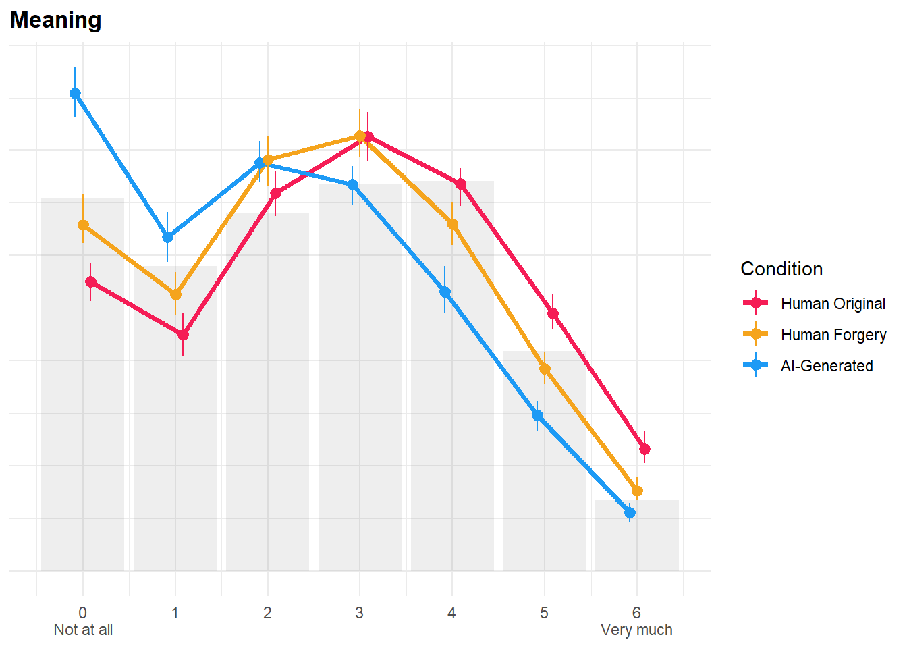{#fig-meaning-1 width=672}
:::

::: {.cell-output-display}
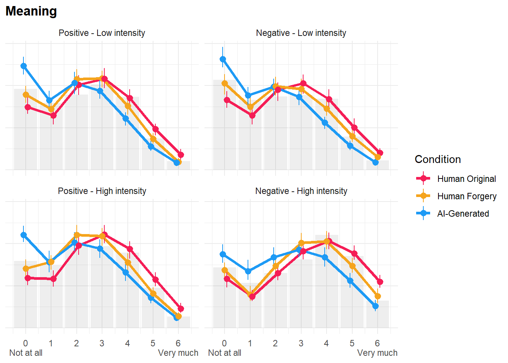{#fig-meaning-2 width=672}
:::

Meaning (0 = Not at all, 6 = Very much): observed proportion of each response (grey bars) and the model-implied probability per label condition (points with 95% CI).
:::


### Worth


::: {.cell}

```{.r .cell-code}
make_report(estimates$Worth)
```

::: {.cell-output-display}

```{=html}
<div id="dbsobnuoro" style="padding-left:0px;padding-right:0px;padding-top:10px;padding-bottom:10px;overflow-x:auto;overflow-y:auto;width:auto;height:auto;">
<style>#dbsobnuoro table {
  font-family: system-ui, 'Segoe UI', Roboto, Helvetica, Arial, sans-serif, 'Apple Color Emoji', 'Segoe UI Emoji', 'Segoe UI Symbol', 'Noto Color Emoji';
  -webkit-font-smoothing: antialiased;
  -moz-osx-font-smoothing: grayscale;
}

#dbsobnuoro thead, #dbsobnuoro tbody, #dbsobnuoro tfoot, #dbsobnuoro tr, #dbsobnuoro td, #dbsobnuoro th {
  border-style: none;
}

#dbsobnuoro p {
  margin: 0;
  padding: 0;
}

#dbsobnuoro .gt_table {
  display: table;
  border-collapse: collapse;
  line-height: normal;
  margin-left: auto;
  margin-right: auto;
  color: #333333;
  font-size: 16px;
  font-weight: normal;
  font-style: normal;
  background-color: #FFFFFF;
  width: auto;
  border-top-style: solid;
  border-top-width: 2px;
  border-top-color: #A8A8A8;
  border-right-style: none;
  border-right-width: 2px;
  border-right-color: #D3D3D3;
  border-bottom-style: solid;
  border-bottom-width: 2px;
  border-bottom-color: #A8A8A8;
  border-left-style: none;
  border-left-width: 2px;
  border-left-color: #D3D3D3;
}

#dbsobnuoro .gt_caption {
  padding-top: 4px;
  padding-bottom: 4px;
}

#dbsobnuoro .gt_title {
  color: #333333;
  font-size: 125%;
  font-weight: initial;
  padding-top: 4px;
  padding-bottom: 4px;
  padding-left: 5px;
  padding-right: 5px;
  border-bottom-color: #FFFFFF;
  border-bottom-width: 0;
}

#dbsobnuoro .gt_subtitle {
  color: #333333;
  font-size: 85%;
  font-weight: initial;
  padding-top: 3px;
  padding-bottom: 5px;
  padding-left: 5px;
  padding-right: 5px;
  border-top-color: #FFFFFF;
  border-top-width: 0;
}

#dbsobnuoro .gt_heading {
  background-color: #FFFFFF;
  text-align: center;
  border-bottom-color: #FFFFFF;
  border-left-style: none;
  border-left-width: 1px;
  border-left-color: #D3D3D3;
  border-right-style: none;
  border-right-width: 1px;
  border-right-color: #D3D3D3;
}

#dbsobnuoro .gt_bottom_border {
  border-bottom-style: solid;
  border-bottom-width: 2px;
  border-bottom-color: #D3D3D3;
}

#dbsobnuoro .gt_col_headings {
  border-top-style: solid;
  border-top-width: 2px;
  border-top-color: #D3D3D3;
  border-bottom-style: solid;
  border-bottom-width: 2px;
  border-bottom-color: #D3D3D3;
  border-left-style: none;
  border-left-width: 1px;
  border-left-color: #D3D3D3;
  border-right-style: none;
  border-right-width: 1px;
  border-right-color: #D3D3D3;
}

#dbsobnuoro .gt_col_heading {
  color: #333333;
  background-color: #FFFFFF;
  font-size: 100%;
  font-weight: normal;
  text-transform: inherit;
  border-left-style: none;
  border-left-width: 1px;
  border-left-color: #D3D3D3;
  border-right-style: none;
  border-right-width: 1px;
  border-right-color: #D3D3D3;
  vertical-align: bottom;
  padding-top: 5px;
  padding-bottom: 6px;
  padding-left: 5px;
  padding-right: 5px;
  overflow-x: hidden;
}

#dbsobnuoro .gt_column_spanner_outer {
  color: #333333;
  background-color: #FFFFFF;
  font-size: 100%;
  font-weight: normal;
  text-transform: inherit;
  padding-top: 0;
  padding-bottom: 0;
  padding-left: 4px;
  padding-right: 4px;
}

#dbsobnuoro .gt_column_spanner_outer:first-child {
  padding-left: 0;
}

#dbsobnuoro .gt_column_spanner_outer:last-child {
  padding-right: 0;
}

#dbsobnuoro .gt_column_spanner {
  border-bottom-style: solid;
  border-bottom-width: 2px;
  border-bottom-color: #D3D3D3;
  vertical-align: bottom;
  padding-top: 5px;
  padding-bottom: 5px;
  overflow-x: hidden;
  display: inline-block;
  width: 100%;
}

#dbsobnuoro .gt_spanner_row {
  border-bottom-style: hidden;
}

#dbsobnuoro .gt_group_heading {
  padding-top: 8px;
  padding-bottom: 8px;
  padding-left: 5px;
  padding-right: 5px;
  color: #333333;
  background-color: #FFFFFF;
  font-size: 100%;
  font-weight: initial;
  text-transform: inherit;
  border-top-style: solid;
  border-top-width: 2px;
  border-top-color: #D3D3D3;
  border-bottom-style: solid;
  border-bottom-width: 2px;
  border-bottom-color: #D3D3D3;
  border-left-style: none;
  border-left-width: 1px;
  border-left-color: #D3D3D3;
  border-right-style: none;
  border-right-width: 1px;
  border-right-color: #D3D3D3;
  vertical-align: middle;
  text-align: left;
}

#dbsobnuoro .gt_empty_group_heading {
  padding: 0.5px;
  color: #333333;
  background-color: #FFFFFF;
  font-size: 100%;
  font-weight: initial;
  border-top-style: solid;
  border-top-width: 2px;
  border-top-color: #D3D3D3;
  border-bottom-style: solid;
  border-bottom-width: 2px;
  border-bottom-color: #D3D3D3;
  vertical-align: middle;
}

#dbsobnuoro .gt_from_md > :first-child {
  margin-top: 0;
}

#dbsobnuoro .gt_from_md > :last-child {
  margin-bottom: 0;
}

#dbsobnuoro .gt_row {
  padding-top: 8px;
  padding-bottom: 8px;
  padding-left: 5px;
  padding-right: 5px;
  margin: 10px;
  border-top-style: solid;
  border-top-width: 1px;
  border-top-color: #D3D3D3;
  border-left-style: none;
  border-left-width: 1px;
  border-left-color: #D3D3D3;
  border-right-style: none;
  border-right-width: 1px;
  border-right-color: #D3D3D3;
  vertical-align: middle;
  overflow-x: hidden;
}

#dbsobnuoro .gt_stub {
  color: #333333;
  background-color: #FFFFFF;
  font-size: 100%;
  font-weight: initial;
  text-transform: inherit;
  border-right-style: solid;
  border-right-width: 2px;
  border-right-color: #D3D3D3;
  padding-left: 5px;
  padding-right: 5px;
}

#dbsobnuoro .gt_stub_row_group {
  color: #333333;
  background-color: #FFFFFF;
  font-size: 100%;
  font-weight: initial;
  text-transform: inherit;
  border-right-style: solid;
  border-right-width: 2px;
  border-right-color: #D3D3D3;
  padding-left: 5px;
  padding-right: 5px;
  vertical-align: top;
}

#dbsobnuoro .gt_row_group_first td {
  border-top-width: 2px;
}

#dbsobnuoro .gt_row_group_first th {
  border-top-width: 2px;
}

#dbsobnuoro .gt_summary_row {
  color: #333333;
  background-color: #FFFFFF;
  text-transform: inherit;
  padding-top: 8px;
  padding-bottom: 8px;
  padding-left: 5px;
  padding-right: 5px;
}

#dbsobnuoro .gt_first_summary_row {
  border-top-style: solid;
  border-top-color: #D3D3D3;
}

#dbsobnuoro .gt_first_summary_row.thick {
  border-top-width: 2px;
}

#dbsobnuoro .gt_last_summary_row {
  padding-top: 8px;
  padding-bottom: 8px;
  padding-left: 5px;
  padding-right: 5px;
  border-bottom-style: solid;
  border-bottom-width: 2px;
  border-bottom-color: #D3D3D3;
}

#dbsobnuoro .gt_grand_summary_row {
  color: #333333;
  background-color: #FFFFFF;
  text-transform: inherit;
  padding-top: 8px;
  padding-bottom: 8px;
  padding-left: 5px;
  padding-right: 5px;
}

#dbsobnuoro .gt_first_grand_summary_row {
  padding-top: 8px;
  padding-bottom: 8px;
  padding-left: 5px;
  padding-right: 5px;
  border-top-style: double;
  border-top-width: 6px;
  border-top-color: #D3D3D3;
}

#dbsobnuoro .gt_last_grand_summary_row_top {
  padding-top: 8px;
  padding-bottom: 8px;
  padding-left: 5px;
  padding-right: 5px;
  border-bottom-style: double;
  border-bottom-width: 6px;
  border-bottom-color: #D3D3D3;
}

#dbsobnuoro .gt_striped {
  background-color: rgba(128, 128, 128, 0.05);
}

#dbsobnuoro .gt_table_body {
  border-top-style: solid;
  border-top-width: 2px;
  border-top-color: #D3D3D3;
  border-bottom-style: solid;
  border-bottom-width: 2px;
  border-bottom-color: #D3D3D3;
}

#dbsobnuoro .gt_footnotes {
  color: #333333;
  background-color: #FFFFFF;
  border-bottom-style: none;
  border-bottom-width: 2px;
  border-bottom-color: #D3D3D3;
  border-left-style: none;
  border-left-width: 2px;
  border-left-color: #D3D3D3;
  border-right-style: none;
  border-right-width: 2px;
  border-right-color: #D3D3D3;
}

#dbsobnuoro .gt_footnote {
  margin: 0px;
  font-size: 90%;
  padding-top: 4px;
  padding-bottom: 4px;
  padding-left: 5px;
  padding-right: 5px;
}

#dbsobnuoro .gt_sourcenotes {
  color: #333333;
  background-color: #FFFFFF;
  border-bottom-style: none;
  border-bottom-width: 2px;
  border-bottom-color: #D3D3D3;
  border-left-style: none;
  border-left-width: 2px;
  border-left-color: #D3D3D3;
  border-right-style: none;
  border-right-width: 2px;
  border-right-color: #D3D3D3;
}

#dbsobnuoro .gt_sourcenote {
  font-size: 90%;
  padding-top: 4px;
  padding-bottom: 4px;
  padding-left: 5px;
  padding-right: 5px;
}

#dbsobnuoro .gt_left {
  text-align: left;
}

#dbsobnuoro .gt_center {
  text-align: center;
}

#dbsobnuoro .gt_right {
  text-align: right;
  font-variant-numeric: tabular-nums;
}

#dbsobnuoro .gt_font_normal {
  font-weight: normal;
}

#dbsobnuoro .gt_font_bold {
  font-weight: bold;
}

#dbsobnuoro .gt_font_italic {
  font-style: italic;
}

#dbsobnuoro .gt_super {
  font-size: 65%;
}

#dbsobnuoro .gt_footnote_marks {
  font-size: 75%;
  vertical-align: 0.4em;
  position: initial;
}

#dbsobnuoro .gt_asterisk {
  font-size: 100%;
  vertical-align: 0;
}

#dbsobnuoro .gt_indent_1 {
  text-indent: 5px;
}

#dbsobnuoro .gt_indent_2 {
  text-indent: 10px;
}

#dbsobnuoro .gt_indent_3 {
  text-indent: 15px;
}

#dbsobnuoro .gt_indent_4 {
  text-indent: 20px;
}

#dbsobnuoro .gt_indent_5 {
  text-indent: 25px;
}

#dbsobnuoro .katex-display {
  display: inline-flex !important;
  margin-bottom: 0.75em !important;
}

#dbsobnuoro div.Reactable > div.rt-table > div.rt-thead > div.rt-tr.rt-tr-group-header > div.rt-th-group:after {
  height: 0px !important;
}
</style>
<table class="gt_table" data-quarto-disable-processing="false" data-quarto-bootstrap="false">
  <thead>
    <tr class="gt_col_headings">
      <th class="gt_col_heading gt_columns_bottom_border gt_left" rowspan="1" colspan="1" scope="col" id="Contrast">Contrast</th>
      <th class="gt_col_heading gt_columns_bottom_border gt_left" rowspan="1" colspan="1" scope="col" id="Parameters">Parameters</th>
    </tr>
  </thead>
  <tbody class="gt_table_body">
    <tr><td headers="Contrast" class="gt_row gt_left">Human Forgery - Human Original</td>
<td headers="Parameters" class="gt_row gt_left">response - 0 (0.09, [ 0.08,  0.11]); response - 10 (0.02, [ 0.01,  0.03]); response - 100 (-0.03, [-0.04, -0.02]); response - 1000 (-0.06, [-0.06, -0.05]); response - 10000 (-0.02, [-0.03, -0.02]); response - 100000 (0.00, [-0.01,  0.00]); mu (-0.14, [-0.15, -0.12])</td></tr>
    <tr><td headers="Contrast" class="gt_row gt_left">AI-Generated - Human Original</td>
<td headers="Parameters" class="gt_row gt_left">response - 0 (0.18, [ 0.17,  0.19]); response - 10 (0.02, [ 0.01,  0.02]); response - 100 (-0.07, [-0.08, -0.07]); response - 1000 (-0.09, [-0.10, -0.08]); response - 10000 (-0.03, [-0.03, -0.03]); response - 100000 (-0.01, [-0.01,  0.00]); mu (-0.24, [-0.26, -0.21])</td></tr>
    <tr><td headers="Contrast" class="gt_row gt_left">AI-Generated - Human Forgery</td>
<td headers="Parameters" class="gt_row gt_left">response - 0 (0.09, [ 0.08,  0.10]); response - 100 (-0.04, [-0.05, -0.04]); response - 1000 (-0.03, [-0.04, -0.03]); response - 10000 (-0.01, [-0.01, -0.01]); response - 100000 (0.00, [ 0.00,  0.00]); mu (-0.10, [-0.12, -0.08])</td></tr>
  </tbody>
  
</table>
</div>
```

```{=html}
<div id="vfueveshhk" style="padding-left:0px;padding-right:0px;padding-top:10px;padding-bottom:10px;overflow-x:auto;overflow-y:auto;width:auto;height:auto;">
<style>#vfueveshhk table {
  font-family: system-ui, 'Segoe UI', Roboto, Helvetica, Arial, sans-serif, 'Apple Color Emoji', 'Segoe UI Emoji', 'Segoe UI Symbol', 'Noto Color Emoji';
  -webkit-font-smoothing: antialiased;
  -moz-osx-font-smoothing: grayscale;
}

#vfueveshhk thead, #vfueveshhk tbody, #vfueveshhk tfoot, #vfueveshhk tr, #vfueveshhk td, #vfueveshhk th {
  border-style: none;
}

#vfueveshhk p {
  margin: 0;
  padding: 0;
}

#vfueveshhk .gt_table {
  display: table;
  border-collapse: collapse;
  line-height: normal;
  margin-left: auto;
  margin-right: auto;
  color: #333333;
  font-size: 16px;
  font-weight: normal;
  font-style: normal;
  background-color: #FFFFFF;
  width: auto;
  border-top-style: solid;
  border-top-width: 2px;
  border-top-color: #A8A8A8;
  border-right-style: none;
  border-right-width: 2px;
  border-right-color: #D3D3D3;
  border-bottom-style: solid;
  border-bottom-width: 2px;
  border-bottom-color: #A8A8A8;
  border-left-style: none;
  border-left-width: 2px;
  border-left-color: #D3D3D3;
}

#vfueveshhk .gt_caption {
  padding-top: 4px;
  padding-bottom: 4px;
}

#vfueveshhk .gt_title {
  color: #333333;
  font-size: 125%;
  font-weight: initial;
  padding-top: 4px;
  padding-bottom: 4px;
  padding-left: 5px;
  padding-right: 5px;
  border-bottom-color: #FFFFFF;
  border-bottom-width: 0;
}

#vfueveshhk .gt_subtitle {
  color: #333333;
  font-size: 85%;
  font-weight: initial;
  padding-top: 3px;
  padding-bottom: 5px;
  padding-left: 5px;
  padding-right: 5px;
  border-top-color: #FFFFFF;
  border-top-width: 0;
}

#vfueveshhk .gt_heading {
  background-color: #FFFFFF;
  text-align: center;
  border-bottom-color: #FFFFFF;
  border-left-style: none;
  border-left-width: 1px;
  border-left-color: #D3D3D3;
  border-right-style: none;
  border-right-width: 1px;
  border-right-color: #D3D3D3;
}

#vfueveshhk .gt_bottom_border {
  border-bottom-style: solid;
  border-bottom-width: 2px;
  border-bottom-color: #D3D3D3;
}

#vfueveshhk .gt_col_headings {
  border-top-style: solid;
  border-top-width: 2px;
  border-top-color: #D3D3D3;
  border-bottom-style: solid;
  border-bottom-width: 2px;
  border-bottom-color: #D3D3D3;
  border-left-style: none;
  border-left-width: 1px;
  border-left-color: #D3D3D3;
  border-right-style: none;
  border-right-width: 1px;
  border-right-color: #D3D3D3;
}

#vfueveshhk .gt_col_heading {
  color: #333333;
  background-color: #FFFFFF;
  font-size: 100%;
  font-weight: normal;
  text-transform: inherit;
  border-left-style: none;
  border-left-width: 1px;
  border-left-color: #D3D3D3;
  border-right-style: none;
  border-right-width: 1px;
  border-right-color: #D3D3D3;
  vertical-align: bottom;
  padding-top: 5px;
  padding-bottom: 6px;
  padding-left: 5px;
  padding-right: 5px;
  overflow-x: hidden;
}

#vfueveshhk .gt_column_spanner_outer {
  color: #333333;
  background-color: #FFFFFF;
  font-size: 100%;
  font-weight: normal;
  text-transform: inherit;
  padding-top: 0;
  padding-bottom: 0;
  padding-left: 4px;
  padding-right: 4px;
}

#vfueveshhk .gt_column_spanner_outer:first-child {
  padding-left: 0;
}

#vfueveshhk .gt_column_spanner_outer:last-child {
  padding-right: 0;
}

#vfueveshhk .gt_column_spanner {
  border-bottom-style: solid;
  border-bottom-width: 2px;
  border-bottom-color: #D3D3D3;
  vertical-align: bottom;
  padding-top: 5px;
  padding-bottom: 5px;
  overflow-x: hidden;
  display: inline-block;
  width: 100%;
}

#vfueveshhk .gt_spanner_row {
  border-bottom-style: hidden;
}

#vfueveshhk .gt_group_heading {
  padding-top: 8px;
  padding-bottom: 8px;
  padding-left: 5px;
  padding-right: 5px;
  color: #333333;
  background-color: #FFFFFF;
  font-size: 100%;
  font-weight: initial;
  text-transform: inherit;
  border-top-style: solid;
  border-top-width: 2px;
  border-top-color: #D3D3D3;
  border-bottom-style: solid;
  border-bottom-width: 2px;
  border-bottom-color: #D3D3D3;
  border-left-style: none;
  border-left-width: 1px;
  border-left-color: #D3D3D3;
  border-right-style: none;
  border-right-width: 1px;
  border-right-color: #D3D3D3;
  vertical-align: middle;
  text-align: left;
}

#vfueveshhk .gt_empty_group_heading {
  padding: 0.5px;
  color: #333333;
  background-color: #FFFFFF;
  font-size: 100%;
  font-weight: initial;
  border-top-style: solid;
  border-top-width: 2px;
  border-top-color: #D3D3D3;
  border-bottom-style: solid;
  border-bottom-width: 2px;
  border-bottom-color: #D3D3D3;
  vertical-align: middle;
}

#vfueveshhk .gt_from_md > :first-child {
  margin-top: 0;
}

#vfueveshhk .gt_from_md > :last-child {
  margin-bottom: 0;
}

#vfueveshhk .gt_row {
  padding-top: 8px;
  padding-bottom: 8px;
  padding-left: 5px;
  padding-right: 5px;
  margin: 10px;
  border-top-style: solid;
  border-top-width: 1px;
  border-top-color: #D3D3D3;
  border-left-style: none;
  border-left-width: 1px;
  border-left-color: #D3D3D3;
  border-right-style: none;
  border-right-width: 1px;
  border-right-color: #D3D3D3;
  vertical-align: middle;
  overflow-x: hidden;
}

#vfueveshhk .gt_stub {
  color: #333333;
  background-color: #FFFFFF;
  font-size: 100%;
  font-weight: initial;
  text-transform: inherit;
  border-right-style: solid;
  border-right-width: 2px;
  border-right-color: #D3D3D3;
  padding-left: 5px;
  padding-right: 5px;
}

#vfueveshhk .gt_stub_row_group {
  color: #333333;
  background-color: #FFFFFF;
  font-size: 100%;
  font-weight: initial;
  text-transform: inherit;
  border-right-style: solid;
  border-right-width: 2px;
  border-right-color: #D3D3D3;
  padding-left: 5px;
  padding-right: 5px;
  vertical-align: top;
}

#vfueveshhk .gt_row_group_first td {
  border-top-width: 2px;
}

#vfueveshhk .gt_row_group_first th {
  border-top-width: 2px;
}

#vfueveshhk .gt_summary_row {
  color: #333333;
  background-color: #FFFFFF;
  text-transform: inherit;
  padding-top: 8px;
  padding-bottom: 8px;
  padding-left: 5px;
  padding-right: 5px;
}

#vfueveshhk .gt_first_summary_row {
  border-top-style: solid;
  border-top-color: #D3D3D3;
}

#vfueveshhk .gt_first_summary_row.thick {
  border-top-width: 2px;
}

#vfueveshhk .gt_last_summary_row {
  padding-top: 8px;
  padding-bottom: 8px;
  padding-left: 5px;
  padding-right: 5px;
  border-bottom-style: solid;
  border-bottom-width: 2px;
  border-bottom-color: #D3D3D3;
}

#vfueveshhk .gt_grand_summary_row {
  color: #333333;
  background-color: #FFFFFF;
  text-transform: inherit;
  padding-top: 8px;
  padding-bottom: 8px;
  padding-left: 5px;
  padding-right: 5px;
}

#vfueveshhk .gt_first_grand_summary_row {
  padding-top: 8px;
  padding-bottom: 8px;
  padding-left: 5px;
  padding-right: 5px;
  border-top-style: double;
  border-top-width: 6px;
  border-top-color: #D3D3D3;
}

#vfueveshhk .gt_last_grand_summary_row_top {
  padding-top: 8px;
  padding-bottom: 8px;
  padding-left: 5px;
  padding-right: 5px;
  border-bottom-style: double;
  border-bottom-width: 6px;
  border-bottom-color: #D3D3D3;
}

#vfueveshhk .gt_striped {
  background-color: rgba(128, 128, 128, 0.05);
}

#vfueveshhk .gt_table_body {
  border-top-style: solid;
  border-top-width: 2px;
  border-top-color: #D3D3D3;
  border-bottom-style: solid;
  border-bottom-width: 2px;
  border-bottom-color: #D3D3D3;
}

#vfueveshhk .gt_footnotes {
  color: #333333;
  background-color: #FFFFFF;
  border-bottom-style: none;
  border-bottom-width: 2px;
  border-bottom-color: #D3D3D3;
  border-left-style: none;
  border-left-width: 2px;
  border-left-color: #D3D3D3;
  border-right-style: none;
  border-right-width: 2px;
  border-right-color: #D3D3D3;
}

#vfueveshhk .gt_footnote {
  margin: 0px;
  font-size: 90%;
  padding-top: 4px;
  padding-bottom: 4px;
  padding-left: 5px;
  padding-right: 5px;
}

#vfueveshhk .gt_sourcenotes {
  color: #333333;
  background-color: #FFFFFF;
  border-bottom-style: none;
  border-bottom-width: 2px;
  border-bottom-color: #D3D3D3;
  border-left-style: none;
  border-left-width: 2px;
  border-left-color: #D3D3D3;
  border-right-style: none;
  border-right-width: 2px;
  border-right-color: #D3D3D3;
}

#vfueveshhk .gt_sourcenote {
  font-size: 90%;
  padding-top: 4px;
  padding-bottom: 4px;
  padding-left: 5px;
  padding-right: 5px;
}

#vfueveshhk .gt_left {
  text-align: left;
}

#vfueveshhk .gt_center {
  text-align: center;
}

#vfueveshhk .gt_right {
  text-align: right;
  font-variant-numeric: tabular-nums;
}

#vfueveshhk .gt_font_normal {
  font-weight: normal;
}

#vfueveshhk .gt_font_bold {
  font-weight: bold;
}

#vfueveshhk .gt_font_italic {
  font-style: italic;
}

#vfueveshhk .gt_super {
  font-size: 65%;
}

#vfueveshhk .gt_footnote_marks {
  font-size: 75%;
  vertical-align: 0.4em;
  position: initial;
}

#vfueveshhk .gt_asterisk {
  font-size: 100%;
  vertical-align: 0;
}

#vfueveshhk .gt_indent_1 {
  text-indent: 5px;
}

#vfueveshhk .gt_indent_2 {
  text-indent: 10px;
}

#vfueveshhk .gt_indent_3 {
  text-indent: 15px;
}

#vfueveshhk .gt_indent_4 {
  text-indent: 20px;
}

#vfueveshhk .gt_indent_5 {
  text-indent: 25px;
}

#vfueveshhk .katex-display {
  display: inline-flex !important;
  margin-bottom: 0.75em !important;
}

#vfueveshhk div.Reactable > div.rt-table > div.rt-thead > div.rt-tr.rt-tr-group-header > div.rt-th-group:after {
  height: 0px !important;
}
</style>
<table class="gt_table" data-quarto-disable-processing="false" data-quarto-bootstrap="false">
  <thead>
    <tr class="gt_col_headings">
      <th class="gt_col_heading gt_columns_bottom_border gt_left" rowspan="1" colspan="1" scope="col" id="Contrast">Contrast</th>
      <th class="gt_col_heading gt_columns_bottom_border gt_left" rowspan="1" colspan="1" scope="col" id="Parameters">Parameters</th>
    </tr>
  </thead>
  <tbody class="gt_table_body">
    <tr><td headers="Contrast" class="gt_row gt_left">Negative - Low intensity - Positive - Low intensity</td>
<td headers="Parameters" class="gt_row gt_left">response - 0 (0.08, [ 0.01,  0.16]); response - 10 (-0.02, [-0.03, -0.01]); response - 100 (-0.04, [-0.07,  0.00])</td></tr>
    <tr><td headers="Contrast" class="gt_row gt_left">Negative - High intensity - Positive - Low intensity</td>
<td headers="Parameters" class="gt_row gt_left">response - 0 (0.11, [ 0.03,  0.18]); response - 10 (-0.04, [-0.05, -0.03]); response - 100 (-0.05, [-0.08, -0.01])</td></tr>
    <tr><td headers="Contrast" class="gt_row gt_left">Positive - High intensity - Negative - Low intensity</td>
<td headers="Parameters" class="gt_row gt_left">response - 0 (-0.08, [-0.17, -0.01]); response - 10 (0.01, [ 0.00,  0.02]); response - 100 (0.04, [ 0.00,  0.07]); mu (0.08, [ 0.00,  0.16])</td></tr>
    <tr><td headers="Contrast" class="gt_row gt_left">Negative - High intensity - Positive - High intensity</td>
<td headers="Parameters" class="gt_row gt_left">response - 0 (0.11, [ 0.03,  0.18]); response - 10 (-0.03, [-0.04, -0.02]); response - 100 (-0.05, [-0.08, -0.01])</td></tr>
    <tr><td headers="Contrast" class="gt_row gt_left">Positive - High intensity - Positive - Low intensity</td>
<td headers="Parameters" class="gt_row gt_left">response - 10 (-0.01, [-0.02,  0.00])</td></tr>
    <tr><td headers="Contrast" class="gt_row gt_left">Negative - High intensity - Negative - Low intensity</td>
<td headers="Parameters" class="gt_row gt_left">response - 10 (-0.02, [-0.03, -0.01])</td></tr>
  </tbody>
  
</table>
</div>
```

```{=html}
<div id="gjskwjwjug" style="padding-left:0px;padding-right:0px;padding-top:10px;padding-bottom:10px;overflow-x:auto;overflow-y:auto;width:auto;height:auto;">
<style>#gjskwjwjug table {
  font-family: system-ui, 'Segoe UI', Roboto, Helvetica, Arial, sans-serif, 'Apple Color Emoji', 'Segoe UI Emoji', 'Segoe UI Symbol', 'Noto Color Emoji';
  -webkit-font-smoothing: antialiased;
  -moz-osx-font-smoothing: grayscale;
}

#gjskwjwjug thead, #gjskwjwjug tbody, #gjskwjwjug tfoot, #gjskwjwjug tr, #gjskwjwjug td, #gjskwjwjug th {
  border-style: none;
}

#gjskwjwjug p {
  margin: 0;
  padding: 0;
}

#gjskwjwjug .gt_table {
  display: table;
  border-collapse: collapse;
  line-height: normal;
  margin-left: auto;
  margin-right: auto;
  color: #333333;
  font-size: 13px;
  font-weight: normal;
  font-style: normal;
  background-color: #FFFFFF;
  width: auto;
  border-top-style: solid;
  border-top-width: 3px;
  border-top-color: #D5D5D5;
  border-right-style: solid;
  border-right-width: 3px;
  border-right-color: #D5D5D5;
  border-bottom-style: solid;
  border-bottom-width: 3px;
  border-bottom-color: #D5D5D5;
  border-left-style: solid;
  border-left-width: 3px;
  border-left-color: #D5D5D5;
}

#gjskwjwjug .gt_caption {
  padding-top: 4px;
  padding-bottom: 4px;
}

#gjskwjwjug .gt_title {
  color: #333333;
  font-size: 125%;
  font-weight: initial;
  padding-top: 4px;
  padding-bottom: 4px;
  padding-left: 5px;
  padding-right: 5px;
  border-bottom-color: #FFFFFF;
  border-bottom-width: 0;
}

#gjskwjwjug .gt_subtitle {
  color: #333333;
  font-size: 85%;
  font-weight: initial;
  padding-top: 3px;
  padding-bottom: 5px;
  padding-left: 5px;
  padding-right: 5px;
  border-top-color: #FFFFFF;
  border-top-width: 0;
}

#gjskwjwjug .gt_heading {
  background-color: #FFFFFF;
  text-align: left;
  border-bottom-color: #FFFFFF;
  border-left-style: none;
  border-left-width: 1px;
  border-left-color: #D3D3D3;
  border-right-style: none;
  border-right-width: 1px;
  border-right-color: #D3D3D3;
}

#gjskwjwjug .gt_bottom_border {
  border-bottom-style: solid;
  border-bottom-width: 2px;
  border-bottom-color: #D5D5D5;
}

#gjskwjwjug .gt_col_headings {
  border-top-style: solid;
  border-top-width: 2px;
  border-top-color: #D5D5D5;
  border-bottom-style: solid;
  border-bottom-width: 2px;
  border-bottom-color: #D5D5D5;
  border-left-style: none;
  border-left-width: 1px;
  border-left-color: #D3D3D3;
  border-right-style: none;
  border-right-width: 1px;
  border-right-color: #D3D3D3;
}

#gjskwjwjug .gt_col_heading {
  color: #FFFFFF;
  background-color: #000000;
  font-size: 100%;
  font-weight: normal;
  text-transform: inherit;
  border-left-style: none;
  border-left-width: 1px;
  border-left-color: #D3D3D3;
  border-right-style: none;
  border-right-width: 1px;
  border-right-color: #D3D3D3;
  vertical-align: bottom;
  padding-top: 5px;
  padding-bottom: 6px;
  padding-left: 5px;
  padding-right: 5px;
  overflow-x: hidden;
}

#gjskwjwjug .gt_column_spanner_outer {
  color: #FFFFFF;
  background-color: #000000;
  font-size: 100%;
  font-weight: normal;
  text-transform: inherit;
  padding-top: 0;
  padding-bottom: 0;
  padding-left: 4px;
  padding-right: 4px;
}

#gjskwjwjug .gt_column_spanner_outer:first-child {
  padding-left: 0;
}

#gjskwjwjug .gt_column_spanner_outer:last-child {
  padding-right: 0;
}

#gjskwjwjug .gt_column_spanner {
  border-bottom-style: solid;
  border-bottom-width: 2px;
  border-bottom-color: #D5D5D5;
  vertical-align: bottom;
  padding-top: 5px;
  padding-bottom: 5px;
  overflow-x: hidden;
  display: inline-block;
  width: 100%;
}

#gjskwjwjug .gt_spanner_row {
  border-bottom-style: hidden;
}

#gjskwjwjug .gt_group_heading {
  padding-top: 8px;
  padding-bottom: 8px;
  padding-left: 5px;
  padding-right: 5px;
  color: #333333;
  background-color: #FFFFFF;
  font-size: 100%;
  font-weight: initial;
  text-transform: inherit;
  border-top-style: solid;
  border-top-width: 2px;
  border-top-color: #D5D5D5;
  border-bottom-style: solid;
  border-bottom-width: 2px;
  border-bottom-color: #D5D5D5;
  border-left-style: none;
  border-left-width: 1px;
  border-left-color: #D3D3D3;
  border-right-style: none;
  border-right-width: 1px;
  border-right-color: #D3D3D3;
  vertical-align: middle;
  text-align: left;
}

#gjskwjwjug .gt_empty_group_heading {
  padding: 0.5px;
  color: #333333;
  background-color: #FFFFFF;
  font-size: 100%;
  font-weight: initial;
  border-top-style: solid;
  border-top-width: 2px;
  border-top-color: #D5D5D5;
  border-bottom-style: solid;
  border-bottom-width: 2px;
  border-bottom-color: #D5D5D5;
  vertical-align: middle;
}

#gjskwjwjug .gt_from_md > :first-child {
  margin-top: 0;
}

#gjskwjwjug .gt_from_md > :last-child {
  margin-bottom: 0;
}

#gjskwjwjug .gt_row {
  padding-top: 8px;
  padding-bottom: 8px;
  padding-left: 5px;
  padding-right: 5px;
  margin: 10px;
  border-top-style: solid;
  border-top-width: 1px;
  border-top-color: #D5D5D5;
  border-left-style: solid;
  border-left-width: 1px;
  border-left-color: #D5D5D5;
  border-right-style: solid;
  border-right-width: 1px;
  border-right-color: #D5D5D5;
  vertical-align: middle;
  overflow-x: hidden;
}

#gjskwjwjug .gt_stub {
  color: #333333;
  background-color: #FFFFFF;
  font-size: 100%;
  font-weight: initial;
  text-transform: inherit;
  border-right-style: solid;
  border-right-width: 2px;
  border-right-color: #5F5F5F;
  padding-left: 5px;
  padding-right: 5px;
}

#gjskwjwjug .gt_stub_row_group {
  color: #333333;
  background-color: #FFFFFF;
  font-size: 100%;
  font-weight: initial;
  text-transform: inherit;
  border-right-style: solid;
  border-right-width: 2px;
  border-right-color: #D3D3D3;
  padding-left: 5px;
  padding-right: 5px;
  vertical-align: top;
}

#gjskwjwjug .gt_row_group_first td {
  border-top-width: 2px;
}

#gjskwjwjug .gt_row_group_first th {
  border-top-width: 2px;
}

#gjskwjwjug .gt_summary_row {
  color: #333333;
  background-color: #D5D5D5;
  text-transform: inherit;
  padding-top: 8px;
  padding-bottom: 8px;
  padding-left: 5px;
  padding-right: 5px;
}

#gjskwjwjug .gt_first_summary_row {
  border-top-style: solid;
  border-top-color: #D5D5D5;
}

#gjskwjwjug .gt_first_summary_row.thick {
  border-top-width: 2px;
}

#gjskwjwjug .gt_last_summary_row {
  padding-top: 8px;
  padding-bottom: 8px;
  padding-left: 5px;
  padding-right: 5px;
  border-bottom-style: solid;
  border-bottom-width: 2px;
  border-bottom-color: #D5D5D5;
}

#gjskwjwjug .gt_grand_summary_row {
  color: #FFFFFF;
  background-color: #929292;
  text-transform: inherit;
  padding-top: 8px;
  padding-bottom: 8px;
  padding-left: 5px;
  padding-right: 5px;
}

#gjskwjwjug .gt_first_grand_summary_row {
  padding-top: 8px;
  padding-bottom: 8px;
  padding-left: 5px;
  padding-right: 5px;
  border-top-style: double;
  border-top-width: 6px;
  border-top-color: #D5D5D5;
}

#gjskwjwjug .gt_last_grand_summary_row_top {
  padding-top: 8px;
  padding-bottom: 8px;
  padding-left: 5px;
  padding-right: 5px;
  border-bottom-style: double;
  border-bottom-width: 6px;
  border-bottom-color: #D5D5D5;
}

#gjskwjwjug .gt_striped {
  background-color: #F4F4F4;
}

#gjskwjwjug .gt_table_body {
  border-top-style: solid;
  border-top-width: 2px;
  border-top-color: #D5D5D5;
  border-bottom-style: solid;
  border-bottom-width: 2px;
  border-bottom-color: #D5D5D5;
}

#gjskwjwjug .gt_footnotes {
  color: #333333;
  background-color: #FFFFFF;
  border-bottom-style: none;
  border-bottom-width: 2px;
  border-bottom-color: #D3D3D3;
  border-left-style: none;
  border-left-width: 2px;
  border-left-color: #D3D3D3;
  border-right-style: none;
  border-right-width: 2px;
  border-right-color: #D3D3D3;
}

#gjskwjwjug .gt_footnote {
  margin: 0px;
  font-size: 90%;
  padding-top: 4px;
  padding-bottom: 4px;
  padding-left: 5px;
  padding-right: 5px;
}

#gjskwjwjug .gt_sourcenotes {
  color: #333333;
  background-color: #FFFFFF;
  border-bottom-style: none;
  border-bottom-width: 2px;
  border-bottom-color: #D3D3D3;
  border-left-style: none;
  border-left-width: 2px;
  border-left-color: #D3D3D3;
  border-right-style: none;
  border-right-width: 2px;
  border-right-color: #D3D3D3;
}

#gjskwjwjug .gt_sourcenote {
  font-size: 90%;
  padding-top: 4px;
  padding-bottom: 4px;
  padding-left: 5px;
  padding-right: 5px;
}

#gjskwjwjug .gt_left {
  text-align: left;
}

#gjskwjwjug .gt_center {
  text-align: center;
}

#gjskwjwjug .gt_right {
  text-align: right;
  font-variant-numeric: tabular-nums;
}

#gjskwjwjug .gt_font_normal {
  font-weight: normal;
}

#gjskwjwjug .gt_font_bold {
  font-weight: bold;
}

#gjskwjwjug .gt_font_italic {
  font-style: italic;
}

#gjskwjwjug .gt_super {
  font-size: 65%;
}

#gjskwjwjug .gt_footnote_marks {
  font-size: 75%;
  vertical-align: 0.4em;
  position: initial;
}

#gjskwjwjug .gt_asterisk {
  font-size: 100%;
  vertical-align: 0;
}

#gjskwjwjug .gt_indent_1 {
  text-indent: 5px;
}

#gjskwjwjug .gt_indent_2 {
  text-indent: 10px;
}

#gjskwjwjug .gt_indent_3 {
  text-indent: 15px;
}

#gjskwjwjug .gt_indent_4 {
  text-indent: 20px;
}

#gjskwjwjug .gt_indent_5 {
  text-indent: 25px;
}

#gjskwjwjug .katex-display {
  display: inline-flex !important;
  margin-bottom: 0.75em !important;
}

#gjskwjwjug div.Reactable > div.rt-table > div.rt-thead > div.rt-tr.rt-tr-group-header > div.rt-th-group:after {
  height: 0px !important;
}
</style>
<table class="gt_table" data-quarto-disable-processing="false" data-quarto-bootstrap="false">
  <thead>
    <tr class="gt_heading">
      <td colspan="10" class="gt_heading gt_title gt_font_normal gt_bottom_border" style>Worth: convergence</td>
    </tr>
    
    <tr class="gt_col_headings">
      <th class="gt_col_heading gt_columns_bottom_border gt_left" rowspan="1" colspan="1" scope="col" id="Model">Model</th>
      <th class="gt_col_heading gt_columns_bottom_border gt_left" rowspan="1" colspan="1" scope="col" id="Family">Family</th>
      <th class="gt_col_heading gt_columns_bottom_border gt_right" rowspan="1" colspan="1" scope="col" id="N_obs">N_obs</th>
      <th class="gt_col_heading gt_columns_bottom_border gt_right" rowspan="1" colspan="1" scope="col" id="N_participants">N_participants</th>
      <th class="gt_col_heading gt_columns_bottom_border gt_right" rowspan="1" colspan="1" scope="col" id="Chains">Chains</th>
      <th class="gt_col_heading gt_columns_bottom_border gt_right" rowspan="1" colspan="1" scope="col" id="Draws">Draws</th>
      <th class="gt_col_heading gt_columns_bottom_border gt_right" rowspan="1" colspan="1" scope="col" id="Max_Rhat">Max_Rhat</th>
      <th class="gt_col_heading gt_columns_bottom_border gt_right" rowspan="1" colspan="1" scope="col" id="Min_ESS_ratio">Min_ESS_ratio</th>
      <th class="gt_col_heading gt_columns_bottom_border gt_right" rowspan="1" colspan="1" scope="col" id="Divergent_pct">Divergent_pct</th>
      <th class="gt_col_heading gt_columns_bottom_border gt_left" rowspan="1" colspan="1" scope="col" id="Criterion">Criterion</th>
    </tr>
  </thead>
  <tbody class="gt_table_body">
    <tr><td headers="Model" class="gt_row gt_left">Worth</td>
<td headers="Family" class="gt_row gt_left">Cumulative (ordinal)</td>
<td headers="N_obs" class="gt_row gt_right">15552</td>
<td headers="N_participants" class="gt_row gt_right">324</td>
<td headers="Chains" class="gt_row gt_right">8</td>
<td headers="Draws" class="gt_row gt_right">4000</td>
<td headers="Max_Rhat" class="gt_row gt_right">1.037</td>
<td headers="Min_ESS_ratio" class="gt_row gt_right">0.078</td>
<td headers="Divergent_pct" class="gt_row gt_right">0</td>
<td headers="Criterion" class="gt_row gt_left">loo</td></tr>
  </tbody>
  
</table>
</div>
```


::: {.callout-note collapse="true" title="Worth: convergence (Markdown table, for text readers)"}

|Model |Family               | N_obs| N_participants| Chains| Draws| Max_Rhat| Min_ESS_ratio| Divergent_pct|Criterion |
|:-----|:--------------------|-----:|--------------:|------:|-----:|--------:|-------------:|-------------:|:---------|
|Worth |Cumulative (ordinal) | 15552|            324|      8|  4000|    1.037|         0.078|             0|loo       |

:::

```{=html}
<div id="spbgpxspjx" style="padding-left:0px;padding-right:0px;padding-top:10px;padding-bottom:10px;overflow-x:auto;overflow-y:auto;width:auto;height:auto;">
<style>#spbgpxspjx table {
  font-family: system-ui, 'Segoe UI', Roboto, Helvetica, Arial, sans-serif, 'Apple Color Emoji', 'Segoe UI Emoji', 'Segoe UI Symbol', 'Noto Color Emoji';
  -webkit-font-smoothing: antialiased;
  -moz-osx-font-smoothing: grayscale;
}

#spbgpxspjx thead, #spbgpxspjx tbody, #spbgpxspjx tfoot, #spbgpxspjx tr, #spbgpxspjx td, #spbgpxspjx th {
  border-style: none;
}

#spbgpxspjx p {
  margin: 0;
  padding: 0;
}

#spbgpxspjx .gt_table {
  display: table;
  border-collapse: collapse;
  line-height: normal;
  margin-left: auto;
  margin-right: auto;
  color: #333333;
  font-size: 13px;
  font-weight: normal;
  font-style: normal;
  background-color: #FFFFFF;
  width: auto;
  border-top-style: solid;
  border-top-width: 3px;
  border-top-color: #D5D5D5;
  border-right-style: solid;
  border-right-width: 3px;
  border-right-color: #D5D5D5;
  border-bottom-style: solid;
  border-bottom-width: 3px;
  border-bottom-color: #D5D5D5;
  border-left-style: solid;
  border-left-width: 3px;
  border-left-color: #D5D5D5;
}

#spbgpxspjx .gt_caption {
  padding-top: 4px;
  padding-bottom: 4px;
}

#spbgpxspjx .gt_title {
  color: #333333;
  font-size: 125%;
  font-weight: initial;
  padding-top: 4px;
  padding-bottom: 4px;
  padding-left: 5px;
  padding-right: 5px;
  border-bottom-color: #FFFFFF;
  border-bottom-width: 0;
}

#spbgpxspjx .gt_subtitle {
  color: #333333;
  font-size: 85%;
  font-weight: initial;
  padding-top: 3px;
  padding-bottom: 5px;
  padding-left: 5px;
  padding-right: 5px;
  border-top-color: #FFFFFF;
  border-top-width: 0;
}

#spbgpxspjx .gt_heading {
  background-color: #FFFFFF;
  text-align: left;
  border-bottom-color: #FFFFFF;
  border-left-style: none;
  border-left-width: 1px;
  border-left-color: #D3D3D3;
  border-right-style: none;
  border-right-width: 1px;
  border-right-color: #D3D3D3;
}

#spbgpxspjx .gt_bottom_border {
  border-bottom-style: solid;
  border-bottom-width: 2px;
  border-bottom-color: #D5D5D5;
}

#spbgpxspjx .gt_col_headings {
  border-top-style: solid;
  border-top-width: 2px;
  border-top-color: #D5D5D5;
  border-bottom-style: solid;
  border-bottom-width: 2px;
  border-bottom-color: #D5D5D5;
  border-left-style: none;
  border-left-width: 1px;
  border-left-color: #D3D3D3;
  border-right-style: none;
  border-right-width: 1px;
  border-right-color: #D3D3D3;
}

#spbgpxspjx .gt_col_heading {
  color: #FFFFFF;
  background-color: #000000;
  font-size: 100%;
  font-weight: normal;
  text-transform: inherit;
  border-left-style: none;
  border-left-width: 1px;
  border-left-color: #D3D3D3;
  border-right-style: none;
  border-right-width: 1px;
  border-right-color: #D3D3D3;
  vertical-align: bottom;
  padding-top: 5px;
  padding-bottom: 6px;
  padding-left: 5px;
  padding-right: 5px;
  overflow-x: hidden;
}

#spbgpxspjx .gt_column_spanner_outer {
  color: #FFFFFF;
  background-color: #000000;
  font-size: 100%;
  font-weight: normal;
  text-transform: inherit;
  padding-top: 0;
  padding-bottom: 0;
  padding-left: 4px;
  padding-right: 4px;
}

#spbgpxspjx .gt_column_spanner_outer:first-child {
  padding-left: 0;
}

#spbgpxspjx .gt_column_spanner_outer:last-child {
  padding-right: 0;
}

#spbgpxspjx .gt_column_spanner {
  border-bottom-style: solid;
  border-bottom-width: 2px;
  border-bottom-color: #D5D5D5;
  vertical-align: bottom;
  padding-top: 5px;
  padding-bottom: 5px;
  overflow-x: hidden;
  display: inline-block;
  width: 100%;
}

#spbgpxspjx .gt_spanner_row {
  border-bottom-style: hidden;
}

#spbgpxspjx .gt_group_heading {
  padding-top: 8px;
  padding-bottom: 8px;
  padding-left: 5px;
  padding-right: 5px;
  color: #333333;
  background-color: #FFFFFF;
  font-size: 100%;
  font-weight: initial;
  text-transform: inherit;
  border-top-style: solid;
  border-top-width: 2px;
  border-top-color: #D5D5D5;
  border-bottom-style: solid;
  border-bottom-width: 2px;
  border-bottom-color: #D5D5D5;
  border-left-style: none;
  border-left-width: 1px;
  border-left-color: #D3D3D3;
  border-right-style: none;
  border-right-width: 1px;
  border-right-color: #D3D3D3;
  vertical-align: middle;
  text-align: left;
}

#spbgpxspjx .gt_empty_group_heading {
  padding: 0.5px;
  color: #333333;
  background-color: #FFFFFF;
  font-size: 100%;
  font-weight: initial;
  border-top-style: solid;
  border-top-width: 2px;
  border-top-color: #D5D5D5;
  border-bottom-style: solid;
  border-bottom-width: 2px;
  border-bottom-color: #D5D5D5;
  vertical-align: middle;
}

#spbgpxspjx .gt_from_md > :first-child {
  margin-top: 0;
}

#spbgpxspjx .gt_from_md > :last-child {
  margin-bottom: 0;
}

#spbgpxspjx .gt_row {
  padding-top: 8px;
  padding-bottom: 8px;
  padding-left: 5px;
  padding-right: 5px;
  margin: 10px;
  border-top-style: solid;
  border-top-width: 1px;
  border-top-color: #D5D5D5;
  border-left-style: solid;
  border-left-width: 1px;
  border-left-color: #D5D5D5;
  border-right-style: solid;
  border-right-width: 1px;
  border-right-color: #D5D5D5;
  vertical-align: middle;
  overflow-x: hidden;
}

#spbgpxspjx .gt_stub {
  color: #333333;
  background-color: #FFFFFF;
  font-size: 100%;
  font-weight: initial;
  text-transform: inherit;
  border-right-style: solid;
  border-right-width: 2px;
  border-right-color: #5F5F5F;
  padding-left: 5px;
  padding-right: 5px;
}

#spbgpxspjx .gt_stub_row_group {
  color: #333333;
  background-color: #FFFFFF;
  font-size: 100%;
  font-weight: initial;
  text-transform: inherit;
  border-right-style: solid;
  border-right-width: 2px;
  border-right-color: #D3D3D3;
  padding-left: 5px;
  padding-right: 5px;
  vertical-align: top;
}

#spbgpxspjx .gt_row_group_first td {
  border-top-width: 2px;
}

#spbgpxspjx .gt_row_group_first th {
  border-top-width: 2px;
}

#spbgpxspjx .gt_summary_row {
  color: #333333;
  background-color: #D5D5D5;
  text-transform: inherit;
  padding-top: 8px;
  padding-bottom: 8px;
  padding-left: 5px;
  padding-right: 5px;
}

#spbgpxspjx .gt_first_summary_row {
  border-top-style: solid;
  border-top-color: #D5D5D5;
}

#spbgpxspjx .gt_first_summary_row.thick {
  border-top-width: 2px;
}

#spbgpxspjx .gt_last_summary_row {
  padding-top: 8px;
  padding-bottom: 8px;
  padding-left: 5px;
  padding-right: 5px;
  border-bottom-style: solid;
  border-bottom-width: 2px;
  border-bottom-color: #D5D5D5;
}

#spbgpxspjx .gt_grand_summary_row {
  color: #FFFFFF;
  background-color: #929292;
  text-transform: inherit;
  padding-top: 8px;
  padding-bottom: 8px;
  padding-left: 5px;
  padding-right: 5px;
}

#spbgpxspjx .gt_first_grand_summary_row {
  padding-top: 8px;
  padding-bottom: 8px;
  padding-left: 5px;
  padding-right: 5px;
  border-top-style: double;
  border-top-width: 6px;
  border-top-color: #D5D5D5;
}

#spbgpxspjx .gt_last_grand_summary_row_top {
  padding-top: 8px;
  padding-bottom: 8px;
  padding-left: 5px;
  padding-right: 5px;
  border-bottom-style: double;
  border-bottom-width: 6px;
  border-bottom-color: #D5D5D5;
}

#spbgpxspjx .gt_striped {
  background-color: #F4F4F4;
}

#spbgpxspjx .gt_table_body {
  border-top-style: solid;
  border-top-width: 2px;
  border-top-color: #D5D5D5;
  border-bottom-style: solid;
  border-bottom-width: 2px;
  border-bottom-color: #D5D5D5;
}

#spbgpxspjx .gt_footnotes {
  color: #333333;
  background-color: #FFFFFF;
  border-bottom-style: none;
  border-bottom-width: 2px;
  border-bottom-color: #D3D3D3;
  border-left-style: none;
  border-left-width: 2px;
  border-left-color: #D3D3D3;
  border-right-style: none;
  border-right-width: 2px;
  border-right-color: #D3D3D3;
}

#spbgpxspjx .gt_footnote {
  margin: 0px;
  font-size: 90%;
  padding-top: 4px;
  padding-bottom: 4px;
  padding-left: 5px;
  padding-right: 5px;
}

#spbgpxspjx .gt_sourcenotes {
  color: #333333;
  background-color: #FFFFFF;
  border-bottom-style: none;
  border-bottom-width: 2px;
  border-bottom-color: #D3D3D3;
  border-left-style: none;
  border-left-width: 2px;
  border-left-color: #D3D3D3;
  border-right-style: none;
  border-right-width: 2px;
  border-right-color: #D3D3D3;
}

#spbgpxspjx .gt_sourcenote {
  font-size: 90%;
  padding-top: 4px;
  padding-bottom: 4px;
  padding-left: 5px;
  padding-right: 5px;
}

#spbgpxspjx .gt_left {
  text-align: left;
}

#spbgpxspjx .gt_center {
  text-align: center;
}

#spbgpxspjx .gt_right {
  text-align: right;
  font-variant-numeric: tabular-nums;
}

#spbgpxspjx .gt_font_normal {
  font-weight: normal;
}

#spbgpxspjx .gt_font_bold {
  font-weight: bold;
}

#spbgpxspjx .gt_font_italic {
  font-style: italic;
}

#spbgpxspjx .gt_super {
  font-size: 65%;
}

#spbgpxspjx .gt_footnote_marks {
  font-size: 75%;
  vertical-align: 0.4em;
  position: initial;
}

#spbgpxspjx .gt_asterisk {
  font-size: 100%;
  vertical-align: 0;
}

#spbgpxspjx .gt_indent_1 {
  text-indent: 5px;
}

#spbgpxspjx .gt_indent_2 {
  text-indent: 10px;
}

#spbgpxspjx .gt_indent_3 {
  text-indent: 15px;
}

#spbgpxspjx .gt_indent_4 {
  text-indent: 20px;
}

#spbgpxspjx .gt_indent_5 {
  text-indent: 25px;
}

#spbgpxspjx .katex-display {
  display: inline-flex !important;
  margin-bottom: 0.75em !important;
}

#spbgpxspjx div.Reactable > div.rt-table > div.rt-thead > div.rt-tr.rt-tr-group-header > div.rt-th-group:after {
  height: 0px !important;
}
</style>
<table class="gt_table" data-quarto-disable-processing="false" data-quarto-bootstrap="false">
  <thead>
    <tr class="gt_heading">
      <td colspan="5" class="gt_heading gt_title gt_font_normal gt_bottom_border" style>Worth: marginal means per label condition (response scale)</td>
    </tr>
    
    <tr class="gt_col_headings">
      <th class="gt_col_heading gt_columns_bottom_border gt_center" rowspan="1" colspan="1" scope="col" id="Condition">Condition</th>
      <th class="gt_col_heading gt_columns_bottom_border gt_center" rowspan="1" colspan="1" scope="col" id="Response">Response</th>
      <th class="gt_col_heading gt_columns_bottom_border gt_right" rowspan="1" colspan="1" scope="col" id="Estimate">Estimate</th>
      <th class="gt_col_heading gt_columns_bottom_border gt_right" rowspan="1" colspan="1" scope="col" id="CI_low">CI_low</th>
      <th class="gt_col_heading gt_columns_bottom_border gt_right" rowspan="1" colspan="1" scope="col" id="CI_high">CI_high</th>
    </tr>
  </thead>
  <tbody class="gt_table_body">
    <tr><td headers="Condition" class="gt_row gt_center">Human Original</td>
<td headers="Response" class="gt_row gt_center">0</td>
<td headers="Estimate" class="gt_row gt_right">0.30</td>
<td headers="CI_low" class="gt_row gt_right">0.29</td>
<td headers="CI_high" class="gt_row gt_right">0.31</td></tr>
    <tr><td headers="Condition" class="gt_row gt_center gt_striped">Human Forgery</td>
<td headers="Response" class="gt_row gt_center gt_striped">0</td>
<td headers="Estimate" class="gt_row gt_right gt_striped">0.39</td>
<td headers="CI_low" class="gt_row gt_right gt_striped">0.38</td>
<td headers="CI_high" class="gt_row gt_right gt_striped">0.40</td></tr>
    <tr><td headers="Condition" class="gt_row gt_center">AI-Generated</td>
<td headers="Response" class="gt_row gt_center">0</td>
<td headers="Estimate" class="gt_row gt_right">0.48</td>
<td headers="CI_low" class="gt_row gt_right">0.47</td>
<td headers="CI_high" class="gt_row gt_right">0.49</td></tr>
    <tr><td headers="Condition" class="gt_row gt_center gt_striped">Human Original</td>
<td headers="Response" class="gt_row gt_center gt_striped">10</td>
<td headers="Estimate" class="gt_row gt_right gt_striped">0.23</td>
<td headers="CI_low" class="gt_row gt_right gt_striped">0.23</td>
<td headers="CI_high" class="gt_row gt_right gt_striped">0.24</td></tr>
    <tr><td headers="Condition" class="gt_row gt_center">Human Forgery</td>
<td headers="Response" class="gt_row gt_center">10</td>
<td headers="Estimate" class="gt_row gt_right">0.25</td>
<td headers="CI_low" class="gt_row gt_right">0.24</td>
<td headers="CI_high" class="gt_row gt_right">0.26</td></tr>
    <tr><td headers="Condition" class="gt_row gt_center gt_striped">AI-Generated</td>
<td headers="Response" class="gt_row gt_center gt_striped">10</td>
<td headers="Estimate" class="gt_row gt_right gt_striped">0.25</td>
<td headers="CI_low" class="gt_row gt_right gt_striped">0.24</td>
<td headers="CI_high" class="gt_row gt_right gt_striped">0.26</td></tr>
    <tr><td headers="Condition" class="gt_row gt_center">Human Original</td>
<td headers="Response" class="gt_row gt_center">100</td>
<td headers="Estimate" class="gt_row gt_right">0.24</td>
<td headers="CI_low" class="gt_row gt_right">0.24</td>
<td headers="CI_high" class="gt_row gt_right">0.25</td></tr>
    <tr><td headers="Condition" class="gt_row gt_center gt_striped">Human Forgery</td>
<td headers="Response" class="gt_row gt_center gt_striped">100</td>
<td headers="Estimate" class="gt_row gt_right gt_striped">0.21</td>
<td headers="CI_low" class="gt_row gt_right gt_striped">0.21</td>
<td headers="CI_high" class="gt_row gt_right gt_striped">0.22</td></tr>
    <tr><td headers="Condition" class="gt_row gt_center">AI-Generated</td>
<td headers="Response" class="gt_row gt_center">100</td>
<td headers="Estimate" class="gt_row gt_right">0.17</td>
<td headers="CI_low" class="gt_row gt_right">0.17</td>
<td headers="CI_high" class="gt_row gt_right">0.18</td></tr>
    <tr><td headers="Condition" class="gt_row gt_center gt_striped">Human Original</td>
<td headers="Response" class="gt_row gt_center gt_striped">1000</td>
<td headers="Estimate" class="gt_row gt_right gt_striped">0.17</td>
<td headers="CI_low" class="gt_row gt_right gt_striped">0.16</td>
<td headers="CI_high" class="gt_row gt_right gt_striped">0.17</td></tr>
    <tr><td headers="Condition" class="gt_row gt_center">Human Forgery</td>
<td headers="Response" class="gt_row gt_center">1000</td>
<td headers="Estimate" class="gt_row gt_right">0.11</td>
<td headers="CI_low" class="gt_row gt_right">0.10</td>
<td headers="CI_high" class="gt_row gt_right">0.11</td></tr>
    <tr><td headers="Condition" class="gt_row gt_center gt_striped">AI-Generated</td>
<td headers="Response" class="gt_row gt_center gt_striped">1000</td>
<td headers="Estimate" class="gt_row gt_right gt_striped">0.08</td>
<td headers="CI_low" class="gt_row gt_right gt_striped">0.07</td>
<td headers="CI_high" class="gt_row gt_right gt_striped">0.08</td></tr>
    <tr><td headers="Condition" class="gt_row gt_center">Human Original</td>
<td headers="Response" class="gt_row gt_center">10000</td>
<td headers="Estimate" class="gt_row gt_right">0.05</td>
<td headers="CI_low" class="gt_row gt_right">0.05</td>
<td headers="CI_high" class="gt_row gt_right">0.05</td></tr>
    <tr><td headers="Condition" class="gt_row gt_center gt_striped">Human Forgery</td>
<td headers="Response" class="gt_row gt_center gt_striped">10000</td>
<td headers="Estimate" class="gt_row gt_right gt_striped">0.03</td>
<td headers="CI_low" class="gt_row gt_right gt_striped">0.02</td>
<td headers="CI_high" class="gt_row gt_right gt_striped">0.03</td></tr>
    <tr><td headers="Condition" class="gt_row gt_center">AI-Generated</td>
<td headers="Response" class="gt_row gt_center">10000</td>
<td headers="Estimate" class="gt_row gt_right">0.02</td>
<td headers="CI_low" class="gt_row gt_right">0.02</td>
<td headers="CI_high" class="gt_row gt_right">0.02</td></tr>
    <tr><td headers="Condition" class="gt_row gt_center gt_striped">Human Original</td>
<td headers="Response" class="gt_row gt_center gt_striped">100000</td>
<td headers="Estimate" class="gt_row gt_right gt_striped">0.01</td>
<td headers="CI_low" class="gt_row gt_right gt_striped">0.01</td>
<td headers="CI_high" class="gt_row gt_right gt_striped">0.01</td></tr>
    <tr><td headers="Condition" class="gt_row gt_center">Human Forgery</td>
<td headers="Response" class="gt_row gt_center">100000</td>
<td headers="Estimate" class="gt_row gt_right">0.01</td>
<td headers="CI_low" class="gt_row gt_right">0.00</td>
<td headers="CI_high" class="gt_row gt_right">0.01</td></tr>
    <tr><td headers="Condition" class="gt_row gt_center gt_striped">AI-Generated</td>
<td headers="Response" class="gt_row gt_center gt_striped">100000</td>
<td headers="Estimate" class="gt_row gt_right gt_striped">0.00</td>
<td headers="CI_low" class="gt_row gt_right gt_striped">0.00</td>
<td headers="CI_high" class="gt_row gt_right gt_striped">0.00</td></tr>
  </tbody>
  
</table>
</div>
```


::: {.callout-note collapse="true" title="Worth: marginal means per label condition (response scale) (Markdown table, for text readers)"}

|Condition      |Response |Estimate |CI_low |CI_high |
|:--------------|:--------|:--------|:------|:-------|
|Human Original |0        |0.30     |0.29   |0.31    |
|Human Forgery  |0        |0.39     |0.38   |0.40    |
|AI-Generated   |0        |0.48     |0.47   |0.49    |
|Human Original |10       |0.23     |0.23   |0.24    |
|Human Forgery  |10       |0.25     |0.24   |0.26    |
|AI-Generated   |10       |0.25     |0.24   |0.26    |
|Human Original |100      |0.24     |0.24   |0.25    |
|Human Forgery  |100      |0.21     |0.21   |0.22    |
|AI-Generated   |100      |0.17     |0.17   |0.18    |
|Human Original |1000     |0.17     |0.16   |0.17    |
|Human Forgery  |1000     |0.11     |0.10   |0.11    |
|AI-Generated   |1000     |0.08     |0.07   |0.08    |
|Human Original |10000    |0.05     |0.05   |0.05    |
|Human Forgery  |10000    |0.03     |0.02   |0.03    |
|AI-Generated   |10000    |0.02     |0.02   |0.02    |
|Human Original |100000   |0.01     |0.01   |0.01    |
|Human Forgery  |100000   |0.01     |0.00   |0.01    |
|AI-Generated   |100000   |0.00     |0.00   |0.00    |

:::

```{=html}
<div id="lcteadfnvv" style="padding-left:0px;padding-right:0px;padding-top:10px;padding-bottom:10px;overflow-x:auto;overflow-y:auto;width:auto;height:auto;">
<style>#lcteadfnvv table {
  font-family: system-ui, 'Segoe UI', Roboto, Helvetica, Arial, sans-serif, 'Apple Color Emoji', 'Segoe UI Emoji', 'Segoe UI Symbol', 'Noto Color Emoji';
  -webkit-font-smoothing: antialiased;
  -moz-osx-font-smoothing: grayscale;
}

#lcteadfnvv thead, #lcteadfnvv tbody, #lcteadfnvv tfoot, #lcteadfnvv tr, #lcteadfnvv td, #lcteadfnvv th {
  border-style: none;
}

#lcteadfnvv p {
  margin: 0;
  padding: 0;
}

#lcteadfnvv .gt_table {
  display: table;
  border-collapse: collapse;
  line-height: normal;
  margin-left: auto;
  margin-right: auto;
  color: #333333;
  font-size: 13px;
  font-weight: normal;
  font-style: normal;
  background-color: #FFFFFF;
  width: auto;
  border-top-style: solid;
  border-top-width: 3px;
  border-top-color: #D5D5D5;
  border-right-style: solid;
  border-right-width: 3px;
  border-right-color: #D5D5D5;
  border-bottom-style: solid;
  border-bottom-width: 3px;
  border-bottom-color: #D5D5D5;
  border-left-style: solid;
  border-left-width: 3px;
  border-left-color: #D5D5D5;
}

#lcteadfnvv .gt_caption {
  padding-top: 4px;
  padding-bottom: 4px;
}

#lcteadfnvv .gt_title {
  color: #333333;
  font-size: 125%;
  font-weight: initial;
  padding-top: 4px;
  padding-bottom: 4px;
  padding-left: 5px;
  padding-right: 5px;
  border-bottom-color: #FFFFFF;
  border-bottom-width: 0;
}

#lcteadfnvv .gt_subtitle {
  color: #333333;
  font-size: 85%;
  font-weight: initial;
  padding-top: 3px;
  padding-bottom: 5px;
  padding-left: 5px;
  padding-right: 5px;
  border-top-color: #FFFFFF;
  border-top-width: 0;
}

#lcteadfnvv .gt_heading {
  background-color: #FFFFFF;
  text-align: left;
  border-bottom-color: #FFFFFF;
  border-left-style: none;
  border-left-width: 1px;
  border-left-color: #D3D3D3;
  border-right-style: none;
  border-right-width: 1px;
  border-right-color: #D3D3D3;
}

#lcteadfnvv .gt_bottom_border {
  border-bottom-style: solid;
  border-bottom-width: 2px;
  border-bottom-color: #D5D5D5;
}

#lcteadfnvv .gt_col_headings {
  border-top-style: solid;
  border-top-width: 2px;
  border-top-color: #D5D5D5;
  border-bottom-style: solid;
  border-bottom-width: 2px;
  border-bottom-color: #D5D5D5;
  border-left-style: none;
  border-left-width: 1px;
  border-left-color: #D3D3D3;
  border-right-style: none;
  border-right-width: 1px;
  border-right-color: #D3D3D3;
}

#lcteadfnvv .gt_col_heading {
  color: #FFFFFF;
  background-color: #000000;
  font-size: 100%;
  font-weight: normal;
  text-transform: inherit;
  border-left-style: none;
  border-left-width: 1px;
  border-left-color: #D3D3D3;
  border-right-style: none;
  border-right-width: 1px;
  border-right-color: #D3D3D3;
  vertical-align: bottom;
  padding-top: 5px;
  padding-bottom: 6px;
  padding-left: 5px;
  padding-right: 5px;
  overflow-x: hidden;
}

#lcteadfnvv .gt_column_spanner_outer {
  color: #FFFFFF;
  background-color: #000000;
  font-size: 100%;
  font-weight: normal;
  text-transform: inherit;
  padding-top: 0;
  padding-bottom: 0;
  padding-left: 4px;
  padding-right: 4px;
}

#lcteadfnvv .gt_column_spanner_outer:first-child {
  padding-left: 0;
}

#lcteadfnvv .gt_column_spanner_outer:last-child {
  padding-right: 0;
}

#lcteadfnvv .gt_column_spanner {
  border-bottom-style: solid;
  border-bottom-width: 2px;
  border-bottom-color: #D5D5D5;
  vertical-align: bottom;
  padding-top: 5px;
  padding-bottom: 5px;
  overflow-x: hidden;
  display: inline-block;
  width: 100%;
}

#lcteadfnvv .gt_spanner_row {
  border-bottom-style: hidden;
}

#lcteadfnvv .gt_group_heading {
  padding-top: 8px;
  padding-bottom: 8px;
  padding-left: 5px;
  padding-right: 5px;
  color: #333333;
  background-color: #FFFFFF;
  font-size: 100%;
  font-weight: initial;
  text-transform: inherit;
  border-top-style: solid;
  border-top-width: 2px;
  border-top-color: #D5D5D5;
  border-bottom-style: solid;
  border-bottom-width: 2px;
  border-bottom-color: #D5D5D5;
  border-left-style: none;
  border-left-width: 1px;
  border-left-color: #D3D3D3;
  border-right-style: none;
  border-right-width: 1px;
  border-right-color: #D3D3D3;
  vertical-align: middle;
  text-align: left;
}

#lcteadfnvv .gt_empty_group_heading {
  padding: 0.5px;
  color: #333333;
  background-color: #FFFFFF;
  font-size: 100%;
  font-weight: initial;
  border-top-style: solid;
  border-top-width: 2px;
  border-top-color: #D5D5D5;
  border-bottom-style: solid;
  border-bottom-width: 2px;
  border-bottom-color: #D5D5D5;
  vertical-align: middle;
}

#lcteadfnvv .gt_from_md > :first-child {
  margin-top: 0;
}

#lcteadfnvv .gt_from_md > :last-child {
  margin-bottom: 0;
}

#lcteadfnvv .gt_row {
  padding-top: 8px;
  padding-bottom: 8px;
  padding-left: 5px;
  padding-right: 5px;
  margin: 10px;
  border-top-style: solid;
  border-top-width: 1px;
  border-top-color: #D5D5D5;
  border-left-style: solid;
  border-left-width: 1px;
  border-left-color: #D5D5D5;
  border-right-style: solid;
  border-right-width: 1px;
  border-right-color: #D5D5D5;
  vertical-align: middle;
  overflow-x: hidden;
}

#lcteadfnvv .gt_stub {
  color: #333333;
  background-color: #FFFFFF;
  font-size: 100%;
  font-weight: initial;
  text-transform: inherit;
  border-right-style: solid;
  border-right-width: 2px;
  border-right-color: #5F5F5F;
  padding-left: 5px;
  padding-right: 5px;
}

#lcteadfnvv .gt_stub_row_group {
  color: #333333;
  background-color: #FFFFFF;
  font-size: 100%;
  font-weight: initial;
  text-transform: inherit;
  border-right-style: solid;
  border-right-width: 2px;
  border-right-color: #D3D3D3;
  padding-left: 5px;
  padding-right: 5px;
  vertical-align: top;
}

#lcteadfnvv .gt_row_group_first td {
  border-top-width: 2px;
}

#lcteadfnvv .gt_row_group_first th {
  border-top-width: 2px;
}

#lcteadfnvv .gt_summary_row {
  color: #333333;
  background-color: #D5D5D5;
  text-transform: inherit;
  padding-top: 8px;
  padding-bottom: 8px;
  padding-left: 5px;
  padding-right: 5px;
}

#lcteadfnvv .gt_first_summary_row {
  border-top-style: solid;
  border-top-color: #D5D5D5;
}

#lcteadfnvv .gt_first_summary_row.thick {
  border-top-width: 2px;
}

#lcteadfnvv .gt_last_summary_row {
  padding-top: 8px;
  padding-bottom: 8px;
  padding-left: 5px;
  padding-right: 5px;
  border-bottom-style: solid;
  border-bottom-width: 2px;
  border-bottom-color: #D5D5D5;
}

#lcteadfnvv .gt_grand_summary_row {
  color: #FFFFFF;
  background-color: #929292;
  text-transform: inherit;
  padding-top: 8px;
  padding-bottom: 8px;
  padding-left: 5px;
  padding-right: 5px;
}

#lcteadfnvv .gt_first_grand_summary_row {
  padding-top: 8px;
  padding-bottom: 8px;
  padding-left: 5px;
  padding-right: 5px;
  border-top-style: double;
  border-top-width: 6px;
  border-top-color: #D5D5D5;
}

#lcteadfnvv .gt_last_grand_summary_row_top {
  padding-top: 8px;
  padding-bottom: 8px;
  padding-left: 5px;
  padding-right: 5px;
  border-bottom-style: double;
  border-bottom-width: 6px;
  border-bottom-color: #D5D5D5;
}

#lcteadfnvv .gt_striped {
  background-color: #F4F4F4;
}

#lcteadfnvv .gt_table_body {
  border-top-style: solid;
  border-top-width: 2px;
  border-top-color: #D5D5D5;
  border-bottom-style: solid;
  border-bottom-width: 2px;
  border-bottom-color: #D5D5D5;
}

#lcteadfnvv .gt_footnotes {
  color: #333333;
  background-color: #FFFFFF;
  border-bottom-style: none;
  border-bottom-width: 2px;
  border-bottom-color: #D3D3D3;
  border-left-style: none;
  border-left-width: 2px;
  border-left-color: #D3D3D3;
  border-right-style: none;
  border-right-width: 2px;
  border-right-color: #D3D3D3;
}

#lcteadfnvv .gt_footnote {
  margin: 0px;
  font-size: 90%;
  padding-top: 4px;
  padding-bottom: 4px;
  padding-left: 5px;
  padding-right: 5px;
}

#lcteadfnvv .gt_sourcenotes {
  color: #333333;
  background-color: #FFFFFF;
  border-bottom-style: none;
  border-bottom-width: 2px;
  border-bottom-color: #D3D3D3;
  border-left-style: none;
  border-left-width: 2px;
  border-left-color: #D3D3D3;
  border-right-style: none;
  border-right-width: 2px;
  border-right-color: #D3D3D3;
}

#lcteadfnvv .gt_sourcenote {
  font-size: 90%;
  padding-top: 4px;
  padding-bottom: 4px;
  padding-left: 5px;
  padding-right: 5px;
}

#lcteadfnvv .gt_left {
  text-align: left;
}

#lcteadfnvv .gt_center {
  text-align: center;
}

#lcteadfnvv .gt_right {
  text-align: right;
  font-variant-numeric: tabular-nums;
}

#lcteadfnvv .gt_font_normal {
  font-weight: normal;
}

#lcteadfnvv .gt_font_bold {
  font-weight: bold;
}

#lcteadfnvv .gt_font_italic {
  font-style: italic;
}

#lcteadfnvv .gt_super {
  font-size: 65%;
}

#lcteadfnvv .gt_footnote_marks {
  font-size: 75%;
  vertical-align: 0.4em;
  position: initial;
}

#lcteadfnvv .gt_asterisk {
  font-size: 100%;
  vertical-align: 0;
}

#lcteadfnvv .gt_indent_1 {
  text-indent: 5px;
}

#lcteadfnvv .gt_indent_2 {
  text-indent: 10px;
}

#lcteadfnvv .gt_indent_3 {
  text-indent: 15px;
}

#lcteadfnvv .gt_indent_4 {
  text-indent: 20px;
}

#lcteadfnvv .gt_indent_5 {
  text-indent: 25px;
}

#lcteadfnvv .katex-display {
  display: inline-flex !important;
  margin-bottom: 0.75em !important;
}

#lcteadfnvv div.Reactable > div.rt-table > div.rt-thead > div.rt-tr.rt-tr-group-header > div.rt-th-group:after {
  height: 0px !important;
}
</style>
<table class="gt_table" data-quarto-disable-processing="false" data-quarto-bootstrap="false">
  <thead>
    <tr class="gt_heading">
      <td colspan="6" class="gt_heading gt_title gt_font_normal gt_bottom_border" style>Worth: all contrasts between label conditions</td>
    </tr>
    
    <tr class="gt_col_headings">
      <th class="gt_col_heading gt_columns_bottom_border gt_left" rowspan="1" colspan="1" scope="col" id="Parameter">Parameter</th>
      <th class="gt_col_heading gt_columns_bottom_border gt_right" rowspan="1" colspan="1" scope="col" id="Diff">Diff</th>
      <th class="gt_col_heading gt_columns_bottom_border gt_left" rowspan="1" colspan="1" scope="col" id="CI">CI</th>
      <th class="gt_col_heading gt_columns_bottom_border gt_right" rowspan="1" colspan="1" scope="col" id="Unit">Unit</th>
      <th class="gt_col_heading gt_columns_bottom_border gt_right" rowspan="1" colspan="1" scope="col" id="pd_fmt">pd_fmt</th>
      <th class="gt_col_heading gt_columns_bottom_border gt_left" rowspan="1" colspan="1" scope="col" id="Effect">Effect</th>
    </tr>
  </thead>
  <tbody class="gt_table_body">
    <tr class="gt_group_heading_row">
      <th colspan="6" class="gt_group_heading" scope="colgroup" id="AI-Generated - Human Original">AI-Generated - Human Original</th>
    </tr>
    <tr class="gt_row_group_first"><td headers="AI-Generated - Human Original  Parameter" class="gt_row gt_left" style="background-color: #E8F5E9;">response - 0</td>
<td headers="AI-Generated - Human Original  Diff" class="gt_row gt_right" style="background-color: #E8F5E9;">18.33</td>
<td headers="AI-Generated - Human Original  CI" class="gt_row gt_left" style="background-color: #E8F5E9;">[17.13, 19.46]</td>
<td headers="AI-Generated - Human Original  Unit" class="gt_row gt_right" style="background-color: #E8F5E9;">%</td>
<td headers="AI-Generated - Human Original  pd_fmt" class="gt_row gt_right" style="background-color: #E8F5E9;">100%</td>
<td headers="AI-Generated - Human Original  Effect" class="gt_row gt_left" style="background-color: #E8F5E9;">Positive</td></tr>
    <tr><td headers="AI-Generated - Human Original  Parameter" class="gt_row gt_left gt_striped" style="background-color: #E8F5E9;">response - 10</td>
<td headers="AI-Generated - Human Original  Diff" class="gt_row gt_right gt_striped" style="background-color: #E8F5E9;">1.60</td>
<td headers="AI-Generated - Human Original  CI" class="gt_row gt_left gt_striped" style="background-color: #E8F5E9;">[0.77, 2.32]</td>
<td headers="AI-Generated - Human Original  Unit" class="gt_row gt_right gt_striped" style="background-color: #E8F5E9;">%</td>
<td headers="AI-Generated - Human Original  pd_fmt" class="gt_row gt_right gt_striped" style="background-color: #E8F5E9;">100%</td>
<td headers="AI-Generated - Human Original  Effect" class="gt_row gt_left gt_striped" style="background-color: #E8F5E9;">Positive</td></tr>
    <tr><td headers="AI-Generated - Human Original  Parameter" class="gt_row gt_left" style="background-color: #FFEBEE;">response - 100</td>
<td headers="AI-Generated - Human Original  Diff" class="gt_row gt_right" style="background-color: #FFEBEE;">-7.25</td>
<td headers="AI-Generated - Human Original  CI" class="gt_row gt_left" style="background-color: #FFEBEE;">[-7.97, -6.50]</td>
<td headers="AI-Generated - Human Original  Unit" class="gt_row gt_right" style="background-color: #FFEBEE;">%</td>
<td headers="AI-Generated - Human Original  pd_fmt" class="gt_row gt_right" style="background-color: #FFEBEE;">100%</td>
<td headers="AI-Generated - Human Original  Effect" class="gt_row gt_left" style="background-color: #FFEBEE;">Negative</td></tr>
    <tr><td headers="AI-Generated - Human Original  Parameter" class="gt_row gt_left gt_striped" style="background-color: #FFEBEE;">response - 1000</td>
<td headers="AI-Generated - Human Original  Diff" class="gt_row gt_right gt_striped" style="background-color: #FFEBEE;">-8.93</td>
<td headers="AI-Generated - Human Original  CI" class="gt_row gt_left gt_striped" style="background-color: #FFEBEE;">[-9.52, -8.27]</td>
<td headers="AI-Generated - Human Original  Unit" class="gt_row gt_right gt_striped" style="background-color: #FFEBEE;">%</td>
<td headers="AI-Generated - Human Original  pd_fmt" class="gt_row gt_right gt_striped" style="background-color: #FFEBEE;">100%</td>
<td headers="AI-Generated - Human Original  Effect" class="gt_row gt_left gt_striped" style="background-color: #FFEBEE;">Negative</td></tr>
    <tr><td headers="AI-Generated - Human Original  Parameter" class="gt_row gt_left" style="background-color: #FFEBEE;">response - 10000</td>
<td headers="AI-Generated - Human Original  Diff" class="gt_row gt_right" style="background-color: #FFEBEE;">-3.08</td>
<td headers="AI-Generated - Human Original  CI" class="gt_row gt_left" style="background-color: #FFEBEE;">[-3.47, -2.74]</td>
<td headers="AI-Generated - Human Original  Unit" class="gt_row gt_right" style="background-color: #FFEBEE;">%</td>
<td headers="AI-Generated - Human Original  pd_fmt" class="gt_row gt_right" style="background-color: #FFEBEE;">100%</td>
<td headers="AI-Generated - Human Original  Effect" class="gt_row gt_left" style="background-color: #FFEBEE;">Negative</td></tr>
    <tr><td headers="AI-Generated - Human Original  Parameter" class="gt_row gt_left gt_striped" style="background-color: #FFEBEE;">response - 100000</td>
<td headers="AI-Generated - Human Original  Diff" class="gt_row gt_right gt_striped" style="background-color: #FFEBEE;">-0.62</td>
<td headers="AI-Generated - Human Original  CI" class="gt_row gt_left gt_striped" style="background-color: #FFEBEE;">[-0.76, -0.49]</td>
<td headers="AI-Generated - Human Original  Unit" class="gt_row gt_right gt_striped" style="background-color: #FFEBEE;">%</td>
<td headers="AI-Generated - Human Original  pd_fmt" class="gt_row gt_right gt_striped" style="background-color: #FFEBEE;">100%</td>
<td headers="AI-Generated - Human Original  Effect" class="gt_row gt_left gt_striped" style="background-color: #FFEBEE;">Negative</td></tr>
    <tr><td headers="AI-Generated - Human Original  Parameter" class="gt_row gt_left" style="background-color: #FFEBEE;">mu</td>
<td headers="AI-Generated - Human Original  Diff" class="gt_row gt_right" style="background-color: #FFEBEE;">-23.77</td>
<td headers="AI-Generated - Human Original  CI" class="gt_row gt_left" style="background-color: #FFEBEE;">[-25.66, -21.26]</td>
<td headers="AI-Generated - Human Original  Unit" class="gt_row gt_right" style="background-color: #FFEBEE;">%</td>
<td headers="AI-Generated - Human Original  pd_fmt" class="gt_row gt_right" style="background-color: #FFEBEE;">100%</td>
<td headers="AI-Generated - Human Original  Effect" class="gt_row gt_left" style="background-color: #FFEBEE;">Negative</td></tr>
    <tr class="gt_group_heading_row">
      <th colspan="6" class="gt_group_heading" scope="colgroup" id="Human Forgery - Human Original">Human Forgery - Human Original</th>
    </tr>
    <tr class="gt_row_group_first"><td headers="Human Forgery - Human Original  Parameter" class="gt_row gt_left gt_striped" style="background-color: #E8F5E9;">response - 0</td>
<td headers="Human Forgery - Human Original  Diff" class="gt_row gt_right gt_striped" style="background-color: #E8F5E9;">9.47</td>
<td headers="Human Forgery - Human Original  CI" class="gt_row gt_left gt_striped" style="background-color: #E8F5E9;">[8.29, 10.61]</td>
<td headers="Human Forgery - Human Original  Unit" class="gt_row gt_right gt_striped" style="background-color: #E8F5E9;">%</td>
<td headers="Human Forgery - Human Original  pd_fmt" class="gt_row gt_right gt_striped" style="background-color: #E8F5E9;">100%</td>
<td headers="Human Forgery - Human Original  Effect" class="gt_row gt_left gt_striped" style="background-color: #E8F5E9;">Positive</td></tr>
    <tr><td headers="Human Forgery - Human Original  Parameter" class="gt_row gt_left" style="background-color: #E8F5E9;">response - 10</td>
<td headers="Human Forgery - Human Original  Diff" class="gt_row gt_right" style="background-color: #E8F5E9;">1.89</td>
<td headers="Human Forgery - Human Original  CI" class="gt_row gt_left" style="background-color: #E8F5E9;">[1.16, 2.67]</td>
<td headers="Human Forgery - Human Original  Unit" class="gt_row gt_right" style="background-color: #E8F5E9;">%</td>
<td headers="Human Forgery - Human Original  pd_fmt" class="gt_row gt_right" style="background-color: #E8F5E9;">100%</td>
<td headers="Human Forgery - Human Original  Effect" class="gt_row gt_left" style="background-color: #E8F5E9;">Positive</td></tr>
    <tr><td headers="Human Forgery - Human Original  Parameter" class="gt_row gt_left gt_striped" style="background-color: #FFEBEE;">response - 100</td>
<td headers="Human Forgery - Human Original  Diff" class="gt_row gt_right gt_striped" style="background-color: #FFEBEE;">-3.02</td>
<td headers="Human Forgery - Human Original  CI" class="gt_row gt_left gt_striped" style="background-color: #FFEBEE;">[-3.71, -2.32]</td>
<td headers="Human Forgery - Human Original  Unit" class="gt_row gt_right gt_striped" style="background-color: #FFEBEE;">%</td>
<td headers="Human Forgery - Human Original  pd_fmt" class="gt_row gt_right gt_striped" style="background-color: #FFEBEE;">100%</td>
<td headers="Human Forgery - Human Original  Effect" class="gt_row gt_left gt_striped" style="background-color: #FFEBEE;">Negative</td></tr>
    <tr><td headers="Human Forgery - Human Original  Parameter" class="gt_row gt_left" style="background-color: #FFEBEE;">response - 1000</td>
<td headers="Human Forgery - Human Original  Diff" class="gt_row gt_right" style="background-color: #FFEBEE;">-5.58</td>
<td headers="Human Forgery - Human Original  CI" class="gt_row gt_left" style="background-color: #FFEBEE;">[-6.24, -4.99]</td>
<td headers="Human Forgery - Human Original  Unit" class="gt_row gt_right" style="background-color: #FFEBEE;">%</td>
<td headers="Human Forgery - Human Original  pd_fmt" class="gt_row gt_right" style="background-color: #FFEBEE;">100%</td>
<td headers="Human Forgery - Human Original  Effect" class="gt_row gt_left" style="background-color: #FFEBEE;">Negative</td></tr>
    <tr><td headers="Human Forgery - Human Original  Parameter" class="gt_row gt_left gt_striped" style="background-color: #FFEBEE;">response - 10000</td>
<td headers="Human Forgery - Human Original  Diff" class="gt_row gt_right gt_striped" style="background-color: #FFEBEE;">-2.30</td>
<td headers="Human Forgery - Human Original  CI" class="gt_row gt_left gt_striped" style="background-color: #FFEBEE;">[-2.64, -2.00]</td>
<td headers="Human Forgery - Human Original  Unit" class="gt_row gt_right gt_striped" style="background-color: #FFEBEE;">%</td>
<td headers="Human Forgery - Human Original  pd_fmt" class="gt_row gt_right gt_striped" style="background-color: #FFEBEE;">100%</td>
<td headers="Human Forgery - Human Original  Effect" class="gt_row gt_left gt_striped" style="background-color: #FFEBEE;">Negative</td></tr>
    <tr><td headers="Human Forgery - Human Original  Parameter" class="gt_row gt_left" style="background-color: #FFEBEE;">response - 100000</td>
<td headers="Human Forgery - Human Original  Diff" class="gt_row gt_right" style="background-color: #FFEBEE;">-0.45</td>
<td headers="Human Forgery - Human Original  CI" class="gt_row gt_left" style="background-color: #FFEBEE;">[-0.58, -0.34]</td>
<td headers="Human Forgery - Human Original  Unit" class="gt_row gt_right" style="background-color: #FFEBEE;">%</td>
<td headers="Human Forgery - Human Original  pd_fmt" class="gt_row gt_right" style="background-color: #FFEBEE;">100%</td>
<td headers="Human Forgery - Human Original  Effect" class="gt_row gt_left" style="background-color: #FFEBEE;">Negative</td></tr>
    <tr><td headers="Human Forgery - Human Original  Parameter" class="gt_row gt_left gt_striped" style="background-color: #FFEBEE;">mu</td>
<td headers="Human Forgery - Human Original  Diff" class="gt_row gt_right gt_striped" style="background-color: #FFEBEE;">-13.60</td>
<td headers="Human Forgery - Human Original  CI" class="gt_row gt_left gt_striped" style="background-color: #FFEBEE;">[-15.02, -12.26]</td>
<td headers="Human Forgery - Human Original  Unit" class="gt_row gt_right gt_striped" style="background-color: #FFEBEE;">%</td>
<td headers="Human Forgery - Human Original  pd_fmt" class="gt_row gt_right gt_striped" style="background-color: #FFEBEE;">100%</td>
<td headers="Human Forgery - Human Original  Effect" class="gt_row gt_left gt_striped" style="background-color: #FFEBEE;">Negative</td></tr>
    <tr class="gt_group_heading_row">
      <th colspan="6" class="gt_group_heading" scope="colgroup" id="AI-Generated - Human Forgery">AI-Generated - Human Forgery</th>
    </tr>
    <tr class="gt_row_group_first"><td headers="AI-Generated - Human Forgery  Parameter" class="gt_row gt_left" style="background-color: #E8F5E9;">response - 0</td>
<td headers="AI-Generated - Human Forgery  Diff" class="gt_row gt_right" style="background-color: #E8F5E9;">8.83</td>
<td headers="AI-Generated - Human Forgery  CI" class="gt_row gt_left" style="background-color: #E8F5E9;">[7.65, 10.10]</td>
<td headers="AI-Generated - Human Forgery  Unit" class="gt_row gt_right" style="background-color: #E8F5E9;">%</td>
<td headers="AI-Generated - Human Forgery  pd_fmt" class="gt_row gt_right" style="background-color: #E8F5E9;">100%</td>
<td headers="AI-Generated - Human Forgery  Effect" class="gt_row gt_left" style="background-color: #E8F5E9;">Positive</td></tr>
    <tr><td headers="AI-Generated - Human Forgery  Parameter" class="gt_row gt_left gt_striped" style="color: #9E9E9E;">response - 10</td>
<td headers="AI-Generated - Human Forgery  Diff" class="gt_row gt_right gt_striped" style="color: #9E9E9E;">-0.31</td>
<td headers="AI-Generated - Human Forgery  CI" class="gt_row gt_left gt_striped" style="color: #9E9E9E;">[-1.09, 0.52]</td>
<td headers="AI-Generated - Human Forgery  Unit" class="gt_row gt_right gt_striped" style="color: #9E9E9E;">%</td>
<td headers="AI-Generated - Human Forgery  pd_fmt" class="gt_row gt_right gt_striped" style="color: #9E9E9E;">75.80%</td>
<td headers="AI-Generated - Human Forgery  Effect" class="gt_row gt_left gt_striped" style="color: #9E9E9E;">n.s.</td></tr>
    <tr><td headers="AI-Generated - Human Forgery  Parameter" class="gt_row gt_left" style="background-color: #FFEBEE;">response - 100</td>
<td headers="AI-Generated - Human Forgery  Diff" class="gt_row gt_right" style="background-color: #FFEBEE;">-4.23</td>
<td headers="AI-Generated - Human Forgery  CI" class="gt_row gt_left" style="background-color: #FFEBEE;">[-4.91, -3.58]</td>
<td headers="AI-Generated - Human Forgery  Unit" class="gt_row gt_right" style="background-color: #FFEBEE;">%</td>
<td headers="AI-Generated - Human Forgery  pd_fmt" class="gt_row gt_right" style="background-color: #FFEBEE;">100%</td>
<td headers="AI-Generated - Human Forgery  Effect" class="gt_row gt_left" style="background-color: #FFEBEE;">Negative</td></tr>
    <tr><td headers="AI-Generated - Human Forgery  Parameter" class="gt_row gt_left gt_striped" style="background-color: #FFEBEE;">response - 1000</td>
<td headers="AI-Generated - Human Forgery  Diff" class="gt_row gt_right gt_striped" style="background-color: #FFEBEE;">-3.35</td>
<td headers="AI-Generated - Human Forgery  CI" class="gt_row gt_left gt_striped" style="background-color: #FFEBEE;">[-3.83, -2.81]</td>
<td headers="AI-Generated - Human Forgery  Unit" class="gt_row gt_right gt_striped" style="background-color: #FFEBEE;">%</td>
<td headers="AI-Generated - Human Forgery  pd_fmt" class="gt_row gt_right gt_striped" style="background-color: #FFEBEE;">100%</td>
<td headers="AI-Generated - Human Forgery  Effect" class="gt_row gt_left gt_striped" style="background-color: #FFEBEE;">Negative</td></tr>
    <tr><td headers="AI-Generated - Human Forgery  Parameter" class="gt_row gt_left" style="background-color: #FFEBEE;">response - 10000</td>
<td headers="AI-Generated - Human Forgery  Diff" class="gt_row gt_right" style="background-color: #FFEBEE;">-0.79</td>
<td headers="AI-Generated - Human Forgery  CI" class="gt_row gt_left" style="background-color: #FFEBEE;">[-1.03, -0.53]</td>
<td headers="AI-Generated - Human Forgery  Unit" class="gt_row gt_right" style="background-color: #FFEBEE;">%</td>
<td headers="AI-Generated - Human Forgery  pd_fmt" class="gt_row gt_right" style="background-color: #FFEBEE;">100%</td>
<td headers="AI-Generated - Human Forgery  Effect" class="gt_row gt_left" style="background-color: #FFEBEE;">Negative</td></tr>
    <tr><td headers="AI-Generated - Human Forgery  Parameter" class="gt_row gt_left gt_striped" style="background-color: #FFEBEE;">response - 100000</td>
<td headers="AI-Generated - Human Forgery  Diff" class="gt_row gt_right gt_striped" style="background-color: #FFEBEE;">-0.17</td>
<td headers="AI-Generated - Human Forgery  CI" class="gt_row gt_left gt_striped" style="background-color: #FFEBEE;">[-0.24, -0.11]</td>
<td headers="AI-Generated - Human Forgery  Unit" class="gt_row gt_right gt_striped" style="background-color: #FFEBEE;">%</td>
<td headers="AI-Generated - Human Forgery  pd_fmt" class="gt_row gt_right gt_striped" style="background-color: #FFEBEE;">100%</td>
<td headers="AI-Generated - Human Forgery  Effect" class="gt_row gt_left gt_striped" style="background-color: #FFEBEE;">Negative</td></tr>
    <tr><td headers="AI-Generated - Human Forgery  Parameter" class="gt_row gt_left" style="background-color: #FFEBEE;">mu</td>
<td headers="AI-Generated - Human Forgery  Diff" class="gt_row gt_right" style="background-color: #FFEBEE;">-10.09</td>
<td headers="AI-Generated - Human Forgery  CI" class="gt_row gt_left" style="background-color: #FFEBEE;">[-11.69, -8.30]</td>
<td headers="AI-Generated - Human Forgery  Unit" class="gt_row gt_right" style="background-color: #FFEBEE;">%</td>
<td headers="AI-Generated - Human Forgery  pd_fmt" class="gt_row gt_right" style="background-color: #FFEBEE;">100%</td>
<td headers="AI-Generated - Human Forgery  Effect" class="gt_row gt_left" style="background-color: #FFEBEE;">Negative</td></tr>
  </tbody>
  
</table>
</div>
```


::: {.callout-note collapse="true" title="Worth: all contrasts between label conditions (Markdown table, for text readers)"}

|Contrast                       |Parameter         |Diff   |CI               |Unit |pd_fmt |Effect   |
|:------------------------------|:-----------------|:------|:----------------|:----|:------|:--------|
|AI-Generated - Human Original  |response - 0      |18.33  |[17.13, 19.46]   |%    |100%   |Positive |
|AI-Generated - Human Original  |response - 10     |1.60   |[0.77, 2.32]     |%    |100%   |Positive |
|AI-Generated - Human Original  |response - 100    |-7.25  |[-7.97, -6.50]   |%    |100%   |Negative |
|AI-Generated - Human Original  |response - 1000   |-8.93  |[-9.52, -8.27]   |%    |100%   |Negative |
|AI-Generated - Human Original  |response - 10000  |-3.08  |[-3.47, -2.74]   |%    |100%   |Negative |
|AI-Generated - Human Original  |response - 100000 |-0.62  |[-0.76, -0.49]   |%    |100%   |Negative |
|AI-Generated - Human Original  |mu                |-23.77 |[-25.66, -21.26] |%    |100%   |Negative |
|Human Forgery - Human Original |response - 0      |9.47   |[8.29, 10.61]    |%    |100%   |Positive |
|Human Forgery - Human Original |response - 10     |1.89   |[1.16, 2.67]     |%    |100%   |Positive |
|Human Forgery - Human Original |response - 100    |-3.02  |[-3.71, -2.32]   |%    |100%   |Negative |
|Human Forgery - Human Original |response - 1000   |-5.58  |[-6.24, -4.99]   |%    |100%   |Negative |
|Human Forgery - Human Original |response - 10000  |-2.30  |[-2.64, -2.00]   |%    |100%   |Negative |
|Human Forgery - Human Original |response - 100000 |-0.45  |[-0.58, -0.34]   |%    |100%   |Negative |
|Human Forgery - Human Original |mu                |-13.60 |[-15.02, -12.26] |%    |100%   |Negative |
|AI-Generated - Human Forgery   |response - 0      |8.83   |[7.65, 10.10]    |%    |100%   |Positive |
|AI-Generated - Human Forgery   |response - 10     |-0.31  |[-1.09, 0.52]    |%    |75.80% |n.s.     |
|AI-Generated - Human Forgery   |response - 100    |-4.23  |[-4.91, -3.58]   |%    |100%   |Negative |
|AI-Generated - Human Forgery   |response - 1000   |-3.35  |[-3.83, -2.81]   |%    |100%   |Negative |
|AI-Generated - Human Forgery   |response - 10000  |-0.79  |[-1.03, -0.53]   |%    |100%   |Negative |
|AI-Generated - Human Forgery   |response - 100000 |-0.17  |[-0.24, -0.11]   |%    |100%   |Negative |
|AI-Generated - Human Forgery   |mu                |-10.09 |[-11.69, -8.30]  |%    |100%   |Negative |

:::

```{=html}
<div id="qdzhyxhpse" style="padding-left:0px;padding-right:0px;padding-top:10px;padding-bottom:10px;overflow-x:auto;overflow-y:auto;width:auto;height:auto;">
<style>#qdzhyxhpse table {
  font-family: system-ui, 'Segoe UI', Roboto, Helvetica, Arial, sans-serif, 'Apple Color Emoji', 'Segoe UI Emoji', 'Segoe UI Symbol', 'Noto Color Emoji';
  -webkit-font-smoothing: antialiased;
  -moz-osx-font-smoothing: grayscale;
}

#qdzhyxhpse thead, #qdzhyxhpse tbody, #qdzhyxhpse tfoot, #qdzhyxhpse tr, #qdzhyxhpse td, #qdzhyxhpse th {
  border-style: none;
}

#qdzhyxhpse p {
  margin: 0;
  padding: 0;
}

#qdzhyxhpse .gt_table {
  display: table;
  border-collapse: collapse;
  line-height: normal;
  margin-left: auto;
  margin-right: auto;
  color: #333333;
  font-size: 13px;
  font-weight: normal;
  font-style: normal;
  background-color: #FFFFFF;
  width: auto;
  border-top-style: solid;
  border-top-width: 3px;
  border-top-color: #D5D5D5;
  border-right-style: solid;
  border-right-width: 3px;
  border-right-color: #D5D5D5;
  border-bottom-style: solid;
  border-bottom-width: 3px;
  border-bottom-color: #D5D5D5;
  border-left-style: solid;
  border-left-width: 3px;
  border-left-color: #D5D5D5;
}

#qdzhyxhpse .gt_caption {
  padding-top: 4px;
  padding-bottom: 4px;
}

#qdzhyxhpse .gt_title {
  color: #333333;
  font-size: 125%;
  font-weight: initial;
  padding-top: 4px;
  padding-bottom: 4px;
  padding-left: 5px;
  padding-right: 5px;
  border-bottom-color: #FFFFFF;
  border-bottom-width: 0;
}

#qdzhyxhpse .gt_subtitle {
  color: #333333;
  font-size: 85%;
  font-weight: initial;
  padding-top: 3px;
  padding-bottom: 5px;
  padding-left: 5px;
  padding-right: 5px;
  border-top-color: #FFFFFF;
  border-top-width: 0;
}

#qdzhyxhpse .gt_heading {
  background-color: #FFFFFF;
  text-align: left;
  border-bottom-color: #FFFFFF;
  border-left-style: none;
  border-left-width: 1px;
  border-left-color: #D3D3D3;
  border-right-style: none;
  border-right-width: 1px;
  border-right-color: #D3D3D3;
}

#qdzhyxhpse .gt_bottom_border {
  border-bottom-style: solid;
  border-bottom-width: 2px;
  border-bottom-color: #D5D5D5;
}

#qdzhyxhpse .gt_col_headings {
  border-top-style: solid;
  border-top-width: 2px;
  border-top-color: #D5D5D5;
  border-bottom-style: solid;
  border-bottom-width: 2px;
  border-bottom-color: #D5D5D5;
  border-left-style: none;
  border-left-width: 1px;
  border-left-color: #D3D3D3;
  border-right-style: none;
  border-right-width: 1px;
  border-right-color: #D3D3D3;
}

#qdzhyxhpse .gt_col_heading {
  color: #FFFFFF;
  background-color: #000000;
  font-size: 100%;
  font-weight: normal;
  text-transform: inherit;
  border-left-style: none;
  border-left-width: 1px;
  border-left-color: #D3D3D3;
  border-right-style: none;
  border-right-width: 1px;
  border-right-color: #D3D3D3;
  vertical-align: bottom;
  padding-top: 5px;
  padding-bottom: 6px;
  padding-left: 5px;
  padding-right: 5px;
  overflow-x: hidden;
}

#qdzhyxhpse .gt_column_spanner_outer {
  color: #FFFFFF;
  background-color: #000000;
  font-size: 100%;
  font-weight: normal;
  text-transform: inherit;
  padding-top: 0;
  padding-bottom: 0;
  padding-left: 4px;
  padding-right: 4px;
}

#qdzhyxhpse .gt_column_spanner_outer:first-child {
  padding-left: 0;
}

#qdzhyxhpse .gt_column_spanner_outer:last-child {
  padding-right: 0;
}

#qdzhyxhpse .gt_column_spanner {
  border-bottom-style: solid;
  border-bottom-width: 2px;
  border-bottom-color: #D5D5D5;
  vertical-align: bottom;
  padding-top: 5px;
  padding-bottom: 5px;
  overflow-x: hidden;
  display: inline-block;
  width: 100%;
}

#qdzhyxhpse .gt_spanner_row {
  border-bottom-style: hidden;
}

#qdzhyxhpse .gt_group_heading {
  padding-top: 8px;
  padding-bottom: 8px;
  padding-left: 5px;
  padding-right: 5px;
  color: #333333;
  background-color: #FFFFFF;
  font-size: 100%;
  font-weight: initial;
  text-transform: inherit;
  border-top-style: solid;
  border-top-width: 2px;
  border-top-color: #D5D5D5;
  border-bottom-style: solid;
  border-bottom-width: 2px;
  border-bottom-color: #D5D5D5;
  border-left-style: none;
  border-left-width: 1px;
  border-left-color: #D3D3D3;
  border-right-style: none;
  border-right-width: 1px;
  border-right-color: #D3D3D3;
  vertical-align: middle;
  text-align: left;
}

#qdzhyxhpse .gt_empty_group_heading {
  padding: 0.5px;
  color: #333333;
  background-color: #FFFFFF;
  font-size: 100%;
  font-weight: initial;
  border-top-style: solid;
  border-top-width: 2px;
  border-top-color: #D5D5D5;
  border-bottom-style: solid;
  border-bottom-width: 2px;
  border-bottom-color: #D5D5D5;
  vertical-align: middle;
}

#qdzhyxhpse .gt_from_md > :first-child {
  margin-top: 0;
}

#qdzhyxhpse .gt_from_md > :last-child {
  margin-bottom: 0;
}

#qdzhyxhpse .gt_row {
  padding-top: 8px;
  padding-bottom: 8px;
  padding-left: 5px;
  padding-right: 5px;
  margin: 10px;
  border-top-style: solid;
  border-top-width: 1px;
  border-top-color: #D5D5D5;
  border-left-style: solid;
  border-left-width: 1px;
  border-left-color: #D5D5D5;
  border-right-style: solid;
  border-right-width: 1px;
  border-right-color: #D5D5D5;
  vertical-align: middle;
  overflow-x: hidden;
}

#qdzhyxhpse .gt_stub {
  color: #333333;
  background-color: #FFFFFF;
  font-size: 100%;
  font-weight: initial;
  text-transform: inherit;
  border-right-style: solid;
  border-right-width: 2px;
  border-right-color: #5F5F5F;
  padding-left: 5px;
  padding-right: 5px;
}

#qdzhyxhpse .gt_stub_row_group {
  color: #333333;
  background-color: #FFFFFF;
  font-size: 100%;
  font-weight: initial;
  text-transform: inherit;
  border-right-style: solid;
  border-right-width: 2px;
  border-right-color: #D3D3D3;
  padding-left: 5px;
  padding-right: 5px;
  vertical-align: top;
}

#qdzhyxhpse .gt_row_group_first td {
  border-top-width: 2px;
}

#qdzhyxhpse .gt_row_group_first th {
  border-top-width: 2px;
}

#qdzhyxhpse .gt_summary_row {
  color: #333333;
  background-color: #D5D5D5;
  text-transform: inherit;
  padding-top: 8px;
  padding-bottom: 8px;
  padding-left: 5px;
  padding-right: 5px;
}

#qdzhyxhpse .gt_first_summary_row {
  border-top-style: solid;
  border-top-color: #D5D5D5;
}

#qdzhyxhpse .gt_first_summary_row.thick {
  border-top-width: 2px;
}

#qdzhyxhpse .gt_last_summary_row {
  padding-top: 8px;
  padding-bottom: 8px;
  padding-left: 5px;
  padding-right: 5px;
  border-bottom-style: solid;
  border-bottom-width: 2px;
  border-bottom-color: #D5D5D5;
}

#qdzhyxhpse .gt_grand_summary_row {
  color: #FFFFFF;
  background-color: #929292;
  text-transform: inherit;
  padding-top: 8px;
  padding-bottom: 8px;
  padding-left: 5px;
  padding-right: 5px;
}

#qdzhyxhpse .gt_first_grand_summary_row {
  padding-top: 8px;
  padding-bottom: 8px;
  padding-left: 5px;
  padding-right: 5px;
  border-top-style: double;
  border-top-width: 6px;
  border-top-color: #D5D5D5;
}

#qdzhyxhpse .gt_last_grand_summary_row_top {
  padding-top: 8px;
  padding-bottom: 8px;
  padding-left: 5px;
  padding-right: 5px;
  border-bottom-style: double;
  border-bottom-width: 6px;
  border-bottom-color: #D5D5D5;
}

#qdzhyxhpse .gt_striped {
  background-color: #F4F4F4;
}

#qdzhyxhpse .gt_table_body {
  border-top-style: solid;
  border-top-width: 2px;
  border-top-color: #D5D5D5;
  border-bottom-style: solid;
  border-bottom-width: 2px;
  border-bottom-color: #D5D5D5;
}

#qdzhyxhpse .gt_footnotes {
  color: #333333;
  background-color: #FFFFFF;
  border-bottom-style: none;
  border-bottom-width: 2px;
  border-bottom-color: #D3D3D3;
  border-left-style: none;
  border-left-width: 2px;
  border-left-color: #D3D3D3;
  border-right-style: none;
  border-right-width: 2px;
  border-right-color: #D3D3D3;
}

#qdzhyxhpse .gt_footnote {
  margin: 0px;
  font-size: 90%;
  padding-top: 4px;
  padding-bottom: 4px;
  padding-left: 5px;
  padding-right: 5px;
}

#qdzhyxhpse .gt_sourcenotes {
  color: #333333;
  background-color: #FFFFFF;
  border-bottom-style: none;
  border-bottom-width: 2px;
  border-bottom-color: #D3D3D3;
  border-left-style: none;
  border-left-width: 2px;
  border-left-color: #D3D3D3;
  border-right-style: none;
  border-right-width: 2px;
  border-right-color: #D3D3D3;
}

#qdzhyxhpse .gt_sourcenote {
  font-size: 90%;
  padding-top: 4px;
  padding-bottom: 4px;
  padding-left: 5px;
  padding-right: 5px;
}

#qdzhyxhpse .gt_left {
  text-align: left;
}

#qdzhyxhpse .gt_center {
  text-align: center;
}

#qdzhyxhpse .gt_right {
  text-align: right;
  font-variant-numeric: tabular-nums;
}

#qdzhyxhpse .gt_font_normal {
  font-weight: normal;
}

#qdzhyxhpse .gt_font_bold {
  font-weight: bold;
}

#qdzhyxhpse .gt_font_italic {
  font-style: italic;
}

#qdzhyxhpse .gt_super {
  font-size: 65%;
}

#qdzhyxhpse .gt_footnote_marks {
  font-size: 75%;
  vertical-align: 0.4em;
  position: initial;
}

#qdzhyxhpse .gt_asterisk {
  font-size: 100%;
  vertical-align: 0;
}

#qdzhyxhpse .gt_indent_1 {
  text-indent: 5px;
}

#qdzhyxhpse .gt_indent_2 {
  text-indent: 10px;
}

#qdzhyxhpse .gt_indent_3 {
  text-indent: 15px;
}

#qdzhyxhpse .gt_indent_4 {
  text-indent: 20px;
}

#qdzhyxhpse .gt_indent_5 {
  text-indent: 25px;
}

#qdzhyxhpse .katex-display {
  display: inline-flex !important;
  margin-bottom: 0.75em !important;
}

#qdzhyxhpse div.Reactable > div.rt-table > div.rt-thead > div.rt-tr.rt-tr-group-header > div.rt-th-group:after {
  height: 0px !important;
}
</style>
<table class="gt_table" data-quarto-disable-processing="false" data-quarto-bootstrap="false">
  <thead>
    <tr class="gt_heading">
      <td colspan="6" class="gt_heading gt_title gt_font_normal gt_bottom_border" style>Worth: contrasts between stimulus emotion quadrants</td>
    </tr>
    
    <tr class="gt_col_headings">
      <th class="gt_col_heading gt_columns_bottom_border gt_left" rowspan="1" colspan="1" scope="col" id="Parameter">Parameter</th>
      <th class="gt_col_heading gt_columns_bottom_border gt_right" rowspan="1" colspan="1" scope="col" id="Diff">Diff</th>
      <th class="gt_col_heading gt_columns_bottom_border gt_left" rowspan="1" colspan="1" scope="col" id="CI">CI</th>
      <th class="gt_col_heading gt_columns_bottom_border gt_right" rowspan="1" colspan="1" scope="col" id="Unit">Unit</th>
      <th class="gt_col_heading gt_columns_bottom_border gt_right" rowspan="1" colspan="1" scope="col" id="pd_fmt">pd_fmt</th>
      <th class="gt_col_heading gt_columns_bottom_border gt_left" rowspan="1" colspan="1" scope="col" id="Effect">Effect</th>
    </tr>
  </thead>
  <tbody class="gt_table_body">
    <tr class="gt_group_heading_row">
      <th colspan="6" class="gt_group_heading" scope="colgroup" id="NA">NA</th>
    </tr>
    <tr class="gt_row_group_first"><td headers="NA  Parameter" class="gt_row gt_left" style="background-color: #E8F5E9;">response - 0</td>
<td headers="NA  Diff" class="gt_row gt_right" style="background-color: #E8F5E9;">8.40</td>
<td headers="NA  CI" class="gt_row gt_left" style="background-color: #E8F5E9;">[0.52, 16.00]</td>
<td headers="NA  Unit" class="gt_row gt_right" style="background-color: #E8F5E9;">%</td>
<td headers="NA  pd_fmt" class="gt_row gt_right" style="background-color: #E8F5E9;">98.60%</td>
<td headers="NA  Effect" class="gt_row gt_left" style="background-color: #E8F5E9;">Positive</td></tr>
    <tr><td headers="NA  Parameter" class="gt_row gt_left gt_striped" style="background-color: #FFEBEE;">response - 10</td>
<td headers="NA  Diff" class="gt_row gt_right gt_striped" style="background-color: #FFEBEE;">-2.14</td>
<td headers="NA  CI" class="gt_row gt_left gt_striped" style="background-color: #FFEBEE;">[-3.03, -1.34]</td>
<td headers="NA  Unit" class="gt_row gt_right gt_striped" style="background-color: #FFEBEE;">%</td>
<td headers="NA  pd_fmt" class="gt_row gt_right gt_striped" style="background-color: #FFEBEE;">100%</td>
<td headers="NA  Effect" class="gt_row gt_left gt_striped" style="background-color: #FFEBEE;">Negative</td></tr>
    <tr><td headers="NA  Parameter" class="gt_row gt_left" style="background-color: #FFEBEE;">response - 100</td>
<td headers="NA  Diff" class="gt_row gt_right" style="background-color: #FFEBEE;">-3.64</td>
<td headers="NA  CI" class="gt_row gt_left" style="background-color: #FFEBEE;">[-6.95, -0.36]</td>
<td headers="NA  Unit" class="gt_row gt_right" style="background-color: #FFEBEE;">%</td>
<td headers="NA  pd_fmt" class="gt_row gt_right" style="background-color: #FFEBEE;">99.00%</td>
<td headers="NA  Effect" class="gt_row gt_left" style="background-color: #FFEBEE;">Negative</td></tr>
    <tr><td headers="NA  Parameter" class="gt_row gt_left gt_striped" style="color: #9E9E9E;">response - 1000</td>
<td headers="NA  Diff" class="gt_row gt_right gt_striped" style="color: #9E9E9E;">-2.09</td>
<td headers="NA  CI" class="gt_row gt_left gt_striped" style="color: #9E9E9E;">[-5.09, 0.89]</td>
<td headers="NA  Unit" class="gt_row gt_right gt_striped" style="color: #9E9E9E;">%</td>
<td headers="NA  pd_fmt" class="gt_row gt_right gt_striped" style="color: #9E9E9E;">90.80%</td>
<td headers="NA  Effect" class="gt_row gt_left gt_striped" style="color: #9E9E9E;">n.s.</td></tr>
    <tr><td headers="NA  Parameter" class="gt_row gt_left" style="color: #9E9E9E;">response - 10000</td>
<td headers="NA  Diff" class="gt_row gt_right" style="color: #9E9E9E;">-0.46</td>
<td headers="NA  CI" class="gt_row gt_left" style="color: #9E9E9E;">[-1.58, 0.61]</td>
<td headers="NA  Unit" class="gt_row gt_right" style="color: #9E9E9E;">%</td>
<td headers="NA  pd_fmt" class="gt_row gt_right" style="color: #9E9E9E;">79.40%</td>
<td headers="NA  Effect" class="gt_row gt_left" style="color: #9E9E9E;">n.s.</td></tr>
    <tr><td headers="NA  Parameter" class="gt_row gt_left gt_striped" style="color: #9E9E9E;">response - 100000</td>
<td headers="NA  Diff" class="gt_row gt_right gt_striped" style="color: #9E9E9E;">-0.09</td>
<td headers="NA  CI" class="gt_row gt_left gt_striped" style="color: #9E9E9E;">[-0.29, 0.11]</td>
<td headers="NA  Unit" class="gt_row gt_right gt_striped" style="color: #9E9E9E;">%</td>
<td headers="NA  pd_fmt" class="gt_row gt_right gt_striped" style="color: #9E9E9E;">82.00%</td>
<td headers="NA  Effect" class="gt_row gt_left gt_striped" style="color: #9E9E9E;">n.s.</td></tr>
    <tr><td headers="NA  Parameter" class="gt_row gt_left" style="color: #9E9E9E;">mu</td>
<td headers="NA  Diff" class="gt_row gt_right" style="color: #9E9E9E;">-7.20</td>
<td headers="NA  CI" class="gt_row gt_left" style="color: #9E9E9E;">[-14.14, 1.43]</td>
<td headers="NA  Unit" class="gt_row gt_right" style="color: #9E9E9E;">%</td>
<td headers="NA  pd_fmt" class="gt_row gt_right" style="color: #9E9E9E;">95.40%</td>
<td headers="NA  Effect" class="gt_row gt_left" style="color: #9E9E9E;">n.s.</td></tr>
    <tr><td headers="NA  Parameter" class="gt_row gt_left gt_striped" style="color: #9E9E9E;">response - 0</td>
<td headers="NA  Diff" class="gt_row gt_right gt_striped" style="color: #9E9E9E;">-0.02</td>
<td headers="NA  CI" class="gt_row gt_left gt_striped" style="color: #9E9E9E;">[-6.79, 7.18]</td>
<td headers="NA  Unit" class="gt_row gt_right gt_striped" style="color: #9E9E9E;">%</td>
<td headers="NA  pd_fmt" class="gt_row gt_right gt_striped" style="color: #9E9E9E;">50.20%</td>
<td headers="NA  Effect" class="gt_row gt_left gt_striped" style="color: #9E9E9E;">n.s.</td></tr>
    <tr><td headers="NA  Parameter" class="gt_row gt_left" style="background-color: #FFEBEE;">response - 10</td>
<td headers="NA  Diff" class="gt_row gt_right" style="background-color: #FFEBEE;">-1.15</td>
<td headers="NA  CI" class="gt_row gt_left" style="background-color: #FFEBEE;">[-1.92, -0.39]</td>
<td headers="NA  Unit" class="gt_row gt_right" style="background-color: #FFEBEE;">%</td>
<td headers="NA  pd_fmt" class="gt_row gt_right" style="background-color: #FFEBEE;">100%</td>
<td headers="NA  Effect" class="gt_row gt_left" style="background-color: #FFEBEE;">Negative</td></tr>
    <tr><td headers="NA  Parameter" class="gt_row gt_left gt_striped" style="color: #9E9E9E;">response - 100</td>
<td headers="NA  Diff" class="gt_row gt_right gt_striped" style="color: #9E9E9E;">0.00</td>
<td headers="NA  CI" class="gt_row gt_left gt_striped" style="color: #9E9E9E;">[-3.10, 2.88]</td>
<td headers="NA  Unit" class="gt_row gt_right gt_striped" style="color: #9E9E9E;">%</td>
<td headers="NA  pd_fmt" class="gt_row gt_right gt_striped" style="color: #9E9E9E;">50.00%</td>
<td headers="NA  Effect" class="gt_row gt_left gt_striped" style="color: #9E9E9E;">n.s.</td></tr>
    <tr><td headers="NA  Parameter" class="gt_row gt_left" style="color: #9E9E9E;">response - 1000</td>
<td headers="NA  Diff" class="gt_row gt_right" style="color: #9E9E9E;">0.68</td>
<td headers="NA  CI" class="gt_row gt_left" style="color: #9E9E9E;">[-2.25, 3.74]</td>
<td headers="NA  Unit" class="gt_row gt_right" style="color: #9E9E9E;">%</td>
<td headers="NA  pd_fmt" class="gt_row gt_right" style="color: #9E9E9E;">68.20%</td>
<td headers="NA  Effect" class="gt_row gt_left" style="color: #9E9E9E;">n.s.</td></tr>
    <tr><td headers="NA  Parameter" class="gt_row gt_left gt_striped" style="color: #9E9E9E;">response - 10000</td>
<td headers="NA  Diff" class="gt_row gt_right gt_striped" style="color: #9E9E9E;">0.37</td>
<td headers="NA  CI" class="gt_row gt_left gt_striped" style="color: #9E9E9E;">[-0.76, 1.59]</td>
<td headers="NA  Unit" class="gt_row gt_right gt_striped" style="color: #9E9E9E;">%</td>
<td headers="NA  pd_fmt" class="gt_row gt_right gt_striped" style="color: #9E9E9E;">74.80%</td>
<td headers="NA  Effect" class="gt_row gt_left gt_striped" style="color: #9E9E9E;">n.s.</td></tr>
    <tr><td headers="NA  Parameter" class="gt_row gt_left" style="color: #9E9E9E;">response - 100000</td>
<td headers="NA  Diff" class="gt_row gt_right" style="color: #9E9E9E;">0.05</td>
<td headers="NA  CI" class="gt_row gt_left" style="color: #9E9E9E;">[-0.17, 0.30]</td>
<td headers="NA  Unit" class="gt_row gt_right" style="color: #9E9E9E;">%</td>
<td headers="NA  pd_fmt" class="gt_row gt_right" style="color: #9E9E9E;">69.20%</td>
<td headers="NA  Effect" class="gt_row gt_left" style="color: #9E9E9E;">n.s.</td></tr>
    <tr><td headers="NA  Parameter" class="gt_row gt_left gt_striped" style="color: #9E9E9E;">mu</td>
<td headers="NA  Diff" class="gt_row gt_right gt_striped" style="color: #9E9E9E;">1.03</td>
<td headers="NA  CI" class="gt_row gt_left gt_striped" style="color: #9E9E9E;">[-6.75, 9.84]</td>
<td headers="NA  Unit" class="gt_row gt_right gt_striped" style="color: #9E9E9E;">%</td>
<td headers="NA  pd_fmt" class="gt_row gt_right gt_striped" style="color: #9E9E9E;">61.40%</td>
<td headers="NA  Effect" class="gt_row gt_left gt_striped" style="color: #9E9E9E;">n.s.</td></tr>
    <tr><td headers="NA  Parameter" class="gt_row gt_left" style="background-color: #E8F5E9;">response - 0</td>
<td headers="NA  Diff" class="gt_row gt_right" style="background-color: #E8F5E9;">10.84</td>
<td headers="NA  CI" class="gt_row gt_left" style="background-color: #E8F5E9;">[3.47, 18.00]</td>
<td headers="NA  Unit" class="gt_row gt_right" style="background-color: #E8F5E9;">%</td>
<td headers="NA  pd_fmt" class="gt_row gt_right" style="background-color: #E8F5E9;">100%</td>
<td headers="NA  Effect" class="gt_row gt_left" style="background-color: #E8F5E9;">Positive</td></tr>
    <tr><td headers="NA  Parameter" class="gt_row gt_left gt_striped" style="background-color: #FFEBEE;">response - 10</td>
<td headers="NA  Diff" class="gt_row gt_right gt_striped" style="background-color: #FFEBEE;">-4.21</td>
<td headers="NA  CI" class="gt_row gt_left gt_striped" style="background-color: #FFEBEE;">[-4.99, -3.33]</td>
<td headers="NA  Unit" class="gt_row gt_right gt_striped" style="background-color: #FFEBEE;">%</td>
<td headers="NA  pd_fmt" class="gt_row gt_right gt_striped" style="background-color: #FFEBEE;">100%</td>
<td headers="NA  Effect" class="gt_row gt_left gt_striped" style="background-color: #FFEBEE;">Negative</td></tr>
    <tr><td headers="NA  Parameter" class="gt_row gt_left" style="background-color: #FFEBEE;">response - 100</td>
<td headers="NA  Diff" class="gt_row gt_right" style="background-color: #FFEBEE;">-4.58</td>
<td headers="NA  CI" class="gt_row gt_left" style="background-color: #FFEBEE;">[-7.57, -1.25]</td>
<td headers="NA  Unit" class="gt_row gt_right" style="background-color: #FFEBEE;">%</td>
<td headers="NA  pd_fmt" class="gt_row gt_right" style="background-color: #FFEBEE;">99.80%</td>
<td headers="NA  Effect" class="gt_row gt_left" style="background-color: #FFEBEE;">Negative</td></tr>
    <tr><td headers="NA  Parameter" class="gt_row gt_left gt_striped" style="color: #9E9E9E;">response - 1000</td>
<td headers="NA  Diff" class="gt_row gt_right gt_striped" style="color: #9E9E9E;">-1.85</td>
<td headers="NA  CI" class="gt_row gt_left gt_striped" style="color: #9E9E9E;">[-4.81, 0.90]</td>
<td headers="NA  Unit" class="gt_row gt_right gt_striped" style="color: #9E9E9E;">%</td>
<td headers="NA  pd_fmt" class="gt_row gt_right gt_striped" style="color: #9E9E9E;">91.60%</td>
<td headers="NA  Effect" class="gt_row gt_left gt_striped" style="color: #9E9E9E;">n.s.</td></tr>
    <tr><td headers="NA  Parameter" class="gt_row gt_left" style="color: #9E9E9E;">response - 10000</td>
<td headers="NA  Diff" class="gt_row gt_right" style="color: #9E9E9E;">-0.12</td>
<td headers="NA  CI" class="gt_row gt_left" style="color: #9E9E9E;">[-1.28, 1.01]</td>
<td headers="NA  Unit" class="gt_row gt_right" style="color: #9E9E9E;">%</td>
<td headers="NA  pd_fmt" class="gt_row gt_right" style="color: #9E9E9E;">58.80%</td>
<td headers="NA  Effect" class="gt_row gt_left" style="color: #9E9E9E;">n.s.</td></tr>
    <tr><td headers="NA  Parameter" class="gt_row gt_left gt_striped" style="color: #9E9E9E;">response - 100000</td>
<td headers="NA  Diff" class="gt_row gt_right gt_striped" style="color: #9E9E9E;">-0.02</td>
<td headers="NA  CI" class="gt_row gt_left gt_striped" style="color: #9E9E9E;">[-0.25, 0.25]</td>
<td headers="NA  Unit" class="gt_row gt_right gt_striped" style="color: #9E9E9E;">%</td>
<td headers="NA  pd_fmt" class="gt_row gt_right gt_striped" style="color: #9E9E9E;">56.00%</td>
<td headers="NA  Effect" class="gt_row gt_left gt_striped" style="color: #9E9E9E;">n.s.</td></tr>
    <tr><td headers="NA  Parameter" class="gt_row gt_left" style="color: #9E9E9E;">mu</td>
<td headers="NA  Diff" class="gt_row gt_right" style="color: #9E9E9E;">-6.91</td>
<td headers="NA  CI" class="gt_row gt_left" style="color: #9E9E9E;">[-13.56, 0.60]</td>
<td headers="NA  Unit" class="gt_row gt_right" style="color: #9E9E9E;">%</td>
<td headers="NA  pd_fmt" class="gt_row gt_right" style="color: #9E9E9E;">95.60%</td>
<td headers="NA  Effect" class="gt_row gt_left" style="color: #9E9E9E;">n.s.</td></tr>
    <tr><td headers="NA  Parameter" class="gt_row gt_left gt_striped" style="background-color: #FFEBEE;">response - 0</td>
<td headers="NA  Diff" class="gt_row gt_right gt_striped" style="background-color: #FFEBEE;">-8.34</td>
<td headers="NA  CI" class="gt_row gt_left gt_striped" style="background-color: #FFEBEE;">[-16.81, -0.58]</td>
<td headers="NA  Unit" class="gt_row gt_right gt_striped" style="background-color: #FFEBEE;">%</td>
<td headers="NA  pd_fmt" class="gt_row gt_right gt_striped" style="background-color: #FFEBEE;">98.20%</td>
<td headers="NA  Effect" class="gt_row gt_left gt_striped" style="background-color: #FFEBEE;">Negative</td></tr>
    <tr><td headers="NA  Parameter" class="gt_row gt_left" style="background-color: #E8F5E9;">response - 10</td>
<td headers="NA  Diff" class="gt_row gt_right" style="background-color: #E8F5E9;">1.00</td>
<td headers="NA  CI" class="gt_row gt_left" style="background-color: #E8F5E9;">[0.16, 1.95]</td>
<td headers="NA  Unit" class="gt_row gt_right" style="background-color: #E8F5E9;">%</td>
<td headers="NA  pd_fmt" class="gt_row gt_right" style="background-color: #E8F5E9;">99.20%</td>
<td headers="NA  Effect" class="gt_row gt_left" style="background-color: #E8F5E9;">Positive</td></tr>
    <tr><td headers="NA  Parameter" class="gt_row gt_left gt_striped" style="background-color: #E8F5E9;">response - 100</td>
<td headers="NA  Diff" class="gt_row gt_right gt_striped" style="background-color: #E8F5E9;">3.70</td>
<td headers="NA  CI" class="gt_row gt_left gt_striped" style="background-color: #E8F5E9;">[0.27, 6.97]</td>
<td headers="NA  Unit" class="gt_row gt_right gt_striped" style="background-color: #E8F5E9;">%</td>
<td headers="NA  pd_fmt" class="gt_row gt_right gt_striped" style="background-color: #E8F5E9;">98.20%</td>
<td headers="NA  Effect" class="gt_row gt_left gt_striped" style="background-color: #E8F5E9;">Positive</td></tr>
    <tr><td headers="NA  Parameter" class="gt_row gt_left" style="color: #9E9E9E;">response - 1000</td>
<td headers="NA  Diff" class="gt_row gt_right" style="color: #9E9E9E;">2.70</td>
<td headers="NA  CI" class="gt_row gt_left" style="color: #9E9E9E;">[-0.23, 6.18]</td>
<td headers="NA  Unit" class="gt_row gt_right" style="color: #9E9E9E;">%</td>
<td headers="NA  pd_fmt" class="gt_row gt_right" style="color: #9E9E9E;">96.20%</td>
<td headers="NA  Effect" class="gt_row gt_left" style="color: #9E9E9E;">n.s.</td></tr>
    <tr><td headers="NA  Parameter" class="gt_row gt_left gt_striped" style="color: #9E9E9E;">response - 10000</td>
<td headers="NA  Diff" class="gt_row gt_right gt_striped" style="color: #9E9E9E;">0.80</td>
<td headers="NA  CI" class="gt_row gt_left gt_striped" style="color: #9E9E9E;">[-0.37, 2.15]</td>
<td headers="NA  Unit" class="gt_row gt_right gt_striped" style="color: #9E9E9E;">%</td>
<td headers="NA  pd_fmt" class="gt_row gt_right gt_striped" style="color: #9E9E9E;">90.80%</td>
<td headers="NA  Effect" class="gt_row gt_left gt_striped" style="color: #9E9E9E;">n.s.</td></tr>
    <tr><td headers="NA  Parameter" class="gt_row gt_left" style="color: #9E9E9E;">response - 100000</td>
<td headers="NA  Diff" class="gt_row gt_right" style="color: #9E9E9E;">0.14</td>
<td headers="NA  CI" class="gt_row gt_left" style="color: #9E9E9E;">[-0.08, 0.43]</td>
<td headers="NA  Unit" class="gt_row gt_right" style="color: #9E9E9E;">%</td>
<td headers="NA  pd_fmt" class="gt_row gt_right" style="color: #9E9E9E;">88.00%</td>
<td headers="NA  Effect" class="gt_row gt_left" style="color: #9E9E9E;">n.s.</td></tr>
    <tr><td headers="NA  Parameter" class="gt_row gt_left gt_striped" style="background-color: #E8F5E9;">mu</td>
<td headers="NA  Diff" class="gt_row gt_right gt_striped" style="background-color: #E8F5E9;">8.34</td>
<td headers="NA  CI" class="gt_row gt_left gt_striped" style="background-color: #E8F5E9;">[0.24, 16.20]</td>
<td headers="NA  Unit" class="gt_row gt_right gt_striped" style="background-color: #E8F5E9;">%</td>
<td headers="NA  pd_fmt" class="gt_row gt_right gt_striped" style="background-color: #E8F5E9;">97.60%</td>
<td headers="NA  Effect" class="gt_row gt_left gt_striped" style="background-color: #E8F5E9;">Positive</td></tr>
    <tr><td headers="NA  Parameter" class="gt_row gt_left" style="color: #9E9E9E;">response - 0</td>
<td headers="NA  Diff" class="gt_row gt_right" style="color: #9E9E9E;">2.29</td>
<td headers="NA  CI" class="gt_row gt_left" style="color: #9E9E9E;">[-5.27, 9.47]</td>
<td headers="NA  Unit" class="gt_row gt_right" style="color: #9E9E9E;">%</td>
<td headers="NA  pd_fmt" class="gt_row gt_right" style="color: #9E9E9E;">71.00%</td>
<td headers="NA  Effect" class="gt_row gt_left" style="color: #9E9E9E;">n.s.</td></tr>
    <tr><td headers="NA  Parameter" class="gt_row gt_left gt_striped" style="background-color: #FFEBEE;">response - 10</td>
<td headers="NA  Diff" class="gt_row gt_right gt_striped" style="background-color: #FFEBEE;">-2.08</td>
<td headers="NA  CI" class="gt_row gt_left gt_striped" style="background-color: #FFEBEE;">[-3.04, -1.03]</td>
<td headers="NA  Unit" class="gt_row gt_right gt_striped" style="background-color: #FFEBEE;">%</td>
<td headers="NA  pd_fmt" class="gt_row gt_right gt_striped" style="background-color: #FFEBEE;">99.80%</td>
<td headers="NA  Effect" class="gt_row gt_left gt_striped" style="background-color: #FFEBEE;">Negative</td></tr>
    <tr><td headers="NA  Parameter" class="gt_row gt_left" style="color: #9E9E9E;">response - 100</td>
<td headers="NA  Diff" class="gt_row gt_right" style="color: #9E9E9E;">-0.86</td>
<td headers="NA  CI" class="gt_row gt_left" style="color: #9E9E9E;">[-3.80, 2.25]</td>
<td headers="NA  Unit" class="gt_row gt_right" style="color: #9E9E9E;">%</td>
<td headers="NA  pd_fmt" class="gt_row gt_right" style="color: #9E9E9E;">71.40%</td>
<td headers="NA  Effect" class="gt_row gt_left" style="color: #9E9E9E;">n.s.</td></tr>
    <tr><td headers="NA  Parameter" class="gt_row gt_left gt_striped" style="color: #9E9E9E;">response - 1000</td>
<td headers="NA  Diff" class="gt_row gt_right gt_striped" style="color: #9E9E9E;">0.25</td>
<td headers="NA  CI" class="gt_row gt_left gt_striped" style="color: #9E9E9E;">[-2.50, 2.97]</td>
<td headers="NA  Unit" class="gt_row gt_right gt_striped" style="color: #9E9E9E;">%</td>
<td headers="NA  pd_fmt" class="gt_row gt_right gt_striped" style="color: #9E9E9E;">58.20%</td>
<td headers="NA  Effect" class="gt_row gt_left gt_striped" style="color: #9E9E9E;">n.s.</td></tr>
    <tr><td headers="NA  Parameter" class="gt_row gt_left" style="color: #9E9E9E;">response - 10000</td>
<td headers="NA  Diff" class="gt_row gt_right" style="color: #9E9E9E;">0.33</td>
<td headers="NA  CI" class="gt_row gt_left" style="color: #9E9E9E;">[-0.73, 1.43]</td>
<td headers="NA  Unit" class="gt_row gt_right" style="color: #9E9E9E;">%</td>
<td headers="NA  pd_fmt" class="gt_row gt_right" style="color: #9E9E9E;">71.20%</td>
<td headers="NA  Effect" class="gt_row gt_left" style="color: #9E9E9E;">n.s.</td></tr>
    <tr><td headers="NA  Parameter" class="gt_row gt_left gt_striped" style="color: #9E9E9E;">response - 100000</td>
<td headers="NA  Diff" class="gt_row gt_right gt_striped" style="color: #9E9E9E;">0.07</td>
<td headers="NA  CI" class="gt_row gt_left gt_striped" style="color: #9E9E9E;">[-0.15, 0.34]</td>
<td headers="NA  Unit" class="gt_row gt_right gt_striped" style="color: #9E9E9E;">%</td>
<td headers="NA  pd_fmt" class="gt_row gt_right gt_striped" style="color: #9E9E9E;">73.40%</td>
<td headers="NA  Effect" class="gt_row gt_left gt_striped" style="color: #9E9E9E;">n.s.</td></tr>
    <tr><td headers="NA  Parameter" class="gt_row gt_left" style="color: #9E9E9E;">mu</td>
<td headers="NA  Diff" class="gt_row gt_right" style="color: #9E9E9E;">0.47</td>
<td headers="NA  CI" class="gt_row gt_left" style="color: #9E9E9E;">[-7.81, 7.95]</td>
<td headers="NA  Unit" class="gt_row gt_right" style="color: #9E9E9E;">%</td>
<td headers="NA  pd_fmt" class="gt_row gt_right" style="color: #9E9E9E;">56.20%</td>
<td headers="NA  Effect" class="gt_row gt_left" style="color: #9E9E9E;">n.s.</td></tr>
    <tr><td headers="NA  Parameter" class="gt_row gt_left gt_striped" style="background-color: #E8F5E9;">response - 0</td>
<td headers="NA  Diff" class="gt_row gt_right gt_striped" style="background-color: #E8F5E9;">10.52</td>
<td headers="NA  CI" class="gt_row gt_left gt_striped" style="background-color: #E8F5E9;">[3.15, 18.25]</td>
<td headers="NA  Unit" class="gt_row gt_right gt_striped" style="background-color: #E8F5E9;">%</td>
<td headers="NA  pd_fmt" class="gt_row gt_right gt_striped" style="background-color: #E8F5E9;">99.60%</td>
<td headers="NA  Effect" class="gt_row gt_left gt_striped" style="background-color: #E8F5E9;">Positive</td></tr>
    <tr><td headers="NA  Parameter" class="gt_row gt_left" style="background-color: #FFEBEE;">response - 10</td>
<td headers="NA  Diff" class="gt_row gt_right" style="background-color: #FFEBEE;">-3.05</td>
<td headers="NA  CI" class="gt_row gt_left" style="background-color: #FFEBEE;">[-3.90, -2.23]</td>
<td headers="NA  Unit" class="gt_row gt_right" style="background-color: #FFEBEE;">%</td>
<td headers="NA  pd_fmt" class="gt_row gt_right" style="background-color: #FFEBEE;">100%</td>
<td headers="NA  Effect" class="gt_row gt_left" style="background-color: #FFEBEE;">Negative</td></tr>
    <tr><td headers="NA  Parameter" class="gt_row gt_left gt_striped" style="background-color: #FFEBEE;">response - 100</td>
<td headers="NA  Diff" class="gt_row gt_right gt_striped" style="background-color: #FFEBEE;">-4.51</td>
<td headers="NA  CI" class="gt_row gt_left gt_striped" style="background-color: #FFEBEE;">[-7.55, -1.42]</td>
<td headers="NA  Unit" class="gt_row gt_right gt_striped" style="background-color: #FFEBEE;">%</td>
<td headers="NA  pd_fmt" class="gt_row gt_right gt_striped" style="background-color: #FFEBEE;">99.60%</td>
<td headers="NA  Effect" class="gt_row gt_left gt_striped" style="background-color: #FFEBEE;">Negative</td></tr>
    <tr><td headers="NA  Parameter" class="gt_row gt_left" style="color: #9E9E9E;">response - 1000</td>
<td headers="NA  Diff" class="gt_row gt_right" style="color: #9E9E9E;">-2.46</td>
<td headers="NA  CI" class="gt_row gt_left" style="color: #9E9E9E;">[-5.83, 0.63]</td>
<td headers="NA  Unit" class="gt_row gt_right" style="color: #9E9E9E;">%</td>
<td headers="NA  pd_fmt" class="gt_row gt_right" style="color: #9E9E9E;">95.40%</td>
<td headers="NA  Effect" class="gt_row gt_left" style="color: #9E9E9E;">n.s.</td></tr>
    <tr><td headers="NA  Parameter" class="gt_row gt_left gt_striped" style="color: #9E9E9E;">response - 10000</td>
<td headers="NA  Diff" class="gt_row gt_right gt_striped" style="color: #9E9E9E;">-0.48</td>
<td headers="NA  CI" class="gt_row gt_left gt_striped" style="color: #9E9E9E;">[-1.86, 0.70]</td>
<td headers="NA  Unit" class="gt_row gt_right gt_striped" style="color: #9E9E9E;">%</td>
<td headers="NA  pd_fmt" class="gt_row gt_right gt_striped" style="color: #9E9E9E;">80.80%</td>
<td headers="NA  Effect" class="gt_row gt_left gt_striped" style="color: #9E9E9E;">n.s.</td></tr>
    <tr><td headers="NA  Parameter" class="gt_row gt_left" style="color: #9E9E9E;">response - 100000</td>
<td headers="NA  Diff" class="gt_row gt_right" style="color: #9E9E9E;">-0.07</td>
<td headers="NA  CI" class="gt_row gt_left" style="color: #9E9E9E;">[-0.35, 0.19]</td>
<td headers="NA  Unit" class="gt_row gt_right" style="color: #9E9E9E;">%</td>
<td headers="NA  pd_fmt" class="gt_row gt_right" style="color: #9E9E9E;">72.00%</td>
<td headers="NA  Effect" class="gt_row gt_left" style="color: #9E9E9E;">n.s.</td></tr>
    <tr><td headers="NA  Parameter" class="gt_row gt_left gt_striped" style="color: #9E9E9E;">mu</td>
<td headers="NA  Diff" class="gt_row gt_right gt_striped" style="color: #9E9E9E;">-8.02</td>
<td headers="NA  CI" class="gt_row gt_left gt_striped" style="color: #9E9E9E;">[-16.31, 0.58]</td>
<td headers="NA  Unit" class="gt_row gt_right gt_striped" style="color: #9E9E9E;">%</td>
<td headers="NA  pd_fmt" class="gt_row gt_right gt_striped" style="color: #9E9E9E;">96.00%</td>
<td headers="NA  Effect" class="gt_row gt_left gt_striped" style="color: #9E9E9E;">n.s.</td></tr>
  </tbody>
  
</table>
</div>
```


::: {.callout-note collapse="true" title="Worth: contrasts between stimulus emotion quadrants (Markdown table, for text readers)"}

|Contrast |Parameter         |Diff  |CI              |Unit |pd_fmt |Effect   |
|:--------|:-----------------|:-----|:---------------|:----|:------|:--------|
|NA       |response - 0      |8.40  |[0.52, 16.00]   |%    |98.60% |Positive |
|NA       |response - 10     |-2.14 |[-3.03, -1.34]  |%    |100%   |Negative |
|NA       |response - 100    |-3.64 |[-6.95, -0.36]  |%    |99.00% |Negative |
|NA       |response - 1000   |-2.09 |[-5.09, 0.89]   |%    |90.80% |n.s.     |
|NA       |response - 10000  |-0.46 |[-1.58, 0.61]   |%    |79.40% |n.s.     |
|NA       |response - 100000 |-0.09 |[-0.29, 0.11]   |%    |82.00% |n.s.     |
|NA       |mu                |-7.20 |[-14.14, 1.43]  |%    |95.40% |n.s.     |
|NA       |response - 0      |-0.02 |[-6.79, 7.18]   |%    |50.20% |n.s.     |
|NA       |response - 10     |-1.15 |[-1.92, -0.39]  |%    |100%   |Negative |
|NA       |response - 100    |0.00  |[-3.10, 2.88]   |%    |50.00% |n.s.     |
|NA       |response - 1000   |0.68  |[-2.25, 3.74]   |%    |68.20% |n.s.     |
|NA       |response - 10000  |0.37  |[-0.76, 1.59]   |%    |74.80% |n.s.     |
|NA       |response - 100000 |0.05  |[-0.17, 0.30]   |%    |69.20% |n.s.     |
|NA       |mu                |1.03  |[-6.75, 9.84]   |%    |61.40% |n.s.     |
|NA       |response - 0      |10.84 |[3.47, 18.00]   |%    |100%   |Positive |
|NA       |response - 10     |-4.21 |[-4.99, -3.33]  |%    |100%   |Negative |
|NA       |response - 100    |-4.58 |[-7.57, -1.25]  |%    |99.80% |Negative |
|NA       |response - 1000   |-1.85 |[-4.81, 0.90]   |%    |91.60% |n.s.     |
|NA       |response - 10000  |-0.12 |[-1.28, 1.01]   |%    |58.80% |n.s.     |
|NA       |response - 100000 |-0.02 |[-0.25, 0.25]   |%    |56.00% |n.s.     |
|NA       |mu                |-6.91 |[-13.56, 0.60]  |%    |95.60% |n.s.     |
|NA       |response - 0      |-8.34 |[-16.81, -0.58] |%    |98.20% |Negative |
|NA       |response - 10     |1.00  |[0.16, 1.95]    |%    |99.20% |Positive |
|NA       |response - 100    |3.70  |[0.27, 6.97]    |%    |98.20% |Positive |
|NA       |response - 1000   |2.70  |[-0.23, 6.18]   |%    |96.20% |n.s.     |
|NA       |response - 10000  |0.80  |[-0.37, 2.15]   |%    |90.80% |n.s.     |
|NA       |response - 100000 |0.14  |[-0.08, 0.43]   |%    |88.00% |n.s.     |
|NA       |mu                |8.34  |[0.24, 16.20]   |%    |97.60% |Positive |
|NA       |response - 0      |2.29  |[-5.27, 9.47]   |%    |71.00% |n.s.     |
|NA       |response - 10     |-2.08 |[-3.04, -1.03]  |%    |99.80% |Negative |
|NA       |response - 100    |-0.86 |[-3.80, 2.25]   |%    |71.40% |n.s.     |
|NA       |response - 1000   |0.25  |[-2.50, 2.97]   |%    |58.20% |n.s.     |
|NA       |response - 10000  |0.33  |[-0.73, 1.43]   |%    |71.20% |n.s.     |
|NA       |response - 100000 |0.07  |[-0.15, 0.34]   |%    |73.40% |n.s.     |
|NA       |mu                |0.47  |[-7.81, 7.95]   |%    |56.20% |n.s.     |
|NA       |response - 0      |10.52 |[3.15, 18.25]   |%    |99.60% |Positive |
|NA       |response - 10     |-3.05 |[-3.90, -2.23]  |%    |100%   |Negative |
|NA       |response - 100    |-4.51 |[-7.55, -1.42]  |%    |99.60% |Negative |
|NA       |response - 1000   |-2.46 |[-5.83, 0.63]   |%    |95.40% |n.s.     |
|NA       |response - 10000  |-0.48 |[-1.86, 0.70]   |%    |80.80% |n.s.     |
|NA       |response - 100000 |-0.07 |[-0.35, 0.19]   |%    |72.00% |n.s.     |
|NA       |mu                |-8.02 |[-16.31, 0.58]  |%    |96.00% |n.s.     |

:::

::: {.callout-note collapse="true" title="Worth: contrasts within each stimulus emotion (Markdown table, for text readers)"}

|Emotion                   |Contrast                       |Parameter         |Diff   |CI               |Unit |pd_fmt |Effect   |
|:-------------------------|:------------------------------|:-----------------|:------|:----------------|:----|:------|:--------|
|Positive - Low intensity  |AI-Generated - Human Original  |response - 0      |17.97  |[15.68, 20.27]   |%    |100%   |Positive |
|Positive - Low intensity  |AI-Generated - Human Original  |response - 10     |2.59   |[0.72, 4.32]     |%    |99.60% |Positive |
|Positive - Low intensity  |AI-Generated - Human Original  |response - 100    |-7.51  |[-8.80, -6.03]   |%    |100%   |Negative |
|Positive - Low intensity  |AI-Generated - Human Original  |response - 1000   |-9.46  |[-10.75, -8.09]  |%    |100%   |Negative |
|Positive - Low intensity  |AI-Generated - Human Original  |response - 10000  |-2.97  |[-3.82, -2.22]   |%    |100%   |Negative |
|Positive - Low intensity  |AI-Generated - Human Original  |response - 100000 |-0.59  |[-0.81, -0.41]   |%    |100%   |Negative |
|Negative - Low intensity  |AI-Generated - Human Original  |response - 0      |20.57  |[18.30, 22.93]   |%    |100%   |Positive |
|Negative - Low intensity  |AI-Generated - Human Original  |response - 10     |0.13   |[-1.75, 2.22]    |%    |56.00% |n.s.     |
|Negative - Low intensity  |AI-Generated - Human Original  |response - 100    |-8.76  |[-10.05, -7.46]  |%    |100%   |Negative |
|Negative - Low intensity  |AI-Generated - Human Original  |response - 1000   |-8.66  |[-10.18, -7.13]  |%    |100%   |Negative |
|Negative - Low intensity  |AI-Generated - Human Original  |response - 10000  |-2.72  |[-3.70, -1.95]   |%    |100%   |Negative |
|Negative - Low intensity  |AI-Generated - Human Original  |response - 100000 |-0.54  |[-0.78, -0.36]   |%    |100%   |Negative |
|Positive - High intensity |AI-Generated - Human Original  |response - 0      |17.37  |[15.09, 19.82]   |%    |100%   |Positive |
|Positive - High intensity |AI-Generated - Human Original  |response - 10     |3.37   |[1.55, 5.05]     |%    |100%   |Positive |
|Positive - High intensity |AI-Generated - Human Original  |response - 100    |-6.59  |[-8.20, -4.64]   |%    |100%   |Negative |
|Positive - High intensity |AI-Generated - Human Original  |response - 1000   |-9.92  |[-11.32, -8.44]  |%    |100%   |Negative |
|Positive - High intensity |AI-Generated - Human Original  |response - 10000  |-3.54  |[-4.70, -2.61]   |%    |100%   |Negative |
|Positive - High intensity |AI-Generated - Human Original  |response - 100000 |-0.70  |[-1.04, -0.48]   |%    |100%   |Negative |
|Negative - High intensity |AI-Generated - Human Original  |response - 0      |17.35  |[14.90, 19.45]   |%    |100%   |Positive |
|Negative - High intensity |AI-Generated - Human Original  |response - 10     |0.37   |[-1.17, 2.01]    |%    |69.40% |n.s.     |
|Negative - High intensity |AI-Generated - Human Original  |response - 100    |-6.15  |[-7.29, -4.84]   |%    |100%   |Negative |
|Negative - High intensity |AI-Generated - Human Original  |response - 1000   |-7.81  |[-9.06, -6.58]   |%    |100%   |Negative |
|Negative - High intensity |AI-Generated - Human Original  |response - 10000  |-3.06  |[-4.14, -2.31]   |%    |100%   |Negative |
|Negative - High intensity |AI-Generated - Human Original  |response - 100000 |-0.66  |[-0.99, -0.45]   |%    |100%   |Negative |
|Positive - Low intensity  |AI-Generated - Human Original  |mu                |-24.97 |[-27.67, -22.44] |%    |100%   |Negative |
|Negative - Low intensity  |AI-Generated - Human Original  |mu                |-24.37 |[-28.54, -19.66] |%    |100%   |Negative |
|Positive - High intensity |AI-Generated - Human Original  |mu                |-25.44 |[-28.77, -21.95] |%    |100%   |Negative |
|Negative - High intensity |AI-Generated - Human Original  |mu                |-19.82 |[-23.15, -16.74] |%    |100%   |Negative |
|Positive - Low intensity  |Human Forgery - Human Original |response - 0      |9.02   |[7.15, 11.17]    |%    |100%   |Positive |
|Positive - Low intensity  |Human Forgery - Human Original |response - 10     |2.69   |[1.48, 3.89]     |%    |100%   |Positive |
|Positive - Low intensity  |Human Forgery - Human Original |response - 100    |-3.05  |[-4.25, -1.79]   |%    |100%   |Negative |
|Positive - Low intensity  |Human Forgery - Human Original |response - 1000   |-6.03  |[-7.23, -5.03]   |%    |100%   |Negative |
|Positive - Low intensity  |Human Forgery - Human Original |response - 10000  |-2.21  |[-2.91, -1.59]   |%    |100%   |Negative |
|Positive - Low intensity  |Human Forgery - Human Original |response - 100000 |-0.41  |[-0.60, -0.27]   |%    |100%   |Negative |
|Negative - Low intensity  |Human Forgery - Human Original |response - 0      |10.26  |[8.09, 12.53]    |%    |100%   |Positive |
|Negative - Low intensity  |Human Forgery - Human Original |response - 10     |1.02   |[-0.37, 2.20]    |%    |91.80% |n.s.     |
|Negative - Low intensity  |Human Forgery - Human Original |response - 100    |-3.68  |[-4.98, -2.65]   |%    |100%   |Negative |
|Negative - Low intensity  |Human Forgery - Human Original |response - 1000   |-5.25  |[-6.40, -4.08]   |%    |100%   |Negative |
|Negative - Low intensity  |Human Forgery - Human Original |response - 10000  |-1.90  |[-2.64, -1.28]   |%    |100%   |Negative |
|Negative - Low intensity  |Human Forgery - Human Original |response - 100000 |-0.36  |[-0.55, -0.22]   |%    |100%   |Negative |
|Positive - High intensity |Human Forgery - Human Original |response - 0      |10.04  |[8.07, 12.14]    |%    |100%   |Positive |
|Positive - High intensity |Human Forgery - Human Original |response - 10     |3.04   |[1.66, 4.26]     |%    |100%   |Positive |
|Positive - High intensity |Human Forgery - Human Original |response - 100    |-2.94  |[-4.35, -1.49]   |%    |100%   |Negative |
|Positive - High intensity |Human Forgery - Human Original |response - 1000   |-6.71  |[-7.83, -5.48]   |%    |100%   |Negative |
|Positive - High intensity |Human Forgery - Human Original |response - 10000  |-2.90  |[-3.89, -2.10]   |%    |100%   |Negative |
|Positive - High intensity |Human Forgery - Human Original |response - 100000 |-0.54  |[-0.84, -0.35]   |%    |100%   |Negative |
|Negative - High intensity |Human Forgery - Human Original |response - 0      |8.58   |[6.37, 10.62]    |%    |100%   |Positive |
|Negative - High intensity |Human Forgery - Human Original |response - 10     |0.85   |[-0.39, 1.90]    |%    |91.00% |n.s.     |
|Negative - High intensity |Human Forgery - Human Original |response - 100    |-2.40  |[-3.54, -1.32]   |%    |100%   |Negative |
|Negative - High intensity |Human Forgery - Human Original |response - 1000   |-4.37  |[-5.38, -3.32]   |%    |100%   |Negative |
|Negative - High intensity |Human Forgery - Human Original |response - 10000  |-2.11  |[-2.95, -1.53]   |%    |100%   |Negative |
|Negative - High intensity |Human Forgery - Human Original |response - 100000 |-0.47  |[-0.73, -0.29]   |%    |100%   |Negative |
|Positive - Low intensity  |Human Forgery - Human Original |mu                |-14.36 |[-16.89, -11.61] |%    |100%   |Negative |
|Negative - Low intensity  |Human Forgery - Human Original |mu                |-13.39 |[-16.01, -10.58] |%    |100%   |Negative |
|Positive - High intensity |Human Forgery - Human Original |mu                |-16.03 |[-18.73, -13.30] |%    |100%   |Negative |
|Negative - High intensity |Human Forgery - Human Original |mu                |-10.37 |[-13.21, -7.95]  |%    |100%   |Negative |
|Positive - Low intensity  |AI-Generated - Human Forgery   |response - 0      |8.91   |[6.70, 11.13]    |%    |100%   |Positive |
|Positive - Low intensity  |AI-Generated - Human Forgery   |response - 10     |-0.10  |[-1.48, 1.22]    |%    |58.40% |n.s.     |
|Positive - Low intensity  |AI-Generated - Human Forgery   |response - 100    |-4.45  |[-5.61, -3.27]   |%    |100%   |Negative |
|Positive - Low intensity  |AI-Generated - Human Forgery   |response - 1000   |-3.36  |[-4.36, -2.49]   |%    |100%   |Negative |
|Positive - Low intensity  |AI-Generated - Human Forgery   |response - 10000  |-0.74  |[-1.15, -0.42]   |%    |100%   |Negative |
|Positive - Low intensity  |AI-Generated - Human Forgery   |response - 100000 |-0.17  |[-0.27, -0.10]   |%    |100%   |Negative |
|Negative - Low intensity  |AI-Generated - Human Forgery   |response - 0      |10.25  |[7.86, 12.74]    |%    |100%   |Positive |
|Negative - Low intensity  |AI-Generated - Human Forgery   |response - 10     |-0.83  |[-2.30, 0.65]    |%    |87.80% |n.s.     |
|Negative - Low intensity  |AI-Generated - Human Forgery   |response - 100    |-5.06  |[-6.21, -3.80]   |%    |100%   |Negative |
|Negative - Low intensity  |AI-Generated - Human Forgery   |response - 1000   |-3.42  |[-4.46, -2.51]   |%    |100%   |Negative |
|Negative - Low intensity  |AI-Generated - Human Forgery   |response - 10000  |-0.82  |[-1.30, -0.43]   |%    |100%   |Negative |
|Negative - Low intensity  |AI-Generated - Human Forgery   |response - 100000 |-0.17  |[-0.28, -0.09]   |%    |100%   |Negative |
|Positive - High intensity |AI-Generated - Human Forgery   |response - 0      |7.43   |[4.89, 9.66]     |%    |100%   |Positive |
|Positive - High intensity |AI-Generated - Human Forgery   |response - 10     |0.28   |[-1.08, 1.53]    |%    |67.00% |n.s.     |
|Positive - High intensity |AI-Generated - Human Forgery   |response - 100    |-3.61  |[-4.90, -2.24]   |%    |100%   |Negative |
|Positive - High intensity |AI-Generated - Human Forgery   |response - 1000   |-3.22  |[-4.29, -2.13]   |%    |100%   |Negative |
|Positive - High intensity |AI-Generated - Human Forgery   |response - 10000  |-0.66  |[-1.15, -0.27]   |%    |100%   |Negative |
|Positive - High intensity |AI-Generated - Human Forgery   |response - 100000 |-0.15  |[-0.26, -0.07]   |%    |100%   |Negative |
|Negative - High intensity |AI-Generated - Human Forgery   |response - 0      |8.75   |[6.36, 11.03]    |%    |100%   |Positive |
|Negative - High intensity |AI-Generated - Human Forgery   |response - 10     |-0.46  |[-1.68, 0.76]    |%    |75.60% |n.s.     |
|Negative - High intensity |AI-Generated - Human Forgery   |response - 100    |-3.74  |[-4.81, -2.48]   |%    |100%   |Negative |
|Negative - High intensity |AI-Generated - Human Forgery   |response - 1000   |-3.43  |[-4.55, -2.50]   |%    |100%   |Negative |
|Negative - High intensity |AI-Generated - Human Forgery   |response - 10000  |-0.93  |[-1.49, -0.48]   |%    |100%   |Negative |
|Negative - High intensity |AI-Generated - Human Forgery   |response - 100000 |-0.20  |[-0.32, -0.09]   |%    |99.80% |Negative |
|Positive - Low intensity  |AI-Generated - Human Forgery   |mu                |-10.64 |[-13.52, -8.12]  |%    |100%   |Negative |
|Negative - Low intensity  |AI-Generated - Human Forgery   |mu                |-10.79 |[-14.34, -7.62]  |%    |100%   |Negative |
|Positive - High intensity |AI-Generated - Human Forgery   |mu                |-9.34  |[-12.50, -6.78]  |%    |100%   |Negative |
|Negative - High intensity |AI-Generated - Human Forgery   |mu                |-9.41  |[-12.01, -6.95]  |%    |100%   |Negative |

:::

::: {.callout-tip title="Summary of credible effects (generated from the tables above)"}

**Worth** (Cumulative (ordinal)). Scale: 6 ordered categories $0, $10, $100, $1,000, $10,000, $100,000; `response - <k>` rows are differences in the probability of choosing category k. Differences are posterior medians with 95% CI, in % of the scale range for bounded parameters and on the parameter's own scale for those marked `raw`; `pd` is the probability of direction. An effect is called credible when the CI excludes 0.

- **AI-Generated - Human Original**: lower `mu` -23.77% [-25.66, -21.26]; `response - 100` -7.25% [-7.97, -6.50]; `response - 1000` -8.93% [-9.52, -8.27]; `response - 10000` -3.08% [-3.47, -2.74]; `response - 100000` -0.62% [-0.76, -0.49]; higher `response - 0` 18.33% [17.13, 19.46]; `response - 10` 1.60% [0.77, 2.32].
- **Human Forgery - Human Original**: lower `mu` -13.60% [-15.02, -12.26]; `response - 100` -3.02% [-3.71, -2.32]; `response - 1000` -5.58% [-6.24, -4.99]; `response - 10000` -2.30% [-2.64, -2.00]; `response - 100000` -0.45% [-0.58, -0.34]; higher `response - 0` 9.47% [8.29, 10.61]; `response - 10` 1.89% [1.16, 2.67].
- **AI-Generated - Human Forgery**: lower `mu` -10.09% [-11.69, -8.30]; `response - 100` -4.23% [-4.91, -3.58]; `response - 1000` -3.35% [-3.83, -2.81]; `response - 10000` -0.79% [-1.03, -0.53]; `response - 100000` -0.17% [-0.24, -0.11]; higher `response - 0` 8.83% [7.65, 10.10]. No credible difference on `response - 10`.

By stimulus emotion (same contrasts within each valence x arousal quadrant, main parameter only):
- **AI-Generated - Human Original** on `response - 0`: credible in Positive - Low intensity (17.97% [15.68, 20.27]), Negative - Low intensity (20.57% [18.30, 22.93]), Positive - High intensity (17.37% [15.09, 19.82]), Negative - High intensity (17.35% [14.90, 19.45]).
- **Human Forgery - Human Original** on `response - 0`: credible in Positive - Low intensity (9.02% [7.15, 11.17]), Negative - Low intensity (10.26% [8.09, 12.53]), Positive - High intensity (10.04% [8.07, 12.14]), Negative - High intensity (8.58% [6.37, 10.62]).
- **AI-Generated - Human Forgery** on `response - 0`: credible in Positive - Low intensity (8.91% [6.70, 11.13]), Negative - Low intensity (10.25% [7.86, 12.74]), Positive - High intensity (7.43% [4.89, 9.66]), Negative - High intensity (8.75% [6.36, 11.03]).

:::

:::
:::


::: {#fig-worth .cell layout-ncol="1"}

```{.r .cell-code}
p_worth <- get_discrete_plot(estimates$Worth$discrete, title = "Worth") +
    scale_x_continuous(breaks = 1:6, labels = c("$0", "$10", "$100", "$1,000", "$10,000", "$100,000"))
p_worth

get_discrete_plot(estimates$Worth$discrete_emo, title = "Worth", facet = ~Emotion) +
    scale_x_continuous(breaks = 1:6, labels = c("$0", "$10", "$100", "$1,000", "$10,000", "$100,000"))
```

::: {.cell-output-display}
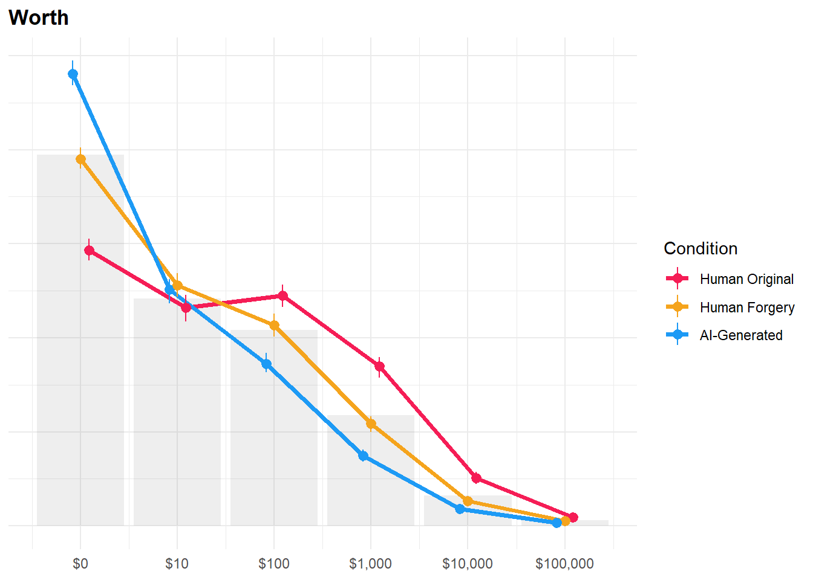{#fig-worth-1 width=672}
:::

::: {.cell-output-display}
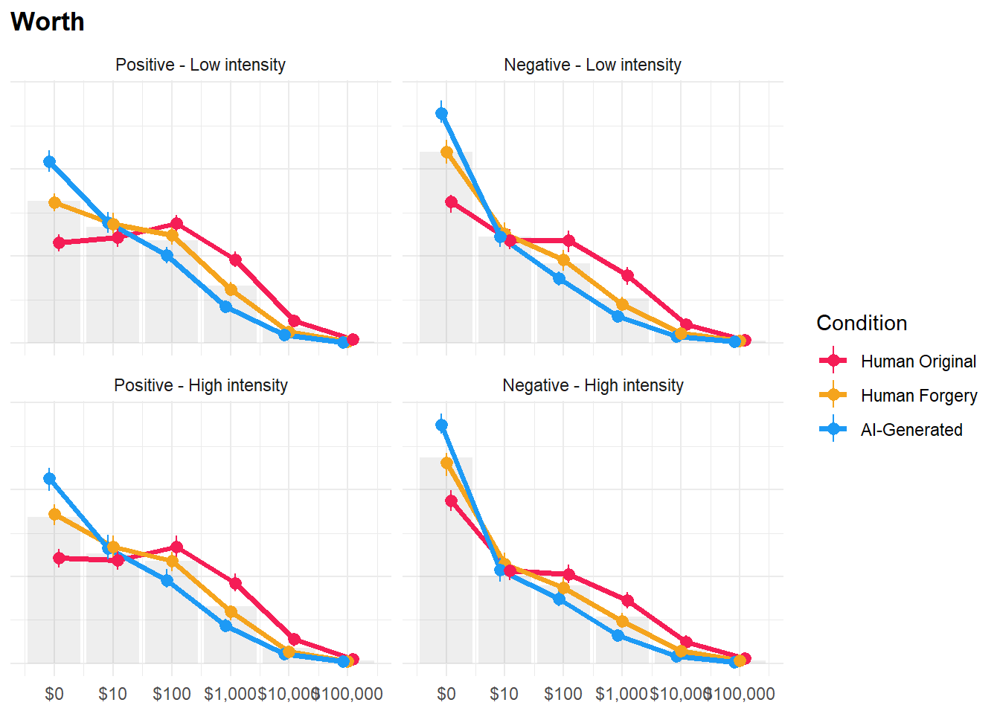{#fig-worth-2 width=672}
:::

Worth ($0 to $100,000, six ordered categories): observed proportion of each category (grey bars) and the model-implied probability per label condition (points with 95% CI).
:::


:::


### Figure 2


::: {.cell}

```{.r .cell-code}
# Manuscript Figure 2. Legend from the Valence panel only (Beauty's keys differ).
figure2 <- wrap_plots(
  p_beauty + guides(colour = "none"),
  p_valence,
  p_meaning + guides(colour = "none"),
  p_worth + guides(colour = "none"),
  ncol = 2
) +
  plot_layout(guides = "collect") &
  theme(legend.position = "bottom", legend.title = element_blank())

figure2

ggsave("figures/figure2.png", figure2, width = 12, height = 9, dpi = 300, bg = "white")
```

::: {.cell-output-display}
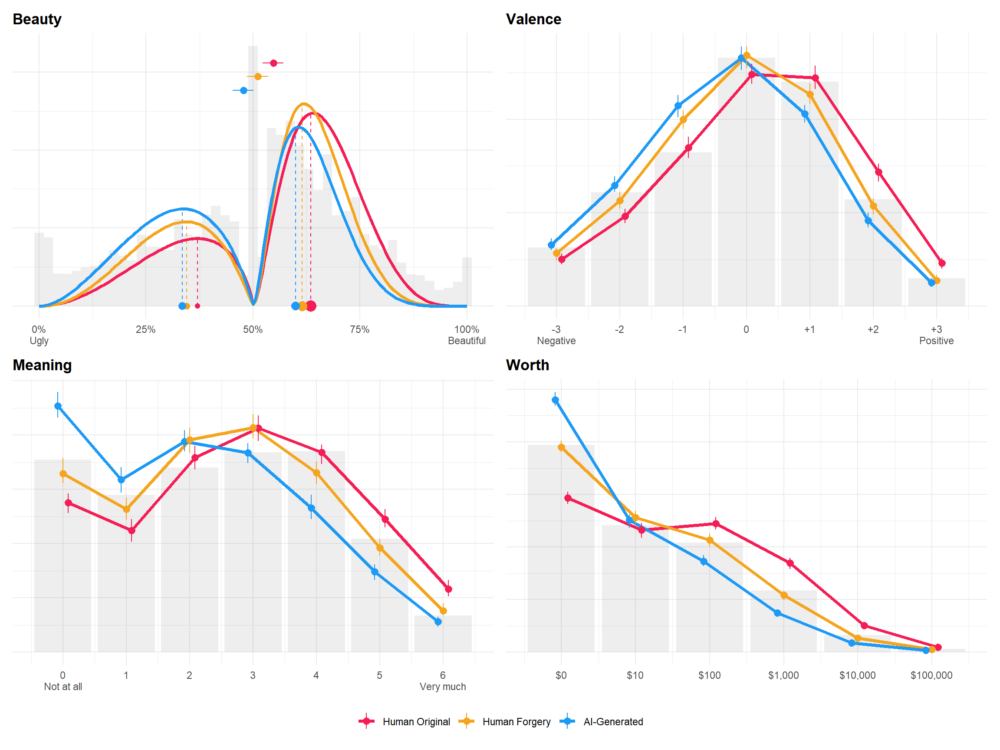{#fig-figure2 fig-alt='Four-panel grid showing the effect of the label condition (Human Original, Human Forgery, AI-Generated) on Beauty, Valence, Meaning and Worth ratings.' width=1152}
:::
:::


## Phase 1 - Eye-Tracking

::: {.panel-tabset}

### Entropy


::: {.cell}

```{.r .cell-code}
make_report(estimates$Entropy)
```

::: {.cell-output-display}

```{=html}
<div id="hpuuyeuqqi" style="padding-left:0px;padding-right:0px;padding-top:10px;padding-bottom:10px;overflow-x:auto;overflow-y:auto;width:auto;height:auto;">
<style>#hpuuyeuqqi table {
  font-family: system-ui, 'Segoe UI', Roboto, Helvetica, Arial, sans-serif, 'Apple Color Emoji', 'Segoe UI Emoji', 'Segoe UI Symbol', 'Noto Color Emoji';
  -webkit-font-smoothing: antialiased;
  -moz-osx-font-smoothing: grayscale;
}

#hpuuyeuqqi thead, #hpuuyeuqqi tbody, #hpuuyeuqqi tfoot, #hpuuyeuqqi tr, #hpuuyeuqqi td, #hpuuyeuqqi th {
  border-style: none;
}

#hpuuyeuqqi p {
  margin: 0;
  padding: 0;
}

#hpuuyeuqqi .gt_table {
  display: table;
  border-collapse: collapse;
  line-height: normal;
  margin-left: auto;
  margin-right: auto;
  color: #333333;
  font-size: 16px;
  font-weight: normal;
  font-style: normal;
  background-color: #FFFFFF;
  width: auto;
  border-top-style: solid;
  border-top-width: 2px;
  border-top-color: #A8A8A8;
  border-right-style: none;
  border-right-width: 2px;
  border-right-color: #D3D3D3;
  border-bottom-style: solid;
  border-bottom-width: 2px;
  border-bottom-color: #A8A8A8;
  border-left-style: none;
  border-left-width: 2px;
  border-left-color: #D3D3D3;
}

#hpuuyeuqqi .gt_caption {
  padding-top: 4px;
  padding-bottom: 4px;
}

#hpuuyeuqqi .gt_title {
  color: #333333;
  font-size: 125%;
  font-weight: initial;
  padding-top: 4px;
  padding-bottom: 4px;
  padding-left: 5px;
  padding-right: 5px;
  border-bottom-color: #FFFFFF;
  border-bottom-width: 0;
}

#hpuuyeuqqi .gt_subtitle {
  color: #333333;
  font-size: 85%;
  font-weight: initial;
  padding-top: 3px;
  padding-bottom: 5px;
  padding-left: 5px;
  padding-right: 5px;
  border-top-color: #FFFFFF;
  border-top-width: 0;
}

#hpuuyeuqqi .gt_heading {
  background-color: #FFFFFF;
  text-align: center;
  border-bottom-color: #FFFFFF;
  border-left-style: none;
  border-left-width: 1px;
  border-left-color: #D3D3D3;
  border-right-style: none;
  border-right-width: 1px;
  border-right-color: #D3D3D3;
}

#hpuuyeuqqi .gt_bottom_border {
  border-bottom-style: solid;
  border-bottom-width: 2px;
  border-bottom-color: #D3D3D3;
}

#hpuuyeuqqi .gt_col_headings {
  border-top-style: solid;
  border-top-width: 2px;
  border-top-color: #D3D3D3;
  border-bottom-style: solid;
  border-bottom-width: 2px;
  border-bottom-color: #D3D3D3;
  border-left-style: none;
  border-left-width: 1px;
  border-left-color: #D3D3D3;
  border-right-style: none;
  border-right-width: 1px;
  border-right-color: #D3D3D3;
}

#hpuuyeuqqi .gt_col_heading {
  color: #333333;
  background-color: #FFFFFF;
  font-size: 100%;
  font-weight: normal;
  text-transform: inherit;
  border-left-style: none;
  border-left-width: 1px;
  border-left-color: #D3D3D3;
  border-right-style: none;
  border-right-width: 1px;
  border-right-color: #D3D3D3;
  vertical-align: bottom;
  padding-top: 5px;
  padding-bottom: 6px;
  padding-left: 5px;
  padding-right: 5px;
  overflow-x: hidden;
}

#hpuuyeuqqi .gt_column_spanner_outer {
  color: #333333;
  background-color: #FFFFFF;
  font-size: 100%;
  font-weight: normal;
  text-transform: inherit;
  padding-top: 0;
  padding-bottom: 0;
  padding-left: 4px;
  padding-right: 4px;
}

#hpuuyeuqqi .gt_column_spanner_outer:first-child {
  padding-left: 0;
}

#hpuuyeuqqi .gt_column_spanner_outer:last-child {
  padding-right: 0;
}

#hpuuyeuqqi .gt_column_spanner {
  border-bottom-style: solid;
  border-bottom-width: 2px;
  border-bottom-color: #D3D3D3;
  vertical-align: bottom;
  padding-top: 5px;
  padding-bottom: 5px;
  overflow-x: hidden;
  display: inline-block;
  width: 100%;
}

#hpuuyeuqqi .gt_spanner_row {
  border-bottom-style: hidden;
}

#hpuuyeuqqi .gt_group_heading {
  padding-top: 8px;
  padding-bottom: 8px;
  padding-left: 5px;
  padding-right: 5px;
  color: #333333;
  background-color: #FFFFFF;
  font-size: 100%;
  font-weight: initial;
  text-transform: inherit;
  border-top-style: solid;
  border-top-width: 2px;
  border-top-color: #D3D3D3;
  border-bottom-style: solid;
  border-bottom-width: 2px;
  border-bottom-color: #D3D3D3;
  border-left-style: none;
  border-left-width: 1px;
  border-left-color: #D3D3D3;
  border-right-style: none;
  border-right-width: 1px;
  border-right-color: #D3D3D3;
  vertical-align: middle;
  text-align: left;
}

#hpuuyeuqqi .gt_empty_group_heading {
  padding: 0.5px;
  color: #333333;
  background-color: #FFFFFF;
  font-size: 100%;
  font-weight: initial;
  border-top-style: solid;
  border-top-width: 2px;
  border-top-color: #D3D3D3;
  border-bottom-style: solid;
  border-bottom-width: 2px;
  border-bottom-color: #D3D3D3;
  vertical-align: middle;
}

#hpuuyeuqqi .gt_from_md > :first-child {
  margin-top: 0;
}

#hpuuyeuqqi .gt_from_md > :last-child {
  margin-bottom: 0;
}

#hpuuyeuqqi .gt_row {
  padding-top: 8px;
  padding-bottom: 8px;
  padding-left: 5px;
  padding-right: 5px;
  margin: 10px;
  border-top-style: solid;
  border-top-width: 1px;
  border-top-color: #D3D3D3;
  border-left-style: none;
  border-left-width: 1px;
  border-left-color: #D3D3D3;
  border-right-style: none;
  border-right-width: 1px;
  border-right-color: #D3D3D3;
  vertical-align: middle;
  overflow-x: hidden;
}

#hpuuyeuqqi .gt_stub {
  color: #333333;
  background-color: #FFFFFF;
  font-size: 100%;
  font-weight: initial;
  text-transform: inherit;
  border-right-style: solid;
  border-right-width: 2px;
  border-right-color: #D3D3D3;
  padding-left: 5px;
  padding-right: 5px;
}

#hpuuyeuqqi .gt_stub_row_group {
  color: #333333;
  background-color: #FFFFFF;
  font-size: 100%;
  font-weight: initial;
  text-transform: inherit;
  border-right-style: solid;
  border-right-width: 2px;
  border-right-color: #D3D3D3;
  padding-left: 5px;
  padding-right: 5px;
  vertical-align: top;
}

#hpuuyeuqqi .gt_row_group_first td {
  border-top-width: 2px;
}

#hpuuyeuqqi .gt_row_group_first th {
  border-top-width: 2px;
}

#hpuuyeuqqi .gt_summary_row {
  color: #333333;
  background-color: #FFFFFF;
  text-transform: inherit;
  padding-top: 8px;
  padding-bottom: 8px;
  padding-left: 5px;
  padding-right: 5px;
}

#hpuuyeuqqi .gt_first_summary_row {
  border-top-style: solid;
  border-top-color: #D3D3D3;
}

#hpuuyeuqqi .gt_first_summary_row.thick {
  border-top-width: 2px;
}

#hpuuyeuqqi .gt_last_summary_row {
  padding-top: 8px;
  padding-bottom: 8px;
  padding-left: 5px;
  padding-right: 5px;
  border-bottom-style: solid;
  border-bottom-width: 2px;
  border-bottom-color: #D3D3D3;
}

#hpuuyeuqqi .gt_grand_summary_row {
  color: #333333;
  background-color: #FFFFFF;
  text-transform: inherit;
  padding-top: 8px;
  padding-bottom: 8px;
  padding-left: 5px;
  padding-right: 5px;
}

#hpuuyeuqqi .gt_first_grand_summary_row {
  padding-top: 8px;
  padding-bottom: 8px;
  padding-left: 5px;
  padding-right: 5px;
  border-top-style: double;
  border-top-width: 6px;
  border-top-color: #D3D3D3;
}

#hpuuyeuqqi .gt_last_grand_summary_row_top {
  padding-top: 8px;
  padding-bottom: 8px;
  padding-left: 5px;
  padding-right: 5px;
  border-bottom-style: double;
  border-bottom-width: 6px;
  border-bottom-color: #D3D3D3;
}

#hpuuyeuqqi .gt_striped {
  background-color: rgba(128, 128, 128, 0.05);
}

#hpuuyeuqqi .gt_table_body {
  border-top-style: solid;
  border-top-width: 2px;
  border-top-color: #D3D3D3;
  border-bottom-style: solid;
  border-bottom-width: 2px;
  border-bottom-color: #D3D3D3;
}

#hpuuyeuqqi .gt_footnotes {
  color: #333333;
  background-color: #FFFFFF;
  border-bottom-style: none;
  border-bottom-width: 2px;
  border-bottom-color: #D3D3D3;
  border-left-style: none;
  border-left-width: 2px;
  border-left-color: #D3D3D3;
  border-right-style: none;
  border-right-width: 2px;
  border-right-color: #D3D3D3;
}

#hpuuyeuqqi .gt_footnote {
  margin: 0px;
  font-size: 90%;
  padding-top: 4px;
  padding-bottom: 4px;
  padding-left: 5px;
  padding-right: 5px;
}

#hpuuyeuqqi .gt_sourcenotes {
  color: #333333;
  background-color: #FFFFFF;
  border-bottom-style: none;
  border-bottom-width: 2px;
  border-bottom-color: #D3D3D3;
  border-left-style: none;
  border-left-width: 2px;
  border-left-color: #D3D3D3;
  border-right-style: none;
  border-right-width: 2px;
  border-right-color: #D3D3D3;
}

#hpuuyeuqqi .gt_sourcenote {
  font-size: 90%;
  padding-top: 4px;
  padding-bottom: 4px;
  padding-left: 5px;
  padding-right: 5px;
}

#hpuuyeuqqi .gt_left {
  text-align: left;
}

#hpuuyeuqqi .gt_center {
  text-align: center;
}

#hpuuyeuqqi .gt_right {
  text-align: right;
  font-variant-numeric: tabular-nums;
}

#hpuuyeuqqi .gt_font_normal {
  font-weight: normal;
}

#hpuuyeuqqi .gt_font_bold {
  font-weight: bold;
}

#hpuuyeuqqi .gt_font_italic {
  font-style: italic;
}

#hpuuyeuqqi .gt_super {
  font-size: 65%;
}

#hpuuyeuqqi .gt_footnote_marks {
  font-size: 75%;
  vertical-align: 0.4em;
  position: initial;
}

#hpuuyeuqqi .gt_asterisk {
  font-size: 100%;
  vertical-align: 0;
}

#hpuuyeuqqi .gt_indent_1 {
  text-indent: 5px;
}

#hpuuyeuqqi .gt_indent_2 {
  text-indent: 10px;
}

#hpuuyeuqqi .gt_indent_3 {
  text-indent: 15px;
}

#hpuuyeuqqi .gt_indent_4 {
  text-indent: 20px;
}

#hpuuyeuqqi .gt_indent_5 {
  text-indent: 25px;
}

#hpuuyeuqqi .katex-display {
  display: inline-flex !important;
  margin-bottom: 0.75em !important;
}

#hpuuyeuqqi div.Reactable > div.rt-table > div.rt-thead > div.rt-tr.rt-tr-group-header > div.rt-th-group:after {
  height: 0px !important;
}
</style>
<table class="gt_table" data-quarto-disable-processing="false" data-quarto-bootstrap="false">
  <thead>
    <tr class="gt_col_headings">
      <th class="gt_col_heading gt_columns_bottom_border gt_left" rowspan="1" colspan="1" scope="col" id="Contrast">Contrast</th>
      <th class="gt_col_heading gt_columns_bottom_border gt_left" rowspan="1" colspan="1" scope="col" id="Parameters">Parameters</th>
    </tr>
  </thead>
  <tbody class="gt_table_body">
    <tr><td headers="Contrast" class="gt_row gt_left">Human Forgery - Human Original</td>
<td headers="Parameters" class="gt_row gt_left">None</td></tr>
    <tr><td headers="Contrast" class="gt_row gt_left">AI-Generated - Human Original</td>
<td headers="Parameters" class="gt_row gt_left">None</td></tr>
    <tr><td headers="Contrast" class="gt_row gt_left">AI-Generated - Human Forgery</td>
<td headers="Parameters" class="gt_row gt_left">None</td></tr>
  </tbody>
  
</table>
</div>
```

```{=html}
<div id="xkzifarzhn" style="padding-left:0px;padding-right:0px;padding-top:10px;padding-bottom:10px;overflow-x:auto;overflow-y:auto;width:auto;height:auto;">
<style>#xkzifarzhn table {
  font-family: system-ui, 'Segoe UI', Roboto, Helvetica, Arial, sans-serif, 'Apple Color Emoji', 'Segoe UI Emoji', 'Segoe UI Symbol', 'Noto Color Emoji';
  -webkit-font-smoothing: antialiased;
  -moz-osx-font-smoothing: grayscale;
}

#xkzifarzhn thead, #xkzifarzhn tbody, #xkzifarzhn tfoot, #xkzifarzhn tr, #xkzifarzhn td, #xkzifarzhn th {
  border-style: none;
}

#xkzifarzhn p {
  margin: 0;
  padding: 0;
}

#xkzifarzhn .gt_table {
  display: table;
  border-collapse: collapse;
  line-height: normal;
  margin-left: auto;
  margin-right: auto;
  color: #333333;
  font-size: 16px;
  font-weight: normal;
  font-style: normal;
  background-color: #FFFFFF;
  width: auto;
  border-top-style: solid;
  border-top-width: 2px;
  border-top-color: #A8A8A8;
  border-right-style: none;
  border-right-width: 2px;
  border-right-color: #D3D3D3;
  border-bottom-style: solid;
  border-bottom-width: 2px;
  border-bottom-color: #A8A8A8;
  border-left-style: none;
  border-left-width: 2px;
  border-left-color: #D3D3D3;
}

#xkzifarzhn .gt_caption {
  padding-top: 4px;
  padding-bottom: 4px;
}

#xkzifarzhn .gt_title {
  color: #333333;
  font-size: 125%;
  font-weight: initial;
  padding-top: 4px;
  padding-bottom: 4px;
  padding-left: 5px;
  padding-right: 5px;
  border-bottom-color: #FFFFFF;
  border-bottom-width: 0;
}

#xkzifarzhn .gt_subtitle {
  color: #333333;
  font-size: 85%;
  font-weight: initial;
  padding-top: 3px;
  padding-bottom: 5px;
  padding-left: 5px;
  padding-right: 5px;
  border-top-color: #FFFFFF;
  border-top-width: 0;
}

#xkzifarzhn .gt_heading {
  background-color: #FFFFFF;
  text-align: center;
  border-bottom-color: #FFFFFF;
  border-left-style: none;
  border-left-width: 1px;
  border-left-color: #D3D3D3;
  border-right-style: none;
  border-right-width: 1px;
  border-right-color: #D3D3D3;
}

#xkzifarzhn .gt_bottom_border {
  border-bottom-style: solid;
  border-bottom-width: 2px;
  border-bottom-color: #D3D3D3;
}

#xkzifarzhn .gt_col_headings {
  border-top-style: solid;
  border-top-width: 2px;
  border-top-color: #D3D3D3;
  border-bottom-style: solid;
  border-bottom-width: 2px;
  border-bottom-color: #D3D3D3;
  border-left-style: none;
  border-left-width: 1px;
  border-left-color: #D3D3D3;
  border-right-style: none;
  border-right-width: 1px;
  border-right-color: #D3D3D3;
}

#xkzifarzhn .gt_col_heading {
  color: #333333;
  background-color: #FFFFFF;
  font-size: 100%;
  font-weight: normal;
  text-transform: inherit;
  border-left-style: none;
  border-left-width: 1px;
  border-left-color: #D3D3D3;
  border-right-style: none;
  border-right-width: 1px;
  border-right-color: #D3D3D3;
  vertical-align: bottom;
  padding-top: 5px;
  padding-bottom: 6px;
  padding-left: 5px;
  padding-right: 5px;
  overflow-x: hidden;
}

#xkzifarzhn .gt_column_spanner_outer {
  color: #333333;
  background-color: #FFFFFF;
  font-size: 100%;
  font-weight: normal;
  text-transform: inherit;
  padding-top: 0;
  padding-bottom: 0;
  padding-left: 4px;
  padding-right: 4px;
}

#xkzifarzhn .gt_column_spanner_outer:first-child {
  padding-left: 0;
}

#xkzifarzhn .gt_column_spanner_outer:last-child {
  padding-right: 0;
}

#xkzifarzhn .gt_column_spanner {
  border-bottom-style: solid;
  border-bottom-width: 2px;
  border-bottom-color: #D3D3D3;
  vertical-align: bottom;
  padding-top: 5px;
  padding-bottom: 5px;
  overflow-x: hidden;
  display: inline-block;
  width: 100%;
}

#xkzifarzhn .gt_spanner_row {
  border-bottom-style: hidden;
}

#xkzifarzhn .gt_group_heading {
  padding-top: 8px;
  padding-bottom: 8px;
  padding-left: 5px;
  padding-right: 5px;
  color: #333333;
  background-color: #FFFFFF;
  font-size: 100%;
  font-weight: initial;
  text-transform: inherit;
  border-top-style: solid;
  border-top-width: 2px;
  border-top-color: #D3D3D3;
  border-bottom-style: solid;
  border-bottom-width: 2px;
  border-bottom-color: #D3D3D3;
  border-left-style: none;
  border-left-width: 1px;
  border-left-color: #D3D3D3;
  border-right-style: none;
  border-right-width: 1px;
  border-right-color: #D3D3D3;
  vertical-align: middle;
  text-align: left;
}

#xkzifarzhn .gt_empty_group_heading {
  padding: 0.5px;
  color: #333333;
  background-color: #FFFFFF;
  font-size: 100%;
  font-weight: initial;
  border-top-style: solid;
  border-top-width: 2px;
  border-top-color: #D3D3D3;
  border-bottom-style: solid;
  border-bottom-width: 2px;
  border-bottom-color: #D3D3D3;
  vertical-align: middle;
}

#xkzifarzhn .gt_from_md > :first-child {
  margin-top: 0;
}

#xkzifarzhn .gt_from_md > :last-child {
  margin-bottom: 0;
}

#xkzifarzhn .gt_row {
  padding-top: 8px;
  padding-bottom: 8px;
  padding-left: 5px;
  padding-right: 5px;
  margin: 10px;
  border-top-style: solid;
  border-top-width: 1px;
  border-top-color: #D3D3D3;
  border-left-style: none;
  border-left-width: 1px;
  border-left-color: #D3D3D3;
  border-right-style: none;
  border-right-width: 1px;
  border-right-color: #D3D3D3;
  vertical-align: middle;
  overflow-x: hidden;
}

#xkzifarzhn .gt_stub {
  color: #333333;
  background-color: #FFFFFF;
  font-size: 100%;
  font-weight: initial;
  text-transform: inherit;
  border-right-style: solid;
  border-right-width: 2px;
  border-right-color: #D3D3D3;
  padding-left: 5px;
  padding-right: 5px;
}

#xkzifarzhn .gt_stub_row_group {
  color: #333333;
  background-color: #FFFFFF;
  font-size: 100%;
  font-weight: initial;
  text-transform: inherit;
  border-right-style: solid;
  border-right-width: 2px;
  border-right-color: #D3D3D3;
  padding-left: 5px;
  padding-right: 5px;
  vertical-align: top;
}

#xkzifarzhn .gt_row_group_first td {
  border-top-width: 2px;
}

#xkzifarzhn .gt_row_group_first th {
  border-top-width: 2px;
}

#xkzifarzhn .gt_summary_row {
  color: #333333;
  background-color: #FFFFFF;
  text-transform: inherit;
  padding-top: 8px;
  padding-bottom: 8px;
  padding-left: 5px;
  padding-right: 5px;
}

#xkzifarzhn .gt_first_summary_row {
  border-top-style: solid;
  border-top-color: #D3D3D3;
}

#xkzifarzhn .gt_first_summary_row.thick {
  border-top-width: 2px;
}

#xkzifarzhn .gt_last_summary_row {
  padding-top: 8px;
  padding-bottom: 8px;
  padding-left: 5px;
  padding-right: 5px;
  border-bottom-style: solid;
  border-bottom-width: 2px;
  border-bottom-color: #D3D3D3;
}

#xkzifarzhn .gt_grand_summary_row {
  color: #333333;
  background-color: #FFFFFF;
  text-transform: inherit;
  padding-top: 8px;
  padding-bottom: 8px;
  padding-left: 5px;
  padding-right: 5px;
}

#xkzifarzhn .gt_first_grand_summary_row {
  padding-top: 8px;
  padding-bottom: 8px;
  padding-left: 5px;
  padding-right: 5px;
  border-top-style: double;
  border-top-width: 6px;
  border-top-color: #D3D3D3;
}

#xkzifarzhn .gt_last_grand_summary_row_top {
  padding-top: 8px;
  padding-bottom: 8px;
  padding-left: 5px;
  padding-right: 5px;
  border-bottom-style: double;
  border-bottom-width: 6px;
  border-bottom-color: #D3D3D3;
}

#xkzifarzhn .gt_striped {
  background-color: rgba(128, 128, 128, 0.05);
}

#xkzifarzhn .gt_table_body {
  border-top-style: solid;
  border-top-width: 2px;
  border-top-color: #D3D3D3;
  border-bottom-style: solid;
  border-bottom-width: 2px;
  border-bottom-color: #D3D3D3;
}

#xkzifarzhn .gt_footnotes {
  color: #333333;
  background-color: #FFFFFF;
  border-bottom-style: none;
  border-bottom-width: 2px;
  border-bottom-color: #D3D3D3;
  border-left-style: none;
  border-left-width: 2px;
  border-left-color: #D3D3D3;
  border-right-style: none;
  border-right-width: 2px;
  border-right-color: #D3D3D3;
}

#xkzifarzhn .gt_footnote {
  margin: 0px;
  font-size: 90%;
  padding-top: 4px;
  padding-bottom: 4px;
  padding-left: 5px;
  padding-right: 5px;
}

#xkzifarzhn .gt_sourcenotes {
  color: #333333;
  background-color: #FFFFFF;
  border-bottom-style: none;
  border-bottom-width: 2px;
  border-bottom-color: #D3D3D3;
  border-left-style: none;
  border-left-width: 2px;
  border-left-color: #D3D3D3;
  border-right-style: none;
  border-right-width: 2px;
  border-right-color: #D3D3D3;
}

#xkzifarzhn .gt_sourcenote {
  font-size: 90%;
  padding-top: 4px;
  padding-bottom: 4px;
  padding-left: 5px;
  padding-right: 5px;
}

#xkzifarzhn .gt_left {
  text-align: left;
}

#xkzifarzhn .gt_center {
  text-align: center;
}

#xkzifarzhn .gt_right {
  text-align: right;
  font-variant-numeric: tabular-nums;
}

#xkzifarzhn .gt_font_normal {
  font-weight: normal;
}

#xkzifarzhn .gt_font_bold {
  font-weight: bold;
}

#xkzifarzhn .gt_font_italic {
  font-style: italic;
}

#xkzifarzhn .gt_super {
  font-size: 65%;
}

#xkzifarzhn .gt_footnote_marks {
  font-size: 75%;
  vertical-align: 0.4em;
  position: initial;
}

#xkzifarzhn .gt_asterisk {
  font-size: 100%;
  vertical-align: 0;
}

#xkzifarzhn .gt_indent_1 {
  text-indent: 5px;
}

#xkzifarzhn .gt_indent_2 {
  text-indent: 10px;
}

#xkzifarzhn .gt_indent_3 {
  text-indent: 15px;
}

#xkzifarzhn .gt_indent_4 {
  text-indent: 20px;
}

#xkzifarzhn .gt_indent_5 {
  text-indent: 25px;
}

#xkzifarzhn .katex-display {
  display: inline-flex !important;
  margin-bottom: 0.75em !important;
}

#xkzifarzhn div.Reactable > div.rt-table > div.rt-thead > div.rt-tr.rt-tr-group-header > div.rt-th-group:after {
  height: 0px !important;
}
</style>
<table class="gt_table" data-quarto-disable-processing="false" data-quarto-bootstrap="false">
  <thead>
    <tr class="gt_col_headings">
      <th class="gt_col_heading gt_columns_bottom_border gt_left" rowspan="1" colspan="1" scope="col" id="Contrast">Contrast</th>
      <th class="gt_col_heading gt_columns_bottom_border gt_left" rowspan="1" colspan="1" scope="col" id="Parameters">Parameters</th>
    </tr>
  </thead>
  <tbody class="gt_table_body">
    <tr><td headers="Contrast" class="gt_row gt_left">Negative - High intensity - Positive - Low intensity</td>
<td headers="Parameters" class="gt_row gt_left">response (0.00, [-0.01,  0.00]); mu (0.00, [-0.01,  0.00])</td></tr>
  </tbody>
  
</table>
</div>
```

```{=html}
<div id="sgmbqqjdfd" style="padding-left:0px;padding-right:0px;padding-top:10px;padding-bottom:10px;overflow-x:auto;overflow-y:auto;width:auto;height:auto;">
<style>#sgmbqqjdfd table {
  font-family: system-ui, 'Segoe UI', Roboto, Helvetica, Arial, sans-serif, 'Apple Color Emoji', 'Segoe UI Emoji', 'Segoe UI Symbol', 'Noto Color Emoji';
  -webkit-font-smoothing: antialiased;
  -moz-osx-font-smoothing: grayscale;
}

#sgmbqqjdfd thead, #sgmbqqjdfd tbody, #sgmbqqjdfd tfoot, #sgmbqqjdfd tr, #sgmbqqjdfd td, #sgmbqqjdfd th {
  border-style: none;
}

#sgmbqqjdfd p {
  margin: 0;
  padding: 0;
}

#sgmbqqjdfd .gt_table {
  display: table;
  border-collapse: collapse;
  line-height: normal;
  margin-left: auto;
  margin-right: auto;
  color: #333333;
  font-size: 13px;
  font-weight: normal;
  font-style: normal;
  background-color: #FFFFFF;
  width: auto;
  border-top-style: solid;
  border-top-width: 3px;
  border-top-color: #D5D5D5;
  border-right-style: solid;
  border-right-width: 3px;
  border-right-color: #D5D5D5;
  border-bottom-style: solid;
  border-bottom-width: 3px;
  border-bottom-color: #D5D5D5;
  border-left-style: solid;
  border-left-width: 3px;
  border-left-color: #D5D5D5;
}

#sgmbqqjdfd .gt_caption {
  padding-top: 4px;
  padding-bottom: 4px;
}

#sgmbqqjdfd .gt_title {
  color: #333333;
  font-size: 125%;
  font-weight: initial;
  padding-top: 4px;
  padding-bottom: 4px;
  padding-left: 5px;
  padding-right: 5px;
  border-bottom-color: #FFFFFF;
  border-bottom-width: 0;
}

#sgmbqqjdfd .gt_subtitle {
  color: #333333;
  font-size: 85%;
  font-weight: initial;
  padding-top: 3px;
  padding-bottom: 5px;
  padding-left: 5px;
  padding-right: 5px;
  border-top-color: #FFFFFF;
  border-top-width: 0;
}

#sgmbqqjdfd .gt_heading {
  background-color: #FFFFFF;
  text-align: left;
  border-bottom-color: #FFFFFF;
  border-left-style: none;
  border-left-width: 1px;
  border-left-color: #D3D3D3;
  border-right-style: none;
  border-right-width: 1px;
  border-right-color: #D3D3D3;
}

#sgmbqqjdfd .gt_bottom_border {
  border-bottom-style: solid;
  border-bottom-width: 2px;
  border-bottom-color: #D5D5D5;
}

#sgmbqqjdfd .gt_col_headings {
  border-top-style: solid;
  border-top-width: 2px;
  border-top-color: #D5D5D5;
  border-bottom-style: solid;
  border-bottom-width: 2px;
  border-bottom-color: #D5D5D5;
  border-left-style: none;
  border-left-width: 1px;
  border-left-color: #D3D3D3;
  border-right-style: none;
  border-right-width: 1px;
  border-right-color: #D3D3D3;
}

#sgmbqqjdfd .gt_col_heading {
  color: #FFFFFF;
  background-color: #000000;
  font-size: 100%;
  font-weight: normal;
  text-transform: inherit;
  border-left-style: none;
  border-left-width: 1px;
  border-left-color: #D3D3D3;
  border-right-style: none;
  border-right-width: 1px;
  border-right-color: #D3D3D3;
  vertical-align: bottom;
  padding-top: 5px;
  padding-bottom: 6px;
  padding-left: 5px;
  padding-right: 5px;
  overflow-x: hidden;
}

#sgmbqqjdfd .gt_column_spanner_outer {
  color: #FFFFFF;
  background-color: #000000;
  font-size: 100%;
  font-weight: normal;
  text-transform: inherit;
  padding-top: 0;
  padding-bottom: 0;
  padding-left: 4px;
  padding-right: 4px;
}

#sgmbqqjdfd .gt_column_spanner_outer:first-child {
  padding-left: 0;
}

#sgmbqqjdfd .gt_column_spanner_outer:last-child {
  padding-right: 0;
}

#sgmbqqjdfd .gt_column_spanner {
  border-bottom-style: solid;
  border-bottom-width: 2px;
  border-bottom-color: #D5D5D5;
  vertical-align: bottom;
  padding-top: 5px;
  padding-bottom: 5px;
  overflow-x: hidden;
  display: inline-block;
  width: 100%;
}

#sgmbqqjdfd .gt_spanner_row {
  border-bottom-style: hidden;
}

#sgmbqqjdfd .gt_group_heading {
  padding-top: 8px;
  padding-bottom: 8px;
  padding-left: 5px;
  padding-right: 5px;
  color: #333333;
  background-color: #FFFFFF;
  font-size: 100%;
  font-weight: initial;
  text-transform: inherit;
  border-top-style: solid;
  border-top-width: 2px;
  border-top-color: #D5D5D5;
  border-bottom-style: solid;
  border-bottom-width: 2px;
  border-bottom-color: #D5D5D5;
  border-left-style: none;
  border-left-width: 1px;
  border-left-color: #D3D3D3;
  border-right-style: none;
  border-right-width: 1px;
  border-right-color: #D3D3D3;
  vertical-align: middle;
  text-align: left;
}

#sgmbqqjdfd .gt_empty_group_heading {
  padding: 0.5px;
  color: #333333;
  background-color: #FFFFFF;
  font-size: 100%;
  font-weight: initial;
  border-top-style: solid;
  border-top-width: 2px;
  border-top-color: #D5D5D5;
  border-bottom-style: solid;
  border-bottom-width: 2px;
  border-bottom-color: #D5D5D5;
  vertical-align: middle;
}

#sgmbqqjdfd .gt_from_md > :first-child {
  margin-top: 0;
}

#sgmbqqjdfd .gt_from_md > :last-child {
  margin-bottom: 0;
}

#sgmbqqjdfd .gt_row {
  padding-top: 8px;
  padding-bottom: 8px;
  padding-left: 5px;
  padding-right: 5px;
  margin: 10px;
  border-top-style: solid;
  border-top-width: 1px;
  border-top-color: #D5D5D5;
  border-left-style: solid;
  border-left-width: 1px;
  border-left-color: #D5D5D5;
  border-right-style: solid;
  border-right-width: 1px;
  border-right-color: #D5D5D5;
  vertical-align: middle;
  overflow-x: hidden;
}

#sgmbqqjdfd .gt_stub {
  color: #333333;
  background-color: #FFFFFF;
  font-size: 100%;
  font-weight: initial;
  text-transform: inherit;
  border-right-style: solid;
  border-right-width: 2px;
  border-right-color: #5F5F5F;
  padding-left: 5px;
  padding-right: 5px;
}

#sgmbqqjdfd .gt_stub_row_group {
  color: #333333;
  background-color: #FFFFFF;
  font-size: 100%;
  font-weight: initial;
  text-transform: inherit;
  border-right-style: solid;
  border-right-width: 2px;
  border-right-color: #D3D3D3;
  padding-left: 5px;
  padding-right: 5px;
  vertical-align: top;
}

#sgmbqqjdfd .gt_row_group_first td {
  border-top-width: 2px;
}

#sgmbqqjdfd .gt_row_group_first th {
  border-top-width: 2px;
}

#sgmbqqjdfd .gt_summary_row {
  color: #333333;
  background-color: #D5D5D5;
  text-transform: inherit;
  padding-top: 8px;
  padding-bottom: 8px;
  padding-left: 5px;
  padding-right: 5px;
}

#sgmbqqjdfd .gt_first_summary_row {
  border-top-style: solid;
  border-top-color: #D5D5D5;
}

#sgmbqqjdfd .gt_first_summary_row.thick {
  border-top-width: 2px;
}

#sgmbqqjdfd .gt_last_summary_row {
  padding-top: 8px;
  padding-bottom: 8px;
  padding-left: 5px;
  padding-right: 5px;
  border-bottom-style: solid;
  border-bottom-width: 2px;
  border-bottom-color: #D5D5D5;
}

#sgmbqqjdfd .gt_grand_summary_row {
  color: #FFFFFF;
  background-color: #929292;
  text-transform: inherit;
  padding-top: 8px;
  padding-bottom: 8px;
  padding-left: 5px;
  padding-right: 5px;
}

#sgmbqqjdfd .gt_first_grand_summary_row {
  padding-top: 8px;
  padding-bottom: 8px;
  padding-left: 5px;
  padding-right: 5px;
  border-top-style: double;
  border-top-width: 6px;
  border-top-color: #D5D5D5;
}

#sgmbqqjdfd .gt_last_grand_summary_row_top {
  padding-top: 8px;
  padding-bottom: 8px;
  padding-left: 5px;
  padding-right: 5px;
  border-bottom-style: double;
  border-bottom-width: 6px;
  border-bottom-color: #D5D5D5;
}

#sgmbqqjdfd .gt_striped {
  background-color: #F4F4F4;
}

#sgmbqqjdfd .gt_table_body {
  border-top-style: solid;
  border-top-width: 2px;
  border-top-color: #D5D5D5;
  border-bottom-style: solid;
  border-bottom-width: 2px;
  border-bottom-color: #D5D5D5;
}

#sgmbqqjdfd .gt_footnotes {
  color: #333333;
  background-color: #FFFFFF;
  border-bottom-style: none;
  border-bottom-width: 2px;
  border-bottom-color: #D3D3D3;
  border-left-style: none;
  border-left-width: 2px;
  border-left-color: #D3D3D3;
  border-right-style: none;
  border-right-width: 2px;
  border-right-color: #D3D3D3;
}

#sgmbqqjdfd .gt_footnote {
  margin: 0px;
  font-size: 90%;
  padding-top: 4px;
  padding-bottom: 4px;
  padding-left: 5px;
  padding-right: 5px;
}

#sgmbqqjdfd .gt_sourcenotes {
  color: #333333;
  background-color: #FFFFFF;
  border-bottom-style: none;
  border-bottom-width: 2px;
  border-bottom-color: #D3D3D3;
  border-left-style: none;
  border-left-width: 2px;
  border-left-color: #D3D3D3;
  border-right-style: none;
  border-right-width: 2px;
  border-right-color: #D3D3D3;
}

#sgmbqqjdfd .gt_sourcenote {
  font-size: 90%;
  padding-top: 4px;
  padding-bottom: 4px;
  padding-left: 5px;
  padding-right: 5px;
}

#sgmbqqjdfd .gt_left {
  text-align: left;
}

#sgmbqqjdfd .gt_center {
  text-align: center;
}

#sgmbqqjdfd .gt_right {
  text-align: right;
  font-variant-numeric: tabular-nums;
}

#sgmbqqjdfd .gt_font_normal {
  font-weight: normal;
}

#sgmbqqjdfd .gt_font_bold {
  font-weight: bold;
}

#sgmbqqjdfd .gt_font_italic {
  font-style: italic;
}

#sgmbqqjdfd .gt_super {
  font-size: 65%;
}

#sgmbqqjdfd .gt_footnote_marks {
  font-size: 75%;
  vertical-align: 0.4em;
  position: initial;
}

#sgmbqqjdfd .gt_asterisk {
  font-size: 100%;
  vertical-align: 0;
}

#sgmbqqjdfd .gt_indent_1 {
  text-indent: 5px;
}

#sgmbqqjdfd .gt_indent_2 {
  text-indent: 10px;
}

#sgmbqqjdfd .gt_indent_3 {
  text-indent: 15px;
}

#sgmbqqjdfd .gt_indent_4 {
  text-indent: 20px;
}

#sgmbqqjdfd .gt_indent_5 {
  text-indent: 25px;
}

#sgmbqqjdfd .katex-display {
  display: inline-flex !important;
  margin-bottom: 0.75em !important;
}

#sgmbqqjdfd div.Reactable > div.rt-table > div.rt-thead > div.rt-tr.rt-tr-group-header > div.rt-th-group:after {
  height: 0px !important;
}
</style>
<table class="gt_table" data-quarto-disable-processing="false" data-quarto-bootstrap="false">
  <thead>
    <tr class="gt_heading">
      <td colspan="10" class="gt_heading gt_title gt_font_normal gt_bottom_border" style>Gaze Entropy: convergence</td>
    </tr>
    
    <tr class="gt_col_headings">
      <th class="gt_col_heading gt_columns_bottom_border gt_left" rowspan="1" colspan="1" scope="col" id="Model">Model</th>
      <th class="gt_col_heading gt_columns_bottom_border gt_left" rowspan="1" colspan="1" scope="col" id="Family">Family</th>
      <th class="gt_col_heading gt_columns_bottom_border gt_right" rowspan="1" colspan="1" scope="col" id="N_obs">N_obs</th>
      <th class="gt_col_heading gt_columns_bottom_border gt_right" rowspan="1" colspan="1" scope="col" id="N_participants">N_participants</th>
      <th class="gt_col_heading gt_columns_bottom_border gt_right" rowspan="1" colspan="1" scope="col" id="Chains">Chains</th>
      <th class="gt_col_heading gt_columns_bottom_border gt_right" rowspan="1" colspan="1" scope="col" id="Draws">Draws</th>
      <th class="gt_col_heading gt_columns_bottom_border gt_right" rowspan="1" colspan="1" scope="col" id="Max_Rhat">Max_Rhat</th>
      <th class="gt_col_heading gt_columns_bottom_border gt_right" rowspan="1" colspan="1" scope="col" id="Min_ESS_ratio">Min_ESS_ratio</th>
      <th class="gt_col_heading gt_columns_bottom_border gt_right" rowspan="1" colspan="1" scope="col" id="Divergent_pct">Divergent_pct</th>
      <th class="gt_col_heading gt_columns_bottom_border gt_left" rowspan="1" colspan="1" scope="col" id="Criterion">Criterion</th>
    </tr>
  </thead>
  <tbody class="gt_table_body">
    <tr><td headers="Model" class="gt_row gt_left">Entropy</td>
<td headers="Family" class="gt_row gt_left">Beta</td>
<td headers="N_obs" class="gt_row gt_right">12220</td>
<td headers="N_participants" class="gt_row gt_right">274</td>
<td headers="Chains" class="gt_row gt_right">8</td>
<td headers="Draws" class="gt_row gt_right">4000</td>
<td headers="Max_Rhat" class="gt_row gt_right">1.021</td>
<td headers="Min_ESS_ratio" class="gt_row gt_right">0.089</td>
<td headers="Divergent_pct" class="gt_row gt_right">0</td>
<td headers="Criterion" class="gt_row gt_left">loo</td></tr>
  </tbody>
  
</table>
</div>
```


::: {.callout-note collapse="true" title="Gaze Entropy: convergence (Markdown table, for text readers)"}

|Model   |Family | N_obs| N_participants| Chains| Draws| Max_Rhat| Min_ESS_ratio| Divergent_pct|Criterion |
|:-------|:------|-----:|--------------:|------:|-----:|--------:|-------------:|-------------:|:---------|
|Entropy |Beta   | 12220|            274|      8|  4000|    1.021|         0.089|             0|loo       |

:::

```{=html}
<div id="prypbbysac" style="padding-left:0px;padding-right:0px;padding-top:10px;padding-bottom:10px;overflow-x:auto;overflow-y:auto;width:auto;height:auto;">
<style>#prypbbysac table {
  font-family: system-ui, 'Segoe UI', Roboto, Helvetica, Arial, sans-serif, 'Apple Color Emoji', 'Segoe UI Emoji', 'Segoe UI Symbol', 'Noto Color Emoji';
  -webkit-font-smoothing: antialiased;
  -moz-osx-font-smoothing: grayscale;
}

#prypbbysac thead, #prypbbysac tbody, #prypbbysac tfoot, #prypbbysac tr, #prypbbysac td, #prypbbysac th {
  border-style: none;
}

#prypbbysac p {
  margin: 0;
  padding: 0;
}

#prypbbysac .gt_table {
  display: table;
  border-collapse: collapse;
  line-height: normal;
  margin-left: auto;
  margin-right: auto;
  color: #333333;
  font-size: 13px;
  font-weight: normal;
  font-style: normal;
  background-color: #FFFFFF;
  width: auto;
  border-top-style: solid;
  border-top-width: 3px;
  border-top-color: #D5D5D5;
  border-right-style: solid;
  border-right-width: 3px;
  border-right-color: #D5D5D5;
  border-bottom-style: solid;
  border-bottom-width: 3px;
  border-bottom-color: #D5D5D5;
  border-left-style: solid;
  border-left-width: 3px;
  border-left-color: #D5D5D5;
}

#prypbbysac .gt_caption {
  padding-top: 4px;
  padding-bottom: 4px;
}

#prypbbysac .gt_title {
  color: #333333;
  font-size: 125%;
  font-weight: initial;
  padding-top: 4px;
  padding-bottom: 4px;
  padding-left: 5px;
  padding-right: 5px;
  border-bottom-color: #FFFFFF;
  border-bottom-width: 0;
}

#prypbbysac .gt_subtitle {
  color: #333333;
  font-size: 85%;
  font-weight: initial;
  padding-top: 3px;
  padding-bottom: 5px;
  padding-left: 5px;
  padding-right: 5px;
  border-top-color: #FFFFFF;
  border-top-width: 0;
}

#prypbbysac .gt_heading {
  background-color: #FFFFFF;
  text-align: left;
  border-bottom-color: #FFFFFF;
  border-left-style: none;
  border-left-width: 1px;
  border-left-color: #D3D3D3;
  border-right-style: none;
  border-right-width: 1px;
  border-right-color: #D3D3D3;
}

#prypbbysac .gt_bottom_border {
  border-bottom-style: solid;
  border-bottom-width: 2px;
  border-bottom-color: #D5D5D5;
}

#prypbbysac .gt_col_headings {
  border-top-style: solid;
  border-top-width: 2px;
  border-top-color: #D5D5D5;
  border-bottom-style: solid;
  border-bottom-width: 2px;
  border-bottom-color: #D5D5D5;
  border-left-style: none;
  border-left-width: 1px;
  border-left-color: #D3D3D3;
  border-right-style: none;
  border-right-width: 1px;
  border-right-color: #D3D3D3;
}

#prypbbysac .gt_col_heading {
  color: #FFFFFF;
  background-color: #000000;
  font-size: 100%;
  font-weight: normal;
  text-transform: inherit;
  border-left-style: none;
  border-left-width: 1px;
  border-left-color: #D3D3D3;
  border-right-style: none;
  border-right-width: 1px;
  border-right-color: #D3D3D3;
  vertical-align: bottom;
  padding-top: 5px;
  padding-bottom: 6px;
  padding-left: 5px;
  padding-right: 5px;
  overflow-x: hidden;
}

#prypbbysac .gt_column_spanner_outer {
  color: #FFFFFF;
  background-color: #000000;
  font-size: 100%;
  font-weight: normal;
  text-transform: inherit;
  padding-top: 0;
  padding-bottom: 0;
  padding-left: 4px;
  padding-right: 4px;
}

#prypbbysac .gt_column_spanner_outer:first-child {
  padding-left: 0;
}

#prypbbysac .gt_column_spanner_outer:last-child {
  padding-right: 0;
}

#prypbbysac .gt_column_spanner {
  border-bottom-style: solid;
  border-bottom-width: 2px;
  border-bottom-color: #D5D5D5;
  vertical-align: bottom;
  padding-top: 5px;
  padding-bottom: 5px;
  overflow-x: hidden;
  display: inline-block;
  width: 100%;
}

#prypbbysac .gt_spanner_row {
  border-bottom-style: hidden;
}

#prypbbysac .gt_group_heading {
  padding-top: 8px;
  padding-bottom: 8px;
  padding-left: 5px;
  padding-right: 5px;
  color: #333333;
  background-color: #FFFFFF;
  font-size: 100%;
  font-weight: initial;
  text-transform: inherit;
  border-top-style: solid;
  border-top-width: 2px;
  border-top-color: #D5D5D5;
  border-bottom-style: solid;
  border-bottom-width: 2px;
  border-bottom-color: #D5D5D5;
  border-left-style: none;
  border-left-width: 1px;
  border-left-color: #D3D3D3;
  border-right-style: none;
  border-right-width: 1px;
  border-right-color: #D3D3D3;
  vertical-align: middle;
  text-align: left;
}

#prypbbysac .gt_empty_group_heading {
  padding: 0.5px;
  color: #333333;
  background-color: #FFFFFF;
  font-size: 100%;
  font-weight: initial;
  border-top-style: solid;
  border-top-width: 2px;
  border-top-color: #D5D5D5;
  border-bottom-style: solid;
  border-bottom-width: 2px;
  border-bottom-color: #D5D5D5;
  vertical-align: middle;
}

#prypbbysac .gt_from_md > :first-child {
  margin-top: 0;
}

#prypbbysac .gt_from_md > :last-child {
  margin-bottom: 0;
}

#prypbbysac .gt_row {
  padding-top: 8px;
  padding-bottom: 8px;
  padding-left: 5px;
  padding-right: 5px;
  margin: 10px;
  border-top-style: solid;
  border-top-width: 1px;
  border-top-color: #D5D5D5;
  border-left-style: solid;
  border-left-width: 1px;
  border-left-color: #D5D5D5;
  border-right-style: solid;
  border-right-width: 1px;
  border-right-color: #D5D5D5;
  vertical-align: middle;
  overflow-x: hidden;
}

#prypbbysac .gt_stub {
  color: #333333;
  background-color: #FFFFFF;
  font-size: 100%;
  font-weight: initial;
  text-transform: inherit;
  border-right-style: solid;
  border-right-width: 2px;
  border-right-color: #5F5F5F;
  padding-left: 5px;
  padding-right: 5px;
}

#prypbbysac .gt_stub_row_group {
  color: #333333;
  background-color: #FFFFFF;
  font-size: 100%;
  font-weight: initial;
  text-transform: inherit;
  border-right-style: solid;
  border-right-width: 2px;
  border-right-color: #D3D3D3;
  padding-left: 5px;
  padding-right: 5px;
  vertical-align: top;
}

#prypbbysac .gt_row_group_first td {
  border-top-width: 2px;
}

#prypbbysac .gt_row_group_first th {
  border-top-width: 2px;
}

#prypbbysac .gt_summary_row {
  color: #333333;
  background-color: #D5D5D5;
  text-transform: inherit;
  padding-top: 8px;
  padding-bottom: 8px;
  padding-left: 5px;
  padding-right: 5px;
}

#prypbbysac .gt_first_summary_row {
  border-top-style: solid;
  border-top-color: #D5D5D5;
}

#prypbbysac .gt_first_summary_row.thick {
  border-top-width: 2px;
}

#prypbbysac .gt_last_summary_row {
  padding-top: 8px;
  padding-bottom: 8px;
  padding-left: 5px;
  padding-right: 5px;
  border-bottom-style: solid;
  border-bottom-width: 2px;
  border-bottom-color: #D5D5D5;
}

#prypbbysac .gt_grand_summary_row {
  color: #FFFFFF;
  background-color: #929292;
  text-transform: inherit;
  padding-top: 8px;
  padding-bottom: 8px;
  padding-left: 5px;
  padding-right: 5px;
}

#prypbbysac .gt_first_grand_summary_row {
  padding-top: 8px;
  padding-bottom: 8px;
  padding-left: 5px;
  padding-right: 5px;
  border-top-style: double;
  border-top-width: 6px;
  border-top-color: #D5D5D5;
}

#prypbbysac .gt_last_grand_summary_row_top {
  padding-top: 8px;
  padding-bottom: 8px;
  padding-left: 5px;
  padding-right: 5px;
  border-bottom-style: double;
  border-bottom-width: 6px;
  border-bottom-color: #D5D5D5;
}

#prypbbysac .gt_striped {
  background-color: #F4F4F4;
}

#prypbbysac .gt_table_body {
  border-top-style: solid;
  border-top-width: 2px;
  border-top-color: #D5D5D5;
  border-bottom-style: solid;
  border-bottom-width: 2px;
  border-bottom-color: #D5D5D5;
}

#prypbbysac .gt_footnotes {
  color: #333333;
  background-color: #FFFFFF;
  border-bottom-style: none;
  border-bottom-width: 2px;
  border-bottom-color: #D3D3D3;
  border-left-style: none;
  border-left-width: 2px;
  border-left-color: #D3D3D3;
  border-right-style: none;
  border-right-width: 2px;
  border-right-color: #D3D3D3;
}

#prypbbysac .gt_footnote {
  margin: 0px;
  font-size: 90%;
  padding-top: 4px;
  padding-bottom: 4px;
  padding-left: 5px;
  padding-right: 5px;
}

#prypbbysac .gt_sourcenotes {
  color: #333333;
  background-color: #FFFFFF;
  border-bottom-style: none;
  border-bottom-width: 2px;
  border-bottom-color: #D3D3D3;
  border-left-style: none;
  border-left-width: 2px;
  border-left-color: #D3D3D3;
  border-right-style: none;
  border-right-width: 2px;
  border-right-color: #D3D3D3;
}

#prypbbysac .gt_sourcenote {
  font-size: 90%;
  padding-top: 4px;
  padding-bottom: 4px;
  padding-left: 5px;
  padding-right: 5px;
}

#prypbbysac .gt_left {
  text-align: left;
}

#prypbbysac .gt_center {
  text-align: center;
}

#prypbbysac .gt_right {
  text-align: right;
  font-variant-numeric: tabular-nums;
}

#prypbbysac .gt_font_normal {
  font-weight: normal;
}

#prypbbysac .gt_font_bold {
  font-weight: bold;
}

#prypbbysac .gt_font_italic {
  font-style: italic;
}

#prypbbysac .gt_super {
  font-size: 65%;
}

#prypbbysac .gt_footnote_marks {
  font-size: 75%;
  vertical-align: 0.4em;
  position: initial;
}

#prypbbysac .gt_asterisk {
  font-size: 100%;
  vertical-align: 0;
}

#prypbbysac .gt_indent_1 {
  text-indent: 5px;
}

#prypbbysac .gt_indent_2 {
  text-indent: 10px;
}

#prypbbysac .gt_indent_3 {
  text-indent: 15px;
}

#prypbbysac .gt_indent_4 {
  text-indent: 20px;
}

#prypbbysac .gt_indent_5 {
  text-indent: 25px;
}

#prypbbysac .katex-display {
  display: inline-flex !important;
  margin-bottom: 0.75em !important;
}

#prypbbysac div.Reactable > div.rt-table > div.rt-thead > div.rt-tr.rt-tr-group-header > div.rt-th-group:after {
  height: 0px !important;
}
</style>
<table class="gt_table" data-quarto-disable-processing="false" data-quarto-bootstrap="false">
  <thead>
    <tr class="gt_heading">
      <td colspan="4" class="gt_heading gt_title gt_font_normal gt_bottom_border" style>Gaze Entropy: marginal means per label condition (response scale)</td>
    </tr>
    
    <tr class="gt_col_headings">
      <th class="gt_col_heading gt_columns_bottom_border gt_center" rowspan="1" colspan="1" scope="col" id="Condition">Condition</th>
      <th class="gt_col_heading gt_columns_bottom_border gt_right" rowspan="1" colspan="1" scope="col" id="Estimate">Estimate</th>
      <th class="gt_col_heading gt_columns_bottom_border gt_right" rowspan="1" colspan="1" scope="col" id="CI_low">CI_low</th>
      <th class="gt_col_heading gt_columns_bottom_border gt_right" rowspan="1" colspan="1" scope="col" id="CI_high">CI_high</th>
    </tr>
  </thead>
  <tbody class="gt_table_body">
    <tr><td headers="Condition" class="gt_row gt_center">Human Original</td>
<td headers="Estimate" class="gt_row gt_right">0.80</td>
<td headers="CI_low" class="gt_row gt_right">0.80</td>
<td headers="CI_high" class="gt_row gt_right">0.81</td></tr>
    <tr><td headers="Condition" class="gt_row gt_center gt_striped">Human Forgery</td>
<td headers="Estimate" class="gt_row gt_right gt_striped">0.80</td>
<td headers="CI_low" class="gt_row gt_right gt_striped">0.80</td>
<td headers="CI_high" class="gt_row gt_right gt_striped">0.81</td></tr>
    <tr><td headers="Condition" class="gt_row gt_center">AI-Generated</td>
<td headers="Estimate" class="gt_row gt_right">0.80</td>
<td headers="CI_low" class="gt_row gt_right">0.80</td>
<td headers="CI_high" class="gt_row gt_right">0.81</td></tr>
  </tbody>
  
</table>
</div>
```


::: {.callout-note collapse="true" title="Gaze Entropy: marginal means per label condition (response scale) (Markdown table, for text readers)"}

|Condition      |Estimate |CI_low |CI_high |
|:--------------|:--------|:------|:-------|
|Human Original |0.80     |0.80   |0.81    |
|Human Forgery  |0.80     |0.80   |0.81    |
|AI-Generated   |0.80     |0.80   |0.81    |

:::

```{=html}
<div id="btdbfftbcr" style="padding-left:0px;padding-right:0px;padding-top:10px;padding-bottom:10px;overflow-x:auto;overflow-y:auto;width:auto;height:auto;">
<style>#btdbfftbcr table {
  font-family: system-ui, 'Segoe UI', Roboto, Helvetica, Arial, sans-serif, 'Apple Color Emoji', 'Segoe UI Emoji', 'Segoe UI Symbol', 'Noto Color Emoji';
  -webkit-font-smoothing: antialiased;
  -moz-osx-font-smoothing: grayscale;
}

#btdbfftbcr thead, #btdbfftbcr tbody, #btdbfftbcr tfoot, #btdbfftbcr tr, #btdbfftbcr td, #btdbfftbcr th {
  border-style: none;
}

#btdbfftbcr p {
  margin: 0;
  padding: 0;
}

#btdbfftbcr .gt_table {
  display: table;
  border-collapse: collapse;
  line-height: normal;
  margin-left: auto;
  margin-right: auto;
  color: #333333;
  font-size: 13px;
  font-weight: normal;
  font-style: normal;
  background-color: #FFFFFF;
  width: auto;
  border-top-style: solid;
  border-top-width: 3px;
  border-top-color: #D5D5D5;
  border-right-style: solid;
  border-right-width: 3px;
  border-right-color: #D5D5D5;
  border-bottom-style: solid;
  border-bottom-width: 3px;
  border-bottom-color: #D5D5D5;
  border-left-style: solid;
  border-left-width: 3px;
  border-left-color: #D5D5D5;
}

#btdbfftbcr .gt_caption {
  padding-top: 4px;
  padding-bottom: 4px;
}

#btdbfftbcr .gt_title {
  color: #333333;
  font-size: 125%;
  font-weight: initial;
  padding-top: 4px;
  padding-bottom: 4px;
  padding-left: 5px;
  padding-right: 5px;
  border-bottom-color: #FFFFFF;
  border-bottom-width: 0;
}

#btdbfftbcr .gt_subtitle {
  color: #333333;
  font-size: 85%;
  font-weight: initial;
  padding-top: 3px;
  padding-bottom: 5px;
  padding-left: 5px;
  padding-right: 5px;
  border-top-color: #FFFFFF;
  border-top-width: 0;
}

#btdbfftbcr .gt_heading {
  background-color: #FFFFFF;
  text-align: left;
  border-bottom-color: #FFFFFF;
  border-left-style: none;
  border-left-width: 1px;
  border-left-color: #D3D3D3;
  border-right-style: none;
  border-right-width: 1px;
  border-right-color: #D3D3D3;
}

#btdbfftbcr .gt_bottom_border {
  border-bottom-style: solid;
  border-bottom-width: 2px;
  border-bottom-color: #D5D5D5;
}

#btdbfftbcr .gt_col_headings {
  border-top-style: solid;
  border-top-width: 2px;
  border-top-color: #D5D5D5;
  border-bottom-style: solid;
  border-bottom-width: 2px;
  border-bottom-color: #D5D5D5;
  border-left-style: none;
  border-left-width: 1px;
  border-left-color: #D3D3D3;
  border-right-style: none;
  border-right-width: 1px;
  border-right-color: #D3D3D3;
}

#btdbfftbcr .gt_col_heading {
  color: #FFFFFF;
  background-color: #000000;
  font-size: 100%;
  font-weight: normal;
  text-transform: inherit;
  border-left-style: none;
  border-left-width: 1px;
  border-left-color: #D3D3D3;
  border-right-style: none;
  border-right-width: 1px;
  border-right-color: #D3D3D3;
  vertical-align: bottom;
  padding-top: 5px;
  padding-bottom: 6px;
  padding-left: 5px;
  padding-right: 5px;
  overflow-x: hidden;
}

#btdbfftbcr .gt_column_spanner_outer {
  color: #FFFFFF;
  background-color: #000000;
  font-size: 100%;
  font-weight: normal;
  text-transform: inherit;
  padding-top: 0;
  padding-bottom: 0;
  padding-left: 4px;
  padding-right: 4px;
}

#btdbfftbcr .gt_column_spanner_outer:first-child {
  padding-left: 0;
}

#btdbfftbcr .gt_column_spanner_outer:last-child {
  padding-right: 0;
}

#btdbfftbcr .gt_column_spanner {
  border-bottom-style: solid;
  border-bottom-width: 2px;
  border-bottom-color: #D5D5D5;
  vertical-align: bottom;
  padding-top: 5px;
  padding-bottom: 5px;
  overflow-x: hidden;
  display: inline-block;
  width: 100%;
}

#btdbfftbcr .gt_spanner_row {
  border-bottom-style: hidden;
}

#btdbfftbcr .gt_group_heading {
  padding-top: 8px;
  padding-bottom: 8px;
  padding-left: 5px;
  padding-right: 5px;
  color: #333333;
  background-color: #FFFFFF;
  font-size: 100%;
  font-weight: initial;
  text-transform: inherit;
  border-top-style: solid;
  border-top-width: 2px;
  border-top-color: #D5D5D5;
  border-bottom-style: solid;
  border-bottom-width: 2px;
  border-bottom-color: #D5D5D5;
  border-left-style: none;
  border-left-width: 1px;
  border-left-color: #D3D3D3;
  border-right-style: none;
  border-right-width: 1px;
  border-right-color: #D3D3D3;
  vertical-align: middle;
  text-align: left;
}

#btdbfftbcr .gt_empty_group_heading {
  padding: 0.5px;
  color: #333333;
  background-color: #FFFFFF;
  font-size: 100%;
  font-weight: initial;
  border-top-style: solid;
  border-top-width: 2px;
  border-top-color: #D5D5D5;
  border-bottom-style: solid;
  border-bottom-width: 2px;
  border-bottom-color: #D5D5D5;
  vertical-align: middle;
}

#btdbfftbcr .gt_from_md > :first-child {
  margin-top: 0;
}

#btdbfftbcr .gt_from_md > :last-child {
  margin-bottom: 0;
}

#btdbfftbcr .gt_row {
  padding-top: 8px;
  padding-bottom: 8px;
  padding-left: 5px;
  padding-right: 5px;
  margin: 10px;
  border-top-style: solid;
  border-top-width: 1px;
  border-top-color: #D5D5D5;
  border-left-style: solid;
  border-left-width: 1px;
  border-left-color: #D5D5D5;
  border-right-style: solid;
  border-right-width: 1px;
  border-right-color: #D5D5D5;
  vertical-align: middle;
  overflow-x: hidden;
}

#btdbfftbcr .gt_stub {
  color: #333333;
  background-color: #FFFFFF;
  font-size: 100%;
  font-weight: initial;
  text-transform: inherit;
  border-right-style: solid;
  border-right-width: 2px;
  border-right-color: #5F5F5F;
  padding-left: 5px;
  padding-right: 5px;
}

#btdbfftbcr .gt_stub_row_group {
  color: #333333;
  background-color: #FFFFFF;
  font-size: 100%;
  font-weight: initial;
  text-transform: inherit;
  border-right-style: solid;
  border-right-width: 2px;
  border-right-color: #D3D3D3;
  padding-left: 5px;
  padding-right: 5px;
  vertical-align: top;
}

#btdbfftbcr .gt_row_group_first td {
  border-top-width: 2px;
}

#btdbfftbcr .gt_row_group_first th {
  border-top-width: 2px;
}

#btdbfftbcr .gt_summary_row {
  color: #333333;
  background-color: #D5D5D5;
  text-transform: inherit;
  padding-top: 8px;
  padding-bottom: 8px;
  padding-left: 5px;
  padding-right: 5px;
}

#btdbfftbcr .gt_first_summary_row {
  border-top-style: solid;
  border-top-color: #D5D5D5;
}

#btdbfftbcr .gt_first_summary_row.thick {
  border-top-width: 2px;
}

#btdbfftbcr .gt_last_summary_row {
  padding-top: 8px;
  padding-bottom: 8px;
  padding-left: 5px;
  padding-right: 5px;
  border-bottom-style: solid;
  border-bottom-width: 2px;
  border-bottom-color: #D5D5D5;
}

#btdbfftbcr .gt_grand_summary_row {
  color: #FFFFFF;
  background-color: #929292;
  text-transform: inherit;
  padding-top: 8px;
  padding-bottom: 8px;
  padding-left: 5px;
  padding-right: 5px;
}

#btdbfftbcr .gt_first_grand_summary_row {
  padding-top: 8px;
  padding-bottom: 8px;
  padding-left: 5px;
  padding-right: 5px;
  border-top-style: double;
  border-top-width: 6px;
  border-top-color: #D5D5D5;
}

#btdbfftbcr .gt_last_grand_summary_row_top {
  padding-top: 8px;
  padding-bottom: 8px;
  padding-left: 5px;
  padding-right: 5px;
  border-bottom-style: double;
  border-bottom-width: 6px;
  border-bottom-color: #D5D5D5;
}

#btdbfftbcr .gt_striped {
  background-color: #F4F4F4;
}

#btdbfftbcr .gt_table_body {
  border-top-style: solid;
  border-top-width: 2px;
  border-top-color: #D5D5D5;
  border-bottom-style: solid;
  border-bottom-width: 2px;
  border-bottom-color: #D5D5D5;
}

#btdbfftbcr .gt_footnotes {
  color: #333333;
  background-color: #FFFFFF;
  border-bottom-style: none;
  border-bottom-width: 2px;
  border-bottom-color: #D3D3D3;
  border-left-style: none;
  border-left-width: 2px;
  border-left-color: #D3D3D3;
  border-right-style: none;
  border-right-width: 2px;
  border-right-color: #D3D3D3;
}

#btdbfftbcr .gt_footnote {
  margin: 0px;
  font-size: 90%;
  padding-top: 4px;
  padding-bottom: 4px;
  padding-left: 5px;
  padding-right: 5px;
}

#btdbfftbcr .gt_sourcenotes {
  color: #333333;
  background-color: #FFFFFF;
  border-bottom-style: none;
  border-bottom-width: 2px;
  border-bottom-color: #D3D3D3;
  border-left-style: none;
  border-left-width: 2px;
  border-left-color: #D3D3D3;
  border-right-style: none;
  border-right-width: 2px;
  border-right-color: #D3D3D3;
}

#btdbfftbcr .gt_sourcenote {
  font-size: 90%;
  padding-top: 4px;
  padding-bottom: 4px;
  padding-left: 5px;
  padding-right: 5px;
}

#btdbfftbcr .gt_left {
  text-align: left;
}

#btdbfftbcr .gt_center {
  text-align: center;
}

#btdbfftbcr .gt_right {
  text-align: right;
  font-variant-numeric: tabular-nums;
}

#btdbfftbcr .gt_font_normal {
  font-weight: normal;
}

#btdbfftbcr .gt_font_bold {
  font-weight: bold;
}

#btdbfftbcr .gt_font_italic {
  font-style: italic;
}

#btdbfftbcr .gt_super {
  font-size: 65%;
}

#btdbfftbcr .gt_footnote_marks {
  font-size: 75%;
  vertical-align: 0.4em;
  position: initial;
}

#btdbfftbcr .gt_asterisk {
  font-size: 100%;
  vertical-align: 0;
}

#btdbfftbcr .gt_indent_1 {
  text-indent: 5px;
}

#btdbfftbcr .gt_indent_2 {
  text-indent: 10px;
}

#btdbfftbcr .gt_indent_3 {
  text-indent: 15px;
}

#btdbfftbcr .gt_indent_4 {
  text-indent: 20px;
}

#btdbfftbcr .gt_indent_5 {
  text-indent: 25px;
}

#btdbfftbcr .katex-display {
  display: inline-flex !important;
  margin-bottom: 0.75em !important;
}

#btdbfftbcr div.Reactable > div.rt-table > div.rt-thead > div.rt-tr.rt-tr-group-header > div.rt-th-group:after {
  height: 0px !important;
}
</style>
<table class="gt_table" data-quarto-disable-processing="false" data-quarto-bootstrap="false">
  <thead>
    <tr class="gt_heading">
      <td colspan="6" class="gt_heading gt_title gt_font_normal gt_bottom_border" style>Gaze Entropy: all contrasts between label conditions</td>
    </tr>
    
    <tr class="gt_col_headings">
      <th class="gt_col_heading gt_columns_bottom_border gt_left" rowspan="1" colspan="1" scope="col" id="Parameter">Parameter</th>
      <th class="gt_col_heading gt_columns_bottom_border gt_right" rowspan="1" colspan="1" scope="col" id="Diff">Diff</th>
      <th class="gt_col_heading gt_columns_bottom_border gt_left" rowspan="1" colspan="1" scope="col" id="CI">CI</th>
      <th class="gt_col_heading gt_columns_bottom_border gt_left" rowspan="1" colspan="1" scope="col" id="Unit">Unit</th>
      <th class="gt_col_heading gt_columns_bottom_border gt_right" rowspan="1" colspan="1" scope="col" id="pd_fmt">pd_fmt</th>
      <th class="gt_col_heading gt_columns_bottom_border gt_left" rowspan="1" colspan="1" scope="col" id="Effect">Effect</th>
    </tr>
  </thead>
  <tbody class="gt_table_body">
    <tr class="gt_group_heading_row">
      <th colspan="6" class="gt_group_heading" scope="colgroup" id="AI-Generated - Human Original">AI-Generated - Human Original</th>
    </tr>
    <tr class="gt_row_group_first"><td headers="AI-Generated - Human Original  Parameter" class="gt_row gt_left" style="color: #9E9E9E;">response</td>
<td headers="AI-Generated - Human Original  Diff" class="gt_row gt_right" style="color: #9E9E9E;">0.04</td>
<td headers="AI-Generated - Human Original  CI" class="gt_row gt_left" style="color: #9E9E9E;">[-0.21, 0.29]</td>
<td headers="AI-Generated - Human Original  Unit" class="gt_row gt_left" style="color: #9E9E9E;">%</td>
<td headers="AI-Generated - Human Original  pd_fmt" class="gt_row gt_right" style="color: #9E9E9E;">61.60%</td>
<td headers="AI-Generated - Human Original  Effect" class="gt_row gt_left" style="color: #9E9E9E;">n.s.</td></tr>
    <tr><td headers="AI-Generated - Human Original  Parameter" class="gt_row gt_left gt_striped" style="color: #9E9E9E;">mu</td>
<td headers="AI-Generated - Human Original  Diff" class="gt_row gt_right gt_striped" style="color: #9E9E9E;">0.04</td>
<td headers="AI-Generated - Human Original  CI" class="gt_row gt_left gt_striped" style="color: #9E9E9E;">[-0.21, 0.29]</td>
<td headers="AI-Generated - Human Original  Unit" class="gt_row gt_left gt_striped" style="color: #9E9E9E;">%</td>
<td headers="AI-Generated - Human Original  pd_fmt" class="gt_row gt_right gt_striped" style="color: #9E9E9E;">61.62%</td>
<td headers="AI-Generated - Human Original  Effect" class="gt_row gt_left gt_striped" style="color: #9E9E9E;">n.s.</td></tr>
    <tr><td headers="AI-Generated - Human Original  Parameter" class="gt_row gt_left" style="color: #9E9E9E;">phi</td>
<td headers="AI-Generated - Human Original  Diff" class="gt_row gt_right" style="color: #9E9E9E;">-0.94</td>
<td headers="AI-Generated - Human Original  CI" class="gt_row gt_left" style="color: #9E9E9E;">[-4.43, 2.72]</td>
<td headers="AI-Generated - Human Original  Unit" class="gt_row gt_left" style="color: #9E9E9E;">raw</td>
<td headers="AI-Generated - Human Original  pd_fmt" class="gt_row gt_right" style="color: #9E9E9E;">69.27%</td>
<td headers="AI-Generated - Human Original  Effect" class="gt_row gt_left" style="color: #9E9E9E;">n.s.</td></tr>
    <tr class="gt_group_heading_row">
      <th colspan="6" class="gt_group_heading" scope="colgroup" id="Human Forgery - Human Original">Human Forgery - Human Original</th>
    </tr>
    <tr class="gt_row_group_first"><td headers="Human Forgery - Human Original  Parameter" class="gt_row gt_left gt_striped" style="color: #9E9E9E;">response</td>
<td headers="Human Forgery - Human Original  Diff" class="gt_row gt_right gt_striped" style="color: #9E9E9E;">0.16</td>
<td headers="Human Forgery - Human Original  CI" class="gt_row gt_left gt_striped" style="color: #9E9E9E;">[-0.11, 0.45]</td>
<td headers="Human Forgery - Human Original  Unit" class="gt_row gt_left gt_striped" style="color: #9E9E9E;">%</td>
<td headers="Human Forgery - Human Original  pd_fmt" class="gt_row gt_right gt_striped" style="color: #9E9E9E;">87.50%</td>
<td headers="Human Forgery - Human Original  Effect" class="gt_row gt_left gt_striped" style="color: #9E9E9E;">n.s.</td></tr>
    <tr><td headers="Human Forgery - Human Original  Parameter" class="gt_row gt_left" style="color: #9E9E9E;">mu</td>
<td headers="Human Forgery - Human Original  Diff" class="gt_row gt_right" style="color: #9E9E9E;">0.16</td>
<td headers="Human Forgery - Human Original  CI" class="gt_row gt_left" style="color: #9E9E9E;">[-0.11, 0.45]</td>
<td headers="Human Forgery - Human Original  Unit" class="gt_row gt_left" style="color: #9E9E9E;">%</td>
<td headers="Human Forgery - Human Original  pd_fmt" class="gt_row gt_right" style="color: #9E9E9E;">87.40%</td>
<td headers="Human Forgery - Human Original  Effect" class="gt_row gt_left" style="color: #9E9E9E;">n.s.</td></tr>
    <tr><td headers="Human Forgery - Human Original  Parameter" class="gt_row gt_left gt_striped" style="color: #9E9E9E;">phi</td>
<td headers="Human Forgery - Human Original  Diff" class="gt_row gt_right gt_striped" style="color: #9E9E9E;">-0.33</td>
<td headers="Human Forgery - Human Original  CI" class="gt_row gt_left gt_striped" style="color: #9E9E9E;">[-3.94, 3.35]</td>
<td headers="Human Forgery - Human Original  Unit" class="gt_row gt_left gt_striped" style="color: #9E9E9E;">raw</td>
<td headers="Human Forgery - Human Original  pd_fmt" class="gt_row gt_right gt_striped" style="color: #9E9E9E;">56.80%</td>
<td headers="Human Forgery - Human Original  Effect" class="gt_row gt_left gt_striped" style="color: #9E9E9E;">n.s.</td></tr>
    <tr class="gt_group_heading_row">
      <th colspan="6" class="gt_group_heading" scope="colgroup" id="AI-Generated - Human Forgery">AI-Generated - Human Forgery</th>
    </tr>
    <tr class="gt_row_group_first"><td headers="AI-Generated - Human Forgery  Parameter" class="gt_row gt_left" style="color: #9E9E9E;">response</td>
<td headers="AI-Generated - Human Forgery  Diff" class="gt_row gt_right" style="color: #9E9E9E;">-0.12</td>
<td headers="AI-Generated - Human Forgery  CI" class="gt_row gt_left" style="color: #9E9E9E;">[-0.42, 0.17]</td>
<td headers="AI-Generated - Human Forgery  Unit" class="gt_row gt_left" style="color: #9E9E9E;">%</td>
<td headers="AI-Generated - Human Forgery  pd_fmt" class="gt_row gt_right" style="color: #9E9E9E;">80.25%</td>
<td headers="AI-Generated - Human Forgery  Effect" class="gt_row gt_left" style="color: #9E9E9E;">n.s.</td></tr>
    <tr><td headers="AI-Generated - Human Forgery  Parameter" class="gt_row gt_left gt_striped" style="color: #9E9E9E;">mu</td>
<td headers="AI-Generated - Human Forgery  Diff" class="gt_row gt_right gt_striped" style="color: #9E9E9E;">-0.12</td>
<td headers="AI-Generated - Human Forgery  CI" class="gt_row gt_left gt_striped" style="color: #9E9E9E;">[-0.42, 0.17]</td>
<td headers="AI-Generated - Human Forgery  Unit" class="gt_row gt_left gt_striped" style="color: #9E9E9E;">%</td>
<td headers="AI-Generated - Human Forgery  pd_fmt" class="gt_row gt_right gt_striped" style="color: #9E9E9E;">80.30%</td>
<td headers="AI-Generated - Human Forgery  Effect" class="gt_row gt_left gt_striped" style="color: #9E9E9E;">n.s.</td></tr>
    <tr><td headers="AI-Generated - Human Forgery  Parameter" class="gt_row gt_left" style="color: #9E9E9E;">phi</td>
<td headers="AI-Generated - Human Forgery  Diff" class="gt_row gt_right" style="color: #9E9E9E;">-0.63</td>
<td headers="AI-Generated - Human Forgery  CI" class="gt_row gt_left" style="color: #9E9E9E;">[-4.49, 3.26]</td>
<td headers="AI-Generated - Human Forgery  Unit" class="gt_row gt_left" style="color: #9E9E9E;">raw</td>
<td headers="AI-Generated - Human Forgery  pd_fmt" class="gt_row gt_right" style="color: #9E9E9E;">62.95%</td>
<td headers="AI-Generated - Human Forgery  Effect" class="gt_row gt_left" style="color: #9E9E9E;">n.s.</td></tr>
  </tbody>
  
</table>
</div>
```


::: {.callout-note collapse="true" title="Gaze Entropy: all contrasts between label conditions (Markdown table, for text readers)"}

|Contrast                       |Parameter |Diff  |CI            |Unit |pd_fmt |Effect |
|:------------------------------|:---------|:-----|:-------------|:----|:------|:------|
|AI-Generated - Human Original  |response  |0.04  |[-0.21, 0.29] |%    |61.60% |n.s.   |
|AI-Generated - Human Original  |mu        |0.04  |[-0.21, 0.29] |%    |61.62% |n.s.   |
|AI-Generated - Human Original  |phi       |-0.94 |[-4.43, 2.72] |raw  |69.27% |n.s.   |
|Human Forgery - Human Original |response  |0.16  |[-0.11, 0.45] |%    |87.50% |n.s.   |
|Human Forgery - Human Original |mu        |0.16  |[-0.11, 0.45] |%    |87.40% |n.s.   |
|Human Forgery - Human Original |phi       |-0.33 |[-3.94, 3.35] |raw  |56.80% |n.s.   |
|AI-Generated - Human Forgery   |response  |-0.12 |[-0.42, 0.17] |%    |80.25% |n.s.   |
|AI-Generated - Human Forgery   |mu        |-0.12 |[-0.42, 0.17] |%    |80.30% |n.s.   |
|AI-Generated - Human Forgery   |phi       |-0.63 |[-4.49, 3.26] |raw  |62.95% |n.s.   |

:::

```{=html}
<div id="jsyfmwhhis" style="padding-left:0px;padding-right:0px;padding-top:10px;padding-bottom:10px;overflow-x:auto;overflow-y:auto;width:auto;height:auto;">
<style>#jsyfmwhhis table {
  font-family: system-ui, 'Segoe UI', Roboto, Helvetica, Arial, sans-serif, 'Apple Color Emoji', 'Segoe UI Emoji', 'Segoe UI Symbol', 'Noto Color Emoji';
  -webkit-font-smoothing: antialiased;
  -moz-osx-font-smoothing: grayscale;
}

#jsyfmwhhis thead, #jsyfmwhhis tbody, #jsyfmwhhis tfoot, #jsyfmwhhis tr, #jsyfmwhhis td, #jsyfmwhhis th {
  border-style: none;
}

#jsyfmwhhis p {
  margin: 0;
  padding: 0;
}

#jsyfmwhhis .gt_table {
  display: table;
  border-collapse: collapse;
  line-height: normal;
  margin-left: auto;
  margin-right: auto;
  color: #333333;
  font-size: 13px;
  font-weight: normal;
  font-style: normal;
  background-color: #FFFFFF;
  width: auto;
  border-top-style: solid;
  border-top-width: 3px;
  border-top-color: #D5D5D5;
  border-right-style: solid;
  border-right-width: 3px;
  border-right-color: #D5D5D5;
  border-bottom-style: solid;
  border-bottom-width: 3px;
  border-bottom-color: #D5D5D5;
  border-left-style: solid;
  border-left-width: 3px;
  border-left-color: #D5D5D5;
}

#jsyfmwhhis .gt_caption {
  padding-top: 4px;
  padding-bottom: 4px;
}

#jsyfmwhhis .gt_title {
  color: #333333;
  font-size: 125%;
  font-weight: initial;
  padding-top: 4px;
  padding-bottom: 4px;
  padding-left: 5px;
  padding-right: 5px;
  border-bottom-color: #FFFFFF;
  border-bottom-width: 0;
}

#jsyfmwhhis .gt_subtitle {
  color: #333333;
  font-size: 85%;
  font-weight: initial;
  padding-top: 3px;
  padding-bottom: 5px;
  padding-left: 5px;
  padding-right: 5px;
  border-top-color: #FFFFFF;
  border-top-width: 0;
}

#jsyfmwhhis .gt_heading {
  background-color: #FFFFFF;
  text-align: left;
  border-bottom-color: #FFFFFF;
  border-left-style: none;
  border-left-width: 1px;
  border-left-color: #D3D3D3;
  border-right-style: none;
  border-right-width: 1px;
  border-right-color: #D3D3D3;
}

#jsyfmwhhis .gt_bottom_border {
  border-bottom-style: solid;
  border-bottom-width: 2px;
  border-bottom-color: #D5D5D5;
}

#jsyfmwhhis .gt_col_headings {
  border-top-style: solid;
  border-top-width: 2px;
  border-top-color: #D5D5D5;
  border-bottom-style: solid;
  border-bottom-width: 2px;
  border-bottom-color: #D5D5D5;
  border-left-style: none;
  border-left-width: 1px;
  border-left-color: #D3D3D3;
  border-right-style: none;
  border-right-width: 1px;
  border-right-color: #D3D3D3;
}

#jsyfmwhhis .gt_col_heading {
  color: #FFFFFF;
  background-color: #000000;
  font-size: 100%;
  font-weight: normal;
  text-transform: inherit;
  border-left-style: none;
  border-left-width: 1px;
  border-left-color: #D3D3D3;
  border-right-style: none;
  border-right-width: 1px;
  border-right-color: #D3D3D3;
  vertical-align: bottom;
  padding-top: 5px;
  padding-bottom: 6px;
  padding-left: 5px;
  padding-right: 5px;
  overflow-x: hidden;
}

#jsyfmwhhis .gt_column_spanner_outer {
  color: #FFFFFF;
  background-color: #000000;
  font-size: 100%;
  font-weight: normal;
  text-transform: inherit;
  padding-top: 0;
  padding-bottom: 0;
  padding-left: 4px;
  padding-right: 4px;
}

#jsyfmwhhis .gt_column_spanner_outer:first-child {
  padding-left: 0;
}

#jsyfmwhhis .gt_column_spanner_outer:last-child {
  padding-right: 0;
}

#jsyfmwhhis .gt_column_spanner {
  border-bottom-style: solid;
  border-bottom-width: 2px;
  border-bottom-color: #D5D5D5;
  vertical-align: bottom;
  padding-top: 5px;
  padding-bottom: 5px;
  overflow-x: hidden;
  display: inline-block;
  width: 100%;
}

#jsyfmwhhis .gt_spanner_row {
  border-bottom-style: hidden;
}

#jsyfmwhhis .gt_group_heading {
  padding-top: 8px;
  padding-bottom: 8px;
  padding-left: 5px;
  padding-right: 5px;
  color: #333333;
  background-color: #FFFFFF;
  font-size: 100%;
  font-weight: initial;
  text-transform: inherit;
  border-top-style: solid;
  border-top-width: 2px;
  border-top-color: #D5D5D5;
  border-bottom-style: solid;
  border-bottom-width: 2px;
  border-bottom-color: #D5D5D5;
  border-left-style: none;
  border-left-width: 1px;
  border-left-color: #D3D3D3;
  border-right-style: none;
  border-right-width: 1px;
  border-right-color: #D3D3D3;
  vertical-align: middle;
  text-align: left;
}

#jsyfmwhhis .gt_empty_group_heading {
  padding: 0.5px;
  color: #333333;
  background-color: #FFFFFF;
  font-size: 100%;
  font-weight: initial;
  border-top-style: solid;
  border-top-width: 2px;
  border-top-color: #D5D5D5;
  border-bottom-style: solid;
  border-bottom-width: 2px;
  border-bottom-color: #D5D5D5;
  vertical-align: middle;
}

#jsyfmwhhis .gt_from_md > :first-child {
  margin-top: 0;
}

#jsyfmwhhis .gt_from_md > :last-child {
  margin-bottom: 0;
}

#jsyfmwhhis .gt_row {
  padding-top: 8px;
  padding-bottom: 8px;
  padding-left: 5px;
  padding-right: 5px;
  margin: 10px;
  border-top-style: solid;
  border-top-width: 1px;
  border-top-color: #D5D5D5;
  border-left-style: solid;
  border-left-width: 1px;
  border-left-color: #D5D5D5;
  border-right-style: solid;
  border-right-width: 1px;
  border-right-color: #D5D5D5;
  vertical-align: middle;
  overflow-x: hidden;
}

#jsyfmwhhis .gt_stub {
  color: #333333;
  background-color: #FFFFFF;
  font-size: 100%;
  font-weight: initial;
  text-transform: inherit;
  border-right-style: solid;
  border-right-width: 2px;
  border-right-color: #5F5F5F;
  padding-left: 5px;
  padding-right: 5px;
}

#jsyfmwhhis .gt_stub_row_group {
  color: #333333;
  background-color: #FFFFFF;
  font-size: 100%;
  font-weight: initial;
  text-transform: inherit;
  border-right-style: solid;
  border-right-width: 2px;
  border-right-color: #D3D3D3;
  padding-left: 5px;
  padding-right: 5px;
  vertical-align: top;
}

#jsyfmwhhis .gt_row_group_first td {
  border-top-width: 2px;
}

#jsyfmwhhis .gt_row_group_first th {
  border-top-width: 2px;
}

#jsyfmwhhis .gt_summary_row {
  color: #333333;
  background-color: #D5D5D5;
  text-transform: inherit;
  padding-top: 8px;
  padding-bottom: 8px;
  padding-left: 5px;
  padding-right: 5px;
}

#jsyfmwhhis .gt_first_summary_row {
  border-top-style: solid;
  border-top-color: #D5D5D5;
}

#jsyfmwhhis .gt_first_summary_row.thick {
  border-top-width: 2px;
}

#jsyfmwhhis .gt_last_summary_row {
  padding-top: 8px;
  padding-bottom: 8px;
  padding-left: 5px;
  padding-right: 5px;
  border-bottom-style: solid;
  border-bottom-width: 2px;
  border-bottom-color: #D5D5D5;
}

#jsyfmwhhis .gt_grand_summary_row {
  color: #FFFFFF;
  background-color: #929292;
  text-transform: inherit;
  padding-top: 8px;
  padding-bottom: 8px;
  padding-left: 5px;
  padding-right: 5px;
}

#jsyfmwhhis .gt_first_grand_summary_row {
  padding-top: 8px;
  padding-bottom: 8px;
  padding-left: 5px;
  padding-right: 5px;
  border-top-style: double;
  border-top-width: 6px;
  border-top-color: #D5D5D5;
}

#jsyfmwhhis .gt_last_grand_summary_row_top {
  padding-top: 8px;
  padding-bottom: 8px;
  padding-left: 5px;
  padding-right: 5px;
  border-bottom-style: double;
  border-bottom-width: 6px;
  border-bottom-color: #D5D5D5;
}

#jsyfmwhhis .gt_striped {
  background-color: #F4F4F4;
}

#jsyfmwhhis .gt_table_body {
  border-top-style: solid;
  border-top-width: 2px;
  border-top-color: #D5D5D5;
  border-bottom-style: solid;
  border-bottom-width: 2px;
  border-bottom-color: #D5D5D5;
}

#jsyfmwhhis .gt_footnotes {
  color: #333333;
  background-color: #FFFFFF;
  border-bottom-style: none;
  border-bottom-width: 2px;
  border-bottom-color: #D3D3D3;
  border-left-style: none;
  border-left-width: 2px;
  border-left-color: #D3D3D3;
  border-right-style: none;
  border-right-width: 2px;
  border-right-color: #D3D3D3;
}

#jsyfmwhhis .gt_footnote {
  margin: 0px;
  font-size: 90%;
  padding-top: 4px;
  padding-bottom: 4px;
  padding-left: 5px;
  padding-right: 5px;
}

#jsyfmwhhis .gt_sourcenotes {
  color: #333333;
  background-color: #FFFFFF;
  border-bottom-style: none;
  border-bottom-width: 2px;
  border-bottom-color: #D3D3D3;
  border-left-style: none;
  border-left-width: 2px;
  border-left-color: #D3D3D3;
  border-right-style: none;
  border-right-width: 2px;
  border-right-color: #D3D3D3;
}

#jsyfmwhhis .gt_sourcenote {
  font-size: 90%;
  padding-top: 4px;
  padding-bottom: 4px;
  padding-left: 5px;
  padding-right: 5px;
}

#jsyfmwhhis .gt_left {
  text-align: left;
}

#jsyfmwhhis .gt_center {
  text-align: center;
}

#jsyfmwhhis .gt_right {
  text-align: right;
  font-variant-numeric: tabular-nums;
}

#jsyfmwhhis .gt_font_normal {
  font-weight: normal;
}

#jsyfmwhhis .gt_font_bold {
  font-weight: bold;
}

#jsyfmwhhis .gt_font_italic {
  font-style: italic;
}

#jsyfmwhhis .gt_super {
  font-size: 65%;
}

#jsyfmwhhis .gt_footnote_marks {
  font-size: 75%;
  vertical-align: 0.4em;
  position: initial;
}

#jsyfmwhhis .gt_asterisk {
  font-size: 100%;
  vertical-align: 0;
}

#jsyfmwhhis .gt_indent_1 {
  text-indent: 5px;
}

#jsyfmwhhis .gt_indent_2 {
  text-indent: 10px;
}

#jsyfmwhhis .gt_indent_3 {
  text-indent: 15px;
}

#jsyfmwhhis .gt_indent_4 {
  text-indent: 20px;
}

#jsyfmwhhis .gt_indent_5 {
  text-indent: 25px;
}

#jsyfmwhhis .katex-display {
  display: inline-flex !important;
  margin-bottom: 0.75em !important;
}

#jsyfmwhhis div.Reactable > div.rt-table > div.rt-thead > div.rt-tr.rt-tr-group-header > div.rt-th-group:after {
  height: 0px !important;
}
</style>
<table class="gt_table" data-quarto-disable-processing="false" data-quarto-bootstrap="false">
  <thead>
    <tr class="gt_heading">
      <td colspan="6" class="gt_heading gt_title gt_font_normal gt_bottom_border" style>Gaze Entropy: contrasts between stimulus emotion quadrants</td>
    </tr>
    
    <tr class="gt_col_headings">
      <th class="gt_col_heading gt_columns_bottom_border gt_left" rowspan="1" colspan="1" scope="col" id="Parameter">Parameter</th>
      <th class="gt_col_heading gt_columns_bottom_border gt_right" rowspan="1" colspan="1" scope="col" id="Diff">Diff</th>
      <th class="gt_col_heading gt_columns_bottom_border gt_left" rowspan="1" colspan="1" scope="col" id="CI">CI</th>
      <th class="gt_col_heading gt_columns_bottom_border gt_left" rowspan="1" colspan="1" scope="col" id="Unit">Unit</th>
      <th class="gt_col_heading gt_columns_bottom_border gt_right" rowspan="1" colspan="1" scope="col" id="pd_fmt">pd_fmt</th>
      <th class="gt_col_heading gt_columns_bottom_border gt_left" rowspan="1" colspan="1" scope="col" id="Effect">Effect</th>
    </tr>
  </thead>
  <tbody class="gt_table_body">
    <tr class="gt_group_heading_row">
      <th colspan="6" class="gt_group_heading" scope="colgroup" id="NA">NA</th>
    </tr>
    <tr class="gt_row_group_first"><td headers="NA  Parameter" class="gt_row gt_left" style="color: #9E9E9E;">response</td>
<td headers="NA  Diff" class="gt_row gt_right" style="color: #9E9E9E;">-0.21</td>
<td headers="NA  CI" class="gt_row gt_left" style="color: #9E9E9E;">[-0.57, 0.15]</td>
<td headers="NA  Unit" class="gt_row gt_left" style="color: #9E9E9E;">%</td>
<td headers="NA  pd_fmt" class="gt_row gt_right" style="color: #9E9E9E;">88.67%</td>
<td headers="NA  Effect" class="gt_row gt_left" style="color: #9E9E9E;">n.s.</td></tr>
    <tr><td headers="NA  Parameter" class="gt_row gt_left gt_striped" style="color: #9E9E9E;">mu</td>
<td headers="NA  Diff" class="gt_row gt_right gt_striped" style="color: #9E9E9E;">-0.21</td>
<td headers="NA  CI" class="gt_row gt_left gt_striped" style="color: #9E9E9E;">[-0.57, 0.15]</td>
<td headers="NA  Unit" class="gt_row gt_left gt_striped" style="color: #9E9E9E;">%</td>
<td headers="NA  pd_fmt" class="gt_row gt_right gt_striped" style="color: #9E9E9E;">88.70%</td>
<td headers="NA  Effect" class="gt_row gt_left gt_striped" style="color: #9E9E9E;">n.s.</td></tr>
    <tr><td headers="NA  Parameter" class="gt_row gt_left" style="color: #9E9E9E;">phi</td>
<td headers="NA  Diff" class="gt_row gt_right" style="color: #9E9E9E;">-1.01</td>
<td headers="NA  CI" class="gt_row gt_left" style="color: #9E9E9E;">[-5.45, 3.55]</td>
<td headers="NA  Unit" class="gt_row gt_left" style="color: #9E9E9E;">raw</td>
<td headers="NA  pd_fmt" class="gt_row gt_right" style="color: #9E9E9E;">66.75%</td>
<td headers="NA  Effect" class="gt_row gt_left" style="color: #9E9E9E;">n.s.</td></tr>
    <tr><td headers="NA  Parameter" class="gt_row gt_left gt_striped" style="color: #9E9E9E;">response</td>
<td headers="NA  Diff" class="gt_row gt_right gt_striped" style="color: #9E9E9E;">-0.31</td>
<td headers="NA  CI" class="gt_row gt_left gt_striped" style="color: #9E9E9E;">[-0.66, 0.05]</td>
<td headers="NA  Unit" class="gt_row gt_left gt_striped" style="color: #9E9E9E;">%</td>
<td headers="NA  pd_fmt" class="gt_row gt_right gt_striped" style="color: #9E9E9E;">95.12%</td>
<td headers="NA  Effect" class="gt_row gt_left gt_striped" style="color: #9E9E9E;">n.s.</td></tr>
    <tr><td headers="NA  Parameter" class="gt_row gt_left" style="color: #9E9E9E;">mu</td>
<td headers="NA  Diff" class="gt_row gt_right" style="color: #9E9E9E;">-0.31</td>
<td headers="NA  CI" class="gt_row gt_left" style="color: #9E9E9E;">[-0.66, 0.06]</td>
<td headers="NA  Unit" class="gt_row gt_left" style="color: #9E9E9E;">%</td>
<td headers="NA  pd_fmt" class="gt_row gt_right" style="color: #9E9E9E;">95.15%</td>
<td headers="NA  Effect" class="gt_row gt_left" style="color: #9E9E9E;">n.s.</td></tr>
    <tr><td headers="NA  Parameter" class="gt_row gt_left gt_striped" style="color: #9E9E9E;">phi</td>
<td headers="NA  Diff" class="gt_row gt_right gt_striped" style="color: #9E9E9E;">-1.80</td>
<td headers="NA  CI" class="gt_row gt_left gt_striped" style="color: #9E9E9E;">[-6.07, 2.64]</td>
<td headers="NA  Unit" class="gt_row gt_left gt_striped" style="color: #9E9E9E;">raw</td>
<td headers="NA  pd_fmt" class="gt_row gt_right gt_striped" style="color: #9E9E9E;">78.33%</td>
<td headers="NA  Effect" class="gt_row gt_left gt_striped" style="color: #9E9E9E;">n.s.</td></tr>
    <tr><td headers="NA  Parameter" class="gt_row gt_left" style="color: #9E9E9E;">response</td>
<td headers="NA  Diff" class="gt_row gt_right" style="color: #9E9E9E;">-0.09</td>
<td headers="NA  CI" class="gt_row gt_left" style="color: #9E9E9E;">[-0.45, 0.27]</td>
<td headers="NA  Unit" class="gt_row gt_left" style="color: #9E9E9E;">%</td>
<td headers="NA  pd_fmt" class="gt_row gt_right" style="color: #9E9E9E;">68.90%</td>
<td headers="NA  Effect" class="gt_row gt_left" style="color: #9E9E9E;">n.s.</td></tr>
    <tr><td headers="NA  Parameter" class="gt_row gt_left gt_striped" style="color: #9E9E9E;">mu</td>
<td headers="NA  Diff" class="gt_row gt_right gt_striped" style="color: #9E9E9E;">-0.09</td>
<td headers="NA  CI" class="gt_row gt_left gt_striped" style="color: #9E9E9E;">[-0.45, 0.27]</td>
<td headers="NA  Unit" class="gt_row gt_left gt_striped" style="color: #9E9E9E;">%</td>
<td headers="NA  pd_fmt" class="gt_row gt_right gt_striped" style="color: #9E9E9E;">68.90%</td>
<td headers="NA  Effect" class="gt_row gt_left gt_striped" style="color: #9E9E9E;">n.s.</td></tr>
    <tr><td headers="NA  Parameter" class="gt_row gt_left" style="color: #9E9E9E;">phi</td>
<td headers="NA  Diff" class="gt_row gt_right" style="color: #9E9E9E;">-0.79</td>
<td headers="NA  CI" class="gt_row gt_left" style="color: #9E9E9E;">[-5.54, 3.81]</td>
<td headers="NA  Unit" class="gt_row gt_left" style="color: #9E9E9E;">raw</td>
<td headers="NA  pd_fmt" class="gt_row gt_right" style="color: #9E9E9E;">63.05%</td>
<td headers="NA  Effect" class="gt_row gt_left" style="color: #9E9E9E;">n.s.</td></tr>
    <tr><td headers="NA  Parameter" class="gt_row gt_left gt_striped" style="background-color: #FFEBEE;">response</td>
<td headers="NA  Diff" class="gt_row gt_right gt_striped" style="background-color: #FFEBEE;">-0.39</td>
<td headers="NA  CI" class="gt_row gt_left gt_striped" style="background-color: #FFEBEE;">[-0.75, -0.03]</td>
<td headers="NA  Unit" class="gt_row gt_left gt_striped" style="background-color: #FFEBEE;">%</td>
<td headers="NA  pd_fmt" class="gt_row gt_right gt_striped" style="background-color: #FFEBEE;">98.25%</td>
<td headers="NA  Effect" class="gt_row gt_left gt_striped" style="background-color: #FFEBEE;">Negative</td></tr>
    <tr><td headers="NA  Parameter" class="gt_row gt_left" style="background-color: #FFEBEE;">mu</td>
<td headers="NA  Diff" class="gt_row gt_right" style="background-color: #FFEBEE;">-0.39</td>
<td headers="NA  CI" class="gt_row gt_left" style="background-color: #FFEBEE;">[-0.75, -0.03]</td>
<td headers="NA  Unit" class="gt_row gt_left" style="background-color: #FFEBEE;">%</td>
<td headers="NA  pd_fmt" class="gt_row gt_right" style="background-color: #FFEBEE;">98.25%</td>
<td headers="NA  Effect" class="gt_row gt_left" style="background-color: #FFEBEE;">Negative</td></tr>
    <tr><td headers="NA  Parameter" class="gt_row gt_left gt_striped" style="color: #9E9E9E;">phi</td>
<td headers="NA  Diff" class="gt_row gt_right gt_striped" style="color: #9E9E9E;">-1.91</td>
<td headers="NA  CI" class="gt_row gt_left gt_striped" style="color: #9E9E9E;">[-6.26, 2.72]</td>
<td headers="NA  Unit" class="gt_row gt_left gt_striped" style="color: #9E9E9E;">raw</td>
<td headers="NA  pd_fmt" class="gt_row gt_right gt_striped" style="color: #9E9E9E;">79.22%</td>
<td headers="NA  Effect" class="gt_row gt_left gt_striped" style="color: #9E9E9E;">n.s.</td></tr>
    <tr><td headers="NA  Parameter" class="gt_row gt_left" style="color: #9E9E9E;">response</td>
<td headers="NA  Diff" class="gt_row gt_right" style="color: #9E9E9E;">-0.17</td>
<td headers="NA  CI" class="gt_row gt_left" style="color: #9E9E9E;">[-0.53, 0.19]</td>
<td headers="NA  Unit" class="gt_row gt_left" style="color: #9E9E9E;">%</td>
<td headers="NA  pd_fmt" class="gt_row gt_right" style="color: #9E9E9E;">83.33%</td>
<td headers="NA  Effect" class="gt_row gt_left" style="color: #9E9E9E;">n.s.</td></tr>
    <tr><td headers="NA  Parameter" class="gt_row gt_left gt_striped" style="color: #9E9E9E;">mu</td>
<td headers="NA  Diff" class="gt_row gt_right gt_striped" style="color: #9E9E9E;">-0.17</td>
<td headers="NA  CI" class="gt_row gt_left gt_striped" style="color: #9E9E9E;">[-0.53, 0.19]</td>
<td headers="NA  Unit" class="gt_row gt_left gt_striped" style="color: #9E9E9E;">%</td>
<td headers="NA  pd_fmt" class="gt_row gt_right gt_striped" style="color: #9E9E9E;">83.25%</td>
<td headers="NA  Effect" class="gt_row gt_left gt_striped" style="color: #9E9E9E;">n.s.</td></tr>
    <tr><td headers="NA  Parameter" class="gt_row gt_left" style="color: #9E9E9E;">phi</td>
<td headers="NA  Diff" class="gt_row gt_right" style="color: #9E9E9E;">-0.88</td>
<td headers="NA  CI" class="gt_row gt_left" style="color: #9E9E9E;">[-5.67, 3.64]</td>
<td headers="NA  Unit" class="gt_row gt_left" style="color: #9E9E9E;">raw</td>
<td headers="NA  pd_fmt" class="gt_row gt_right" style="color: #9E9E9E;">63.98%</td>
<td headers="NA  Effect" class="gt_row gt_left" style="color: #9E9E9E;">n.s.</td></tr>
    <tr><td headers="NA  Parameter" class="gt_row gt_left gt_striped" style="color: #9E9E9E;">response</td>
<td headers="NA  Diff" class="gt_row gt_right gt_striped" style="color: #9E9E9E;">-0.08</td>
<td headers="NA  CI" class="gt_row gt_left gt_striped" style="color: #9E9E9E;">[-0.44, 0.29]</td>
<td headers="NA  Unit" class="gt_row gt_left gt_striped" style="color: #9E9E9E;">%</td>
<td headers="NA  pd_fmt" class="gt_row gt_right gt_striped" style="color: #9E9E9E;">67.12%</td>
<td headers="NA  Effect" class="gt_row gt_left gt_striped" style="color: #9E9E9E;">n.s.</td></tr>
    <tr><td headers="NA  Parameter" class="gt_row gt_left" style="color: #9E9E9E;">mu</td>
<td headers="NA  Diff" class="gt_row gt_right" style="color: #9E9E9E;">-0.08</td>
<td headers="NA  CI" class="gt_row gt_left" style="color: #9E9E9E;">[-0.44, 0.29]</td>
<td headers="NA  Unit" class="gt_row gt_left" style="color: #9E9E9E;">%</td>
<td headers="NA  pd_fmt" class="gt_row gt_right" style="color: #9E9E9E;">67.15%</td>
<td headers="NA  Effect" class="gt_row gt_left" style="color: #9E9E9E;">n.s.</td></tr>
    <tr><td headers="NA  Parameter" class="gt_row gt_left gt_striped" style="color: #9E9E9E;">phi</td>
<td headers="NA  Diff" class="gt_row gt_right gt_striped" style="color: #9E9E9E;">-0.08</td>
<td headers="NA  CI" class="gt_row gt_left gt_striped" style="color: #9E9E9E;">[-4.72, 4.61]</td>
<td headers="NA  Unit" class="gt_row gt_left gt_striped" style="color: #9E9E9E;">raw</td>
<td headers="NA  pd_fmt" class="gt_row gt_right gt_striped" style="color: #9E9E9E;">51.40%</td>
<td headers="NA  Effect" class="gt_row gt_left gt_striped" style="color: #9E9E9E;">n.s.</td></tr>
  </tbody>
  
</table>
</div>
```


::: {.callout-note collapse="true" title="Gaze Entropy: contrasts between stimulus emotion quadrants (Markdown table, for text readers)"}

|Contrast |Parameter |Diff  |CI             |Unit |pd_fmt |Effect   |
|:--------|:---------|:-----|:--------------|:----|:------|:--------|
|NA       |response  |-0.21 |[-0.57, 0.15]  |%    |88.67% |n.s.     |
|NA       |mu        |-0.21 |[-0.57, 0.15]  |%    |88.70% |n.s.     |
|NA       |phi       |-1.01 |[-5.45, 3.55]  |raw  |66.75% |n.s.     |
|NA       |response  |-0.31 |[-0.66, 0.05]  |%    |95.12% |n.s.     |
|NA       |mu        |-0.31 |[-0.66, 0.06]  |%    |95.15% |n.s.     |
|NA       |phi       |-1.80 |[-6.07, 2.64]  |raw  |78.33% |n.s.     |
|NA       |response  |-0.09 |[-0.45, 0.27]  |%    |68.90% |n.s.     |
|NA       |mu        |-0.09 |[-0.45, 0.27]  |%    |68.90% |n.s.     |
|NA       |phi       |-0.79 |[-5.54, 3.81]  |raw  |63.05% |n.s.     |
|NA       |response  |-0.39 |[-0.75, -0.03] |%    |98.25% |Negative |
|NA       |mu        |-0.39 |[-0.75, -0.03] |%    |98.25% |Negative |
|NA       |phi       |-1.91 |[-6.26, 2.72]  |raw  |79.22% |n.s.     |
|NA       |response  |-0.17 |[-0.53, 0.19]  |%    |83.33% |n.s.     |
|NA       |mu        |-0.17 |[-0.53, 0.19]  |%    |83.25% |n.s.     |
|NA       |phi       |-0.88 |[-5.67, 3.64]  |raw  |63.98% |n.s.     |
|NA       |response  |-0.08 |[-0.44, 0.29]  |%    |67.12% |n.s.     |
|NA       |mu        |-0.08 |[-0.44, 0.29]  |%    |67.15% |n.s.     |
|NA       |phi       |-0.08 |[-4.72, 4.61]  |raw  |51.40% |n.s.     |

:::

::: {.callout-note collapse="true" title="Gaze Entropy: contrasts within each stimulus emotion (Markdown table, for text readers)"}

|Emotion                   |Contrast                       |Parameter |Diff  |CI             |Unit |pd_fmt |Effect |
|:-------------------------|:------------------------------|:---------|:-----|:--------------|:----|:------|:------|
|Positive - Low intensity  |AI-Generated - Human Original  |response  |0.04  |[-0.46, 0.54]  |%    |55.53% |n.s.   |
|Negative - Low intensity  |AI-Generated - Human Original  |response  |-0.10 |[-0.62, 0.43]  |%    |64.88% |n.s.   |
|Positive - High intensity |AI-Generated - Human Original  |response  |-0.06 |[-0.57, 0.46]  |%    |59.03% |n.s.   |
|Negative - High intensity |AI-Generated - Human Original  |response  |0.28  |[-0.25, 0.81]  |%    |85.97% |n.s.   |
|Positive - Low intensity  |AI-Generated - Human Original  |mu        |0.04  |[-0.46, 0.54]  |%    |55.53% |n.s.   |
|Negative - Low intensity  |AI-Generated - Human Original  |mu        |-0.10 |[-0.62, 0.43]  |%    |64.88% |n.s.   |
|Positive - High intensity |AI-Generated - Human Original  |mu        |-0.06 |[-0.57, 0.46]  |%    |59.03% |n.s.   |
|Negative - High intensity |AI-Generated - Human Original  |mu        |0.28  |[-0.25, 0.81]  |%    |85.97% |n.s.   |
|Positive - Low intensity  |AI-Generated - Human Original  |phi       |-0.66 |[-7.64, 6.06]  |raw  |57.85% |n.s.   |
|Negative - Low intensity  |AI-Generated - Human Original  |phi       |6.16  |[-0.93, 14.34] |raw  |95.03% |n.s.   |
|Positive - High intensity |AI-Generated - Human Original  |phi       |-4.09 |[-10.82, 2.75] |raw  |88.50% |n.s.   |
|Negative - High intensity |AI-Generated - Human Original  |phi       |-5.11 |[-11.48, 1.82] |raw  |92.73% |n.s.   |
|Positive - Low intensity  |Human Forgery - Human Original |response  |0.19  |[-0.34, 0.72]  |%    |75.72% |n.s.   |
|Negative - Low intensity  |Human Forgery - Human Original |response  |-0.06 |[-0.64, 0.51]  |%    |58.33% |n.s.   |
|Positive - High intensity |Human Forgery - Human Original |response  |0.28  |[-0.26, 0.82]  |%    |84.67% |n.s.   |
|Negative - High intensity |Human Forgery - Human Original |response  |0.26  |[-0.28, 0.77]  |%    |82.75% |n.s.   |
|Positive - Low intensity  |Human Forgery - Human Original |mu        |0.19  |[-0.34, 0.72]  |%    |75.72% |n.s.   |
|Negative - Low intensity  |Human Forgery - Human Original |mu        |-0.06 |[-0.64, 0.51]  |%    |58.33% |n.s.   |
|Positive - High intensity |Human Forgery - Human Original |mu        |0.28  |[-0.26, 0.82]  |%    |84.67% |n.s.   |
|Negative - High intensity |Human Forgery - Human Original |mu        |0.26  |[-0.28, 0.77]  |%    |82.75% |n.s.   |
|Positive - Low intensity  |Human Forgery - Human Original |phi       |-1.40 |[-8.01, 5.38]  |raw  |65.00% |n.s.   |
|Negative - Low intensity  |Human Forgery - Human Original |phi       |4.42  |[-2.97, 12.71] |raw  |87.75% |n.s.   |
|Positive - High intensity |Human Forgery - Human Original |phi       |-2.60 |[-9.37, 4.82]  |raw  |76.28% |n.s.   |
|Negative - High intensity |Human Forgery - Human Original |phi       |-1.93 |[-9.01, 5.73]  |raw  |68.88% |n.s.   |
|Positive - Low intensity  |AI-Generated - Human Forgery   |response  |-0.15 |[-0.69, 0.38]  |%    |71.80% |n.s.   |
|Negative - Low intensity  |AI-Generated - Human Forgery   |response  |-0.04 |[-0.61, 0.52]  |%    |55.05% |n.s.   |
|Positive - High intensity |AI-Generated - Human Forgery   |response  |-0.34 |[-0.92, 0.24]  |%    |86.70% |n.s.   |
|Negative - High intensity |AI-Generated - Human Forgery   |response  |0.03  |[-0.54, 0.59]  |%    |53.77% |n.s.   |
|Positive - Low intensity  |AI-Generated - Human Forgery   |mu        |-0.15 |[-0.69, 0.38]  |%    |71.80% |n.s.   |
|Negative - Low intensity  |AI-Generated - Human Forgery   |mu        |-0.04 |[-0.61, 0.52]  |%    |55.05% |n.s.   |
|Positive - High intensity |AI-Generated - Human Forgery   |mu        |-0.34 |[-0.92, 0.24]  |%    |86.70% |n.s.   |
|Negative - High intensity |AI-Generated - Human Forgery   |mu        |0.03  |[-0.54, 0.59]  |%    |53.77% |n.s.   |
|Positive - Low intensity  |AI-Generated - Human Forgery   |phi       |0.66  |[-6.16, 7.71]  |raw  |57.43% |n.s.   |
|Negative - Low intensity  |AI-Generated - Human Forgery   |phi       |1.76  |[-7.02, 10.47] |raw  |65.55% |n.s.   |
|Positive - High intensity |AI-Generated - Human Forgery   |phi       |-1.58 |[-8.98, 5.71]  |raw  |65.80% |n.s.   |
|Negative - High intensity |AI-Generated - Human Forgery   |phi       |-3.17 |[-10.87, 4.08] |raw  |80.08% |n.s.   |

:::

::: {.callout-tip title="Summary of credible effects (generated from the tables above)"}

**Gaze Entropy** (Beta). Scale: normalised spatial entropy of gaze in (0, 1); higher = more dispersed gaze. Differences are posterior medians with 95% CI, in % of the scale range for bounded parameters and on the parameter's own scale for those marked `raw`; `pd` is the probability of direction. An effect is called credible when the CI excludes 0.

- **AI-Generated - Human Original**: no credible difference on any parameter (response, mu, phi).
- **Human Forgery - Human Original**: no credible difference on any parameter (response, mu, phi).
- **AI-Generated - Human Forgery**: no credible difference on any parameter (response, mu, phi).

By stimulus emotion (same contrasts within each valence x arousal quadrant, main parameter only):
- **AI-Generated - Human Original** on `response`: credible in no quadrant.
- **Human Forgery - Human Original** on `response`: credible in no quadrant.
- **AI-Generated - Human Forgery** on `response`: credible in no quadrant.

:::

:::
:::


::: {.cell}

```{.r .cell-code}
get_density_plot(estimates$Entropy$density, observed = "Gaze_Entropy", bins = 40)
```

::: {.cell-output .cell-output-stderr}

```
Warning: Removed 3332 rows containing non-finite outside the scale range
(`stat_bin()`).
```


:::

::: {.cell-output-display}
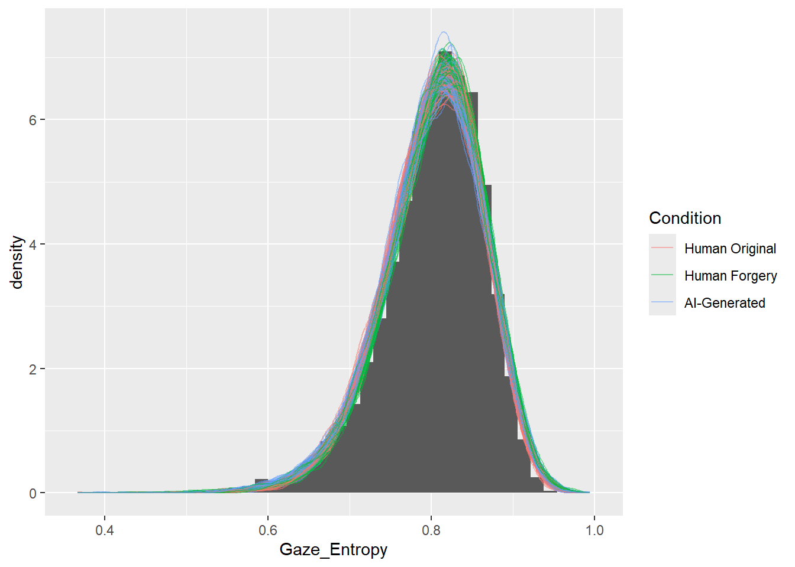{#fig-entropy fig-alt='Gaze entropy: observed distribution (histogram) with posterior-predictive densities per label condition (50 draws each).' width=672}
:::
:::


### pLeft


::: {.cell}

```{.r .cell-code}
make_report(estimates$pLeft)
```

::: {.cell-output-display}

```{=html}
<div id="mfwamrfedb" style="padding-left:0px;padding-right:0px;padding-top:10px;padding-bottom:10px;overflow-x:auto;overflow-y:auto;width:auto;height:auto;">
<style>#mfwamrfedb table {
  font-family: system-ui, 'Segoe UI', Roboto, Helvetica, Arial, sans-serif, 'Apple Color Emoji', 'Segoe UI Emoji', 'Segoe UI Symbol', 'Noto Color Emoji';
  -webkit-font-smoothing: antialiased;
  -moz-osx-font-smoothing: grayscale;
}

#mfwamrfedb thead, #mfwamrfedb tbody, #mfwamrfedb tfoot, #mfwamrfedb tr, #mfwamrfedb td, #mfwamrfedb th {
  border-style: none;
}

#mfwamrfedb p {
  margin: 0;
  padding: 0;
}

#mfwamrfedb .gt_table {
  display: table;
  border-collapse: collapse;
  line-height: normal;
  margin-left: auto;
  margin-right: auto;
  color: #333333;
  font-size: 16px;
  font-weight: normal;
  font-style: normal;
  background-color: #FFFFFF;
  width: auto;
  border-top-style: solid;
  border-top-width: 2px;
  border-top-color: #A8A8A8;
  border-right-style: none;
  border-right-width: 2px;
  border-right-color: #D3D3D3;
  border-bottom-style: solid;
  border-bottom-width: 2px;
  border-bottom-color: #A8A8A8;
  border-left-style: none;
  border-left-width: 2px;
  border-left-color: #D3D3D3;
}

#mfwamrfedb .gt_caption {
  padding-top: 4px;
  padding-bottom: 4px;
}

#mfwamrfedb .gt_title {
  color: #333333;
  font-size: 125%;
  font-weight: initial;
  padding-top: 4px;
  padding-bottom: 4px;
  padding-left: 5px;
  padding-right: 5px;
  border-bottom-color: #FFFFFF;
  border-bottom-width: 0;
}

#mfwamrfedb .gt_subtitle {
  color: #333333;
  font-size: 85%;
  font-weight: initial;
  padding-top: 3px;
  padding-bottom: 5px;
  padding-left: 5px;
  padding-right: 5px;
  border-top-color: #FFFFFF;
  border-top-width: 0;
}

#mfwamrfedb .gt_heading {
  background-color: #FFFFFF;
  text-align: center;
  border-bottom-color: #FFFFFF;
  border-left-style: none;
  border-left-width: 1px;
  border-left-color: #D3D3D3;
  border-right-style: none;
  border-right-width: 1px;
  border-right-color: #D3D3D3;
}

#mfwamrfedb .gt_bottom_border {
  border-bottom-style: solid;
  border-bottom-width: 2px;
  border-bottom-color: #D3D3D3;
}

#mfwamrfedb .gt_col_headings {
  border-top-style: solid;
  border-top-width: 2px;
  border-top-color: #D3D3D3;
  border-bottom-style: solid;
  border-bottom-width: 2px;
  border-bottom-color: #D3D3D3;
  border-left-style: none;
  border-left-width: 1px;
  border-left-color: #D3D3D3;
  border-right-style: none;
  border-right-width: 1px;
  border-right-color: #D3D3D3;
}

#mfwamrfedb .gt_col_heading {
  color: #333333;
  background-color: #FFFFFF;
  font-size: 100%;
  font-weight: normal;
  text-transform: inherit;
  border-left-style: none;
  border-left-width: 1px;
  border-left-color: #D3D3D3;
  border-right-style: none;
  border-right-width: 1px;
  border-right-color: #D3D3D3;
  vertical-align: bottom;
  padding-top: 5px;
  padding-bottom: 6px;
  padding-left: 5px;
  padding-right: 5px;
  overflow-x: hidden;
}

#mfwamrfedb .gt_column_spanner_outer {
  color: #333333;
  background-color: #FFFFFF;
  font-size: 100%;
  font-weight: normal;
  text-transform: inherit;
  padding-top: 0;
  padding-bottom: 0;
  padding-left: 4px;
  padding-right: 4px;
}

#mfwamrfedb .gt_column_spanner_outer:first-child {
  padding-left: 0;
}

#mfwamrfedb .gt_column_spanner_outer:last-child {
  padding-right: 0;
}

#mfwamrfedb .gt_column_spanner {
  border-bottom-style: solid;
  border-bottom-width: 2px;
  border-bottom-color: #D3D3D3;
  vertical-align: bottom;
  padding-top: 5px;
  padding-bottom: 5px;
  overflow-x: hidden;
  display: inline-block;
  width: 100%;
}

#mfwamrfedb .gt_spanner_row {
  border-bottom-style: hidden;
}

#mfwamrfedb .gt_group_heading {
  padding-top: 8px;
  padding-bottom: 8px;
  padding-left: 5px;
  padding-right: 5px;
  color: #333333;
  background-color: #FFFFFF;
  font-size: 100%;
  font-weight: initial;
  text-transform: inherit;
  border-top-style: solid;
  border-top-width: 2px;
  border-top-color: #D3D3D3;
  border-bottom-style: solid;
  border-bottom-width: 2px;
  border-bottom-color: #D3D3D3;
  border-left-style: none;
  border-left-width: 1px;
  border-left-color: #D3D3D3;
  border-right-style: none;
  border-right-width: 1px;
  border-right-color: #D3D3D3;
  vertical-align: middle;
  text-align: left;
}

#mfwamrfedb .gt_empty_group_heading {
  padding: 0.5px;
  color: #333333;
  background-color: #FFFFFF;
  font-size: 100%;
  font-weight: initial;
  border-top-style: solid;
  border-top-width: 2px;
  border-top-color: #D3D3D3;
  border-bottom-style: solid;
  border-bottom-width: 2px;
  border-bottom-color: #D3D3D3;
  vertical-align: middle;
}

#mfwamrfedb .gt_from_md > :first-child {
  margin-top: 0;
}

#mfwamrfedb .gt_from_md > :last-child {
  margin-bottom: 0;
}

#mfwamrfedb .gt_row {
  padding-top: 8px;
  padding-bottom: 8px;
  padding-left: 5px;
  padding-right: 5px;
  margin: 10px;
  border-top-style: solid;
  border-top-width: 1px;
  border-top-color: #D3D3D3;
  border-left-style: none;
  border-left-width: 1px;
  border-left-color: #D3D3D3;
  border-right-style: none;
  border-right-width: 1px;
  border-right-color: #D3D3D3;
  vertical-align: middle;
  overflow-x: hidden;
}

#mfwamrfedb .gt_stub {
  color: #333333;
  background-color: #FFFFFF;
  font-size: 100%;
  font-weight: initial;
  text-transform: inherit;
  border-right-style: solid;
  border-right-width: 2px;
  border-right-color: #D3D3D3;
  padding-left: 5px;
  padding-right: 5px;
}

#mfwamrfedb .gt_stub_row_group {
  color: #333333;
  background-color: #FFFFFF;
  font-size: 100%;
  font-weight: initial;
  text-transform: inherit;
  border-right-style: solid;
  border-right-width: 2px;
  border-right-color: #D3D3D3;
  padding-left: 5px;
  padding-right: 5px;
  vertical-align: top;
}

#mfwamrfedb .gt_row_group_first td {
  border-top-width: 2px;
}

#mfwamrfedb .gt_row_group_first th {
  border-top-width: 2px;
}

#mfwamrfedb .gt_summary_row {
  color: #333333;
  background-color: #FFFFFF;
  text-transform: inherit;
  padding-top: 8px;
  padding-bottom: 8px;
  padding-left: 5px;
  padding-right: 5px;
}

#mfwamrfedb .gt_first_summary_row {
  border-top-style: solid;
  border-top-color: #D3D3D3;
}

#mfwamrfedb .gt_first_summary_row.thick {
  border-top-width: 2px;
}

#mfwamrfedb .gt_last_summary_row {
  padding-top: 8px;
  padding-bottom: 8px;
  padding-left: 5px;
  padding-right: 5px;
  border-bottom-style: solid;
  border-bottom-width: 2px;
  border-bottom-color: #D3D3D3;
}

#mfwamrfedb .gt_grand_summary_row {
  color: #333333;
  background-color: #FFFFFF;
  text-transform: inherit;
  padding-top: 8px;
  padding-bottom: 8px;
  padding-left: 5px;
  padding-right: 5px;
}

#mfwamrfedb .gt_first_grand_summary_row {
  padding-top: 8px;
  padding-bottom: 8px;
  padding-left: 5px;
  padding-right: 5px;
  border-top-style: double;
  border-top-width: 6px;
  border-top-color: #D3D3D3;
}

#mfwamrfedb .gt_last_grand_summary_row_top {
  padding-top: 8px;
  padding-bottom: 8px;
  padding-left: 5px;
  padding-right: 5px;
  border-bottom-style: double;
  border-bottom-width: 6px;
  border-bottom-color: #D3D3D3;
}

#mfwamrfedb .gt_striped {
  background-color: rgba(128, 128, 128, 0.05);
}

#mfwamrfedb .gt_table_body {
  border-top-style: solid;
  border-top-width: 2px;
  border-top-color: #D3D3D3;
  border-bottom-style: solid;
  border-bottom-width: 2px;
  border-bottom-color: #D3D3D3;
}

#mfwamrfedb .gt_footnotes {
  color: #333333;
  background-color: #FFFFFF;
  border-bottom-style: none;
  border-bottom-width: 2px;
  border-bottom-color: #D3D3D3;
  border-left-style: none;
  border-left-width: 2px;
  border-left-color: #D3D3D3;
  border-right-style: none;
  border-right-width: 2px;
  border-right-color: #D3D3D3;
}

#mfwamrfedb .gt_footnote {
  margin: 0px;
  font-size: 90%;
  padding-top: 4px;
  padding-bottom: 4px;
  padding-left: 5px;
  padding-right: 5px;
}

#mfwamrfedb .gt_sourcenotes {
  color: #333333;
  background-color: #FFFFFF;
  border-bottom-style: none;
  border-bottom-width: 2px;
  border-bottom-color: #D3D3D3;
  border-left-style: none;
  border-left-width: 2px;
  border-left-color: #D3D3D3;
  border-right-style: none;
  border-right-width: 2px;
  border-right-color: #D3D3D3;
}

#mfwamrfedb .gt_sourcenote {
  font-size: 90%;
  padding-top: 4px;
  padding-bottom: 4px;
  padding-left: 5px;
  padding-right: 5px;
}

#mfwamrfedb .gt_left {
  text-align: left;
}

#mfwamrfedb .gt_center {
  text-align: center;
}

#mfwamrfedb .gt_right {
  text-align: right;
  font-variant-numeric: tabular-nums;
}

#mfwamrfedb .gt_font_normal {
  font-weight: normal;
}

#mfwamrfedb .gt_font_bold {
  font-weight: bold;
}

#mfwamrfedb .gt_font_italic {
  font-style: italic;
}

#mfwamrfedb .gt_super {
  font-size: 65%;
}

#mfwamrfedb .gt_footnote_marks {
  font-size: 75%;
  vertical-align: 0.4em;
  position: initial;
}

#mfwamrfedb .gt_asterisk {
  font-size: 100%;
  vertical-align: 0;
}

#mfwamrfedb .gt_indent_1 {
  text-indent: 5px;
}

#mfwamrfedb .gt_indent_2 {
  text-indent: 10px;
}

#mfwamrfedb .gt_indent_3 {
  text-indent: 15px;
}

#mfwamrfedb .gt_indent_4 {
  text-indent: 20px;
}

#mfwamrfedb .gt_indent_5 {
  text-indent: 25px;
}

#mfwamrfedb .katex-display {
  display: inline-flex !important;
  margin-bottom: 0.75em !important;
}

#mfwamrfedb div.Reactable > div.rt-table > div.rt-thead > div.rt-tr.rt-tr-group-header > div.rt-th-group:after {
  height: 0px !important;
}
</style>
<table class="gt_table" data-quarto-disable-processing="false" data-quarto-bootstrap="false">
  <thead>
    <tr class="gt_col_headings">
      <th class="gt_col_heading gt_columns_bottom_border gt_left" rowspan="1" colspan="1" scope="col" id="Contrast">Contrast</th>
      <th class="gt_col_heading gt_columns_bottom_border gt_left" rowspan="1" colspan="1" scope="col" id="Parameters">Parameters</th>
    </tr>
  </thead>
  <tbody class="gt_table_body">
    <tr><td headers="Contrast" class="gt_row gt_left">AI-Generated - Human Original</td>
<td headers="Parameters" class="gt_row gt_left">phi (0.31, [0.03, 0.60])</td></tr>
  </tbody>
  
</table>
</div>
```

```{=html}
<div id="zeouesglwf" style="padding-left:0px;padding-right:0px;padding-top:10px;padding-bottom:10px;overflow-x:auto;overflow-y:auto;width:auto;height:auto;">
<style>#zeouesglwf table {
  font-family: system-ui, 'Segoe UI', Roboto, Helvetica, Arial, sans-serif, 'Apple Color Emoji', 'Segoe UI Emoji', 'Segoe UI Symbol', 'Noto Color Emoji';
  -webkit-font-smoothing: antialiased;
  -moz-osx-font-smoothing: grayscale;
}

#zeouesglwf thead, #zeouesglwf tbody, #zeouesglwf tfoot, #zeouesglwf tr, #zeouesglwf td, #zeouesglwf th {
  border-style: none;
}

#zeouesglwf p {
  margin: 0;
  padding: 0;
}

#zeouesglwf .gt_table {
  display: table;
  border-collapse: collapse;
  line-height: normal;
  margin-left: auto;
  margin-right: auto;
  color: #333333;
  font-size: 16px;
  font-weight: normal;
  font-style: normal;
  background-color: #FFFFFF;
  width: auto;
  border-top-style: solid;
  border-top-width: 2px;
  border-top-color: #A8A8A8;
  border-right-style: none;
  border-right-width: 2px;
  border-right-color: #D3D3D3;
  border-bottom-style: solid;
  border-bottom-width: 2px;
  border-bottom-color: #A8A8A8;
  border-left-style: none;
  border-left-width: 2px;
  border-left-color: #D3D3D3;
}

#zeouesglwf .gt_caption {
  padding-top: 4px;
  padding-bottom: 4px;
}

#zeouesglwf .gt_title {
  color: #333333;
  font-size: 125%;
  font-weight: initial;
  padding-top: 4px;
  padding-bottom: 4px;
  padding-left: 5px;
  padding-right: 5px;
  border-bottom-color: #FFFFFF;
  border-bottom-width: 0;
}

#zeouesglwf .gt_subtitle {
  color: #333333;
  font-size: 85%;
  font-weight: initial;
  padding-top: 3px;
  padding-bottom: 5px;
  padding-left: 5px;
  padding-right: 5px;
  border-top-color: #FFFFFF;
  border-top-width: 0;
}

#zeouesglwf .gt_heading {
  background-color: #FFFFFF;
  text-align: center;
  border-bottom-color: #FFFFFF;
  border-left-style: none;
  border-left-width: 1px;
  border-left-color: #D3D3D3;
  border-right-style: none;
  border-right-width: 1px;
  border-right-color: #D3D3D3;
}

#zeouesglwf .gt_bottom_border {
  border-bottom-style: solid;
  border-bottom-width: 2px;
  border-bottom-color: #D3D3D3;
}

#zeouesglwf .gt_col_headings {
  border-top-style: solid;
  border-top-width: 2px;
  border-top-color: #D3D3D3;
  border-bottom-style: solid;
  border-bottom-width: 2px;
  border-bottom-color: #D3D3D3;
  border-left-style: none;
  border-left-width: 1px;
  border-left-color: #D3D3D3;
  border-right-style: none;
  border-right-width: 1px;
  border-right-color: #D3D3D3;
}

#zeouesglwf .gt_col_heading {
  color: #333333;
  background-color: #FFFFFF;
  font-size: 100%;
  font-weight: normal;
  text-transform: inherit;
  border-left-style: none;
  border-left-width: 1px;
  border-left-color: #D3D3D3;
  border-right-style: none;
  border-right-width: 1px;
  border-right-color: #D3D3D3;
  vertical-align: bottom;
  padding-top: 5px;
  padding-bottom: 6px;
  padding-left: 5px;
  padding-right: 5px;
  overflow-x: hidden;
}

#zeouesglwf .gt_column_spanner_outer {
  color: #333333;
  background-color: #FFFFFF;
  font-size: 100%;
  font-weight: normal;
  text-transform: inherit;
  padding-top: 0;
  padding-bottom: 0;
  padding-left: 4px;
  padding-right: 4px;
}

#zeouesglwf .gt_column_spanner_outer:first-child {
  padding-left: 0;
}

#zeouesglwf .gt_column_spanner_outer:last-child {
  padding-right: 0;
}

#zeouesglwf .gt_column_spanner {
  border-bottom-style: solid;
  border-bottom-width: 2px;
  border-bottom-color: #D3D3D3;
  vertical-align: bottom;
  padding-top: 5px;
  padding-bottom: 5px;
  overflow-x: hidden;
  display: inline-block;
  width: 100%;
}

#zeouesglwf .gt_spanner_row {
  border-bottom-style: hidden;
}

#zeouesglwf .gt_group_heading {
  padding-top: 8px;
  padding-bottom: 8px;
  padding-left: 5px;
  padding-right: 5px;
  color: #333333;
  background-color: #FFFFFF;
  font-size: 100%;
  font-weight: initial;
  text-transform: inherit;
  border-top-style: solid;
  border-top-width: 2px;
  border-top-color: #D3D3D3;
  border-bottom-style: solid;
  border-bottom-width: 2px;
  border-bottom-color: #D3D3D3;
  border-left-style: none;
  border-left-width: 1px;
  border-left-color: #D3D3D3;
  border-right-style: none;
  border-right-width: 1px;
  border-right-color: #D3D3D3;
  vertical-align: middle;
  text-align: left;
}

#zeouesglwf .gt_empty_group_heading {
  padding: 0.5px;
  color: #333333;
  background-color: #FFFFFF;
  font-size: 100%;
  font-weight: initial;
  border-top-style: solid;
  border-top-width: 2px;
  border-top-color: #D3D3D3;
  border-bottom-style: solid;
  border-bottom-width: 2px;
  border-bottom-color: #D3D3D3;
  vertical-align: middle;
}

#zeouesglwf .gt_from_md > :first-child {
  margin-top: 0;
}

#zeouesglwf .gt_from_md > :last-child {
  margin-bottom: 0;
}

#zeouesglwf .gt_row {
  padding-top: 8px;
  padding-bottom: 8px;
  padding-left: 5px;
  padding-right: 5px;
  margin: 10px;
  border-top-style: solid;
  border-top-width: 1px;
  border-top-color: #D3D3D3;
  border-left-style: none;
  border-left-width: 1px;
  border-left-color: #D3D3D3;
  border-right-style: none;
  border-right-width: 1px;
  border-right-color: #D3D3D3;
  vertical-align: middle;
  overflow-x: hidden;
}

#zeouesglwf .gt_stub {
  color: #333333;
  background-color: #FFFFFF;
  font-size: 100%;
  font-weight: initial;
  text-transform: inherit;
  border-right-style: solid;
  border-right-width: 2px;
  border-right-color: #D3D3D3;
  padding-left: 5px;
  padding-right: 5px;
}

#zeouesglwf .gt_stub_row_group {
  color: #333333;
  background-color: #FFFFFF;
  font-size: 100%;
  font-weight: initial;
  text-transform: inherit;
  border-right-style: solid;
  border-right-width: 2px;
  border-right-color: #D3D3D3;
  padding-left: 5px;
  padding-right: 5px;
  vertical-align: top;
}

#zeouesglwf .gt_row_group_first td {
  border-top-width: 2px;
}

#zeouesglwf .gt_row_group_first th {
  border-top-width: 2px;
}

#zeouesglwf .gt_summary_row {
  color: #333333;
  background-color: #FFFFFF;
  text-transform: inherit;
  padding-top: 8px;
  padding-bottom: 8px;
  padding-left: 5px;
  padding-right: 5px;
}

#zeouesglwf .gt_first_summary_row {
  border-top-style: solid;
  border-top-color: #D3D3D3;
}

#zeouesglwf .gt_first_summary_row.thick {
  border-top-width: 2px;
}

#zeouesglwf .gt_last_summary_row {
  padding-top: 8px;
  padding-bottom: 8px;
  padding-left: 5px;
  padding-right: 5px;
  border-bottom-style: solid;
  border-bottom-width: 2px;
  border-bottom-color: #D3D3D3;
}

#zeouesglwf .gt_grand_summary_row {
  color: #333333;
  background-color: #FFFFFF;
  text-transform: inherit;
  padding-top: 8px;
  padding-bottom: 8px;
  padding-left: 5px;
  padding-right: 5px;
}

#zeouesglwf .gt_first_grand_summary_row {
  padding-top: 8px;
  padding-bottom: 8px;
  padding-left: 5px;
  padding-right: 5px;
  border-top-style: double;
  border-top-width: 6px;
  border-top-color: #D3D3D3;
}

#zeouesglwf .gt_last_grand_summary_row_top {
  padding-top: 8px;
  padding-bottom: 8px;
  padding-left: 5px;
  padding-right: 5px;
  border-bottom-style: double;
  border-bottom-width: 6px;
  border-bottom-color: #D3D3D3;
}

#zeouesglwf .gt_striped {
  background-color: rgba(128, 128, 128, 0.05);
}

#zeouesglwf .gt_table_body {
  border-top-style: solid;
  border-top-width: 2px;
  border-top-color: #D3D3D3;
  border-bottom-style: solid;
  border-bottom-width: 2px;
  border-bottom-color: #D3D3D3;
}

#zeouesglwf .gt_footnotes {
  color: #333333;
  background-color: #FFFFFF;
  border-bottom-style: none;
  border-bottom-width: 2px;
  border-bottom-color: #D3D3D3;
  border-left-style: none;
  border-left-width: 2px;
  border-left-color: #D3D3D3;
  border-right-style: none;
  border-right-width: 2px;
  border-right-color: #D3D3D3;
}

#zeouesglwf .gt_footnote {
  margin: 0px;
  font-size: 90%;
  padding-top: 4px;
  padding-bottom: 4px;
  padding-left: 5px;
  padding-right: 5px;
}

#zeouesglwf .gt_sourcenotes {
  color: #333333;
  background-color: #FFFFFF;
  border-bottom-style: none;
  border-bottom-width: 2px;
  border-bottom-color: #D3D3D3;
  border-left-style: none;
  border-left-width: 2px;
  border-left-color: #D3D3D3;
  border-right-style: none;
  border-right-width: 2px;
  border-right-color: #D3D3D3;
}

#zeouesglwf .gt_sourcenote {
  font-size: 90%;
  padding-top: 4px;
  padding-bottom: 4px;
  padding-left: 5px;
  padding-right: 5px;
}

#zeouesglwf .gt_left {
  text-align: left;
}

#zeouesglwf .gt_center {
  text-align: center;
}

#zeouesglwf .gt_right {
  text-align: right;
  font-variant-numeric: tabular-nums;
}

#zeouesglwf .gt_font_normal {
  font-weight: normal;
}

#zeouesglwf .gt_font_bold {
  font-weight: bold;
}

#zeouesglwf .gt_font_italic {
  font-style: italic;
}

#zeouesglwf .gt_super {
  font-size: 65%;
}

#zeouesglwf .gt_footnote_marks {
  font-size: 75%;
  vertical-align: 0.4em;
  position: initial;
}

#zeouesglwf .gt_asterisk {
  font-size: 100%;
  vertical-align: 0;
}

#zeouesglwf .gt_indent_1 {
  text-indent: 5px;
}

#zeouesglwf .gt_indent_2 {
  text-indent: 10px;
}

#zeouesglwf .gt_indent_3 {
  text-indent: 15px;
}

#zeouesglwf .gt_indent_4 {
  text-indent: 20px;
}

#zeouesglwf .gt_indent_5 {
  text-indent: 25px;
}

#zeouesglwf .katex-display {
  display: inline-flex !important;
  margin-bottom: 0.75em !important;
}

#zeouesglwf div.Reactable > div.rt-table > div.rt-thead > div.rt-tr.rt-tr-group-header > div.rt-th-group:after {
  height: 0px !important;
}
</style>
<table class="gt_table" data-quarto-disable-processing="false" data-quarto-bootstrap="false">
  <thead>
    <tr class="gt_col_headings">
      <th class="gt_col_heading gt_columns_bottom_border gt_left" rowspan="1" colspan="1" scope="col" id="Contrast">Contrast</th>
      <th class="gt_col_heading gt_columns_bottom_border gt_left" rowspan="1" colspan="1" scope="col" id="Parameters">Parameters</th>
    </tr>
  </thead>
  <tbody class="gt_table_body">
    <tr><td headers="Contrast" class="gt_row gt_left">Negative - Low intensity - Positive - Low intensity</td>
<td headers="Parameters" class="gt_row gt_left">None</td></tr>
    <tr><td headers="Contrast" class="gt_row gt_left">Positive - High intensity - Positive - Low intensity</td>
<td headers="Parameters" class="gt_row gt_left">None</td></tr>
    <tr><td headers="Contrast" class="gt_row gt_left">Positive - High intensity - Negative - Low intensity</td>
<td headers="Parameters" class="gt_row gt_left">None</td></tr>
    <tr><td headers="Contrast" class="gt_row gt_left">Negative - High intensity - Positive - Low intensity</td>
<td headers="Parameters" class="gt_row gt_left">None</td></tr>
    <tr><td headers="Contrast" class="gt_row gt_left">Negative - High intensity - Negative - Low intensity</td>
<td headers="Parameters" class="gt_row gt_left">None</td></tr>
    <tr><td headers="Contrast" class="gt_row gt_left">Negative - High intensity - Positive - High intensity</td>
<td headers="Parameters" class="gt_row gt_left">None</td></tr>
  </tbody>
  
</table>
</div>
```

```{=html}
<div id="yuncdvxevw" style="padding-left:0px;padding-right:0px;padding-top:10px;padding-bottom:10px;overflow-x:auto;overflow-y:auto;width:auto;height:auto;">
<style>#yuncdvxevw table {
  font-family: system-ui, 'Segoe UI', Roboto, Helvetica, Arial, sans-serif, 'Apple Color Emoji', 'Segoe UI Emoji', 'Segoe UI Symbol', 'Noto Color Emoji';
  -webkit-font-smoothing: antialiased;
  -moz-osx-font-smoothing: grayscale;
}

#yuncdvxevw thead, #yuncdvxevw tbody, #yuncdvxevw tfoot, #yuncdvxevw tr, #yuncdvxevw td, #yuncdvxevw th {
  border-style: none;
}

#yuncdvxevw p {
  margin: 0;
  padding: 0;
}

#yuncdvxevw .gt_table {
  display: table;
  border-collapse: collapse;
  line-height: normal;
  margin-left: auto;
  margin-right: auto;
  color: #333333;
  font-size: 13px;
  font-weight: normal;
  font-style: normal;
  background-color: #FFFFFF;
  width: auto;
  border-top-style: solid;
  border-top-width: 3px;
  border-top-color: #D5D5D5;
  border-right-style: solid;
  border-right-width: 3px;
  border-right-color: #D5D5D5;
  border-bottom-style: solid;
  border-bottom-width: 3px;
  border-bottom-color: #D5D5D5;
  border-left-style: solid;
  border-left-width: 3px;
  border-left-color: #D5D5D5;
}

#yuncdvxevw .gt_caption {
  padding-top: 4px;
  padding-bottom: 4px;
}

#yuncdvxevw .gt_title {
  color: #333333;
  font-size: 125%;
  font-weight: initial;
  padding-top: 4px;
  padding-bottom: 4px;
  padding-left: 5px;
  padding-right: 5px;
  border-bottom-color: #FFFFFF;
  border-bottom-width: 0;
}

#yuncdvxevw .gt_subtitle {
  color: #333333;
  font-size: 85%;
  font-weight: initial;
  padding-top: 3px;
  padding-bottom: 5px;
  padding-left: 5px;
  padding-right: 5px;
  border-top-color: #FFFFFF;
  border-top-width: 0;
}

#yuncdvxevw .gt_heading {
  background-color: #FFFFFF;
  text-align: left;
  border-bottom-color: #FFFFFF;
  border-left-style: none;
  border-left-width: 1px;
  border-left-color: #D3D3D3;
  border-right-style: none;
  border-right-width: 1px;
  border-right-color: #D3D3D3;
}

#yuncdvxevw .gt_bottom_border {
  border-bottom-style: solid;
  border-bottom-width: 2px;
  border-bottom-color: #D5D5D5;
}

#yuncdvxevw .gt_col_headings {
  border-top-style: solid;
  border-top-width: 2px;
  border-top-color: #D5D5D5;
  border-bottom-style: solid;
  border-bottom-width: 2px;
  border-bottom-color: #D5D5D5;
  border-left-style: none;
  border-left-width: 1px;
  border-left-color: #D3D3D3;
  border-right-style: none;
  border-right-width: 1px;
  border-right-color: #D3D3D3;
}

#yuncdvxevw .gt_col_heading {
  color: #FFFFFF;
  background-color: #000000;
  font-size: 100%;
  font-weight: normal;
  text-transform: inherit;
  border-left-style: none;
  border-left-width: 1px;
  border-left-color: #D3D3D3;
  border-right-style: none;
  border-right-width: 1px;
  border-right-color: #D3D3D3;
  vertical-align: bottom;
  padding-top: 5px;
  padding-bottom: 6px;
  padding-left: 5px;
  padding-right: 5px;
  overflow-x: hidden;
}

#yuncdvxevw .gt_column_spanner_outer {
  color: #FFFFFF;
  background-color: #000000;
  font-size: 100%;
  font-weight: normal;
  text-transform: inherit;
  padding-top: 0;
  padding-bottom: 0;
  padding-left: 4px;
  padding-right: 4px;
}

#yuncdvxevw .gt_column_spanner_outer:first-child {
  padding-left: 0;
}

#yuncdvxevw .gt_column_spanner_outer:last-child {
  padding-right: 0;
}

#yuncdvxevw .gt_column_spanner {
  border-bottom-style: solid;
  border-bottom-width: 2px;
  border-bottom-color: #D5D5D5;
  vertical-align: bottom;
  padding-top: 5px;
  padding-bottom: 5px;
  overflow-x: hidden;
  display: inline-block;
  width: 100%;
}

#yuncdvxevw .gt_spanner_row {
  border-bottom-style: hidden;
}

#yuncdvxevw .gt_group_heading {
  padding-top: 8px;
  padding-bottom: 8px;
  padding-left: 5px;
  padding-right: 5px;
  color: #333333;
  background-color: #FFFFFF;
  font-size: 100%;
  font-weight: initial;
  text-transform: inherit;
  border-top-style: solid;
  border-top-width: 2px;
  border-top-color: #D5D5D5;
  border-bottom-style: solid;
  border-bottom-width: 2px;
  border-bottom-color: #D5D5D5;
  border-left-style: none;
  border-left-width: 1px;
  border-left-color: #D3D3D3;
  border-right-style: none;
  border-right-width: 1px;
  border-right-color: #D3D3D3;
  vertical-align: middle;
  text-align: left;
}

#yuncdvxevw .gt_empty_group_heading {
  padding: 0.5px;
  color: #333333;
  background-color: #FFFFFF;
  font-size: 100%;
  font-weight: initial;
  border-top-style: solid;
  border-top-width: 2px;
  border-top-color: #D5D5D5;
  border-bottom-style: solid;
  border-bottom-width: 2px;
  border-bottom-color: #D5D5D5;
  vertical-align: middle;
}

#yuncdvxevw .gt_from_md > :first-child {
  margin-top: 0;
}

#yuncdvxevw .gt_from_md > :last-child {
  margin-bottom: 0;
}

#yuncdvxevw .gt_row {
  padding-top: 8px;
  padding-bottom: 8px;
  padding-left: 5px;
  padding-right: 5px;
  margin: 10px;
  border-top-style: solid;
  border-top-width: 1px;
  border-top-color: #D5D5D5;
  border-left-style: solid;
  border-left-width: 1px;
  border-left-color: #D5D5D5;
  border-right-style: solid;
  border-right-width: 1px;
  border-right-color: #D5D5D5;
  vertical-align: middle;
  overflow-x: hidden;
}

#yuncdvxevw .gt_stub {
  color: #333333;
  background-color: #FFFFFF;
  font-size: 100%;
  font-weight: initial;
  text-transform: inherit;
  border-right-style: solid;
  border-right-width: 2px;
  border-right-color: #5F5F5F;
  padding-left: 5px;
  padding-right: 5px;
}

#yuncdvxevw .gt_stub_row_group {
  color: #333333;
  background-color: #FFFFFF;
  font-size: 100%;
  font-weight: initial;
  text-transform: inherit;
  border-right-style: solid;
  border-right-width: 2px;
  border-right-color: #D3D3D3;
  padding-left: 5px;
  padding-right: 5px;
  vertical-align: top;
}

#yuncdvxevw .gt_row_group_first td {
  border-top-width: 2px;
}

#yuncdvxevw .gt_row_group_first th {
  border-top-width: 2px;
}

#yuncdvxevw .gt_summary_row {
  color: #333333;
  background-color: #D5D5D5;
  text-transform: inherit;
  padding-top: 8px;
  padding-bottom: 8px;
  padding-left: 5px;
  padding-right: 5px;
}

#yuncdvxevw .gt_first_summary_row {
  border-top-style: solid;
  border-top-color: #D5D5D5;
}

#yuncdvxevw .gt_first_summary_row.thick {
  border-top-width: 2px;
}

#yuncdvxevw .gt_last_summary_row {
  padding-top: 8px;
  padding-bottom: 8px;
  padding-left: 5px;
  padding-right: 5px;
  border-bottom-style: solid;
  border-bottom-width: 2px;
  border-bottom-color: #D5D5D5;
}

#yuncdvxevw .gt_grand_summary_row {
  color: #FFFFFF;
  background-color: #929292;
  text-transform: inherit;
  padding-top: 8px;
  padding-bottom: 8px;
  padding-left: 5px;
  padding-right: 5px;
}

#yuncdvxevw .gt_first_grand_summary_row {
  padding-top: 8px;
  padding-bottom: 8px;
  padding-left: 5px;
  padding-right: 5px;
  border-top-style: double;
  border-top-width: 6px;
  border-top-color: #D5D5D5;
}

#yuncdvxevw .gt_last_grand_summary_row_top {
  padding-top: 8px;
  padding-bottom: 8px;
  padding-left: 5px;
  padding-right: 5px;
  border-bottom-style: double;
  border-bottom-width: 6px;
  border-bottom-color: #D5D5D5;
}

#yuncdvxevw .gt_striped {
  background-color: #F4F4F4;
}

#yuncdvxevw .gt_table_body {
  border-top-style: solid;
  border-top-width: 2px;
  border-top-color: #D5D5D5;
  border-bottom-style: solid;
  border-bottom-width: 2px;
  border-bottom-color: #D5D5D5;
}

#yuncdvxevw .gt_footnotes {
  color: #333333;
  background-color: #FFFFFF;
  border-bottom-style: none;
  border-bottom-width: 2px;
  border-bottom-color: #D3D3D3;
  border-left-style: none;
  border-left-width: 2px;
  border-left-color: #D3D3D3;
  border-right-style: none;
  border-right-width: 2px;
  border-right-color: #D3D3D3;
}

#yuncdvxevw .gt_footnote {
  margin: 0px;
  font-size: 90%;
  padding-top: 4px;
  padding-bottom: 4px;
  padding-left: 5px;
  padding-right: 5px;
}

#yuncdvxevw .gt_sourcenotes {
  color: #333333;
  background-color: #FFFFFF;
  border-bottom-style: none;
  border-bottom-width: 2px;
  border-bottom-color: #D3D3D3;
  border-left-style: none;
  border-left-width: 2px;
  border-left-color: #D3D3D3;
  border-right-style: none;
  border-right-width: 2px;
  border-right-color: #D3D3D3;
}

#yuncdvxevw .gt_sourcenote {
  font-size: 90%;
  padding-top: 4px;
  padding-bottom: 4px;
  padding-left: 5px;
  padding-right: 5px;
}

#yuncdvxevw .gt_left {
  text-align: left;
}

#yuncdvxevw .gt_center {
  text-align: center;
}

#yuncdvxevw .gt_right {
  text-align: right;
  font-variant-numeric: tabular-nums;
}

#yuncdvxevw .gt_font_normal {
  font-weight: normal;
}

#yuncdvxevw .gt_font_bold {
  font-weight: bold;
}

#yuncdvxevw .gt_font_italic {
  font-style: italic;
}

#yuncdvxevw .gt_super {
  font-size: 65%;
}

#yuncdvxevw .gt_footnote_marks {
  font-size: 75%;
  vertical-align: 0.4em;
  position: initial;
}

#yuncdvxevw .gt_asterisk {
  font-size: 100%;
  vertical-align: 0;
}

#yuncdvxevw .gt_indent_1 {
  text-indent: 5px;
}

#yuncdvxevw .gt_indent_2 {
  text-indent: 10px;
}

#yuncdvxevw .gt_indent_3 {
  text-indent: 15px;
}

#yuncdvxevw .gt_indent_4 {
  text-indent: 20px;
}

#yuncdvxevw .gt_indent_5 {
  text-indent: 25px;
}

#yuncdvxevw .katex-display {
  display: inline-flex !important;
  margin-bottom: 0.75em !important;
}

#yuncdvxevw div.Reactable > div.rt-table > div.rt-thead > div.rt-tr.rt-tr-group-header > div.rt-th-group:after {
  height: 0px !important;
}
</style>
<table class="gt_table" data-quarto-disable-processing="false" data-quarto-bootstrap="false">
  <thead>
    <tr class="gt_heading">
      <td colspan="10" class="gt_heading gt_title gt_font_normal gt_bottom_border" style>Gaze Laterality (pLeft): convergence</td>
    </tr>
    
    <tr class="gt_col_headings">
      <th class="gt_col_heading gt_columns_bottom_border gt_left" rowspan="1" colspan="1" scope="col" id="Model">Model</th>
      <th class="gt_col_heading gt_columns_bottom_border gt_left" rowspan="1" colspan="1" scope="col" id="Family">Family</th>
      <th class="gt_col_heading gt_columns_bottom_border gt_right" rowspan="1" colspan="1" scope="col" id="N_obs">N_obs</th>
      <th class="gt_col_heading gt_columns_bottom_border gt_right" rowspan="1" colspan="1" scope="col" id="N_participants">N_participants</th>
      <th class="gt_col_heading gt_columns_bottom_border gt_right" rowspan="1" colspan="1" scope="col" id="Chains">Chains</th>
      <th class="gt_col_heading gt_columns_bottom_border gt_right" rowspan="1" colspan="1" scope="col" id="Draws">Draws</th>
      <th class="gt_col_heading gt_columns_bottom_border gt_right" rowspan="1" colspan="1" scope="col" id="Max_Rhat">Max_Rhat</th>
      <th class="gt_col_heading gt_columns_bottom_border gt_right" rowspan="1" colspan="1" scope="col" id="Min_ESS_ratio">Min_ESS_ratio</th>
      <th class="gt_col_heading gt_columns_bottom_border gt_right" rowspan="1" colspan="1" scope="col" id="Divergent_pct">Divergent_pct</th>
      <th class="gt_col_heading gt_columns_bottom_border gt_left" rowspan="1" colspan="1" scope="col" id="Criterion">Criterion</th>
    </tr>
  </thead>
  <tbody class="gt_table_body">
    <tr><td headers="Model" class="gt_row gt_left">pLeft</td>
<td headers="Family" class="gt_row gt_left">Zero-one-inflated Beta</td>
<td headers="N_obs" class="gt_row gt_right">12220</td>
<td headers="N_participants" class="gt_row gt_right">274</td>
<td headers="Chains" class="gt_row gt_right">8</td>
<td headers="Draws" class="gt_row gt_right">4000</td>
<td headers="Max_Rhat" class="gt_row gt_right">1.058</td>
<td headers="Min_ESS_ratio" class="gt_row gt_right">0.033</td>
<td headers="Divergent_pct" class="gt_row gt_right">0</td>
<td headers="Criterion" class="gt_row gt_left">loo</td></tr>
  </tbody>
  
</table>
</div>
```


::: {.callout-note collapse="true" title="Gaze Laterality (pLeft): convergence (Markdown table, for text readers)"}

|Model |Family                 | N_obs| N_participants| Chains| Draws| Max_Rhat| Min_ESS_ratio| Divergent_pct|Criterion |
|:-----|:----------------------|-----:|--------------:|------:|-----:|--------:|-------------:|-------------:|:---------|
|pLeft |Zero-one-inflated Beta | 12220|            274|      8|  4000|    1.058|         0.033|             0|loo       |

:::

```{=html}
<div id="hccjqicahs" style="padding-left:0px;padding-right:0px;padding-top:10px;padding-bottom:10px;overflow-x:auto;overflow-y:auto;width:auto;height:auto;">
<style>#hccjqicahs table {
  font-family: system-ui, 'Segoe UI', Roboto, Helvetica, Arial, sans-serif, 'Apple Color Emoji', 'Segoe UI Emoji', 'Segoe UI Symbol', 'Noto Color Emoji';
  -webkit-font-smoothing: antialiased;
  -moz-osx-font-smoothing: grayscale;
}

#hccjqicahs thead, #hccjqicahs tbody, #hccjqicahs tfoot, #hccjqicahs tr, #hccjqicahs td, #hccjqicahs th {
  border-style: none;
}

#hccjqicahs p {
  margin: 0;
  padding: 0;
}

#hccjqicahs .gt_table {
  display: table;
  border-collapse: collapse;
  line-height: normal;
  margin-left: auto;
  margin-right: auto;
  color: #333333;
  font-size: 13px;
  font-weight: normal;
  font-style: normal;
  background-color: #FFFFFF;
  width: auto;
  border-top-style: solid;
  border-top-width: 3px;
  border-top-color: #D5D5D5;
  border-right-style: solid;
  border-right-width: 3px;
  border-right-color: #D5D5D5;
  border-bottom-style: solid;
  border-bottom-width: 3px;
  border-bottom-color: #D5D5D5;
  border-left-style: solid;
  border-left-width: 3px;
  border-left-color: #D5D5D5;
}

#hccjqicahs .gt_caption {
  padding-top: 4px;
  padding-bottom: 4px;
}

#hccjqicahs .gt_title {
  color: #333333;
  font-size: 125%;
  font-weight: initial;
  padding-top: 4px;
  padding-bottom: 4px;
  padding-left: 5px;
  padding-right: 5px;
  border-bottom-color: #FFFFFF;
  border-bottom-width: 0;
}

#hccjqicahs .gt_subtitle {
  color: #333333;
  font-size: 85%;
  font-weight: initial;
  padding-top: 3px;
  padding-bottom: 5px;
  padding-left: 5px;
  padding-right: 5px;
  border-top-color: #FFFFFF;
  border-top-width: 0;
}

#hccjqicahs .gt_heading {
  background-color: #FFFFFF;
  text-align: left;
  border-bottom-color: #FFFFFF;
  border-left-style: none;
  border-left-width: 1px;
  border-left-color: #D3D3D3;
  border-right-style: none;
  border-right-width: 1px;
  border-right-color: #D3D3D3;
}

#hccjqicahs .gt_bottom_border {
  border-bottom-style: solid;
  border-bottom-width: 2px;
  border-bottom-color: #D5D5D5;
}

#hccjqicahs .gt_col_headings {
  border-top-style: solid;
  border-top-width: 2px;
  border-top-color: #D5D5D5;
  border-bottom-style: solid;
  border-bottom-width: 2px;
  border-bottom-color: #D5D5D5;
  border-left-style: none;
  border-left-width: 1px;
  border-left-color: #D3D3D3;
  border-right-style: none;
  border-right-width: 1px;
  border-right-color: #D3D3D3;
}

#hccjqicahs .gt_col_heading {
  color: #FFFFFF;
  background-color: #000000;
  font-size: 100%;
  font-weight: normal;
  text-transform: inherit;
  border-left-style: none;
  border-left-width: 1px;
  border-left-color: #D3D3D3;
  border-right-style: none;
  border-right-width: 1px;
  border-right-color: #D3D3D3;
  vertical-align: bottom;
  padding-top: 5px;
  padding-bottom: 6px;
  padding-left: 5px;
  padding-right: 5px;
  overflow-x: hidden;
}

#hccjqicahs .gt_column_spanner_outer {
  color: #FFFFFF;
  background-color: #000000;
  font-size: 100%;
  font-weight: normal;
  text-transform: inherit;
  padding-top: 0;
  padding-bottom: 0;
  padding-left: 4px;
  padding-right: 4px;
}

#hccjqicahs .gt_column_spanner_outer:first-child {
  padding-left: 0;
}

#hccjqicahs .gt_column_spanner_outer:last-child {
  padding-right: 0;
}

#hccjqicahs .gt_column_spanner {
  border-bottom-style: solid;
  border-bottom-width: 2px;
  border-bottom-color: #D5D5D5;
  vertical-align: bottom;
  padding-top: 5px;
  padding-bottom: 5px;
  overflow-x: hidden;
  display: inline-block;
  width: 100%;
}

#hccjqicahs .gt_spanner_row {
  border-bottom-style: hidden;
}

#hccjqicahs .gt_group_heading {
  padding-top: 8px;
  padding-bottom: 8px;
  padding-left: 5px;
  padding-right: 5px;
  color: #333333;
  background-color: #FFFFFF;
  font-size: 100%;
  font-weight: initial;
  text-transform: inherit;
  border-top-style: solid;
  border-top-width: 2px;
  border-top-color: #D5D5D5;
  border-bottom-style: solid;
  border-bottom-width: 2px;
  border-bottom-color: #D5D5D5;
  border-left-style: none;
  border-left-width: 1px;
  border-left-color: #D3D3D3;
  border-right-style: none;
  border-right-width: 1px;
  border-right-color: #D3D3D3;
  vertical-align: middle;
  text-align: left;
}

#hccjqicahs .gt_empty_group_heading {
  padding: 0.5px;
  color: #333333;
  background-color: #FFFFFF;
  font-size: 100%;
  font-weight: initial;
  border-top-style: solid;
  border-top-width: 2px;
  border-top-color: #D5D5D5;
  border-bottom-style: solid;
  border-bottom-width: 2px;
  border-bottom-color: #D5D5D5;
  vertical-align: middle;
}

#hccjqicahs .gt_from_md > :first-child {
  margin-top: 0;
}

#hccjqicahs .gt_from_md > :last-child {
  margin-bottom: 0;
}

#hccjqicahs .gt_row {
  padding-top: 8px;
  padding-bottom: 8px;
  padding-left: 5px;
  padding-right: 5px;
  margin: 10px;
  border-top-style: solid;
  border-top-width: 1px;
  border-top-color: #D5D5D5;
  border-left-style: solid;
  border-left-width: 1px;
  border-left-color: #D5D5D5;
  border-right-style: solid;
  border-right-width: 1px;
  border-right-color: #D5D5D5;
  vertical-align: middle;
  overflow-x: hidden;
}

#hccjqicahs .gt_stub {
  color: #333333;
  background-color: #FFFFFF;
  font-size: 100%;
  font-weight: initial;
  text-transform: inherit;
  border-right-style: solid;
  border-right-width: 2px;
  border-right-color: #5F5F5F;
  padding-left: 5px;
  padding-right: 5px;
}

#hccjqicahs .gt_stub_row_group {
  color: #333333;
  background-color: #FFFFFF;
  font-size: 100%;
  font-weight: initial;
  text-transform: inherit;
  border-right-style: solid;
  border-right-width: 2px;
  border-right-color: #D3D3D3;
  padding-left: 5px;
  padding-right: 5px;
  vertical-align: top;
}

#hccjqicahs .gt_row_group_first td {
  border-top-width: 2px;
}

#hccjqicahs .gt_row_group_first th {
  border-top-width: 2px;
}

#hccjqicahs .gt_summary_row {
  color: #333333;
  background-color: #D5D5D5;
  text-transform: inherit;
  padding-top: 8px;
  padding-bottom: 8px;
  padding-left: 5px;
  padding-right: 5px;
}

#hccjqicahs .gt_first_summary_row {
  border-top-style: solid;
  border-top-color: #D5D5D5;
}

#hccjqicahs .gt_first_summary_row.thick {
  border-top-width: 2px;
}

#hccjqicahs .gt_last_summary_row {
  padding-top: 8px;
  padding-bottom: 8px;
  padding-left: 5px;
  padding-right: 5px;
  border-bottom-style: solid;
  border-bottom-width: 2px;
  border-bottom-color: #D5D5D5;
}

#hccjqicahs .gt_grand_summary_row {
  color: #FFFFFF;
  background-color: #929292;
  text-transform: inherit;
  padding-top: 8px;
  padding-bottom: 8px;
  padding-left: 5px;
  padding-right: 5px;
}

#hccjqicahs .gt_first_grand_summary_row {
  padding-top: 8px;
  padding-bottom: 8px;
  padding-left: 5px;
  padding-right: 5px;
  border-top-style: double;
  border-top-width: 6px;
  border-top-color: #D5D5D5;
}

#hccjqicahs .gt_last_grand_summary_row_top {
  padding-top: 8px;
  padding-bottom: 8px;
  padding-left: 5px;
  padding-right: 5px;
  border-bottom-style: double;
  border-bottom-width: 6px;
  border-bottom-color: #D5D5D5;
}

#hccjqicahs .gt_striped {
  background-color: #F4F4F4;
}

#hccjqicahs .gt_table_body {
  border-top-style: solid;
  border-top-width: 2px;
  border-top-color: #D5D5D5;
  border-bottom-style: solid;
  border-bottom-width: 2px;
  border-bottom-color: #D5D5D5;
}

#hccjqicahs .gt_footnotes {
  color: #333333;
  background-color: #FFFFFF;
  border-bottom-style: none;
  border-bottom-width: 2px;
  border-bottom-color: #D3D3D3;
  border-left-style: none;
  border-left-width: 2px;
  border-left-color: #D3D3D3;
  border-right-style: none;
  border-right-width: 2px;
  border-right-color: #D3D3D3;
}

#hccjqicahs .gt_footnote {
  margin: 0px;
  font-size: 90%;
  padding-top: 4px;
  padding-bottom: 4px;
  padding-left: 5px;
  padding-right: 5px;
}

#hccjqicahs .gt_sourcenotes {
  color: #333333;
  background-color: #FFFFFF;
  border-bottom-style: none;
  border-bottom-width: 2px;
  border-bottom-color: #D3D3D3;
  border-left-style: none;
  border-left-width: 2px;
  border-left-color: #D3D3D3;
  border-right-style: none;
  border-right-width: 2px;
  border-right-color: #D3D3D3;
}

#hccjqicahs .gt_sourcenote {
  font-size: 90%;
  padding-top: 4px;
  padding-bottom: 4px;
  padding-left: 5px;
  padding-right: 5px;
}

#hccjqicahs .gt_left {
  text-align: left;
}

#hccjqicahs .gt_center {
  text-align: center;
}

#hccjqicahs .gt_right {
  text-align: right;
  font-variant-numeric: tabular-nums;
}

#hccjqicahs .gt_font_normal {
  font-weight: normal;
}

#hccjqicahs .gt_font_bold {
  font-weight: bold;
}

#hccjqicahs .gt_font_italic {
  font-style: italic;
}

#hccjqicahs .gt_super {
  font-size: 65%;
}

#hccjqicahs .gt_footnote_marks {
  font-size: 75%;
  vertical-align: 0.4em;
  position: initial;
}

#hccjqicahs .gt_asterisk {
  font-size: 100%;
  vertical-align: 0;
}

#hccjqicahs .gt_indent_1 {
  text-indent: 5px;
}

#hccjqicahs .gt_indent_2 {
  text-indent: 10px;
}

#hccjqicahs .gt_indent_3 {
  text-indent: 15px;
}

#hccjqicahs .gt_indent_4 {
  text-indent: 20px;
}

#hccjqicahs .gt_indent_5 {
  text-indent: 25px;
}

#hccjqicahs .katex-display {
  display: inline-flex !important;
  margin-bottom: 0.75em !important;
}

#hccjqicahs div.Reactable > div.rt-table > div.rt-thead > div.rt-tr.rt-tr-group-header > div.rt-th-group:after {
  height: 0px !important;
}
</style>
<table class="gt_table" data-quarto-disable-processing="false" data-quarto-bootstrap="false">
  <thead>
    <tr class="gt_heading">
      <td colspan="4" class="gt_heading gt_title gt_font_normal gt_bottom_border" style>Gaze Laterality (pLeft): marginal means per label condition (response scale)</td>
    </tr>
    
    <tr class="gt_col_headings">
      <th class="gt_col_heading gt_columns_bottom_border gt_center" rowspan="1" colspan="1" scope="col" id="Condition">Condition</th>
      <th class="gt_col_heading gt_columns_bottom_border gt_right" rowspan="1" colspan="1" scope="col" id="Estimate">Estimate</th>
      <th class="gt_col_heading gt_columns_bottom_border gt_right" rowspan="1" colspan="1" scope="col" id="CI_low">CI_low</th>
      <th class="gt_col_heading gt_columns_bottom_border gt_right" rowspan="1" colspan="1" scope="col" id="CI_high">CI_high</th>
    </tr>
  </thead>
  <tbody class="gt_table_body">
    <tr><td headers="Condition" class="gt_row gt_center">Human Original</td>
<td headers="Estimate" class="gt_row gt_right">0.50</td>
<td headers="CI_low" class="gt_row gt_right">0.48</td>
<td headers="CI_high" class="gt_row gt_right">0.53</td></tr>
    <tr><td headers="Condition" class="gt_row gt_center gt_striped">Human Forgery</td>
<td headers="Estimate" class="gt_row gt_right gt_striped">0.49</td>
<td headers="CI_low" class="gt_row gt_right gt_striped">0.47</td>
<td headers="CI_high" class="gt_row gt_right gt_striped">0.52</td></tr>
    <tr><td headers="Condition" class="gt_row gt_center">AI-Generated</td>
<td headers="Estimate" class="gt_row gt_right">0.50</td>
<td headers="CI_low" class="gt_row gt_right">0.47</td>
<td headers="CI_high" class="gt_row gt_right">0.52</td></tr>
  </tbody>
  
</table>
</div>
```


::: {.callout-note collapse="true" title="Gaze Laterality (pLeft): marginal means per label condition (response scale) (Markdown table, for text readers)"}

|Condition      |Estimate |CI_low |CI_high |
|:--------------|:--------|:------|:-------|
|Human Original |0.50     |0.48   |0.53    |
|Human Forgery  |0.49     |0.47   |0.52    |
|AI-Generated   |0.50     |0.47   |0.52    |

:::

```{=html}
<div id="oarrhippve" style="padding-left:0px;padding-right:0px;padding-top:10px;padding-bottom:10px;overflow-x:auto;overflow-y:auto;width:auto;height:auto;">
<style>#oarrhippve table {
  font-family: system-ui, 'Segoe UI', Roboto, Helvetica, Arial, sans-serif, 'Apple Color Emoji', 'Segoe UI Emoji', 'Segoe UI Symbol', 'Noto Color Emoji';
  -webkit-font-smoothing: antialiased;
  -moz-osx-font-smoothing: grayscale;
}

#oarrhippve thead, #oarrhippve tbody, #oarrhippve tfoot, #oarrhippve tr, #oarrhippve td, #oarrhippve th {
  border-style: none;
}

#oarrhippve p {
  margin: 0;
  padding: 0;
}

#oarrhippve .gt_table {
  display: table;
  border-collapse: collapse;
  line-height: normal;
  margin-left: auto;
  margin-right: auto;
  color: #333333;
  font-size: 13px;
  font-weight: normal;
  font-style: normal;
  background-color: #FFFFFF;
  width: auto;
  border-top-style: solid;
  border-top-width: 3px;
  border-top-color: #D5D5D5;
  border-right-style: solid;
  border-right-width: 3px;
  border-right-color: #D5D5D5;
  border-bottom-style: solid;
  border-bottom-width: 3px;
  border-bottom-color: #D5D5D5;
  border-left-style: solid;
  border-left-width: 3px;
  border-left-color: #D5D5D5;
}

#oarrhippve .gt_caption {
  padding-top: 4px;
  padding-bottom: 4px;
}

#oarrhippve .gt_title {
  color: #333333;
  font-size: 125%;
  font-weight: initial;
  padding-top: 4px;
  padding-bottom: 4px;
  padding-left: 5px;
  padding-right: 5px;
  border-bottom-color: #FFFFFF;
  border-bottom-width: 0;
}

#oarrhippve .gt_subtitle {
  color: #333333;
  font-size: 85%;
  font-weight: initial;
  padding-top: 3px;
  padding-bottom: 5px;
  padding-left: 5px;
  padding-right: 5px;
  border-top-color: #FFFFFF;
  border-top-width: 0;
}

#oarrhippve .gt_heading {
  background-color: #FFFFFF;
  text-align: left;
  border-bottom-color: #FFFFFF;
  border-left-style: none;
  border-left-width: 1px;
  border-left-color: #D3D3D3;
  border-right-style: none;
  border-right-width: 1px;
  border-right-color: #D3D3D3;
}

#oarrhippve .gt_bottom_border {
  border-bottom-style: solid;
  border-bottom-width: 2px;
  border-bottom-color: #D5D5D5;
}

#oarrhippve .gt_col_headings {
  border-top-style: solid;
  border-top-width: 2px;
  border-top-color: #D5D5D5;
  border-bottom-style: solid;
  border-bottom-width: 2px;
  border-bottom-color: #D5D5D5;
  border-left-style: none;
  border-left-width: 1px;
  border-left-color: #D3D3D3;
  border-right-style: none;
  border-right-width: 1px;
  border-right-color: #D3D3D3;
}

#oarrhippve .gt_col_heading {
  color: #FFFFFF;
  background-color: #000000;
  font-size: 100%;
  font-weight: normal;
  text-transform: inherit;
  border-left-style: none;
  border-left-width: 1px;
  border-left-color: #D3D3D3;
  border-right-style: none;
  border-right-width: 1px;
  border-right-color: #D3D3D3;
  vertical-align: bottom;
  padding-top: 5px;
  padding-bottom: 6px;
  padding-left: 5px;
  padding-right: 5px;
  overflow-x: hidden;
}

#oarrhippve .gt_column_spanner_outer {
  color: #FFFFFF;
  background-color: #000000;
  font-size: 100%;
  font-weight: normal;
  text-transform: inherit;
  padding-top: 0;
  padding-bottom: 0;
  padding-left: 4px;
  padding-right: 4px;
}

#oarrhippve .gt_column_spanner_outer:first-child {
  padding-left: 0;
}

#oarrhippve .gt_column_spanner_outer:last-child {
  padding-right: 0;
}

#oarrhippve .gt_column_spanner {
  border-bottom-style: solid;
  border-bottom-width: 2px;
  border-bottom-color: #D5D5D5;
  vertical-align: bottom;
  padding-top: 5px;
  padding-bottom: 5px;
  overflow-x: hidden;
  display: inline-block;
  width: 100%;
}

#oarrhippve .gt_spanner_row {
  border-bottom-style: hidden;
}

#oarrhippve .gt_group_heading {
  padding-top: 8px;
  padding-bottom: 8px;
  padding-left: 5px;
  padding-right: 5px;
  color: #333333;
  background-color: #FFFFFF;
  font-size: 100%;
  font-weight: initial;
  text-transform: inherit;
  border-top-style: solid;
  border-top-width: 2px;
  border-top-color: #D5D5D5;
  border-bottom-style: solid;
  border-bottom-width: 2px;
  border-bottom-color: #D5D5D5;
  border-left-style: none;
  border-left-width: 1px;
  border-left-color: #D3D3D3;
  border-right-style: none;
  border-right-width: 1px;
  border-right-color: #D3D3D3;
  vertical-align: middle;
  text-align: left;
}

#oarrhippve .gt_empty_group_heading {
  padding: 0.5px;
  color: #333333;
  background-color: #FFFFFF;
  font-size: 100%;
  font-weight: initial;
  border-top-style: solid;
  border-top-width: 2px;
  border-top-color: #D5D5D5;
  border-bottom-style: solid;
  border-bottom-width: 2px;
  border-bottom-color: #D5D5D5;
  vertical-align: middle;
}

#oarrhippve .gt_from_md > :first-child {
  margin-top: 0;
}

#oarrhippve .gt_from_md > :last-child {
  margin-bottom: 0;
}

#oarrhippve .gt_row {
  padding-top: 8px;
  padding-bottom: 8px;
  padding-left: 5px;
  padding-right: 5px;
  margin: 10px;
  border-top-style: solid;
  border-top-width: 1px;
  border-top-color: #D5D5D5;
  border-left-style: solid;
  border-left-width: 1px;
  border-left-color: #D5D5D5;
  border-right-style: solid;
  border-right-width: 1px;
  border-right-color: #D5D5D5;
  vertical-align: middle;
  overflow-x: hidden;
}

#oarrhippve .gt_stub {
  color: #333333;
  background-color: #FFFFFF;
  font-size: 100%;
  font-weight: initial;
  text-transform: inherit;
  border-right-style: solid;
  border-right-width: 2px;
  border-right-color: #5F5F5F;
  padding-left: 5px;
  padding-right: 5px;
}

#oarrhippve .gt_stub_row_group {
  color: #333333;
  background-color: #FFFFFF;
  font-size: 100%;
  font-weight: initial;
  text-transform: inherit;
  border-right-style: solid;
  border-right-width: 2px;
  border-right-color: #D3D3D3;
  padding-left: 5px;
  padding-right: 5px;
  vertical-align: top;
}

#oarrhippve .gt_row_group_first td {
  border-top-width: 2px;
}

#oarrhippve .gt_row_group_first th {
  border-top-width: 2px;
}

#oarrhippve .gt_summary_row {
  color: #333333;
  background-color: #D5D5D5;
  text-transform: inherit;
  padding-top: 8px;
  padding-bottom: 8px;
  padding-left: 5px;
  padding-right: 5px;
}

#oarrhippve .gt_first_summary_row {
  border-top-style: solid;
  border-top-color: #D5D5D5;
}

#oarrhippve .gt_first_summary_row.thick {
  border-top-width: 2px;
}

#oarrhippve .gt_last_summary_row {
  padding-top: 8px;
  padding-bottom: 8px;
  padding-left: 5px;
  padding-right: 5px;
  border-bottom-style: solid;
  border-bottom-width: 2px;
  border-bottom-color: #D5D5D5;
}

#oarrhippve .gt_grand_summary_row {
  color: #FFFFFF;
  background-color: #929292;
  text-transform: inherit;
  padding-top: 8px;
  padding-bottom: 8px;
  padding-left: 5px;
  padding-right: 5px;
}

#oarrhippve .gt_first_grand_summary_row {
  padding-top: 8px;
  padding-bottom: 8px;
  padding-left: 5px;
  padding-right: 5px;
  border-top-style: double;
  border-top-width: 6px;
  border-top-color: #D5D5D5;
}

#oarrhippve .gt_last_grand_summary_row_top {
  padding-top: 8px;
  padding-bottom: 8px;
  padding-left: 5px;
  padding-right: 5px;
  border-bottom-style: double;
  border-bottom-width: 6px;
  border-bottom-color: #D5D5D5;
}

#oarrhippve .gt_striped {
  background-color: #F4F4F4;
}

#oarrhippve .gt_table_body {
  border-top-style: solid;
  border-top-width: 2px;
  border-top-color: #D5D5D5;
  border-bottom-style: solid;
  border-bottom-width: 2px;
  border-bottom-color: #D5D5D5;
}

#oarrhippve .gt_footnotes {
  color: #333333;
  background-color: #FFFFFF;
  border-bottom-style: none;
  border-bottom-width: 2px;
  border-bottom-color: #D3D3D3;
  border-left-style: none;
  border-left-width: 2px;
  border-left-color: #D3D3D3;
  border-right-style: none;
  border-right-width: 2px;
  border-right-color: #D3D3D3;
}

#oarrhippve .gt_footnote {
  margin: 0px;
  font-size: 90%;
  padding-top: 4px;
  padding-bottom: 4px;
  padding-left: 5px;
  padding-right: 5px;
}

#oarrhippve .gt_sourcenotes {
  color: #333333;
  background-color: #FFFFFF;
  border-bottom-style: none;
  border-bottom-width: 2px;
  border-bottom-color: #D3D3D3;
  border-left-style: none;
  border-left-width: 2px;
  border-left-color: #D3D3D3;
  border-right-style: none;
  border-right-width: 2px;
  border-right-color: #D3D3D3;
}

#oarrhippve .gt_sourcenote {
  font-size: 90%;
  padding-top: 4px;
  padding-bottom: 4px;
  padding-left: 5px;
  padding-right: 5px;
}

#oarrhippve .gt_left {
  text-align: left;
}

#oarrhippve .gt_center {
  text-align: center;
}

#oarrhippve .gt_right {
  text-align: right;
  font-variant-numeric: tabular-nums;
}

#oarrhippve .gt_font_normal {
  font-weight: normal;
}

#oarrhippve .gt_font_bold {
  font-weight: bold;
}

#oarrhippve .gt_font_italic {
  font-style: italic;
}

#oarrhippve .gt_super {
  font-size: 65%;
}

#oarrhippve .gt_footnote_marks {
  font-size: 75%;
  vertical-align: 0.4em;
  position: initial;
}

#oarrhippve .gt_asterisk {
  font-size: 100%;
  vertical-align: 0;
}

#oarrhippve .gt_indent_1 {
  text-indent: 5px;
}

#oarrhippve .gt_indent_2 {
  text-indent: 10px;
}

#oarrhippve .gt_indent_3 {
  text-indent: 15px;
}

#oarrhippve .gt_indent_4 {
  text-indent: 20px;
}

#oarrhippve .gt_indent_5 {
  text-indent: 25px;
}

#oarrhippve .katex-display {
  display: inline-flex !important;
  margin-bottom: 0.75em !important;
}

#oarrhippve div.Reactable > div.rt-table > div.rt-thead > div.rt-tr.rt-tr-group-header > div.rt-th-group:after {
  height: 0px !important;
}
</style>
<table class="gt_table" data-quarto-disable-processing="false" data-quarto-bootstrap="false">
  <thead>
    <tr class="gt_heading">
      <td colspan="6" class="gt_heading gt_title gt_font_normal gt_bottom_border" style>Gaze Laterality (pLeft): all contrasts between label conditions</td>
    </tr>
    
    <tr class="gt_col_headings">
      <th class="gt_col_heading gt_columns_bottom_border gt_left" rowspan="1" colspan="1" scope="col" id="Parameter">Parameter</th>
      <th class="gt_col_heading gt_columns_bottom_border gt_right" rowspan="1" colspan="1" scope="col" id="Diff">Diff</th>
      <th class="gt_col_heading gt_columns_bottom_border gt_left" rowspan="1" colspan="1" scope="col" id="CI">CI</th>
      <th class="gt_col_heading gt_columns_bottom_border gt_left" rowspan="1" colspan="1" scope="col" id="Unit">Unit</th>
      <th class="gt_col_heading gt_columns_bottom_border gt_right" rowspan="1" colspan="1" scope="col" id="pd_fmt">pd_fmt</th>
      <th class="gt_col_heading gt_columns_bottom_border gt_left" rowspan="1" colspan="1" scope="col" id="Effect">Effect</th>
    </tr>
  </thead>
  <tbody class="gt_table_body">
    <tr class="gt_group_heading_row">
      <th colspan="6" class="gt_group_heading" scope="colgroup" id="AI-Generated - Human Original">AI-Generated - Human Original</th>
    </tr>
    <tr class="gt_row_group_first"><td headers="AI-Generated - Human Original  Parameter" class="gt_row gt_left" style="color: #9E9E9E;">response</td>
<td headers="AI-Generated - Human Original  Diff" class="gt_row gt_right" style="color: #9E9E9E;">-0.32</td>
<td headers="AI-Generated - Human Original  CI" class="gt_row gt_left" style="color: #9E9E9E;">[-1.37, 0.74]</td>
<td headers="AI-Generated - Human Original  Unit" class="gt_row gt_left" style="color: #9E9E9E;">%</td>
<td headers="AI-Generated - Human Original  pd_fmt" class="gt_row gt_right" style="color: #9E9E9E;">73.12%</td>
<td headers="AI-Generated - Human Original  Effect" class="gt_row gt_left" style="color: #9E9E9E;">n.s.</td></tr>
    <tr><td headers="AI-Generated - Human Original  Parameter" class="gt_row gt_left gt_striped" style="color: #9E9E9E;">mu</td>
<td headers="AI-Generated - Human Original  Diff" class="gt_row gt_right gt_striped" style="color: #9E9E9E;">-0.33</td>
<td headers="AI-Generated - Human Original  CI" class="gt_row gt_left gt_striped" style="color: #9E9E9E;">[-1.42, 0.77]</td>
<td headers="AI-Generated - Human Original  Unit" class="gt_row gt_left gt_striped" style="color: #9E9E9E;">%</td>
<td headers="AI-Generated - Human Original  pd_fmt" class="gt_row gt_right gt_striped" style="color: #9E9E9E;">73.12%</td>
<td headers="AI-Generated - Human Original  Effect" class="gt_row gt_left gt_striped" style="color: #9E9E9E;">n.s.</td></tr>
    <tr><td headers="AI-Generated - Human Original  Parameter" class="gt_row gt_left" style="background-color: #E8F5E9;">phi</td>
<td headers="AI-Generated - Human Original  Diff" class="gt_row gt_right" style="background-color: #E8F5E9;">0.31</td>
<td headers="AI-Generated - Human Original  CI" class="gt_row gt_left" style="background-color: #E8F5E9;">[0.03, 0.60]</td>
<td headers="AI-Generated - Human Original  Unit" class="gt_row gt_left" style="background-color: #E8F5E9;">raw</td>
<td headers="AI-Generated - Human Original  pd_fmt" class="gt_row gt_right" style="background-color: #E8F5E9;">98.60%</td>
<td headers="AI-Generated - Human Original  Effect" class="gt_row gt_left" style="background-color: #E8F5E9;">Positive</td></tr>
    <tr class="gt_group_heading_row">
      <th colspan="6" class="gt_group_heading" scope="colgroup" id="Human Forgery - Human Original">Human Forgery - Human Original</th>
    </tr>
    <tr class="gt_row_group_first"><td headers="Human Forgery - Human Original  Parameter" class="gt_row gt_left gt_striped" style="color: #9E9E9E;">response</td>
<td headers="Human Forgery - Human Original  Diff" class="gt_row gt_right gt_striped" style="color: #9E9E9E;">-0.98</td>
<td headers="Human Forgery - Human Original  CI" class="gt_row gt_left gt_striped" style="color: #9E9E9E;">[-2.03, 0.08]</td>
<td headers="Human Forgery - Human Original  Unit" class="gt_row gt_left gt_striped" style="color: #9E9E9E;">%</td>
<td headers="Human Forgery - Human Original  pd_fmt" class="gt_row gt_right gt_striped" style="color: #9E9E9E;">96.25%</td>
<td headers="Human Forgery - Human Original  Effect" class="gt_row gt_left gt_striped" style="color: #9E9E9E;">n.s.</td></tr>
    <tr><td headers="Human Forgery - Human Original  Parameter" class="gt_row gt_left" style="color: #9E9E9E;">mu</td>
<td headers="Human Forgery - Human Original  Diff" class="gt_row gt_right" style="color: #9E9E9E;">-1.02</td>
<td headers="Human Forgery - Human Original  CI" class="gt_row gt_left" style="color: #9E9E9E;">[-2.13, 0.08]</td>
<td headers="Human Forgery - Human Original  Unit" class="gt_row gt_left" style="color: #9E9E9E;">%</td>
<td headers="Human Forgery - Human Original  pd_fmt" class="gt_row gt_right" style="color: #9E9E9E;">96.25%</td>
<td headers="Human Forgery - Human Original  Effect" class="gt_row gt_left" style="color: #9E9E9E;">n.s.</td></tr>
    <tr><td headers="Human Forgery - Human Original  Parameter" class="gt_row gt_left gt_striped" style="color: #9E9E9E;">phi</td>
<td headers="Human Forgery - Human Original  Diff" class="gt_row gt_right gt_striped" style="color: #9E9E9E;">0.18</td>
<td headers="Human Forgery - Human Original  CI" class="gt_row gt_left gt_striped" style="color: #9E9E9E;">[-0.09, 0.46]</td>
<td headers="Human Forgery - Human Original  Unit" class="gt_row gt_left gt_striped" style="color: #9E9E9E;">raw</td>
<td headers="Human Forgery - Human Original  pd_fmt" class="gt_row gt_right gt_striped" style="color: #9E9E9E;">91.22%</td>
<td headers="Human Forgery - Human Original  Effect" class="gt_row gt_left gt_striped" style="color: #9E9E9E;">n.s.</td></tr>
    <tr class="gt_group_heading_row">
      <th colspan="6" class="gt_group_heading" scope="colgroup" id="AI-Generated - Human Forgery">AI-Generated - Human Forgery</th>
    </tr>
    <tr class="gt_row_group_first"><td headers="AI-Generated - Human Forgery  Parameter" class="gt_row gt_left" style="color: #9E9E9E;">response</td>
<td headers="AI-Generated - Human Forgery  Diff" class="gt_row gt_right" style="color: #9E9E9E;">0.66</td>
<td headers="AI-Generated - Human Forgery  CI" class="gt_row gt_left" style="color: #9E9E9E;">[-0.49, 1.76]</td>
<td headers="AI-Generated - Human Forgery  Unit" class="gt_row gt_left" style="color: #9E9E9E;">%</td>
<td headers="AI-Generated - Human Forgery  pd_fmt" class="gt_row gt_right" style="color: #9E9E9E;">87.42%</td>
<td headers="AI-Generated - Human Forgery  Effect" class="gt_row gt_left" style="color: #9E9E9E;">n.s.</td></tr>
    <tr><td headers="AI-Generated - Human Forgery  Parameter" class="gt_row gt_left gt_striped" style="color: #9E9E9E;">mu</td>
<td headers="AI-Generated - Human Forgery  Diff" class="gt_row gt_right gt_striped" style="color: #9E9E9E;">0.69</td>
<td headers="AI-Generated - Human Forgery  CI" class="gt_row gt_left gt_striped" style="color: #9E9E9E;">[-0.51, 1.83]</td>
<td headers="AI-Generated - Human Forgery  Unit" class="gt_row gt_left gt_striped" style="color: #9E9E9E;">%</td>
<td headers="AI-Generated - Human Forgery  pd_fmt" class="gt_row gt_right gt_striped" style="color: #9E9E9E;">87.42%</td>
<td headers="AI-Generated - Human Forgery  Effect" class="gt_row gt_left gt_striped" style="color: #9E9E9E;">n.s.</td></tr>
    <tr><td headers="AI-Generated - Human Forgery  Parameter" class="gt_row gt_left" style="color: #9E9E9E;">phi</td>
<td headers="AI-Generated - Human Forgery  Diff" class="gt_row gt_right" style="color: #9E9E9E;">0.12</td>
<td headers="AI-Generated - Human Forgery  CI" class="gt_row gt_left" style="color: #9E9E9E;">[-0.19, 0.43]</td>
<td headers="AI-Generated - Human Forgery  Unit" class="gt_row gt_left" style="color: #9E9E9E;">raw</td>
<td headers="AI-Generated - Human Forgery  pd_fmt" class="gt_row gt_right" style="color: #9E9E9E;">78.17%</td>
<td headers="AI-Generated - Human Forgery  Effect" class="gt_row gt_left" style="color: #9E9E9E;">n.s.</td></tr>
  </tbody>
  
</table>
</div>
```


::: {.callout-note collapse="true" title="Gaze Laterality (pLeft): all contrasts between label conditions (Markdown table, for text readers)"}

|Contrast                       |Parameter |Diff  |CI            |Unit |pd_fmt |Effect   |
|:------------------------------|:---------|:-----|:-------------|:----|:------|:--------|
|AI-Generated - Human Original  |response  |-0.32 |[-1.37, 0.74] |%    |73.12% |n.s.     |
|AI-Generated - Human Original  |mu        |-0.33 |[-1.42, 0.77] |%    |73.12% |n.s.     |
|AI-Generated - Human Original  |phi       |0.31  |[0.03, 0.60]  |raw  |98.60% |Positive |
|Human Forgery - Human Original |response  |-0.98 |[-2.03, 0.08] |%    |96.25% |n.s.     |
|Human Forgery - Human Original |mu        |-1.02 |[-2.13, 0.08] |%    |96.25% |n.s.     |
|Human Forgery - Human Original |phi       |0.18  |[-0.09, 0.46] |raw  |91.22% |n.s.     |
|AI-Generated - Human Forgery   |response  |0.66  |[-0.49, 1.76] |%    |87.42% |n.s.     |
|AI-Generated - Human Forgery   |mu        |0.69  |[-0.51, 1.83] |%    |87.42% |n.s.     |
|AI-Generated - Human Forgery   |phi       |0.12  |[-0.19, 0.43] |raw  |78.17% |n.s.     |

:::

```{=html}
<div id="pwqbqutdkx" style="padding-left:0px;padding-right:0px;padding-top:10px;padding-bottom:10px;overflow-x:auto;overflow-y:auto;width:auto;height:auto;">
<style>#pwqbqutdkx table {
  font-family: system-ui, 'Segoe UI', Roboto, Helvetica, Arial, sans-serif, 'Apple Color Emoji', 'Segoe UI Emoji', 'Segoe UI Symbol', 'Noto Color Emoji';
  -webkit-font-smoothing: antialiased;
  -moz-osx-font-smoothing: grayscale;
}

#pwqbqutdkx thead, #pwqbqutdkx tbody, #pwqbqutdkx tfoot, #pwqbqutdkx tr, #pwqbqutdkx td, #pwqbqutdkx th {
  border-style: none;
}

#pwqbqutdkx p {
  margin: 0;
  padding: 0;
}

#pwqbqutdkx .gt_table {
  display: table;
  border-collapse: collapse;
  line-height: normal;
  margin-left: auto;
  margin-right: auto;
  color: #333333;
  font-size: 13px;
  font-weight: normal;
  font-style: normal;
  background-color: #FFFFFF;
  width: auto;
  border-top-style: solid;
  border-top-width: 3px;
  border-top-color: #D5D5D5;
  border-right-style: solid;
  border-right-width: 3px;
  border-right-color: #D5D5D5;
  border-bottom-style: solid;
  border-bottom-width: 3px;
  border-bottom-color: #D5D5D5;
  border-left-style: solid;
  border-left-width: 3px;
  border-left-color: #D5D5D5;
}

#pwqbqutdkx .gt_caption {
  padding-top: 4px;
  padding-bottom: 4px;
}

#pwqbqutdkx .gt_title {
  color: #333333;
  font-size: 125%;
  font-weight: initial;
  padding-top: 4px;
  padding-bottom: 4px;
  padding-left: 5px;
  padding-right: 5px;
  border-bottom-color: #FFFFFF;
  border-bottom-width: 0;
}

#pwqbqutdkx .gt_subtitle {
  color: #333333;
  font-size: 85%;
  font-weight: initial;
  padding-top: 3px;
  padding-bottom: 5px;
  padding-left: 5px;
  padding-right: 5px;
  border-top-color: #FFFFFF;
  border-top-width: 0;
}

#pwqbqutdkx .gt_heading {
  background-color: #FFFFFF;
  text-align: left;
  border-bottom-color: #FFFFFF;
  border-left-style: none;
  border-left-width: 1px;
  border-left-color: #D3D3D3;
  border-right-style: none;
  border-right-width: 1px;
  border-right-color: #D3D3D3;
}

#pwqbqutdkx .gt_bottom_border {
  border-bottom-style: solid;
  border-bottom-width: 2px;
  border-bottom-color: #D5D5D5;
}

#pwqbqutdkx .gt_col_headings {
  border-top-style: solid;
  border-top-width: 2px;
  border-top-color: #D5D5D5;
  border-bottom-style: solid;
  border-bottom-width: 2px;
  border-bottom-color: #D5D5D5;
  border-left-style: none;
  border-left-width: 1px;
  border-left-color: #D3D3D3;
  border-right-style: none;
  border-right-width: 1px;
  border-right-color: #D3D3D3;
}

#pwqbqutdkx .gt_col_heading {
  color: #FFFFFF;
  background-color: #000000;
  font-size: 100%;
  font-weight: normal;
  text-transform: inherit;
  border-left-style: none;
  border-left-width: 1px;
  border-left-color: #D3D3D3;
  border-right-style: none;
  border-right-width: 1px;
  border-right-color: #D3D3D3;
  vertical-align: bottom;
  padding-top: 5px;
  padding-bottom: 6px;
  padding-left: 5px;
  padding-right: 5px;
  overflow-x: hidden;
}

#pwqbqutdkx .gt_column_spanner_outer {
  color: #FFFFFF;
  background-color: #000000;
  font-size: 100%;
  font-weight: normal;
  text-transform: inherit;
  padding-top: 0;
  padding-bottom: 0;
  padding-left: 4px;
  padding-right: 4px;
}

#pwqbqutdkx .gt_column_spanner_outer:first-child {
  padding-left: 0;
}

#pwqbqutdkx .gt_column_spanner_outer:last-child {
  padding-right: 0;
}

#pwqbqutdkx .gt_column_spanner {
  border-bottom-style: solid;
  border-bottom-width: 2px;
  border-bottom-color: #D5D5D5;
  vertical-align: bottom;
  padding-top: 5px;
  padding-bottom: 5px;
  overflow-x: hidden;
  display: inline-block;
  width: 100%;
}

#pwqbqutdkx .gt_spanner_row {
  border-bottom-style: hidden;
}

#pwqbqutdkx .gt_group_heading {
  padding-top: 8px;
  padding-bottom: 8px;
  padding-left: 5px;
  padding-right: 5px;
  color: #333333;
  background-color: #FFFFFF;
  font-size: 100%;
  font-weight: initial;
  text-transform: inherit;
  border-top-style: solid;
  border-top-width: 2px;
  border-top-color: #D5D5D5;
  border-bottom-style: solid;
  border-bottom-width: 2px;
  border-bottom-color: #D5D5D5;
  border-left-style: none;
  border-left-width: 1px;
  border-left-color: #D3D3D3;
  border-right-style: none;
  border-right-width: 1px;
  border-right-color: #D3D3D3;
  vertical-align: middle;
  text-align: left;
}

#pwqbqutdkx .gt_empty_group_heading {
  padding: 0.5px;
  color: #333333;
  background-color: #FFFFFF;
  font-size: 100%;
  font-weight: initial;
  border-top-style: solid;
  border-top-width: 2px;
  border-top-color: #D5D5D5;
  border-bottom-style: solid;
  border-bottom-width: 2px;
  border-bottom-color: #D5D5D5;
  vertical-align: middle;
}

#pwqbqutdkx .gt_from_md > :first-child {
  margin-top: 0;
}

#pwqbqutdkx .gt_from_md > :last-child {
  margin-bottom: 0;
}

#pwqbqutdkx .gt_row {
  padding-top: 8px;
  padding-bottom: 8px;
  padding-left: 5px;
  padding-right: 5px;
  margin: 10px;
  border-top-style: solid;
  border-top-width: 1px;
  border-top-color: #D5D5D5;
  border-left-style: solid;
  border-left-width: 1px;
  border-left-color: #D5D5D5;
  border-right-style: solid;
  border-right-width: 1px;
  border-right-color: #D5D5D5;
  vertical-align: middle;
  overflow-x: hidden;
}

#pwqbqutdkx .gt_stub {
  color: #333333;
  background-color: #FFFFFF;
  font-size: 100%;
  font-weight: initial;
  text-transform: inherit;
  border-right-style: solid;
  border-right-width: 2px;
  border-right-color: #5F5F5F;
  padding-left: 5px;
  padding-right: 5px;
}

#pwqbqutdkx .gt_stub_row_group {
  color: #333333;
  background-color: #FFFFFF;
  font-size: 100%;
  font-weight: initial;
  text-transform: inherit;
  border-right-style: solid;
  border-right-width: 2px;
  border-right-color: #D3D3D3;
  padding-left: 5px;
  padding-right: 5px;
  vertical-align: top;
}

#pwqbqutdkx .gt_row_group_first td {
  border-top-width: 2px;
}

#pwqbqutdkx .gt_row_group_first th {
  border-top-width: 2px;
}

#pwqbqutdkx .gt_summary_row {
  color: #333333;
  background-color: #D5D5D5;
  text-transform: inherit;
  padding-top: 8px;
  padding-bottom: 8px;
  padding-left: 5px;
  padding-right: 5px;
}

#pwqbqutdkx .gt_first_summary_row {
  border-top-style: solid;
  border-top-color: #D5D5D5;
}

#pwqbqutdkx .gt_first_summary_row.thick {
  border-top-width: 2px;
}

#pwqbqutdkx .gt_last_summary_row {
  padding-top: 8px;
  padding-bottom: 8px;
  padding-left: 5px;
  padding-right: 5px;
  border-bottom-style: solid;
  border-bottom-width: 2px;
  border-bottom-color: #D5D5D5;
}

#pwqbqutdkx .gt_grand_summary_row {
  color: #FFFFFF;
  background-color: #929292;
  text-transform: inherit;
  padding-top: 8px;
  padding-bottom: 8px;
  padding-left: 5px;
  padding-right: 5px;
}

#pwqbqutdkx .gt_first_grand_summary_row {
  padding-top: 8px;
  padding-bottom: 8px;
  padding-left: 5px;
  padding-right: 5px;
  border-top-style: double;
  border-top-width: 6px;
  border-top-color: #D5D5D5;
}

#pwqbqutdkx .gt_last_grand_summary_row_top {
  padding-top: 8px;
  padding-bottom: 8px;
  padding-left: 5px;
  padding-right: 5px;
  border-bottom-style: double;
  border-bottom-width: 6px;
  border-bottom-color: #D5D5D5;
}

#pwqbqutdkx .gt_striped {
  background-color: #F4F4F4;
}

#pwqbqutdkx .gt_table_body {
  border-top-style: solid;
  border-top-width: 2px;
  border-top-color: #D5D5D5;
  border-bottom-style: solid;
  border-bottom-width: 2px;
  border-bottom-color: #D5D5D5;
}

#pwqbqutdkx .gt_footnotes {
  color: #333333;
  background-color: #FFFFFF;
  border-bottom-style: none;
  border-bottom-width: 2px;
  border-bottom-color: #D3D3D3;
  border-left-style: none;
  border-left-width: 2px;
  border-left-color: #D3D3D3;
  border-right-style: none;
  border-right-width: 2px;
  border-right-color: #D3D3D3;
}

#pwqbqutdkx .gt_footnote {
  margin: 0px;
  font-size: 90%;
  padding-top: 4px;
  padding-bottom: 4px;
  padding-left: 5px;
  padding-right: 5px;
}

#pwqbqutdkx .gt_sourcenotes {
  color: #333333;
  background-color: #FFFFFF;
  border-bottom-style: none;
  border-bottom-width: 2px;
  border-bottom-color: #D3D3D3;
  border-left-style: none;
  border-left-width: 2px;
  border-left-color: #D3D3D3;
  border-right-style: none;
  border-right-width: 2px;
  border-right-color: #D3D3D3;
}

#pwqbqutdkx .gt_sourcenote {
  font-size: 90%;
  padding-top: 4px;
  padding-bottom: 4px;
  padding-left: 5px;
  padding-right: 5px;
}

#pwqbqutdkx .gt_left {
  text-align: left;
}

#pwqbqutdkx .gt_center {
  text-align: center;
}

#pwqbqutdkx .gt_right {
  text-align: right;
  font-variant-numeric: tabular-nums;
}

#pwqbqutdkx .gt_font_normal {
  font-weight: normal;
}

#pwqbqutdkx .gt_font_bold {
  font-weight: bold;
}

#pwqbqutdkx .gt_font_italic {
  font-style: italic;
}

#pwqbqutdkx .gt_super {
  font-size: 65%;
}

#pwqbqutdkx .gt_footnote_marks {
  font-size: 75%;
  vertical-align: 0.4em;
  position: initial;
}

#pwqbqutdkx .gt_asterisk {
  font-size: 100%;
  vertical-align: 0;
}

#pwqbqutdkx .gt_indent_1 {
  text-indent: 5px;
}

#pwqbqutdkx .gt_indent_2 {
  text-indent: 10px;
}

#pwqbqutdkx .gt_indent_3 {
  text-indent: 15px;
}

#pwqbqutdkx .gt_indent_4 {
  text-indent: 20px;
}

#pwqbqutdkx .gt_indent_5 {
  text-indent: 25px;
}

#pwqbqutdkx .katex-display {
  display: inline-flex !important;
  margin-bottom: 0.75em !important;
}

#pwqbqutdkx div.Reactable > div.rt-table > div.rt-thead > div.rt-tr.rt-tr-group-header > div.rt-th-group:after {
  height: 0px !important;
}
</style>
<table class="gt_table" data-quarto-disable-processing="false" data-quarto-bootstrap="false">
  <thead>
    <tr class="gt_heading">
      <td colspan="6" class="gt_heading gt_title gt_font_normal gt_bottom_border" style>Gaze Laterality (pLeft): contrasts between stimulus emotion quadrants</td>
    </tr>
    
    <tr class="gt_col_headings">
      <th class="gt_col_heading gt_columns_bottom_border gt_left" rowspan="1" colspan="1" scope="col" id="Parameter">Parameter</th>
      <th class="gt_col_heading gt_columns_bottom_border gt_right" rowspan="1" colspan="1" scope="col" id="Diff">Diff</th>
      <th class="gt_col_heading gt_columns_bottom_border gt_left" rowspan="1" colspan="1" scope="col" id="CI">CI</th>
      <th class="gt_col_heading gt_columns_bottom_border gt_left" rowspan="1" colspan="1" scope="col" id="Unit">Unit</th>
      <th class="gt_col_heading gt_columns_bottom_border gt_right" rowspan="1" colspan="1" scope="col" id="pd_fmt">pd_fmt</th>
      <th class="gt_col_heading gt_columns_bottom_border gt_left" rowspan="1" colspan="1" scope="col" id="Effect">Effect</th>
    </tr>
  </thead>
  <tbody class="gt_table_body">
    <tr class="gt_group_heading_row">
      <th colspan="6" class="gt_group_heading" scope="colgroup" id="NA">NA</th>
    </tr>
    <tr class="gt_row_group_first"><td headers="NA  Parameter" class="gt_row gt_left" style="color: #9E9E9E;">response</td>
<td headers="NA  Diff" class="gt_row gt_right" style="color: #9E9E9E;">0.46</td>
<td headers="NA  CI" class="gt_row gt_left" style="color: #9E9E9E;">[-0.92, 1.82]</td>
<td headers="NA  Unit" class="gt_row gt_left" style="color: #9E9E9E;">%</td>
<td headers="NA  pd_fmt" class="gt_row gt_right" style="color: #9E9E9E;">74.38%</td>
<td headers="NA  Effect" class="gt_row gt_left" style="color: #9E9E9E;">n.s.</td></tr>
    <tr><td headers="NA  Parameter" class="gt_row gt_left gt_striped" style="color: #9E9E9E;">mu</td>
<td headers="NA  Diff" class="gt_row gt_right gt_striped" style="color: #9E9E9E;">0.48</td>
<td headers="NA  CI" class="gt_row gt_left gt_striped" style="color: #9E9E9E;">[-0.96, 1.91]</td>
<td headers="NA  Unit" class="gt_row gt_left gt_striped" style="color: #9E9E9E;">%</td>
<td headers="NA  pd_fmt" class="gt_row gt_right gt_striped" style="color: #9E9E9E;">74.35%</td>
<td headers="NA  Effect" class="gt_row gt_left gt_striped" style="color: #9E9E9E;">n.s.</td></tr>
    <tr><td headers="NA  Parameter" class="gt_row gt_left" style="color: #9E9E9E;">phi</td>
<td headers="NA  Diff" class="gt_row gt_right" style="color: #9E9E9E;">-0.32</td>
<td headers="NA  CI" class="gt_row gt_left" style="color: #9E9E9E;">[-0.69, 0.05]</td>
<td headers="NA  Unit" class="gt_row gt_left" style="color: #9E9E9E;">raw</td>
<td headers="NA  pd_fmt" class="gt_row gt_right" style="color: #9E9E9E;">95.75%</td>
<td headers="NA  Effect" class="gt_row gt_left" style="color: #9E9E9E;">n.s.</td></tr>
    <tr><td headers="NA  Parameter" class="gt_row gt_left gt_striped" style="color: #9E9E9E;">response</td>
<td headers="NA  Diff" class="gt_row gt_right gt_striped" style="color: #9E9E9E;">0.08</td>
<td headers="NA  CI" class="gt_row gt_left gt_striped" style="color: #9E9E9E;">[-1.44, 1.62]</td>
<td headers="NA  Unit" class="gt_row gt_left gt_striped" style="color: #9E9E9E;">%</td>
<td headers="NA  pd_fmt" class="gt_row gt_right gt_striped" style="color: #9E9E9E;">53.83%</td>
<td headers="NA  Effect" class="gt_row gt_left gt_striped" style="color: #9E9E9E;">n.s.</td></tr>
    <tr><td headers="NA  Parameter" class="gt_row gt_left" style="color: #9E9E9E;">mu</td>
<td headers="NA  Diff" class="gt_row gt_right" style="color: #9E9E9E;">0.09</td>
<td headers="NA  CI" class="gt_row gt_left" style="color: #9E9E9E;">[-1.50, 1.69]</td>
<td headers="NA  Unit" class="gt_row gt_left" style="color: #9E9E9E;">%</td>
<td headers="NA  pd_fmt" class="gt_row gt_right" style="color: #9E9E9E;">53.83%</td>
<td headers="NA  Effect" class="gt_row gt_left" style="color: #9E9E9E;">n.s.</td></tr>
    <tr><td headers="NA  Parameter" class="gt_row gt_left gt_striped" style="color: #9E9E9E;">phi</td>
<td headers="NA  Diff" class="gt_row gt_right gt_striped" style="color: #9E9E9E;">-0.24</td>
<td headers="NA  CI" class="gt_row gt_left gt_striped" style="color: #9E9E9E;">[-0.60, 0.13]</td>
<td headers="NA  Unit" class="gt_row gt_left gt_striped" style="color: #9E9E9E;">raw</td>
<td headers="NA  pd_fmt" class="gt_row gt_right gt_striped" style="color: #9E9E9E;">90.72%</td>
<td headers="NA  Effect" class="gt_row gt_left gt_striped" style="color: #9E9E9E;">n.s.</td></tr>
    <tr><td headers="NA  Parameter" class="gt_row gt_left" style="color: #9E9E9E;">response</td>
<td headers="NA  Diff" class="gt_row gt_right" style="color: #9E9E9E;">-0.39</td>
<td headers="NA  CI" class="gt_row gt_left" style="color: #9E9E9E;">[-1.72, 0.99]</td>
<td headers="NA  Unit" class="gt_row gt_left" style="color: #9E9E9E;">%</td>
<td headers="NA  pd_fmt" class="gt_row gt_right" style="color: #9E9E9E;">70.65%</td>
<td headers="NA  Effect" class="gt_row gt_left" style="color: #9E9E9E;">n.s.</td></tr>
    <tr><td headers="NA  Parameter" class="gt_row gt_left gt_striped" style="color: #9E9E9E;">mu</td>
<td headers="NA  Diff" class="gt_row gt_right gt_striped" style="color: #9E9E9E;">-0.40</td>
<td headers="NA  CI" class="gt_row gt_left gt_striped" style="color: #9E9E9E;">[-1.80, 1.03]</td>
<td headers="NA  Unit" class="gt_row gt_left gt_striped" style="color: #9E9E9E;">%</td>
<td headers="NA  pd_fmt" class="gt_row gt_right gt_striped" style="color: #9E9E9E;">70.65%</td>
<td headers="NA  Effect" class="gt_row gt_left gt_striped" style="color: #9E9E9E;">n.s.</td></tr>
    <tr><td headers="NA  Parameter" class="gt_row gt_left" style="color: #9E9E9E;">phi</td>
<td headers="NA  Diff" class="gt_row gt_right" style="color: #9E9E9E;">0.08</td>
<td headers="NA  CI" class="gt_row gt_left" style="color: #9E9E9E;">[-0.28, 0.44]</td>
<td headers="NA  Unit" class="gt_row gt_left" style="color: #9E9E9E;">raw</td>
<td headers="NA  pd_fmt" class="gt_row gt_right" style="color: #9E9E9E;">66.85%</td>
<td headers="NA  Effect" class="gt_row gt_left" style="color: #9E9E9E;">n.s.</td></tr>
    <tr><td headers="NA  Parameter" class="gt_row gt_left gt_striped" style="color: #9E9E9E;">response</td>
<td headers="NA  Diff" class="gt_row gt_right gt_striped" style="color: #9E9E9E;">0.57</td>
<td headers="NA  CI" class="gt_row gt_left gt_striped" style="color: #9E9E9E;">[-1.09, 2.20]</td>
<td headers="NA  Unit" class="gt_row gt_left gt_striped" style="color: #9E9E9E;">%</td>
<td headers="NA  pd_fmt" class="gt_row gt_right gt_striped" style="color: #9E9E9E;">75.10%</td>
<td headers="NA  Effect" class="gt_row gt_left gt_striped" style="color: #9E9E9E;">n.s.</td></tr>
    <tr><td headers="NA  Parameter" class="gt_row gt_left" style="color: #9E9E9E;">mu</td>
<td headers="NA  Diff" class="gt_row gt_right" style="color: #9E9E9E;">0.59</td>
<td headers="NA  CI" class="gt_row gt_left" style="color: #9E9E9E;">[-1.14, 2.30]</td>
<td headers="NA  Unit" class="gt_row gt_left" style="color: #9E9E9E;">%</td>
<td headers="NA  pd_fmt" class="gt_row gt_right" style="color: #9E9E9E;">75.10%</td>
<td headers="NA  Effect" class="gt_row gt_left" style="color: #9E9E9E;">n.s.</td></tr>
    <tr><td headers="NA  Parameter" class="gt_row gt_left gt_striped" style="color: #9E9E9E;">phi</td>
<td headers="NA  Diff" class="gt_row gt_right gt_striped" style="color: #9E9E9E;">-0.04</td>
<td headers="NA  CI" class="gt_row gt_left gt_striped" style="color: #9E9E9E;">[-0.42, 0.36]</td>
<td headers="NA  Unit" class="gt_row gt_left gt_striped" style="color: #9E9E9E;">raw</td>
<td headers="NA  pd_fmt" class="gt_row gt_right gt_striped" style="color: #9E9E9E;">58.33%</td>
<td headers="NA  Effect" class="gt_row gt_left gt_striped" style="color: #9E9E9E;">n.s.</td></tr>
    <tr><td headers="NA  Parameter" class="gt_row gt_left" style="color: #9E9E9E;">response</td>
<td headers="NA  Diff" class="gt_row gt_right" style="color: #9E9E9E;">0.09</td>
<td headers="NA  CI" class="gt_row gt_left" style="color: #9E9E9E;">[-1.35, 1.60]</td>
<td headers="NA  Unit" class="gt_row gt_left" style="color: #9E9E9E;">%</td>
<td headers="NA  pd_fmt" class="gt_row gt_right" style="color: #9E9E9E;">54.62%</td>
<td headers="NA  Effect" class="gt_row gt_left" style="color: #9E9E9E;">n.s.</td></tr>
    <tr><td headers="NA  Parameter" class="gt_row gt_left gt_striped" style="color: #9E9E9E;">mu</td>
<td headers="NA  Diff" class="gt_row gt_right gt_striped" style="color: #9E9E9E;">0.09</td>
<td headers="NA  CI" class="gt_row gt_left gt_striped" style="color: #9E9E9E;">[-1.41, 1.69]</td>
<td headers="NA  Unit" class="gt_row gt_left gt_striped" style="color: #9E9E9E;">%</td>
<td headers="NA  pd_fmt" class="gt_row gt_right gt_striped" style="color: #9E9E9E;">54.65%</td>
<td headers="NA  Effect" class="gt_row gt_left gt_striped" style="color: #9E9E9E;">n.s.</td></tr>
    <tr><td headers="NA  Parameter" class="gt_row gt_left" style="color: #9E9E9E;">phi</td>
<td headers="NA  Diff" class="gt_row gt_right" style="color: #9E9E9E;">0.28</td>
<td headers="NA  CI" class="gt_row gt_left" style="color: #9E9E9E;">[-0.10, 0.67]</td>
<td headers="NA  Unit" class="gt_row gt_left" style="color: #9E9E9E;">raw</td>
<td headers="NA  pd_fmt" class="gt_row gt_right" style="color: #9E9E9E;">92.05%</td>
<td headers="NA  Effect" class="gt_row gt_left" style="color: #9E9E9E;">n.s.</td></tr>
    <tr><td headers="NA  Parameter" class="gt_row gt_left gt_striped" style="color: #9E9E9E;">response</td>
<td headers="NA  Diff" class="gt_row gt_right gt_striped" style="color: #9E9E9E;">0.50</td>
<td headers="NA  CI" class="gt_row gt_left gt_striped" style="color: #9E9E9E;">[-0.87, 1.83]</td>
<td headers="NA  Unit" class="gt_row gt_left gt_striped" style="color: #9E9E9E;">%</td>
<td headers="NA  pd_fmt" class="gt_row gt_right gt_striped" style="color: #9E9E9E;">76.83%</td>
<td headers="NA  Effect" class="gt_row gt_left gt_striped" style="color: #9E9E9E;">n.s.</td></tr>
    <tr><td headers="NA  Parameter" class="gt_row gt_left" style="color: #9E9E9E;">mu</td>
<td headers="NA  Diff" class="gt_row gt_right" style="color: #9E9E9E;">0.52</td>
<td headers="NA  CI" class="gt_row gt_left" style="color: #9E9E9E;">[-0.91, 1.92]</td>
<td headers="NA  Unit" class="gt_row gt_left" style="color: #9E9E9E;">%</td>
<td headers="NA  pd_fmt" class="gt_row gt_right" style="color: #9E9E9E;">76.83%</td>
<td headers="NA  Effect" class="gt_row gt_left" style="color: #9E9E9E;">n.s.</td></tr>
    <tr><td headers="NA  Parameter" class="gt_row gt_left gt_striped" style="color: #9E9E9E;">phi</td>
<td headers="NA  Diff" class="gt_row gt_right gt_striped" style="color: #9E9E9E;">0.21</td>
<td headers="NA  CI" class="gt_row gt_left gt_striped" style="color: #9E9E9E;">[-0.18, 0.58]</td>
<td headers="NA  Unit" class="gt_row gt_left gt_striped" style="color: #9E9E9E;">raw</td>
<td headers="NA  pd_fmt" class="gt_row gt_right gt_striped" style="color: #9E9E9E;">85.40%</td>
<td headers="NA  Effect" class="gt_row gt_left gt_striped" style="color: #9E9E9E;">n.s.</td></tr>
  </tbody>
  
</table>
</div>
```


::: {.callout-note collapse="true" title="Gaze Laterality (pLeft): contrasts between stimulus emotion quadrants (Markdown table, for text readers)"}

|Contrast |Parameter |Diff  |CI            |Unit |pd_fmt |Effect |
|:--------|:---------|:-----|:-------------|:----|:------|:------|
|NA       |response  |0.46  |[-0.92, 1.82] |%    |74.38% |n.s.   |
|NA       |mu        |0.48  |[-0.96, 1.91] |%    |74.35% |n.s.   |
|NA       |phi       |-0.32 |[-0.69, 0.05] |raw  |95.75% |n.s.   |
|NA       |response  |0.08  |[-1.44, 1.62] |%    |53.83% |n.s.   |
|NA       |mu        |0.09  |[-1.50, 1.69] |%    |53.83% |n.s.   |
|NA       |phi       |-0.24 |[-0.60, 0.13] |raw  |90.72% |n.s.   |
|NA       |response  |-0.39 |[-1.72, 0.99] |%    |70.65% |n.s.   |
|NA       |mu        |-0.40 |[-1.80, 1.03] |%    |70.65% |n.s.   |
|NA       |phi       |0.08  |[-0.28, 0.44] |raw  |66.85% |n.s.   |
|NA       |response  |0.57  |[-1.09, 2.20] |%    |75.10% |n.s.   |
|NA       |mu        |0.59  |[-1.14, 2.30] |%    |75.10% |n.s.   |
|NA       |phi       |-0.04 |[-0.42, 0.36] |raw  |58.33% |n.s.   |
|NA       |response  |0.09  |[-1.35, 1.60] |%    |54.62% |n.s.   |
|NA       |mu        |0.09  |[-1.41, 1.69] |%    |54.65% |n.s.   |
|NA       |phi       |0.28  |[-0.10, 0.67] |raw  |92.05% |n.s.   |
|NA       |response  |0.50  |[-0.87, 1.83] |%    |76.83% |n.s.   |
|NA       |mu        |0.52  |[-0.91, 1.92] |%    |76.83% |n.s.   |
|NA       |phi       |0.21  |[-0.18, 0.58] |raw  |85.40% |n.s.   |

:::

::: {.callout-note collapse="true" title="Gaze Laterality (pLeft): contrasts within each stimulus emotion (Markdown table, for text readers)"}

|Emotion                   |Contrast                       |Parameter |Diff  |CI            |Unit |pd_fmt |Effect   |
|:-------------------------|:------------------------------|:---------|:-----|:-------------|:----|:------|:--------|
|Positive - Low intensity  |AI-Generated - Human Original  |response  |1.11  |[-0.89, 3.21] |%    |85.67% |n.s.     |
|Negative - Low intensity  |AI-Generated - Human Original  |response  |-0.17 |[-2.25, 1.88] |%    |56.73% |n.s.     |
|Positive - High intensity |AI-Generated - Human Original  |response  |-1.55 |[-3.63, 0.53] |%    |92.75% |n.s.     |
|Negative - High intensity |AI-Generated - Human Original  |response  |-0.66 |[-2.77, 1.49] |%    |73.83% |n.s.     |
|Positive - Low intensity  |AI-Generated - Human Original  |mu        |1.16  |[-0.93, 3.35] |%    |85.67% |n.s.     |
|Negative - Low intensity  |AI-Generated - Human Original  |mu        |-0.18 |[-2.36, 1.95] |%    |56.73% |n.s.     |
|Positive - High intensity |AI-Generated - Human Original  |mu        |-1.62 |[-3.79, 0.55] |%    |92.75% |n.s.     |
|Negative - High intensity |AI-Generated - Human Original  |mu        |-0.69 |[-2.90, 1.56] |%    |73.83% |n.s.     |
|Positive - Low intensity  |AI-Generated - Human Original  |phi       |0.34  |[-0.19, 0.90] |raw  |89.45% |n.s.     |
|Negative - Low intensity  |AI-Generated - Human Original  |phi       |0.66  |[0.16, 1.23]  |raw  |99.40% |Positive |
|Positive - High intensity |AI-Generated - Human Original  |phi       |-0.15 |[-0.66, 0.40] |raw  |71.10% |n.s.     |
|Negative - High intensity |AI-Generated - Human Original  |phi       |0.37  |[-0.20, 0.96] |raw  |90.05% |n.s.     |
|Positive - Low intensity  |Human Forgery - Human Original |response  |-0.60 |[-2.66, 1.48] |%    |71.45% |n.s.     |
|Negative - Low intensity  |Human Forgery - Human Original |response  |-0.64 |[-2.80, 1.46] |%    |73.32% |n.s.     |
|Positive - High intensity |Human Forgery - Human Original |response  |-1.84 |[-3.79, 0.26] |%    |95.93% |n.s.     |
|Negative - High intensity |Human Forgery - Human Original |response  |-0.81 |[-2.82, 1.20] |%    |77.55% |n.s.     |
|Positive - Low intensity  |Human Forgery - Human Original |mu        |-0.63 |[-2.76, 1.55] |%    |71.45% |n.s.     |
|Negative - Low intensity  |Human Forgery - Human Original |mu        |-0.67 |[-2.93, 1.54] |%    |73.32% |n.s.     |
|Positive - High intensity |Human Forgery - Human Original |mu        |-1.92 |[-3.97, 0.27] |%    |95.93% |n.s.     |
|Negative - High intensity |Human Forgery - Human Original |mu        |-0.84 |[-2.95, 1.24] |%    |77.55% |n.s.     |
|Positive - Low intensity  |Human Forgery - Human Original |phi       |0.07  |[-0.47, 0.61] |raw  |60.58% |n.s.     |
|Negative - Low intensity  |Human Forgery - Human Original |phi       |0.46  |[-0.06, 1.03] |raw  |95.75% |n.s.     |
|Positive - High intensity |Human Forgery - Human Original |phi       |-0.02 |[-0.53, 0.51] |raw  |53.45% |n.s.     |
|Negative - High intensity |Human Forgery - Human Original |phi       |0.20  |[-0.36, 0.82] |raw  |75.33% |n.s.     |
|Positive - Low intensity  |AI-Generated - Human Forgery   |response  |1.70  |[-0.39, 3.78] |%    |94.25% |n.s.     |
|Negative - Low intensity  |AI-Generated - Human Forgery   |response  |0.50  |[-1.72, 2.65] |%    |66.95% |n.s.     |
|Positive - High intensity |AI-Generated - Human Forgery   |response  |0.27  |[-1.95, 2.47] |%    |59.58% |n.s.     |
|Negative - High intensity |AI-Generated - Human Forgery   |response  |0.15  |[-2.10, 2.34] |%    |55.80% |n.s.     |
|Positive - Low intensity  |AI-Generated - Human Forgery   |mu        |1.77  |[-0.41, 3.95] |%    |94.25% |n.s.     |
|Negative - Low intensity  |AI-Generated - Human Forgery   |mu        |0.52  |[-1.79, 2.77] |%    |66.95% |n.s.     |
|Positive - High intensity |AI-Generated - Human Forgery   |mu        |0.28  |[-2.04, 2.58] |%    |59.58% |n.s.     |
|Negative - High intensity |AI-Generated - Human Forgery   |mu        |0.16  |[-2.19, 2.43] |%    |55.80% |n.s.     |
|Positive - Low intensity  |AI-Generated - Human Forgery   |phi       |0.27  |[-0.32, 0.88] |raw  |80.80% |n.s.     |
|Negative - Low intensity  |AI-Generated - Human Forgery   |phi       |0.21  |[-0.45, 0.83] |raw  |73.65% |n.s.     |
|Positive - High intensity |AI-Generated - Human Forgery   |phi       |-0.13 |[-0.72, 0.46] |raw  |66.65% |n.s.     |
|Negative - High intensity |AI-Generated - Human Forgery   |phi       |0.17  |[-0.48, 0.82] |raw  |69.25% |n.s.     |

:::

::: {.callout-tip title="Summary of credible effects (generated from the tables above)"}

**Gaze Laterality (pLeft)** (Zero-one-inflated Beta). Scale: proportion of gaze samples on the left half of the image (0 - 1). Differences are posterior medians with 95% CI, in % of the scale range for bounded parameters and on the parameter's own scale for those marked `raw`; `pd` is the probability of direction. An effect is called credible when the CI excludes 0.

- **AI-Generated - Human Original**: higher `phi` 0.31 [0.03, 0.60]. No credible difference on `response`, `mu`.
- **Human Forgery - Human Original**: no credible difference on any parameter (response, mu, phi).
- **AI-Generated - Human Forgery**: no credible difference on any parameter (response, mu, phi).

By stimulus emotion (same contrasts within each valence x arousal quadrant, main parameter only):
- **AI-Generated - Human Original** on `response`: credible in no quadrant.
- **Human Forgery - Human Original** on `response`: credible in no quadrant.
- **AI-Generated - Human Forgery** on `response`: credible in no quadrant.

:::

:::
:::


::: {.cell}

```{.r .cell-code}
get_density_plot(estimates$pLeft$density, observed = "Gaze_pLeft", bins = 40)
```

::: {.cell-output .cell-output-stderr}

```
Warning: Removed 3332 rows containing non-finite outside the scale range
(`stat_bin()`).
```


:::

::: {.cell-output-display}
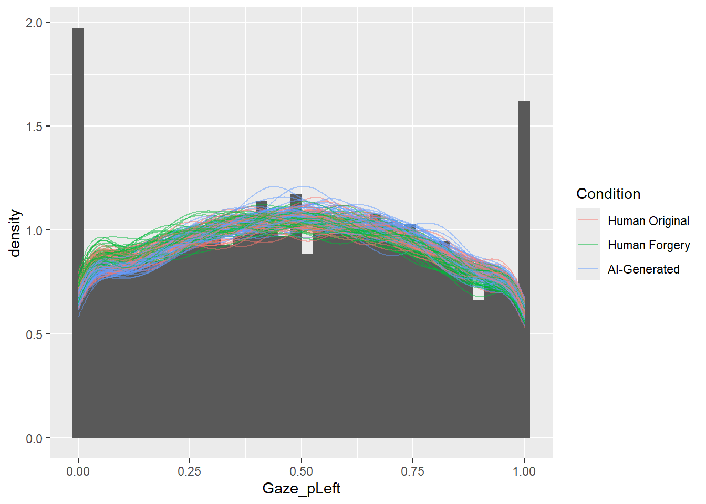{#fig-pleft fig-alt='Gaze laterality (proportion of samples on the left half of the image): observed distribution with posterior-predictive densities per label condition (50 draws each).' width=672}
:::
:::


### pCenter


::: {.cell}

```{.r .cell-code}
make_report(estimates$pCenter)
```

::: {.cell-output-display}

```{=html}
<div id="opbshojczi" style="padding-left:0px;padding-right:0px;padding-top:10px;padding-bottom:10px;overflow-x:auto;overflow-y:auto;width:auto;height:auto;">
<style>#opbshojczi table {
  font-family: system-ui, 'Segoe UI', Roboto, Helvetica, Arial, sans-serif, 'Apple Color Emoji', 'Segoe UI Emoji', 'Segoe UI Symbol', 'Noto Color Emoji';
  -webkit-font-smoothing: antialiased;
  -moz-osx-font-smoothing: grayscale;
}

#opbshojczi thead, #opbshojczi tbody, #opbshojczi tfoot, #opbshojczi tr, #opbshojczi td, #opbshojczi th {
  border-style: none;
}

#opbshojczi p {
  margin: 0;
  padding: 0;
}

#opbshojczi .gt_table {
  display: table;
  border-collapse: collapse;
  line-height: normal;
  margin-left: auto;
  margin-right: auto;
  color: #333333;
  font-size: 16px;
  font-weight: normal;
  font-style: normal;
  background-color: #FFFFFF;
  width: auto;
  border-top-style: solid;
  border-top-width: 2px;
  border-top-color: #A8A8A8;
  border-right-style: none;
  border-right-width: 2px;
  border-right-color: #D3D3D3;
  border-bottom-style: solid;
  border-bottom-width: 2px;
  border-bottom-color: #A8A8A8;
  border-left-style: none;
  border-left-width: 2px;
  border-left-color: #D3D3D3;
}

#opbshojczi .gt_caption {
  padding-top: 4px;
  padding-bottom: 4px;
}

#opbshojczi .gt_title {
  color: #333333;
  font-size: 125%;
  font-weight: initial;
  padding-top: 4px;
  padding-bottom: 4px;
  padding-left: 5px;
  padding-right: 5px;
  border-bottom-color: #FFFFFF;
  border-bottom-width: 0;
}

#opbshojczi .gt_subtitle {
  color: #333333;
  font-size: 85%;
  font-weight: initial;
  padding-top: 3px;
  padding-bottom: 5px;
  padding-left: 5px;
  padding-right: 5px;
  border-top-color: #FFFFFF;
  border-top-width: 0;
}

#opbshojczi .gt_heading {
  background-color: #FFFFFF;
  text-align: center;
  border-bottom-color: #FFFFFF;
  border-left-style: none;
  border-left-width: 1px;
  border-left-color: #D3D3D3;
  border-right-style: none;
  border-right-width: 1px;
  border-right-color: #D3D3D3;
}

#opbshojczi .gt_bottom_border {
  border-bottom-style: solid;
  border-bottom-width: 2px;
  border-bottom-color: #D3D3D3;
}

#opbshojczi .gt_col_headings {
  border-top-style: solid;
  border-top-width: 2px;
  border-top-color: #D3D3D3;
  border-bottom-style: solid;
  border-bottom-width: 2px;
  border-bottom-color: #D3D3D3;
  border-left-style: none;
  border-left-width: 1px;
  border-left-color: #D3D3D3;
  border-right-style: none;
  border-right-width: 1px;
  border-right-color: #D3D3D3;
}

#opbshojczi .gt_col_heading {
  color: #333333;
  background-color: #FFFFFF;
  font-size: 100%;
  font-weight: normal;
  text-transform: inherit;
  border-left-style: none;
  border-left-width: 1px;
  border-left-color: #D3D3D3;
  border-right-style: none;
  border-right-width: 1px;
  border-right-color: #D3D3D3;
  vertical-align: bottom;
  padding-top: 5px;
  padding-bottom: 6px;
  padding-left: 5px;
  padding-right: 5px;
  overflow-x: hidden;
}

#opbshojczi .gt_column_spanner_outer {
  color: #333333;
  background-color: #FFFFFF;
  font-size: 100%;
  font-weight: normal;
  text-transform: inherit;
  padding-top: 0;
  padding-bottom: 0;
  padding-left: 4px;
  padding-right: 4px;
}

#opbshojczi .gt_column_spanner_outer:first-child {
  padding-left: 0;
}

#opbshojczi .gt_column_spanner_outer:last-child {
  padding-right: 0;
}

#opbshojczi .gt_column_spanner {
  border-bottom-style: solid;
  border-bottom-width: 2px;
  border-bottom-color: #D3D3D3;
  vertical-align: bottom;
  padding-top: 5px;
  padding-bottom: 5px;
  overflow-x: hidden;
  display: inline-block;
  width: 100%;
}

#opbshojczi .gt_spanner_row {
  border-bottom-style: hidden;
}

#opbshojczi .gt_group_heading {
  padding-top: 8px;
  padding-bottom: 8px;
  padding-left: 5px;
  padding-right: 5px;
  color: #333333;
  background-color: #FFFFFF;
  font-size: 100%;
  font-weight: initial;
  text-transform: inherit;
  border-top-style: solid;
  border-top-width: 2px;
  border-top-color: #D3D3D3;
  border-bottom-style: solid;
  border-bottom-width: 2px;
  border-bottom-color: #D3D3D3;
  border-left-style: none;
  border-left-width: 1px;
  border-left-color: #D3D3D3;
  border-right-style: none;
  border-right-width: 1px;
  border-right-color: #D3D3D3;
  vertical-align: middle;
  text-align: left;
}

#opbshojczi .gt_empty_group_heading {
  padding: 0.5px;
  color: #333333;
  background-color: #FFFFFF;
  font-size: 100%;
  font-weight: initial;
  border-top-style: solid;
  border-top-width: 2px;
  border-top-color: #D3D3D3;
  border-bottom-style: solid;
  border-bottom-width: 2px;
  border-bottom-color: #D3D3D3;
  vertical-align: middle;
}

#opbshojczi .gt_from_md > :first-child {
  margin-top: 0;
}

#opbshojczi .gt_from_md > :last-child {
  margin-bottom: 0;
}

#opbshojczi .gt_row {
  padding-top: 8px;
  padding-bottom: 8px;
  padding-left: 5px;
  padding-right: 5px;
  margin: 10px;
  border-top-style: solid;
  border-top-width: 1px;
  border-top-color: #D3D3D3;
  border-left-style: none;
  border-left-width: 1px;
  border-left-color: #D3D3D3;
  border-right-style: none;
  border-right-width: 1px;
  border-right-color: #D3D3D3;
  vertical-align: middle;
  overflow-x: hidden;
}

#opbshojczi .gt_stub {
  color: #333333;
  background-color: #FFFFFF;
  font-size: 100%;
  font-weight: initial;
  text-transform: inherit;
  border-right-style: solid;
  border-right-width: 2px;
  border-right-color: #D3D3D3;
  padding-left: 5px;
  padding-right: 5px;
}

#opbshojczi .gt_stub_row_group {
  color: #333333;
  background-color: #FFFFFF;
  font-size: 100%;
  font-weight: initial;
  text-transform: inherit;
  border-right-style: solid;
  border-right-width: 2px;
  border-right-color: #D3D3D3;
  padding-left: 5px;
  padding-right: 5px;
  vertical-align: top;
}

#opbshojczi .gt_row_group_first td {
  border-top-width: 2px;
}

#opbshojczi .gt_row_group_first th {
  border-top-width: 2px;
}

#opbshojczi .gt_summary_row {
  color: #333333;
  background-color: #FFFFFF;
  text-transform: inherit;
  padding-top: 8px;
  padding-bottom: 8px;
  padding-left: 5px;
  padding-right: 5px;
}

#opbshojczi .gt_first_summary_row {
  border-top-style: solid;
  border-top-color: #D3D3D3;
}

#opbshojczi .gt_first_summary_row.thick {
  border-top-width: 2px;
}

#opbshojczi .gt_last_summary_row {
  padding-top: 8px;
  padding-bottom: 8px;
  padding-left: 5px;
  padding-right: 5px;
  border-bottom-style: solid;
  border-bottom-width: 2px;
  border-bottom-color: #D3D3D3;
}

#opbshojczi .gt_grand_summary_row {
  color: #333333;
  background-color: #FFFFFF;
  text-transform: inherit;
  padding-top: 8px;
  padding-bottom: 8px;
  padding-left: 5px;
  padding-right: 5px;
}

#opbshojczi .gt_first_grand_summary_row {
  padding-top: 8px;
  padding-bottom: 8px;
  padding-left: 5px;
  padding-right: 5px;
  border-top-style: double;
  border-top-width: 6px;
  border-top-color: #D3D3D3;
}

#opbshojczi .gt_last_grand_summary_row_top {
  padding-top: 8px;
  padding-bottom: 8px;
  padding-left: 5px;
  padding-right: 5px;
  border-bottom-style: double;
  border-bottom-width: 6px;
  border-bottom-color: #D3D3D3;
}

#opbshojczi .gt_striped {
  background-color: rgba(128, 128, 128, 0.05);
}

#opbshojczi .gt_table_body {
  border-top-style: solid;
  border-top-width: 2px;
  border-top-color: #D3D3D3;
  border-bottom-style: solid;
  border-bottom-width: 2px;
  border-bottom-color: #D3D3D3;
}

#opbshojczi .gt_footnotes {
  color: #333333;
  background-color: #FFFFFF;
  border-bottom-style: none;
  border-bottom-width: 2px;
  border-bottom-color: #D3D3D3;
  border-left-style: none;
  border-left-width: 2px;
  border-left-color: #D3D3D3;
  border-right-style: none;
  border-right-width: 2px;
  border-right-color: #D3D3D3;
}

#opbshojczi .gt_footnote {
  margin: 0px;
  font-size: 90%;
  padding-top: 4px;
  padding-bottom: 4px;
  padding-left: 5px;
  padding-right: 5px;
}

#opbshojczi .gt_sourcenotes {
  color: #333333;
  background-color: #FFFFFF;
  border-bottom-style: none;
  border-bottom-width: 2px;
  border-bottom-color: #D3D3D3;
  border-left-style: none;
  border-left-width: 2px;
  border-left-color: #D3D3D3;
  border-right-style: none;
  border-right-width: 2px;
  border-right-color: #D3D3D3;
}

#opbshojczi .gt_sourcenote {
  font-size: 90%;
  padding-top: 4px;
  padding-bottom: 4px;
  padding-left: 5px;
  padding-right: 5px;
}

#opbshojczi .gt_left {
  text-align: left;
}

#opbshojczi .gt_center {
  text-align: center;
}

#opbshojczi .gt_right {
  text-align: right;
  font-variant-numeric: tabular-nums;
}

#opbshojczi .gt_font_normal {
  font-weight: normal;
}

#opbshojczi .gt_font_bold {
  font-weight: bold;
}

#opbshojczi .gt_font_italic {
  font-style: italic;
}

#opbshojczi .gt_super {
  font-size: 65%;
}

#opbshojczi .gt_footnote_marks {
  font-size: 75%;
  vertical-align: 0.4em;
  position: initial;
}

#opbshojczi .gt_asterisk {
  font-size: 100%;
  vertical-align: 0;
}

#opbshojczi .gt_indent_1 {
  text-indent: 5px;
}

#opbshojczi .gt_indent_2 {
  text-indent: 10px;
}

#opbshojczi .gt_indent_3 {
  text-indent: 15px;
}

#opbshojczi .gt_indent_4 {
  text-indent: 20px;
}

#opbshojczi .gt_indent_5 {
  text-indent: 25px;
}

#opbshojczi .katex-display {
  display: inline-flex !important;
  margin-bottom: 0.75em !important;
}

#opbshojczi div.Reactable > div.rt-table > div.rt-thead > div.rt-tr.rt-tr-group-header > div.rt-th-group:after {
  height: 0px !important;
}
</style>
<table class="gt_table" data-quarto-disable-processing="false" data-quarto-bootstrap="false">
  <thead>
    <tr class="gt_col_headings">
      <th class="gt_col_heading gt_columns_bottom_border gt_left" rowspan="1" colspan="1" scope="col" id="Contrast">Contrast</th>
      <th class="gt_col_heading gt_columns_bottom_border gt_left" rowspan="1" colspan="1" scope="col" id="Parameters">Parameters</th>
    </tr>
  </thead>
  <tbody class="gt_table_body">
    <tr><td headers="Contrast" class="gt_row gt_left">Human Forgery - Human Original</td>
<td headers="Parameters" class="gt_row gt_left">phi (0.24, [0.02, 0.48])</td></tr>
  </tbody>
  
</table>
</div>
```

```{=html}
<div id="ijgqndxegq" style="padding-left:0px;padding-right:0px;padding-top:10px;padding-bottom:10px;overflow-x:auto;overflow-y:auto;width:auto;height:auto;">
<style>#ijgqndxegq table {
  font-family: system-ui, 'Segoe UI', Roboto, Helvetica, Arial, sans-serif, 'Apple Color Emoji', 'Segoe UI Emoji', 'Segoe UI Symbol', 'Noto Color Emoji';
  -webkit-font-smoothing: antialiased;
  -moz-osx-font-smoothing: grayscale;
}

#ijgqndxegq thead, #ijgqndxegq tbody, #ijgqndxegq tfoot, #ijgqndxegq tr, #ijgqndxegq td, #ijgqndxegq th {
  border-style: none;
}

#ijgqndxegq p {
  margin: 0;
  padding: 0;
}

#ijgqndxegq .gt_table {
  display: table;
  border-collapse: collapse;
  line-height: normal;
  margin-left: auto;
  margin-right: auto;
  color: #333333;
  font-size: 16px;
  font-weight: normal;
  font-style: normal;
  background-color: #FFFFFF;
  width: auto;
  border-top-style: solid;
  border-top-width: 2px;
  border-top-color: #A8A8A8;
  border-right-style: none;
  border-right-width: 2px;
  border-right-color: #D3D3D3;
  border-bottom-style: solid;
  border-bottom-width: 2px;
  border-bottom-color: #A8A8A8;
  border-left-style: none;
  border-left-width: 2px;
  border-left-color: #D3D3D3;
}

#ijgqndxegq .gt_caption {
  padding-top: 4px;
  padding-bottom: 4px;
}

#ijgqndxegq .gt_title {
  color: #333333;
  font-size: 125%;
  font-weight: initial;
  padding-top: 4px;
  padding-bottom: 4px;
  padding-left: 5px;
  padding-right: 5px;
  border-bottom-color: #FFFFFF;
  border-bottom-width: 0;
}

#ijgqndxegq .gt_subtitle {
  color: #333333;
  font-size: 85%;
  font-weight: initial;
  padding-top: 3px;
  padding-bottom: 5px;
  padding-left: 5px;
  padding-right: 5px;
  border-top-color: #FFFFFF;
  border-top-width: 0;
}

#ijgqndxegq .gt_heading {
  background-color: #FFFFFF;
  text-align: center;
  border-bottom-color: #FFFFFF;
  border-left-style: none;
  border-left-width: 1px;
  border-left-color: #D3D3D3;
  border-right-style: none;
  border-right-width: 1px;
  border-right-color: #D3D3D3;
}

#ijgqndxegq .gt_bottom_border {
  border-bottom-style: solid;
  border-bottom-width: 2px;
  border-bottom-color: #D3D3D3;
}

#ijgqndxegq .gt_col_headings {
  border-top-style: solid;
  border-top-width: 2px;
  border-top-color: #D3D3D3;
  border-bottom-style: solid;
  border-bottom-width: 2px;
  border-bottom-color: #D3D3D3;
  border-left-style: none;
  border-left-width: 1px;
  border-left-color: #D3D3D3;
  border-right-style: none;
  border-right-width: 1px;
  border-right-color: #D3D3D3;
}

#ijgqndxegq .gt_col_heading {
  color: #333333;
  background-color: #FFFFFF;
  font-size: 100%;
  font-weight: normal;
  text-transform: inherit;
  border-left-style: none;
  border-left-width: 1px;
  border-left-color: #D3D3D3;
  border-right-style: none;
  border-right-width: 1px;
  border-right-color: #D3D3D3;
  vertical-align: bottom;
  padding-top: 5px;
  padding-bottom: 6px;
  padding-left: 5px;
  padding-right: 5px;
  overflow-x: hidden;
}

#ijgqndxegq .gt_column_spanner_outer {
  color: #333333;
  background-color: #FFFFFF;
  font-size: 100%;
  font-weight: normal;
  text-transform: inherit;
  padding-top: 0;
  padding-bottom: 0;
  padding-left: 4px;
  padding-right: 4px;
}

#ijgqndxegq .gt_column_spanner_outer:first-child {
  padding-left: 0;
}

#ijgqndxegq .gt_column_spanner_outer:last-child {
  padding-right: 0;
}

#ijgqndxegq .gt_column_spanner {
  border-bottom-style: solid;
  border-bottom-width: 2px;
  border-bottom-color: #D3D3D3;
  vertical-align: bottom;
  padding-top: 5px;
  padding-bottom: 5px;
  overflow-x: hidden;
  display: inline-block;
  width: 100%;
}

#ijgqndxegq .gt_spanner_row {
  border-bottom-style: hidden;
}

#ijgqndxegq .gt_group_heading {
  padding-top: 8px;
  padding-bottom: 8px;
  padding-left: 5px;
  padding-right: 5px;
  color: #333333;
  background-color: #FFFFFF;
  font-size: 100%;
  font-weight: initial;
  text-transform: inherit;
  border-top-style: solid;
  border-top-width: 2px;
  border-top-color: #D3D3D3;
  border-bottom-style: solid;
  border-bottom-width: 2px;
  border-bottom-color: #D3D3D3;
  border-left-style: none;
  border-left-width: 1px;
  border-left-color: #D3D3D3;
  border-right-style: none;
  border-right-width: 1px;
  border-right-color: #D3D3D3;
  vertical-align: middle;
  text-align: left;
}

#ijgqndxegq .gt_empty_group_heading {
  padding: 0.5px;
  color: #333333;
  background-color: #FFFFFF;
  font-size: 100%;
  font-weight: initial;
  border-top-style: solid;
  border-top-width: 2px;
  border-top-color: #D3D3D3;
  border-bottom-style: solid;
  border-bottom-width: 2px;
  border-bottom-color: #D3D3D3;
  vertical-align: middle;
}

#ijgqndxegq .gt_from_md > :first-child {
  margin-top: 0;
}

#ijgqndxegq .gt_from_md > :last-child {
  margin-bottom: 0;
}

#ijgqndxegq .gt_row {
  padding-top: 8px;
  padding-bottom: 8px;
  padding-left: 5px;
  padding-right: 5px;
  margin: 10px;
  border-top-style: solid;
  border-top-width: 1px;
  border-top-color: #D3D3D3;
  border-left-style: none;
  border-left-width: 1px;
  border-left-color: #D3D3D3;
  border-right-style: none;
  border-right-width: 1px;
  border-right-color: #D3D3D3;
  vertical-align: middle;
  overflow-x: hidden;
}

#ijgqndxegq .gt_stub {
  color: #333333;
  background-color: #FFFFFF;
  font-size: 100%;
  font-weight: initial;
  text-transform: inherit;
  border-right-style: solid;
  border-right-width: 2px;
  border-right-color: #D3D3D3;
  padding-left: 5px;
  padding-right: 5px;
}

#ijgqndxegq .gt_stub_row_group {
  color: #333333;
  background-color: #FFFFFF;
  font-size: 100%;
  font-weight: initial;
  text-transform: inherit;
  border-right-style: solid;
  border-right-width: 2px;
  border-right-color: #D3D3D3;
  padding-left: 5px;
  padding-right: 5px;
  vertical-align: top;
}

#ijgqndxegq .gt_row_group_first td {
  border-top-width: 2px;
}

#ijgqndxegq .gt_row_group_first th {
  border-top-width: 2px;
}

#ijgqndxegq .gt_summary_row {
  color: #333333;
  background-color: #FFFFFF;
  text-transform: inherit;
  padding-top: 8px;
  padding-bottom: 8px;
  padding-left: 5px;
  padding-right: 5px;
}

#ijgqndxegq .gt_first_summary_row {
  border-top-style: solid;
  border-top-color: #D3D3D3;
}

#ijgqndxegq .gt_first_summary_row.thick {
  border-top-width: 2px;
}

#ijgqndxegq .gt_last_summary_row {
  padding-top: 8px;
  padding-bottom: 8px;
  padding-left: 5px;
  padding-right: 5px;
  border-bottom-style: solid;
  border-bottom-width: 2px;
  border-bottom-color: #D3D3D3;
}

#ijgqndxegq .gt_grand_summary_row {
  color: #333333;
  background-color: #FFFFFF;
  text-transform: inherit;
  padding-top: 8px;
  padding-bottom: 8px;
  padding-left: 5px;
  padding-right: 5px;
}

#ijgqndxegq .gt_first_grand_summary_row {
  padding-top: 8px;
  padding-bottom: 8px;
  padding-left: 5px;
  padding-right: 5px;
  border-top-style: double;
  border-top-width: 6px;
  border-top-color: #D3D3D3;
}

#ijgqndxegq .gt_last_grand_summary_row_top {
  padding-top: 8px;
  padding-bottom: 8px;
  padding-left: 5px;
  padding-right: 5px;
  border-bottom-style: double;
  border-bottom-width: 6px;
  border-bottom-color: #D3D3D3;
}

#ijgqndxegq .gt_striped {
  background-color: rgba(128, 128, 128, 0.05);
}

#ijgqndxegq .gt_table_body {
  border-top-style: solid;
  border-top-width: 2px;
  border-top-color: #D3D3D3;
  border-bottom-style: solid;
  border-bottom-width: 2px;
  border-bottom-color: #D3D3D3;
}

#ijgqndxegq .gt_footnotes {
  color: #333333;
  background-color: #FFFFFF;
  border-bottom-style: none;
  border-bottom-width: 2px;
  border-bottom-color: #D3D3D3;
  border-left-style: none;
  border-left-width: 2px;
  border-left-color: #D3D3D3;
  border-right-style: none;
  border-right-width: 2px;
  border-right-color: #D3D3D3;
}

#ijgqndxegq .gt_footnote {
  margin: 0px;
  font-size: 90%;
  padding-top: 4px;
  padding-bottom: 4px;
  padding-left: 5px;
  padding-right: 5px;
}

#ijgqndxegq .gt_sourcenotes {
  color: #333333;
  background-color: #FFFFFF;
  border-bottom-style: none;
  border-bottom-width: 2px;
  border-bottom-color: #D3D3D3;
  border-left-style: none;
  border-left-width: 2px;
  border-left-color: #D3D3D3;
  border-right-style: none;
  border-right-width: 2px;
  border-right-color: #D3D3D3;
}

#ijgqndxegq .gt_sourcenote {
  font-size: 90%;
  padding-top: 4px;
  padding-bottom: 4px;
  padding-left: 5px;
  padding-right: 5px;
}

#ijgqndxegq .gt_left {
  text-align: left;
}

#ijgqndxegq .gt_center {
  text-align: center;
}

#ijgqndxegq .gt_right {
  text-align: right;
  font-variant-numeric: tabular-nums;
}

#ijgqndxegq .gt_font_normal {
  font-weight: normal;
}

#ijgqndxegq .gt_font_bold {
  font-weight: bold;
}

#ijgqndxegq .gt_font_italic {
  font-style: italic;
}

#ijgqndxegq .gt_super {
  font-size: 65%;
}

#ijgqndxegq .gt_footnote_marks {
  font-size: 75%;
  vertical-align: 0.4em;
  position: initial;
}

#ijgqndxegq .gt_asterisk {
  font-size: 100%;
  vertical-align: 0;
}

#ijgqndxegq .gt_indent_1 {
  text-indent: 5px;
}

#ijgqndxegq .gt_indent_2 {
  text-indent: 10px;
}

#ijgqndxegq .gt_indent_3 {
  text-indent: 15px;
}

#ijgqndxegq .gt_indent_4 {
  text-indent: 20px;
}

#ijgqndxegq .gt_indent_5 {
  text-indent: 25px;
}

#ijgqndxegq .katex-display {
  display: inline-flex !important;
  margin-bottom: 0.75em !important;
}

#ijgqndxegq div.Reactable > div.rt-table > div.rt-thead > div.rt-tr.rt-tr-group-header > div.rt-th-group:after {
  height: 0px !important;
}
</style>
<table class="gt_table" data-quarto-disable-processing="false" data-quarto-bootstrap="false">
  <thead>
    <tr class="gt_col_headings">
      <th class="gt_col_heading gt_columns_bottom_border gt_left" rowspan="1" colspan="1" scope="col" id="Contrast">Contrast</th>
      <th class="gt_col_heading gt_columns_bottom_border gt_left" rowspan="1" colspan="1" scope="col" id="Parameters">Parameters</th>
    </tr>
  </thead>
  <tbody class="gt_table_body">
    <tr><td headers="Contrast" class="gt_row gt_left">Negative - Low intensity - Positive - Low intensity</td>
<td headers="Parameters" class="gt_row gt_left">None</td></tr>
    <tr><td headers="Contrast" class="gt_row gt_left">Positive - High intensity - Positive - Low intensity</td>
<td headers="Parameters" class="gt_row gt_left">None</td></tr>
    <tr><td headers="Contrast" class="gt_row gt_left">Positive - High intensity - Negative - Low intensity</td>
<td headers="Parameters" class="gt_row gt_left">None</td></tr>
    <tr><td headers="Contrast" class="gt_row gt_left">Negative - High intensity - Positive - Low intensity</td>
<td headers="Parameters" class="gt_row gt_left">None</td></tr>
    <tr><td headers="Contrast" class="gt_row gt_left">Negative - High intensity - Negative - Low intensity</td>
<td headers="Parameters" class="gt_row gt_left">None</td></tr>
    <tr><td headers="Contrast" class="gt_row gt_left">Negative - High intensity - Positive - High intensity</td>
<td headers="Parameters" class="gt_row gt_left">None</td></tr>
  </tbody>
  
</table>
</div>
```

```{=html}
<div id="aljedmbums" style="padding-left:0px;padding-right:0px;padding-top:10px;padding-bottom:10px;overflow-x:auto;overflow-y:auto;width:auto;height:auto;">
<style>#aljedmbums table {
  font-family: system-ui, 'Segoe UI', Roboto, Helvetica, Arial, sans-serif, 'Apple Color Emoji', 'Segoe UI Emoji', 'Segoe UI Symbol', 'Noto Color Emoji';
  -webkit-font-smoothing: antialiased;
  -moz-osx-font-smoothing: grayscale;
}

#aljedmbums thead, #aljedmbums tbody, #aljedmbums tfoot, #aljedmbums tr, #aljedmbums td, #aljedmbums th {
  border-style: none;
}

#aljedmbums p {
  margin: 0;
  padding: 0;
}

#aljedmbums .gt_table {
  display: table;
  border-collapse: collapse;
  line-height: normal;
  margin-left: auto;
  margin-right: auto;
  color: #333333;
  font-size: 13px;
  font-weight: normal;
  font-style: normal;
  background-color: #FFFFFF;
  width: auto;
  border-top-style: solid;
  border-top-width: 3px;
  border-top-color: #D5D5D5;
  border-right-style: solid;
  border-right-width: 3px;
  border-right-color: #D5D5D5;
  border-bottom-style: solid;
  border-bottom-width: 3px;
  border-bottom-color: #D5D5D5;
  border-left-style: solid;
  border-left-width: 3px;
  border-left-color: #D5D5D5;
}

#aljedmbums .gt_caption {
  padding-top: 4px;
  padding-bottom: 4px;
}

#aljedmbums .gt_title {
  color: #333333;
  font-size: 125%;
  font-weight: initial;
  padding-top: 4px;
  padding-bottom: 4px;
  padding-left: 5px;
  padding-right: 5px;
  border-bottom-color: #FFFFFF;
  border-bottom-width: 0;
}

#aljedmbums .gt_subtitle {
  color: #333333;
  font-size: 85%;
  font-weight: initial;
  padding-top: 3px;
  padding-bottom: 5px;
  padding-left: 5px;
  padding-right: 5px;
  border-top-color: #FFFFFF;
  border-top-width: 0;
}

#aljedmbums .gt_heading {
  background-color: #FFFFFF;
  text-align: left;
  border-bottom-color: #FFFFFF;
  border-left-style: none;
  border-left-width: 1px;
  border-left-color: #D3D3D3;
  border-right-style: none;
  border-right-width: 1px;
  border-right-color: #D3D3D3;
}

#aljedmbums .gt_bottom_border {
  border-bottom-style: solid;
  border-bottom-width: 2px;
  border-bottom-color: #D5D5D5;
}

#aljedmbums .gt_col_headings {
  border-top-style: solid;
  border-top-width: 2px;
  border-top-color: #D5D5D5;
  border-bottom-style: solid;
  border-bottom-width: 2px;
  border-bottom-color: #D5D5D5;
  border-left-style: none;
  border-left-width: 1px;
  border-left-color: #D3D3D3;
  border-right-style: none;
  border-right-width: 1px;
  border-right-color: #D3D3D3;
}

#aljedmbums .gt_col_heading {
  color: #FFFFFF;
  background-color: #000000;
  font-size: 100%;
  font-weight: normal;
  text-transform: inherit;
  border-left-style: none;
  border-left-width: 1px;
  border-left-color: #D3D3D3;
  border-right-style: none;
  border-right-width: 1px;
  border-right-color: #D3D3D3;
  vertical-align: bottom;
  padding-top: 5px;
  padding-bottom: 6px;
  padding-left: 5px;
  padding-right: 5px;
  overflow-x: hidden;
}

#aljedmbums .gt_column_spanner_outer {
  color: #FFFFFF;
  background-color: #000000;
  font-size: 100%;
  font-weight: normal;
  text-transform: inherit;
  padding-top: 0;
  padding-bottom: 0;
  padding-left: 4px;
  padding-right: 4px;
}

#aljedmbums .gt_column_spanner_outer:first-child {
  padding-left: 0;
}

#aljedmbums .gt_column_spanner_outer:last-child {
  padding-right: 0;
}

#aljedmbums .gt_column_spanner {
  border-bottom-style: solid;
  border-bottom-width: 2px;
  border-bottom-color: #D5D5D5;
  vertical-align: bottom;
  padding-top: 5px;
  padding-bottom: 5px;
  overflow-x: hidden;
  display: inline-block;
  width: 100%;
}

#aljedmbums .gt_spanner_row {
  border-bottom-style: hidden;
}

#aljedmbums .gt_group_heading {
  padding-top: 8px;
  padding-bottom: 8px;
  padding-left: 5px;
  padding-right: 5px;
  color: #333333;
  background-color: #FFFFFF;
  font-size: 100%;
  font-weight: initial;
  text-transform: inherit;
  border-top-style: solid;
  border-top-width: 2px;
  border-top-color: #D5D5D5;
  border-bottom-style: solid;
  border-bottom-width: 2px;
  border-bottom-color: #D5D5D5;
  border-left-style: none;
  border-left-width: 1px;
  border-left-color: #D3D3D3;
  border-right-style: none;
  border-right-width: 1px;
  border-right-color: #D3D3D3;
  vertical-align: middle;
  text-align: left;
}

#aljedmbums .gt_empty_group_heading {
  padding: 0.5px;
  color: #333333;
  background-color: #FFFFFF;
  font-size: 100%;
  font-weight: initial;
  border-top-style: solid;
  border-top-width: 2px;
  border-top-color: #D5D5D5;
  border-bottom-style: solid;
  border-bottom-width: 2px;
  border-bottom-color: #D5D5D5;
  vertical-align: middle;
}

#aljedmbums .gt_from_md > :first-child {
  margin-top: 0;
}

#aljedmbums .gt_from_md > :last-child {
  margin-bottom: 0;
}

#aljedmbums .gt_row {
  padding-top: 8px;
  padding-bottom: 8px;
  padding-left: 5px;
  padding-right: 5px;
  margin: 10px;
  border-top-style: solid;
  border-top-width: 1px;
  border-top-color: #D5D5D5;
  border-left-style: solid;
  border-left-width: 1px;
  border-left-color: #D5D5D5;
  border-right-style: solid;
  border-right-width: 1px;
  border-right-color: #D5D5D5;
  vertical-align: middle;
  overflow-x: hidden;
}

#aljedmbums .gt_stub {
  color: #333333;
  background-color: #FFFFFF;
  font-size: 100%;
  font-weight: initial;
  text-transform: inherit;
  border-right-style: solid;
  border-right-width: 2px;
  border-right-color: #5F5F5F;
  padding-left: 5px;
  padding-right: 5px;
}

#aljedmbums .gt_stub_row_group {
  color: #333333;
  background-color: #FFFFFF;
  font-size: 100%;
  font-weight: initial;
  text-transform: inherit;
  border-right-style: solid;
  border-right-width: 2px;
  border-right-color: #D3D3D3;
  padding-left: 5px;
  padding-right: 5px;
  vertical-align: top;
}

#aljedmbums .gt_row_group_first td {
  border-top-width: 2px;
}

#aljedmbums .gt_row_group_first th {
  border-top-width: 2px;
}

#aljedmbums .gt_summary_row {
  color: #333333;
  background-color: #D5D5D5;
  text-transform: inherit;
  padding-top: 8px;
  padding-bottom: 8px;
  padding-left: 5px;
  padding-right: 5px;
}

#aljedmbums .gt_first_summary_row {
  border-top-style: solid;
  border-top-color: #D5D5D5;
}

#aljedmbums .gt_first_summary_row.thick {
  border-top-width: 2px;
}

#aljedmbums .gt_last_summary_row {
  padding-top: 8px;
  padding-bottom: 8px;
  padding-left: 5px;
  padding-right: 5px;
  border-bottom-style: solid;
  border-bottom-width: 2px;
  border-bottom-color: #D5D5D5;
}

#aljedmbums .gt_grand_summary_row {
  color: #FFFFFF;
  background-color: #929292;
  text-transform: inherit;
  padding-top: 8px;
  padding-bottom: 8px;
  padding-left: 5px;
  padding-right: 5px;
}

#aljedmbums .gt_first_grand_summary_row {
  padding-top: 8px;
  padding-bottom: 8px;
  padding-left: 5px;
  padding-right: 5px;
  border-top-style: double;
  border-top-width: 6px;
  border-top-color: #D5D5D5;
}

#aljedmbums .gt_last_grand_summary_row_top {
  padding-top: 8px;
  padding-bottom: 8px;
  padding-left: 5px;
  padding-right: 5px;
  border-bottom-style: double;
  border-bottom-width: 6px;
  border-bottom-color: #D5D5D5;
}

#aljedmbums .gt_striped {
  background-color: #F4F4F4;
}

#aljedmbums .gt_table_body {
  border-top-style: solid;
  border-top-width: 2px;
  border-top-color: #D5D5D5;
  border-bottom-style: solid;
  border-bottom-width: 2px;
  border-bottom-color: #D5D5D5;
}

#aljedmbums .gt_footnotes {
  color: #333333;
  background-color: #FFFFFF;
  border-bottom-style: none;
  border-bottom-width: 2px;
  border-bottom-color: #D3D3D3;
  border-left-style: none;
  border-left-width: 2px;
  border-left-color: #D3D3D3;
  border-right-style: none;
  border-right-width: 2px;
  border-right-color: #D3D3D3;
}

#aljedmbums .gt_footnote {
  margin: 0px;
  font-size: 90%;
  padding-top: 4px;
  padding-bottom: 4px;
  padding-left: 5px;
  padding-right: 5px;
}

#aljedmbums .gt_sourcenotes {
  color: #333333;
  background-color: #FFFFFF;
  border-bottom-style: none;
  border-bottom-width: 2px;
  border-bottom-color: #D3D3D3;
  border-left-style: none;
  border-left-width: 2px;
  border-left-color: #D3D3D3;
  border-right-style: none;
  border-right-width: 2px;
  border-right-color: #D3D3D3;
}

#aljedmbums .gt_sourcenote {
  font-size: 90%;
  padding-top: 4px;
  padding-bottom: 4px;
  padding-left: 5px;
  padding-right: 5px;
}

#aljedmbums .gt_left {
  text-align: left;
}

#aljedmbums .gt_center {
  text-align: center;
}

#aljedmbums .gt_right {
  text-align: right;
  font-variant-numeric: tabular-nums;
}

#aljedmbums .gt_font_normal {
  font-weight: normal;
}

#aljedmbums .gt_font_bold {
  font-weight: bold;
}

#aljedmbums .gt_font_italic {
  font-style: italic;
}

#aljedmbums .gt_super {
  font-size: 65%;
}

#aljedmbums .gt_footnote_marks {
  font-size: 75%;
  vertical-align: 0.4em;
  position: initial;
}

#aljedmbums .gt_asterisk {
  font-size: 100%;
  vertical-align: 0;
}

#aljedmbums .gt_indent_1 {
  text-indent: 5px;
}

#aljedmbums .gt_indent_2 {
  text-indent: 10px;
}

#aljedmbums .gt_indent_3 {
  text-indent: 15px;
}

#aljedmbums .gt_indent_4 {
  text-indent: 20px;
}

#aljedmbums .gt_indent_5 {
  text-indent: 25px;
}

#aljedmbums .katex-display {
  display: inline-flex !important;
  margin-bottom: 0.75em !important;
}

#aljedmbums div.Reactable > div.rt-table > div.rt-thead > div.rt-tr.rt-tr-group-header > div.rt-th-group:after {
  height: 0px !important;
}
</style>
<table class="gt_table" data-quarto-disable-processing="false" data-quarto-bootstrap="false">
  <thead>
    <tr class="gt_heading">
      <td colspan="10" class="gt_heading gt_title gt_font_normal gt_bottom_border" style>Gaze Centeredness (pCenter): convergence</td>
    </tr>
    
    <tr class="gt_col_headings">
      <th class="gt_col_heading gt_columns_bottom_border gt_left" rowspan="1" colspan="1" scope="col" id="Model">Model</th>
      <th class="gt_col_heading gt_columns_bottom_border gt_left" rowspan="1" colspan="1" scope="col" id="Family">Family</th>
      <th class="gt_col_heading gt_columns_bottom_border gt_right" rowspan="1" colspan="1" scope="col" id="N_obs">N_obs</th>
      <th class="gt_col_heading gt_columns_bottom_border gt_right" rowspan="1" colspan="1" scope="col" id="N_participants">N_participants</th>
      <th class="gt_col_heading gt_columns_bottom_border gt_right" rowspan="1" colspan="1" scope="col" id="Chains">Chains</th>
      <th class="gt_col_heading gt_columns_bottom_border gt_right" rowspan="1" colspan="1" scope="col" id="Draws">Draws</th>
      <th class="gt_col_heading gt_columns_bottom_border gt_right" rowspan="1" colspan="1" scope="col" id="Max_Rhat">Max_Rhat</th>
      <th class="gt_col_heading gt_columns_bottom_border gt_right" rowspan="1" colspan="1" scope="col" id="Min_ESS_ratio">Min_ESS_ratio</th>
      <th class="gt_col_heading gt_columns_bottom_border gt_right" rowspan="1" colspan="1" scope="col" id="Divergent_pct">Divergent_pct</th>
      <th class="gt_col_heading gt_columns_bottom_border gt_left" rowspan="1" colspan="1" scope="col" id="Criterion">Criterion</th>
    </tr>
  </thead>
  <tbody class="gt_table_body">
    <tr><td headers="Model" class="gt_row gt_left">pCenter</td>
<td headers="Family" class="gt_row gt_left">Zero-one-inflated Beta</td>
<td headers="N_obs" class="gt_row gt_right">12220</td>
<td headers="N_participants" class="gt_row gt_right">274</td>
<td headers="Chains" class="gt_row gt_right">8</td>
<td headers="Draws" class="gt_row gt_right">4000</td>
<td headers="Max_Rhat" class="gt_row gt_right">1.037</td>
<td headers="Min_ESS_ratio" class="gt_row gt_right">0.057</td>
<td headers="Divergent_pct" class="gt_row gt_right">0</td>
<td headers="Criterion" class="gt_row gt_left">loo</td></tr>
  </tbody>
  
</table>
</div>
```


::: {.callout-note collapse="true" title="Gaze Centeredness (pCenter): convergence (Markdown table, for text readers)"}

|Model   |Family                 | N_obs| N_participants| Chains| Draws| Max_Rhat| Min_ESS_ratio| Divergent_pct|Criterion |
|:-------|:----------------------|-----:|--------------:|------:|-----:|--------:|-------------:|-------------:|:---------|
|pCenter |Zero-one-inflated Beta | 12220|            274|      8|  4000|    1.037|         0.057|             0|loo       |

:::

```{=html}
<div id="lsojtijwfu" style="padding-left:0px;padding-right:0px;padding-top:10px;padding-bottom:10px;overflow-x:auto;overflow-y:auto;width:auto;height:auto;">
<style>#lsojtijwfu table {
  font-family: system-ui, 'Segoe UI', Roboto, Helvetica, Arial, sans-serif, 'Apple Color Emoji', 'Segoe UI Emoji', 'Segoe UI Symbol', 'Noto Color Emoji';
  -webkit-font-smoothing: antialiased;
  -moz-osx-font-smoothing: grayscale;
}

#lsojtijwfu thead, #lsojtijwfu tbody, #lsojtijwfu tfoot, #lsojtijwfu tr, #lsojtijwfu td, #lsojtijwfu th {
  border-style: none;
}

#lsojtijwfu p {
  margin: 0;
  padding: 0;
}

#lsojtijwfu .gt_table {
  display: table;
  border-collapse: collapse;
  line-height: normal;
  margin-left: auto;
  margin-right: auto;
  color: #333333;
  font-size: 13px;
  font-weight: normal;
  font-style: normal;
  background-color: #FFFFFF;
  width: auto;
  border-top-style: solid;
  border-top-width: 3px;
  border-top-color: #D5D5D5;
  border-right-style: solid;
  border-right-width: 3px;
  border-right-color: #D5D5D5;
  border-bottom-style: solid;
  border-bottom-width: 3px;
  border-bottom-color: #D5D5D5;
  border-left-style: solid;
  border-left-width: 3px;
  border-left-color: #D5D5D5;
}

#lsojtijwfu .gt_caption {
  padding-top: 4px;
  padding-bottom: 4px;
}

#lsojtijwfu .gt_title {
  color: #333333;
  font-size: 125%;
  font-weight: initial;
  padding-top: 4px;
  padding-bottom: 4px;
  padding-left: 5px;
  padding-right: 5px;
  border-bottom-color: #FFFFFF;
  border-bottom-width: 0;
}

#lsojtijwfu .gt_subtitle {
  color: #333333;
  font-size: 85%;
  font-weight: initial;
  padding-top: 3px;
  padding-bottom: 5px;
  padding-left: 5px;
  padding-right: 5px;
  border-top-color: #FFFFFF;
  border-top-width: 0;
}

#lsojtijwfu .gt_heading {
  background-color: #FFFFFF;
  text-align: left;
  border-bottom-color: #FFFFFF;
  border-left-style: none;
  border-left-width: 1px;
  border-left-color: #D3D3D3;
  border-right-style: none;
  border-right-width: 1px;
  border-right-color: #D3D3D3;
}

#lsojtijwfu .gt_bottom_border {
  border-bottom-style: solid;
  border-bottom-width: 2px;
  border-bottom-color: #D5D5D5;
}

#lsojtijwfu .gt_col_headings {
  border-top-style: solid;
  border-top-width: 2px;
  border-top-color: #D5D5D5;
  border-bottom-style: solid;
  border-bottom-width: 2px;
  border-bottom-color: #D5D5D5;
  border-left-style: none;
  border-left-width: 1px;
  border-left-color: #D3D3D3;
  border-right-style: none;
  border-right-width: 1px;
  border-right-color: #D3D3D3;
}

#lsojtijwfu .gt_col_heading {
  color: #FFFFFF;
  background-color: #000000;
  font-size: 100%;
  font-weight: normal;
  text-transform: inherit;
  border-left-style: none;
  border-left-width: 1px;
  border-left-color: #D3D3D3;
  border-right-style: none;
  border-right-width: 1px;
  border-right-color: #D3D3D3;
  vertical-align: bottom;
  padding-top: 5px;
  padding-bottom: 6px;
  padding-left: 5px;
  padding-right: 5px;
  overflow-x: hidden;
}

#lsojtijwfu .gt_column_spanner_outer {
  color: #FFFFFF;
  background-color: #000000;
  font-size: 100%;
  font-weight: normal;
  text-transform: inherit;
  padding-top: 0;
  padding-bottom: 0;
  padding-left: 4px;
  padding-right: 4px;
}

#lsojtijwfu .gt_column_spanner_outer:first-child {
  padding-left: 0;
}

#lsojtijwfu .gt_column_spanner_outer:last-child {
  padding-right: 0;
}

#lsojtijwfu .gt_column_spanner {
  border-bottom-style: solid;
  border-bottom-width: 2px;
  border-bottom-color: #D5D5D5;
  vertical-align: bottom;
  padding-top: 5px;
  padding-bottom: 5px;
  overflow-x: hidden;
  display: inline-block;
  width: 100%;
}

#lsojtijwfu .gt_spanner_row {
  border-bottom-style: hidden;
}

#lsojtijwfu .gt_group_heading {
  padding-top: 8px;
  padding-bottom: 8px;
  padding-left: 5px;
  padding-right: 5px;
  color: #333333;
  background-color: #FFFFFF;
  font-size: 100%;
  font-weight: initial;
  text-transform: inherit;
  border-top-style: solid;
  border-top-width: 2px;
  border-top-color: #D5D5D5;
  border-bottom-style: solid;
  border-bottom-width: 2px;
  border-bottom-color: #D5D5D5;
  border-left-style: none;
  border-left-width: 1px;
  border-left-color: #D3D3D3;
  border-right-style: none;
  border-right-width: 1px;
  border-right-color: #D3D3D3;
  vertical-align: middle;
  text-align: left;
}

#lsojtijwfu .gt_empty_group_heading {
  padding: 0.5px;
  color: #333333;
  background-color: #FFFFFF;
  font-size: 100%;
  font-weight: initial;
  border-top-style: solid;
  border-top-width: 2px;
  border-top-color: #D5D5D5;
  border-bottom-style: solid;
  border-bottom-width: 2px;
  border-bottom-color: #D5D5D5;
  vertical-align: middle;
}

#lsojtijwfu .gt_from_md > :first-child {
  margin-top: 0;
}

#lsojtijwfu .gt_from_md > :last-child {
  margin-bottom: 0;
}

#lsojtijwfu .gt_row {
  padding-top: 8px;
  padding-bottom: 8px;
  padding-left: 5px;
  padding-right: 5px;
  margin: 10px;
  border-top-style: solid;
  border-top-width: 1px;
  border-top-color: #D5D5D5;
  border-left-style: solid;
  border-left-width: 1px;
  border-left-color: #D5D5D5;
  border-right-style: solid;
  border-right-width: 1px;
  border-right-color: #D5D5D5;
  vertical-align: middle;
  overflow-x: hidden;
}

#lsojtijwfu .gt_stub {
  color: #333333;
  background-color: #FFFFFF;
  font-size: 100%;
  font-weight: initial;
  text-transform: inherit;
  border-right-style: solid;
  border-right-width: 2px;
  border-right-color: #5F5F5F;
  padding-left: 5px;
  padding-right: 5px;
}

#lsojtijwfu .gt_stub_row_group {
  color: #333333;
  background-color: #FFFFFF;
  font-size: 100%;
  font-weight: initial;
  text-transform: inherit;
  border-right-style: solid;
  border-right-width: 2px;
  border-right-color: #D3D3D3;
  padding-left: 5px;
  padding-right: 5px;
  vertical-align: top;
}

#lsojtijwfu .gt_row_group_first td {
  border-top-width: 2px;
}

#lsojtijwfu .gt_row_group_first th {
  border-top-width: 2px;
}

#lsojtijwfu .gt_summary_row {
  color: #333333;
  background-color: #D5D5D5;
  text-transform: inherit;
  padding-top: 8px;
  padding-bottom: 8px;
  padding-left: 5px;
  padding-right: 5px;
}

#lsojtijwfu .gt_first_summary_row {
  border-top-style: solid;
  border-top-color: #D5D5D5;
}

#lsojtijwfu .gt_first_summary_row.thick {
  border-top-width: 2px;
}

#lsojtijwfu .gt_last_summary_row {
  padding-top: 8px;
  padding-bottom: 8px;
  padding-left: 5px;
  padding-right: 5px;
  border-bottom-style: solid;
  border-bottom-width: 2px;
  border-bottom-color: #D5D5D5;
}

#lsojtijwfu .gt_grand_summary_row {
  color: #FFFFFF;
  background-color: #929292;
  text-transform: inherit;
  padding-top: 8px;
  padding-bottom: 8px;
  padding-left: 5px;
  padding-right: 5px;
}

#lsojtijwfu .gt_first_grand_summary_row {
  padding-top: 8px;
  padding-bottom: 8px;
  padding-left: 5px;
  padding-right: 5px;
  border-top-style: double;
  border-top-width: 6px;
  border-top-color: #D5D5D5;
}

#lsojtijwfu .gt_last_grand_summary_row_top {
  padding-top: 8px;
  padding-bottom: 8px;
  padding-left: 5px;
  padding-right: 5px;
  border-bottom-style: double;
  border-bottom-width: 6px;
  border-bottom-color: #D5D5D5;
}

#lsojtijwfu .gt_striped {
  background-color: #F4F4F4;
}

#lsojtijwfu .gt_table_body {
  border-top-style: solid;
  border-top-width: 2px;
  border-top-color: #D5D5D5;
  border-bottom-style: solid;
  border-bottom-width: 2px;
  border-bottom-color: #D5D5D5;
}

#lsojtijwfu .gt_footnotes {
  color: #333333;
  background-color: #FFFFFF;
  border-bottom-style: none;
  border-bottom-width: 2px;
  border-bottom-color: #D3D3D3;
  border-left-style: none;
  border-left-width: 2px;
  border-left-color: #D3D3D3;
  border-right-style: none;
  border-right-width: 2px;
  border-right-color: #D3D3D3;
}

#lsojtijwfu .gt_footnote {
  margin: 0px;
  font-size: 90%;
  padding-top: 4px;
  padding-bottom: 4px;
  padding-left: 5px;
  padding-right: 5px;
}

#lsojtijwfu .gt_sourcenotes {
  color: #333333;
  background-color: #FFFFFF;
  border-bottom-style: none;
  border-bottom-width: 2px;
  border-bottom-color: #D3D3D3;
  border-left-style: none;
  border-left-width: 2px;
  border-left-color: #D3D3D3;
  border-right-style: none;
  border-right-width: 2px;
  border-right-color: #D3D3D3;
}

#lsojtijwfu .gt_sourcenote {
  font-size: 90%;
  padding-top: 4px;
  padding-bottom: 4px;
  padding-left: 5px;
  padding-right: 5px;
}

#lsojtijwfu .gt_left {
  text-align: left;
}

#lsojtijwfu .gt_center {
  text-align: center;
}

#lsojtijwfu .gt_right {
  text-align: right;
  font-variant-numeric: tabular-nums;
}

#lsojtijwfu .gt_font_normal {
  font-weight: normal;
}

#lsojtijwfu .gt_font_bold {
  font-weight: bold;
}

#lsojtijwfu .gt_font_italic {
  font-style: italic;
}

#lsojtijwfu .gt_super {
  font-size: 65%;
}

#lsojtijwfu .gt_footnote_marks {
  font-size: 75%;
  vertical-align: 0.4em;
  position: initial;
}

#lsojtijwfu .gt_asterisk {
  font-size: 100%;
  vertical-align: 0;
}

#lsojtijwfu .gt_indent_1 {
  text-indent: 5px;
}

#lsojtijwfu .gt_indent_2 {
  text-indent: 10px;
}

#lsojtijwfu .gt_indent_3 {
  text-indent: 15px;
}

#lsojtijwfu .gt_indent_4 {
  text-indent: 20px;
}

#lsojtijwfu .gt_indent_5 {
  text-indent: 25px;
}

#lsojtijwfu .katex-display {
  display: inline-flex !important;
  margin-bottom: 0.75em !important;
}

#lsojtijwfu div.Reactable > div.rt-table > div.rt-thead > div.rt-tr.rt-tr-group-header > div.rt-th-group:after {
  height: 0px !important;
}
</style>
<table class="gt_table" data-quarto-disable-processing="false" data-quarto-bootstrap="false">
  <thead>
    <tr class="gt_heading">
      <td colspan="4" class="gt_heading gt_title gt_font_normal gt_bottom_border" style>Gaze Centeredness (pCenter): marginal means per label condition (response scale)</td>
    </tr>
    
    <tr class="gt_col_headings">
      <th class="gt_col_heading gt_columns_bottom_border gt_center" rowspan="1" colspan="1" scope="col" id="Condition">Condition</th>
      <th class="gt_col_heading gt_columns_bottom_border gt_right" rowspan="1" colspan="1" scope="col" id="Estimate">Estimate</th>
      <th class="gt_col_heading gt_columns_bottom_border gt_right" rowspan="1" colspan="1" scope="col" id="CI_low">CI_low</th>
      <th class="gt_col_heading gt_columns_bottom_border gt_right" rowspan="1" colspan="1" scope="col" id="CI_high">CI_high</th>
    </tr>
  </thead>
  <tbody class="gt_table_body">
    <tr><td headers="Condition" class="gt_row gt_center">Human Original</td>
<td headers="Estimate" class="gt_row gt_right">0.54</td>
<td headers="CI_low" class="gt_row gt_right">0.52</td>
<td headers="CI_high" class="gt_row gt_right">0.55</td></tr>
    <tr><td headers="Condition" class="gt_row gt_center gt_striped">Human Forgery</td>
<td headers="Estimate" class="gt_row gt_right gt_striped">0.54</td>
<td headers="CI_low" class="gt_row gt_right gt_striped">0.52</td>
<td headers="CI_high" class="gt_row gt_right gt_striped">0.55</td></tr>
    <tr><td headers="Condition" class="gt_row gt_center">AI-Generated</td>
<td headers="Estimate" class="gt_row gt_right">0.54</td>
<td headers="CI_low" class="gt_row gt_right">0.52</td>
<td headers="CI_high" class="gt_row gt_right">0.56</td></tr>
  </tbody>
  
</table>
</div>
```


::: {.callout-note collapse="true" title="Gaze Centeredness (pCenter): marginal means per label condition (response scale) (Markdown table, for text readers)"}

|Condition      |Estimate |CI_low |CI_high |
|:--------------|:--------|:------|:-------|
|Human Original |0.54     |0.52   |0.55    |
|Human Forgery  |0.54     |0.52   |0.55    |
|AI-Generated   |0.54     |0.52   |0.56    |

:::

```{=html}
<div id="vonzdiexgg" style="padding-left:0px;padding-right:0px;padding-top:10px;padding-bottom:10px;overflow-x:auto;overflow-y:auto;width:auto;height:auto;">
<style>#vonzdiexgg table {
  font-family: system-ui, 'Segoe UI', Roboto, Helvetica, Arial, sans-serif, 'Apple Color Emoji', 'Segoe UI Emoji', 'Segoe UI Symbol', 'Noto Color Emoji';
  -webkit-font-smoothing: antialiased;
  -moz-osx-font-smoothing: grayscale;
}

#vonzdiexgg thead, #vonzdiexgg tbody, #vonzdiexgg tfoot, #vonzdiexgg tr, #vonzdiexgg td, #vonzdiexgg th {
  border-style: none;
}

#vonzdiexgg p {
  margin: 0;
  padding: 0;
}

#vonzdiexgg .gt_table {
  display: table;
  border-collapse: collapse;
  line-height: normal;
  margin-left: auto;
  margin-right: auto;
  color: #333333;
  font-size: 13px;
  font-weight: normal;
  font-style: normal;
  background-color: #FFFFFF;
  width: auto;
  border-top-style: solid;
  border-top-width: 3px;
  border-top-color: #D5D5D5;
  border-right-style: solid;
  border-right-width: 3px;
  border-right-color: #D5D5D5;
  border-bottom-style: solid;
  border-bottom-width: 3px;
  border-bottom-color: #D5D5D5;
  border-left-style: solid;
  border-left-width: 3px;
  border-left-color: #D5D5D5;
}

#vonzdiexgg .gt_caption {
  padding-top: 4px;
  padding-bottom: 4px;
}

#vonzdiexgg .gt_title {
  color: #333333;
  font-size: 125%;
  font-weight: initial;
  padding-top: 4px;
  padding-bottom: 4px;
  padding-left: 5px;
  padding-right: 5px;
  border-bottom-color: #FFFFFF;
  border-bottom-width: 0;
}

#vonzdiexgg .gt_subtitle {
  color: #333333;
  font-size: 85%;
  font-weight: initial;
  padding-top: 3px;
  padding-bottom: 5px;
  padding-left: 5px;
  padding-right: 5px;
  border-top-color: #FFFFFF;
  border-top-width: 0;
}

#vonzdiexgg .gt_heading {
  background-color: #FFFFFF;
  text-align: left;
  border-bottom-color: #FFFFFF;
  border-left-style: none;
  border-left-width: 1px;
  border-left-color: #D3D3D3;
  border-right-style: none;
  border-right-width: 1px;
  border-right-color: #D3D3D3;
}

#vonzdiexgg .gt_bottom_border {
  border-bottom-style: solid;
  border-bottom-width: 2px;
  border-bottom-color: #D5D5D5;
}

#vonzdiexgg .gt_col_headings {
  border-top-style: solid;
  border-top-width: 2px;
  border-top-color: #D5D5D5;
  border-bottom-style: solid;
  border-bottom-width: 2px;
  border-bottom-color: #D5D5D5;
  border-left-style: none;
  border-left-width: 1px;
  border-left-color: #D3D3D3;
  border-right-style: none;
  border-right-width: 1px;
  border-right-color: #D3D3D3;
}

#vonzdiexgg .gt_col_heading {
  color: #FFFFFF;
  background-color: #000000;
  font-size: 100%;
  font-weight: normal;
  text-transform: inherit;
  border-left-style: none;
  border-left-width: 1px;
  border-left-color: #D3D3D3;
  border-right-style: none;
  border-right-width: 1px;
  border-right-color: #D3D3D3;
  vertical-align: bottom;
  padding-top: 5px;
  padding-bottom: 6px;
  padding-left: 5px;
  padding-right: 5px;
  overflow-x: hidden;
}

#vonzdiexgg .gt_column_spanner_outer {
  color: #FFFFFF;
  background-color: #000000;
  font-size: 100%;
  font-weight: normal;
  text-transform: inherit;
  padding-top: 0;
  padding-bottom: 0;
  padding-left: 4px;
  padding-right: 4px;
}

#vonzdiexgg .gt_column_spanner_outer:first-child {
  padding-left: 0;
}

#vonzdiexgg .gt_column_spanner_outer:last-child {
  padding-right: 0;
}

#vonzdiexgg .gt_column_spanner {
  border-bottom-style: solid;
  border-bottom-width: 2px;
  border-bottom-color: #D5D5D5;
  vertical-align: bottom;
  padding-top: 5px;
  padding-bottom: 5px;
  overflow-x: hidden;
  display: inline-block;
  width: 100%;
}

#vonzdiexgg .gt_spanner_row {
  border-bottom-style: hidden;
}

#vonzdiexgg .gt_group_heading {
  padding-top: 8px;
  padding-bottom: 8px;
  padding-left: 5px;
  padding-right: 5px;
  color: #333333;
  background-color: #FFFFFF;
  font-size: 100%;
  font-weight: initial;
  text-transform: inherit;
  border-top-style: solid;
  border-top-width: 2px;
  border-top-color: #D5D5D5;
  border-bottom-style: solid;
  border-bottom-width: 2px;
  border-bottom-color: #D5D5D5;
  border-left-style: none;
  border-left-width: 1px;
  border-left-color: #D3D3D3;
  border-right-style: none;
  border-right-width: 1px;
  border-right-color: #D3D3D3;
  vertical-align: middle;
  text-align: left;
}

#vonzdiexgg .gt_empty_group_heading {
  padding: 0.5px;
  color: #333333;
  background-color: #FFFFFF;
  font-size: 100%;
  font-weight: initial;
  border-top-style: solid;
  border-top-width: 2px;
  border-top-color: #D5D5D5;
  border-bottom-style: solid;
  border-bottom-width: 2px;
  border-bottom-color: #D5D5D5;
  vertical-align: middle;
}

#vonzdiexgg .gt_from_md > :first-child {
  margin-top: 0;
}

#vonzdiexgg .gt_from_md > :last-child {
  margin-bottom: 0;
}

#vonzdiexgg .gt_row {
  padding-top: 8px;
  padding-bottom: 8px;
  padding-left: 5px;
  padding-right: 5px;
  margin: 10px;
  border-top-style: solid;
  border-top-width: 1px;
  border-top-color: #D5D5D5;
  border-left-style: solid;
  border-left-width: 1px;
  border-left-color: #D5D5D5;
  border-right-style: solid;
  border-right-width: 1px;
  border-right-color: #D5D5D5;
  vertical-align: middle;
  overflow-x: hidden;
}

#vonzdiexgg .gt_stub {
  color: #333333;
  background-color: #FFFFFF;
  font-size: 100%;
  font-weight: initial;
  text-transform: inherit;
  border-right-style: solid;
  border-right-width: 2px;
  border-right-color: #5F5F5F;
  padding-left: 5px;
  padding-right: 5px;
}

#vonzdiexgg .gt_stub_row_group {
  color: #333333;
  background-color: #FFFFFF;
  font-size: 100%;
  font-weight: initial;
  text-transform: inherit;
  border-right-style: solid;
  border-right-width: 2px;
  border-right-color: #D3D3D3;
  padding-left: 5px;
  padding-right: 5px;
  vertical-align: top;
}

#vonzdiexgg .gt_row_group_first td {
  border-top-width: 2px;
}

#vonzdiexgg .gt_row_group_first th {
  border-top-width: 2px;
}

#vonzdiexgg .gt_summary_row {
  color: #333333;
  background-color: #D5D5D5;
  text-transform: inherit;
  padding-top: 8px;
  padding-bottom: 8px;
  padding-left: 5px;
  padding-right: 5px;
}

#vonzdiexgg .gt_first_summary_row {
  border-top-style: solid;
  border-top-color: #D5D5D5;
}

#vonzdiexgg .gt_first_summary_row.thick {
  border-top-width: 2px;
}

#vonzdiexgg .gt_last_summary_row {
  padding-top: 8px;
  padding-bottom: 8px;
  padding-left: 5px;
  padding-right: 5px;
  border-bottom-style: solid;
  border-bottom-width: 2px;
  border-bottom-color: #D5D5D5;
}

#vonzdiexgg .gt_grand_summary_row {
  color: #FFFFFF;
  background-color: #929292;
  text-transform: inherit;
  padding-top: 8px;
  padding-bottom: 8px;
  padding-left: 5px;
  padding-right: 5px;
}

#vonzdiexgg .gt_first_grand_summary_row {
  padding-top: 8px;
  padding-bottom: 8px;
  padding-left: 5px;
  padding-right: 5px;
  border-top-style: double;
  border-top-width: 6px;
  border-top-color: #D5D5D5;
}

#vonzdiexgg .gt_last_grand_summary_row_top {
  padding-top: 8px;
  padding-bottom: 8px;
  padding-left: 5px;
  padding-right: 5px;
  border-bottom-style: double;
  border-bottom-width: 6px;
  border-bottom-color: #D5D5D5;
}

#vonzdiexgg .gt_striped {
  background-color: #F4F4F4;
}

#vonzdiexgg .gt_table_body {
  border-top-style: solid;
  border-top-width: 2px;
  border-top-color: #D5D5D5;
  border-bottom-style: solid;
  border-bottom-width: 2px;
  border-bottom-color: #D5D5D5;
}

#vonzdiexgg .gt_footnotes {
  color: #333333;
  background-color: #FFFFFF;
  border-bottom-style: none;
  border-bottom-width: 2px;
  border-bottom-color: #D3D3D3;
  border-left-style: none;
  border-left-width: 2px;
  border-left-color: #D3D3D3;
  border-right-style: none;
  border-right-width: 2px;
  border-right-color: #D3D3D3;
}

#vonzdiexgg .gt_footnote {
  margin: 0px;
  font-size: 90%;
  padding-top: 4px;
  padding-bottom: 4px;
  padding-left: 5px;
  padding-right: 5px;
}

#vonzdiexgg .gt_sourcenotes {
  color: #333333;
  background-color: #FFFFFF;
  border-bottom-style: none;
  border-bottom-width: 2px;
  border-bottom-color: #D3D3D3;
  border-left-style: none;
  border-left-width: 2px;
  border-left-color: #D3D3D3;
  border-right-style: none;
  border-right-width: 2px;
  border-right-color: #D3D3D3;
}

#vonzdiexgg .gt_sourcenote {
  font-size: 90%;
  padding-top: 4px;
  padding-bottom: 4px;
  padding-left: 5px;
  padding-right: 5px;
}

#vonzdiexgg .gt_left {
  text-align: left;
}

#vonzdiexgg .gt_center {
  text-align: center;
}

#vonzdiexgg .gt_right {
  text-align: right;
  font-variant-numeric: tabular-nums;
}

#vonzdiexgg .gt_font_normal {
  font-weight: normal;
}

#vonzdiexgg .gt_font_bold {
  font-weight: bold;
}

#vonzdiexgg .gt_font_italic {
  font-style: italic;
}

#vonzdiexgg .gt_super {
  font-size: 65%;
}

#vonzdiexgg .gt_footnote_marks {
  font-size: 75%;
  vertical-align: 0.4em;
  position: initial;
}

#vonzdiexgg .gt_asterisk {
  font-size: 100%;
  vertical-align: 0;
}

#vonzdiexgg .gt_indent_1 {
  text-indent: 5px;
}

#vonzdiexgg .gt_indent_2 {
  text-indent: 10px;
}

#vonzdiexgg .gt_indent_3 {
  text-indent: 15px;
}

#vonzdiexgg .gt_indent_4 {
  text-indent: 20px;
}

#vonzdiexgg .gt_indent_5 {
  text-indent: 25px;
}

#vonzdiexgg .katex-display {
  display: inline-flex !important;
  margin-bottom: 0.75em !important;
}

#vonzdiexgg div.Reactable > div.rt-table > div.rt-thead > div.rt-tr.rt-tr-group-header > div.rt-th-group:after {
  height: 0px !important;
}
</style>
<table class="gt_table" data-quarto-disable-processing="false" data-quarto-bootstrap="false">
  <thead>
    <tr class="gt_heading">
      <td colspan="6" class="gt_heading gt_title gt_font_normal gt_bottom_border" style>Gaze Centeredness (pCenter): all contrasts between label conditions</td>
    </tr>
    
    <tr class="gt_col_headings">
      <th class="gt_col_heading gt_columns_bottom_border gt_left" rowspan="1" colspan="1" scope="col" id="Parameter">Parameter</th>
      <th class="gt_col_heading gt_columns_bottom_border gt_right" rowspan="1" colspan="1" scope="col" id="Diff">Diff</th>
      <th class="gt_col_heading gt_columns_bottom_border gt_left" rowspan="1" colspan="1" scope="col" id="CI">CI</th>
      <th class="gt_col_heading gt_columns_bottom_border gt_left" rowspan="1" colspan="1" scope="col" id="Unit">Unit</th>
      <th class="gt_col_heading gt_columns_bottom_border gt_right" rowspan="1" colspan="1" scope="col" id="pd_fmt">pd_fmt</th>
      <th class="gt_col_heading gt_columns_bottom_border gt_left" rowspan="1" colspan="1" scope="col" id="Effect">Effect</th>
    </tr>
  </thead>
  <tbody class="gt_table_body">
    <tr class="gt_group_heading_row">
      <th colspan="6" class="gt_group_heading" scope="colgroup" id="AI-Generated - Human Original">AI-Generated - Human Original</th>
    </tr>
    <tr class="gt_row_group_first"><td headers="AI-Generated - Human Original  Parameter" class="gt_row gt_left" style="color: #9E9E9E;">response</td>
<td headers="AI-Generated - Human Original  Diff" class="gt_row gt_right" style="color: #9E9E9E;">0.13</td>
<td headers="AI-Generated - Human Original  CI" class="gt_row gt_left" style="color: #9E9E9E;">[-0.98, 1.23]</td>
<td headers="AI-Generated - Human Original  Unit" class="gt_row gt_left" style="color: #9E9E9E;">%</td>
<td headers="AI-Generated - Human Original  pd_fmt" class="gt_row gt_right" style="color: #9E9E9E;">59.17%</td>
<td headers="AI-Generated - Human Original  Effect" class="gt_row gt_left" style="color: #9E9E9E;">n.s.</td></tr>
    <tr><td headers="AI-Generated - Human Original  Parameter" class="gt_row gt_left gt_striped" style="color: #9E9E9E;">mu</td>
<td headers="AI-Generated - Human Original  Diff" class="gt_row gt_right gt_striped" style="color: #9E9E9E;">0.14</td>
<td headers="AI-Generated - Human Original  CI" class="gt_row gt_left gt_striped" style="color: #9E9E9E;">[-1.01, 1.26]</td>
<td headers="AI-Generated - Human Original  Unit" class="gt_row gt_left gt_striped" style="color: #9E9E9E;">%</td>
<td headers="AI-Generated - Human Original  pd_fmt" class="gt_row gt_right gt_striped" style="color: #9E9E9E;">59.10%</td>
<td headers="AI-Generated - Human Original  Effect" class="gt_row gt_left gt_striped" style="color: #9E9E9E;">n.s.</td></tr>
    <tr><td headers="AI-Generated - Human Original  Parameter" class="gt_row gt_left" style="color: #9E9E9E;">phi</td>
<td headers="AI-Generated - Human Original  Diff" class="gt_row gt_right" style="color: #9E9E9E;">0.13</td>
<td headers="AI-Generated - Human Original  CI" class="gt_row gt_left" style="color: #9E9E9E;">[-0.09, 0.36]</td>
<td headers="AI-Generated - Human Original  Unit" class="gt_row gt_left" style="color: #9E9E9E;">raw</td>
<td headers="AI-Generated - Human Original  pd_fmt" class="gt_row gt_right" style="color: #9E9E9E;">88.40%</td>
<td headers="AI-Generated - Human Original  Effect" class="gt_row gt_left" style="color: #9E9E9E;">n.s.</td></tr>
    <tr class="gt_group_heading_row">
      <th colspan="6" class="gt_group_heading" scope="colgroup" id="Human Forgery - Human Original">Human Forgery - Human Original</th>
    </tr>
    <tr class="gt_row_group_first"><td headers="Human Forgery - Human Original  Parameter" class="gt_row gt_left gt_striped" style="color: #9E9E9E;">response</td>
<td headers="Human Forgery - Human Original  Diff" class="gt_row gt_right gt_striped" style="color: #9E9E9E;">-0.19</td>
<td headers="Human Forgery - Human Original  CI" class="gt_row gt_left gt_striped" style="color: #9E9E9E;">[-1.29, 0.91]</td>
<td headers="Human Forgery - Human Original  Unit" class="gt_row gt_left gt_striped" style="color: #9E9E9E;">%</td>
<td headers="Human Forgery - Human Original  pd_fmt" class="gt_row gt_right gt_striped" style="color: #9E9E9E;">62.40%</td>
<td headers="Human Forgery - Human Original  Effect" class="gt_row gt_left gt_striped" style="color: #9E9E9E;">n.s.</td></tr>
    <tr><td headers="Human Forgery - Human Original  Parameter" class="gt_row gt_left" style="color: #9E9E9E;">mu</td>
<td headers="Human Forgery - Human Original  Diff" class="gt_row gt_right" style="color: #9E9E9E;">-0.19</td>
<td headers="Human Forgery - Human Original  CI" class="gt_row gt_left" style="color: #9E9E9E;">[-1.32, 0.93]</td>
<td headers="Human Forgery - Human Original  Unit" class="gt_row gt_left" style="color: #9E9E9E;">%</td>
<td headers="Human Forgery - Human Original  pd_fmt" class="gt_row gt_right" style="color: #9E9E9E;">62.38%</td>
<td headers="Human Forgery - Human Original  Effect" class="gt_row gt_left" style="color: #9E9E9E;">n.s.</td></tr>
    <tr><td headers="Human Forgery - Human Original  Parameter" class="gt_row gt_left gt_striped" style="background-color: #E8F5E9;">phi</td>
<td headers="Human Forgery - Human Original  Diff" class="gt_row gt_right gt_striped" style="background-color: #E8F5E9;">0.24</td>
<td headers="Human Forgery - Human Original  CI" class="gt_row gt_left gt_striped" style="background-color: #E8F5E9;">[0.02, 0.48]</td>
<td headers="Human Forgery - Human Original  Unit" class="gt_row gt_left gt_striped" style="background-color: #E8F5E9;">raw</td>
<td headers="Human Forgery - Human Original  pd_fmt" class="gt_row gt_right gt_striped" style="background-color: #E8F5E9;">98.30%</td>
<td headers="Human Forgery - Human Original  Effect" class="gt_row gt_left gt_striped" style="background-color: #E8F5E9;">Positive</td></tr>
    <tr class="gt_group_heading_row">
      <th colspan="6" class="gt_group_heading" scope="colgroup" id="AI-Generated - Human Forgery">AI-Generated - Human Forgery</th>
    </tr>
    <tr class="gt_row_group_first"><td headers="AI-Generated - Human Forgery  Parameter" class="gt_row gt_left" style="color: #9E9E9E;">response</td>
<td headers="AI-Generated - Human Forgery  Diff" class="gt_row gt_right" style="color: #9E9E9E;">0.31</td>
<td headers="AI-Generated - Human Forgery  CI" class="gt_row gt_left" style="color: #9E9E9E;">[-0.87, 1.45]</td>
<td headers="AI-Generated - Human Forgery  Unit" class="gt_row gt_left" style="color: #9E9E9E;">%</td>
<td headers="AI-Generated - Human Forgery  pd_fmt" class="gt_row gt_right" style="color: #9E9E9E;">69.40%</td>
<td headers="AI-Generated - Human Forgery  Effect" class="gt_row gt_left" style="color: #9E9E9E;">n.s.</td></tr>
    <tr><td headers="AI-Generated - Human Forgery  Parameter" class="gt_row gt_left gt_striped" style="color: #9E9E9E;">mu</td>
<td headers="AI-Generated - Human Forgery  Diff" class="gt_row gt_right gt_striped" style="color: #9E9E9E;">0.31</td>
<td headers="AI-Generated - Human Forgery  CI" class="gt_row gt_left gt_striped" style="color: #9E9E9E;">[-0.90, 1.48]</td>
<td headers="AI-Generated - Human Forgery  Unit" class="gt_row gt_left gt_striped" style="color: #9E9E9E;">%</td>
<td headers="AI-Generated - Human Forgery  pd_fmt" class="gt_row gt_right gt_striped" style="color: #9E9E9E;">69.38%</td>
<td headers="AI-Generated - Human Forgery  Effect" class="gt_row gt_left gt_striped" style="color: #9E9E9E;">n.s.</td></tr>
    <tr><td headers="AI-Generated - Human Forgery  Parameter" class="gt_row gt_left" style="color: #9E9E9E;">phi</td>
<td headers="AI-Generated - Human Forgery  Diff" class="gt_row gt_right" style="color: #9E9E9E;">-0.11</td>
<td headers="AI-Generated - Human Forgery  CI" class="gt_row gt_left" style="color: #9E9E9E;">[-0.37, 0.15]</td>
<td headers="AI-Generated - Human Forgery  Unit" class="gt_row gt_left" style="color: #9E9E9E;">raw</td>
<td headers="AI-Generated - Human Forgery  pd_fmt" class="gt_row gt_right" style="color: #9E9E9E;">79.15%</td>
<td headers="AI-Generated - Human Forgery  Effect" class="gt_row gt_left" style="color: #9E9E9E;">n.s.</td></tr>
  </tbody>
  
</table>
</div>
```


::: {.callout-note collapse="true" title="Gaze Centeredness (pCenter): all contrasts between label conditions (Markdown table, for text readers)"}

|Contrast                       |Parameter |Diff  |CI            |Unit |pd_fmt |Effect   |
|:------------------------------|:---------|:-----|:-------------|:----|:------|:--------|
|AI-Generated - Human Original  |response  |0.13  |[-0.98, 1.23] |%    |59.17% |n.s.     |
|AI-Generated - Human Original  |mu        |0.14  |[-1.01, 1.26] |%    |59.10% |n.s.     |
|AI-Generated - Human Original  |phi       |0.13  |[-0.09, 0.36] |raw  |88.40% |n.s.     |
|Human Forgery - Human Original |response  |-0.19 |[-1.29, 0.91] |%    |62.40% |n.s.     |
|Human Forgery - Human Original |mu        |-0.19 |[-1.32, 0.93] |%    |62.38% |n.s.     |
|Human Forgery - Human Original |phi       |0.24  |[0.02, 0.48]  |raw  |98.30% |Positive |
|AI-Generated - Human Forgery   |response  |0.31  |[-0.87, 1.45] |%    |69.40% |n.s.     |
|AI-Generated - Human Forgery   |mu        |0.31  |[-0.90, 1.48] |%    |69.38% |n.s.     |
|AI-Generated - Human Forgery   |phi       |-0.11 |[-0.37, 0.15] |raw  |79.15% |n.s.     |

:::

```{=html}
<div id="ksdwrcjdkk" style="padding-left:0px;padding-right:0px;padding-top:10px;padding-bottom:10px;overflow-x:auto;overflow-y:auto;width:auto;height:auto;">
<style>#ksdwrcjdkk table {
  font-family: system-ui, 'Segoe UI', Roboto, Helvetica, Arial, sans-serif, 'Apple Color Emoji', 'Segoe UI Emoji', 'Segoe UI Symbol', 'Noto Color Emoji';
  -webkit-font-smoothing: antialiased;
  -moz-osx-font-smoothing: grayscale;
}

#ksdwrcjdkk thead, #ksdwrcjdkk tbody, #ksdwrcjdkk tfoot, #ksdwrcjdkk tr, #ksdwrcjdkk td, #ksdwrcjdkk th {
  border-style: none;
}

#ksdwrcjdkk p {
  margin: 0;
  padding: 0;
}

#ksdwrcjdkk .gt_table {
  display: table;
  border-collapse: collapse;
  line-height: normal;
  margin-left: auto;
  margin-right: auto;
  color: #333333;
  font-size: 13px;
  font-weight: normal;
  font-style: normal;
  background-color: #FFFFFF;
  width: auto;
  border-top-style: solid;
  border-top-width: 3px;
  border-top-color: #D5D5D5;
  border-right-style: solid;
  border-right-width: 3px;
  border-right-color: #D5D5D5;
  border-bottom-style: solid;
  border-bottom-width: 3px;
  border-bottom-color: #D5D5D5;
  border-left-style: solid;
  border-left-width: 3px;
  border-left-color: #D5D5D5;
}

#ksdwrcjdkk .gt_caption {
  padding-top: 4px;
  padding-bottom: 4px;
}

#ksdwrcjdkk .gt_title {
  color: #333333;
  font-size: 125%;
  font-weight: initial;
  padding-top: 4px;
  padding-bottom: 4px;
  padding-left: 5px;
  padding-right: 5px;
  border-bottom-color: #FFFFFF;
  border-bottom-width: 0;
}

#ksdwrcjdkk .gt_subtitle {
  color: #333333;
  font-size: 85%;
  font-weight: initial;
  padding-top: 3px;
  padding-bottom: 5px;
  padding-left: 5px;
  padding-right: 5px;
  border-top-color: #FFFFFF;
  border-top-width: 0;
}

#ksdwrcjdkk .gt_heading {
  background-color: #FFFFFF;
  text-align: left;
  border-bottom-color: #FFFFFF;
  border-left-style: none;
  border-left-width: 1px;
  border-left-color: #D3D3D3;
  border-right-style: none;
  border-right-width: 1px;
  border-right-color: #D3D3D3;
}

#ksdwrcjdkk .gt_bottom_border {
  border-bottom-style: solid;
  border-bottom-width: 2px;
  border-bottom-color: #D5D5D5;
}

#ksdwrcjdkk .gt_col_headings {
  border-top-style: solid;
  border-top-width: 2px;
  border-top-color: #D5D5D5;
  border-bottom-style: solid;
  border-bottom-width: 2px;
  border-bottom-color: #D5D5D5;
  border-left-style: none;
  border-left-width: 1px;
  border-left-color: #D3D3D3;
  border-right-style: none;
  border-right-width: 1px;
  border-right-color: #D3D3D3;
}

#ksdwrcjdkk .gt_col_heading {
  color: #FFFFFF;
  background-color: #000000;
  font-size: 100%;
  font-weight: normal;
  text-transform: inherit;
  border-left-style: none;
  border-left-width: 1px;
  border-left-color: #D3D3D3;
  border-right-style: none;
  border-right-width: 1px;
  border-right-color: #D3D3D3;
  vertical-align: bottom;
  padding-top: 5px;
  padding-bottom: 6px;
  padding-left: 5px;
  padding-right: 5px;
  overflow-x: hidden;
}

#ksdwrcjdkk .gt_column_spanner_outer {
  color: #FFFFFF;
  background-color: #000000;
  font-size: 100%;
  font-weight: normal;
  text-transform: inherit;
  padding-top: 0;
  padding-bottom: 0;
  padding-left: 4px;
  padding-right: 4px;
}

#ksdwrcjdkk .gt_column_spanner_outer:first-child {
  padding-left: 0;
}

#ksdwrcjdkk .gt_column_spanner_outer:last-child {
  padding-right: 0;
}

#ksdwrcjdkk .gt_column_spanner {
  border-bottom-style: solid;
  border-bottom-width: 2px;
  border-bottom-color: #D5D5D5;
  vertical-align: bottom;
  padding-top: 5px;
  padding-bottom: 5px;
  overflow-x: hidden;
  display: inline-block;
  width: 100%;
}

#ksdwrcjdkk .gt_spanner_row {
  border-bottom-style: hidden;
}

#ksdwrcjdkk .gt_group_heading {
  padding-top: 8px;
  padding-bottom: 8px;
  padding-left: 5px;
  padding-right: 5px;
  color: #333333;
  background-color: #FFFFFF;
  font-size: 100%;
  font-weight: initial;
  text-transform: inherit;
  border-top-style: solid;
  border-top-width: 2px;
  border-top-color: #D5D5D5;
  border-bottom-style: solid;
  border-bottom-width: 2px;
  border-bottom-color: #D5D5D5;
  border-left-style: none;
  border-left-width: 1px;
  border-left-color: #D3D3D3;
  border-right-style: none;
  border-right-width: 1px;
  border-right-color: #D3D3D3;
  vertical-align: middle;
  text-align: left;
}

#ksdwrcjdkk .gt_empty_group_heading {
  padding: 0.5px;
  color: #333333;
  background-color: #FFFFFF;
  font-size: 100%;
  font-weight: initial;
  border-top-style: solid;
  border-top-width: 2px;
  border-top-color: #D5D5D5;
  border-bottom-style: solid;
  border-bottom-width: 2px;
  border-bottom-color: #D5D5D5;
  vertical-align: middle;
}

#ksdwrcjdkk .gt_from_md > :first-child {
  margin-top: 0;
}

#ksdwrcjdkk .gt_from_md > :last-child {
  margin-bottom: 0;
}

#ksdwrcjdkk .gt_row {
  padding-top: 8px;
  padding-bottom: 8px;
  padding-left: 5px;
  padding-right: 5px;
  margin: 10px;
  border-top-style: solid;
  border-top-width: 1px;
  border-top-color: #D5D5D5;
  border-left-style: solid;
  border-left-width: 1px;
  border-left-color: #D5D5D5;
  border-right-style: solid;
  border-right-width: 1px;
  border-right-color: #D5D5D5;
  vertical-align: middle;
  overflow-x: hidden;
}

#ksdwrcjdkk .gt_stub {
  color: #333333;
  background-color: #FFFFFF;
  font-size: 100%;
  font-weight: initial;
  text-transform: inherit;
  border-right-style: solid;
  border-right-width: 2px;
  border-right-color: #5F5F5F;
  padding-left: 5px;
  padding-right: 5px;
}

#ksdwrcjdkk .gt_stub_row_group {
  color: #333333;
  background-color: #FFFFFF;
  font-size: 100%;
  font-weight: initial;
  text-transform: inherit;
  border-right-style: solid;
  border-right-width: 2px;
  border-right-color: #D3D3D3;
  padding-left: 5px;
  padding-right: 5px;
  vertical-align: top;
}

#ksdwrcjdkk .gt_row_group_first td {
  border-top-width: 2px;
}

#ksdwrcjdkk .gt_row_group_first th {
  border-top-width: 2px;
}

#ksdwrcjdkk .gt_summary_row {
  color: #333333;
  background-color: #D5D5D5;
  text-transform: inherit;
  padding-top: 8px;
  padding-bottom: 8px;
  padding-left: 5px;
  padding-right: 5px;
}

#ksdwrcjdkk .gt_first_summary_row {
  border-top-style: solid;
  border-top-color: #D5D5D5;
}

#ksdwrcjdkk .gt_first_summary_row.thick {
  border-top-width: 2px;
}

#ksdwrcjdkk .gt_last_summary_row {
  padding-top: 8px;
  padding-bottom: 8px;
  padding-left: 5px;
  padding-right: 5px;
  border-bottom-style: solid;
  border-bottom-width: 2px;
  border-bottom-color: #D5D5D5;
}

#ksdwrcjdkk .gt_grand_summary_row {
  color: #FFFFFF;
  background-color: #929292;
  text-transform: inherit;
  padding-top: 8px;
  padding-bottom: 8px;
  padding-left: 5px;
  padding-right: 5px;
}

#ksdwrcjdkk .gt_first_grand_summary_row {
  padding-top: 8px;
  padding-bottom: 8px;
  padding-left: 5px;
  padding-right: 5px;
  border-top-style: double;
  border-top-width: 6px;
  border-top-color: #D5D5D5;
}

#ksdwrcjdkk .gt_last_grand_summary_row_top {
  padding-top: 8px;
  padding-bottom: 8px;
  padding-left: 5px;
  padding-right: 5px;
  border-bottom-style: double;
  border-bottom-width: 6px;
  border-bottom-color: #D5D5D5;
}

#ksdwrcjdkk .gt_striped {
  background-color: #F4F4F4;
}

#ksdwrcjdkk .gt_table_body {
  border-top-style: solid;
  border-top-width: 2px;
  border-top-color: #D5D5D5;
  border-bottom-style: solid;
  border-bottom-width: 2px;
  border-bottom-color: #D5D5D5;
}

#ksdwrcjdkk .gt_footnotes {
  color: #333333;
  background-color: #FFFFFF;
  border-bottom-style: none;
  border-bottom-width: 2px;
  border-bottom-color: #D3D3D3;
  border-left-style: none;
  border-left-width: 2px;
  border-left-color: #D3D3D3;
  border-right-style: none;
  border-right-width: 2px;
  border-right-color: #D3D3D3;
}

#ksdwrcjdkk .gt_footnote {
  margin: 0px;
  font-size: 90%;
  padding-top: 4px;
  padding-bottom: 4px;
  padding-left: 5px;
  padding-right: 5px;
}

#ksdwrcjdkk .gt_sourcenotes {
  color: #333333;
  background-color: #FFFFFF;
  border-bottom-style: none;
  border-bottom-width: 2px;
  border-bottom-color: #D3D3D3;
  border-left-style: none;
  border-left-width: 2px;
  border-left-color: #D3D3D3;
  border-right-style: none;
  border-right-width: 2px;
  border-right-color: #D3D3D3;
}

#ksdwrcjdkk .gt_sourcenote {
  font-size: 90%;
  padding-top: 4px;
  padding-bottom: 4px;
  padding-left: 5px;
  padding-right: 5px;
}

#ksdwrcjdkk .gt_left {
  text-align: left;
}

#ksdwrcjdkk .gt_center {
  text-align: center;
}

#ksdwrcjdkk .gt_right {
  text-align: right;
  font-variant-numeric: tabular-nums;
}

#ksdwrcjdkk .gt_font_normal {
  font-weight: normal;
}

#ksdwrcjdkk .gt_font_bold {
  font-weight: bold;
}

#ksdwrcjdkk .gt_font_italic {
  font-style: italic;
}

#ksdwrcjdkk .gt_super {
  font-size: 65%;
}

#ksdwrcjdkk .gt_footnote_marks {
  font-size: 75%;
  vertical-align: 0.4em;
  position: initial;
}

#ksdwrcjdkk .gt_asterisk {
  font-size: 100%;
  vertical-align: 0;
}

#ksdwrcjdkk .gt_indent_1 {
  text-indent: 5px;
}

#ksdwrcjdkk .gt_indent_2 {
  text-indent: 10px;
}

#ksdwrcjdkk .gt_indent_3 {
  text-indent: 15px;
}

#ksdwrcjdkk .gt_indent_4 {
  text-indent: 20px;
}

#ksdwrcjdkk .gt_indent_5 {
  text-indent: 25px;
}

#ksdwrcjdkk .katex-display {
  display: inline-flex !important;
  margin-bottom: 0.75em !important;
}

#ksdwrcjdkk div.Reactable > div.rt-table > div.rt-thead > div.rt-tr.rt-tr-group-header > div.rt-th-group:after {
  height: 0px !important;
}
</style>
<table class="gt_table" data-quarto-disable-processing="false" data-quarto-bootstrap="false">
  <thead>
    <tr class="gt_heading">
      <td colspan="6" class="gt_heading gt_title gt_font_normal gt_bottom_border" style>Gaze Centeredness (pCenter): contrasts between stimulus emotion quadrants</td>
    </tr>
    
    <tr class="gt_col_headings">
      <th class="gt_col_heading gt_columns_bottom_border gt_left" rowspan="1" colspan="1" scope="col" id="Parameter">Parameter</th>
      <th class="gt_col_heading gt_columns_bottom_border gt_right" rowspan="1" colspan="1" scope="col" id="Diff">Diff</th>
      <th class="gt_col_heading gt_columns_bottom_border gt_left" rowspan="1" colspan="1" scope="col" id="CI">CI</th>
      <th class="gt_col_heading gt_columns_bottom_border gt_left" rowspan="1" colspan="1" scope="col" id="Unit">Unit</th>
      <th class="gt_col_heading gt_columns_bottom_border gt_right" rowspan="1" colspan="1" scope="col" id="pd_fmt">pd_fmt</th>
      <th class="gt_col_heading gt_columns_bottom_border gt_left" rowspan="1" colspan="1" scope="col" id="Effect">Effect</th>
    </tr>
  </thead>
  <tbody class="gt_table_body">
    <tr class="gt_group_heading_row">
      <th colspan="6" class="gt_group_heading" scope="colgroup" id="NA">NA</th>
    </tr>
    <tr class="gt_row_group_first"><td headers="NA  Parameter" class="gt_row gt_left" style="color: #9E9E9E;">response</td>
<td headers="NA  Diff" class="gt_row gt_right" style="color: #9E9E9E;">-1.09</td>
<td headers="NA  CI" class="gt_row gt_left" style="color: #9E9E9E;">[-2.67, 0.41]</td>
<td headers="NA  Unit" class="gt_row gt_left" style="color: #9E9E9E;">%</td>
<td headers="NA  pd_fmt" class="gt_row gt_right" style="color: #9E9E9E;">92.40%</td>
<td headers="NA  Effect" class="gt_row gt_left" style="color: #9E9E9E;">n.s.</td></tr>
    <tr><td headers="NA  Parameter" class="gt_row gt_left gt_striped" style="color: #9E9E9E;">mu</td>
<td headers="NA  Diff" class="gt_row gt_right gt_striped" style="color: #9E9E9E;">-1.12</td>
<td headers="NA  CI" class="gt_row gt_left gt_striped" style="color: #9E9E9E;">[-2.74, 0.42]</td>
<td headers="NA  Unit" class="gt_row gt_left gt_striped" style="color: #9E9E9E;">%</td>
<td headers="NA  pd_fmt" class="gt_row gt_right gt_striped" style="color: #9E9E9E;">92.40%</td>
<td headers="NA  Effect" class="gt_row gt_left gt_striped" style="color: #9E9E9E;">n.s.</td></tr>
    <tr><td headers="NA  Parameter" class="gt_row gt_left" style="color: #9E9E9E;">phi</td>
<td headers="NA  Diff" class="gt_row gt_right" style="color: #9E9E9E;">-0.04</td>
<td headers="NA  CI" class="gt_row gt_left" style="color: #9E9E9E;">[-0.39, 0.31]</td>
<td headers="NA  Unit" class="gt_row gt_left" style="color: #9E9E9E;">raw</td>
<td headers="NA  pd_fmt" class="gt_row gt_right" style="color: #9E9E9E;">60.62%</td>
<td headers="NA  Effect" class="gt_row gt_left" style="color: #9E9E9E;">n.s.</td></tr>
    <tr><td headers="NA  Parameter" class="gt_row gt_left gt_striped" style="color: #9E9E9E;">response</td>
<td headers="NA  Diff" class="gt_row gt_right gt_striped" style="color: #9E9E9E;">-0.43</td>
<td headers="NA  CI" class="gt_row gt_left gt_striped" style="color: #9E9E9E;">[-1.99, 1.18]</td>
<td headers="NA  Unit" class="gt_row gt_left gt_striped" style="color: #9E9E9E;">%</td>
<td headers="NA  pd_fmt" class="gt_row gt_right gt_striped" style="color: #9E9E9E;">71.08%</td>
<td headers="NA  Effect" class="gt_row gt_left gt_striped" style="color: #9E9E9E;">n.s.</td></tr>
    <tr><td headers="NA  Parameter" class="gt_row gt_left" style="color: #9E9E9E;">mu</td>
<td headers="NA  Diff" class="gt_row gt_right" style="color: #9E9E9E;">-0.44</td>
<td headers="NA  CI" class="gt_row gt_left" style="color: #9E9E9E;">[-2.04, 1.20]</td>
<td headers="NA  Unit" class="gt_row gt_left" style="color: #9E9E9E;">%</td>
<td headers="NA  pd_fmt" class="gt_row gt_right" style="color: #9E9E9E;">71.03%</td>
<td headers="NA  Effect" class="gt_row gt_left" style="color: #9E9E9E;">n.s.</td></tr>
    <tr><td headers="NA  Parameter" class="gt_row gt_left gt_striped" style="color: #9E9E9E;">phi</td>
<td headers="NA  Diff" class="gt_row gt_right gt_striped" style="color: #9E9E9E;">-0.20</td>
<td headers="NA  CI" class="gt_row gt_left gt_striped" style="color: #9E9E9E;">[-0.54, 0.15]</td>
<td headers="NA  Unit" class="gt_row gt_left gt_striped" style="color: #9E9E9E;">raw</td>
<td headers="NA  pd_fmt" class="gt_row gt_right gt_striped" style="color: #9E9E9E;">87.30%</td>
<td headers="NA  Effect" class="gt_row gt_left gt_striped" style="color: #9E9E9E;">n.s.</td></tr>
    <tr><td headers="NA  Parameter" class="gt_row gt_left" style="color: #9E9E9E;">response</td>
<td headers="NA  Diff" class="gt_row gt_right" style="color: #9E9E9E;">0.69</td>
<td headers="NA  CI" class="gt_row gt_left" style="color: #9E9E9E;">[-0.91, 2.23]</td>
<td headers="NA  Unit" class="gt_row gt_left" style="color: #9E9E9E;">%</td>
<td headers="NA  pd_fmt" class="gt_row gt_right" style="color: #9E9E9E;">79.15%</td>
<td headers="NA  Effect" class="gt_row gt_left" style="color: #9E9E9E;">n.s.</td></tr>
    <tr><td headers="NA  Parameter" class="gt_row gt_left gt_striped" style="color: #9E9E9E;">mu</td>
<td headers="NA  Diff" class="gt_row gt_right gt_striped" style="color: #9E9E9E;">0.70</td>
<td headers="NA  CI" class="gt_row gt_left gt_striped" style="color: #9E9E9E;">[-0.93, 2.29]</td>
<td headers="NA  Unit" class="gt_row gt_left gt_striped" style="color: #9E9E9E;">%</td>
<td headers="NA  pd_fmt" class="gt_row gt_right gt_striped" style="color: #9E9E9E;">79.20%</td>
<td headers="NA  Effect" class="gt_row gt_left gt_striped" style="color: #9E9E9E;">n.s.</td></tr>
    <tr><td headers="NA  Parameter" class="gt_row gt_left" style="color: #9E9E9E;">phi</td>
<td headers="NA  Diff" class="gt_row gt_right" style="color: #9E9E9E;">-0.15</td>
<td headers="NA  CI" class="gt_row gt_left" style="color: #9E9E9E;">[-0.52, 0.19]</td>
<td headers="NA  Unit" class="gt_row gt_left" style="color: #9E9E9E;">raw</td>
<td headers="NA  pd_fmt" class="gt_row gt_right" style="color: #9E9E9E;">81.12%</td>
<td headers="NA  Effect" class="gt_row gt_left" style="color: #9E9E9E;">n.s.</td></tr>
    <tr><td headers="NA  Parameter" class="gt_row gt_left gt_striped" style="color: #9E9E9E;">response</td>
<td headers="NA  Diff" class="gt_row gt_right gt_striped" style="color: #9E9E9E;">-1.28</td>
<td headers="NA  CI" class="gt_row gt_left gt_striped" style="color: #9E9E9E;">[-2.93, 0.40]</td>
<td headers="NA  Unit" class="gt_row gt_left gt_striped" style="color: #9E9E9E;">%</td>
<td headers="NA  pd_fmt" class="gt_row gt_right gt_striped" style="color: #9E9E9E;">92.92%</td>
<td headers="NA  Effect" class="gt_row gt_left gt_striped" style="color: #9E9E9E;">n.s.</td></tr>
    <tr><td headers="NA  Parameter" class="gt_row gt_left" style="color: #9E9E9E;">mu</td>
<td headers="NA  Diff" class="gt_row gt_right" style="color: #9E9E9E;">-1.31</td>
<td headers="NA  CI" class="gt_row gt_left" style="color: #9E9E9E;">[-3.00, 0.41]</td>
<td headers="NA  Unit" class="gt_row gt_left" style="color: #9E9E9E;">%</td>
<td headers="NA  pd_fmt" class="gt_row gt_right" style="color: #9E9E9E;">92.90%</td>
<td headers="NA  Effect" class="gt_row gt_left" style="color: #9E9E9E;">n.s.</td></tr>
    <tr><td headers="NA  Parameter" class="gt_row gt_left gt_striped" style="color: #9E9E9E;">phi</td>
<td headers="NA  Diff" class="gt_row gt_right gt_striped" style="color: #9E9E9E;">-0.16</td>
<td headers="NA  CI" class="gt_row gt_left gt_striped" style="color: #9E9E9E;">[-0.52, 0.17]</td>
<td headers="NA  Unit" class="gt_row gt_left gt_striped" style="color: #9E9E9E;">raw</td>
<td headers="NA  pd_fmt" class="gt_row gt_right gt_striped" style="color: #9E9E9E;">83.00%</td>
<td headers="NA  Effect" class="gt_row gt_left gt_striped" style="color: #9E9E9E;">n.s.</td></tr>
    <tr><td headers="NA  Parameter" class="gt_row gt_left" style="color: #9E9E9E;">response</td>
<td headers="NA  Diff" class="gt_row gt_right" style="color: #9E9E9E;">-0.18</td>
<td headers="NA  CI" class="gt_row gt_left" style="color: #9E9E9E;">[-1.78, 1.49]</td>
<td headers="NA  Unit" class="gt_row gt_left" style="color: #9E9E9E;">%</td>
<td headers="NA  pd_fmt" class="gt_row gt_right" style="color: #9E9E9E;">57.98%</td>
<td headers="NA  Effect" class="gt_row gt_left" style="color: #9E9E9E;">n.s.</td></tr>
    <tr><td headers="NA  Parameter" class="gt_row gt_left gt_striped" style="color: #9E9E9E;">mu</td>
<td headers="NA  Diff" class="gt_row gt_right gt_striped" style="color: #9E9E9E;">-0.18</td>
<td headers="NA  CI" class="gt_row gt_left gt_striped" style="color: #9E9E9E;">[-1.83, 1.52]</td>
<td headers="NA  Unit" class="gt_row gt_left gt_striped" style="color: #9E9E9E;">%</td>
<td headers="NA  pd_fmt" class="gt_row gt_right gt_striped" style="color: #9E9E9E;">57.98%</td>
<td headers="NA  Effect" class="gt_row gt_left gt_striped" style="color: #9E9E9E;">n.s.</td></tr>
    <tr><td headers="NA  Parameter" class="gt_row gt_left" style="color: #9E9E9E;">phi</td>
<td headers="NA  Diff" class="gt_row gt_right" style="color: #9E9E9E;">-0.12</td>
<td headers="NA  CI" class="gt_row gt_left" style="color: #9E9E9E;">[-0.48, 0.23]</td>
<td headers="NA  Unit" class="gt_row gt_left" style="color: #9E9E9E;">raw</td>
<td headers="NA  pd_fmt" class="gt_row gt_right" style="color: #9E9E9E;">75.52%</td>
<td headers="NA  Effect" class="gt_row gt_left" style="color: #9E9E9E;">n.s.</td></tr>
    <tr><td headers="NA  Parameter" class="gt_row gt_left gt_striped" style="color: #9E9E9E;">response</td>
<td headers="NA  Diff" class="gt_row gt_right gt_striped" style="color: #9E9E9E;">-0.85</td>
<td headers="NA  CI" class="gt_row gt_left gt_striped" style="color: #9E9E9E;">[-2.39, 0.74]</td>
<td headers="NA  Unit" class="gt_row gt_left gt_striped" style="color: #9E9E9E;">%</td>
<td headers="NA  pd_fmt" class="gt_row gt_right gt_striped" style="color: #9E9E9E;">84.75%</td>
<td headers="NA  Effect" class="gt_row gt_left gt_striped" style="color: #9E9E9E;">n.s.</td></tr>
    <tr><td headers="NA  Parameter" class="gt_row gt_left" style="color: #9E9E9E;">mu</td>
<td headers="NA  Diff" class="gt_row gt_right" style="color: #9E9E9E;">-0.87</td>
<td headers="NA  CI" class="gt_row gt_left" style="color: #9E9E9E;">[-2.46, 0.76]</td>
<td headers="NA  Unit" class="gt_row gt_left" style="color: #9E9E9E;">%</td>
<td headers="NA  pd_fmt" class="gt_row gt_right" style="color: #9E9E9E;">84.72%</td>
<td headers="NA  Effect" class="gt_row gt_left" style="color: #9E9E9E;">n.s.</td></tr>
    <tr><td headers="NA  Parameter" class="gt_row gt_left gt_striped" style="color: #9E9E9E;">phi</td>
<td headers="NA  Diff" class="gt_row gt_right gt_striped" style="color: #9E9E9E;">0.03</td>
<td headers="NA  CI" class="gt_row gt_left gt_striped" style="color: #9E9E9E;">[-0.30, 0.37]</td>
<td headers="NA  Unit" class="gt_row gt_left gt_striped" style="color: #9E9E9E;">raw</td>
<td headers="NA  pd_fmt" class="gt_row gt_right gt_striped" style="color: #9E9E9E;">57.65%</td>
<td headers="NA  Effect" class="gt_row gt_left gt_striped" style="color: #9E9E9E;">n.s.</td></tr>
  </tbody>
  
</table>
</div>
```


::: {.callout-note collapse="true" title="Gaze Centeredness (pCenter): contrasts between stimulus emotion quadrants (Markdown table, for text readers)"}

|Contrast |Parameter |Diff  |CI            |Unit |pd_fmt |Effect |
|:--------|:---------|:-----|:-------------|:----|:------|:------|
|NA       |response  |-1.09 |[-2.67, 0.41] |%    |92.40% |n.s.   |
|NA       |mu        |-1.12 |[-2.74, 0.42] |%    |92.40% |n.s.   |
|NA       |phi       |-0.04 |[-0.39, 0.31] |raw  |60.62% |n.s.   |
|NA       |response  |-0.43 |[-1.99, 1.18] |%    |71.08% |n.s.   |
|NA       |mu        |-0.44 |[-2.04, 1.20] |%    |71.03% |n.s.   |
|NA       |phi       |-0.20 |[-0.54, 0.15] |raw  |87.30% |n.s.   |
|NA       |response  |0.69  |[-0.91, 2.23] |%    |79.15% |n.s.   |
|NA       |mu        |0.70  |[-0.93, 2.29] |%    |79.20% |n.s.   |
|NA       |phi       |-0.15 |[-0.52, 0.19] |raw  |81.12% |n.s.   |
|NA       |response  |-1.28 |[-2.93, 0.40] |%    |92.92% |n.s.   |
|NA       |mu        |-1.31 |[-3.00, 0.41] |%    |92.90% |n.s.   |
|NA       |phi       |-0.16 |[-0.52, 0.17] |raw  |83.00% |n.s.   |
|NA       |response  |-0.18 |[-1.78, 1.49] |%    |57.98% |n.s.   |
|NA       |mu        |-0.18 |[-1.83, 1.52] |%    |57.98% |n.s.   |
|NA       |phi       |-0.12 |[-0.48, 0.23] |raw  |75.52% |n.s.   |
|NA       |response  |-0.85 |[-2.39, 0.74] |%    |84.75% |n.s.   |
|NA       |mu        |-0.87 |[-2.46, 0.76] |%    |84.72% |n.s.   |
|NA       |phi       |0.03  |[-0.30, 0.37] |raw  |57.65% |n.s.   |

:::

::: {.callout-note collapse="true" title="Gaze Centeredness (pCenter): contrasts within each stimulus emotion (Markdown table, for text readers)"}

|Emotion                   |Contrast                       |Parameter |Diff  |CI            |Unit |pd_fmt |Effect |
|:-------------------------|:------------------------------|:---------|:-----|:-------------|:----|:------|:------|
|Positive - Low intensity  |AI-Generated - Human Original  |response  |-0.28 |[-2.39, 1.81] |%    |59.90% |n.s.   |
|Negative - Low intensity  |AI-Generated - Human Original  |response  |1.15  |[-0.97, 3.40] |%    |85.25% |n.s.   |
|Positive - High intensity |AI-Generated - Human Original  |response  |-1.60 |[-3.88, 0.63] |%    |91.92% |n.s.   |
|Negative - High intensity |AI-Generated - Human Original  |response  |1.23  |[-1.01, 3.50] |%    |85.10% |n.s.   |
|Positive - Low intensity  |AI-Generated - Human Original  |mu        |-0.29 |[-2.46, 1.87] |%    |59.90% |n.s.   |
|Negative - Low intensity  |AI-Generated - Human Original  |mu        |1.18  |[-0.99, 3.48] |%    |85.25% |n.s.   |
|Positive - High intensity |AI-Generated - Human Original  |mu        |-1.64 |[-3.97, 0.65] |%    |91.92% |n.s.   |
|Negative - High intensity |AI-Generated - Human Original  |mu        |1.26  |[-1.04, 3.59] |%    |85.10% |n.s.   |
|Positive - Low intensity  |AI-Generated - Human Original  |phi       |0.21  |[-0.22, 0.62] |raw  |83.10% |n.s.   |
|Negative - Low intensity  |AI-Generated - Human Original  |phi       |0.39  |[-0.06, 0.86] |raw  |95.62% |n.s.   |
|Positive - High intensity |AI-Generated - Human Original  |phi       |0.23  |[-0.20, 0.68] |raw  |85.58% |n.s.   |
|Negative - High intensity |AI-Generated - Human Original  |phi       |-0.30 |[-0.75, 0.14] |raw  |90.88% |n.s.   |
|Positive - Low intensity  |Human Forgery - Human Original |response  |-0.32 |[-2.42, 1.84] |%    |61.75% |n.s.   |
|Negative - Low intensity  |Human Forgery - Human Original |response  |0.03  |[-2.08, 2.36] |%    |50.98% |n.s.   |
|Positive - High intensity |Human Forgery - Human Original |response  |0.11  |[-2.18, 2.28] |%    |53.83% |n.s.   |
|Negative - High intensity |Human Forgery - Human Original |response  |-0.53 |[-2.69, 1.59] |%    |68.17% |n.s.   |
|Positive - Low intensity  |Human Forgery - Human Original |mu        |-0.33 |[-2.49, 1.88] |%    |61.75% |n.s.   |
|Negative - Low intensity  |Human Forgery - Human Original |mu        |0.03  |[-2.14, 2.42] |%    |50.98% |n.s.   |
|Positive - High intensity |Human Forgery - Human Original |mu        |0.11  |[-2.23, 2.34] |%    |53.83% |n.s.   |
|Negative - High intensity |Human Forgery - Human Original |mu        |-0.54 |[-2.76, 1.64] |%    |68.17% |n.s.   |
|Positive - Low intensity  |Human Forgery - Human Original |phi       |0.36  |[-0.09, 0.84] |raw  |94.40% |n.s.   |
|Negative - Low intensity  |Human Forgery - Human Original |phi       |0.40  |[-0.07, 0.88] |raw  |95.43% |n.s.   |
|Positive - High intensity |Human Forgery - Human Original |phi       |0.36  |[-0.06, 0.79] |raw  |95.05% |n.s.   |
|Negative - High intensity |Human Forgery - Human Original |phi       |-0.16 |[-0.60, 0.30] |raw  |75.67% |n.s.   |
|Positive - Low intensity  |AI-Generated - Human Forgery   |response  |0.02  |[-2.14, 2.23] |%    |50.82% |n.s.   |
|Negative - Low intensity  |AI-Generated - Human Forgery   |response  |1.14  |[-1.12, 3.32] |%    |83.50% |n.s.   |
|Positive - High intensity |AI-Generated - Human Forgery   |response  |-1.71 |[-4.00, 0.65] |%    |92.35% |n.s.   |
|Negative - High intensity |AI-Generated - Human Forgery   |response  |1.78  |[-0.60, 4.07] |%    |92.45% |n.s.   |
|Positive - Low intensity  |AI-Generated - Human Forgery   |mu        |0.02  |[-2.19, 2.29] |%    |50.82% |n.s.   |
|Negative - Low intensity  |AI-Generated - Human Forgery   |mu        |1.17  |[-1.15, 3.42] |%    |83.50% |n.s.   |
|Positive - High intensity |AI-Generated - Human Forgery   |mu        |-1.75 |[-4.11, 0.67] |%    |92.35% |n.s.   |
|Negative - High intensity |AI-Generated - Human Forgery   |mu        |1.83  |[-0.62, 4.18] |%    |92.45% |n.s.   |
|Positive - Low intensity  |AI-Generated - Human Forgery   |phi       |-0.15 |[-0.64, 0.33] |raw  |74.20% |n.s.   |
|Negative - Low intensity  |AI-Generated - Human Forgery   |phi       |0.00  |[-0.54, 0.52] |raw  |50.05% |n.s.   |
|Positive - High intensity |AI-Generated - Human Forgery   |phi       |-0.14 |[-0.63, 0.37] |raw  |70.15% |n.s.   |
|Negative - High intensity |AI-Generated - Human Forgery   |phi       |-0.14 |[-0.63, 0.33] |raw  |72.30% |n.s.   |

:::

::: {.callout-tip title="Summary of credible effects (generated from the tables above)"}

**Gaze Centeredness (pCenter)** (Zero-one-inflated Beta). Scale: proportion of gaze samples in the central region of the image (0 - 1). Differences are posterior medians with 95% CI, in % of the scale range for bounded parameters and on the parameter's own scale for those marked `raw`; `pd` is the probability of direction. An effect is called credible when the CI excludes 0.

- **AI-Generated - Human Original**: no credible difference on any parameter (response, mu, phi).
- **Human Forgery - Human Original**: higher `phi` 0.24 [0.02, 0.48]. No credible difference on `response`, `mu`.
- **AI-Generated - Human Forgery**: no credible difference on any parameter (response, mu, phi).

By stimulus emotion (same contrasts within each valence x arousal quadrant, main parameter only):
- **AI-Generated - Human Original** on `response`: credible in no quadrant.
- **Human Forgery - Human Original** on `response`: credible in no quadrant.
- **AI-Generated - Human Forgery** on `response`: credible in no quadrant.

:::

:::
:::


::: {.cell}

```{.r .cell-code}
get_density_plot(estimates$pCenter$density, observed = "Gaze_pCenter", bins = 40)
```

::: {.cell-output .cell-output-stderr}

```
Warning: Removed 3332 rows containing non-finite outside the scale range
(`stat_bin()`).
```


:::

::: {.cell-output-display}
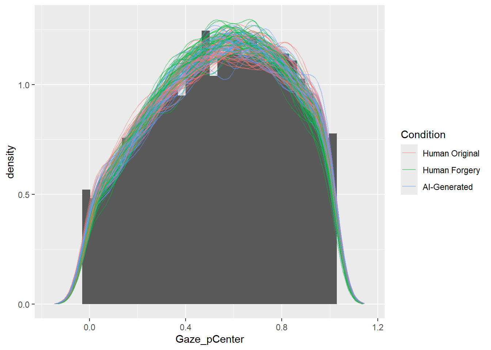{#fig-pcenter fig-alt='Gaze centeredness (proportion of samples in the central region): observed distribution with posterior-predictive densities per label condition (50 draws each).' width=672}
:::
:::


### Shift


::: {.cell}

```{.r .cell-code}
make_report(estimates$Shift)
```

::: {.cell-output-display}

```{=html}
<div id="hmwxuxwabp" style="padding-left:0px;padding-right:0px;padding-top:10px;padding-bottom:10px;overflow-x:auto;overflow-y:auto;width:auto;height:auto;">
<style>#hmwxuxwabp table {
  font-family: system-ui, 'Segoe UI', Roboto, Helvetica, Arial, sans-serif, 'Apple Color Emoji', 'Segoe UI Emoji', 'Segoe UI Symbol', 'Noto Color Emoji';
  -webkit-font-smoothing: antialiased;
  -moz-osx-font-smoothing: grayscale;
}

#hmwxuxwabp thead, #hmwxuxwabp tbody, #hmwxuxwabp tfoot, #hmwxuxwabp tr, #hmwxuxwabp td, #hmwxuxwabp th {
  border-style: none;
}

#hmwxuxwabp p {
  margin: 0;
  padding: 0;
}

#hmwxuxwabp .gt_table {
  display: table;
  border-collapse: collapse;
  line-height: normal;
  margin-left: auto;
  margin-right: auto;
  color: #333333;
  font-size: 16px;
  font-weight: normal;
  font-style: normal;
  background-color: #FFFFFF;
  width: auto;
  border-top-style: solid;
  border-top-width: 2px;
  border-top-color: #A8A8A8;
  border-right-style: none;
  border-right-width: 2px;
  border-right-color: #D3D3D3;
  border-bottom-style: solid;
  border-bottom-width: 2px;
  border-bottom-color: #A8A8A8;
  border-left-style: none;
  border-left-width: 2px;
  border-left-color: #D3D3D3;
}

#hmwxuxwabp .gt_caption {
  padding-top: 4px;
  padding-bottom: 4px;
}

#hmwxuxwabp .gt_title {
  color: #333333;
  font-size: 125%;
  font-weight: initial;
  padding-top: 4px;
  padding-bottom: 4px;
  padding-left: 5px;
  padding-right: 5px;
  border-bottom-color: #FFFFFF;
  border-bottom-width: 0;
}

#hmwxuxwabp .gt_subtitle {
  color: #333333;
  font-size: 85%;
  font-weight: initial;
  padding-top: 3px;
  padding-bottom: 5px;
  padding-left: 5px;
  padding-right: 5px;
  border-top-color: #FFFFFF;
  border-top-width: 0;
}

#hmwxuxwabp .gt_heading {
  background-color: #FFFFFF;
  text-align: center;
  border-bottom-color: #FFFFFF;
  border-left-style: none;
  border-left-width: 1px;
  border-left-color: #D3D3D3;
  border-right-style: none;
  border-right-width: 1px;
  border-right-color: #D3D3D3;
}

#hmwxuxwabp .gt_bottom_border {
  border-bottom-style: solid;
  border-bottom-width: 2px;
  border-bottom-color: #D3D3D3;
}

#hmwxuxwabp .gt_col_headings {
  border-top-style: solid;
  border-top-width: 2px;
  border-top-color: #D3D3D3;
  border-bottom-style: solid;
  border-bottom-width: 2px;
  border-bottom-color: #D3D3D3;
  border-left-style: none;
  border-left-width: 1px;
  border-left-color: #D3D3D3;
  border-right-style: none;
  border-right-width: 1px;
  border-right-color: #D3D3D3;
}

#hmwxuxwabp .gt_col_heading {
  color: #333333;
  background-color: #FFFFFF;
  font-size: 100%;
  font-weight: normal;
  text-transform: inherit;
  border-left-style: none;
  border-left-width: 1px;
  border-left-color: #D3D3D3;
  border-right-style: none;
  border-right-width: 1px;
  border-right-color: #D3D3D3;
  vertical-align: bottom;
  padding-top: 5px;
  padding-bottom: 6px;
  padding-left: 5px;
  padding-right: 5px;
  overflow-x: hidden;
}

#hmwxuxwabp .gt_column_spanner_outer {
  color: #333333;
  background-color: #FFFFFF;
  font-size: 100%;
  font-weight: normal;
  text-transform: inherit;
  padding-top: 0;
  padding-bottom: 0;
  padding-left: 4px;
  padding-right: 4px;
}

#hmwxuxwabp .gt_column_spanner_outer:first-child {
  padding-left: 0;
}

#hmwxuxwabp .gt_column_spanner_outer:last-child {
  padding-right: 0;
}

#hmwxuxwabp .gt_column_spanner {
  border-bottom-style: solid;
  border-bottom-width: 2px;
  border-bottom-color: #D3D3D3;
  vertical-align: bottom;
  padding-top: 5px;
  padding-bottom: 5px;
  overflow-x: hidden;
  display: inline-block;
  width: 100%;
}

#hmwxuxwabp .gt_spanner_row {
  border-bottom-style: hidden;
}

#hmwxuxwabp .gt_group_heading {
  padding-top: 8px;
  padding-bottom: 8px;
  padding-left: 5px;
  padding-right: 5px;
  color: #333333;
  background-color: #FFFFFF;
  font-size: 100%;
  font-weight: initial;
  text-transform: inherit;
  border-top-style: solid;
  border-top-width: 2px;
  border-top-color: #D3D3D3;
  border-bottom-style: solid;
  border-bottom-width: 2px;
  border-bottom-color: #D3D3D3;
  border-left-style: none;
  border-left-width: 1px;
  border-left-color: #D3D3D3;
  border-right-style: none;
  border-right-width: 1px;
  border-right-color: #D3D3D3;
  vertical-align: middle;
  text-align: left;
}

#hmwxuxwabp .gt_empty_group_heading {
  padding: 0.5px;
  color: #333333;
  background-color: #FFFFFF;
  font-size: 100%;
  font-weight: initial;
  border-top-style: solid;
  border-top-width: 2px;
  border-top-color: #D3D3D3;
  border-bottom-style: solid;
  border-bottom-width: 2px;
  border-bottom-color: #D3D3D3;
  vertical-align: middle;
}

#hmwxuxwabp .gt_from_md > :first-child {
  margin-top: 0;
}

#hmwxuxwabp .gt_from_md > :last-child {
  margin-bottom: 0;
}

#hmwxuxwabp .gt_row {
  padding-top: 8px;
  padding-bottom: 8px;
  padding-left: 5px;
  padding-right: 5px;
  margin: 10px;
  border-top-style: solid;
  border-top-width: 1px;
  border-top-color: #D3D3D3;
  border-left-style: none;
  border-left-width: 1px;
  border-left-color: #D3D3D3;
  border-right-style: none;
  border-right-width: 1px;
  border-right-color: #D3D3D3;
  vertical-align: middle;
  overflow-x: hidden;
}

#hmwxuxwabp .gt_stub {
  color: #333333;
  background-color: #FFFFFF;
  font-size: 100%;
  font-weight: initial;
  text-transform: inherit;
  border-right-style: solid;
  border-right-width: 2px;
  border-right-color: #D3D3D3;
  padding-left: 5px;
  padding-right: 5px;
}

#hmwxuxwabp .gt_stub_row_group {
  color: #333333;
  background-color: #FFFFFF;
  font-size: 100%;
  font-weight: initial;
  text-transform: inherit;
  border-right-style: solid;
  border-right-width: 2px;
  border-right-color: #D3D3D3;
  padding-left: 5px;
  padding-right: 5px;
  vertical-align: top;
}

#hmwxuxwabp .gt_row_group_first td {
  border-top-width: 2px;
}

#hmwxuxwabp .gt_row_group_first th {
  border-top-width: 2px;
}

#hmwxuxwabp .gt_summary_row {
  color: #333333;
  background-color: #FFFFFF;
  text-transform: inherit;
  padding-top: 8px;
  padding-bottom: 8px;
  padding-left: 5px;
  padding-right: 5px;
}

#hmwxuxwabp .gt_first_summary_row {
  border-top-style: solid;
  border-top-color: #D3D3D3;
}

#hmwxuxwabp .gt_first_summary_row.thick {
  border-top-width: 2px;
}

#hmwxuxwabp .gt_last_summary_row {
  padding-top: 8px;
  padding-bottom: 8px;
  padding-left: 5px;
  padding-right: 5px;
  border-bottom-style: solid;
  border-bottom-width: 2px;
  border-bottom-color: #D3D3D3;
}

#hmwxuxwabp .gt_grand_summary_row {
  color: #333333;
  background-color: #FFFFFF;
  text-transform: inherit;
  padding-top: 8px;
  padding-bottom: 8px;
  padding-left: 5px;
  padding-right: 5px;
}

#hmwxuxwabp .gt_first_grand_summary_row {
  padding-top: 8px;
  padding-bottom: 8px;
  padding-left: 5px;
  padding-right: 5px;
  border-top-style: double;
  border-top-width: 6px;
  border-top-color: #D3D3D3;
}

#hmwxuxwabp .gt_last_grand_summary_row_top {
  padding-top: 8px;
  padding-bottom: 8px;
  padding-left: 5px;
  padding-right: 5px;
  border-bottom-style: double;
  border-bottom-width: 6px;
  border-bottom-color: #D3D3D3;
}

#hmwxuxwabp .gt_striped {
  background-color: rgba(128, 128, 128, 0.05);
}

#hmwxuxwabp .gt_table_body {
  border-top-style: solid;
  border-top-width: 2px;
  border-top-color: #D3D3D3;
  border-bottom-style: solid;
  border-bottom-width: 2px;
  border-bottom-color: #D3D3D3;
}

#hmwxuxwabp .gt_footnotes {
  color: #333333;
  background-color: #FFFFFF;
  border-bottom-style: none;
  border-bottom-width: 2px;
  border-bottom-color: #D3D3D3;
  border-left-style: none;
  border-left-width: 2px;
  border-left-color: #D3D3D3;
  border-right-style: none;
  border-right-width: 2px;
  border-right-color: #D3D3D3;
}

#hmwxuxwabp .gt_footnote {
  margin: 0px;
  font-size: 90%;
  padding-top: 4px;
  padding-bottom: 4px;
  padding-left: 5px;
  padding-right: 5px;
}

#hmwxuxwabp .gt_sourcenotes {
  color: #333333;
  background-color: #FFFFFF;
  border-bottom-style: none;
  border-bottom-width: 2px;
  border-bottom-color: #D3D3D3;
  border-left-style: none;
  border-left-width: 2px;
  border-left-color: #D3D3D3;
  border-right-style: none;
  border-right-width: 2px;
  border-right-color: #D3D3D3;
}

#hmwxuxwabp .gt_sourcenote {
  font-size: 90%;
  padding-top: 4px;
  padding-bottom: 4px;
  padding-left: 5px;
  padding-right: 5px;
}

#hmwxuxwabp .gt_left {
  text-align: left;
}

#hmwxuxwabp .gt_center {
  text-align: center;
}

#hmwxuxwabp .gt_right {
  text-align: right;
  font-variant-numeric: tabular-nums;
}

#hmwxuxwabp .gt_font_normal {
  font-weight: normal;
}

#hmwxuxwabp .gt_font_bold {
  font-weight: bold;
}

#hmwxuxwabp .gt_font_italic {
  font-style: italic;
}

#hmwxuxwabp .gt_super {
  font-size: 65%;
}

#hmwxuxwabp .gt_footnote_marks {
  font-size: 75%;
  vertical-align: 0.4em;
  position: initial;
}

#hmwxuxwabp .gt_asterisk {
  font-size: 100%;
  vertical-align: 0;
}

#hmwxuxwabp .gt_indent_1 {
  text-indent: 5px;
}

#hmwxuxwabp .gt_indent_2 {
  text-indent: 10px;
}

#hmwxuxwabp .gt_indent_3 {
  text-indent: 15px;
}

#hmwxuxwabp .gt_indent_4 {
  text-indent: 20px;
}

#hmwxuxwabp .gt_indent_5 {
  text-indent: 25px;
}

#hmwxuxwabp .katex-display {
  display: inline-flex !important;
  margin-bottom: 0.75em !important;
}

#hmwxuxwabp div.Reactable > div.rt-table > div.rt-thead > div.rt-tr.rt-tr-group-header > div.rt-th-group:after {
  height: 0px !important;
}
</style>
<table class="gt_table" data-quarto-disable-processing="false" data-quarto-bootstrap="false">
  <thead>
    <tr class="gt_col_headings">
      <th class="gt_col_heading gt_columns_bottom_border gt_left" rowspan="1" colspan="1" scope="col" id="Contrast">Contrast</th>
      <th class="gt_col_heading gt_columns_bottom_border gt_left" rowspan="1" colspan="1" scope="col" id="Parameters">Parameters</th>
    </tr>
  </thead>
  <tbody class="gt_table_body">
    <tr><td headers="Contrast" class="gt_row gt_left">Human Forgery - Human Original</td>
<td headers="Parameters" class="gt_row gt_left">None</td></tr>
    <tr><td headers="Contrast" class="gt_row gt_left">AI-Generated - Human Original</td>
<td headers="Parameters" class="gt_row gt_left">None</td></tr>
    <tr><td headers="Contrast" class="gt_row gt_left">AI-Generated - Human Forgery</td>
<td headers="Parameters" class="gt_row gt_left">None</td></tr>
  </tbody>
  
</table>
</div>
```

```{=html}
<div id="nnnonulslu" style="padding-left:0px;padding-right:0px;padding-top:10px;padding-bottom:10px;overflow-x:auto;overflow-y:auto;width:auto;height:auto;">
<style>#nnnonulslu table {
  font-family: system-ui, 'Segoe UI', Roboto, Helvetica, Arial, sans-serif, 'Apple Color Emoji', 'Segoe UI Emoji', 'Segoe UI Symbol', 'Noto Color Emoji';
  -webkit-font-smoothing: antialiased;
  -moz-osx-font-smoothing: grayscale;
}

#nnnonulslu thead, #nnnonulslu tbody, #nnnonulslu tfoot, #nnnonulslu tr, #nnnonulslu td, #nnnonulslu th {
  border-style: none;
}

#nnnonulslu p {
  margin: 0;
  padding: 0;
}

#nnnonulslu .gt_table {
  display: table;
  border-collapse: collapse;
  line-height: normal;
  margin-left: auto;
  margin-right: auto;
  color: #333333;
  font-size: 16px;
  font-weight: normal;
  font-style: normal;
  background-color: #FFFFFF;
  width: auto;
  border-top-style: solid;
  border-top-width: 2px;
  border-top-color: #A8A8A8;
  border-right-style: none;
  border-right-width: 2px;
  border-right-color: #D3D3D3;
  border-bottom-style: solid;
  border-bottom-width: 2px;
  border-bottom-color: #A8A8A8;
  border-left-style: none;
  border-left-width: 2px;
  border-left-color: #D3D3D3;
}

#nnnonulslu .gt_caption {
  padding-top: 4px;
  padding-bottom: 4px;
}

#nnnonulslu .gt_title {
  color: #333333;
  font-size: 125%;
  font-weight: initial;
  padding-top: 4px;
  padding-bottom: 4px;
  padding-left: 5px;
  padding-right: 5px;
  border-bottom-color: #FFFFFF;
  border-bottom-width: 0;
}

#nnnonulslu .gt_subtitle {
  color: #333333;
  font-size: 85%;
  font-weight: initial;
  padding-top: 3px;
  padding-bottom: 5px;
  padding-left: 5px;
  padding-right: 5px;
  border-top-color: #FFFFFF;
  border-top-width: 0;
}

#nnnonulslu .gt_heading {
  background-color: #FFFFFF;
  text-align: center;
  border-bottom-color: #FFFFFF;
  border-left-style: none;
  border-left-width: 1px;
  border-left-color: #D3D3D3;
  border-right-style: none;
  border-right-width: 1px;
  border-right-color: #D3D3D3;
}

#nnnonulslu .gt_bottom_border {
  border-bottom-style: solid;
  border-bottom-width: 2px;
  border-bottom-color: #D3D3D3;
}

#nnnonulslu .gt_col_headings {
  border-top-style: solid;
  border-top-width: 2px;
  border-top-color: #D3D3D3;
  border-bottom-style: solid;
  border-bottom-width: 2px;
  border-bottom-color: #D3D3D3;
  border-left-style: none;
  border-left-width: 1px;
  border-left-color: #D3D3D3;
  border-right-style: none;
  border-right-width: 1px;
  border-right-color: #D3D3D3;
}

#nnnonulslu .gt_col_heading {
  color: #333333;
  background-color: #FFFFFF;
  font-size: 100%;
  font-weight: normal;
  text-transform: inherit;
  border-left-style: none;
  border-left-width: 1px;
  border-left-color: #D3D3D3;
  border-right-style: none;
  border-right-width: 1px;
  border-right-color: #D3D3D3;
  vertical-align: bottom;
  padding-top: 5px;
  padding-bottom: 6px;
  padding-left: 5px;
  padding-right: 5px;
  overflow-x: hidden;
}

#nnnonulslu .gt_column_spanner_outer {
  color: #333333;
  background-color: #FFFFFF;
  font-size: 100%;
  font-weight: normal;
  text-transform: inherit;
  padding-top: 0;
  padding-bottom: 0;
  padding-left: 4px;
  padding-right: 4px;
}

#nnnonulslu .gt_column_spanner_outer:first-child {
  padding-left: 0;
}

#nnnonulslu .gt_column_spanner_outer:last-child {
  padding-right: 0;
}

#nnnonulslu .gt_column_spanner {
  border-bottom-style: solid;
  border-bottom-width: 2px;
  border-bottom-color: #D3D3D3;
  vertical-align: bottom;
  padding-top: 5px;
  padding-bottom: 5px;
  overflow-x: hidden;
  display: inline-block;
  width: 100%;
}

#nnnonulslu .gt_spanner_row {
  border-bottom-style: hidden;
}

#nnnonulslu .gt_group_heading {
  padding-top: 8px;
  padding-bottom: 8px;
  padding-left: 5px;
  padding-right: 5px;
  color: #333333;
  background-color: #FFFFFF;
  font-size: 100%;
  font-weight: initial;
  text-transform: inherit;
  border-top-style: solid;
  border-top-width: 2px;
  border-top-color: #D3D3D3;
  border-bottom-style: solid;
  border-bottom-width: 2px;
  border-bottom-color: #D3D3D3;
  border-left-style: none;
  border-left-width: 1px;
  border-left-color: #D3D3D3;
  border-right-style: none;
  border-right-width: 1px;
  border-right-color: #D3D3D3;
  vertical-align: middle;
  text-align: left;
}

#nnnonulslu .gt_empty_group_heading {
  padding: 0.5px;
  color: #333333;
  background-color: #FFFFFF;
  font-size: 100%;
  font-weight: initial;
  border-top-style: solid;
  border-top-width: 2px;
  border-top-color: #D3D3D3;
  border-bottom-style: solid;
  border-bottom-width: 2px;
  border-bottom-color: #D3D3D3;
  vertical-align: middle;
}

#nnnonulslu .gt_from_md > :first-child {
  margin-top: 0;
}

#nnnonulslu .gt_from_md > :last-child {
  margin-bottom: 0;
}

#nnnonulslu .gt_row {
  padding-top: 8px;
  padding-bottom: 8px;
  padding-left: 5px;
  padding-right: 5px;
  margin: 10px;
  border-top-style: solid;
  border-top-width: 1px;
  border-top-color: #D3D3D3;
  border-left-style: none;
  border-left-width: 1px;
  border-left-color: #D3D3D3;
  border-right-style: none;
  border-right-width: 1px;
  border-right-color: #D3D3D3;
  vertical-align: middle;
  overflow-x: hidden;
}

#nnnonulslu .gt_stub {
  color: #333333;
  background-color: #FFFFFF;
  font-size: 100%;
  font-weight: initial;
  text-transform: inherit;
  border-right-style: solid;
  border-right-width: 2px;
  border-right-color: #D3D3D3;
  padding-left: 5px;
  padding-right: 5px;
}

#nnnonulslu .gt_stub_row_group {
  color: #333333;
  background-color: #FFFFFF;
  font-size: 100%;
  font-weight: initial;
  text-transform: inherit;
  border-right-style: solid;
  border-right-width: 2px;
  border-right-color: #D3D3D3;
  padding-left: 5px;
  padding-right: 5px;
  vertical-align: top;
}

#nnnonulslu .gt_row_group_first td {
  border-top-width: 2px;
}

#nnnonulslu .gt_row_group_first th {
  border-top-width: 2px;
}

#nnnonulslu .gt_summary_row {
  color: #333333;
  background-color: #FFFFFF;
  text-transform: inherit;
  padding-top: 8px;
  padding-bottom: 8px;
  padding-left: 5px;
  padding-right: 5px;
}

#nnnonulslu .gt_first_summary_row {
  border-top-style: solid;
  border-top-color: #D3D3D3;
}

#nnnonulslu .gt_first_summary_row.thick {
  border-top-width: 2px;
}

#nnnonulslu .gt_last_summary_row {
  padding-top: 8px;
  padding-bottom: 8px;
  padding-left: 5px;
  padding-right: 5px;
  border-bottom-style: solid;
  border-bottom-width: 2px;
  border-bottom-color: #D3D3D3;
}

#nnnonulslu .gt_grand_summary_row {
  color: #333333;
  background-color: #FFFFFF;
  text-transform: inherit;
  padding-top: 8px;
  padding-bottom: 8px;
  padding-left: 5px;
  padding-right: 5px;
}

#nnnonulslu .gt_first_grand_summary_row {
  padding-top: 8px;
  padding-bottom: 8px;
  padding-left: 5px;
  padding-right: 5px;
  border-top-style: double;
  border-top-width: 6px;
  border-top-color: #D3D3D3;
}

#nnnonulslu .gt_last_grand_summary_row_top {
  padding-top: 8px;
  padding-bottom: 8px;
  padding-left: 5px;
  padding-right: 5px;
  border-bottom-style: double;
  border-bottom-width: 6px;
  border-bottom-color: #D3D3D3;
}

#nnnonulslu .gt_striped {
  background-color: rgba(128, 128, 128, 0.05);
}

#nnnonulslu .gt_table_body {
  border-top-style: solid;
  border-top-width: 2px;
  border-top-color: #D3D3D3;
  border-bottom-style: solid;
  border-bottom-width: 2px;
  border-bottom-color: #D3D3D3;
}

#nnnonulslu .gt_footnotes {
  color: #333333;
  background-color: #FFFFFF;
  border-bottom-style: none;
  border-bottom-width: 2px;
  border-bottom-color: #D3D3D3;
  border-left-style: none;
  border-left-width: 2px;
  border-left-color: #D3D3D3;
  border-right-style: none;
  border-right-width: 2px;
  border-right-color: #D3D3D3;
}

#nnnonulslu .gt_footnote {
  margin: 0px;
  font-size: 90%;
  padding-top: 4px;
  padding-bottom: 4px;
  padding-left: 5px;
  padding-right: 5px;
}

#nnnonulslu .gt_sourcenotes {
  color: #333333;
  background-color: #FFFFFF;
  border-bottom-style: none;
  border-bottom-width: 2px;
  border-bottom-color: #D3D3D3;
  border-left-style: none;
  border-left-width: 2px;
  border-left-color: #D3D3D3;
  border-right-style: none;
  border-right-width: 2px;
  border-right-color: #D3D3D3;
}

#nnnonulslu .gt_sourcenote {
  font-size: 90%;
  padding-top: 4px;
  padding-bottom: 4px;
  padding-left: 5px;
  padding-right: 5px;
}

#nnnonulslu .gt_left {
  text-align: left;
}

#nnnonulslu .gt_center {
  text-align: center;
}

#nnnonulslu .gt_right {
  text-align: right;
  font-variant-numeric: tabular-nums;
}

#nnnonulslu .gt_font_normal {
  font-weight: normal;
}

#nnnonulslu .gt_font_bold {
  font-weight: bold;
}

#nnnonulslu .gt_font_italic {
  font-style: italic;
}

#nnnonulslu .gt_super {
  font-size: 65%;
}

#nnnonulslu .gt_footnote_marks {
  font-size: 75%;
  vertical-align: 0.4em;
  position: initial;
}

#nnnonulslu .gt_asterisk {
  font-size: 100%;
  vertical-align: 0;
}

#nnnonulslu .gt_indent_1 {
  text-indent: 5px;
}

#nnnonulslu .gt_indent_2 {
  text-indent: 10px;
}

#nnnonulslu .gt_indent_3 {
  text-indent: 15px;
}

#nnnonulslu .gt_indent_4 {
  text-indent: 20px;
}

#nnnonulslu .gt_indent_5 {
  text-indent: 25px;
}

#nnnonulslu .katex-display {
  display: inline-flex !important;
  margin-bottom: 0.75em !important;
}

#nnnonulslu div.Reactable > div.rt-table > div.rt-thead > div.rt-tr.rt-tr-group-header > div.rt-th-group:after {
  height: 0px !important;
}
</style>
<table class="gt_table" data-quarto-disable-processing="false" data-quarto-bootstrap="false">
  <thead>
    <tr class="gt_col_headings">
      <th class="gt_col_heading gt_columns_bottom_border gt_left" rowspan="1" colspan="1" scope="col" id="Contrast">Contrast</th>
      <th class="gt_col_heading gt_columns_bottom_border gt_left" rowspan="1" colspan="1" scope="col" id="Parameters">Parameters</th>
    </tr>
  </thead>
  <tbody class="gt_table_body">
    <tr><td headers="Contrast" class="gt_row gt_left">Negative - High intensity - Positive - Low intensity</td>
<td headers="Parameters" class="gt_row gt_left">response (-0.01, [-0.02,  0.00]); mu (-0.04, [-0.06, -0.01])</td></tr>
  </tbody>
  
</table>
</div>
```

```{=html}
<div id="wqjienzbto" style="padding-left:0px;padding-right:0px;padding-top:10px;padding-bottom:10px;overflow-x:auto;overflow-y:auto;width:auto;height:auto;">
<style>#wqjienzbto table {
  font-family: system-ui, 'Segoe UI', Roboto, Helvetica, Arial, sans-serif, 'Apple Color Emoji', 'Segoe UI Emoji', 'Segoe UI Symbol', 'Noto Color Emoji';
  -webkit-font-smoothing: antialiased;
  -moz-osx-font-smoothing: grayscale;
}

#wqjienzbto thead, #wqjienzbto tbody, #wqjienzbto tfoot, #wqjienzbto tr, #wqjienzbto td, #wqjienzbto th {
  border-style: none;
}

#wqjienzbto p {
  margin: 0;
  padding: 0;
}

#wqjienzbto .gt_table {
  display: table;
  border-collapse: collapse;
  line-height: normal;
  margin-left: auto;
  margin-right: auto;
  color: #333333;
  font-size: 13px;
  font-weight: normal;
  font-style: normal;
  background-color: #FFFFFF;
  width: auto;
  border-top-style: solid;
  border-top-width: 3px;
  border-top-color: #D5D5D5;
  border-right-style: solid;
  border-right-width: 3px;
  border-right-color: #D5D5D5;
  border-bottom-style: solid;
  border-bottom-width: 3px;
  border-bottom-color: #D5D5D5;
  border-left-style: solid;
  border-left-width: 3px;
  border-left-color: #D5D5D5;
}

#wqjienzbto .gt_caption {
  padding-top: 4px;
  padding-bottom: 4px;
}

#wqjienzbto .gt_title {
  color: #333333;
  font-size: 125%;
  font-weight: initial;
  padding-top: 4px;
  padding-bottom: 4px;
  padding-left: 5px;
  padding-right: 5px;
  border-bottom-color: #FFFFFF;
  border-bottom-width: 0;
}

#wqjienzbto .gt_subtitle {
  color: #333333;
  font-size: 85%;
  font-weight: initial;
  padding-top: 3px;
  padding-bottom: 5px;
  padding-left: 5px;
  padding-right: 5px;
  border-top-color: #FFFFFF;
  border-top-width: 0;
}

#wqjienzbto .gt_heading {
  background-color: #FFFFFF;
  text-align: left;
  border-bottom-color: #FFFFFF;
  border-left-style: none;
  border-left-width: 1px;
  border-left-color: #D3D3D3;
  border-right-style: none;
  border-right-width: 1px;
  border-right-color: #D3D3D3;
}

#wqjienzbto .gt_bottom_border {
  border-bottom-style: solid;
  border-bottom-width: 2px;
  border-bottom-color: #D5D5D5;
}

#wqjienzbto .gt_col_headings {
  border-top-style: solid;
  border-top-width: 2px;
  border-top-color: #D5D5D5;
  border-bottom-style: solid;
  border-bottom-width: 2px;
  border-bottom-color: #D5D5D5;
  border-left-style: none;
  border-left-width: 1px;
  border-left-color: #D3D3D3;
  border-right-style: none;
  border-right-width: 1px;
  border-right-color: #D3D3D3;
}

#wqjienzbto .gt_col_heading {
  color: #FFFFFF;
  background-color: #000000;
  font-size: 100%;
  font-weight: normal;
  text-transform: inherit;
  border-left-style: none;
  border-left-width: 1px;
  border-left-color: #D3D3D3;
  border-right-style: none;
  border-right-width: 1px;
  border-right-color: #D3D3D3;
  vertical-align: bottom;
  padding-top: 5px;
  padding-bottom: 6px;
  padding-left: 5px;
  padding-right: 5px;
  overflow-x: hidden;
}

#wqjienzbto .gt_column_spanner_outer {
  color: #FFFFFF;
  background-color: #000000;
  font-size: 100%;
  font-weight: normal;
  text-transform: inherit;
  padding-top: 0;
  padding-bottom: 0;
  padding-left: 4px;
  padding-right: 4px;
}

#wqjienzbto .gt_column_spanner_outer:first-child {
  padding-left: 0;
}

#wqjienzbto .gt_column_spanner_outer:last-child {
  padding-right: 0;
}

#wqjienzbto .gt_column_spanner {
  border-bottom-style: solid;
  border-bottom-width: 2px;
  border-bottom-color: #D5D5D5;
  vertical-align: bottom;
  padding-top: 5px;
  padding-bottom: 5px;
  overflow-x: hidden;
  display: inline-block;
  width: 100%;
}

#wqjienzbto .gt_spanner_row {
  border-bottom-style: hidden;
}

#wqjienzbto .gt_group_heading {
  padding-top: 8px;
  padding-bottom: 8px;
  padding-left: 5px;
  padding-right: 5px;
  color: #333333;
  background-color: #FFFFFF;
  font-size: 100%;
  font-weight: initial;
  text-transform: inherit;
  border-top-style: solid;
  border-top-width: 2px;
  border-top-color: #D5D5D5;
  border-bottom-style: solid;
  border-bottom-width: 2px;
  border-bottom-color: #D5D5D5;
  border-left-style: none;
  border-left-width: 1px;
  border-left-color: #D3D3D3;
  border-right-style: none;
  border-right-width: 1px;
  border-right-color: #D3D3D3;
  vertical-align: middle;
  text-align: left;
}

#wqjienzbto .gt_empty_group_heading {
  padding: 0.5px;
  color: #333333;
  background-color: #FFFFFF;
  font-size: 100%;
  font-weight: initial;
  border-top-style: solid;
  border-top-width: 2px;
  border-top-color: #D5D5D5;
  border-bottom-style: solid;
  border-bottom-width: 2px;
  border-bottom-color: #D5D5D5;
  vertical-align: middle;
}

#wqjienzbto .gt_from_md > :first-child {
  margin-top: 0;
}

#wqjienzbto .gt_from_md > :last-child {
  margin-bottom: 0;
}

#wqjienzbto .gt_row {
  padding-top: 8px;
  padding-bottom: 8px;
  padding-left: 5px;
  padding-right: 5px;
  margin: 10px;
  border-top-style: solid;
  border-top-width: 1px;
  border-top-color: #D5D5D5;
  border-left-style: solid;
  border-left-width: 1px;
  border-left-color: #D5D5D5;
  border-right-style: solid;
  border-right-width: 1px;
  border-right-color: #D5D5D5;
  vertical-align: middle;
  overflow-x: hidden;
}

#wqjienzbto .gt_stub {
  color: #333333;
  background-color: #FFFFFF;
  font-size: 100%;
  font-weight: initial;
  text-transform: inherit;
  border-right-style: solid;
  border-right-width: 2px;
  border-right-color: #5F5F5F;
  padding-left: 5px;
  padding-right: 5px;
}

#wqjienzbto .gt_stub_row_group {
  color: #333333;
  background-color: #FFFFFF;
  font-size: 100%;
  font-weight: initial;
  text-transform: inherit;
  border-right-style: solid;
  border-right-width: 2px;
  border-right-color: #D3D3D3;
  padding-left: 5px;
  padding-right: 5px;
  vertical-align: top;
}

#wqjienzbto .gt_row_group_first td {
  border-top-width: 2px;
}

#wqjienzbto .gt_row_group_first th {
  border-top-width: 2px;
}

#wqjienzbto .gt_summary_row {
  color: #333333;
  background-color: #D5D5D5;
  text-transform: inherit;
  padding-top: 8px;
  padding-bottom: 8px;
  padding-left: 5px;
  padding-right: 5px;
}

#wqjienzbto .gt_first_summary_row {
  border-top-style: solid;
  border-top-color: #D5D5D5;
}

#wqjienzbto .gt_first_summary_row.thick {
  border-top-width: 2px;
}

#wqjienzbto .gt_last_summary_row {
  padding-top: 8px;
  padding-bottom: 8px;
  padding-left: 5px;
  padding-right: 5px;
  border-bottom-style: solid;
  border-bottom-width: 2px;
  border-bottom-color: #D5D5D5;
}

#wqjienzbto .gt_grand_summary_row {
  color: #FFFFFF;
  background-color: #929292;
  text-transform: inherit;
  padding-top: 8px;
  padding-bottom: 8px;
  padding-left: 5px;
  padding-right: 5px;
}

#wqjienzbto .gt_first_grand_summary_row {
  padding-top: 8px;
  padding-bottom: 8px;
  padding-left: 5px;
  padding-right: 5px;
  border-top-style: double;
  border-top-width: 6px;
  border-top-color: #D5D5D5;
}

#wqjienzbto .gt_last_grand_summary_row_top {
  padding-top: 8px;
  padding-bottom: 8px;
  padding-left: 5px;
  padding-right: 5px;
  border-bottom-style: double;
  border-bottom-width: 6px;
  border-bottom-color: #D5D5D5;
}

#wqjienzbto .gt_striped {
  background-color: #F4F4F4;
}

#wqjienzbto .gt_table_body {
  border-top-style: solid;
  border-top-width: 2px;
  border-top-color: #D5D5D5;
  border-bottom-style: solid;
  border-bottom-width: 2px;
  border-bottom-color: #D5D5D5;
}

#wqjienzbto .gt_footnotes {
  color: #333333;
  background-color: #FFFFFF;
  border-bottom-style: none;
  border-bottom-width: 2px;
  border-bottom-color: #D3D3D3;
  border-left-style: none;
  border-left-width: 2px;
  border-left-color: #D3D3D3;
  border-right-style: none;
  border-right-width: 2px;
  border-right-color: #D3D3D3;
}

#wqjienzbto .gt_footnote {
  margin: 0px;
  font-size: 90%;
  padding-top: 4px;
  padding-bottom: 4px;
  padding-left: 5px;
  padding-right: 5px;
}

#wqjienzbto .gt_sourcenotes {
  color: #333333;
  background-color: #FFFFFF;
  border-bottom-style: none;
  border-bottom-width: 2px;
  border-bottom-color: #D3D3D3;
  border-left-style: none;
  border-left-width: 2px;
  border-left-color: #D3D3D3;
  border-right-style: none;
  border-right-width: 2px;
  border-right-color: #D3D3D3;
}

#wqjienzbto .gt_sourcenote {
  font-size: 90%;
  padding-top: 4px;
  padding-bottom: 4px;
  padding-left: 5px;
  padding-right: 5px;
}

#wqjienzbto .gt_left {
  text-align: left;
}

#wqjienzbto .gt_center {
  text-align: center;
}

#wqjienzbto .gt_right {
  text-align: right;
  font-variant-numeric: tabular-nums;
}

#wqjienzbto .gt_font_normal {
  font-weight: normal;
}

#wqjienzbto .gt_font_bold {
  font-weight: bold;
}

#wqjienzbto .gt_font_italic {
  font-style: italic;
}

#wqjienzbto .gt_super {
  font-size: 65%;
}

#wqjienzbto .gt_footnote_marks {
  font-size: 75%;
  vertical-align: 0.4em;
  position: initial;
}

#wqjienzbto .gt_asterisk {
  font-size: 100%;
  vertical-align: 0;
}

#wqjienzbto .gt_indent_1 {
  text-indent: 5px;
}

#wqjienzbto .gt_indent_2 {
  text-indent: 10px;
}

#wqjienzbto .gt_indent_3 {
  text-indent: 15px;
}

#wqjienzbto .gt_indent_4 {
  text-indent: 20px;
}

#wqjienzbto .gt_indent_5 {
  text-indent: 25px;
}

#wqjienzbto .katex-display {
  display: inline-flex !important;
  margin-bottom: 0.75em !important;
}

#wqjienzbto div.Reactable > div.rt-table > div.rt-thead > div.rt-tr.rt-tr-group-header > div.rt-th-group:after {
  height: 0px !important;
}
</style>
<table class="gt_table" data-quarto-disable-processing="false" data-quarto-bootstrap="false">
  <thead>
    <tr class="gt_heading">
      <td colspan="10" class="gt_heading gt_title gt_font_normal gt_bottom_border" style>Gaze Max. Shift: convergence</td>
    </tr>
    
    <tr class="gt_col_headings">
      <th class="gt_col_heading gt_columns_bottom_border gt_left" rowspan="1" colspan="1" scope="col" id="Model">Model</th>
      <th class="gt_col_heading gt_columns_bottom_border gt_left" rowspan="1" colspan="1" scope="col" id="Family">Family</th>
      <th class="gt_col_heading gt_columns_bottom_border gt_right" rowspan="1" colspan="1" scope="col" id="N_obs">N_obs</th>
      <th class="gt_col_heading gt_columns_bottom_border gt_right" rowspan="1" colspan="1" scope="col" id="N_participants">N_participants</th>
      <th class="gt_col_heading gt_columns_bottom_border gt_right" rowspan="1" colspan="1" scope="col" id="Chains">Chains</th>
      <th class="gt_col_heading gt_columns_bottom_border gt_right" rowspan="1" colspan="1" scope="col" id="Draws">Draws</th>
      <th class="gt_col_heading gt_columns_bottom_border gt_right" rowspan="1" colspan="1" scope="col" id="Max_Rhat">Max_Rhat</th>
      <th class="gt_col_heading gt_columns_bottom_border gt_right" rowspan="1" colspan="1" scope="col" id="Min_ESS_ratio">Min_ESS_ratio</th>
      <th class="gt_col_heading gt_columns_bottom_border gt_right" rowspan="1" colspan="1" scope="col" id="Divergent_pct">Divergent_pct</th>
      <th class="gt_col_heading gt_columns_bottom_border gt_left" rowspan="1" colspan="1" scope="col" id="Criterion">Criterion</th>
    </tr>
  </thead>
  <tbody class="gt_table_body">
    <tr><td headers="Model" class="gt_row gt_left">Shift</td>
<td headers="Family" class="gt_row gt_left">LogNormal</td>
<td headers="N_obs" class="gt_row gt_right">11772</td>
<td headers="N_participants" class="gt_row gt_right">273</td>
<td headers="Chains" class="gt_row gt_right">8</td>
<td headers="Draws" class="gt_row gt_right">4000</td>
<td headers="Max_Rhat" class="gt_row gt_right">1.018</td>
<td headers="Min_ESS_ratio" class="gt_row gt_right">0.1</td>
<td headers="Divergent_pct" class="gt_row gt_right">0</td>
<td headers="Criterion" class="gt_row gt_left">loo</td></tr>
  </tbody>
  
</table>
</div>
```


::: {.callout-note collapse="true" title="Gaze Max. Shift: convergence (Markdown table, for text readers)"}

|Model |Family    | N_obs| N_participants| Chains| Draws| Max_Rhat| Min_ESS_ratio| Divergent_pct|Criterion |
|:-----|:---------|-----:|--------------:|------:|-----:|--------:|-------------:|-------------:|:---------|
|Shift |LogNormal | 11772|            273|      8|  4000|    1.018|           0.1|             0|loo       |

:::

```{=html}
<div id="rgqtejawvj" style="padding-left:0px;padding-right:0px;padding-top:10px;padding-bottom:10px;overflow-x:auto;overflow-y:auto;width:auto;height:auto;">
<style>#rgqtejawvj table {
  font-family: system-ui, 'Segoe UI', Roboto, Helvetica, Arial, sans-serif, 'Apple Color Emoji', 'Segoe UI Emoji', 'Segoe UI Symbol', 'Noto Color Emoji';
  -webkit-font-smoothing: antialiased;
  -moz-osx-font-smoothing: grayscale;
}

#rgqtejawvj thead, #rgqtejawvj tbody, #rgqtejawvj tfoot, #rgqtejawvj tr, #rgqtejawvj td, #rgqtejawvj th {
  border-style: none;
}

#rgqtejawvj p {
  margin: 0;
  padding: 0;
}

#rgqtejawvj .gt_table {
  display: table;
  border-collapse: collapse;
  line-height: normal;
  margin-left: auto;
  margin-right: auto;
  color: #333333;
  font-size: 13px;
  font-weight: normal;
  font-style: normal;
  background-color: #FFFFFF;
  width: auto;
  border-top-style: solid;
  border-top-width: 3px;
  border-top-color: #D5D5D5;
  border-right-style: solid;
  border-right-width: 3px;
  border-right-color: #D5D5D5;
  border-bottom-style: solid;
  border-bottom-width: 3px;
  border-bottom-color: #D5D5D5;
  border-left-style: solid;
  border-left-width: 3px;
  border-left-color: #D5D5D5;
}

#rgqtejawvj .gt_caption {
  padding-top: 4px;
  padding-bottom: 4px;
}

#rgqtejawvj .gt_title {
  color: #333333;
  font-size: 125%;
  font-weight: initial;
  padding-top: 4px;
  padding-bottom: 4px;
  padding-left: 5px;
  padding-right: 5px;
  border-bottom-color: #FFFFFF;
  border-bottom-width: 0;
}

#rgqtejawvj .gt_subtitle {
  color: #333333;
  font-size: 85%;
  font-weight: initial;
  padding-top: 3px;
  padding-bottom: 5px;
  padding-left: 5px;
  padding-right: 5px;
  border-top-color: #FFFFFF;
  border-top-width: 0;
}

#rgqtejawvj .gt_heading {
  background-color: #FFFFFF;
  text-align: left;
  border-bottom-color: #FFFFFF;
  border-left-style: none;
  border-left-width: 1px;
  border-left-color: #D3D3D3;
  border-right-style: none;
  border-right-width: 1px;
  border-right-color: #D3D3D3;
}

#rgqtejawvj .gt_bottom_border {
  border-bottom-style: solid;
  border-bottom-width: 2px;
  border-bottom-color: #D5D5D5;
}

#rgqtejawvj .gt_col_headings {
  border-top-style: solid;
  border-top-width: 2px;
  border-top-color: #D5D5D5;
  border-bottom-style: solid;
  border-bottom-width: 2px;
  border-bottom-color: #D5D5D5;
  border-left-style: none;
  border-left-width: 1px;
  border-left-color: #D3D3D3;
  border-right-style: none;
  border-right-width: 1px;
  border-right-color: #D3D3D3;
}

#rgqtejawvj .gt_col_heading {
  color: #FFFFFF;
  background-color: #000000;
  font-size: 100%;
  font-weight: normal;
  text-transform: inherit;
  border-left-style: none;
  border-left-width: 1px;
  border-left-color: #D3D3D3;
  border-right-style: none;
  border-right-width: 1px;
  border-right-color: #D3D3D3;
  vertical-align: bottom;
  padding-top: 5px;
  padding-bottom: 6px;
  padding-left: 5px;
  padding-right: 5px;
  overflow-x: hidden;
}

#rgqtejawvj .gt_column_spanner_outer {
  color: #FFFFFF;
  background-color: #000000;
  font-size: 100%;
  font-weight: normal;
  text-transform: inherit;
  padding-top: 0;
  padding-bottom: 0;
  padding-left: 4px;
  padding-right: 4px;
}

#rgqtejawvj .gt_column_spanner_outer:first-child {
  padding-left: 0;
}

#rgqtejawvj .gt_column_spanner_outer:last-child {
  padding-right: 0;
}

#rgqtejawvj .gt_column_spanner {
  border-bottom-style: solid;
  border-bottom-width: 2px;
  border-bottom-color: #D5D5D5;
  vertical-align: bottom;
  padding-top: 5px;
  padding-bottom: 5px;
  overflow-x: hidden;
  display: inline-block;
  width: 100%;
}

#rgqtejawvj .gt_spanner_row {
  border-bottom-style: hidden;
}

#rgqtejawvj .gt_group_heading {
  padding-top: 8px;
  padding-bottom: 8px;
  padding-left: 5px;
  padding-right: 5px;
  color: #333333;
  background-color: #FFFFFF;
  font-size: 100%;
  font-weight: initial;
  text-transform: inherit;
  border-top-style: solid;
  border-top-width: 2px;
  border-top-color: #D5D5D5;
  border-bottom-style: solid;
  border-bottom-width: 2px;
  border-bottom-color: #D5D5D5;
  border-left-style: none;
  border-left-width: 1px;
  border-left-color: #D3D3D3;
  border-right-style: none;
  border-right-width: 1px;
  border-right-color: #D3D3D3;
  vertical-align: middle;
  text-align: left;
}

#rgqtejawvj .gt_empty_group_heading {
  padding: 0.5px;
  color: #333333;
  background-color: #FFFFFF;
  font-size: 100%;
  font-weight: initial;
  border-top-style: solid;
  border-top-width: 2px;
  border-top-color: #D5D5D5;
  border-bottom-style: solid;
  border-bottom-width: 2px;
  border-bottom-color: #D5D5D5;
  vertical-align: middle;
}

#rgqtejawvj .gt_from_md > :first-child {
  margin-top: 0;
}

#rgqtejawvj .gt_from_md > :last-child {
  margin-bottom: 0;
}

#rgqtejawvj .gt_row {
  padding-top: 8px;
  padding-bottom: 8px;
  padding-left: 5px;
  padding-right: 5px;
  margin: 10px;
  border-top-style: solid;
  border-top-width: 1px;
  border-top-color: #D5D5D5;
  border-left-style: solid;
  border-left-width: 1px;
  border-left-color: #D5D5D5;
  border-right-style: solid;
  border-right-width: 1px;
  border-right-color: #D5D5D5;
  vertical-align: middle;
  overflow-x: hidden;
}

#rgqtejawvj .gt_stub {
  color: #333333;
  background-color: #FFFFFF;
  font-size: 100%;
  font-weight: initial;
  text-transform: inherit;
  border-right-style: solid;
  border-right-width: 2px;
  border-right-color: #5F5F5F;
  padding-left: 5px;
  padding-right: 5px;
}

#rgqtejawvj .gt_stub_row_group {
  color: #333333;
  background-color: #FFFFFF;
  font-size: 100%;
  font-weight: initial;
  text-transform: inherit;
  border-right-style: solid;
  border-right-width: 2px;
  border-right-color: #D3D3D3;
  padding-left: 5px;
  padding-right: 5px;
  vertical-align: top;
}

#rgqtejawvj .gt_row_group_first td {
  border-top-width: 2px;
}

#rgqtejawvj .gt_row_group_first th {
  border-top-width: 2px;
}

#rgqtejawvj .gt_summary_row {
  color: #333333;
  background-color: #D5D5D5;
  text-transform: inherit;
  padding-top: 8px;
  padding-bottom: 8px;
  padding-left: 5px;
  padding-right: 5px;
}

#rgqtejawvj .gt_first_summary_row {
  border-top-style: solid;
  border-top-color: #D5D5D5;
}

#rgqtejawvj .gt_first_summary_row.thick {
  border-top-width: 2px;
}

#rgqtejawvj .gt_last_summary_row {
  padding-top: 8px;
  padding-bottom: 8px;
  padding-left: 5px;
  padding-right: 5px;
  border-bottom-style: solid;
  border-bottom-width: 2px;
  border-bottom-color: #D5D5D5;
}

#rgqtejawvj .gt_grand_summary_row {
  color: #FFFFFF;
  background-color: #929292;
  text-transform: inherit;
  padding-top: 8px;
  padding-bottom: 8px;
  padding-left: 5px;
  padding-right: 5px;
}

#rgqtejawvj .gt_first_grand_summary_row {
  padding-top: 8px;
  padding-bottom: 8px;
  padding-left: 5px;
  padding-right: 5px;
  border-top-style: double;
  border-top-width: 6px;
  border-top-color: #D5D5D5;
}

#rgqtejawvj .gt_last_grand_summary_row_top {
  padding-top: 8px;
  padding-bottom: 8px;
  padding-left: 5px;
  padding-right: 5px;
  border-bottom-style: double;
  border-bottom-width: 6px;
  border-bottom-color: #D5D5D5;
}

#rgqtejawvj .gt_striped {
  background-color: #F4F4F4;
}

#rgqtejawvj .gt_table_body {
  border-top-style: solid;
  border-top-width: 2px;
  border-top-color: #D5D5D5;
  border-bottom-style: solid;
  border-bottom-width: 2px;
  border-bottom-color: #D5D5D5;
}

#rgqtejawvj .gt_footnotes {
  color: #333333;
  background-color: #FFFFFF;
  border-bottom-style: none;
  border-bottom-width: 2px;
  border-bottom-color: #D3D3D3;
  border-left-style: none;
  border-left-width: 2px;
  border-left-color: #D3D3D3;
  border-right-style: none;
  border-right-width: 2px;
  border-right-color: #D3D3D3;
}

#rgqtejawvj .gt_footnote {
  margin: 0px;
  font-size: 90%;
  padding-top: 4px;
  padding-bottom: 4px;
  padding-left: 5px;
  padding-right: 5px;
}

#rgqtejawvj .gt_sourcenotes {
  color: #333333;
  background-color: #FFFFFF;
  border-bottom-style: none;
  border-bottom-width: 2px;
  border-bottom-color: #D3D3D3;
  border-left-style: none;
  border-left-width: 2px;
  border-left-color: #D3D3D3;
  border-right-style: none;
  border-right-width: 2px;
  border-right-color: #D3D3D3;
}

#rgqtejawvj .gt_sourcenote {
  font-size: 90%;
  padding-top: 4px;
  padding-bottom: 4px;
  padding-left: 5px;
  padding-right: 5px;
}

#rgqtejawvj .gt_left {
  text-align: left;
}

#rgqtejawvj .gt_center {
  text-align: center;
}

#rgqtejawvj .gt_right {
  text-align: right;
  font-variant-numeric: tabular-nums;
}

#rgqtejawvj .gt_font_normal {
  font-weight: normal;
}

#rgqtejawvj .gt_font_bold {
  font-weight: bold;
}

#rgqtejawvj .gt_font_italic {
  font-style: italic;
}

#rgqtejawvj .gt_super {
  font-size: 65%;
}

#rgqtejawvj .gt_footnote_marks {
  font-size: 75%;
  vertical-align: 0.4em;
  position: initial;
}

#rgqtejawvj .gt_asterisk {
  font-size: 100%;
  vertical-align: 0;
}

#rgqtejawvj .gt_indent_1 {
  text-indent: 5px;
}

#rgqtejawvj .gt_indent_2 {
  text-indent: 10px;
}

#rgqtejawvj .gt_indent_3 {
  text-indent: 15px;
}

#rgqtejawvj .gt_indent_4 {
  text-indent: 20px;
}

#rgqtejawvj .gt_indent_5 {
  text-indent: 25px;
}

#rgqtejawvj .katex-display {
  display: inline-flex !important;
  margin-bottom: 0.75em !important;
}

#rgqtejawvj div.Reactable > div.rt-table > div.rt-thead > div.rt-tr.rt-tr-group-header > div.rt-th-group:after {
  height: 0px !important;
}
</style>
<table class="gt_table" data-quarto-disable-processing="false" data-quarto-bootstrap="false">
  <thead>
    <tr class="gt_heading">
      <td colspan="4" class="gt_heading gt_title gt_font_normal gt_bottom_border" style>Gaze Max. Shift: marginal means per label condition (response scale)</td>
    </tr>
    
    <tr class="gt_col_headings">
      <th class="gt_col_heading gt_columns_bottom_border gt_center" rowspan="1" colspan="1" scope="col" id="Condition">Condition</th>
      <th class="gt_col_heading gt_columns_bottom_border gt_right" rowspan="1" colspan="1" scope="col" id="Estimate">Estimate</th>
      <th class="gt_col_heading gt_columns_bottom_border gt_right" rowspan="1" colspan="1" scope="col" id="CI_low">CI_low</th>
      <th class="gt_col_heading gt_columns_bottom_border gt_right" rowspan="1" colspan="1" scope="col" id="CI_high">CI_high</th>
    </tr>
  </thead>
  <tbody class="gt_table_body">
    <tr><td headers="Condition" class="gt_row gt_center">Human Original</td>
<td headers="Estimate" class="gt_row gt_right">0.27</td>
<td headers="CI_low" class="gt_row gt_right">0.26</td>
<td headers="CI_high" class="gt_row gt_right">0.28</td></tr>
    <tr><td headers="Condition" class="gt_row gt_center gt_striped">Human Forgery</td>
<td headers="Estimate" class="gt_row gt_right gt_striped">0.27</td>
<td headers="CI_low" class="gt_row gt_right gt_striped">0.26</td>
<td headers="CI_high" class="gt_row gt_right gt_striped">0.28</td></tr>
    <tr><td headers="Condition" class="gt_row gt_center">AI-Generated</td>
<td headers="Estimate" class="gt_row gt_right">0.27</td>
<td headers="CI_low" class="gt_row gt_right">0.26</td>
<td headers="CI_high" class="gt_row gt_right">0.28</td></tr>
  </tbody>
  
</table>
</div>
```


::: {.callout-note collapse="true" title="Gaze Max. Shift: marginal means per label condition (response scale) (Markdown table, for text readers)"}

|Condition      |Estimate |CI_low |CI_high |
|:--------------|:--------|:------|:-------|
|Human Original |0.27     |0.26   |0.28    |
|Human Forgery  |0.27     |0.26   |0.28    |
|AI-Generated   |0.27     |0.26   |0.28    |

:::

```{=html}
<div id="rswsbqrqro" style="padding-left:0px;padding-right:0px;padding-top:10px;padding-bottom:10px;overflow-x:auto;overflow-y:auto;width:auto;height:auto;">
<style>#rswsbqrqro table {
  font-family: system-ui, 'Segoe UI', Roboto, Helvetica, Arial, sans-serif, 'Apple Color Emoji', 'Segoe UI Emoji', 'Segoe UI Symbol', 'Noto Color Emoji';
  -webkit-font-smoothing: antialiased;
  -moz-osx-font-smoothing: grayscale;
}

#rswsbqrqro thead, #rswsbqrqro tbody, #rswsbqrqro tfoot, #rswsbqrqro tr, #rswsbqrqro td, #rswsbqrqro th {
  border-style: none;
}

#rswsbqrqro p {
  margin: 0;
  padding: 0;
}

#rswsbqrqro .gt_table {
  display: table;
  border-collapse: collapse;
  line-height: normal;
  margin-left: auto;
  margin-right: auto;
  color: #333333;
  font-size: 13px;
  font-weight: normal;
  font-style: normal;
  background-color: #FFFFFF;
  width: auto;
  border-top-style: solid;
  border-top-width: 3px;
  border-top-color: #D5D5D5;
  border-right-style: solid;
  border-right-width: 3px;
  border-right-color: #D5D5D5;
  border-bottom-style: solid;
  border-bottom-width: 3px;
  border-bottom-color: #D5D5D5;
  border-left-style: solid;
  border-left-width: 3px;
  border-left-color: #D5D5D5;
}

#rswsbqrqro .gt_caption {
  padding-top: 4px;
  padding-bottom: 4px;
}

#rswsbqrqro .gt_title {
  color: #333333;
  font-size: 125%;
  font-weight: initial;
  padding-top: 4px;
  padding-bottom: 4px;
  padding-left: 5px;
  padding-right: 5px;
  border-bottom-color: #FFFFFF;
  border-bottom-width: 0;
}

#rswsbqrqro .gt_subtitle {
  color: #333333;
  font-size: 85%;
  font-weight: initial;
  padding-top: 3px;
  padding-bottom: 5px;
  padding-left: 5px;
  padding-right: 5px;
  border-top-color: #FFFFFF;
  border-top-width: 0;
}

#rswsbqrqro .gt_heading {
  background-color: #FFFFFF;
  text-align: left;
  border-bottom-color: #FFFFFF;
  border-left-style: none;
  border-left-width: 1px;
  border-left-color: #D3D3D3;
  border-right-style: none;
  border-right-width: 1px;
  border-right-color: #D3D3D3;
}

#rswsbqrqro .gt_bottom_border {
  border-bottom-style: solid;
  border-bottom-width: 2px;
  border-bottom-color: #D5D5D5;
}

#rswsbqrqro .gt_col_headings {
  border-top-style: solid;
  border-top-width: 2px;
  border-top-color: #D5D5D5;
  border-bottom-style: solid;
  border-bottom-width: 2px;
  border-bottom-color: #D5D5D5;
  border-left-style: none;
  border-left-width: 1px;
  border-left-color: #D3D3D3;
  border-right-style: none;
  border-right-width: 1px;
  border-right-color: #D3D3D3;
}

#rswsbqrqro .gt_col_heading {
  color: #FFFFFF;
  background-color: #000000;
  font-size: 100%;
  font-weight: normal;
  text-transform: inherit;
  border-left-style: none;
  border-left-width: 1px;
  border-left-color: #D3D3D3;
  border-right-style: none;
  border-right-width: 1px;
  border-right-color: #D3D3D3;
  vertical-align: bottom;
  padding-top: 5px;
  padding-bottom: 6px;
  padding-left: 5px;
  padding-right: 5px;
  overflow-x: hidden;
}

#rswsbqrqro .gt_column_spanner_outer {
  color: #FFFFFF;
  background-color: #000000;
  font-size: 100%;
  font-weight: normal;
  text-transform: inherit;
  padding-top: 0;
  padding-bottom: 0;
  padding-left: 4px;
  padding-right: 4px;
}

#rswsbqrqro .gt_column_spanner_outer:first-child {
  padding-left: 0;
}

#rswsbqrqro .gt_column_spanner_outer:last-child {
  padding-right: 0;
}

#rswsbqrqro .gt_column_spanner {
  border-bottom-style: solid;
  border-bottom-width: 2px;
  border-bottom-color: #D5D5D5;
  vertical-align: bottom;
  padding-top: 5px;
  padding-bottom: 5px;
  overflow-x: hidden;
  display: inline-block;
  width: 100%;
}

#rswsbqrqro .gt_spanner_row {
  border-bottom-style: hidden;
}

#rswsbqrqro .gt_group_heading {
  padding-top: 8px;
  padding-bottom: 8px;
  padding-left: 5px;
  padding-right: 5px;
  color: #333333;
  background-color: #FFFFFF;
  font-size: 100%;
  font-weight: initial;
  text-transform: inherit;
  border-top-style: solid;
  border-top-width: 2px;
  border-top-color: #D5D5D5;
  border-bottom-style: solid;
  border-bottom-width: 2px;
  border-bottom-color: #D5D5D5;
  border-left-style: none;
  border-left-width: 1px;
  border-left-color: #D3D3D3;
  border-right-style: none;
  border-right-width: 1px;
  border-right-color: #D3D3D3;
  vertical-align: middle;
  text-align: left;
}

#rswsbqrqro .gt_empty_group_heading {
  padding: 0.5px;
  color: #333333;
  background-color: #FFFFFF;
  font-size: 100%;
  font-weight: initial;
  border-top-style: solid;
  border-top-width: 2px;
  border-top-color: #D5D5D5;
  border-bottom-style: solid;
  border-bottom-width: 2px;
  border-bottom-color: #D5D5D5;
  vertical-align: middle;
}

#rswsbqrqro .gt_from_md > :first-child {
  margin-top: 0;
}

#rswsbqrqro .gt_from_md > :last-child {
  margin-bottom: 0;
}

#rswsbqrqro .gt_row {
  padding-top: 8px;
  padding-bottom: 8px;
  padding-left: 5px;
  padding-right: 5px;
  margin: 10px;
  border-top-style: solid;
  border-top-width: 1px;
  border-top-color: #D5D5D5;
  border-left-style: solid;
  border-left-width: 1px;
  border-left-color: #D5D5D5;
  border-right-style: solid;
  border-right-width: 1px;
  border-right-color: #D5D5D5;
  vertical-align: middle;
  overflow-x: hidden;
}

#rswsbqrqro .gt_stub {
  color: #333333;
  background-color: #FFFFFF;
  font-size: 100%;
  font-weight: initial;
  text-transform: inherit;
  border-right-style: solid;
  border-right-width: 2px;
  border-right-color: #5F5F5F;
  padding-left: 5px;
  padding-right: 5px;
}

#rswsbqrqro .gt_stub_row_group {
  color: #333333;
  background-color: #FFFFFF;
  font-size: 100%;
  font-weight: initial;
  text-transform: inherit;
  border-right-style: solid;
  border-right-width: 2px;
  border-right-color: #D3D3D3;
  padding-left: 5px;
  padding-right: 5px;
  vertical-align: top;
}

#rswsbqrqro .gt_row_group_first td {
  border-top-width: 2px;
}

#rswsbqrqro .gt_row_group_first th {
  border-top-width: 2px;
}

#rswsbqrqro .gt_summary_row {
  color: #333333;
  background-color: #D5D5D5;
  text-transform: inherit;
  padding-top: 8px;
  padding-bottom: 8px;
  padding-left: 5px;
  padding-right: 5px;
}

#rswsbqrqro .gt_first_summary_row {
  border-top-style: solid;
  border-top-color: #D5D5D5;
}

#rswsbqrqro .gt_first_summary_row.thick {
  border-top-width: 2px;
}

#rswsbqrqro .gt_last_summary_row {
  padding-top: 8px;
  padding-bottom: 8px;
  padding-left: 5px;
  padding-right: 5px;
  border-bottom-style: solid;
  border-bottom-width: 2px;
  border-bottom-color: #D5D5D5;
}

#rswsbqrqro .gt_grand_summary_row {
  color: #FFFFFF;
  background-color: #929292;
  text-transform: inherit;
  padding-top: 8px;
  padding-bottom: 8px;
  padding-left: 5px;
  padding-right: 5px;
}

#rswsbqrqro .gt_first_grand_summary_row {
  padding-top: 8px;
  padding-bottom: 8px;
  padding-left: 5px;
  padding-right: 5px;
  border-top-style: double;
  border-top-width: 6px;
  border-top-color: #D5D5D5;
}

#rswsbqrqro .gt_last_grand_summary_row_top {
  padding-top: 8px;
  padding-bottom: 8px;
  padding-left: 5px;
  padding-right: 5px;
  border-bottom-style: double;
  border-bottom-width: 6px;
  border-bottom-color: #D5D5D5;
}

#rswsbqrqro .gt_striped {
  background-color: #F4F4F4;
}

#rswsbqrqro .gt_table_body {
  border-top-style: solid;
  border-top-width: 2px;
  border-top-color: #D5D5D5;
  border-bottom-style: solid;
  border-bottom-width: 2px;
  border-bottom-color: #D5D5D5;
}

#rswsbqrqro .gt_footnotes {
  color: #333333;
  background-color: #FFFFFF;
  border-bottom-style: none;
  border-bottom-width: 2px;
  border-bottom-color: #D3D3D3;
  border-left-style: none;
  border-left-width: 2px;
  border-left-color: #D3D3D3;
  border-right-style: none;
  border-right-width: 2px;
  border-right-color: #D3D3D3;
}

#rswsbqrqro .gt_footnote {
  margin: 0px;
  font-size: 90%;
  padding-top: 4px;
  padding-bottom: 4px;
  padding-left: 5px;
  padding-right: 5px;
}

#rswsbqrqro .gt_sourcenotes {
  color: #333333;
  background-color: #FFFFFF;
  border-bottom-style: none;
  border-bottom-width: 2px;
  border-bottom-color: #D3D3D3;
  border-left-style: none;
  border-left-width: 2px;
  border-left-color: #D3D3D3;
  border-right-style: none;
  border-right-width: 2px;
  border-right-color: #D3D3D3;
}

#rswsbqrqro .gt_sourcenote {
  font-size: 90%;
  padding-top: 4px;
  padding-bottom: 4px;
  padding-left: 5px;
  padding-right: 5px;
}

#rswsbqrqro .gt_left {
  text-align: left;
}

#rswsbqrqro .gt_center {
  text-align: center;
}

#rswsbqrqro .gt_right {
  text-align: right;
  font-variant-numeric: tabular-nums;
}

#rswsbqrqro .gt_font_normal {
  font-weight: normal;
}

#rswsbqrqro .gt_font_bold {
  font-weight: bold;
}

#rswsbqrqro .gt_font_italic {
  font-style: italic;
}

#rswsbqrqro .gt_super {
  font-size: 65%;
}

#rswsbqrqro .gt_footnote_marks {
  font-size: 75%;
  vertical-align: 0.4em;
  position: initial;
}

#rswsbqrqro .gt_asterisk {
  font-size: 100%;
  vertical-align: 0;
}

#rswsbqrqro .gt_indent_1 {
  text-indent: 5px;
}

#rswsbqrqro .gt_indent_2 {
  text-indent: 10px;
}

#rswsbqrqro .gt_indent_3 {
  text-indent: 15px;
}

#rswsbqrqro .gt_indent_4 {
  text-indent: 20px;
}

#rswsbqrqro .gt_indent_5 {
  text-indent: 25px;
}

#rswsbqrqro .katex-display {
  display: inline-flex !important;
  margin-bottom: 0.75em !important;
}

#rswsbqrqro div.Reactable > div.rt-table > div.rt-thead > div.rt-tr.rt-tr-group-header > div.rt-th-group:after {
  height: 0px !important;
}
</style>
<table class="gt_table" data-quarto-disable-processing="false" data-quarto-bootstrap="false">
  <thead>
    <tr class="gt_heading">
      <td colspan="6" class="gt_heading gt_title gt_font_normal gt_bottom_border" style>Gaze Max. Shift: all contrasts between label conditions</td>
    </tr>
    
    <tr class="gt_col_headings">
      <th class="gt_col_heading gt_columns_bottom_border gt_left" rowspan="1" colspan="1" scope="col" id="Parameter">Parameter</th>
      <th class="gt_col_heading gt_columns_bottom_border gt_right" rowspan="1" colspan="1" scope="col" id="Diff">Diff</th>
      <th class="gt_col_heading gt_columns_bottom_border gt_left" rowspan="1" colspan="1" scope="col" id="CI">CI</th>
      <th class="gt_col_heading gt_columns_bottom_border gt_left" rowspan="1" colspan="1" scope="col" id="Unit">Unit</th>
      <th class="gt_col_heading gt_columns_bottom_border gt_right" rowspan="1" colspan="1" scope="col" id="pd_fmt">pd_fmt</th>
      <th class="gt_col_heading gt_columns_bottom_border gt_left" rowspan="1" colspan="1" scope="col" id="Effect">Effect</th>
    </tr>
  </thead>
  <tbody class="gt_table_body">
    <tr class="gt_group_heading_row">
      <th colspan="6" class="gt_group_heading" scope="colgroup" id="AI-Generated - Human Original">AI-Generated - Human Original</th>
    </tr>
    <tr class="gt_row_group_first"><td headers="AI-Generated - Human Original  Parameter" class="gt_row gt_left" style="color: #9E9E9E;">response</td>
<td headers="AI-Generated - Human Original  Diff" class="gt_row gt_right" style="color: #9E9E9E;">0.00</td>
<td headers="AI-Generated - Human Original  CI" class="gt_row gt_left" style="color: #9E9E9E;">[0.00, 0.01]</td>
<td headers="AI-Generated - Human Original  Unit" class="gt_row gt_left" style="color: #9E9E9E;">raw</td>
<td headers="AI-Generated - Human Original  pd_fmt" class="gt_row gt_right" style="color: #9E9E9E;">92.85%</td>
<td headers="AI-Generated - Human Original  Effect" class="gt_row gt_left" style="color: #9E9E9E;">n.s.</td></tr>
    <tr><td headers="AI-Generated - Human Original  Parameter" class="gt_row gt_left gt_striped" style="color: #9E9E9E;">mu</td>
<td headers="AI-Generated - Human Original  Diff" class="gt_row gt_right gt_striped" style="color: #9E9E9E;">1.69</td>
<td headers="AI-Generated - Human Original  CI" class="gt_row gt_left gt_striped" style="color: #9E9E9E;">[-0.42, 3.88]</td>
<td headers="AI-Generated - Human Original  Unit" class="gt_row gt_left gt_striped" style="color: #9E9E9E;">%</td>
<td headers="AI-Generated - Human Original  pd_fmt" class="gt_row gt_right gt_striped" style="color: #9E9E9E;">93.65%</td>
<td headers="AI-Generated - Human Original  Effect" class="gt_row gt_left gt_striped" style="color: #9E9E9E;">n.s.</td></tr>
    <tr><td headers="AI-Generated - Human Original  Parameter" class="gt_row gt_left" style="color: #9E9E9E;">sigma</td>
<td headers="AI-Generated - Human Original  Diff" class="gt_row gt_right" style="color: #9E9E9E;">0.00</td>
<td headers="AI-Generated - Human Original  CI" class="gt_row gt_left" style="color: #9E9E9E;">[-0.02, 0.01]</td>
<td headers="AI-Generated - Human Original  Unit" class="gt_row gt_left" style="color: #9E9E9E;">raw</td>
<td headers="AI-Generated - Human Original  pd_fmt" class="gt_row gt_right" style="color: #9E9E9E;">55.33%</td>
<td headers="AI-Generated - Human Original  Effect" class="gt_row gt_left" style="color: #9E9E9E;">n.s.</td></tr>
    <tr class="gt_group_heading_row">
      <th colspan="6" class="gt_group_heading" scope="colgroup" id="Human Forgery - Human Original">Human Forgery - Human Original</th>
    </tr>
    <tr class="gt_row_group_first"><td headers="Human Forgery - Human Original  Parameter" class="gt_row gt_left gt_striped" style="color: #9E9E9E;">response</td>
<td headers="Human Forgery - Human Original  Diff" class="gt_row gt_right gt_striped" style="color: #9E9E9E;">0.00</td>
<td headers="Human Forgery - Human Original  CI" class="gt_row gt_left gt_striped" style="color: #9E9E9E;">[-0.01, 0.01]</td>
<td headers="Human Forgery - Human Original  Unit" class="gt_row gt_left gt_striped" style="color: #9E9E9E;">raw</td>
<td headers="Human Forgery - Human Original  pd_fmt" class="gt_row gt_right gt_striped" style="color: #9E9E9E;">63.92%</td>
<td headers="Human Forgery - Human Original  Effect" class="gt_row gt_left gt_striped" style="color: #9E9E9E;">n.s.</td></tr>
    <tr><td headers="Human Forgery - Human Original  Parameter" class="gt_row gt_left" style="color: #9E9E9E;">mu</td>
<td headers="Human Forgery - Human Original  Diff" class="gt_row gt_right" style="color: #9E9E9E;">-0.01</td>
<td headers="Human Forgery - Human Original  CI" class="gt_row gt_left" style="color: #9E9E9E;">[-2.31, 2.34]</td>
<td headers="Human Forgery - Human Original  Unit" class="gt_row gt_left" style="color: #9E9E9E;">%</td>
<td headers="Human Forgery - Human Original  pd_fmt" class="gt_row gt_right" style="color: #9E9E9E;">50.50%</td>
<td headers="Human Forgery - Human Original  Effect" class="gt_row gt_left" style="color: #9E9E9E;">n.s.</td></tr>
    <tr><td headers="Human Forgery - Human Original  Parameter" class="gt_row gt_left gt_striped" style="color: #9E9E9E;">sigma</td>
<td headers="Human Forgery - Human Original  Diff" class="gt_row gt_right gt_striped" style="color: #9E9E9E;">-0.01</td>
<td headers="Human Forgery - Human Original  CI" class="gt_row gt_left gt_striped" style="color: #9E9E9E;">[-0.03, 0.01]</td>
<td headers="Human Forgery - Human Original  Unit" class="gt_row gt_left gt_striped" style="color: #9E9E9E;">raw</td>
<td headers="Human Forgery - Human Original  pd_fmt" class="gt_row gt_right gt_striped" style="color: #9E9E9E;">87.12%</td>
<td headers="Human Forgery - Human Original  Effect" class="gt_row gt_left gt_striped" style="color: #9E9E9E;">n.s.</td></tr>
    <tr class="gt_group_heading_row">
      <th colspan="6" class="gt_group_heading" scope="colgroup" id="AI-Generated - Human Forgery">AI-Generated - Human Forgery</th>
    </tr>
    <tr class="gt_row_group_first"><td headers="AI-Generated - Human Forgery  Parameter" class="gt_row gt_left" style="color: #9E9E9E;">response</td>
<td headers="AI-Generated - Human Forgery  Diff" class="gt_row gt_right" style="color: #9E9E9E;">0.01</td>
<td headers="AI-Generated - Human Forgery  CI" class="gt_row gt_left" style="color: #9E9E9E;">[0.00, 0.01]</td>
<td headers="AI-Generated - Human Forgery  Unit" class="gt_row gt_left" style="color: #9E9E9E;">raw</td>
<td headers="AI-Generated - Human Forgery  pd_fmt" class="gt_row gt_right" style="color: #9E9E9E;">95.15%</td>
<td headers="AI-Generated - Human Forgery  Effect" class="gt_row gt_left" style="color: #9E9E9E;">n.s.</td></tr>
    <tr><td headers="AI-Generated - Human Forgery  Parameter" class="gt_row gt_left gt_striped" style="color: #9E9E9E;">mu</td>
<td headers="AI-Generated - Human Forgery  Diff" class="gt_row gt_right gt_striped" style="color: #9E9E9E;">1.71</td>
<td headers="AI-Generated - Human Forgery  CI" class="gt_row gt_left gt_striped" style="color: #9E9E9E;">[-0.69, 4.15]</td>
<td headers="AI-Generated - Human Forgery  Unit" class="gt_row gt_left gt_striped" style="color: #9E9E9E;">%</td>
<td headers="AI-Generated - Human Forgery  pd_fmt" class="gt_row gt_right gt_striped" style="color: #9E9E9E;">91.97%</td>
<td headers="AI-Generated - Human Forgery  Effect" class="gt_row gt_left gt_striped" style="color: #9E9E9E;">n.s.</td></tr>
    <tr><td headers="AI-Generated - Human Forgery  Parameter" class="gt_row gt_left" style="color: #9E9E9E;">sigma</td>
<td headers="AI-Generated - Human Forgery  Diff" class="gt_row gt_right" style="color: #9E9E9E;">0.01</td>
<td headers="AI-Generated - Human Forgery  CI" class="gt_row gt_left" style="color: #9E9E9E;">[-0.01, 0.03]</td>
<td headers="AI-Generated - Human Forgery  Unit" class="gt_row gt_left" style="color: #9E9E9E;">raw</td>
<td headers="AI-Generated - Human Forgery  pd_fmt" class="gt_row gt_right" style="color: #9E9E9E;">82.70%</td>
<td headers="AI-Generated - Human Forgery  Effect" class="gt_row gt_left" style="color: #9E9E9E;">n.s.</td></tr>
  </tbody>
  
</table>
</div>
```


::: {.callout-note collapse="true" title="Gaze Max. Shift: all contrasts between label conditions (Markdown table, for text readers)"}

|Contrast                       |Parameter |Diff  |CI            |Unit |pd_fmt |Effect |
|:------------------------------|:---------|:-----|:-------------|:----|:------|:------|
|AI-Generated - Human Original  |response  |0.00  |[0.00, 0.01]  |raw  |92.85% |n.s.   |
|AI-Generated - Human Original  |mu        |1.69  |[-0.42, 3.88] |%    |93.65% |n.s.   |
|AI-Generated - Human Original  |sigma     |0.00  |[-0.02, 0.01] |raw  |55.33% |n.s.   |
|Human Forgery - Human Original |response  |0.00  |[-0.01, 0.01] |raw  |63.92% |n.s.   |
|Human Forgery - Human Original |mu        |-0.01 |[-2.31, 2.34] |%    |50.50% |n.s.   |
|Human Forgery - Human Original |sigma     |-0.01 |[-0.03, 0.01] |raw  |87.12% |n.s.   |
|AI-Generated - Human Forgery   |response  |0.01  |[0.00, 0.01]  |raw  |95.15% |n.s.   |
|AI-Generated - Human Forgery   |mu        |1.71  |[-0.69, 4.15] |%    |91.97% |n.s.   |
|AI-Generated - Human Forgery   |sigma     |0.01  |[-0.01, 0.03] |raw  |82.70% |n.s.   |

:::

```{=html}
<div id="yrnvhyhrbs" style="padding-left:0px;padding-right:0px;padding-top:10px;padding-bottom:10px;overflow-x:auto;overflow-y:auto;width:auto;height:auto;">
<style>#yrnvhyhrbs table {
  font-family: system-ui, 'Segoe UI', Roboto, Helvetica, Arial, sans-serif, 'Apple Color Emoji', 'Segoe UI Emoji', 'Segoe UI Symbol', 'Noto Color Emoji';
  -webkit-font-smoothing: antialiased;
  -moz-osx-font-smoothing: grayscale;
}

#yrnvhyhrbs thead, #yrnvhyhrbs tbody, #yrnvhyhrbs tfoot, #yrnvhyhrbs tr, #yrnvhyhrbs td, #yrnvhyhrbs th {
  border-style: none;
}

#yrnvhyhrbs p {
  margin: 0;
  padding: 0;
}

#yrnvhyhrbs .gt_table {
  display: table;
  border-collapse: collapse;
  line-height: normal;
  margin-left: auto;
  margin-right: auto;
  color: #333333;
  font-size: 13px;
  font-weight: normal;
  font-style: normal;
  background-color: #FFFFFF;
  width: auto;
  border-top-style: solid;
  border-top-width: 3px;
  border-top-color: #D5D5D5;
  border-right-style: solid;
  border-right-width: 3px;
  border-right-color: #D5D5D5;
  border-bottom-style: solid;
  border-bottom-width: 3px;
  border-bottom-color: #D5D5D5;
  border-left-style: solid;
  border-left-width: 3px;
  border-left-color: #D5D5D5;
}

#yrnvhyhrbs .gt_caption {
  padding-top: 4px;
  padding-bottom: 4px;
}

#yrnvhyhrbs .gt_title {
  color: #333333;
  font-size: 125%;
  font-weight: initial;
  padding-top: 4px;
  padding-bottom: 4px;
  padding-left: 5px;
  padding-right: 5px;
  border-bottom-color: #FFFFFF;
  border-bottom-width: 0;
}

#yrnvhyhrbs .gt_subtitle {
  color: #333333;
  font-size: 85%;
  font-weight: initial;
  padding-top: 3px;
  padding-bottom: 5px;
  padding-left: 5px;
  padding-right: 5px;
  border-top-color: #FFFFFF;
  border-top-width: 0;
}

#yrnvhyhrbs .gt_heading {
  background-color: #FFFFFF;
  text-align: left;
  border-bottom-color: #FFFFFF;
  border-left-style: none;
  border-left-width: 1px;
  border-left-color: #D3D3D3;
  border-right-style: none;
  border-right-width: 1px;
  border-right-color: #D3D3D3;
}

#yrnvhyhrbs .gt_bottom_border {
  border-bottom-style: solid;
  border-bottom-width: 2px;
  border-bottom-color: #D5D5D5;
}

#yrnvhyhrbs .gt_col_headings {
  border-top-style: solid;
  border-top-width: 2px;
  border-top-color: #D5D5D5;
  border-bottom-style: solid;
  border-bottom-width: 2px;
  border-bottom-color: #D5D5D5;
  border-left-style: none;
  border-left-width: 1px;
  border-left-color: #D3D3D3;
  border-right-style: none;
  border-right-width: 1px;
  border-right-color: #D3D3D3;
}

#yrnvhyhrbs .gt_col_heading {
  color: #FFFFFF;
  background-color: #000000;
  font-size: 100%;
  font-weight: normal;
  text-transform: inherit;
  border-left-style: none;
  border-left-width: 1px;
  border-left-color: #D3D3D3;
  border-right-style: none;
  border-right-width: 1px;
  border-right-color: #D3D3D3;
  vertical-align: bottom;
  padding-top: 5px;
  padding-bottom: 6px;
  padding-left: 5px;
  padding-right: 5px;
  overflow-x: hidden;
}

#yrnvhyhrbs .gt_column_spanner_outer {
  color: #FFFFFF;
  background-color: #000000;
  font-size: 100%;
  font-weight: normal;
  text-transform: inherit;
  padding-top: 0;
  padding-bottom: 0;
  padding-left: 4px;
  padding-right: 4px;
}

#yrnvhyhrbs .gt_column_spanner_outer:first-child {
  padding-left: 0;
}

#yrnvhyhrbs .gt_column_spanner_outer:last-child {
  padding-right: 0;
}

#yrnvhyhrbs .gt_column_spanner {
  border-bottom-style: solid;
  border-bottom-width: 2px;
  border-bottom-color: #D5D5D5;
  vertical-align: bottom;
  padding-top: 5px;
  padding-bottom: 5px;
  overflow-x: hidden;
  display: inline-block;
  width: 100%;
}

#yrnvhyhrbs .gt_spanner_row {
  border-bottom-style: hidden;
}

#yrnvhyhrbs .gt_group_heading {
  padding-top: 8px;
  padding-bottom: 8px;
  padding-left: 5px;
  padding-right: 5px;
  color: #333333;
  background-color: #FFFFFF;
  font-size: 100%;
  font-weight: initial;
  text-transform: inherit;
  border-top-style: solid;
  border-top-width: 2px;
  border-top-color: #D5D5D5;
  border-bottom-style: solid;
  border-bottom-width: 2px;
  border-bottom-color: #D5D5D5;
  border-left-style: none;
  border-left-width: 1px;
  border-left-color: #D3D3D3;
  border-right-style: none;
  border-right-width: 1px;
  border-right-color: #D3D3D3;
  vertical-align: middle;
  text-align: left;
}

#yrnvhyhrbs .gt_empty_group_heading {
  padding: 0.5px;
  color: #333333;
  background-color: #FFFFFF;
  font-size: 100%;
  font-weight: initial;
  border-top-style: solid;
  border-top-width: 2px;
  border-top-color: #D5D5D5;
  border-bottom-style: solid;
  border-bottom-width: 2px;
  border-bottom-color: #D5D5D5;
  vertical-align: middle;
}

#yrnvhyhrbs .gt_from_md > :first-child {
  margin-top: 0;
}

#yrnvhyhrbs .gt_from_md > :last-child {
  margin-bottom: 0;
}

#yrnvhyhrbs .gt_row {
  padding-top: 8px;
  padding-bottom: 8px;
  padding-left: 5px;
  padding-right: 5px;
  margin: 10px;
  border-top-style: solid;
  border-top-width: 1px;
  border-top-color: #D5D5D5;
  border-left-style: solid;
  border-left-width: 1px;
  border-left-color: #D5D5D5;
  border-right-style: solid;
  border-right-width: 1px;
  border-right-color: #D5D5D5;
  vertical-align: middle;
  overflow-x: hidden;
}

#yrnvhyhrbs .gt_stub {
  color: #333333;
  background-color: #FFFFFF;
  font-size: 100%;
  font-weight: initial;
  text-transform: inherit;
  border-right-style: solid;
  border-right-width: 2px;
  border-right-color: #5F5F5F;
  padding-left: 5px;
  padding-right: 5px;
}

#yrnvhyhrbs .gt_stub_row_group {
  color: #333333;
  background-color: #FFFFFF;
  font-size: 100%;
  font-weight: initial;
  text-transform: inherit;
  border-right-style: solid;
  border-right-width: 2px;
  border-right-color: #D3D3D3;
  padding-left: 5px;
  padding-right: 5px;
  vertical-align: top;
}

#yrnvhyhrbs .gt_row_group_first td {
  border-top-width: 2px;
}

#yrnvhyhrbs .gt_row_group_first th {
  border-top-width: 2px;
}

#yrnvhyhrbs .gt_summary_row {
  color: #333333;
  background-color: #D5D5D5;
  text-transform: inherit;
  padding-top: 8px;
  padding-bottom: 8px;
  padding-left: 5px;
  padding-right: 5px;
}

#yrnvhyhrbs .gt_first_summary_row {
  border-top-style: solid;
  border-top-color: #D5D5D5;
}

#yrnvhyhrbs .gt_first_summary_row.thick {
  border-top-width: 2px;
}

#yrnvhyhrbs .gt_last_summary_row {
  padding-top: 8px;
  padding-bottom: 8px;
  padding-left: 5px;
  padding-right: 5px;
  border-bottom-style: solid;
  border-bottom-width: 2px;
  border-bottom-color: #D5D5D5;
}

#yrnvhyhrbs .gt_grand_summary_row {
  color: #FFFFFF;
  background-color: #929292;
  text-transform: inherit;
  padding-top: 8px;
  padding-bottom: 8px;
  padding-left: 5px;
  padding-right: 5px;
}

#yrnvhyhrbs .gt_first_grand_summary_row {
  padding-top: 8px;
  padding-bottom: 8px;
  padding-left: 5px;
  padding-right: 5px;
  border-top-style: double;
  border-top-width: 6px;
  border-top-color: #D5D5D5;
}

#yrnvhyhrbs .gt_last_grand_summary_row_top {
  padding-top: 8px;
  padding-bottom: 8px;
  padding-left: 5px;
  padding-right: 5px;
  border-bottom-style: double;
  border-bottom-width: 6px;
  border-bottom-color: #D5D5D5;
}

#yrnvhyhrbs .gt_striped {
  background-color: #F4F4F4;
}

#yrnvhyhrbs .gt_table_body {
  border-top-style: solid;
  border-top-width: 2px;
  border-top-color: #D5D5D5;
  border-bottom-style: solid;
  border-bottom-width: 2px;
  border-bottom-color: #D5D5D5;
}

#yrnvhyhrbs .gt_footnotes {
  color: #333333;
  background-color: #FFFFFF;
  border-bottom-style: none;
  border-bottom-width: 2px;
  border-bottom-color: #D3D3D3;
  border-left-style: none;
  border-left-width: 2px;
  border-left-color: #D3D3D3;
  border-right-style: none;
  border-right-width: 2px;
  border-right-color: #D3D3D3;
}

#yrnvhyhrbs .gt_footnote {
  margin: 0px;
  font-size: 90%;
  padding-top: 4px;
  padding-bottom: 4px;
  padding-left: 5px;
  padding-right: 5px;
}

#yrnvhyhrbs .gt_sourcenotes {
  color: #333333;
  background-color: #FFFFFF;
  border-bottom-style: none;
  border-bottom-width: 2px;
  border-bottom-color: #D3D3D3;
  border-left-style: none;
  border-left-width: 2px;
  border-left-color: #D3D3D3;
  border-right-style: none;
  border-right-width: 2px;
  border-right-color: #D3D3D3;
}

#yrnvhyhrbs .gt_sourcenote {
  font-size: 90%;
  padding-top: 4px;
  padding-bottom: 4px;
  padding-left: 5px;
  padding-right: 5px;
}

#yrnvhyhrbs .gt_left {
  text-align: left;
}

#yrnvhyhrbs .gt_center {
  text-align: center;
}

#yrnvhyhrbs .gt_right {
  text-align: right;
  font-variant-numeric: tabular-nums;
}

#yrnvhyhrbs .gt_font_normal {
  font-weight: normal;
}

#yrnvhyhrbs .gt_font_bold {
  font-weight: bold;
}

#yrnvhyhrbs .gt_font_italic {
  font-style: italic;
}

#yrnvhyhrbs .gt_super {
  font-size: 65%;
}

#yrnvhyhrbs .gt_footnote_marks {
  font-size: 75%;
  vertical-align: 0.4em;
  position: initial;
}

#yrnvhyhrbs .gt_asterisk {
  font-size: 100%;
  vertical-align: 0;
}

#yrnvhyhrbs .gt_indent_1 {
  text-indent: 5px;
}

#yrnvhyhrbs .gt_indent_2 {
  text-indent: 10px;
}

#yrnvhyhrbs .gt_indent_3 {
  text-indent: 15px;
}

#yrnvhyhrbs .gt_indent_4 {
  text-indent: 20px;
}

#yrnvhyhrbs .gt_indent_5 {
  text-indent: 25px;
}

#yrnvhyhrbs .katex-display {
  display: inline-flex !important;
  margin-bottom: 0.75em !important;
}

#yrnvhyhrbs div.Reactable > div.rt-table > div.rt-thead > div.rt-tr.rt-tr-group-header > div.rt-th-group:after {
  height: 0px !important;
}
</style>
<table class="gt_table" data-quarto-disable-processing="false" data-quarto-bootstrap="false">
  <thead>
    <tr class="gt_heading">
      <td colspan="6" class="gt_heading gt_title gt_font_normal gt_bottom_border" style>Gaze Max. Shift: contrasts between stimulus emotion quadrants</td>
    </tr>
    
    <tr class="gt_col_headings">
      <th class="gt_col_heading gt_columns_bottom_border gt_left" rowspan="1" colspan="1" scope="col" id="Parameter">Parameter</th>
      <th class="gt_col_heading gt_columns_bottom_border gt_right" rowspan="1" colspan="1" scope="col" id="Diff">Diff</th>
      <th class="gt_col_heading gt_columns_bottom_border gt_left" rowspan="1" colspan="1" scope="col" id="CI">CI</th>
      <th class="gt_col_heading gt_columns_bottom_border gt_left" rowspan="1" colspan="1" scope="col" id="Unit">Unit</th>
      <th class="gt_col_heading gt_columns_bottom_border gt_right" rowspan="1" colspan="1" scope="col" id="pd_fmt">pd_fmt</th>
      <th class="gt_col_heading gt_columns_bottom_border gt_left" rowspan="1" colspan="1" scope="col" id="Effect">Effect</th>
    </tr>
  </thead>
  <tbody class="gt_table_body">
    <tr class="gt_group_heading_row">
      <th colspan="6" class="gt_group_heading" scope="colgroup" id="NA">NA</th>
    </tr>
    <tr class="gt_row_group_first"><td headers="NA  Parameter" class="gt_row gt_left" style="color: #9E9E9E;">response</td>
<td headers="NA  Diff" class="gt_row gt_right" style="color: #9E9E9E;">0.00</td>
<td headers="NA  CI" class="gt_row gt_left" style="color: #9E9E9E;">[-0.01, 0.00]</td>
<td headers="NA  Unit" class="gt_row gt_left" style="color: #9E9E9E;">raw</td>
<td headers="NA  pd_fmt" class="gt_row gt_right" style="color: #9E9E9E;">78.10%</td>
<td headers="NA  Effect" class="gt_row gt_left" style="color: #9E9E9E;">n.s.</td></tr>
    <tr><td headers="NA  Parameter" class="gt_row gt_left gt_striped" style="color: #9E9E9E;">mu</td>
<td headers="NA  Diff" class="gt_row gt_right gt_striped" style="color: #9E9E9E;">-0.85</td>
<td headers="NA  CI" class="gt_row gt_left gt_striped" style="color: #9E9E9E;">[-3.58, 1.78]</td>
<td headers="NA  Unit" class="gt_row gt_left gt_striped" style="color: #9E9E9E;">%</td>
<td headers="NA  pd_fmt" class="gt_row gt_right gt_striped" style="color: #9E9E9E;">73.90%</td>
<td headers="NA  Effect" class="gt_row gt_left gt_striped" style="color: #9E9E9E;">n.s.</td></tr>
    <tr><td headers="NA  Parameter" class="gt_row gt_left" style="color: #9E9E9E;">sigma</td>
<td headers="NA  Diff" class="gt_row gt_right" style="color: #9E9E9E;">0.00</td>
<td headers="NA  CI" class="gt_row gt_left" style="color: #9E9E9E;">[-0.02, 0.02]</td>
<td headers="NA  Unit" class="gt_row gt_left" style="color: #9E9E9E;">raw</td>
<td headers="NA  pd_fmt" class="gt_row gt_right" style="color: #9E9E9E;">63.80%</td>
<td headers="NA  Effect" class="gt_row gt_left" style="color: #9E9E9E;">n.s.</td></tr>
    <tr><td headers="NA  Parameter" class="gt_row gt_left gt_striped" style="color: #9E9E9E;">response</td>
<td headers="NA  Diff" class="gt_row gt_right gt_striped" style="color: #9E9E9E;">0.00</td>
<td headers="NA  CI" class="gt_row gt_left gt_striped" style="color: #9E9E9E;">[-0.01, 0.01]</td>
<td headers="NA  Unit" class="gt_row gt_left gt_striped" style="color: #9E9E9E;">raw</td>
<td headers="NA  pd_fmt" class="gt_row gt_right gt_striped" style="color: #9E9E9E;">76.92%</td>
<td headers="NA  Effect" class="gt_row gt_left gt_striped" style="color: #9E9E9E;">n.s.</td></tr>
    <tr><td headers="NA  Parameter" class="gt_row gt_left" style="color: #9E9E9E;">mu</td>
<td headers="NA  Diff" class="gt_row gt_right" style="color: #9E9E9E;">-1.26</td>
<td headers="NA  CI" class="gt_row gt_left" style="color: #9E9E9E;">[-3.95, 1.45]</td>
<td headers="NA  Unit" class="gt_row gt_left" style="color: #9E9E9E;">%</td>
<td headers="NA  pd_fmt" class="gt_row gt_right" style="color: #9E9E9E;">81.12%</td>
<td headers="NA  Effect" class="gt_row gt_left" style="color: #9E9E9E;">n.s.</td></tr>
    <tr><td headers="NA  Parameter" class="gt_row gt_left gt_striped" style="color: #9E9E9E;">sigma</td>
<td headers="NA  Diff" class="gt_row gt_right gt_striped" style="color: #9E9E9E;">0.01</td>
<td headers="NA  CI" class="gt_row gt_left gt_striped" style="color: #9E9E9E;">[-0.02, 0.03]</td>
<td headers="NA  Unit" class="gt_row gt_left gt_striped" style="color: #9E9E9E;">raw</td>
<td headers="NA  pd_fmt" class="gt_row gt_right gt_striped" style="color: #9E9E9E;">70.45%</td>
<td headers="NA  Effect" class="gt_row gt_left gt_striped" style="color: #9E9E9E;">n.s.</td></tr>
    <tr><td headers="NA  Parameter" class="gt_row gt_left" style="color: #9E9E9E;">response</td>
<td headers="NA  Diff" class="gt_row gt_right" style="color: #9E9E9E;">0.00</td>
<td headers="NA  CI" class="gt_row gt_left" style="color: #9E9E9E;">[-0.01, 0.01]</td>
<td headers="NA  Unit" class="gt_row gt_left" style="color: #9E9E9E;">raw</td>
<td headers="NA  pd_fmt" class="gt_row gt_right" style="color: #9E9E9E;">51.28%</td>
<td headers="NA  Effect" class="gt_row gt_left" style="color: #9E9E9E;">n.s.</td></tr>
    <tr><td headers="NA  Parameter" class="gt_row gt_left gt_striped" style="color: #9E9E9E;">mu</td>
<td headers="NA  Diff" class="gt_row gt_right gt_striped" style="color: #9E9E9E;">-0.38</td>
<td headers="NA  CI" class="gt_row gt_left gt_striped" style="color: #9E9E9E;">[-3.24, 2.31]</td>
<td headers="NA  Unit" class="gt_row gt_left gt_striped" style="color: #9E9E9E;">%</td>
<td headers="NA  pd_fmt" class="gt_row gt_right gt_striped" style="color: #9E9E9E;">60.68%</td>
<td headers="NA  Effect" class="gt_row gt_left gt_striped" style="color: #9E9E9E;">n.s.</td></tr>
    <tr><td headers="NA  Parameter" class="gt_row gt_left" style="color: #9E9E9E;">sigma</td>
<td headers="NA  Diff" class="gt_row gt_right" style="color: #9E9E9E;">0.01</td>
<td headers="NA  CI" class="gt_row gt_left" style="color: #9E9E9E;">[-0.01, 0.03]</td>
<td headers="NA  Unit" class="gt_row gt_left" style="color: #9E9E9E;">raw</td>
<td headers="NA  pd_fmt" class="gt_row gt_right" style="color: #9E9E9E;">81.70%</td>
<td headers="NA  Effect" class="gt_row gt_left" style="color: #9E9E9E;">n.s.</td></tr>
    <tr><td headers="NA  Parameter" class="gt_row gt_left gt_striped" style="background-color: #FFEBEE;">response</td>
<td headers="NA  Diff" class="gt_row gt_right gt_striped" style="background-color: #FFEBEE;">-0.01</td>
<td headers="NA  CI" class="gt_row gt_left gt_striped" style="background-color: #FFEBEE;">[-0.02, 0.00]</td>
<td headers="NA  Unit" class="gt_row gt_left gt_striped" style="background-color: #FFEBEE;">raw</td>
<td headers="NA  pd_fmt" class="gt_row gt_right gt_striped" style="background-color: #FFEBEE;">98.75%</td>
<td headers="NA  Effect" class="gt_row gt_left gt_striped" style="background-color: #FFEBEE;">Negative</td></tr>
    <tr><td headers="NA  Parameter" class="gt_row gt_left" style="background-color: #FFEBEE;">mu</td>
<td headers="NA  Diff" class="gt_row gt_right" style="background-color: #FFEBEE;">-3.59</td>
<td headers="NA  CI" class="gt_row gt_left" style="background-color: #FFEBEE;">[-6.34, -0.93]</td>
<td headers="NA  Unit" class="gt_row gt_left" style="background-color: #FFEBEE;">%</td>
<td headers="NA  pd_fmt" class="gt_row gt_right" style="background-color: #FFEBEE;">99.58%</td>
<td headers="NA  Effect" class="gt_row gt_left" style="background-color: #FFEBEE;">Negative</td></tr>
    <tr><td headers="NA  Parameter" class="gt_row gt_left gt_striped" style="color: #9E9E9E;">sigma</td>
<td headers="NA  Diff" class="gt_row gt_right gt_striped" style="color: #9E9E9E;">0.01</td>
<td headers="NA  CI" class="gt_row gt_left gt_striped" style="color: #9E9E9E;">[-0.01, 0.03]</td>
<td headers="NA  Unit" class="gt_row gt_left gt_striped" style="color: #9E9E9E;">raw</td>
<td headers="NA  pd_fmt" class="gt_row gt_right gt_striped" style="color: #9E9E9E;">85.15%</td>
<td headers="NA  Effect" class="gt_row gt_left gt_striped" style="color: #9E9E9E;">n.s.</td></tr>
    <tr><td headers="NA  Parameter" class="gt_row gt_left" style="color: #9E9E9E;">response</td>
<td headers="NA  Diff" class="gt_row gt_right" style="color: #9E9E9E;">-0.01</td>
<td headers="NA  CI" class="gt_row gt_left" style="color: #9E9E9E;">[-0.01, 0.00]</td>
<td headers="NA  Unit" class="gt_row gt_left" style="color: #9E9E9E;">raw</td>
<td headers="NA  pd_fmt" class="gt_row gt_right" style="color: #9E9E9E;">91.80%</td>
<td headers="NA  Effect" class="gt_row gt_left" style="color: #9E9E9E;">n.s.</td></tr>
    <tr><td headers="NA  Parameter" class="gt_row gt_left gt_striped" style="color: #9E9E9E;">mu</td>
<td headers="NA  Diff" class="gt_row gt_right gt_striped" style="color: #9E9E9E;">-2.72</td>
<td headers="NA  CI" class="gt_row gt_left gt_striped" style="color: #9E9E9E;">[-5.52, 0.03]</td>
<td headers="NA  Unit" class="gt_row gt_left gt_striped" style="color: #9E9E9E;">%</td>
<td headers="NA  pd_fmt" class="gt_row gt_right gt_striped" style="color: #9E9E9E;">97.22%</td>
<td headers="NA  Effect" class="gt_row gt_left gt_striped" style="color: #9E9E9E;">n.s.</td></tr>
    <tr><td headers="NA  Parameter" class="gt_row gt_left" style="color: #9E9E9E;">sigma</td>
<td headers="NA  Diff" class="gt_row gt_right" style="color: #9E9E9E;">0.01</td>
<td headers="NA  CI" class="gt_row gt_left" style="color: #9E9E9E;">[-0.01, 0.04]</td>
<td headers="NA  Unit" class="gt_row gt_left" style="color: #9E9E9E;">raw</td>
<td headers="NA  pd_fmt" class="gt_row gt_right" style="color: #9E9E9E;">90.38%</td>
<td headers="NA  Effect" class="gt_row gt_left" style="color: #9E9E9E;">n.s.</td></tr>
    <tr><td headers="NA  Parameter" class="gt_row gt_left gt_striped" style="color: #9E9E9E;">response</td>
<td headers="NA  Diff" class="gt_row gt_right gt_striped" style="color: #9E9E9E;">-0.01</td>
<td headers="NA  CI" class="gt_row gt_left gt_striped" style="color: #9E9E9E;">[-0.01, 0.00]</td>
<td headers="NA  Unit" class="gt_row gt_left gt_striped" style="color: #9E9E9E;">raw</td>
<td headers="NA  pd_fmt" class="gt_row gt_right gt_striped" style="color: #9E9E9E;">91.92%</td>
<td headers="NA  Effect" class="gt_row gt_left gt_striped" style="color: #9E9E9E;">n.s.</td></tr>
    <tr><td headers="NA  Parameter" class="gt_row gt_left" style="color: #9E9E9E;">mu</td>
<td headers="NA  Diff" class="gt_row gt_right" style="color: #9E9E9E;">-2.37</td>
<td headers="NA  CI" class="gt_row gt_left" style="color: #9E9E9E;">[-5.07, 0.48]</td>
<td headers="NA  Unit" class="gt_row gt_left" style="color: #9E9E9E;">%</td>
<td headers="NA  pd_fmt" class="gt_row gt_right" style="color: #9E9E9E;">94.70%</td>
<td headers="NA  Effect" class="gt_row gt_left" style="color: #9E9E9E;">n.s.</td></tr>
    <tr><td headers="NA  Parameter" class="gt_row gt_left gt_striped" style="color: #9E9E9E;">sigma</td>
<td headers="NA  Diff" class="gt_row gt_right gt_striped" style="color: #9E9E9E;">0.01</td>
<td headers="NA  CI" class="gt_row gt_left gt_striped" style="color: #9E9E9E;">[-0.02, 0.03]</td>
<td headers="NA  Unit" class="gt_row gt_left gt_striped" style="color: #9E9E9E;">raw</td>
<td headers="NA  pd_fmt" class="gt_row gt_right gt_striped" style="color: #9E9E9E;">68.75%</td>
<td headers="NA  Effect" class="gt_row gt_left gt_striped" style="color: #9E9E9E;">n.s.</td></tr>
  </tbody>
  
</table>
</div>
```


::: {.callout-note collapse="true" title="Gaze Max. Shift: contrasts between stimulus emotion quadrants (Markdown table, for text readers)"}

|Contrast |Parameter |Diff  |CI             |Unit |pd_fmt |Effect   |
|:--------|:---------|:-----|:--------------|:----|:------|:--------|
|NA       |response  |0.00  |[-0.01, 0.00]  |raw  |78.10% |n.s.     |
|NA       |mu        |-0.85 |[-3.58, 1.78]  |%    |73.90% |n.s.     |
|NA       |sigma     |0.00  |[-0.02, 0.02]  |raw  |63.80% |n.s.     |
|NA       |response  |0.00  |[-0.01, 0.01]  |raw  |76.92% |n.s.     |
|NA       |mu        |-1.26 |[-3.95, 1.45]  |%    |81.12% |n.s.     |
|NA       |sigma     |0.01  |[-0.02, 0.03]  |raw  |70.45% |n.s.     |
|NA       |response  |0.00  |[-0.01, 0.01]  |raw  |51.28% |n.s.     |
|NA       |mu        |-0.38 |[-3.24, 2.31]  |%    |60.68% |n.s.     |
|NA       |sigma     |0.01  |[-0.01, 0.03]  |raw  |81.70% |n.s.     |
|NA       |response  |-0.01 |[-0.02, 0.00]  |raw  |98.75% |Negative |
|NA       |mu        |-3.59 |[-6.34, -0.93] |%    |99.58% |Negative |
|NA       |sigma     |0.01  |[-0.01, 0.03]  |raw  |85.15% |n.s.     |
|NA       |response  |-0.01 |[-0.01, 0.00]  |raw  |91.80% |n.s.     |
|NA       |mu        |-2.72 |[-5.52, 0.03]  |%    |97.22% |n.s.     |
|NA       |sigma     |0.01  |[-0.01, 0.04]  |raw  |90.38% |n.s.     |
|NA       |response  |-0.01 |[-0.01, 0.00]  |raw  |91.92% |n.s.     |
|NA       |mu        |-2.37 |[-5.07, 0.48]  |%    |94.70% |n.s.     |
|NA       |sigma     |0.01  |[-0.02, 0.03]  |raw  |68.75% |n.s.     |

:::

::: {.callout-note collapse="true" title="Gaze Max. Shift: contrasts within each stimulus emotion (Markdown table, for text readers)"}

|Emotion                   |Contrast                       |Parameter |Diff  |CI             |Unit |pd_fmt |Effect   |
|:-------------------------|:------------------------------|:---------|:-----|:--------------|:----|:------|:--------|
|Positive - Low intensity  |AI-Generated - Human Original  |response  |0.02  |[0.01, 0.03]   |raw  |99.70% |Positive |
|Negative - Low intensity  |AI-Generated - Human Original  |response  |0.00  |[-0.01, 0.01]  |raw  |53.77% |n.s.     |
|Positive - High intensity |AI-Generated - Human Original  |response  |0.00  |[-0.01, 0.01]  |raw  |61.52% |n.s.     |
|Negative - High intensity |AI-Generated - Human Original  |response  |0.00  |[-0.01, 0.02]  |raw  |69.12% |n.s.     |
|Positive - Low intensity  |AI-Generated - Human Original  |mu        |6.66  |[2.34, 11.01]  |%    |99.98% |Positive |
|Negative - Low intensity  |AI-Generated - Human Original  |mu        |0.27  |[-3.92, 4.64]  |%    |54.50% |n.s.     |
|Positive - High intensity |AI-Generated - Human Original  |mu        |-0.80 |[-5.23, 3.43]  |%    |63.45% |n.s.     |
|Negative - High intensity |AI-Generated - Human Original  |mu        |0.63  |[-3.74, 5.09]  |%    |61.32% |n.s.     |
|Positive - Low intensity  |AI-Generated - Human Original  |sigma     |-0.01 |[-0.04, 0.02]  |raw  |69.60% |n.s.     |
|Negative - Low intensity  |AI-Generated - Human Original  |sigma     |-0.01 |[-0.04, 0.02]  |raw  |74.35% |n.s.     |
|Positive - High intensity |AI-Generated - Human Original  |sigma     |0.00  |[-0.03, 0.03]  |raw  |54.95% |n.s.     |
|Negative - High intensity |AI-Generated - Human Original  |sigma     |0.01  |[-0.02, 0.05]  |raw  |75.62% |n.s.     |
|Positive - Low intensity  |Human Forgery - Human Original |response  |0.00  |[-0.01, 0.01]  |raw  |60.88% |n.s.     |
|Negative - Low intensity  |Human Forgery - Human Original |response  |0.00  |[-0.01, 0.01]  |raw  |58.33% |n.s.     |
|Positive - High intensity |Human Forgery - Human Original |response  |0.00  |[-0.01, 0.01]  |raw  |58.23% |n.s.     |
|Negative - High intensity |Human Forgery - Human Original |response  |0.00  |[-0.01, 0.01]  |raw  |51.52% |n.s.     |
|Positive - Low intensity  |Human Forgery - Human Original |mu        |1.10  |[-3.25, 5.57]  |%    |68.30% |n.s.     |
|Negative - Low intensity  |Human Forgery - Human Original |mu        |-0.22 |[-4.72, 4.59]  |%    |53.60% |n.s.     |
|Positive - High intensity |Human Forgery - Human Original |mu        |-0.42 |[-4.91, 4.03]  |%    |57.65% |n.s.     |
|Negative - High intensity |Human Forgery - Human Original |mu        |-0.45 |[-4.98, 4.23]  |%    |57.93% |n.s.     |
|Positive - Low intensity  |Human Forgery - Human Original |sigma     |-0.04 |[-0.07, -0.01] |raw  |99.17% |Negative |
|Negative - Low intensity  |Human Forgery - Human Original |sigma     |-0.01 |[-0.04, 0.03]  |raw  |65.08% |n.s.     |
|Positive - High intensity |Human Forgery - Human Original |sigma     |0.00  |[-0.03, 0.03]  |raw  |52.38% |n.s.     |
|Negative - High intensity |Human Forgery - Human Original |sigma     |0.01  |[-0.02, 0.04]  |raw  |69.05% |n.s.     |
|Positive - Low intensity  |AI-Generated - Human Forgery   |response  |0.02  |[0.01, 0.03]   |raw  |99.80% |Positive |
|Negative - Low intensity  |AI-Generated - Human Forgery   |response  |0.00  |[-0.01, 0.01]  |raw  |54.67% |n.s.     |
|Positive - High intensity |AI-Generated - Human Forgery   |response  |0.00  |[-0.01, 0.01]  |raw  |53.60% |n.s.     |
|Negative - High intensity |AI-Generated - Human Forgery   |response  |0.00  |[-0.01, 0.02]  |raw  |68.83% |n.s.     |
|Positive - Low intensity  |AI-Generated - Human Forgery   |mu        |5.61  |[1.09, 10.06]  |%    |99.35% |Positive |
|Negative - Low intensity  |AI-Generated - Human Forgery   |mu        |0.47  |[-4.42, 5.19]  |%    |57.57% |n.s.     |
|Positive - High intensity |AI-Generated - Human Forgery   |mu        |-0.38 |[-5.20, 4.40]  |%    |55.85% |n.s.     |
|Negative - High intensity |AI-Generated - Human Forgery   |mu        |1.07  |[-3.74, 6.00]  |%    |66.95% |n.s.     |
|Positive - Low intensity  |AI-Generated - Human Forgery   |sigma     |0.03  |[0.00, 0.06]   |raw  |96.60% |n.s.     |
|Negative - Low intensity  |AI-Generated - Human Forgery   |sigma     |0.00  |[-0.04, 0.03]  |raw  |59.30% |n.s.     |
|Positive - High intensity |AI-Generated - Human Forgery   |sigma     |0.00  |[-0.03, 0.04]  |raw  |55.95% |n.s.     |
|Negative - High intensity |AI-Generated - Human Forgery   |sigma     |0.00  |[-0.03, 0.04]  |raw  |58.80% |n.s.     |

:::

::: {.callout-tip title="Summary of credible effects (generated from the tables above)"}

**Gaze Max. Shift** (LogNormal). Scale: largest within-trial relocation of the gaze centroid, in stimulus widths. Differences are posterior medians with 95% CI, in % of the scale range for bounded parameters and on the parameter's own scale for those marked `raw`; `pd` is the probability of direction. An effect is called credible when the CI excludes 0.

- **AI-Generated - Human Original**: no credible difference on any parameter (response, mu, sigma).
- **Human Forgery - Human Original**: no credible difference on any parameter (response, mu, sigma).
- **AI-Generated - Human Forgery**: no credible difference on any parameter (response, mu, sigma).

By stimulus emotion (same contrasts within each valence x arousal quadrant, main parameter only):
- **AI-Generated - Human Original** on `response`: credible in Positive - Low intensity (0.02 [0.01, 0.03]); not in Negative - Low intensity, Positive - High intensity, Negative - High intensity.
- **Human Forgery - Human Original** on `response`: credible in no quadrant.
- **AI-Generated - Human Forgery** on `response`: credible in Positive - Low intensity (0.02 [0.01, 0.03]); not in Negative - Low intensity, Positive - High intensity, Negative - High intensity.

:::

:::
:::


::: {.cell}

```{.r .cell-code}
get_density_plot(estimates$Shift$density, observed = "Gaze_Shift", bins = 100,
                 alpha = 0.05, facet = ~Emotion, xlim = c(0, 1))
```

::: {.cell-output .cell-output-stderr}

```
Warning: Removed 3780 rows containing non-finite outside the scale range
(`stat_bin()`).
```


:::

::: {.cell-output-display}
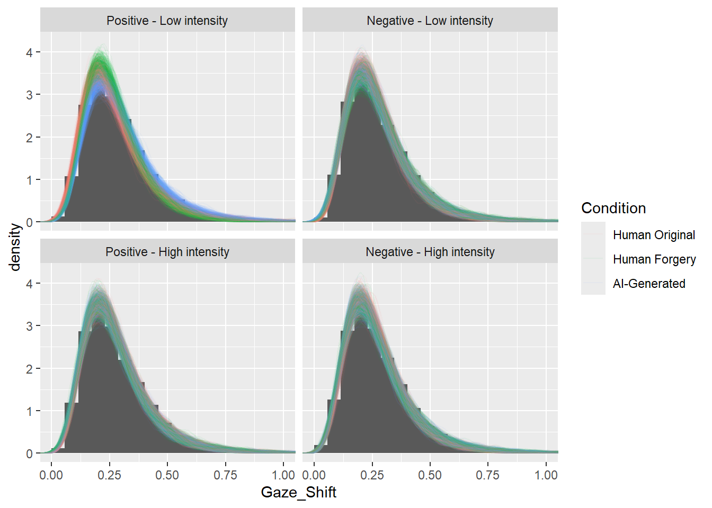{#fig-shift fig-alt='Gaze maximal shift (largest within-trial relocation of the gaze centroid, in stimulus widths, truncated at 1): observed distribution with posterior-predictive densities per label condition (500 draws), one panel per stimulus emotion quadrant.' width=672}
:::
:::


:::


## Phase 2

::: {.panel-tabset}

### Syntheticness


::: {.cell}

```{.r .cell-code}
make_report(estimates$Reality)
```

::: {.cell-output-display}

```{=html}
<div id="odldqvqnum" style="padding-left:0px;padding-right:0px;padding-top:10px;padding-bottom:10px;overflow-x:auto;overflow-y:auto;width:auto;height:auto;">
<style>#odldqvqnum table {
  font-family: system-ui, 'Segoe UI', Roboto, Helvetica, Arial, sans-serif, 'Apple Color Emoji', 'Segoe UI Emoji', 'Segoe UI Symbol', 'Noto Color Emoji';
  -webkit-font-smoothing: antialiased;
  -moz-osx-font-smoothing: grayscale;
}

#odldqvqnum thead, #odldqvqnum tbody, #odldqvqnum tfoot, #odldqvqnum tr, #odldqvqnum td, #odldqvqnum th {
  border-style: none;
}

#odldqvqnum p {
  margin: 0;
  padding: 0;
}

#odldqvqnum .gt_table {
  display: table;
  border-collapse: collapse;
  line-height: normal;
  margin-left: auto;
  margin-right: auto;
  color: #333333;
  font-size: 16px;
  font-weight: normal;
  font-style: normal;
  background-color: #FFFFFF;
  width: auto;
  border-top-style: solid;
  border-top-width: 2px;
  border-top-color: #A8A8A8;
  border-right-style: none;
  border-right-width: 2px;
  border-right-color: #D3D3D3;
  border-bottom-style: solid;
  border-bottom-width: 2px;
  border-bottom-color: #A8A8A8;
  border-left-style: none;
  border-left-width: 2px;
  border-left-color: #D3D3D3;
}

#odldqvqnum .gt_caption {
  padding-top: 4px;
  padding-bottom: 4px;
}

#odldqvqnum .gt_title {
  color: #333333;
  font-size: 125%;
  font-weight: initial;
  padding-top: 4px;
  padding-bottom: 4px;
  padding-left: 5px;
  padding-right: 5px;
  border-bottom-color: #FFFFFF;
  border-bottom-width: 0;
}

#odldqvqnum .gt_subtitle {
  color: #333333;
  font-size: 85%;
  font-weight: initial;
  padding-top: 3px;
  padding-bottom: 5px;
  padding-left: 5px;
  padding-right: 5px;
  border-top-color: #FFFFFF;
  border-top-width: 0;
}

#odldqvqnum .gt_heading {
  background-color: #FFFFFF;
  text-align: center;
  border-bottom-color: #FFFFFF;
  border-left-style: none;
  border-left-width: 1px;
  border-left-color: #D3D3D3;
  border-right-style: none;
  border-right-width: 1px;
  border-right-color: #D3D3D3;
}

#odldqvqnum .gt_bottom_border {
  border-bottom-style: solid;
  border-bottom-width: 2px;
  border-bottom-color: #D3D3D3;
}

#odldqvqnum .gt_col_headings {
  border-top-style: solid;
  border-top-width: 2px;
  border-top-color: #D3D3D3;
  border-bottom-style: solid;
  border-bottom-width: 2px;
  border-bottom-color: #D3D3D3;
  border-left-style: none;
  border-left-width: 1px;
  border-left-color: #D3D3D3;
  border-right-style: none;
  border-right-width: 1px;
  border-right-color: #D3D3D3;
}

#odldqvqnum .gt_col_heading {
  color: #333333;
  background-color: #FFFFFF;
  font-size: 100%;
  font-weight: normal;
  text-transform: inherit;
  border-left-style: none;
  border-left-width: 1px;
  border-left-color: #D3D3D3;
  border-right-style: none;
  border-right-width: 1px;
  border-right-color: #D3D3D3;
  vertical-align: bottom;
  padding-top: 5px;
  padding-bottom: 6px;
  padding-left: 5px;
  padding-right: 5px;
  overflow-x: hidden;
}

#odldqvqnum .gt_column_spanner_outer {
  color: #333333;
  background-color: #FFFFFF;
  font-size: 100%;
  font-weight: normal;
  text-transform: inherit;
  padding-top: 0;
  padding-bottom: 0;
  padding-left: 4px;
  padding-right: 4px;
}

#odldqvqnum .gt_column_spanner_outer:first-child {
  padding-left: 0;
}

#odldqvqnum .gt_column_spanner_outer:last-child {
  padding-right: 0;
}

#odldqvqnum .gt_column_spanner {
  border-bottom-style: solid;
  border-bottom-width: 2px;
  border-bottom-color: #D3D3D3;
  vertical-align: bottom;
  padding-top: 5px;
  padding-bottom: 5px;
  overflow-x: hidden;
  display: inline-block;
  width: 100%;
}

#odldqvqnum .gt_spanner_row {
  border-bottom-style: hidden;
}

#odldqvqnum .gt_group_heading {
  padding-top: 8px;
  padding-bottom: 8px;
  padding-left: 5px;
  padding-right: 5px;
  color: #333333;
  background-color: #FFFFFF;
  font-size: 100%;
  font-weight: initial;
  text-transform: inherit;
  border-top-style: solid;
  border-top-width: 2px;
  border-top-color: #D3D3D3;
  border-bottom-style: solid;
  border-bottom-width: 2px;
  border-bottom-color: #D3D3D3;
  border-left-style: none;
  border-left-width: 1px;
  border-left-color: #D3D3D3;
  border-right-style: none;
  border-right-width: 1px;
  border-right-color: #D3D3D3;
  vertical-align: middle;
  text-align: left;
}

#odldqvqnum .gt_empty_group_heading {
  padding: 0.5px;
  color: #333333;
  background-color: #FFFFFF;
  font-size: 100%;
  font-weight: initial;
  border-top-style: solid;
  border-top-width: 2px;
  border-top-color: #D3D3D3;
  border-bottom-style: solid;
  border-bottom-width: 2px;
  border-bottom-color: #D3D3D3;
  vertical-align: middle;
}

#odldqvqnum .gt_from_md > :first-child {
  margin-top: 0;
}

#odldqvqnum .gt_from_md > :last-child {
  margin-bottom: 0;
}

#odldqvqnum .gt_row {
  padding-top: 8px;
  padding-bottom: 8px;
  padding-left: 5px;
  padding-right: 5px;
  margin: 10px;
  border-top-style: solid;
  border-top-width: 1px;
  border-top-color: #D3D3D3;
  border-left-style: none;
  border-left-width: 1px;
  border-left-color: #D3D3D3;
  border-right-style: none;
  border-right-width: 1px;
  border-right-color: #D3D3D3;
  vertical-align: middle;
  overflow-x: hidden;
}

#odldqvqnum .gt_stub {
  color: #333333;
  background-color: #FFFFFF;
  font-size: 100%;
  font-weight: initial;
  text-transform: inherit;
  border-right-style: solid;
  border-right-width: 2px;
  border-right-color: #D3D3D3;
  padding-left: 5px;
  padding-right: 5px;
}

#odldqvqnum .gt_stub_row_group {
  color: #333333;
  background-color: #FFFFFF;
  font-size: 100%;
  font-weight: initial;
  text-transform: inherit;
  border-right-style: solid;
  border-right-width: 2px;
  border-right-color: #D3D3D3;
  padding-left: 5px;
  padding-right: 5px;
  vertical-align: top;
}

#odldqvqnum .gt_row_group_first td {
  border-top-width: 2px;
}

#odldqvqnum .gt_row_group_first th {
  border-top-width: 2px;
}

#odldqvqnum .gt_summary_row {
  color: #333333;
  background-color: #FFFFFF;
  text-transform: inherit;
  padding-top: 8px;
  padding-bottom: 8px;
  padding-left: 5px;
  padding-right: 5px;
}

#odldqvqnum .gt_first_summary_row {
  border-top-style: solid;
  border-top-color: #D3D3D3;
}

#odldqvqnum .gt_first_summary_row.thick {
  border-top-width: 2px;
}

#odldqvqnum .gt_last_summary_row {
  padding-top: 8px;
  padding-bottom: 8px;
  padding-left: 5px;
  padding-right: 5px;
  border-bottom-style: solid;
  border-bottom-width: 2px;
  border-bottom-color: #D3D3D3;
}

#odldqvqnum .gt_grand_summary_row {
  color: #333333;
  background-color: #FFFFFF;
  text-transform: inherit;
  padding-top: 8px;
  padding-bottom: 8px;
  padding-left: 5px;
  padding-right: 5px;
}

#odldqvqnum .gt_first_grand_summary_row {
  padding-top: 8px;
  padding-bottom: 8px;
  padding-left: 5px;
  padding-right: 5px;
  border-top-style: double;
  border-top-width: 6px;
  border-top-color: #D3D3D3;
}

#odldqvqnum .gt_last_grand_summary_row_top {
  padding-top: 8px;
  padding-bottom: 8px;
  padding-left: 5px;
  padding-right: 5px;
  border-bottom-style: double;
  border-bottom-width: 6px;
  border-bottom-color: #D3D3D3;
}

#odldqvqnum .gt_striped {
  background-color: rgba(128, 128, 128, 0.05);
}

#odldqvqnum .gt_table_body {
  border-top-style: solid;
  border-top-width: 2px;
  border-top-color: #D3D3D3;
  border-bottom-style: solid;
  border-bottom-width: 2px;
  border-bottom-color: #D3D3D3;
}

#odldqvqnum .gt_footnotes {
  color: #333333;
  background-color: #FFFFFF;
  border-bottom-style: none;
  border-bottom-width: 2px;
  border-bottom-color: #D3D3D3;
  border-left-style: none;
  border-left-width: 2px;
  border-left-color: #D3D3D3;
  border-right-style: none;
  border-right-width: 2px;
  border-right-color: #D3D3D3;
}

#odldqvqnum .gt_footnote {
  margin: 0px;
  font-size: 90%;
  padding-top: 4px;
  padding-bottom: 4px;
  padding-left: 5px;
  padding-right: 5px;
}

#odldqvqnum .gt_sourcenotes {
  color: #333333;
  background-color: #FFFFFF;
  border-bottom-style: none;
  border-bottom-width: 2px;
  border-bottom-color: #D3D3D3;
  border-left-style: none;
  border-left-width: 2px;
  border-left-color: #D3D3D3;
  border-right-style: none;
  border-right-width: 2px;
  border-right-color: #D3D3D3;
}

#odldqvqnum .gt_sourcenote {
  font-size: 90%;
  padding-top: 4px;
  padding-bottom: 4px;
  padding-left: 5px;
  padding-right: 5px;
}

#odldqvqnum .gt_left {
  text-align: left;
}

#odldqvqnum .gt_center {
  text-align: center;
}

#odldqvqnum .gt_right {
  text-align: right;
  font-variant-numeric: tabular-nums;
}

#odldqvqnum .gt_font_normal {
  font-weight: normal;
}

#odldqvqnum .gt_font_bold {
  font-weight: bold;
}

#odldqvqnum .gt_font_italic {
  font-style: italic;
}

#odldqvqnum .gt_super {
  font-size: 65%;
}

#odldqvqnum .gt_footnote_marks {
  font-size: 75%;
  vertical-align: 0.4em;
  position: initial;
}

#odldqvqnum .gt_asterisk {
  font-size: 100%;
  vertical-align: 0;
}

#odldqvqnum .gt_indent_1 {
  text-indent: 5px;
}

#odldqvqnum .gt_indent_2 {
  text-indent: 10px;
}

#odldqvqnum .gt_indent_3 {
  text-indent: 15px;
}

#odldqvqnum .gt_indent_4 {
  text-indent: 20px;
}

#odldqvqnum .gt_indent_5 {
  text-indent: 25px;
}

#odldqvqnum .katex-display {
  display: inline-flex !important;
  margin-bottom: 0.75em !important;
}

#odldqvqnum div.Reactable > div.rt-table > div.rt-thead > div.rt-tr.rt-tr-group-header > div.rt-th-group:after {
  height: 0px !important;
}
</style>
<table class="gt_table" data-quarto-disable-processing="false" data-quarto-bootstrap="false">
  <thead>
    <tr class="gt_col_headings">
      <th class="gt_col_heading gt_columns_bottom_border gt_left" rowspan="1" colspan="1" scope="col" id="Contrast">Contrast</th>
      <th class="gt_col_heading gt_columns_bottom_border gt_left" rowspan="1" colspan="1" scope="col" id="Parameters">Parameters</th>
    </tr>
  </thead>
  <tbody class="gt_table_body">
    <tr><td headers="Contrast" class="gt_row gt_left">Human Forgery - Human Original</td>
<td headers="Parameters" class="gt_row gt_left">response (-0.01, [-0.03,  0.00])</td></tr>
    <tr><td headers="Contrast" class="gt_row gt_left">AI-Generated - Human Original</td>
<td headers="Parameters" class="gt_row gt_left">response (-0.06, [-0.07, -0.04]); mu (-0.08, [-0.10, -0.06]); confright (-0.03, [-0.04, -0.01]); pex (0.00, [ 0.00,  0.01])</td></tr>
    <tr><td headers="Contrast" class="gt_row gt_left">AI-Generated - Human Forgery</td>
<td headers="Parameters" class="gt_row gt_left">response (-0.04, [-0.06, -0.03]); mu (-0.06, [-0.08, -0.03]); confright (-0.02, [-0.03, -0.01])</td></tr>
  </tbody>
  
</table>
</div>
```

```{=html}
<div id="wjllcgbdyy" style="padding-left:0px;padding-right:0px;padding-top:10px;padding-bottom:10px;overflow-x:auto;overflow-y:auto;width:auto;height:auto;">
<style>#wjllcgbdyy table {
  font-family: system-ui, 'Segoe UI', Roboto, Helvetica, Arial, sans-serif, 'Apple Color Emoji', 'Segoe UI Emoji', 'Segoe UI Symbol', 'Noto Color Emoji';
  -webkit-font-smoothing: antialiased;
  -moz-osx-font-smoothing: grayscale;
}

#wjllcgbdyy thead, #wjllcgbdyy tbody, #wjllcgbdyy tfoot, #wjllcgbdyy tr, #wjllcgbdyy td, #wjllcgbdyy th {
  border-style: none;
}

#wjllcgbdyy p {
  margin: 0;
  padding: 0;
}

#wjllcgbdyy .gt_table {
  display: table;
  border-collapse: collapse;
  line-height: normal;
  margin-left: auto;
  margin-right: auto;
  color: #333333;
  font-size: 16px;
  font-weight: normal;
  font-style: normal;
  background-color: #FFFFFF;
  width: auto;
  border-top-style: solid;
  border-top-width: 2px;
  border-top-color: #A8A8A8;
  border-right-style: none;
  border-right-width: 2px;
  border-right-color: #D3D3D3;
  border-bottom-style: solid;
  border-bottom-width: 2px;
  border-bottom-color: #A8A8A8;
  border-left-style: none;
  border-left-width: 2px;
  border-left-color: #D3D3D3;
}

#wjllcgbdyy .gt_caption {
  padding-top: 4px;
  padding-bottom: 4px;
}

#wjllcgbdyy .gt_title {
  color: #333333;
  font-size: 125%;
  font-weight: initial;
  padding-top: 4px;
  padding-bottom: 4px;
  padding-left: 5px;
  padding-right: 5px;
  border-bottom-color: #FFFFFF;
  border-bottom-width: 0;
}

#wjllcgbdyy .gt_subtitle {
  color: #333333;
  font-size: 85%;
  font-weight: initial;
  padding-top: 3px;
  padding-bottom: 5px;
  padding-left: 5px;
  padding-right: 5px;
  border-top-color: #FFFFFF;
  border-top-width: 0;
}

#wjllcgbdyy .gt_heading {
  background-color: #FFFFFF;
  text-align: center;
  border-bottom-color: #FFFFFF;
  border-left-style: none;
  border-left-width: 1px;
  border-left-color: #D3D3D3;
  border-right-style: none;
  border-right-width: 1px;
  border-right-color: #D3D3D3;
}

#wjllcgbdyy .gt_bottom_border {
  border-bottom-style: solid;
  border-bottom-width: 2px;
  border-bottom-color: #D3D3D3;
}

#wjllcgbdyy .gt_col_headings {
  border-top-style: solid;
  border-top-width: 2px;
  border-top-color: #D3D3D3;
  border-bottom-style: solid;
  border-bottom-width: 2px;
  border-bottom-color: #D3D3D3;
  border-left-style: none;
  border-left-width: 1px;
  border-left-color: #D3D3D3;
  border-right-style: none;
  border-right-width: 1px;
  border-right-color: #D3D3D3;
}

#wjllcgbdyy .gt_col_heading {
  color: #333333;
  background-color: #FFFFFF;
  font-size: 100%;
  font-weight: normal;
  text-transform: inherit;
  border-left-style: none;
  border-left-width: 1px;
  border-left-color: #D3D3D3;
  border-right-style: none;
  border-right-width: 1px;
  border-right-color: #D3D3D3;
  vertical-align: bottom;
  padding-top: 5px;
  padding-bottom: 6px;
  padding-left: 5px;
  padding-right: 5px;
  overflow-x: hidden;
}

#wjllcgbdyy .gt_column_spanner_outer {
  color: #333333;
  background-color: #FFFFFF;
  font-size: 100%;
  font-weight: normal;
  text-transform: inherit;
  padding-top: 0;
  padding-bottom: 0;
  padding-left: 4px;
  padding-right: 4px;
}

#wjllcgbdyy .gt_column_spanner_outer:first-child {
  padding-left: 0;
}

#wjllcgbdyy .gt_column_spanner_outer:last-child {
  padding-right: 0;
}

#wjllcgbdyy .gt_column_spanner {
  border-bottom-style: solid;
  border-bottom-width: 2px;
  border-bottom-color: #D3D3D3;
  vertical-align: bottom;
  padding-top: 5px;
  padding-bottom: 5px;
  overflow-x: hidden;
  display: inline-block;
  width: 100%;
}

#wjllcgbdyy .gt_spanner_row {
  border-bottom-style: hidden;
}

#wjllcgbdyy .gt_group_heading {
  padding-top: 8px;
  padding-bottom: 8px;
  padding-left: 5px;
  padding-right: 5px;
  color: #333333;
  background-color: #FFFFFF;
  font-size: 100%;
  font-weight: initial;
  text-transform: inherit;
  border-top-style: solid;
  border-top-width: 2px;
  border-top-color: #D3D3D3;
  border-bottom-style: solid;
  border-bottom-width: 2px;
  border-bottom-color: #D3D3D3;
  border-left-style: none;
  border-left-width: 1px;
  border-left-color: #D3D3D3;
  border-right-style: none;
  border-right-width: 1px;
  border-right-color: #D3D3D3;
  vertical-align: middle;
  text-align: left;
}

#wjllcgbdyy .gt_empty_group_heading {
  padding: 0.5px;
  color: #333333;
  background-color: #FFFFFF;
  font-size: 100%;
  font-weight: initial;
  border-top-style: solid;
  border-top-width: 2px;
  border-top-color: #D3D3D3;
  border-bottom-style: solid;
  border-bottom-width: 2px;
  border-bottom-color: #D3D3D3;
  vertical-align: middle;
}

#wjllcgbdyy .gt_from_md > :first-child {
  margin-top: 0;
}

#wjllcgbdyy .gt_from_md > :last-child {
  margin-bottom: 0;
}

#wjllcgbdyy .gt_row {
  padding-top: 8px;
  padding-bottom: 8px;
  padding-left: 5px;
  padding-right: 5px;
  margin: 10px;
  border-top-style: solid;
  border-top-width: 1px;
  border-top-color: #D3D3D3;
  border-left-style: none;
  border-left-width: 1px;
  border-left-color: #D3D3D3;
  border-right-style: none;
  border-right-width: 1px;
  border-right-color: #D3D3D3;
  vertical-align: middle;
  overflow-x: hidden;
}

#wjllcgbdyy .gt_stub {
  color: #333333;
  background-color: #FFFFFF;
  font-size: 100%;
  font-weight: initial;
  text-transform: inherit;
  border-right-style: solid;
  border-right-width: 2px;
  border-right-color: #D3D3D3;
  padding-left: 5px;
  padding-right: 5px;
}

#wjllcgbdyy .gt_stub_row_group {
  color: #333333;
  background-color: #FFFFFF;
  font-size: 100%;
  font-weight: initial;
  text-transform: inherit;
  border-right-style: solid;
  border-right-width: 2px;
  border-right-color: #D3D3D3;
  padding-left: 5px;
  padding-right: 5px;
  vertical-align: top;
}

#wjllcgbdyy .gt_row_group_first td {
  border-top-width: 2px;
}

#wjllcgbdyy .gt_row_group_first th {
  border-top-width: 2px;
}

#wjllcgbdyy .gt_summary_row {
  color: #333333;
  background-color: #FFFFFF;
  text-transform: inherit;
  padding-top: 8px;
  padding-bottom: 8px;
  padding-left: 5px;
  padding-right: 5px;
}

#wjllcgbdyy .gt_first_summary_row {
  border-top-style: solid;
  border-top-color: #D3D3D3;
}

#wjllcgbdyy .gt_first_summary_row.thick {
  border-top-width: 2px;
}

#wjllcgbdyy .gt_last_summary_row {
  padding-top: 8px;
  padding-bottom: 8px;
  padding-left: 5px;
  padding-right: 5px;
  border-bottom-style: solid;
  border-bottom-width: 2px;
  border-bottom-color: #D3D3D3;
}

#wjllcgbdyy .gt_grand_summary_row {
  color: #333333;
  background-color: #FFFFFF;
  text-transform: inherit;
  padding-top: 8px;
  padding-bottom: 8px;
  padding-left: 5px;
  padding-right: 5px;
}

#wjllcgbdyy .gt_first_grand_summary_row {
  padding-top: 8px;
  padding-bottom: 8px;
  padding-left: 5px;
  padding-right: 5px;
  border-top-style: double;
  border-top-width: 6px;
  border-top-color: #D3D3D3;
}

#wjllcgbdyy .gt_last_grand_summary_row_top {
  padding-top: 8px;
  padding-bottom: 8px;
  padding-left: 5px;
  padding-right: 5px;
  border-bottom-style: double;
  border-bottom-width: 6px;
  border-bottom-color: #D3D3D3;
}

#wjllcgbdyy .gt_striped {
  background-color: rgba(128, 128, 128, 0.05);
}

#wjllcgbdyy .gt_table_body {
  border-top-style: solid;
  border-top-width: 2px;
  border-top-color: #D3D3D3;
  border-bottom-style: solid;
  border-bottom-width: 2px;
  border-bottom-color: #D3D3D3;
}

#wjllcgbdyy .gt_footnotes {
  color: #333333;
  background-color: #FFFFFF;
  border-bottom-style: none;
  border-bottom-width: 2px;
  border-bottom-color: #D3D3D3;
  border-left-style: none;
  border-left-width: 2px;
  border-left-color: #D3D3D3;
  border-right-style: none;
  border-right-width: 2px;
  border-right-color: #D3D3D3;
}

#wjllcgbdyy .gt_footnote {
  margin: 0px;
  font-size: 90%;
  padding-top: 4px;
  padding-bottom: 4px;
  padding-left: 5px;
  padding-right: 5px;
}

#wjllcgbdyy .gt_sourcenotes {
  color: #333333;
  background-color: #FFFFFF;
  border-bottom-style: none;
  border-bottom-width: 2px;
  border-bottom-color: #D3D3D3;
  border-left-style: none;
  border-left-width: 2px;
  border-left-color: #D3D3D3;
  border-right-style: none;
  border-right-width: 2px;
  border-right-color: #D3D3D3;
}

#wjllcgbdyy .gt_sourcenote {
  font-size: 90%;
  padding-top: 4px;
  padding-bottom: 4px;
  padding-left: 5px;
  padding-right: 5px;
}

#wjllcgbdyy .gt_left {
  text-align: left;
}

#wjllcgbdyy .gt_center {
  text-align: center;
}

#wjllcgbdyy .gt_right {
  text-align: right;
  font-variant-numeric: tabular-nums;
}

#wjllcgbdyy .gt_font_normal {
  font-weight: normal;
}

#wjllcgbdyy .gt_font_bold {
  font-weight: bold;
}

#wjllcgbdyy .gt_font_italic {
  font-style: italic;
}

#wjllcgbdyy .gt_super {
  font-size: 65%;
}

#wjllcgbdyy .gt_footnote_marks {
  font-size: 75%;
  vertical-align: 0.4em;
  position: initial;
}

#wjllcgbdyy .gt_asterisk {
  font-size: 100%;
  vertical-align: 0;
}

#wjllcgbdyy .gt_indent_1 {
  text-indent: 5px;
}

#wjllcgbdyy .gt_indent_2 {
  text-indent: 10px;
}

#wjllcgbdyy .gt_indent_3 {
  text-indent: 15px;
}

#wjllcgbdyy .gt_indent_4 {
  text-indent: 20px;
}

#wjllcgbdyy .gt_indent_5 {
  text-indent: 25px;
}

#wjllcgbdyy .katex-display {
  display: inline-flex !important;
  margin-bottom: 0.75em !important;
}

#wjllcgbdyy div.Reactable > div.rt-table > div.rt-thead > div.rt-tr.rt-tr-group-header > div.rt-th-group:after {
  height: 0px !important;
}
</style>
<table class="gt_table" data-quarto-disable-processing="false" data-quarto-bootstrap="false">
  <thead>
    <tr class="gt_col_headings">
      <th class="gt_col_heading gt_columns_bottom_border gt_left" rowspan="1" colspan="1" scope="col" id="Contrast">Contrast</th>
      <th class="gt_col_heading gt_columns_bottom_border gt_left" rowspan="1" colspan="1" scope="col" id="Parameters">Parameters</th>
    </tr>
  </thead>
  <tbody class="gt_table_body">
    <tr><td headers="Contrast" class="gt_row gt_left">Negative - High intensity - Positive - Low intensity</td>
<td headers="Parameters" class="gt_row gt_left">response (-0.13, [-0.22, -0.05]); mu (-0.20, [-0.34, -0.06]); confleft (0.05, [ 0.02,  0.07])</td></tr>
    <tr><td headers="Contrast" class="gt_row gt_left">Negative - High intensity - Negative - Low intensity</td>
<td headers="Parameters" class="gt_row gt_left">response (-0.10, [-0.19, -0.02]); mu (-0.17, [-0.32, -0.02]); confleft (0.03, [ 0.00,  0.06])</td></tr>
    <tr><td headers="Contrast" class="gt_row gt_left">Negative - High intensity - Positive - High intensity</td>
<td headers="Parameters" class="gt_row gt_left">response (-0.10, [-0.18, -0.01]); mu (-0.15, [-0.29, -0.01])</td></tr>
    <tr><td headers="Contrast" class="gt_row gt_left">Positive - High intensity - Positive - Low intensity</td>
<td headers="Parameters" class="gt_row gt_left">confleft (0.03, [ 0.00,  0.06])</td></tr>
  </tbody>
  
</table>
</div>
```

```{=html}
<div id="qhjuiwnsht" style="padding-left:0px;padding-right:0px;padding-top:10px;padding-bottom:10px;overflow-x:auto;overflow-y:auto;width:auto;height:auto;">
<style>#qhjuiwnsht table {
  font-family: system-ui, 'Segoe UI', Roboto, Helvetica, Arial, sans-serif, 'Apple Color Emoji', 'Segoe UI Emoji', 'Segoe UI Symbol', 'Noto Color Emoji';
  -webkit-font-smoothing: antialiased;
  -moz-osx-font-smoothing: grayscale;
}

#qhjuiwnsht thead, #qhjuiwnsht tbody, #qhjuiwnsht tfoot, #qhjuiwnsht tr, #qhjuiwnsht td, #qhjuiwnsht th {
  border-style: none;
}

#qhjuiwnsht p {
  margin: 0;
  padding: 0;
}

#qhjuiwnsht .gt_table {
  display: table;
  border-collapse: collapse;
  line-height: normal;
  margin-left: auto;
  margin-right: auto;
  color: #333333;
  font-size: 13px;
  font-weight: normal;
  font-style: normal;
  background-color: #FFFFFF;
  width: auto;
  border-top-style: solid;
  border-top-width: 3px;
  border-top-color: #D5D5D5;
  border-right-style: solid;
  border-right-width: 3px;
  border-right-color: #D5D5D5;
  border-bottom-style: solid;
  border-bottom-width: 3px;
  border-bottom-color: #D5D5D5;
  border-left-style: solid;
  border-left-width: 3px;
  border-left-color: #D5D5D5;
}

#qhjuiwnsht .gt_caption {
  padding-top: 4px;
  padding-bottom: 4px;
}

#qhjuiwnsht .gt_title {
  color: #333333;
  font-size: 125%;
  font-weight: initial;
  padding-top: 4px;
  padding-bottom: 4px;
  padding-left: 5px;
  padding-right: 5px;
  border-bottom-color: #FFFFFF;
  border-bottom-width: 0;
}

#qhjuiwnsht .gt_subtitle {
  color: #333333;
  font-size: 85%;
  font-weight: initial;
  padding-top: 3px;
  padding-bottom: 5px;
  padding-left: 5px;
  padding-right: 5px;
  border-top-color: #FFFFFF;
  border-top-width: 0;
}

#qhjuiwnsht .gt_heading {
  background-color: #FFFFFF;
  text-align: left;
  border-bottom-color: #FFFFFF;
  border-left-style: none;
  border-left-width: 1px;
  border-left-color: #D3D3D3;
  border-right-style: none;
  border-right-width: 1px;
  border-right-color: #D3D3D3;
}

#qhjuiwnsht .gt_bottom_border {
  border-bottom-style: solid;
  border-bottom-width: 2px;
  border-bottom-color: #D5D5D5;
}

#qhjuiwnsht .gt_col_headings {
  border-top-style: solid;
  border-top-width: 2px;
  border-top-color: #D5D5D5;
  border-bottom-style: solid;
  border-bottom-width: 2px;
  border-bottom-color: #D5D5D5;
  border-left-style: none;
  border-left-width: 1px;
  border-left-color: #D3D3D3;
  border-right-style: none;
  border-right-width: 1px;
  border-right-color: #D3D3D3;
}

#qhjuiwnsht .gt_col_heading {
  color: #FFFFFF;
  background-color: #000000;
  font-size: 100%;
  font-weight: normal;
  text-transform: inherit;
  border-left-style: none;
  border-left-width: 1px;
  border-left-color: #D3D3D3;
  border-right-style: none;
  border-right-width: 1px;
  border-right-color: #D3D3D3;
  vertical-align: bottom;
  padding-top: 5px;
  padding-bottom: 6px;
  padding-left: 5px;
  padding-right: 5px;
  overflow-x: hidden;
}

#qhjuiwnsht .gt_column_spanner_outer {
  color: #FFFFFF;
  background-color: #000000;
  font-size: 100%;
  font-weight: normal;
  text-transform: inherit;
  padding-top: 0;
  padding-bottom: 0;
  padding-left: 4px;
  padding-right: 4px;
}

#qhjuiwnsht .gt_column_spanner_outer:first-child {
  padding-left: 0;
}

#qhjuiwnsht .gt_column_spanner_outer:last-child {
  padding-right: 0;
}

#qhjuiwnsht .gt_column_spanner {
  border-bottom-style: solid;
  border-bottom-width: 2px;
  border-bottom-color: #D5D5D5;
  vertical-align: bottom;
  padding-top: 5px;
  padding-bottom: 5px;
  overflow-x: hidden;
  display: inline-block;
  width: 100%;
}

#qhjuiwnsht .gt_spanner_row {
  border-bottom-style: hidden;
}

#qhjuiwnsht .gt_group_heading {
  padding-top: 8px;
  padding-bottom: 8px;
  padding-left: 5px;
  padding-right: 5px;
  color: #333333;
  background-color: #FFFFFF;
  font-size: 100%;
  font-weight: initial;
  text-transform: inherit;
  border-top-style: solid;
  border-top-width: 2px;
  border-top-color: #D5D5D5;
  border-bottom-style: solid;
  border-bottom-width: 2px;
  border-bottom-color: #D5D5D5;
  border-left-style: none;
  border-left-width: 1px;
  border-left-color: #D3D3D3;
  border-right-style: none;
  border-right-width: 1px;
  border-right-color: #D3D3D3;
  vertical-align: middle;
  text-align: left;
}

#qhjuiwnsht .gt_empty_group_heading {
  padding: 0.5px;
  color: #333333;
  background-color: #FFFFFF;
  font-size: 100%;
  font-weight: initial;
  border-top-style: solid;
  border-top-width: 2px;
  border-top-color: #D5D5D5;
  border-bottom-style: solid;
  border-bottom-width: 2px;
  border-bottom-color: #D5D5D5;
  vertical-align: middle;
}

#qhjuiwnsht .gt_from_md > :first-child {
  margin-top: 0;
}

#qhjuiwnsht .gt_from_md > :last-child {
  margin-bottom: 0;
}

#qhjuiwnsht .gt_row {
  padding-top: 8px;
  padding-bottom: 8px;
  padding-left: 5px;
  padding-right: 5px;
  margin: 10px;
  border-top-style: solid;
  border-top-width: 1px;
  border-top-color: #D5D5D5;
  border-left-style: solid;
  border-left-width: 1px;
  border-left-color: #D5D5D5;
  border-right-style: solid;
  border-right-width: 1px;
  border-right-color: #D5D5D5;
  vertical-align: middle;
  overflow-x: hidden;
}

#qhjuiwnsht .gt_stub {
  color: #333333;
  background-color: #FFFFFF;
  font-size: 100%;
  font-weight: initial;
  text-transform: inherit;
  border-right-style: solid;
  border-right-width: 2px;
  border-right-color: #5F5F5F;
  padding-left: 5px;
  padding-right: 5px;
}

#qhjuiwnsht .gt_stub_row_group {
  color: #333333;
  background-color: #FFFFFF;
  font-size: 100%;
  font-weight: initial;
  text-transform: inherit;
  border-right-style: solid;
  border-right-width: 2px;
  border-right-color: #D3D3D3;
  padding-left: 5px;
  padding-right: 5px;
  vertical-align: top;
}

#qhjuiwnsht .gt_row_group_first td {
  border-top-width: 2px;
}

#qhjuiwnsht .gt_row_group_first th {
  border-top-width: 2px;
}

#qhjuiwnsht .gt_summary_row {
  color: #333333;
  background-color: #D5D5D5;
  text-transform: inherit;
  padding-top: 8px;
  padding-bottom: 8px;
  padding-left: 5px;
  padding-right: 5px;
}

#qhjuiwnsht .gt_first_summary_row {
  border-top-style: solid;
  border-top-color: #D5D5D5;
}

#qhjuiwnsht .gt_first_summary_row.thick {
  border-top-width: 2px;
}

#qhjuiwnsht .gt_last_summary_row {
  padding-top: 8px;
  padding-bottom: 8px;
  padding-left: 5px;
  padding-right: 5px;
  border-bottom-style: solid;
  border-bottom-width: 2px;
  border-bottom-color: #D5D5D5;
}

#qhjuiwnsht .gt_grand_summary_row {
  color: #FFFFFF;
  background-color: #929292;
  text-transform: inherit;
  padding-top: 8px;
  padding-bottom: 8px;
  padding-left: 5px;
  padding-right: 5px;
}

#qhjuiwnsht .gt_first_grand_summary_row {
  padding-top: 8px;
  padding-bottom: 8px;
  padding-left: 5px;
  padding-right: 5px;
  border-top-style: double;
  border-top-width: 6px;
  border-top-color: #D5D5D5;
}

#qhjuiwnsht .gt_last_grand_summary_row_top {
  padding-top: 8px;
  padding-bottom: 8px;
  padding-left: 5px;
  padding-right: 5px;
  border-bottom-style: double;
  border-bottom-width: 6px;
  border-bottom-color: #D5D5D5;
}

#qhjuiwnsht .gt_striped {
  background-color: #F4F4F4;
}

#qhjuiwnsht .gt_table_body {
  border-top-style: solid;
  border-top-width: 2px;
  border-top-color: #D5D5D5;
  border-bottom-style: solid;
  border-bottom-width: 2px;
  border-bottom-color: #D5D5D5;
}

#qhjuiwnsht .gt_footnotes {
  color: #333333;
  background-color: #FFFFFF;
  border-bottom-style: none;
  border-bottom-width: 2px;
  border-bottom-color: #D3D3D3;
  border-left-style: none;
  border-left-width: 2px;
  border-left-color: #D3D3D3;
  border-right-style: none;
  border-right-width: 2px;
  border-right-color: #D3D3D3;
}

#qhjuiwnsht .gt_footnote {
  margin: 0px;
  font-size: 90%;
  padding-top: 4px;
  padding-bottom: 4px;
  padding-left: 5px;
  padding-right: 5px;
}

#qhjuiwnsht .gt_sourcenotes {
  color: #333333;
  background-color: #FFFFFF;
  border-bottom-style: none;
  border-bottom-width: 2px;
  border-bottom-color: #D3D3D3;
  border-left-style: none;
  border-left-width: 2px;
  border-left-color: #D3D3D3;
  border-right-style: none;
  border-right-width: 2px;
  border-right-color: #D3D3D3;
}

#qhjuiwnsht .gt_sourcenote {
  font-size: 90%;
  padding-top: 4px;
  padding-bottom: 4px;
  padding-left: 5px;
  padding-right: 5px;
}

#qhjuiwnsht .gt_left {
  text-align: left;
}

#qhjuiwnsht .gt_center {
  text-align: center;
}

#qhjuiwnsht .gt_right {
  text-align: right;
  font-variant-numeric: tabular-nums;
}

#qhjuiwnsht .gt_font_normal {
  font-weight: normal;
}

#qhjuiwnsht .gt_font_bold {
  font-weight: bold;
}

#qhjuiwnsht .gt_font_italic {
  font-style: italic;
}

#qhjuiwnsht .gt_super {
  font-size: 65%;
}

#qhjuiwnsht .gt_footnote_marks {
  font-size: 75%;
  vertical-align: 0.4em;
  position: initial;
}

#qhjuiwnsht .gt_asterisk {
  font-size: 100%;
  vertical-align: 0;
}

#qhjuiwnsht .gt_indent_1 {
  text-indent: 5px;
}

#qhjuiwnsht .gt_indent_2 {
  text-indent: 10px;
}

#qhjuiwnsht .gt_indent_3 {
  text-indent: 15px;
}

#qhjuiwnsht .gt_indent_4 {
  text-indent: 20px;
}

#qhjuiwnsht .gt_indent_5 {
  text-indent: 25px;
}

#qhjuiwnsht .katex-display {
  display: inline-flex !important;
  margin-bottom: 0.75em !important;
}

#qhjuiwnsht div.Reactable > div.rt-table > div.rt-thead > div.rt-tr.rt-tr-group-header > div.rt-th-group:after {
  height: 0px !important;
}
</style>
<table class="gt_table" data-quarto-disable-processing="false" data-quarto-bootstrap="false">
  <thead>
    <tr class="gt_heading">
      <td colspan="10" class="gt_heading gt_title gt_font_normal gt_bottom_border" style>Syntheticness: convergence</td>
    </tr>
    
    <tr class="gt_col_headings">
      <th class="gt_col_heading gt_columns_bottom_border gt_left" rowspan="1" colspan="1" scope="col" id="Model">Model</th>
      <th class="gt_col_heading gt_columns_bottom_border gt_left" rowspan="1" colspan="1" scope="col" id="Family">Family</th>
      <th class="gt_col_heading gt_columns_bottom_border gt_right" rowspan="1" colspan="1" scope="col" id="N_obs">N_obs</th>
      <th class="gt_col_heading gt_columns_bottom_border gt_right" rowspan="1" colspan="1" scope="col" id="N_participants">N_participants</th>
      <th class="gt_col_heading gt_columns_bottom_border gt_right" rowspan="1" colspan="1" scope="col" id="Chains">Chains</th>
      <th class="gt_col_heading gt_columns_bottom_border gt_right" rowspan="1" colspan="1" scope="col" id="Draws">Draws</th>
      <th class="gt_col_heading gt_columns_bottom_border gt_right" rowspan="1" colspan="1" scope="col" id="Max_Rhat">Max_Rhat</th>
      <th class="gt_col_heading gt_columns_bottom_border gt_right" rowspan="1" colspan="1" scope="col" id="Min_ESS_ratio">Min_ESS_ratio</th>
      <th class="gt_col_heading gt_columns_bottom_border gt_right" rowspan="1" colspan="1" scope="col" id="Divergent_pct">Divergent_pct</th>
      <th class="gt_col_heading gt_columns_bottom_border gt_left" rowspan="1" colspan="1" scope="col" id="Criterion">Criterion</th>
    </tr>
  </thead>
  <tbody class="gt_table_body">
    <tr><td headers="Model" class="gt_row gt_left">Reality</td>
<td headers="Family" class="gt_row gt_left">CHOCO</td>
<td headers="N_obs" class="gt_row gt_right">15216</td>
<td headers="N_participants" class="gt_row gt_right">317</td>
<td headers="Chains" class="gt_row gt_right">8</td>
<td headers="Draws" class="gt_row gt_right">4000</td>
<td headers="Max_Rhat" class="gt_row gt_right">1.071</td>
<td headers="Min_ESS_ratio" class="gt_row gt_right">0.02</td>
<td headers="Divergent_pct" class="gt_row gt_right">0</td>
<td headers="Criterion" class="gt_row gt_left">loo</td></tr>
  </tbody>
  
</table>
</div>
```


::: {.callout-note collapse="true" title="Syntheticness: convergence (Markdown table, for text readers)"}

|Model   |Family | N_obs| N_participants| Chains| Draws| Max_Rhat| Min_ESS_ratio| Divergent_pct|Criterion |
|:-------|:------|-----:|--------------:|------:|-----:|--------:|-------------:|-------------:|:---------|
|Reality |CHOCO  | 15216|            317|      8|  4000|    1.071|          0.02|             0|loo       |

:::

```{=html}
<div id="kvmrlhqtsl" style="padding-left:0px;padding-right:0px;padding-top:10px;padding-bottom:10px;overflow-x:auto;overflow-y:auto;width:auto;height:auto;">
<style>#kvmrlhqtsl table {
  font-family: system-ui, 'Segoe UI', Roboto, Helvetica, Arial, sans-serif, 'Apple Color Emoji', 'Segoe UI Emoji', 'Segoe UI Symbol', 'Noto Color Emoji';
  -webkit-font-smoothing: antialiased;
  -moz-osx-font-smoothing: grayscale;
}

#kvmrlhqtsl thead, #kvmrlhqtsl tbody, #kvmrlhqtsl tfoot, #kvmrlhqtsl tr, #kvmrlhqtsl td, #kvmrlhqtsl th {
  border-style: none;
}

#kvmrlhqtsl p {
  margin: 0;
  padding: 0;
}

#kvmrlhqtsl .gt_table {
  display: table;
  border-collapse: collapse;
  line-height: normal;
  margin-left: auto;
  margin-right: auto;
  color: #333333;
  font-size: 13px;
  font-weight: normal;
  font-style: normal;
  background-color: #FFFFFF;
  width: auto;
  border-top-style: solid;
  border-top-width: 3px;
  border-top-color: #D5D5D5;
  border-right-style: solid;
  border-right-width: 3px;
  border-right-color: #D5D5D5;
  border-bottom-style: solid;
  border-bottom-width: 3px;
  border-bottom-color: #D5D5D5;
  border-left-style: solid;
  border-left-width: 3px;
  border-left-color: #D5D5D5;
}

#kvmrlhqtsl .gt_caption {
  padding-top: 4px;
  padding-bottom: 4px;
}

#kvmrlhqtsl .gt_title {
  color: #333333;
  font-size: 125%;
  font-weight: initial;
  padding-top: 4px;
  padding-bottom: 4px;
  padding-left: 5px;
  padding-right: 5px;
  border-bottom-color: #FFFFFF;
  border-bottom-width: 0;
}

#kvmrlhqtsl .gt_subtitle {
  color: #333333;
  font-size: 85%;
  font-weight: initial;
  padding-top: 3px;
  padding-bottom: 5px;
  padding-left: 5px;
  padding-right: 5px;
  border-top-color: #FFFFFF;
  border-top-width: 0;
}

#kvmrlhqtsl .gt_heading {
  background-color: #FFFFFF;
  text-align: left;
  border-bottom-color: #FFFFFF;
  border-left-style: none;
  border-left-width: 1px;
  border-left-color: #D3D3D3;
  border-right-style: none;
  border-right-width: 1px;
  border-right-color: #D3D3D3;
}

#kvmrlhqtsl .gt_bottom_border {
  border-bottom-style: solid;
  border-bottom-width: 2px;
  border-bottom-color: #D5D5D5;
}

#kvmrlhqtsl .gt_col_headings {
  border-top-style: solid;
  border-top-width: 2px;
  border-top-color: #D5D5D5;
  border-bottom-style: solid;
  border-bottom-width: 2px;
  border-bottom-color: #D5D5D5;
  border-left-style: none;
  border-left-width: 1px;
  border-left-color: #D3D3D3;
  border-right-style: none;
  border-right-width: 1px;
  border-right-color: #D3D3D3;
}

#kvmrlhqtsl .gt_col_heading {
  color: #FFFFFF;
  background-color: #000000;
  font-size: 100%;
  font-weight: normal;
  text-transform: inherit;
  border-left-style: none;
  border-left-width: 1px;
  border-left-color: #D3D3D3;
  border-right-style: none;
  border-right-width: 1px;
  border-right-color: #D3D3D3;
  vertical-align: bottom;
  padding-top: 5px;
  padding-bottom: 6px;
  padding-left: 5px;
  padding-right: 5px;
  overflow-x: hidden;
}

#kvmrlhqtsl .gt_column_spanner_outer {
  color: #FFFFFF;
  background-color: #000000;
  font-size: 100%;
  font-weight: normal;
  text-transform: inherit;
  padding-top: 0;
  padding-bottom: 0;
  padding-left: 4px;
  padding-right: 4px;
}

#kvmrlhqtsl .gt_column_spanner_outer:first-child {
  padding-left: 0;
}

#kvmrlhqtsl .gt_column_spanner_outer:last-child {
  padding-right: 0;
}

#kvmrlhqtsl .gt_column_spanner {
  border-bottom-style: solid;
  border-bottom-width: 2px;
  border-bottom-color: #D5D5D5;
  vertical-align: bottom;
  padding-top: 5px;
  padding-bottom: 5px;
  overflow-x: hidden;
  display: inline-block;
  width: 100%;
}

#kvmrlhqtsl .gt_spanner_row {
  border-bottom-style: hidden;
}

#kvmrlhqtsl .gt_group_heading {
  padding-top: 8px;
  padding-bottom: 8px;
  padding-left: 5px;
  padding-right: 5px;
  color: #333333;
  background-color: #FFFFFF;
  font-size: 100%;
  font-weight: initial;
  text-transform: inherit;
  border-top-style: solid;
  border-top-width: 2px;
  border-top-color: #D5D5D5;
  border-bottom-style: solid;
  border-bottom-width: 2px;
  border-bottom-color: #D5D5D5;
  border-left-style: none;
  border-left-width: 1px;
  border-left-color: #D3D3D3;
  border-right-style: none;
  border-right-width: 1px;
  border-right-color: #D3D3D3;
  vertical-align: middle;
  text-align: left;
}

#kvmrlhqtsl .gt_empty_group_heading {
  padding: 0.5px;
  color: #333333;
  background-color: #FFFFFF;
  font-size: 100%;
  font-weight: initial;
  border-top-style: solid;
  border-top-width: 2px;
  border-top-color: #D5D5D5;
  border-bottom-style: solid;
  border-bottom-width: 2px;
  border-bottom-color: #D5D5D5;
  vertical-align: middle;
}

#kvmrlhqtsl .gt_from_md > :first-child {
  margin-top: 0;
}

#kvmrlhqtsl .gt_from_md > :last-child {
  margin-bottom: 0;
}

#kvmrlhqtsl .gt_row {
  padding-top: 8px;
  padding-bottom: 8px;
  padding-left: 5px;
  padding-right: 5px;
  margin: 10px;
  border-top-style: solid;
  border-top-width: 1px;
  border-top-color: #D5D5D5;
  border-left-style: solid;
  border-left-width: 1px;
  border-left-color: #D5D5D5;
  border-right-style: solid;
  border-right-width: 1px;
  border-right-color: #D5D5D5;
  vertical-align: middle;
  overflow-x: hidden;
}

#kvmrlhqtsl .gt_stub {
  color: #333333;
  background-color: #FFFFFF;
  font-size: 100%;
  font-weight: initial;
  text-transform: inherit;
  border-right-style: solid;
  border-right-width: 2px;
  border-right-color: #5F5F5F;
  padding-left: 5px;
  padding-right: 5px;
}

#kvmrlhqtsl .gt_stub_row_group {
  color: #333333;
  background-color: #FFFFFF;
  font-size: 100%;
  font-weight: initial;
  text-transform: inherit;
  border-right-style: solid;
  border-right-width: 2px;
  border-right-color: #D3D3D3;
  padding-left: 5px;
  padding-right: 5px;
  vertical-align: top;
}

#kvmrlhqtsl .gt_row_group_first td {
  border-top-width: 2px;
}

#kvmrlhqtsl .gt_row_group_first th {
  border-top-width: 2px;
}

#kvmrlhqtsl .gt_summary_row {
  color: #333333;
  background-color: #D5D5D5;
  text-transform: inherit;
  padding-top: 8px;
  padding-bottom: 8px;
  padding-left: 5px;
  padding-right: 5px;
}

#kvmrlhqtsl .gt_first_summary_row {
  border-top-style: solid;
  border-top-color: #D5D5D5;
}

#kvmrlhqtsl .gt_first_summary_row.thick {
  border-top-width: 2px;
}

#kvmrlhqtsl .gt_last_summary_row {
  padding-top: 8px;
  padding-bottom: 8px;
  padding-left: 5px;
  padding-right: 5px;
  border-bottom-style: solid;
  border-bottom-width: 2px;
  border-bottom-color: #D5D5D5;
}

#kvmrlhqtsl .gt_grand_summary_row {
  color: #FFFFFF;
  background-color: #929292;
  text-transform: inherit;
  padding-top: 8px;
  padding-bottom: 8px;
  padding-left: 5px;
  padding-right: 5px;
}

#kvmrlhqtsl .gt_first_grand_summary_row {
  padding-top: 8px;
  padding-bottom: 8px;
  padding-left: 5px;
  padding-right: 5px;
  border-top-style: double;
  border-top-width: 6px;
  border-top-color: #D5D5D5;
}

#kvmrlhqtsl .gt_last_grand_summary_row_top {
  padding-top: 8px;
  padding-bottom: 8px;
  padding-left: 5px;
  padding-right: 5px;
  border-bottom-style: double;
  border-bottom-width: 6px;
  border-bottom-color: #D5D5D5;
}

#kvmrlhqtsl .gt_striped {
  background-color: #F4F4F4;
}

#kvmrlhqtsl .gt_table_body {
  border-top-style: solid;
  border-top-width: 2px;
  border-top-color: #D5D5D5;
  border-bottom-style: solid;
  border-bottom-width: 2px;
  border-bottom-color: #D5D5D5;
}

#kvmrlhqtsl .gt_footnotes {
  color: #333333;
  background-color: #FFFFFF;
  border-bottom-style: none;
  border-bottom-width: 2px;
  border-bottom-color: #D3D3D3;
  border-left-style: none;
  border-left-width: 2px;
  border-left-color: #D3D3D3;
  border-right-style: none;
  border-right-width: 2px;
  border-right-color: #D3D3D3;
}

#kvmrlhqtsl .gt_footnote {
  margin: 0px;
  font-size: 90%;
  padding-top: 4px;
  padding-bottom: 4px;
  padding-left: 5px;
  padding-right: 5px;
}

#kvmrlhqtsl .gt_sourcenotes {
  color: #333333;
  background-color: #FFFFFF;
  border-bottom-style: none;
  border-bottom-width: 2px;
  border-bottom-color: #D3D3D3;
  border-left-style: none;
  border-left-width: 2px;
  border-left-color: #D3D3D3;
  border-right-style: none;
  border-right-width: 2px;
  border-right-color: #D3D3D3;
}

#kvmrlhqtsl .gt_sourcenote {
  font-size: 90%;
  padding-top: 4px;
  padding-bottom: 4px;
  padding-left: 5px;
  padding-right: 5px;
}

#kvmrlhqtsl .gt_left {
  text-align: left;
}

#kvmrlhqtsl .gt_center {
  text-align: center;
}

#kvmrlhqtsl .gt_right {
  text-align: right;
  font-variant-numeric: tabular-nums;
}

#kvmrlhqtsl .gt_font_normal {
  font-weight: normal;
}

#kvmrlhqtsl .gt_font_bold {
  font-weight: bold;
}

#kvmrlhqtsl .gt_font_italic {
  font-style: italic;
}

#kvmrlhqtsl .gt_super {
  font-size: 65%;
}

#kvmrlhqtsl .gt_footnote_marks {
  font-size: 75%;
  vertical-align: 0.4em;
  position: initial;
}

#kvmrlhqtsl .gt_asterisk {
  font-size: 100%;
  vertical-align: 0;
}

#kvmrlhqtsl .gt_indent_1 {
  text-indent: 5px;
}

#kvmrlhqtsl .gt_indent_2 {
  text-indent: 10px;
}

#kvmrlhqtsl .gt_indent_3 {
  text-indent: 15px;
}

#kvmrlhqtsl .gt_indent_4 {
  text-indent: 20px;
}

#kvmrlhqtsl .gt_indent_5 {
  text-indent: 25px;
}

#kvmrlhqtsl .katex-display {
  display: inline-flex !important;
  margin-bottom: 0.75em !important;
}

#kvmrlhqtsl div.Reactable > div.rt-table > div.rt-thead > div.rt-tr.rt-tr-group-header > div.rt-th-group:after {
  height: 0px !important;
}
</style>
<table class="gt_table" data-quarto-disable-processing="false" data-quarto-bootstrap="false">
  <thead>
    <tr class="gt_heading">
      <td colspan="4" class="gt_heading gt_title gt_font_normal gt_bottom_border" style>Syntheticness: marginal means per label condition (response scale)</td>
    </tr>
    
    <tr class="gt_col_headings">
      <th class="gt_col_heading gt_columns_bottom_border gt_center" rowspan="1" colspan="1" scope="col" id="Condition">Condition</th>
      <th class="gt_col_heading gt_columns_bottom_border gt_right" rowspan="1" colspan="1" scope="col" id="Estimate">Estimate</th>
      <th class="gt_col_heading gt_columns_bottom_border gt_right" rowspan="1" colspan="1" scope="col" id="CI_low">CI_low</th>
      <th class="gt_col_heading gt_columns_bottom_border gt_right" rowspan="1" colspan="1" scope="col" id="CI_high">CI_high</th>
    </tr>
  </thead>
  <tbody class="gt_table_body">
    <tr><td headers="Condition" class="gt_row gt_center">Human Original</td>
<td headers="Estimate" class="gt_row gt_right">0.56</td>
<td headers="CI_low" class="gt_row gt_right">0.53</td>
<td headers="CI_high" class="gt_row gt_right">0.59</td></tr>
    <tr><td headers="Condition" class="gt_row gt_center gt_striped">Human Forgery</td>
<td headers="Estimate" class="gt_row gt_right gt_striped">0.55</td>
<td headers="CI_low" class="gt_row gt_right gt_striped">0.51</td>
<td headers="CI_high" class="gt_row gt_right gt_striped">0.58</td></tr>
    <tr><td headers="Condition" class="gt_row gt_center">AI-Generated</td>
<td headers="Estimate" class="gt_row gt_right">0.51</td>
<td headers="CI_low" class="gt_row gt_right">0.47</td>
<td headers="CI_high" class="gt_row gt_right">0.54</td></tr>
  </tbody>
  
</table>
</div>
```


::: {.callout-note collapse="true" title="Syntheticness: marginal means per label condition (response scale) (Markdown table, for text readers)"}

|Condition      |Estimate |CI_low |CI_high |
|:--------------|:--------|:------|:-------|
|Human Original |0.56     |0.53   |0.59    |
|Human Forgery  |0.55     |0.51   |0.58    |
|AI-Generated   |0.51     |0.47   |0.54    |

:::

```{=html}
<div id="xdpmthpbku" style="padding-left:0px;padding-right:0px;padding-top:10px;padding-bottom:10px;overflow-x:auto;overflow-y:auto;width:auto;height:auto;">
<style>#xdpmthpbku table {
  font-family: system-ui, 'Segoe UI', Roboto, Helvetica, Arial, sans-serif, 'Apple Color Emoji', 'Segoe UI Emoji', 'Segoe UI Symbol', 'Noto Color Emoji';
  -webkit-font-smoothing: antialiased;
  -moz-osx-font-smoothing: grayscale;
}

#xdpmthpbku thead, #xdpmthpbku tbody, #xdpmthpbku tfoot, #xdpmthpbku tr, #xdpmthpbku td, #xdpmthpbku th {
  border-style: none;
}

#xdpmthpbku p {
  margin: 0;
  padding: 0;
}

#xdpmthpbku .gt_table {
  display: table;
  border-collapse: collapse;
  line-height: normal;
  margin-left: auto;
  margin-right: auto;
  color: #333333;
  font-size: 13px;
  font-weight: normal;
  font-style: normal;
  background-color: #FFFFFF;
  width: auto;
  border-top-style: solid;
  border-top-width: 3px;
  border-top-color: #D5D5D5;
  border-right-style: solid;
  border-right-width: 3px;
  border-right-color: #D5D5D5;
  border-bottom-style: solid;
  border-bottom-width: 3px;
  border-bottom-color: #D5D5D5;
  border-left-style: solid;
  border-left-width: 3px;
  border-left-color: #D5D5D5;
}

#xdpmthpbku .gt_caption {
  padding-top: 4px;
  padding-bottom: 4px;
}

#xdpmthpbku .gt_title {
  color: #333333;
  font-size: 125%;
  font-weight: initial;
  padding-top: 4px;
  padding-bottom: 4px;
  padding-left: 5px;
  padding-right: 5px;
  border-bottom-color: #FFFFFF;
  border-bottom-width: 0;
}

#xdpmthpbku .gt_subtitle {
  color: #333333;
  font-size: 85%;
  font-weight: initial;
  padding-top: 3px;
  padding-bottom: 5px;
  padding-left: 5px;
  padding-right: 5px;
  border-top-color: #FFFFFF;
  border-top-width: 0;
}

#xdpmthpbku .gt_heading {
  background-color: #FFFFFF;
  text-align: left;
  border-bottom-color: #FFFFFF;
  border-left-style: none;
  border-left-width: 1px;
  border-left-color: #D3D3D3;
  border-right-style: none;
  border-right-width: 1px;
  border-right-color: #D3D3D3;
}

#xdpmthpbku .gt_bottom_border {
  border-bottom-style: solid;
  border-bottom-width: 2px;
  border-bottom-color: #D5D5D5;
}

#xdpmthpbku .gt_col_headings {
  border-top-style: solid;
  border-top-width: 2px;
  border-top-color: #D5D5D5;
  border-bottom-style: solid;
  border-bottom-width: 2px;
  border-bottom-color: #D5D5D5;
  border-left-style: none;
  border-left-width: 1px;
  border-left-color: #D3D3D3;
  border-right-style: none;
  border-right-width: 1px;
  border-right-color: #D3D3D3;
}

#xdpmthpbku .gt_col_heading {
  color: #FFFFFF;
  background-color: #000000;
  font-size: 100%;
  font-weight: normal;
  text-transform: inherit;
  border-left-style: none;
  border-left-width: 1px;
  border-left-color: #D3D3D3;
  border-right-style: none;
  border-right-width: 1px;
  border-right-color: #D3D3D3;
  vertical-align: bottom;
  padding-top: 5px;
  padding-bottom: 6px;
  padding-left: 5px;
  padding-right: 5px;
  overflow-x: hidden;
}

#xdpmthpbku .gt_column_spanner_outer {
  color: #FFFFFF;
  background-color: #000000;
  font-size: 100%;
  font-weight: normal;
  text-transform: inherit;
  padding-top: 0;
  padding-bottom: 0;
  padding-left: 4px;
  padding-right: 4px;
}

#xdpmthpbku .gt_column_spanner_outer:first-child {
  padding-left: 0;
}

#xdpmthpbku .gt_column_spanner_outer:last-child {
  padding-right: 0;
}

#xdpmthpbku .gt_column_spanner {
  border-bottom-style: solid;
  border-bottom-width: 2px;
  border-bottom-color: #D5D5D5;
  vertical-align: bottom;
  padding-top: 5px;
  padding-bottom: 5px;
  overflow-x: hidden;
  display: inline-block;
  width: 100%;
}

#xdpmthpbku .gt_spanner_row {
  border-bottom-style: hidden;
}

#xdpmthpbku .gt_group_heading {
  padding-top: 8px;
  padding-bottom: 8px;
  padding-left: 5px;
  padding-right: 5px;
  color: #333333;
  background-color: #FFFFFF;
  font-size: 100%;
  font-weight: initial;
  text-transform: inherit;
  border-top-style: solid;
  border-top-width: 2px;
  border-top-color: #D5D5D5;
  border-bottom-style: solid;
  border-bottom-width: 2px;
  border-bottom-color: #D5D5D5;
  border-left-style: none;
  border-left-width: 1px;
  border-left-color: #D3D3D3;
  border-right-style: none;
  border-right-width: 1px;
  border-right-color: #D3D3D3;
  vertical-align: middle;
  text-align: left;
}

#xdpmthpbku .gt_empty_group_heading {
  padding: 0.5px;
  color: #333333;
  background-color: #FFFFFF;
  font-size: 100%;
  font-weight: initial;
  border-top-style: solid;
  border-top-width: 2px;
  border-top-color: #D5D5D5;
  border-bottom-style: solid;
  border-bottom-width: 2px;
  border-bottom-color: #D5D5D5;
  vertical-align: middle;
}

#xdpmthpbku .gt_from_md > :first-child {
  margin-top: 0;
}

#xdpmthpbku .gt_from_md > :last-child {
  margin-bottom: 0;
}

#xdpmthpbku .gt_row {
  padding-top: 8px;
  padding-bottom: 8px;
  padding-left: 5px;
  padding-right: 5px;
  margin: 10px;
  border-top-style: solid;
  border-top-width: 1px;
  border-top-color: #D5D5D5;
  border-left-style: solid;
  border-left-width: 1px;
  border-left-color: #D5D5D5;
  border-right-style: solid;
  border-right-width: 1px;
  border-right-color: #D5D5D5;
  vertical-align: middle;
  overflow-x: hidden;
}

#xdpmthpbku .gt_stub {
  color: #333333;
  background-color: #FFFFFF;
  font-size: 100%;
  font-weight: initial;
  text-transform: inherit;
  border-right-style: solid;
  border-right-width: 2px;
  border-right-color: #5F5F5F;
  padding-left: 5px;
  padding-right: 5px;
}

#xdpmthpbku .gt_stub_row_group {
  color: #333333;
  background-color: #FFFFFF;
  font-size: 100%;
  font-weight: initial;
  text-transform: inherit;
  border-right-style: solid;
  border-right-width: 2px;
  border-right-color: #D3D3D3;
  padding-left: 5px;
  padding-right: 5px;
  vertical-align: top;
}

#xdpmthpbku .gt_row_group_first td {
  border-top-width: 2px;
}

#xdpmthpbku .gt_row_group_first th {
  border-top-width: 2px;
}

#xdpmthpbku .gt_summary_row {
  color: #333333;
  background-color: #D5D5D5;
  text-transform: inherit;
  padding-top: 8px;
  padding-bottom: 8px;
  padding-left: 5px;
  padding-right: 5px;
}

#xdpmthpbku .gt_first_summary_row {
  border-top-style: solid;
  border-top-color: #D5D5D5;
}

#xdpmthpbku .gt_first_summary_row.thick {
  border-top-width: 2px;
}

#xdpmthpbku .gt_last_summary_row {
  padding-top: 8px;
  padding-bottom: 8px;
  padding-left: 5px;
  padding-right: 5px;
  border-bottom-style: solid;
  border-bottom-width: 2px;
  border-bottom-color: #D5D5D5;
}

#xdpmthpbku .gt_grand_summary_row {
  color: #FFFFFF;
  background-color: #929292;
  text-transform: inherit;
  padding-top: 8px;
  padding-bottom: 8px;
  padding-left: 5px;
  padding-right: 5px;
}

#xdpmthpbku .gt_first_grand_summary_row {
  padding-top: 8px;
  padding-bottom: 8px;
  padding-left: 5px;
  padding-right: 5px;
  border-top-style: double;
  border-top-width: 6px;
  border-top-color: #D5D5D5;
}

#xdpmthpbku .gt_last_grand_summary_row_top {
  padding-top: 8px;
  padding-bottom: 8px;
  padding-left: 5px;
  padding-right: 5px;
  border-bottom-style: double;
  border-bottom-width: 6px;
  border-bottom-color: #D5D5D5;
}

#xdpmthpbku .gt_striped {
  background-color: #F4F4F4;
}

#xdpmthpbku .gt_table_body {
  border-top-style: solid;
  border-top-width: 2px;
  border-top-color: #D5D5D5;
  border-bottom-style: solid;
  border-bottom-width: 2px;
  border-bottom-color: #D5D5D5;
}

#xdpmthpbku .gt_footnotes {
  color: #333333;
  background-color: #FFFFFF;
  border-bottom-style: none;
  border-bottom-width: 2px;
  border-bottom-color: #D3D3D3;
  border-left-style: none;
  border-left-width: 2px;
  border-left-color: #D3D3D3;
  border-right-style: none;
  border-right-width: 2px;
  border-right-color: #D3D3D3;
}

#xdpmthpbku .gt_footnote {
  margin: 0px;
  font-size: 90%;
  padding-top: 4px;
  padding-bottom: 4px;
  padding-left: 5px;
  padding-right: 5px;
}

#xdpmthpbku .gt_sourcenotes {
  color: #333333;
  background-color: #FFFFFF;
  border-bottom-style: none;
  border-bottom-width: 2px;
  border-bottom-color: #D3D3D3;
  border-left-style: none;
  border-left-width: 2px;
  border-left-color: #D3D3D3;
  border-right-style: none;
  border-right-width: 2px;
  border-right-color: #D3D3D3;
}

#xdpmthpbku .gt_sourcenote {
  font-size: 90%;
  padding-top: 4px;
  padding-bottom: 4px;
  padding-left: 5px;
  padding-right: 5px;
}

#xdpmthpbku .gt_left {
  text-align: left;
}

#xdpmthpbku .gt_center {
  text-align: center;
}

#xdpmthpbku .gt_right {
  text-align: right;
  font-variant-numeric: tabular-nums;
}

#xdpmthpbku .gt_font_normal {
  font-weight: normal;
}

#xdpmthpbku .gt_font_bold {
  font-weight: bold;
}

#xdpmthpbku .gt_font_italic {
  font-style: italic;
}

#xdpmthpbku .gt_super {
  font-size: 65%;
}

#xdpmthpbku .gt_footnote_marks {
  font-size: 75%;
  vertical-align: 0.4em;
  position: initial;
}

#xdpmthpbku .gt_asterisk {
  font-size: 100%;
  vertical-align: 0;
}

#xdpmthpbku .gt_indent_1 {
  text-indent: 5px;
}

#xdpmthpbku .gt_indent_2 {
  text-indent: 10px;
}

#xdpmthpbku .gt_indent_3 {
  text-indent: 15px;
}

#xdpmthpbku .gt_indent_4 {
  text-indent: 20px;
}

#xdpmthpbku .gt_indent_5 {
  text-indent: 25px;
}

#xdpmthpbku .katex-display {
  display: inline-flex !important;
  margin-bottom: 0.75em !important;
}

#xdpmthpbku div.Reactable > div.rt-table > div.rt-thead > div.rt-tr.rt-tr-group-header > div.rt-th-group:after {
  height: 0px !important;
}
</style>
<table class="gt_table" data-quarto-disable-processing="false" data-quarto-bootstrap="false">
  <thead>
    <tr class="gt_heading">
      <td colspan="6" class="gt_heading gt_title gt_font_normal gt_bottom_border" style>Syntheticness: all contrasts between label conditions</td>
    </tr>
    
    <tr class="gt_col_headings">
      <th class="gt_col_heading gt_columns_bottom_border gt_left" rowspan="1" colspan="1" scope="col" id="Parameter">Parameter</th>
      <th class="gt_col_heading gt_columns_bottom_border gt_right" rowspan="1" colspan="1" scope="col" id="Diff">Diff</th>
      <th class="gt_col_heading gt_columns_bottom_border gt_left" rowspan="1" colspan="1" scope="col" id="CI">CI</th>
      <th class="gt_col_heading gt_columns_bottom_border gt_left" rowspan="1" colspan="1" scope="col" id="Unit">Unit</th>
      <th class="gt_col_heading gt_columns_bottom_border gt_right" rowspan="1" colspan="1" scope="col" id="pd_fmt">pd_fmt</th>
      <th class="gt_col_heading gt_columns_bottom_border gt_left" rowspan="1" colspan="1" scope="col" id="Effect">Effect</th>
    </tr>
  </thead>
  <tbody class="gt_table_body">
    <tr class="gt_group_heading_row">
      <th colspan="6" class="gt_group_heading" scope="colgroup" id="AI-Generated - Human Original">AI-Generated - Human Original</th>
    </tr>
    <tr class="gt_row_group_first"><td headers="AI-Generated - Human Original  Parameter" class="gt_row gt_left" style="background-color: #FFEBEE;">response</td>
<td headers="AI-Generated - Human Original  Diff" class="gt_row gt_right" style="background-color: #FFEBEE;">-5.51</td>
<td headers="AI-Generated - Human Original  CI" class="gt_row gt_left" style="background-color: #FFEBEE;">[-6.94, -4.12]</td>
<td headers="AI-Generated - Human Original  Unit" class="gt_row gt_left" style="background-color: #FFEBEE;">%</td>
<td headers="AI-Generated - Human Original  pd_fmt" class="gt_row gt_right" style="background-color: #FFEBEE;">100%</td>
<td headers="AI-Generated - Human Original  Effect" class="gt_row gt_left" style="background-color: #FFEBEE;">Negative</td></tr>
    <tr><td headers="AI-Generated - Human Original  Parameter" class="gt_row gt_left gt_striped" style="background-color: #FFEBEE;">mu</td>
<td headers="AI-Generated - Human Original  Diff" class="gt_row gt_right gt_striped" style="background-color: #FFEBEE;">-8.09</td>
<td headers="AI-Generated - Human Original  CI" class="gt_row gt_left gt_striped" style="background-color: #FFEBEE;">[-10.39, -5.76]</td>
<td headers="AI-Generated - Human Original  Unit" class="gt_row gt_left gt_striped" style="background-color: #FFEBEE;">%</td>
<td headers="AI-Generated - Human Original  pd_fmt" class="gt_row gt_right gt_striped" style="background-color: #FFEBEE;">100%</td>
<td headers="AI-Generated - Human Original  Effect" class="gt_row gt_left gt_striped" style="background-color: #FFEBEE;">Negative</td></tr>
    <tr><td headers="AI-Generated - Human Original  Parameter" class="gt_row gt_left" style="background-color: #FFEBEE;">confright</td>
<td headers="AI-Generated - Human Original  Diff" class="gt_row gt_right" style="background-color: #FFEBEE;">-2.53</td>
<td headers="AI-Generated - Human Original  CI" class="gt_row gt_left" style="background-color: #FFEBEE;">[-3.53, -1.49]</td>
<td headers="AI-Generated - Human Original  Unit" class="gt_row gt_left" style="background-color: #FFEBEE;">%</td>
<td headers="AI-Generated - Human Original  pd_fmt" class="gt_row gt_right" style="background-color: #FFEBEE;">100%</td>
<td headers="AI-Generated - Human Original  Effect" class="gt_row gt_left" style="background-color: #FFEBEE;">Negative</td></tr>
    <tr><td headers="AI-Generated - Human Original  Parameter" class="gt_row gt_left gt_striped" style="color: #9E9E9E;">confleft</td>
<td headers="AI-Generated - Human Original  Diff" class="gt_row gt_right gt_striped" style="color: #9E9E9E;">0.94</td>
<td headers="AI-Generated - Human Original  CI" class="gt_row gt_left gt_striped" style="color: #9E9E9E;">[-0.39, 2.24]</td>
<td headers="AI-Generated - Human Original  Unit" class="gt_row gt_left gt_striped" style="color: #9E9E9E;">%</td>
<td headers="AI-Generated - Human Original  pd_fmt" class="gt_row gt_right gt_striped" style="color: #9E9E9E;">92.25%</td>
<td headers="AI-Generated - Human Original  Effect" class="gt_row gt_left gt_striped" style="color: #9E9E9E;">n.s.</td></tr>
    <tr><td headers="AI-Generated - Human Original  Parameter" class="gt_row gt_left" style="color: #9E9E9E;">precright</td>
<td headers="AI-Generated - Human Original  Diff" class="gt_row gt_right" style="color: #9E9E9E;">-0.15</td>
<td headers="AI-Generated - Human Original  CI" class="gt_row gt_left" style="color: #9E9E9E;">[-0.41, 0.11]</td>
<td headers="AI-Generated - Human Original  Unit" class="gt_row gt_left" style="color: #9E9E9E;">raw</td>
<td headers="AI-Generated - Human Original  pd_fmt" class="gt_row gt_right" style="color: #9E9E9E;">86.42%</td>
<td headers="AI-Generated - Human Original  Effect" class="gt_row gt_left" style="color: #9E9E9E;">n.s.</td></tr>
    <tr><td headers="AI-Generated - Human Original  Parameter" class="gt_row gt_left gt_striped" style="color: #9E9E9E;">precleft</td>
<td headers="AI-Generated - Human Original  Diff" class="gt_row gt_right gt_striped" style="color: #9E9E9E;">-0.10</td>
<td headers="AI-Generated - Human Original  CI" class="gt_row gt_left gt_striped" style="color: #9E9E9E;">[-0.41, 0.20]</td>
<td headers="AI-Generated - Human Original  Unit" class="gt_row gt_left gt_striped" style="color: #9E9E9E;">raw</td>
<td headers="AI-Generated - Human Original  pd_fmt" class="gt_row gt_right gt_striped" style="color: #9E9E9E;">72.92%</td>
<td headers="AI-Generated - Human Original  Effect" class="gt_row gt_left gt_striped" style="color: #9E9E9E;">n.s.</td></tr>
    <tr><td headers="AI-Generated - Human Original  Parameter" class="gt_row gt_left" style="background-color: #E8F5E9;">pex</td>
<td headers="AI-Generated - Human Original  Diff" class="gt_row gt_right" style="background-color: #E8F5E9;">0.21</td>
<td headers="AI-Generated - Human Original  CI" class="gt_row gt_left" style="background-color: #E8F5E9;">[0.04, 0.50]</td>
<td headers="AI-Generated - Human Original  Unit" class="gt_row gt_left" style="background-color: #E8F5E9;">%</td>
<td headers="AI-Generated - Human Original  pd_fmt" class="gt_row gt_right" style="background-color: #E8F5E9;">99.20%</td>
<td headers="AI-Generated - Human Original  Effect" class="gt_row gt_left" style="background-color: #E8F5E9;">Positive</td></tr>
    <tr><td headers="AI-Generated - Human Original  Parameter" class="gt_row gt_left gt_striped" style="color: #9E9E9E;">bex</td>
<td headers="AI-Generated - Human Original  Diff" class="gt_row gt_right gt_striped" style="color: #9E9E9E;">-3.62</td>
<td headers="AI-Generated - Human Original  CI" class="gt_row gt_left gt_striped" style="color: #9E9E9E;">[-10.17, 2.87]</td>
<td headers="AI-Generated - Human Original  Unit" class="gt_row gt_left gt_striped" style="color: #9E9E9E;">%</td>
<td headers="AI-Generated - Human Original  pd_fmt" class="gt_row gt_right gt_striped" style="color: #9E9E9E;">86.30%</td>
<td headers="AI-Generated - Human Original  Effect" class="gt_row gt_left gt_striped" style="color: #9E9E9E;">n.s.</td></tr>
    <tr><td headers="AI-Generated - Human Original  Parameter" class="gt_row gt_left" style="color: #9E9E9E;">pmid</td>
<td headers="AI-Generated - Human Original  Diff" class="gt_row gt_right" style="color: #9E9E9E;">-0.01</td>
<td headers="AI-Generated - Human Original  CI" class="gt_row gt_left" style="color: #9E9E9E;">[-0.13, 0.10]</td>
<td headers="AI-Generated - Human Original  Unit" class="gt_row gt_left" style="color: #9E9E9E;">%</td>
<td headers="AI-Generated - Human Original  pd_fmt" class="gt_row gt_right" style="color: #9E9E9E;">55.75%</td>
<td headers="AI-Generated - Human Original  Effect" class="gt_row gt_left" style="color: #9E9E9E;">n.s.</td></tr>
    <tr class="gt_group_heading_row">
      <th colspan="6" class="gt_group_heading" scope="colgroup" id="Human Forgery - Human Original">Human Forgery - Human Original</th>
    </tr>
    <tr class="gt_row_group_first"><td headers="Human Forgery - Human Original  Parameter" class="gt_row gt_left gt_striped" style="background-color: #FFEBEE;">response</td>
<td headers="Human Forgery - Human Original  Diff" class="gt_row gt_right gt_striped" style="background-color: #FFEBEE;">-1.48</td>
<td headers="Human Forgery - Human Original  CI" class="gt_row gt_left gt_striped" style="background-color: #FFEBEE;">[-2.91, -0.11]</td>
<td headers="Human Forgery - Human Original  Unit" class="gt_row gt_left gt_striped" style="background-color: #FFEBEE;">%</td>
<td headers="Human Forgery - Human Original  pd_fmt" class="gt_row gt_right gt_striped" style="background-color: #FFEBEE;">98.30%</td>
<td headers="Human Forgery - Human Original  Effect" class="gt_row gt_left gt_striped" style="background-color: #FFEBEE;">Negative</td></tr>
    <tr><td headers="Human Forgery - Human Original  Parameter" class="gt_row gt_left" style="color: #9E9E9E;">mu</td>
<td headers="Human Forgery - Human Original  Diff" class="gt_row gt_right" style="color: #9E9E9E;">-2.05</td>
<td headers="Human Forgery - Human Original  CI" class="gt_row gt_left" style="color: #9E9E9E;">[-4.43, 0.21]</td>
<td headers="Human Forgery - Human Original  Unit" class="gt_row gt_left" style="color: #9E9E9E;">%</td>
<td headers="Human Forgery - Human Original  pd_fmt" class="gt_row gt_right" style="color: #9E9E9E;">96.10%</td>
<td headers="Human Forgery - Human Original  Effect" class="gt_row gt_left" style="color: #9E9E9E;">n.s.</td></tr>
    <tr><td headers="Human Forgery - Human Original  Parameter" class="gt_row gt_left gt_striped" style="color: #9E9E9E;">confright</td>
<td headers="Human Forgery - Human Original  Diff" class="gt_row gt_right gt_striped" style="color: #9E9E9E;">-0.92</td>
<td headers="Human Forgery - Human Original  CI" class="gt_row gt_left gt_striped" style="color: #9E9E9E;">[-1.98, 0.10]</td>
<td headers="Human Forgery - Human Original  Unit" class="gt_row gt_left gt_striped" style="color: #9E9E9E;">%</td>
<td headers="Human Forgery - Human Original  pd_fmt" class="gt_row gt_right gt_striped" style="color: #9E9E9E;">96.30%</td>
<td headers="Human Forgery - Human Original  Effect" class="gt_row gt_left gt_striped" style="color: #9E9E9E;">n.s.</td></tr>
    <tr><td headers="Human Forgery - Human Original  Parameter" class="gt_row gt_left" style="color: #9E9E9E;">confleft</td>
<td headers="Human Forgery - Human Original  Diff" class="gt_row gt_right" style="color: #9E9E9E;">0.44</td>
<td headers="Human Forgery - Human Original  CI" class="gt_row gt_left" style="color: #9E9E9E;">[-0.87, 1.74]</td>
<td headers="Human Forgery - Human Original  Unit" class="gt_row gt_left" style="color: #9E9E9E;">%</td>
<td headers="Human Forgery - Human Original  pd_fmt" class="gt_row gt_right" style="color: #9E9E9E;">75.22%</td>
<td headers="Human Forgery - Human Original  Effect" class="gt_row gt_left" style="color: #9E9E9E;">n.s.</td></tr>
    <tr><td headers="Human Forgery - Human Original  Parameter" class="gt_row gt_left gt_striped" style="color: #9E9E9E;">precright</td>
<td headers="Human Forgery - Human Original  Diff" class="gt_row gt_right gt_striped" style="color: #9E9E9E;">0.09</td>
<td headers="Human Forgery - Human Original  CI" class="gt_row gt_left gt_striped" style="color: #9E9E9E;">[-0.17, 0.38]</td>
<td headers="Human Forgery - Human Original  Unit" class="gt_row gt_left gt_striped" style="color: #9E9E9E;">raw</td>
<td headers="Human Forgery - Human Original  pd_fmt" class="gt_row gt_right gt_striped" style="color: #9E9E9E;">75.98%</td>
<td headers="Human Forgery - Human Original  Effect" class="gt_row gt_left gt_striped" style="color: #9E9E9E;">n.s.</td></tr>
    <tr><td headers="Human Forgery - Human Original  Parameter" class="gt_row gt_left" style="color: #9E9E9E;">precleft</td>
<td headers="Human Forgery - Human Original  Diff" class="gt_row gt_right" style="color: #9E9E9E;">0.20</td>
<td headers="Human Forgery - Human Original  CI" class="gt_row gt_left" style="color: #9E9E9E;">[-0.10, 0.55]</td>
<td headers="Human Forgery - Human Original  Unit" class="gt_row gt_left" style="color: #9E9E9E;">raw</td>
<td headers="Human Forgery - Human Original  pd_fmt" class="gt_row gt_right" style="color: #9E9E9E;">88.90%</td>
<td headers="Human Forgery - Human Original  Effect" class="gt_row gt_left" style="color: #9E9E9E;">n.s.</td></tr>
    <tr><td headers="Human Forgery - Human Original  Parameter" class="gt_row gt_left gt_striped" style="color: #9E9E9E;">pex</td>
<td headers="Human Forgery - Human Original  Diff" class="gt_row gt_right gt_striped" style="color: #9E9E9E;">0.04</td>
<td headers="Human Forgery - Human Original  CI" class="gt_row gt_left gt_striped" style="color: #9E9E9E;">[-0.12, 0.23]</td>
<td headers="Human Forgery - Human Original  Unit" class="gt_row gt_left gt_striped" style="color: #9E9E9E;">%</td>
<td headers="Human Forgery - Human Original  pd_fmt" class="gt_row gt_right gt_striped" style="color: #9E9E9E;">70.85%</td>
<td headers="Human Forgery - Human Original  Effect" class="gt_row gt_left gt_striped" style="color: #9E9E9E;">n.s.</td></tr>
    <tr><td headers="Human Forgery - Human Original  Parameter" class="gt_row gt_left" style="color: #9E9E9E;">bex</td>
<td headers="Human Forgery - Human Original  Diff" class="gt_row gt_right" style="color: #9E9E9E;">0.56</td>
<td headers="Human Forgery - Human Original  CI" class="gt_row gt_left" style="color: #9E9E9E;">[-5.95, 7.13]</td>
<td headers="Human Forgery - Human Original  Unit" class="gt_row gt_left" style="color: #9E9E9E;">%</td>
<td headers="Human Forgery - Human Original  pd_fmt" class="gt_row gt_right" style="color: #9E9E9E;">57.03%</td>
<td headers="Human Forgery - Human Original  Effect" class="gt_row gt_left" style="color: #9E9E9E;">n.s.</td></tr>
    <tr><td headers="Human Forgery - Human Original  Parameter" class="gt_row gt_left gt_striped" style="color: #9E9E9E;">pmid</td>
<td headers="Human Forgery - Human Original  Diff" class="gt_row gt_right gt_striped" style="color: #9E9E9E;">-0.07</td>
<td headers="Human Forgery - Human Original  CI" class="gt_row gt_left gt_striped" style="color: #9E9E9E;">[-0.20, 0.03]</td>
<td headers="Human Forgery - Human Original  Unit" class="gt_row gt_left gt_striped" style="color: #9E9E9E;">%</td>
<td headers="Human Forgery - Human Original  pd_fmt" class="gt_row gt_right gt_striped" style="color: #9E9E9E;">91.30%</td>
<td headers="Human Forgery - Human Original  Effect" class="gt_row gt_left gt_striped" style="color: #9E9E9E;">n.s.</td></tr>
    <tr class="gt_group_heading_row">
      <th colspan="6" class="gt_group_heading" scope="colgroup" id="AI-Generated - Human Forgery">AI-Generated - Human Forgery</th>
    </tr>
    <tr class="gt_row_group_first"><td headers="AI-Generated - Human Forgery  Parameter" class="gt_row gt_left" style="background-color: #FFEBEE;">response</td>
<td headers="AI-Generated - Human Forgery  Diff" class="gt_row gt_right" style="background-color: #FFEBEE;">-4.00</td>
<td headers="AI-Generated - Human Forgery  CI" class="gt_row gt_left" style="background-color: #FFEBEE;">[-5.54, -2.54]</td>
<td headers="AI-Generated - Human Forgery  Unit" class="gt_row gt_left" style="background-color: #FFEBEE;">%</td>
<td headers="AI-Generated - Human Forgery  pd_fmt" class="gt_row gt_right" style="background-color: #FFEBEE;">100%</td>
<td headers="AI-Generated - Human Forgery  Effect" class="gt_row gt_left" style="background-color: #FFEBEE;">Negative</td></tr>
    <tr><td headers="AI-Generated - Human Forgery  Parameter" class="gt_row gt_left gt_striped" style="background-color: #FFEBEE;">mu</td>
<td headers="AI-Generated - Human Forgery  Diff" class="gt_row gt_right gt_striped" style="background-color: #FFEBEE;">-5.99</td>
<td headers="AI-Generated - Human Forgery  CI" class="gt_row gt_left gt_striped" style="background-color: #FFEBEE;">[-8.47, -3.49]</td>
<td headers="AI-Generated - Human Forgery  Unit" class="gt_row gt_left gt_striped" style="background-color: #FFEBEE;">%</td>
<td headers="AI-Generated - Human Forgery  pd_fmt" class="gt_row gt_right gt_striped" style="background-color: #FFEBEE;">100%</td>
<td headers="AI-Generated - Human Forgery  Effect" class="gt_row gt_left gt_striped" style="background-color: #FFEBEE;">Negative</td></tr>
    <tr><td headers="AI-Generated - Human Forgery  Parameter" class="gt_row gt_left" style="background-color: #FFEBEE;">confright</td>
<td headers="AI-Generated - Human Forgery  Diff" class="gt_row gt_right" style="background-color: #FFEBEE;">-1.61</td>
<td headers="AI-Generated - Human Forgery  CI" class="gt_row gt_left" style="background-color: #FFEBEE;">[-2.68, -0.51]</td>
<td headers="AI-Generated - Human Forgery  Unit" class="gt_row gt_left" style="background-color: #FFEBEE;">%</td>
<td headers="AI-Generated - Human Forgery  pd_fmt" class="gt_row gt_right" style="background-color: #FFEBEE;">99.70%</td>
<td headers="AI-Generated - Human Forgery  Effect" class="gt_row gt_left" style="background-color: #FFEBEE;">Negative</td></tr>
    <tr><td headers="AI-Generated - Human Forgery  Parameter" class="gt_row gt_left gt_striped" style="color: #9E9E9E;">confleft</td>
<td headers="AI-Generated - Human Forgery  Diff" class="gt_row gt_right gt_striped" style="color: #9E9E9E;">0.50</td>
<td headers="AI-Generated - Human Forgery  CI" class="gt_row gt_left gt_striped" style="color: #9E9E9E;">[-0.78, 1.81]</td>
<td headers="AI-Generated - Human Forgery  Unit" class="gt_row gt_left gt_striped" style="color: #9E9E9E;">%</td>
<td headers="AI-Generated - Human Forgery  pd_fmt" class="gt_row gt_right gt_striped" style="color: #9E9E9E;">77.42%</td>
<td headers="AI-Generated - Human Forgery  Effect" class="gt_row gt_left gt_striped" style="color: #9E9E9E;">n.s.</td></tr>
    <tr><td headers="AI-Generated - Human Forgery  Parameter" class="gt_row gt_left" style="color: #9E9E9E;">precright</td>
<td headers="AI-Generated - Human Forgery  Diff" class="gt_row gt_right" style="color: #9E9E9E;">-0.25</td>
<td headers="AI-Generated - Human Forgery  CI" class="gt_row gt_left" style="color: #9E9E9E;">[-0.55, 0.07]</td>
<td headers="AI-Generated - Human Forgery  Unit" class="gt_row gt_left" style="color: #9E9E9E;">raw</td>
<td headers="AI-Generated - Human Forgery  pd_fmt" class="gt_row gt_right" style="color: #9E9E9E;">93.95%</td>
<td headers="AI-Generated - Human Forgery  Effect" class="gt_row gt_left" style="color: #9E9E9E;">n.s.</td></tr>
    <tr><td headers="AI-Generated - Human Forgery  Parameter" class="gt_row gt_left gt_striped" style="color: #9E9E9E;">precleft</td>
<td headers="AI-Generated - Human Forgery  Diff" class="gt_row gt_right gt_striped" style="color: #9E9E9E;">-0.30</td>
<td headers="AI-Generated - Human Forgery  CI" class="gt_row gt_left gt_striped" style="color: #9E9E9E;">[-0.68, 0.06]</td>
<td headers="AI-Generated - Human Forgery  Unit" class="gt_row gt_left gt_striped" style="color: #9E9E9E;">raw</td>
<td headers="AI-Generated - Human Forgery  pd_fmt" class="gt_row gt_right gt_striped" style="color: #9E9E9E;">94.73%</td>
<td headers="AI-Generated - Human Forgery  Effect" class="gt_row gt_left gt_striped" style="color: #9E9E9E;">n.s.</td></tr>
    <tr><td headers="AI-Generated - Human Forgery  Parameter" class="gt_row gt_left" style="color: #9E9E9E;">pex</td>
<td headers="AI-Generated - Human Forgery  Diff" class="gt_row gt_right" style="color: #9E9E9E;">0.17</td>
<td headers="AI-Generated - Human Forgery  CI" class="gt_row gt_left" style="color: #9E9E9E;">[-0.02, 0.46]</td>
<td headers="AI-Generated - Human Forgery  Unit" class="gt_row gt_left" style="color: #9E9E9E;">%</td>
<td headers="AI-Generated - Human Forgery  pd_fmt" class="gt_row gt_right" style="color: #9E9E9E;">96.43%</td>
<td headers="AI-Generated - Human Forgery  Effect" class="gt_row gt_left" style="color: #9E9E9E;">n.s.</td></tr>
    <tr><td headers="AI-Generated - Human Forgery  Parameter" class="gt_row gt_left gt_striped" style="color: #9E9E9E;">bex</td>
<td headers="AI-Generated - Human Forgery  Diff" class="gt_row gt_right gt_striped" style="color: #9E9E9E;">-4.29</td>
<td headers="AI-Generated - Human Forgery  CI" class="gt_row gt_left gt_striped" style="color: #9E9E9E;">[-11.00, 2.71]</td>
<td headers="AI-Generated - Human Forgery  Unit" class="gt_row gt_left gt_striped" style="color: #9E9E9E;">%</td>
<td headers="AI-Generated - Human Forgery  pd_fmt" class="gt_row gt_right gt_striped" style="color: #9E9E9E;">89.50%</td>
<td headers="AI-Generated - Human Forgery  Effect" class="gt_row gt_left gt_striped" style="color: #9E9E9E;">n.s.</td></tr>
    <tr><td headers="AI-Generated - Human Forgery  Parameter" class="gt_row gt_left" style="color: #9E9E9E;">pmid</td>
<td headers="AI-Generated - Human Forgery  Diff" class="gt_row gt_right" style="color: #9E9E9E;">0.06</td>
<td headers="AI-Generated - Human Forgery  CI" class="gt_row gt_left" style="color: #9E9E9E;">[-0.05, 0.19]</td>
<td headers="AI-Generated - Human Forgery  Unit" class="gt_row gt_left" style="color: #9E9E9E;">%</td>
<td headers="AI-Generated - Human Forgery  pd_fmt" class="gt_row gt_right" style="color: #9E9E9E;">87.58%</td>
<td headers="AI-Generated - Human Forgery  Effect" class="gt_row gt_left" style="color: #9E9E9E;">n.s.</td></tr>
  </tbody>
  
</table>
</div>
```


::: {.callout-note collapse="true" title="Syntheticness: all contrasts between label conditions (Markdown table, for text readers)"}

|Contrast                       |Parameter |Diff  |CI              |Unit |pd_fmt |Effect   |
|:------------------------------|:---------|:-----|:---------------|:----|:------|:--------|
|AI-Generated - Human Original  |response  |-5.51 |[-6.94, -4.12]  |%    |100%   |Negative |
|AI-Generated - Human Original  |mu        |-8.09 |[-10.39, -5.76] |%    |100%   |Negative |
|AI-Generated - Human Original  |confright |-2.53 |[-3.53, -1.49]  |%    |100%   |Negative |
|AI-Generated - Human Original  |confleft  |0.94  |[-0.39, 2.24]   |%    |92.25% |n.s.     |
|AI-Generated - Human Original  |precright |-0.15 |[-0.41, 0.11]   |raw  |86.42% |n.s.     |
|AI-Generated - Human Original  |precleft  |-0.10 |[-0.41, 0.20]   |raw  |72.92% |n.s.     |
|AI-Generated - Human Original  |pex       |0.21  |[0.04, 0.50]    |%    |99.20% |Positive |
|AI-Generated - Human Original  |bex       |-3.62 |[-10.17, 2.87]  |%    |86.30% |n.s.     |
|AI-Generated - Human Original  |pmid      |-0.01 |[-0.13, 0.10]   |%    |55.75% |n.s.     |
|Human Forgery - Human Original |response  |-1.48 |[-2.91, -0.11]  |%    |98.30% |Negative |
|Human Forgery - Human Original |mu        |-2.05 |[-4.43, 0.21]   |%    |96.10% |n.s.     |
|Human Forgery - Human Original |confright |-0.92 |[-1.98, 0.10]   |%    |96.30% |n.s.     |
|Human Forgery - Human Original |confleft  |0.44  |[-0.87, 1.74]   |%    |75.22% |n.s.     |
|Human Forgery - Human Original |precright |0.09  |[-0.17, 0.38]   |raw  |75.98% |n.s.     |
|Human Forgery - Human Original |precleft  |0.20  |[-0.10, 0.55]   |raw  |88.90% |n.s.     |
|Human Forgery - Human Original |pex       |0.04  |[-0.12, 0.23]   |%    |70.85% |n.s.     |
|Human Forgery - Human Original |bex       |0.56  |[-5.95, 7.13]   |%    |57.03% |n.s.     |
|Human Forgery - Human Original |pmid      |-0.07 |[-0.20, 0.03]   |%    |91.30% |n.s.     |
|AI-Generated - Human Forgery   |response  |-4.00 |[-5.54, -2.54]  |%    |100%   |Negative |
|AI-Generated - Human Forgery   |mu        |-5.99 |[-8.47, -3.49]  |%    |100%   |Negative |
|AI-Generated - Human Forgery   |confright |-1.61 |[-2.68, -0.51]  |%    |99.70% |Negative |
|AI-Generated - Human Forgery   |confleft  |0.50  |[-0.78, 1.81]   |%    |77.42% |n.s.     |
|AI-Generated - Human Forgery   |precright |-0.25 |[-0.55, 0.07]   |raw  |93.95% |n.s.     |
|AI-Generated - Human Forgery   |precleft  |-0.30 |[-0.68, 0.06]   |raw  |94.73% |n.s.     |
|AI-Generated - Human Forgery   |pex       |0.17  |[-0.02, 0.46]   |%    |96.43% |n.s.     |
|AI-Generated - Human Forgery   |bex       |-4.29 |[-11.00, 2.71]  |%    |89.50% |n.s.     |
|AI-Generated - Human Forgery   |pmid      |0.06  |[-0.05, 0.19]   |%    |87.58% |n.s.     |

:::

```{=html}
<div id="svmdpxwoyy" style="padding-left:0px;padding-right:0px;padding-top:10px;padding-bottom:10px;overflow-x:auto;overflow-y:auto;width:auto;height:auto;">
<style>#svmdpxwoyy table {
  font-family: system-ui, 'Segoe UI', Roboto, Helvetica, Arial, sans-serif, 'Apple Color Emoji', 'Segoe UI Emoji', 'Segoe UI Symbol', 'Noto Color Emoji';
  -webkit-font-smoothing: antialiased;
  -moz-osx-font-smoothing: grayscale;
}

#svmdpxwoyy thead, #svmdpxwoyy tbody, #svmdpxwoyy tfoot, #svmdpxwoyy tr, #svmdpxwoyy td, #svmdpxwoyy th {
  border-style: none;
}

#svmdpxwoyy p {
  margin: 0;
  padding: 0;
}

#svmdpxwoyy .gt_table {
  display: table;
  border-collapse: collapse;
  line-height: normal;
  margin-left: auto;
  margin-right: auto;
  color: #333333;
  font-size: 13px;
  font-weight: normal;
  font-style: normal;
  background-color: #FFFFFF;
  width: auto;
  border-top-style: solid;
  border-top-width: 3px;
  border-top-color: #D5D5D5;
  border-right-style: solid;
  border-right-width: 3px;
  border-right-color: #D5D5D5;
  border-bottom-style: solid;
  border-bottom-width: 3px;
  border-bottom-color: #D5D5D5;
  border-left-style: solid;
  border-left-width: 3px;
  border-left-color: #D5D5D5;
}

#svmdpxwoyy .gt_caption {
  padding-top: 4px;
  padding-bottom: 4px;
}

#svmdpxwoyy .gt_title {
  color: #333333;
  font-size: 125%;
  font-weight: initial;
  padding-top: 4px;
  padding-bottom: 4px;
  padding-left: 5px;
  padding-right: 5px;
  border-bottom-color: #FFFFFF;
  border-bottom-width: 0;
}

#svmdpxwoyy .gt_subtitle {
  color: #333333;
  font-size: 85%;
  font-weight: initial;
  padding-top: 3px;
  padding-bottom: 5px;
  padding-left: 5px;
  padding-right: 5px;
  border-top-color: #FFFFFF;
  border-top-width: 0;
}

#svmdpxwoyy .gt_heading {
  background-color: #FFFFFF;
  text-align: left;
  border-bottom-color: #FFFFFF;
  border-left-style: none;
  border-left-width: 1px;
  border-left-color: #D3D3D3;
  border-right-style: none;
  border-right-width: 1px;
  border-right-color: #D3D3D3;
}

#svmdpxwoyy .gt_bottom_border {
  border-bottom-style: solid;
  border-bottom-width: 2px;
  border-bottom-color: #D5D5D5;
}

#svmdpxwoyy .gt_col_headings {
  border-top-style: solid;
  border-top-width: 2px;
  border-top-color: #D5D5D5;
  border-bottom-style: solid;
  border-bottom-width: 2px;
  border-bottom-color: #D5D5D5;
  border-left-style: none;
  border-left-width: 1px;
  border-left-color: #D3D3D3;
  border-right-style: none;
  border-right-width: 1px;
  border-right-color: #D3D3D3;
}

#svmdpxwoyy .gt_col_heading {
  color: #FFFFFF;
  background-color: #000000;
  font-size: 100%;
  font-weight: normal;
  text-transform: inherit;
  border-left-style: none;
  border-left-width: 1px;
  border-left-color: #D3D3D3;
  border-right-style: none;
  border-right-width: 1px;
  border-right-color: #D3D3D3;
  vertical-align: bottom;
  padding-top: 5px;
  padding-bottom: 6px;
  padding-left: 5px;
  padding-right: 5px;
  overflow-x: hidden;
}

#svmdpxwoyy .gt_column_spanner_outer {
  color: #FFFFFF;
  background-color: #000000;
  font-size: 100%;
  font-weight: normal;
  text-transform: inherit;
  padding-top: 0;
  padding-bottom: 0;
  padding-left: 4px;
  padding-right: 4px;
}

#svmdpxwoyy .gt_column_spanner_outer:first-child {
  padding-left: 0;
}

#svmdpxwoyy .gt_column_spanner_outer:last-child {
  padding-right: 0;
}

#svmdpxwoyy .gt_column_spanner {
  border-bottom-style: solid;
  border-bottom-width: 2px;
  border-bottom-color: #D5D5D5;
  vertical-align: bottom;
  padding-top: 5px;
  padding-bottom: 5px;
  overflow-x: hidden;
  display: inline-block;
  width: 100%;
}

#svmdpxwoyy .gt_spanner_row {
  border-bottom-style: hidden;
}

#svmdpxwoyy .gt_group_heading {
  padding-top: 8px;
  padding-bottom: 8px;
  padding-left: 5px;
  padding-right: 5px;
  color: #333333;
  background-color: #FFFFFF;
  font-size: 100%;
  font-weight: initial;
  text-transform: inherit;
  border-top-style: solid;
  border-top-width: 2px;
  border-top-color: #D5D5D5;
  border-bottom-style: solid;
  border-bottom-width: 2px;
  border-bottom-color: #D5D5D5;
  border-left-style: none;
  border-left-width: 1px;
  border-left-color: #D3D3D3;
  border-right-style: none;
  border-right-width: 1px;
  border-right-color: #D3D3D3;
  vertical-align: middle;
  text-align: left;
}

#svmdpxwoyy .gt_empty_group_heading {
  padding: 0.5px;
  color: #333333;
  background-color: #FFFFFF;
  font-size: 100%;
  font-weight: initial;
  border-top-style: solid;
  border-top-width: 2px;
  border-top-color: #D5D5D5;
  border-bottom-style: solid;
  border-bottom-width: 2px;
  border-bottom-color: #D5D5D5;
  vertical-align: middle;
}

#svmdpxwoyy .gt_from_md > :first-child {
  margin-top: 0;
}

#svmdpxwoyy .gt_from_md > :last-child {
  margin-bottom: 0;
}

#svmdpxwoyy .gt_row {
  padding-top: 8px;
  padding-bottom: 8px;
  padding-left: 5px;
  padding-right: 5px;
  margin: 10px;
  border-top-style: solid;
  border-top-width: 1px;
  border-top-color: #D5D5D5;
  border-left-style: solid;
  border-left-width: 1px;
  border-left-color: #D5D5D5;
  border-right-style: solid;
  border-right-width: 1px;
  border-right-color: #D5D5D5;
  vertical-align: middle;
  overflow-x: hidden;
}

#svmdpxwoyy .gt_stub {
  color: #333333;
  background-color: #FFFFFF;
  font-size: 100%;
  font-weight: initial;
  text-transform: inherit;
  border-right-style: solid;
  border-right-width: 2px;
  border-right-color: #5F5F5F;
  padding-left: 5px;
  padding-right: 5px;
}

#svmdpxwoyy .gt_stub_row_group {
  color: #333333;
  background-color: #FFFFFF;
  font-size: 100%;
  font-weight: initial;
  text-transform: inherit;
  border-right-style: solid;
  border-right-width: 2px;
  border-right-color: #D3D3D3;
  padding-left: 5px;
  padding-right: 5px;
  vertical-align: top;
}

#svmdpxwoyy .gt_row_group_first td {
  border-top-width: 2px;
}

#svmdpxwoyy .gt_row_group_first th {
  border-top-width: 2px;
}

#svmdpxwoyy .gt_summary_row {
  color: #333333;
  background-color: #D5D5D5;
  text-transform: inherit;
  padding-top: 8px;
  padding-bottom: 8px;
  padding-left: 5px;
  padding-right: 5px;
}

#svmdpxwoyy .gt_first_summary_row {
  border-top-style: solid;
  border-top-color: #D5D5D5;
}

#svmdpxwoyy .gt_first_summary_row.thick {
  border-top-width: 2px;
}

#svmdpxwoyy .gt_last_summary_row {
  padding-top: 8px;
  padding-bottom: 8px;
  padding-left: 5px;
  padding-right: 5px;
  border-bottom-style: solid;
  border-bottom-width: 2px;
  border-bottom-color: #D5D5D5;
}

#svmdpxwoyy .gt_grand_summary_row {
  color: #FFFFFF;
  background-color: #929292;
  text-transform: inherit;
  padding-top: 8px;
  padding-bottom: 8px;
  padding-left: 5px;
  padding-right: 5px;
}

#svmdpxwoyy .gt_first_grand_summary_row {
  padding-top: 8px;
  padding-bottom: 8px;
  padding-left: 5px;
  padding-right: 5px;
  border-top-style: double;
  border-top-width: 6px;
  border-top-color: #D5D5D5;
}

#svmdpxwoyy .gt_last_grand_summary_row_top {
  padding-top: 8px;
  padding-bottom: 8px;
  padding-left: 5px;
  padding-right: 5px;
  border-bottom-style: double;
  border-bottom-width: 6px;
  border-bottom-color: #D5D5D5;
}

#svmdpxwoyy .gt_striped {
  background-color: #F4F4F4;
}

#svmdpxwoyy .gt_table_body {
  border-top-style: solid;
  border-top-width: 2px;
  border-top-color: #D5D5D5;
  border-bottom-style: solid;
  border-bottom-width: 2px;
  border-bottom-color: #D5D5D5;
}

#svmdpxwoyy .gt_footnotes {
  color: #333333;
  background-color: #FFFFFF;
  border-bottom-style: none;
  border-bottom-width: 2px;
  border-bottom-color: #D3D3D3;
  border-left-style: none;
  border-left-width: 2px;
  border-left-color: #D3D3D3;
  border-right-style: none;
  border-right-width: 2px;
  border-right-color: #D3D3D3;
}

#svmdpxwoyy .gt_footnote {
  margin: 0px;
  font-size: 90%;
  padding-top: 4px;
  padding-bottom: 4px;
  padding-left: 5px;
  padding-right: 5px;
}

#svmdpxwoyy .gt_sourcenotes {
  color: #333333;
  background-color: #FFFFFF;
  border-bottom-style: none;
  border-bottom-width: 2px;
  border-bottom-color: #D3D3D3;
  border-left-style: none;
  border-left-width: 2px;
  border-left-color: #D3D3D3;
  border-right-style: none;
  border-right-width: 2px;
  border-right-color: #D3D3D3;
}

#svmdpxwoyy .gt_sourcenote {
  font-size: 90%;
  padding-top: 4px;
  padding-bottom: 4px;
  padding-left: 5px;
  padding-right: 5px;
}

#svmdpxwoyy .gt_left {
  text-align: left;
}

#svmdpxwoyy .gt_center {
  text-align: center;
}

#svmdpxwoyy .gt_right {
  text-align: right;
  font-variant-numeric: tabular-nums;
}

#svmdpxwoyy .gt_font_normal {
  font-weight: normal;
}

#svmdpxwoyy .gt_font_bold {
  font-weight: bold;
}

#svmdpxwoyy .gt_font_italic {
  font-style: italic;
}

#svmdpxwoyy .gt_super {
  font-size: 65%;
}

#svmdpxwoyy .gt_footnote_marks {
  font-size: 75%;
  vertical-align: 0.4em;
  position: initial;
}

#svmdpxwoyy .gt_asterisk {
  font-size: 100%;
  vertical-align: 0;
}

#svmdpxwoyy .gt_indent_1 {
  text-indent: 5px;
}

#svmdpxwoyy .gt_indent_2 {
  text-indent: 10px;
}

#svmdpxwoyy .gt_indent_3 {
  text-indent: 15px;
}

#svmdpxwoyy .gt_indent_4 {
  text-indent: 20px;
}

#svmdpxwoyy .gt_indent_5 {
  text-indent: 25px;
}

#svmdpxwoyy .katex-display {
  display: inline-flex !important;
  margin-bottom: 0.75em !important;
}

#svmdpxwoyy div.Reactable > div.rt-table > div.rt-thead > div.rt-tr.rt-tr-group-header > div.rt-th-group:after {
  height: 0px !important;
}
</style>
<table class="gt_table" data-quarto-disable-processing="false" data-quarto-bootstrap="false">
  <thead>
    <tr class="gt_heading">
      <td colspan="6" class="gt_heading gt_title gt_font_normal gt_bottom_border" style>Syntheticness: contrasts between stimulus emotion quadrants</td>
    </tr>
    
    <tr class="gt_col_headings">
      <th class="gt_col_heading gt_columns_bottom_border gt_left" rowspan="1" colspan="1" scope="col" id="Parameter">Parameter</th>
      <th class="gt_col_heading gt_columns_bottom_border gt_right" rowspan="1" colspan="1" scope="col" id="Diff">Diff</th>
      <th class="gt_col_heading gt_columns_bottom_border gt_left" rowspan="1" colspan="1" scope="col" id="CI">CI</th>
      <th class="gt_col_heading gt_columns_bottom_border gt_left" rowspan="1" colspan="1" scope="col" id="Unit">Unit</th>
      <th class="gt_col_heading gt_columns_bottom_border gt_right" rowspan="1" colspan="1" scope="col" id="pd_fmt">pd_fmt</th>
      <th class="gt_col_heading gt_columns_bottom_border gt_left" rowspan="1" colspan="1" scope="col" id="Effect">Effect</th>
    </tr>
  </thead>
  <tbody class="gt_table_body">
    <tr class="gt_group_heading_row">
      <th colspan="6" class="gt_group_heading" scope="colgroup" id="NA">NA</th>
    </tr>
    <tr class="gt_row_group_first"><td headers="NA  Parameter" class="gt_row gt_left" style="color: #9E9E9E;">response</td>
<td headers="NA  Diff" class="gt_row gt_right" style="color: #9E9E9E;">-2.91</td>
<td headers="NA  CI" class="gt_row gt_left" style="color: #9E9E9E;">[-10.78, 5.44]</td>
<td headers="NA  Unit" class="gt_row gt_left" style="color: #9E9E9E;">%</td>
<td headers="NA  pd_fmt" class="gt_row gt_right" style="color: #9E9E9E;">75.70%</td>
<td headers="NA  Effect" class="gt_row gt_left" style="color: #9E9E9E;">n.s.</td></tr>
    <tr><td headers="NA  Parameter" class="gt_row gt_left gt_striped" style="color: #9E9E9E;">mu</td>
<td headers="NA  Diff" class="gt_row gt_right gt_striped" style="color: #9E9E9E;">-3.64</td>
<td headers="NA  CI" class="gt_row gt_left gt_striped" style="color: #9E9E9E;">[-17.19, 10.90]</td>
<td headers="NA  Unit" class="gt_row gt_left gt_striped" style="color: #9E9E9E;">%</td>
<td headers="NA  pd_fmt" class="gt_row gt_right gt_striped" style="color: #9E9E9E;">69.97%</td>
<td headers="NA  Effect" class="gt_row gt_left gt_striped" style="color: #9E9E9E;">n.s.</td></tr>
    <tr><td headers="NA  Parameter" class="gt_row gt_left" style="color: #9E9E9E;">confright</td>
<td headers="NA  Diff" class="gt_row gt_right" style="color: #9E9E9E;">-1.85</td>
<td headers="NA  CI" class="gt_row gt_left" style="color: #9E9E9E;">[-4.30, 0.54]</td>
<td headers="NA  Unit" class="gt_row gt_left" style="color: #9E9E9E;">%</td>
<td headers="NA  pd_fmt" class="gt_row gt_right" style="color: #9E9E9E;">93.38%</td>
<td headers="NA  Effect" class="gt_row gt_left" style="color: #9E9E9E;">n.s.</td></tr>
    <tr><td headers="NA  Parameter" class="gt_row gt_left gt_striped" style="color: #9E9E9E;">confleft</td>
<td headers="NA  Diff" class="gt_row gt_right gt_striped" style="color: #9E9E9E;">1.21</td>
<td headers="NA  CI" class="gt_row gt_left gt_striped" style="color: #9E9E9E;">[-1.73, 4.28]</td>
<td headers="NA  Unit" class="gt_row gt_left gt_striped" style="color: #9E9E9E;">%</td>
<td headers="NA  pd_fmt" class="gt_row gt_right gt_striped" style="color: #9E9E9E;">78.80%</td>
<td headers="NA  Effect" class="gt_row gt_left gt_striped" style="color: #9E9E9E;">n.s.</td></tr>
    <tr><td headers="NA  Parameter" class="gt_row gt_left" style="color: #9E9E9E;">precright</td>
<td headers="NA  Diff" class="gt_row gt_right" style="color: #9E9E9E;">0.13</td>
<td headers="NA  CI" class="gt_row gt_left" style="color: #9E9E9E;">[-0.16, 0.45]</td>
<td headers="NA  Unit" class="gt_row gt_left" style="color: #9E9E9E;">raw</td>
<td headers="NA  pd_fmt" class="gt_row gt_right" style="color: #9E9E9E;">80.88%</td>
<td headers="NA  Effect" class="gt_row gt_left" style="color: #9E9E9E;">n.s.</td></tr>
    <tr><td headers="NA  Parameter" class="gt_row gt_left gt_striped" style="color: #9E9E9E;">precleft</td>
<td headers="NA  Diff" class="gt_row gt_right gt_striped" style="color: #9E9E9E;">0.05</td>
<td headers="NA  CI" class="gt_row gt_left gt_striped" style="color: #9E9E9E;">[-0.34, 0.42]</td>
<td headers="NA  Unit" class="gt_row gt_left gt_striped" style="color: #9E9E9E;">raw</td>
<td headers="NA  pd_fmt" class="gt_row gt_right gt_striped" style="color: #9E9E9E;">60.27%</td>
<td headers="NA  Effect" class="gt_row gt_left gt_striped" style="color: #9E9E9E;">n.s.</td></tr>
    <tr><td headers="NA  Parameter" class="gt_row gt_left" style="color: #9E9E9E;">response</td>
<td headers="NA  Diff" class="gt_row gt_right" style="color: #9E9E9E;">-3.66</td>
<td headers="NA  CI" class="gt_row gt_left" style="color: #9E9E9E;">[-11.67, 4.38]</td>
<td headers="NA  Unit" class="gt_row gt_left" style="color: #9E9E9E;">%</td>
<td headers="NA  pd_fmt" class="gt_row gt_right" style="color: #9E9E9E;">81.20%</td>
<td headers="NA  Effect" class="gt_row gt_left" style="color: #9E9E9E;">n.s.</td></tr>
    <tr><td headers="NA  Parameter" class="gt_row gt_left gt_striped" style="color: #9E9E9E;">mu</td>
<td headers="NA  Diff" class="gt_row gt_right gt_striped" style="color: #9E9E9E;">-4.99</td>
<td headers="NA  CI" class="gt_row gt_left gt_striped" style="color: #9E9E9E;">[-18.68, 8.77]</td>
<td headers="NA  Unit" class="gt_row gt_left gt_striped" style="color: #9E9E9E;">%</td>
<td headers="NA  pd_fmt" class="gt_row gt_right gt_striped" style="color: #9E9E9E;">76.58%</td>
<td headers="NA  Effect" class="gt_row gt_left gt_striped" style="color: #9E9E9E;">n.s.</td></tr>
    <tr><td headers="NA  Parameter" class="gt_row gt_left" style="color: #9E9E9E;">confright</td>
<td headers="NA  Diff" class="gt_row gt_right" style="color: #9E9E9E;">-0.31</td>
<td headers="NA  CI" class="gt_row gt_left" style="color: #9E9E9E;">[-2.75, 2.09]</td>
<td headers="NA  Unit" class="gt_row gt_left" style="color: #9E9E9E;">%</td>
<td headers="NA  pd_fmt" class="gt_row gt_right" style="color: #9E9E9E;">61.18%</td>
<td headers="NA  Effect" class="gt_row gt_left" style="color: #9E9E9E;">n.s.</td></tr>
    <tr><td headers="NA  Parameter" class="gt_row gt_left gt_striped" style="background-color: #E8F5E9;">confleft</td>
<td headers="NA  Diff" class="gt_row gt_right gt_striped" style="background-color: #E8F5E9;">3.20</td>
<td headers="NA  CI" class="gt_row gt_left gt_striped" style="background-color: #E8F5E9;">[0.29, 6.07]</td>
<td headers="NA  Unit" class="gt_row gt_left gt_striped" style="background-color: #E8F5E9;">%</td>
<td headers="NA  pd_fmt" class="gt_row gt_right gt_striped" style="background-color: #E8F5E9;">98.55%</td>
<td headers="NA  Effect" class="gt_row gt_left gt_striped" style="background-color: #E8F5E9;">Positive</td></tr>
    <tr><td headers="NA  Parameter" class="gt_row gt_left" style="color: #9E9E9E;">precright</td>
<td headers="NA  Diff" class="gt_row gt_right" style="color: #9E9E9E;">-0.03</td>
<td headers="NA  CI" class="gt_row gt_left" style="color: #9E9E9E;">[-0.31, 0.25]</td>
<td headers="NA  Unit" class="gt_row gt_left" style="color: #9E9E9E;">raw</td>
<td headers="NA  pd_fmt" class="gt_row gt_right" style="color: #9E9E9E;">58.90%</td>
<td headers="NA  Effect" class="gt_row gt_left" style="color: #9E9E9E;">n.s.</td></tr>
    <tr><td headers="NA  Parameter" class="gt_row gt_left gt_striped" style="color: #9E9E9E;">precleft</td>
<td headers="NA  Diff" class="gt_row gt_right gt_striped" style="color: #9E9E9E;">0.18</td>
<td headers="NA  CI" class="gt_row gt_left gt_striped" style="color: #9E9E9E;">[-0.20, 0.56]</td>
<td headers="NA  Unit" class="gt_row gt_left gt_striped" style="color: #9E9E9E;">raw</td>
<td headers="NA  pd_fmt" class="gt_row gt_right gt_striped" style="color: #9E9E9E;">81.80%</td>
<td headers="NA  Effect" class="gt_row gt_left gt_striped" style="color: #9E9E9E;">n.s.</td></tr>
    <tr><td headers="NA  Parameter" class="gt_row gt_left" style="color: #9E9E9E;">response</td>
<td headers="NA  Diff" class="gt_row gt_right" style="color: #9E9E9E;">-0.73</td>
<td headers="NA  CI" class="gt_row gt_left" style="color: #9E9E9E;">[-9.59, 7.83]</td>
<td headers="NA  Unit" class="gt_row gt_left" style="color: #9E9E9E;">%</td>
<td headers="NA  pd_fmt" class="gt_row gt_right" style="color: #9E9E9E;">57.33%</td>
<td headers="NA  Effect" class="gt_row gt_left" style="color: #9E9E9E;">n.s.</td></tr>
    <tr><td headers="NA  Parameter" class="gt_row gt_left gt_striped" style="color: #9E9E9E;">mu</td>
<td headers="NA  Diff" class="gt_row gt_right gt_striped" style="color: #9E9E9E;">-1.28</td>
<td headers="NA  CI" class="gt_row gt_left gt_striped" style="color: #9E9E9E;">[-16.24, 13.27]</td>
<td headers="NA  Unit" class="gt_row gt_left gt_striped" style="color: #9E9E9E;">%</td>
<td headers="NA  pd_fmt" class="gt_row gt_right gt_striped" style="color: #9E9E9E;">58.17%</td>
<td headers="NA  Effect" class="gt_row gt_left gt_striped" style="color: #9E9E9E;">n.s.</td></tr>
    <tr><td headers="NA  Parameter" class="gt_row gt_left" style="color: #9E9E9E;">confright</td>
<td headers="NA  Diff" class="gt_row gt_right" style="color: #9E9E9E;">1.49</td>
<td headers="NA  CI" class="gt_row gt_left" style="color: #9E9E9E;">[-0.84, 3.96]</td>
<td headers="NA  Unit" class="gt_row gt_left" style="color: #9E9E9E;">%</td>
<td headers="NA  pd_fmt" class="gt_row gt_right" style="color: #9E9E9E;">89.78%</td>
<td headers="NA  Effect" class="gt_row gt_left" style="color: #9E9E9E;">n.s.</td></tr>
    <tr><td headers="NA  Parameter" class="gt_row gt_left gt_striped" style="color: #9E9E9E;">confleft</td>
<td headers="NA  Diff" class="gt_row gt_right gt_striped" style="color: #9E9E9E;">1.97</td>
<td headers="NA  CI" class="gt_row gt_left gt_striped" style="color: #9E9E9E;">[-1.00, 4.97]</td>
<td headers="NA  Unit" class="gt_row gt_left gt_striped" style="color: #9E9E9E;">%</td>
<td headers="NA  pd_fmt" class="gt_row gt_right gt_striped" style="color: #9E9E9E;">90.65%</td>
<td headers="NA  Effect" class="gt_row gt_left gt_striped" style="color: #9E9E9E;">n.s.</td></tr>
    <tr><td headers="NA  Parameter" class="gt_row gt_left" style="color: #9E9E9E;">precright</td>
<td headers="NA  Diff" class="gt_row gt_right" style="color: #9E9E9E;">-0.16</td>
<td headers="NA  CI" class="gt_row gt_left" style="color: #9E9E9E;">[-0.51, 0.17]</td>
<td headers="NA  Unit" class="gt_row gt_left" style="color: #9E9E9E;">raw</td>
<td headers="NA  pd_fmt" class="gt_row gt_right" style="color: #9E9E9E;">83.65%</td>
<td headers="NA  Effect" class="gt_row gt_left" style="color: #9E9E9E;">n.s.</td></tr>
    <tr><td headers="NA  Parameter" class="gt_row gt_left gt_striped" style="color: #9E9E9E;">precleft</td>
<td headers="NA  Diff" class="gt_row gt_right gt_striped" style="color: #9E9E9E;">0.13</td>
<td headers="NA  CI" class="gt_row gt_left gt_striped" style="color: #9E9E9E;">[-0.29, 0.56]</td>
<td headers="NA  Unit" class="gt_row gt_left gt_striped" style="color: #9E9E9E;">raw</td>
<td headers="NA  pd_fmt" class="gt_row gt_right gt_striped" style="color: #9E9E9E;">72.20%</td>
<td headers="NA  Effect" class="gt_row gt_left gt_striped" style="color: #9E9E9E;">n.s.</td></tr>
    <tr><td headers="NA  Parameter" class="gt_row gt_left" style="background-color: #FFEBEE;">response</td>
<td headers="NA  Diff" class="gt_row gt_right" style="background-color: #FFEBEE;">-13.45</td>
<td headers="NA  CI" class="gt_row gt_left" style="background-color: #FFEBEE;">[-21.53, -5.06]</td>
<td headers="NA  Unit" class="gt_row gt_left" style="background-color: #FFEBEE;">%</td>
<td headers="NA  pd_fmt" class="gt_row gt_right" style="background-color: #FFEBEE;">100%</td>
<td headers="NA  Effect" class="gt_row gt_left" style="background-color: #FFEBEE;">Negative</td></tr>
    <tr><td headers="NA  Parameter" class="gt_row gt_left gt_striped" style="background-color: #FFEBEE;">mu</td>
<td headers="NA  Diff" class="gt_row gt_right gt_striped" style="background-color: #FFEBEE;">-20.36</td>
<td headers="NA  CI" class="gt_row gt_left gt_striped" style="background-color: #FFEBEE;">[-33.84, -5.94]</td>
<td headers="NA  Unit" class="gt_row gt_left gt_striped" style="background-color: #FFEBEE;">%</td>
<td headers="NA  pd_fmt" class="gt_row gt_right gt_striped" style="background-color: #FFEBEE;">99.92%</td>
<td headers="NA  Effect" class="gt_row gt_left gt_striped" style="background-color: #FFEBEE;">Negative</td></tr>
    <tr><td headers="NA  Parameter" class="gt_row gt_left" style="color: #9E9E9E;">confright</td>
<td headers="NA  Diff" class="gt_row gt_right" style="color: #9E9E9E;">-1.75</td>
<td headers="NA  CI" class="gt_row gt_left" style="color: #9E9E9E;">[-4.21, 0.75]</td>
<td headers="NA  Unit" class="gt_row gt_left" style="color: #9E9E9E;">%</td>
<td headers="NA  pd_fmt" class="gt_row gt_right" style="color: #9E9E9E;">91.22%</td>
<td headers="NA  Effect" class="gt_row gt_left" style="color: #9E9E9E;">n.s.</td></tr>
    <tr><td headers="NA  Parameter" class="gt_row gt_left gt_striped" style="background-color: #E8F5E9;">confleft</td>
<td headers="NA  Diff" class="gt_row gt_right gt_striped" style="background-color: #E8F5E9;">4.56</td>
<td headers="NA  CI" class="gt_row gt_left gt_striped" style="background-color: #E8F5E9;">[1.72, 7.43]</td>
<td headers="NA  Unit" class="gt_row gt_left gt_striped" style="background-color: #E8F5E9;">%</td>
<td headers="NA  pd_fmt" class="gt_row gt_right gt_striped" style="background-color: #E8F5E9;">99.98%</td>
<td headers="NA  Effect" class="gt_row gt_left gt_striped" style="background-color: #E8F5E9;">Positive</td></tr>
    <tr><td headers="NA  Parameter" class="gt_row gt_left" style="color: #9E9E9E;">precright</td>
<td headers="NA  Diff" class="gt_row gt_right" style="color: #9E9E9E;">0.15</td>
<td headers="NA  CI" class="gt_row gt_left" style="color: #9E9E9E;">[-0.17, 0.51]</td>
<td headers="NA  Unit" class="gt_row gt_left" style="color: #9E9E9E;">raw</td>
<td headers="NA  pd_fmt" class="gt_row gt_right" style="color: #9E9E9E;">82.25%</td>
<td headers="NA  Effect" class="gt_row gt_left" style="color: #9E9E9E;">n.s.</td></tr>
    <tr><td headers="NA  Parameter" class="gt_row gt_left gt_striped" style="color: #9E9E9E;">precleft</td>
<td headers="NA  Diff" class="gt_row gt_right gt_striped" style="color: #9E9E9E;">0.36</td>
<td headers="NA  CI" class="gt_row gt_left gt_striped" style="color: #9E9E9E;">[0.00, 0.74]</td>
<td headers="NA  Unit" class="gt_row gt_left gt_striped" style="color: #9E9E9E;">raw</td>
<td headers="NA  pd_fmt" class="gt_row gt_right gt_striped" style="color: #9E9E9E;">97.42%</td>
<td headers="NA  Effect" class="gt_row gt_left gt_striped" style="color: #9E9E9E;">n.s.</td></tr>
    <tr><td headers="NA  Parameter" class="gt_row gt_left" style="background-color: #FFEBEE;">response</td>
<td headers="NA  Diff" class="gt_row gt_right" style="background-color: #FFEBEE;">-10.46</td>
<td headers="NA  CI" class="gt_row gt_left" style="background-color: #FFEBEE;">[-19.34, -1.77]</td>
<td headers="NA  Unit" class="gt_row gt_left" style="background-color: #FFEBEE;">%</td>
<td headers="NA  pd_fmt" class="gt_row gt_right" style="background-color: #FFEBEE;">99.02%</td>
<td headers="NA  Effect" class="gt_row gt_left" style="background-color: #FFEBEE;">Negative</td></tr>
    <tr><td headers="NA  Parameter" class="gt_row gt_left gt_striped" style="background-color: #FFEBEE;">mu</td>
<td headers="NA  Diff" class="gt_row gt_right gt_striped" style="background-color: #FFEBEE;">-16.67</td>
<td headers="NA  CI" class="gt_row gt_left gt_striped" style="background-color: #FFEBEE;">[-31.77, -1.91]</td>
<td headers="NA  Unit" class="gt_row gt_left gt_striped" style="background-color: #FFEBEE;">%</td>
<td headers="NA  pd_fmt" class="gt_row gt_right gt_striped" style="background-color: #FFEBEE;">98.55%</td>
<td headers="NA  Effect" class="gt_row gt_left gt_striped" style="background-color: #FFEBEE;">Negative</td></tr>
    <tr><td headers="NA  Parameter" class="gt_row gt_left" style="color: #9E9E9E;">confright</td>
<td headers="NA  Diff" class="gt_row gt_right" style="color: #9E9E9E;">0.05</td>
<td headers="NA  CI" class="gt_row gt_left" style="color: #9E9E9E;">[-2.37, 2.58]</td>
<td headers="NA  Unit" class="gt_row gt_left" style="color: #9E9E9E;">%</td>
<td headers="NA  pd_fmt" class="gt_row gt_right" style="color: #9E9E9E;">51.50%</td>
<td headers="NA  Effect" class="gt_row gt_left" style="color: #9E9E9E;">n.s.</td></tr>
    <tr><td headers="NA  Parameter" class="gt_row gt_left gt_striped" style="background-color: #E8F5E9;">confleft</td>
<td headers="NA  Diff" class="gt_row gt_right gt_striped" style="background-color: #E8F5E9;">3.37</td>
<td headers="NA  CI" class="gt_row gt_left gt_striped" style="background-color: #E8F5E9;">[0.37, 6.19]</td>
<td headers="NA  Unit" class="gt_row gt_left gt_striped" style="background-color: #E8F5E9;">%</td>
<td headers="NA  pd_fmt" class="gt_row gt_right gt_striped" style="background-color: #E8F5E9;">98.60%</td>
<td headers="NA  Effect" class="gt_row gt_left gt_striped" style="background-color: #E8F5E9;">Positive</td></tr>
    <tr><td headers="NA  Parameter" class="gt_row gt_left" style="color: #9E9E9E;">precright</td>
<td headers="NA  Diff" class="gt_row gt_right" style="color: #9E9E9E;">0.02</td>
<td headers="NA  CI" class="gt_row gt_left" style="color: #9E9E9E;">[-0.38, 0.42]</td>
<td headers="NA  Unit" class="gt_row gt_left" style="color: #9E9E9E;">raw</td>
<td headers="NA  pd_fmt" class="gt_row gt_right" style="color: #9E9E9E;">55.15%</td>
<td headers="NA  Effect" class="gt_row gt_left" style="color: #9E9E9E;">n.s.</td></tr>
    <tr><td headers="NA  Parameter" class="gt_row gt_left gt_striped" style="color: #9E9E9E;">precleft</td>
<td headers="NA  Diff" class="gt_row gt_right gt_striped" style="color: #9E9E9E;">0.31</td>
<td headers="NA  CI" class="gt_row gt_left gt_striped" style="color: #9E9E9E;">[-0.09, 0.77]</td>
<td headers="NA  Unit" class="gt_row gt_left gt_striped" style="color: #9E9E9E;">raw</td>
<td headers="NA  pd_fmt" class="gt_row gt_right gt_striped" style="color: #9E9E9E;">92.85%</td>
<td headers="NA  Effect" class="gt_row gt_left gt_striped" style="color: #9E9E9E;">n.s.</td></tr>
    <tr><td headers="NA  Parameter" class="gt_row gt_left" style="background-color: #FFEBEE;">response</td>
<td headers="NA  Diff" class="gt_row gt_right" style="background-color: #FFEBEE;">-9.71</td>
<td headers="NA  CI" class="gt_row gt_left" style="background-color: #FFEBEE;">[-18.01, -1.33]</td>
<td headers="NA  Unit" class="gt_row gt_left" style="background-color: #FFEBEE;">%</td>
<td headers="NA  pd_fmt" class="gt_row gt_right" style="background-color: #FFEBEE;">98.83%</td>
<td headers="NA  Effect" class="gt_row gt_left" style="background-color: #FFEBEE;">Negative</td></tr>
    <tr><td headers="NA  Parameter" class="gt_row gt_left gt_striped" style="background-color: #FFEBEE;">mu</td>
<td headers="NA  Diff" class="gt_row gt_right gt_striped" style="background-color: #FFEBEE;">-15.17</td>
<td headers="NA  CI" class="gt_row gt_left gt_striped" style="background-color: #FFEBEE;">[-29.15, -1.12]</td>
<td headers="NA  Unit" class="gt_row gt_left gt_striped" style="background-color: #FFEBEE;">%</td>
<td headers="NA  pd_fmt" class="gt_row gt_right gt_striped" style="background-color: #FFEBEE;">98.30%</td>
<td headers="NA  Effect" class="gt_row gt_left gt_striped" style="background-color: #FFEBEE;">Negative</td></tr>
    <tr><td headers="NA  Parameter" class="gt_row gt_left" style="color: #9E9E9E;">confright</td>
<td headers="NA  Diff" class="gt_row gt_right" style="color: #9E9E9E;">-1.44</td>
<td headers="NA  CI" class="gt_row gt_left" style="color: #9E9E9E;">[-3.94, 0.97]</td>
<td headers="NA  Unit" class="gt_row gt_left" style="color: #9E9E9E;">%</td>
<td headers="NA  pd_fmt" class="gt_row gt_right" style="color: #9E9E9E;">88.00%</td>
<td headers="NA  Effect" class="gt_row gt_left" style="color: #9E9E9E;">n.s.</td></tr>
    <tr><td headers="NA  Parameter" class="gt_row gt_left gt_striped" style="color: #9E9E9E;">confleft</td>
<td headers="NA  Diff" class="gt_row gt_right gt_striped" style="color: #9E9E9E;">1.36</td>
<td headers="NA  CI" class="gt_row gt_left gt_striped" style="color: #9E9E9E;">[-1.40, 4.21]</td>
<td headers="NA  Unit" class="gt_row gt_left gt_striped" style="color: #9E9E9E;">%</td>
<td headers="NA  pd_fmt" class="gt_row gt_right gt_striped" style="color: #9E9E9E;">82.67%</td>
<td headers="NA  Effect" class="gt_row gt_left gt_striped" style="color: #9E9E9E;">n.s.</td></tr>
    <tr><td headers="NA  Parameter" class="gt_row gt_left" style="color: #9E9E9E;">precright</td>
<td headers="NA  Diff" class="gt_row gt_right" style="color: #9E9E9E;">0.19</td>
<td headers="NA  CI" class="gt_row gt_left" style="color: #9E9E9E;">[-0.17, 0.57]</td>
<td headers="NA  Unit" class="gt_row gt_left" style="color: #9E9E9E;">raw</td>
<td headers="NA  pd_fmt" class="gt_row gt_right" style="color: #9E9E9E;">84.35%</td>
<td headers="NA  Effect" class="gt_row gt_left" style="color: #9E9E9E;">n.s.</td></tr>
    <tr><td headers="NA  Parameter" class="gt_row gt_left gt_striped" style="color: #9E9E9E;">precleft</td>
<td headers="NA  Diff" class="gt_row gt_right gt_striped" style="color: #9E9E9E;">0.18</td>
<td headers="NA  CI" class="gt_row gt_left gt_striped" style="color: #9E9E9E;">[-0.26, 0.62]</td>
<td headers="NA  Unit" class="gt_row gt_left gt_striped" style="color: #9E9E9E;">raw</td>
<td headers="NA  pd_fmt" class="gt_row gt_right gt_striped" style="color: #9E9E9E;">79.53%</td>
<td headers="NA  Effect" class="gt_row gt_left gt_striped" style="color: #9E9E9E;">n.s.</td></tr>
  </tbody>
  
</table>
</div>
```


::: {.callout-note collapse="true" title="Syntheticness: contrasts between stimulus emotion quadrants (Markdown table, for text readers)"}

|Contrast |Parameter |Diff   |CI              |Unit |pd_fmt |Effect   |
|:--------|:---------|:------|:---------------|:----|:------|:--------|
|NA       |response  |-2.91  |[-10.78, 5.44]  |%    |75.70% |n.s.     |
|NA       |mu        |-3.64  |[-17.19, 10.90] |%    |69.97% |n.s.     |
|NA       |confright |-1.85  |[-4.30, 0.54]   |%    |93.38% |n.s.     |
|NA       |confleft  |1.21   |[-1.73, 4.28]   |%    |78.80% |n.s.     |
|NA       |precright |0.13   |[-0.16, 0.45]   |raw  |80.88% |n.s.     |
|NA       |precleft  |0.05   |[-0.34, 0.42]   |raw  |60.27% |n.s.     |
|NA       |response  |-3.66  |[-11.67, 4.38]  |%    |81.20% |n.s.     |
|NA       |mu        |-4.99  |[-18.68, 8.77]  |%    |76.58% |n.s.     |
|NA       |confright |-0.31  |[-2.75, 2.09]   |%    |61.18% |n.s.     |
|NA       |confleft  |3.20   |[0.29, 6.07]    |%    |98.55% |Positive |
|NA       |precright |-0.03  |[-0.31, 0.25]   |raw  |58.90% |n.s.     |
|NA       |precleft  |0.18   |[-0.20, 0.56]   |raw  |81.80% |n.s.     |
|NA       |response  |-0.73  |[-9.59, 7.83]   |%    |57.33% |n.s.     |
|NA       |mu        |-1.28  |[-16.24, 13.27] |%    |58.17% |n.s.     |
|NA       |confright |1.49   |[-0.84, 3.96]   |%    |89.78% |n.s.     |
|NA       |confleft  |1.97   |[-1.00, 4.97]   |%    |90.65% |n.s.     |
|NA       |precright |-0.16  |[-0.51, 0.17]   |raw  |83.65% |n.s.     |
|NA       |precleft  |0.13   |[-0.29, 0.56]   |raw  |72.20% |n.s.     |
|NA       |response  |-13.45 |[-21.53, -5.06] |%    |100%   |Negative |
|NA       |mu        |-20.36 |[-33.84, -5.94] |%    |99.92% |Negative |
|NA       |confright |-1.75  |[-4.21, 0.75]   |%    |91.22% |n.s.     |
|NA       |confleft  |4.56   |[1.72, 7.43]    |%    |99.98% |Positive |
|NA       |precright |0.15   |[-0.17, 0.51]   |raw  |82.25% |n.s.     |
|NA       |precleft  |0.36   |[0.00, 0.74]    |raw  |97.42% |n.s.     |
|NA       |response  |-10.46 |[-19.34, -1.77] |%    |99.02% |Negative |
|NA       |mu        |-16.67 |[-31.77, -1.91] |%    |98.55% |Negative |
|NA       |confright |0.05   |[-2.37, 2.58]   |%    |51.50% |n.s.     |
|NA       |confleft  |3.37   |[0.37, 6.19]    |%    |98.60% |Positive |
|NA       |precright |0.02   |[-0.38, 0.42]   |raw  |55.15% |n.s.     |
|NA       |precleft  |0.31   |[-0.09, 0.77]   |raw  |92.85% |n.s.     |
|NA       |response  |-9.71  |[-18.01, -1.33] |%    |98.83% |Negative |
|NA       |mu        |-15.17 |[-29.15, -1.12] |%    |98.30% |Negative |
|NA       |confright |-1.44  |[-3.94, 0.97]   |%    |88.00% |n.s.     |
|NA       |confleft  |1.36   |[-1.40, 4.21]   |%    |82.67% |n.s.     |
|NA       |precright |0.19   |[-0.17, 0.57]   |raw  |84.35% |n.s.     |
|NA       |precleft  |0.18   |[-0.26, 0.62]   |raw  |79.53% |n.s.     |

:::

::: {.callout-note collapse="true" title="Syntheticness: contrasts within each stimulus emotion (Markdown table, for text readers)"}

|Emotion                   |Contrast                       |Parameter |Diff   |CI              |Unit |pd_fmt |Effect   |
|:-------------------------|:------------------------------|:---------|:------|:---------------|:----|:------|:--------|
|Positive - Low intensity  |AI-Generated - Human Original  |response  |-4.57  |[-7.17, -1.99]  |%    |99.98% |Negative |
|Negative - Low intensity  |AI-Generated - Human Original  |response  |-4.59  |[-7.13, -1.83]  |%    |99.90% |Negative |
|Positive - High intensity |AI-Generated - Human Original  |response  |-7.13  |[-9.87, -4.33]  |%    |100%   |Negative |
|Negative - High intensity |AI-Generated - Human Original  |response  |-5.83  |[-8.76, -2.87]  |%    |100%   |Negative |
|Positive - Low intensity  |AI-Generated - Human Original  |mu        |-6.79  |[-11.22, -2.48] |%    |99.90% |Negative |
|Negative - Low intensity  |AI-Generated - Human Original  |mu        |-6.03  |[-10.26, -1.66] |%    |99.55% |Negative |
|Positive - High intensity |AI-Generated - Human Original  |mu        |-10.57 |[-15.06, -6.07] |%    |100%   |Negative |
|Negative - High intensity |AI-Generated - Human Original  |mu        |-7.94  |[-12.53, -3.27] |%    |99.98% |Negative |
|Positive - Low intensity  |AI-Generated - Human Original  |confright |-2.54  |[-4.41, -0.73]  |%    |99.55% |Negative |
|Negative - Low intensity  |AI-Generated - Human Original  |confright |-2.12  |[-4.04, -0.15]  |%    |98.30% |Negative |
|Positive - High intensity |AI-Generated - Human Original  |confright |-2.06  |[-3.95, -0.21]  |%    |98.32% |Negative |
|Negative - High intensity |AI-Generated - Human Original  |confright |-3.38  |[-5.63, -1.17]  |%    |99.78% |Negative |
|Positive - Low intensity  |AI-Generated - Human Original  |confleft  |-0.89  |[-3.56, 1.64]   |%    |75.12% |n.s.     |
|Negative - Low intensity  |AI-Generated - Human Original  |confleft  |2.27   |[-0.39, 4.96]   |%    |95.55% |n.s.     |
|Positive - High intensity |AI-Generated - Human Original  |confleft  |1.16   |[-1.45, 3.71]   |%    |82.20% |n.s.     |
|Negative - High intensity |AI-Generated - Human Original  |confleft  |1.17   |[-0.99, 3.24]   |%    |86.33% |n.s.     |
|Positive - Low intensity  |AI-Generated - Human Original  |precright |-0.11  |[-0.46, 0.21]   |raw  |74.15% |n.s.     |
|Negative - Low intensity  |AI-Generated - Human Original  |precright |-0.27  |[-0.76, 0.26]   |raw  |85.25% |n.s.     |
|Positive - High intensity |AI-Generated - Human Original  |precright |-0.23  |[-0.69, 0.22]   |raw  |85.28% |n.s.     |
|Negative - High intensity |AI-Generated - Human Original  |precright |0.00   |[-0.48, 0.51]   |raw  |50.48% |n.s.     |
|Positive - Low intensity  |AI-Generated - Human Original  |precleft  |-0.10  |[-0.48, 0.27]   |raw  |69.97% |n.s.     |
|Negative - Low intensity  |AI-Generated - Human Original  |precleft  |-0.17  |[-0.71, 0.38]   |raw  |71.90% |n.s.     |
|Positive - High intensity |AI-Generated - Human Original  |precleft  |-0.01  |[-0.55, 0.59]   |raw  |50.88% |n.s.     |
|Negative - High intensity |AI-Generated - Human Original  |precleft  |-0.13  |[-0.59, 0.34]   |raw  |70.33% |n.s.     |
|Positive - Low intensity  |Human Forgery - Human Original |response  |-0.83  |[-3.49, 1.62]   |%    |73.35% |n.s.     |
|Negative - Low intensity  |Human Forgery - Human Original |response  |-0.62  |[-3.41, 1.94]   |%    |68.25% |n.s.     |
|Positive - High intensity |Human Forgery - Human Original |response  |-2.91  |[-5.82, -0.15]  |%    |97.97% |Negative |
|Negative - High intensity |Human Forgery - Human Original |response  |-1.59  |[-4.47, 1.35]   |%    |84.80% |n.s.     |
|Positive - Low intensity  |Human Forgery - Human Original |mu        |-1.68  |[-6.02, 2.34]   |%    |78.27% |n.s.     |
|Negative - Low intensity  |Human Forgery - Human Original |mu        |-0.45  |[-4.96, 3.85]   |%    |58.17% |n.s.     |
|Positive - High intensity |Human Forgery - Human Original |mu        |-4.45  |[-9.09, 0.01]   |%    |97.40% |n.s.     |
|Negative - High intensity |Human Forgery - Human Original |mu        |-1.49  |[-6.16, 3.21]   |%    |72.90% |n.s.     |
|Positive - Low intensity  |Human Forgery - Human Original |confright |0.54   |[-1.42, 2.50]   |%    |71.15% |n.s.     |
|Negative - Low intensity  |Human Forgery - Human Original |confright |-1.05  |[-3.02, 0.82]   |%    |85.65% |n.s.     |
|Positive - High intensity |Human Forgery - Human Original |confright |0.03   |[-1.88, 2.03]   |%    |51.28% |n.s.     |
|Negative - High intensity |Human Forgery - Human Original |confright |-3.28  |[-5.54, -1.03]  |%    |99.65% |Negative |
|Positive - Low intensity  |Human Forgery - Human Original |confleft  |0.33   |[-2.32, 2.78]   |%    |60.40% |n.s.     |
|Negative - Low intensity  |Human Forgery - Human Original |confleft  |0.21   |[-2.42, 2.79]   |%    |55.93% |n.s.     |
|Positive - High intensity |Human Forgery - Human Original |confleft  |1.41   |[-0.96, 3.87]   |%    |87.20% |n.s.     |
|Negative - High intensity |Human Forgery - Human Original |confleft  |-0.18  |[-2.33, 1.90]   |%    |57.07% |n.s.     |
|Positive - Low intensity  |Human Forgery - Human Original |precright |-0.03  |[-0.37, 0.31]   |raw  |57.63% |n.s.     |
|Negative - Low intensity  |Human Forgery - Human Original |precright |0.05   |[-0.41, 0.52]   |raw  |57.17% |n.s.     |
|Positive - High intensity |Human Forgery - Human Original |precright |0.13   |[-0.29, 0.59]   |raw  |71.62% |n.s.     |
|Negative - High intensity |Human Forgery - Human Original |precright |0.23   |[-0.30, 0.80]   |raw  |80.40% |n.s.     |
|Positive - Low intensity  |Human Forgery - Human Original |precleft  |0.11   |[-0.28, 0.55]   |raw  |69.15% |n.s.     |
|Negative - Low intensity  |Human Forgery - Human Original |precleft  |0.14   |[-0.41, 0.71]   |raw  |69.15% |n.s.     |
|Positive - High intensity |Human Forgery - Human Original |precleft  |0.27   |[-0.25, 0.82]   |raw  |84.33% |n.s.     |
|Negative - High intensity |Human Forgery - Human Original |precleft  |0.27   |[-0.23, 0.81]   |raw  |85.67% |n.s.     |
|Positive - Low intensity  |AI-Generated - Human Forgery   |response  |-3.72  |[-6.35, -0.98]  |%    |99.62% |Negative |
|Negative - Low intensity  |AI-Generated - Human Forgery   |response  |-3.89  |[-6.79, -1.19]  |%    |99.60% |Negative |
|Positive - High intensity |AI-Generated - Human Forgery   |response  |-4.17  |[-7.16, -1.28]  |%    |99.85% |Negative |
|Negative - High intensity |AI-Generated - Human Forgery   |response  |-4.23  |[-7.29, -1.03]  |%    |99.58% |Negative |
|Positive - Low intensity  |AI-Generated - Human Forgery   |mu        |-5.15  |[-9.45, -0.69]  |%    |98.70% |Negative |
|Negative - Low intensity  |AI-Generated - Human Forgery   |mu        |-5.48  |[-10.18, -0.94] |%    |99.00% |Negative |
|Positive - High intensity |AI-Generated - Human Forgery   |mu        |-6.08  |[-10.86, -1.39] |%    |99.45% |Negative |
|Negative - High intensity |AI-Generated - Human Forgery   |mu        |-6.45  |[-11.43, -1.28] |%    |99.38% |Negative |
|Positive - Low intensity  |AI-Generated - Human Forgery   |confright |-3.08  |[-5.05, -1.09]  |%    |99.90% |Negative |
|Negative - Low intensity  |AI-Generated - Human Forgery   |confright |-1.07  |[-3.02, 1.11]   |%    |84.85% |n.s.     |
|Positive - High intensity |AI-Generated - Human Forgery   |confright |-2.09  |[-4.24, -0.05]  |%    |97.75% |Negative |
|Negative - High intensity |AI-Generated - Human Forgery   |confright |-0.13  |[-2.53, 2.34]   |%    |53.97% |n.s.     |
|Positive - Low intensity  |AI-Generated - Human Forgery   |confleft  |-1.19  |[-3.77, 1.35]   |%    |81.73% |n.s.     |
|Negative - Low intensity  |AI-Generated - Human Forgery   |confleft  |2.10   |[-0.63, 4.83]   |%    |92.60% |n.s.     |
|Positive - High intensity |AI-Generated - Human Forgery   |confleft  |-0.24  |[-2.81, 2.26]   |%    |57.53% |n.s.     |
|Negative - High intensity |AI-Generated - Human Forgery   |confleft  |1.33   |[-0.78, 3.54]   |%    |88.98% |n.s.     |
|Positive - Low intensity  |AI-Generated - Human Forgery   |precright |-0.08  |[-0.48, 0.33]   |raw  |65.62% |n.s.     |
|Negative - Low intensity  |AI-Generated - Human Forgery   |precright |-0.31  |[-0.88, 0.27]   |raw  |85.82% |n.s.     |
|Positive - High intensity |AI-Generated - Human Forgery   |precright |-0.36  |[-0.86, 0.15]   |raw  |91.85% |n.s.     |
|Negative - High intensity |AI-Generated - Human Forgery   |precright |-0.23  |[-0.87, 0.42]   |raw  |75.92% |n.s.     |
|Positive - Low intensity  |AI-Generated - Human Forgery   |precleft  |-0.21  |[-0.71, 0.25]   |raw  |80.85% |n.s.     |
|Negative - Low intensity  |AI-Generated - Human Forgery   |precleft  |-0.32  |[-0.98, 0.34]   |raw  |82.62% |n.s.     |
|Positive - High intensity |AI-Generated - Human Forgery   |precleft  |-0.28  |[-0.96, 0.41]   |raw  |78.35% |n.s.     |
|Negative - High intensity |AI-Generated - Human Forgery   |precleft  |-0.39  |[-1.02, 0.18]   |raw  |91.35% |n.s.     |

:::

::: {.callout-tip title="Summary of credible effects (generated from the tables above)"}

**Syntheticness** (CHOCO). Scale: slider rescaled to 0 (AI-Generated) - 1 (Human Creation); higher = judged more human. Differences are posterior medians with 95% CI, in % of the scale range for bounded parameters and on the parameter's own scale for those marked `raw`; `pd` is the probability of direction. An effect is called credible when the CI excludes 0.

- **AI-Generated - Human Original**: lower `mu` -8.09% [-10.39, -5.76]; `response` -5.51% [-6.94, -4.12]; `confright` -2.53% [-3.53, -1.49]; higher `pex` 0.21% [0.04, 0.50]. No credible difference on `confleft`, `precright`, `precleft`, `bex`, `pmid`.
- **Human Forgery - Human Original**: lower `response` -1.48% [-2.91, -0.11]. No credible difference on `mu`, `confright`, `confleft`, `precright`, `precleft`, `pex`, `bex`, `pmid`.
- **AI-Generated - Human Forgery**: lower `mu` -5.99% [-8.47, -3.49]; `response` -4.00% [-5.54, -2.54]; `confright` -1.61% [-2.68, -0.51]. No credible difference on `confleft`, `precright`, `precleft`, `pex`, `bex`, `pmid`.

By stimulus emotion (same contrasts within each valence x arousal quadrant, main parameter only):
- **AI-Generated - Human Original** on `response`: credible in Positive - Low intensity (-4.57% [-7.17, -1.99]), Negative - Low intensity (-4.59% [-7.13, -1.83]), Positive - High intensity (-7.13% [-9.87, -4.33]), Negative - High intensity (-5.83% [-8.76, -2.87]).
- **Human Forgery - Human Original** on `response`: credible in Positive - High intensity (-2.91% [-5.82, -0.15]); not in Positive - Low intensity, Negative - Low intensity, Negative - High intensity.
- **AI-Generated - Human Forgery** on `response`: credible in Positive - Low intensity (-3.72% [-6.35, -0.98]), Negative - Low intensity (-3.89% [-6.79, -1.19]), Positive - High intensity (-4.17% [-7.16, -1.28]), Negative - High intensity (-4.23% [-7.29, -1.03]).

:::

:::
:::


::: {.cell}

```{.r .cell-code}
dens_reality <- get_marginal_densities(estimates$Reality$marginal, adjust = 0.5)
p_reality <- get_choco_plot(dens_reality, title = "Syntheticness", observed = "Reality", xlabs = c("0%\nAI-Generated", "100%\nHuman-Creation"))
p_reality
```

::: {.cell-output-display}
{#fig-reality fig-alt='Syntheticness (Phase 2 slider, 0 = AI-Generated, 1 = Human Creation): observed ratings with the model-implied CHOCO density per label condition; dots mark the modal rating in each half of the scale sized by the probability of choosing that half, point-ranges are marginal means with 95% CI.' width=960}
:::
:::


### Authenticity


::: {.cell}

```{.r .cell-code}
make_report(estimates$Authenticity)
```

::: {.cell-output-display}

```{=html}
<div id="nouwizmmzq" style="padding-left:0px;padding-right:0px;padding-top:10px;padding-bottom:10px;overflow-x:auto;overflow-y:auto;width:auto;height:auto;">
<style>#nouwizmmzq table {
  font-family: system-ui, 'Segoe UI', Roboto, Helvetica, Arial, sans-serif, 'Apple Color Emoji', 'Segoe UI Emoji', 'Segoe UI Symbol', 'Noto Color Emoji';
  -webkit-font-smoothing: antialiased;
  -moz-osx-font-smoothing: grayscale;
}

#nouwizmmzq thead, #nouwizmmzq tbody, #nouwizmmzq tfoot, #nouwizmmzq tr, #nouwizmmzq td, #nouwizmmzq th {
  border-style: none;
}

#nouwizmmzq p {
  margin: 0;
  padding: 0;
}

#nouwizmmzq .gt_table {
  display: table;
  border-collapse: collapse;
  line-height: normal;
  margin-left: auto;
  margin-right: auto;
  color: #333333;
  font-size: 16px;
  font-weight: normal;
  font-style: normal;
  background-color: #FFFFFF;
  width: auto;
  border-top-style: solid;
  border-top-width: 2px;
  border-top-color: #A8A8A8;
  border-right-style: none;
  border-right-width: 2px;
  border-right-color: #D3D3D3;
  border-bottom-style: solid;
  border-bottom-width: 2px;
  border-bottom-color: #A8A8A8;
  border-left-style: none;
  border-left-width: 2px;
  border-left-color: #D3D3D3;
}

#nouwizmmzq .gt_caption {
  padding-top: 4px;
  padding-bottom: 4px;
}

#nouwizmmzq .gt_title {
  color: #333333;
  font-size: 125%;
  font-weight: initial;
  padding-top: 4px;
  padding-bottom: 4px;
  padding-left: 5px;
  padding-right: 5px;
  border-bottom-color: #FFFFFF;
  border-bottom-width: 0;
}

#nouwizmmzq .gt_subtitle {
  color: #333333;
  font-size: 85%;
  font-weight: initial;
  padding-top: 3px;
  padding-bottom: 5px;
  padding-left: 5px;
  padding-right: 5px;
  border-top-color: #FFFFFF;
  border-top-width: 0;
}

#nouwizmmzq .gt_heading {
  background-color: #FFFFFF;
  text-align: center;
  border-bottom-color: #FFFFFF;
  border-left-style: none;
  border-left-width: 1px;
  border-left-color: #D3D3D3;
  border-right-style: none;
  border-right-width: 1px;
  border-right-color: #D3D3D3;
}

#nouwizmmzq .gt_bottom_border {
  border-bottom-style: solid;
  border-bottom-width: 2px;
  border-bottom-color: #D3D3D3;
}

#nouwizmmzq .gt_col_headings {
  border-top-style: solid;
  border-top-width: 2px;
  border-top-color: #D3D3D3;
  border-bottom-style: solid;
  border-bottom-width: 2px;
  border-bottom-color: #D3D3D3;
  border-left-style: none;
  border-left-width: 1px;
  border-left-color: #D3D3D3;
  border-right-style: none;
  border-right-width: 1px;
  border-right-color: #D3D3D3;
}

#nouwizmmzq .gt_col_heading {
  color: #333333;
  background-color: #FFFFFF;
  font-size: 100%;
  font-weight: normal;
  text-transform: inherit;
  border-left-style: none;
  border-left-width: 1px;
  border-left-color: #D3D3D3;
  border-right-style: none;
  border-right-width: 1px;
  border-right-color: #D3D3D3;
  vertical-align: bottom;
  padding-top: 5px;
  padding-bottom: 6px;
  padding-left: 5px;
  padding-right: 5px;
  overflow-x: hidden;
}

#nouwizmmzq .gt_column_spanner_outer {
  color: #333333;
  background-color: #FFFFFF;
  font-size: 100%;
  font-weight: normal;
  text-transform: inherit;
  padding-top: 0;
  padding-bottom: 0;
  padding-left: 4px;
  padding-right: 4px;
}

#nouwizmmzq .gt_column_spanner_outer:first-child {
  padding-left: 0;
}

#nouwizmmzq .gt_column_spanner_outer:last-child {
  padding-right: 0;
}

#nouwizmmzq .gt_column_spanner {
  border-bottom-style: solid;
  border-bottom-width: 2px;
  border-bottom-color: #D3D3D3;
  vertical-align: bottom;
  padding-top: 5px;
  padding-bottom: 5px;
  overflow-x: hidden;
  display: inline-block;
  width: 100%;
}

#nouwizmmzq .gt_spanner_row {
  border-bottom-style: hidden;
}

#nouwizmmzq .gt_group_heading {
  padding-top: 8px;
  padding-bottom: 8px;
  padding-left: 5px;
  padding-right: 5px;
  color: #333333;
  background-color: #FFFFFF;
  font-size: 100%;
  font-weight: initial;
  text-transform: inherit;
  border-top-style: solid;
  border-top-width: 2px;
  border-top-color: #D3D3D3;
  border-bottom-style: solid;
  border-bottom-width: 2px;
  border-bottom-color: #D3D3D3;
  border-left-style: none;
  border-left-width: 1px;
  border-left-color: #D3D3D3;
  border-right-style: none;
  border-right-width: 1px;
  border-right-color: #D3D3D3;
  vertical-align: middle;
  text-align: left;
}

#nouwizmmzq .gt_empty_group_heading {
  padding: 0.5px;
  color: #333333;
  background-color: #FFFFFF;
  font-size: 100%;
  font-weight: initial;
  border-top-style: solid;
  border-top-width: 2px;
  border-top-color: #D3D3D3;
  border-bottom-style: solid;
  border-bottom-width: 2px;
  border-bottom-color: #D3D3D3;
  vertical-align: middle;
}

#nouwizmmzq .gt_from_md > :first-child {
  margin-top: 0;
}

#nouwizmmzq .gt_from_md > :last-child {
  margin-bottom: 0;
}

#nouwizmmzq .gt_row {
  padding-top: 8px;
  padding-bottom: 8px;
  padding-left: 5px;
  padding-right: 5px;
  margin: 10px;
  border-top-style: solid;
  border-top-width: 1px;
  border-top-color: #D3D3D3;
  border-left-style: none;
  border-left-width: 1px;
  border-left-color: #D3D3D3;
  border-right-style: none;
  border-right-width: 1px;
  border-right-color: #D3D3D3;
  vertical-align: middle;
  overflow-x: hidden;
}

#nouwizmmzq .gt_stub {
  color: #333333;
  background-color: #FFFFFF;
  font-size: 100%;
  font-weight: initial;
  text-transform: inherit;
  border-right-style: solid;
  border-right-width: 2px;
  border-right-color: #D3D3D3;
  padding-left: 5px;
  padding-right: 5px;
}

#nouwizmmzq .gt_stub_row_group {
  color: #333333;
  background-color: #FFFFFF;
  font-size: 100%;
  font-weight: initial;
  text-transform: inherit;
  border-right-style: solid;
  border-right-width: 2px;
  border-right-color: #D3D3D3;
  padding-left: 5px;
  padding-right: 5px;
  vertical-align: top;
}

#nouwizmmzq .gt_row_group_first td {
  border-top-width: 2px;
}

#nouwizmmzq .gt_row_group_first th {
  border-top-width: 2px;
}

#nouwizmmzq .gt_summary_row {
  color: #333333;
  background-color: #FFFFFF;
  text-transform: inherit;
  padding-top: 8px;
  padding-bottom: 8px;
  padding-left: 5px;
  padding-right: 5px;
}

#nouwizmmzq .gt_first_summary_row {
  border-top-style: solid;
  border-top-color: #D3D3D3;
}

#nouwizmmzq .gt_first_summary_row.thick {
  border-top-width: 2px;
}

#nouwizmmzq .gt_last_summary_row {
  padding-top: 8px;
  padding-bottom: 8px;
  padding-left: 5px;
  padding-right: 5px;
  border-bottom-style: solid;
  border-bottom-width: 2px;
  border-bottom-color: #D3D3D3;
}

#nouwizmmzq .gt_grand_summary_row {
  color: #333333;
  background-color: #FFFFFF;
  text-transform: inherit;
  padding-top: 8px;
  padding-bottom: 8px;
  padding-left: 5px;
  padding-right: 5px;
}

#nouwizmmzq .gt_first_grand_summary_row {
  padding-top: 8px;
  padding-bottom: 8px;
  padding-left: 5px;
  padding-right: 5px;
  border-top-style: double;
  border-top-width: 6px;
  border-top-color: #D3D3D3;
}

#nouwizmmzq .gt_last_grand_summary_row_top {
  padding-top: 8px;
  padding-bottom: 8px;
  padding-left: 5px;
  padding-right: 5px;
  border-bottom-style: double;
  border-bottom-width: 6px;
  border-bottom-color: #D3D3D3;
}

#nouwizmmzq .gt_striped {
  background-color: rgba(128, 128, 128, 0.05);
}

#nouwizmmzq .gt_table_body {
  border-top-style: solid;
  border-top-width: 2px;
  border-top-color: #D3D3D3;
  border-bottom-style: solid;
  border-bottom-width: 2px;
  border-bottom-color: #D3D3D3;
}

#nouwizmmzq .gt_footnotes {
  color: #333333;
  background-color: #FFFFFF;
  border-bottom-style: none;
  border-bottom-width: 2px;
  border-bottom-color: #D3D3D3;
  border-left-style: none;
  border-left-width: 2px;
  border-left-color: #D3D3D3;
  border-right-style: none;
  border-right-width: 2px;
  border-right-color: #D3D3D3;
}

#nouwizmmzq .gt_footnote {
  margin: 0px;
  font-size: 90%;
  padding-top: 4px;
  padding-bottom: 4px;
  padding-left: 5px;
  padding-right: 5px;
}

#nouwizmmzq .gt_sourcenotes {
  color: #333333;
  background-color: #FFFFFF;
  border-bottom-style: none;
  border-bottom-width: 2px;
  border-bottom-color: #D3D3D3;
  border-left-style: none;
  border-left-width: 2px;
  border-left-color: #D3D3D3;
  border-right-style: none;
  border-right-width: 2px;
  border-right-color: #D3D3D3;
}

#nouwizmmzq .gt_sourcenote {
  font-size: 90%;
  padding-top: 4px;
  padding-bottom: 4px;
  padding-left: 5px;
  padding-right: 5px;
}

#nouwizmmzq .gt_left {
  text-align: left;
}

#nouwizmmzq .gt_center {
  text-align: center;
}

#nouwizmmzq .gt_right {
  text-align: right;
  font-variant-numeric: tabular-nums;
}

#nouwizmmzq .gt_font_normal {
  font-weight: normal;
}

#nouwizmmzq .gt_font_bold {
  font-weight: bold;
}

#nouwizmmzq .gt_font_italic {
  font-style: italic;
}

#nouwizmmzq .gt_super {
  font-size: 65%;
}

#nouwizmmzq .gt_footnote_marks {
  font-size: 75%;
  vertical-align: 0.4em;
  position: initial;
}

#nouwizmmzq .gt_asterisk {
  font-size: 100%;
  vertical-align: 0;
}

#nouwizmmzq .gt_indent_1 {
  text-indent: 5px;
}

#nouwizmmzq .gt_indent_2 {
  text-indent: 10px;
}

#nouwizmmzq .gt_indent_3 {
  text-indent: 15px;
}

#nouwizmmzq .gt_indent_4 {
  text-indent: 20px;
}

#nouwizmmzq .gt_indent_5 {
  text-indent: 25px;
}

#nouwizmmzq .katex-display {
  display: inline-flex !important;
  margin-bottom: 0.75em !important;
}

#nouwizmmzq div.Reactable > div.rt-table > div.rt-thead > div.rt-tr.rt-tr-group-header > div.rt-th-group:after {
  height: 0px !important;
}
</style>
<table class="gt_table" data-quarto-disable-processing="false" data-quarto-bootstrap="false">
  <thead>
    <tr class="gt_col_headings">
      <th class="gt_col_heading gt_columns_bottom_border gt_left" rowspan="1" colspan="1" scope="col" id="Contrast">Contrast</th>
      <th class="gt_col_heading gt_columns_bottom_border gt_left" rowspan="1" colspan="1" scope="col" id="Parameters">Parameters</th>
    </tr>
  </thead>
  <tbody class="gt_table_body">
    <tr><td headers="Contrast" class="gt_row gt_left">Human Forgery - Human Original</td>
<td headers="Parameters" class="gt_row gt_left">response (-0.02, [-0.03, -0.01]); mu (-0.04, [-0.06, -0.01])</td></tr>
    <tr><td headers="Contrast" class="gt_row gt_left">AI-Generated - Human Original</td>
<td headers="Parameters" class="gt_row gt_left">response (-0.01, [-0.03,  0.00]); mu (-0.02, [-0.04,  0.00])</td></tr>
  </tbody>
  
</table>
</div>
```

```{=html}
<div id="yfiqbhnkxc" style="padding-left:0px;padding-right:0px;padding-top:10px;padding-bottom:10px;overflow-x:auto;overflow-y:auto;width:auto;height:auto;">
<style>#yfiqbhnkxc table {
  font-family: system-ui, 'Segoe UI', Roboto, Helvetica, Arial, sans-serif, 'Apple Color Emoji', 'Segoe UI Emoji', 'Segoe UI Symbol', 'Noto Color Emoji';
  -webkit-font-smoothing: antialiased;
  -moz-osx-font-smoothing: grayscale;
}

#yfiqbhnkxc thead, #yfiqbhnkxc tbody, #yfiqbhnkxc tfoot, #yfiqbhnkxc tr, #yfiqbhnkxc td, #yfiqbhnkxc th {
  border-style: none;
}

#yfiqbhnkxc p {
  margin: 0;
  padding: 0;
}

#yfiqbhnkxc .gt_table {
  display: table;
  border-collapse: collapse;
  line-height: normal;
  margin-left: auto;
  margin-right: auto;
  color: #333333;
  font-size: 16px;
  font-weight: normal;
  font-style: normal;
  background-color: #FFFFFF;
  width: auto;
  border-top-style: solid;
  border-top-width: 2px;
  border-top-color: #A8A8A8;
  border-right-style: none;
  border-right-width: 2px;
  border-right-color: #D3D3D3;
  border-bottom-style: solid;
  border-bottom-width: 2px;
  border-bottom-color: #A8A8A8;
  border-left-style: none;
  border-left-width: 2px;
  border-left-color: #D3D3D3;
}

#yfiqbhnkxc .gt_caption {
  padding-top: 4px;
  padding-bottom: 4px;
}

#yfiqbhnkxc .gt_title {
  color: #333333;
  font-size: 125%;
  font-weight: initial;
  padding-top: 4px;
  padding-bottom: 4px;
  padding-left: 5px;
  padding-right: 5px;
  border-bottom-color: #FFFFFF;
  border-bottom-width: 0;
}

#yfiqbhnkxc .gt_subtitle {
  color: #333333;
  font-size: 85%;
  font-weight: initial;
  padding-top: 3px;
  padding-bottom: 5px;
  padding-left: 5px;
  padding-right: 5px;
  border-top-color: #FFFFFF;
  border-top-width: 0;
}

#yfiqbhnkxc .gt_heading {
  background-color: #FFFFFF;
  text-align: center;
  border-bottom-color: #FFFFFF;
  border-left-style: none;
  border-left-width: 1px;
  border-left-color: #D3D3D3;
  border-right-style: none;
  border-right-width: 1px;
  border-right-color: #D3D3D3;
}

#yfiqbhnkxc .gt_bottom_border {
  border-bottom-style: solid;
  border-bottom-width: 2px;
  border-bottom-color: #D3D3D3;
}

#yfiqbhnkxc .gt_col_headings {
  border-top-style: solid;
  border-top-width: 2px;
  border-top-color: #D3D3D3;
  border-bottom-style: solid;
  border-bottom-width: 2px;
  border-bottom-color: #D3D3D3;
  border-left-style: none;
  border-left-width: 1px;
  border-left-color: #D3D3D3;
  border-right-style: none;
  border-right-width: 1px;
  border-right-color: #D3D3D3;
}

#yfiqbhnkxc .gt_col_heading {
  color: #333333;
  background-color: #FFFFFF;
  font-size: 100%;
  font-weight: normal;
  text-transform: inherit;
  border-left-style: none;
  border-left-width: 1px;
  border-left-color: #D3D3D3;
  border-right-style: none;
  border-right-width: 1px;
  border-right-color: #D3D3D3;
  vertical-align: bottom;
  padding-top: 5px;
  padding-bottom: 6px;
  padding-left: 5px;
  padding-right: 5px;
  overflow-x: hidden;
}

#yfiqbhnkxc .gt_column_spanner_outer {
  color: #333333;
  background-color: #FFFFFF;
  font-size: 100%;
  font-weight: normal;
  text-transform: inherit;
  padding-top: 0;
  padding-bottom: 0;
  padding-left: 4px;
  padding-right: 4px;
}

#yfiqbhnkxc .gt_column_spanner_outer:first-child {
  padding-left: 0;
}

#yfiqbhnkxc .gt_column_spanner_outer:last-child {
  padding-right: 0;
}

#yfiqbhnkxc .gt_column_spanner {
  border-bottom-style: solid;
  border-bottom-width: 2px;
  border-bottom-color: #D3D3D3;
  vertical-align: bottom;
  padding-top: 5px;
  padding-bottom: 5px;
  overflow-x: hidden;
  display: inline-block;
  width: 100%;
}

#yfiqbhnkxc .gt_spanner_row {
  border-bottom-style: hidden;
}

#yfiqbhnkxc .gt_group_heading {
  padding-top: 8px;
  padding-bottom: 8px;
  padding-left: 5px;
  padding-right: 5px;
  color: #333333;
  background-color: #FFFFFF;
  font-size: 100%;
  font-weight: initial;
  text-transform: inherit;
  border-top-style: solid;
  border-top-width: 2px;
  border-top-color: #D3D3D3;
  border-bottom-style: solid;
  border-bottom-width: 2px;
  border-bottom-color: #D3D3D3;
  border-left-style: none;
  border-left-width: 1px;
  border-left-color: #D3D3D3;
  border-right-style: none;
  border-right-width: 1px;
  border-right-color: #D3D3D3;
  vertical-align: middle;
  text-align: left;
}

#yfiqbhnkxc .gt_empty_group_heading {
  padding: 0.5px;
  color: #333333;
  background-color: #FFFFFF;
  font-size: 100%;
  font-weight: initial;
  border-top-style: solid;
  border-top-width: 2px;
  border-top-color: #D3D3D3;
  border-bottom-style: solid;
  border-bottom-width: 2px;
  border-bottom-color: #D3D3D3;
  vertical-align: middle;
}

#yfiqbhnkxc .gt_from_md > :first-child {
  margin-top: 0;
}

#yfiqbhnkxc .gt_from_md > :last-child {
  margin-bottom: 0;
}

#yfiqbhnkxc .gt_row {
  padding-top: 8px;
  padding-bottom: 8px;
  padding-left: 5px;
  padding-right: 5px;
  margin: 10px;
  border-top-style: solid;
  border-top-width: 1px;
  border-top-color: #D3D3D3;
  border-left-style: none;
  border-left-width: 1px;
  border-left-color: #D3D3D3;
  border-right-style: none;
  border-right-width: 1px;
  border-right-color: #D3D3D3;
  vertical-align: middle;
  overflow-x: hidden;
}

#yfiqbhnkxc .gt_stub {
  color: #333333;
  background-color: #FFFFFF;
  font-size: 100%;
  font-weight: initial;
  text-transform: inherit;
  border-right-style: solid;
  border-right-width: 2px;
  border-right-color: #D3D3D3;
  padding-left: 5px;
  padding-right: 5px;
}

#yfiqbhnkxc .gt_stub_row_group {
  color: #333333;
  background-color: #FFFFFF;
  font-size: 100%;
  font-weight: initial;
  text-transform: inherit;
  border-right-style: solid;
  border-right-width: 2px;
  border-right-color: #D3D3D3;
  padding-left: 5px;
  padding-right: 5px;
  vertical-align: top;
}

#yfiqbhnkxc .gt_row_group_first td {
  border-top-width: 2px;
}

#yfiqbhnkxc .gt_row_group_first th {
  border-top-width: 2px;
}

#yfiqbhnkxc .gt_summary_row {
  color: #333333;
  background-color: #FFFFFF;
  text-transform: inherit;
  padding-top: 8px;
  padding-bottom: 8px;
  padding-left: 5px;
  padding-right: 5px;
}

#yfiqbhnkxc .gt_first_summary_row {
  border-top-style: solid;
  border-top-color: #D3D3D3;
}

#yfiqbhnkxc .gt_first_summary_row.thick {
  border-top-width: 2px;
}

#yfiqbhnkxc .gt_last_summary_row {
  padding-top: 8px;
  padding-bottom: 8px;
  padding-left: 5px;
  padding-right: 5px;
  border-bottom-style: solid;
  border-bottom-width: 2px;
  border-bottom-color: #D3D3D3;
}

#yfiqbhnkxc .gt_grand_summary_row {
  color: #333333;
  background-color: #FFFFFF;
  text-transform: inherit;
  padding-top: 8px;
  padding-bottom: 8px;
  padding-left: 5px;
  padding-right: 5px;
}

#yfiqbhnkxc .gt_first_grand_summary_row {
  padding-top: 8px;
  padding-bottom: 8px;
  padding-left: 5px;
  padding-right: 5px;
  border-top-style: double;
  border-top-width: 6px;
  border-top-color: #D3D3D3;
}

#yfiqbhnkxc .gt_last_grand_summary_row_top {
  padding-top: 8px;
  padding-bottom: 8px;
  padding-left: 5px;
  padding-right: 5px;
  border-bottom-style: double;
  border-bottom-width: 6px;
  border-bottom-color: #D3D3D3;
}

#yfiqbhnkxc .gt_striped {
  background-color: rgba(128, 128, 128, 0.05);
}

#yfiqbhnkxc .gt_table_body {
  border-top-style: solid;
  border-top-width: 2px;
  border-top-color: #D3D3D3;
  border-bottom-style: solid;
  border-bottom-width: 2px;
  border-bottom-color: #D3D3D3;
}

#yfiqbhnkxc .gt_footnotes {
  color: #333333;
  background-color: #FFFFFF;
  border-bottom-style: none;
  border-bottom-width: 2px;
  border-bottom-color: #D3D3D3;
  border-left-style: none;
  border-left-width: 2px;
  border-left-color: #D3D3D3;
  border-right-style: none;
  border-right-width: 2px;
  border-right-color: #D3D3D3;
}

#yfiqbhnkxc .gt_footnote {
  margin: 0px;
  font-size: 90%;
  padding-top: 4px;
  padding-bottom: 4px;
  padding-left: 5px;
  padding-right: 5px;
}

#yfiqbhnkxc .gt_sourcenotes {
  color: #333333;
  background-color: #FFFFFF;
  border-bottom-style: none;
  border-bottom-width: 2px;
  border-bottom-color: #D3D3D3;
  border-left-style: none;
  border-left-width: 2px;
  border-left-color: #D3D3D3;
  border-right-style: none;
  border-right-width: 2px;
  border-right-color: #D3D3D3;
}

#yfiqbhnkxc .gt_sourcenote {
  font-size: 90%;
  padding-top: 4px;
  padding-bottom: 4px;
  padding-left: 5px;
  padding-right: 5px;
}

#yfiqbhnkxc .gt_left {
  text-align: left;
}

#yfiqbhnkxc .gt_center {
  text-align: center;
}

#yfiqbhnkxc .gt_right {
  text-align: right;
  font-variant-numeric: tabular-nums;
}

#yfiqbhnkxc .gt_font_normal {
  font-weight: normal;
}

#yfiqbhnkxc .gt_font_bold {
  font-weight: bold;
}

#yfiqbhnkxc .gt_font_italic {
  font-style: italic;
}

#yfiqbhnkxc .gt_super {
  font-size: 65%;
}

#yfiqbhnkxc .gt_footnote_marks {
  font-size: 75%;
  vertical-align: 0.4em;
  position: initial;
}

#yfiqbhnkxc .gt_asterisk {
  font-size: 100%;
  vertical-align: 0;
}

#yfiqbhnkxc .gt_indent_1 {
  text-indent: 5px;
}

#yfiqbhnkxc .gt_indent_2 {
  text-indent: 10px;
}

#yfiqbhnkxc .gt_indent_3 {
  text-indent: 15px;
}

#yfiqbhnkxc .gt_indent_4 {
  text-indent: 20px;
}

#yfiqbhnkxc .gt_indent_5 {
  text-indent: 25px;
}

#yfiqbhnkxc .katex-display {
  display: inline-flex !important;
  margin-bottom: 0.75em !important;
}

#yfiqbhnkxc div.Reactable > div.rt-table > div.rt-thead > div.rt-tr.rt-tr-group-header > div.rt-th-group:after {
  height: 0px !important;
}
</style>
<table class="gt_table" data-quarto-disable-processing="false" data-quarto-bootstrap="false">
  <thead>
    <tr class="gt_col_headings">
      <th class="gt_col_heading gt_columns_bottom_border gt_left" rowspan="1" colspan="1" scope="col" id="Contrast">Contrast</th>
      <th class="gt_col_heading gt_columns_bottom_border gt_left" rowspan="1" colspan="1" scope="col" id="Parameters">Parameters</th>
    </tr>
  </thead>
  <tbody class="gt_table_body">
    <tr><td headers="Contrast" class="gt_row gt_left">Negative - Low intensity - Positive - Low intensity</td>
<td headers="Parameters" class="gt_row gt_left">response (-0.04, [-0.06, -0.02]); mu (-0.07, [-0.11, -0.02])</td></tr>
    <tr><td headers="Contrast" class="gt_row gt_left">Negative - High intensity - Positive - Low intensity</td>
<td headers="Parameters" class="gt_row gt_left">response (-0.03, [-0.05,  0.00]); mu (-0.05, [-0.09, -0.01]); confleft (0.02, [ 0.00,  0.04])</td></tr>
    <tr><td headers="Contrast" class="gt_row gt_left">Positive - High intensity - Negative - Low intensity</td>
<td headers="Parameters" class="gt_row gt_left">confright (0.02, [ 0.00,  0.03])</td></tr>
    <tr><td headers="Contrast" class="gt_row gt_left">Positive - High intensity - Positive - Low intensity</td>
<td headers="Parameters" class="gt_row gt_left">confleft (0.02, [ 0.00,  0.04])</td></tr>
  </tbody>
  
</table>
</div>
```

```{=html}
<div id="yofhfrdjad" style="padding-left:0px;padding-right:0px;padding-top:10px;padding-bottom:10px;overflow-x:auto;overflow-y:auto;width:auto;height:auto;">
<style>#yofhfrdjad table {
  font-family: system-ui, 'Segoe UI', Roboto, Helvetica, Arial, sans-serif, 'Apple Color Emoji', 'Segoe UI Emoji', 'Segoe UI Symbol', 'Noto Color Emoji';
  -webkit-font-smoothing: antialiased;
  -moz-osx-font-smoothing: grayscale;
}

#yofhfrdjad thead, #yofhfrdjad tbody, #yofhfrdjad tfoot, #yofhfrdjad tr, #yofhfrdjad td, #yofhfrdjad th {
  border-style: none;
}

#yofhfrdjad p {
  margin: 0;
  padding: 0;
}

#yofhfrdjad .gt_table {
  display: table;
  border-collapse: collapse;
  line-height: normal;
  margin-left: auto;
  margin-right: auto;
  color: #333333;
  font-size: 13px;
  font-weight: normal;
  font-style: normal;
  background-color: #FFFFFF;
  width: auto;
  border-top-style: solid;
  border-top-width: 3px;
  border-top-color: #D5D5D5;
  border-right-style: solid;
  border-right-width: 3px;
  border-right-color: #D5D5D5;
  border-bottom-style: solid;
  border-bottom-width: 3px;
  border-bottom-color: #D5D5D5;
  border-left-style: solid;
  border-left-width: 3px;
  border-left-color: #D5D5D5;
}

#yofhfrdjad .gt_caption {
  padding-top: 4px;
  padding-bottom: 4px;
}

#yofhfrdjad .gt_title {
  color: #333333;
  font-size: 125%;
  font-weight: initial;
  padding-top: 4px;
  padding-bottom: 4px;
  padding-left: 5px;
  padding-right: 5px;
  border-bottom-color: #FFFFFF;
  border-bottom-width: 0;
}

#yofhfrdjad .gt_subtitle {
  color: #333333;
  font-size: 85%;
  font-weight: initial;
  padding-top: 3px;
  padding-bottom: 5px;
  padding-left: 5px;
  padding-right: 5px;
  border-top-color: #FFFFFF;
  border-top-width: 0;
}

#yofhfrdjad .gt_heading {
  background-color: #FFFFFF;
  text-align: left;
  border-bottom-color: #FFFFFF;
  border-left-style: none;
  border-left-width: 1px;
  border-left-color: #D3D3D3;
  border-right-style: none;
  border-right-width: 1px;
  border-right-color: #D3D3D3;
}

#yofhfrdjad .gt_bottom_border {
  border-bottom-style: solid;
  border-bottom-width: 2px;
  border-bottom-color: #D5D5D5;
}

#yofhfrdjad .gt_col_headings {
  border-top-style: solid;
  border-top-width: 2px;
  border-top-color: #D5D5D5;
  border-bottom-style: solid;
  border-bottom-width: 2px;
  border-bottom-color: #D5D5D5;
  border-left-style: none;
  border-left-width: 1px;
  border-left-color: #D3D3D3;
  border-right-style: none;
  border-right-width: 1px;
  border-right-color: #D3D3D3;
}

#yofhfrdjad .gt_col_heading {
  color: #FFFFFF;
  background-color: #000000;
  font-size: 100%;
  font-weight: normal;
  text-transform: inherit;
  border-left-style: none;
  border-left-width: 1px;
  border-left-color: #D3D3D3;
  border-right-style: none;
  border-right-width: 1px;
  border-right-color: #D3D3D3;
  vertical-align: bottom;
  padding-top: 5px;
  padding-bottom: 6px;
  padding-left: 5px;
  padding-right: 5px;
  overflow-x: hidden;
}

#yofhfrdjad .gt_column_spanner_outer {
  color: #FFFFFF;
  background-color: #000000;
  font-size: 100%;
  font-weight: normal;
  text-transform: inherit;
  padding-top: 0;
  padding-bottom: 0;
  padding-left: 4px;
  padding-right: 4px;
}

#yofhfrdjad .gt_column_spanner_outer:first-child {
  padding-left: 0;
}

#yofhfrdjad .gt_column_spanner_outer:last-child {
  padding-right: 0;
}

#yofhfrdjad .gt_column_spanner {
  border-bottom-style: solid;
  border-bottom-width: 2px;
  border-bottom-color: #D5D5D5;
  vertical-align: bottom;
  padding-top: 5px;
  padding-bottom: 5px;
  overflow-x: hidden;
  display: inline-block;
  width: 100%;
}

#yofhfrdjad .gt_spanner_row {
  border-bottom-style: hidden;
}

#yofhfrdjad .gt_group_heading {
  padding-top: 8px;
  padding-bottom: 8px;
  padding-left: 5px;
  padding-right: 5px;
  color: #333333;
  background-color: #FFFFFF;
  font-size: 100%;
  font-weight: initial;
  text-transform: inherit;
  border-top-style: solid;
  border-top-width: 2px;
  border-top-color: #D5D5D5;
  border-bottom-style: solid;
  border-bottom-width: 2px;
  border-bottom-color: #D5D5D5;
  border-left-style: none;
  border-left-width: 1px;
  border-left-color: #D3D3D3;
  border-right-style: none;
  border-right-width: 1px;
  border-right-color: #D3D3D3;
  vertical-align: middle;
  text-align: left;
}

#yofhfrdjad .gt_empty_group_heading {
  padding: 0.5px;
  color: #333333;
  background-color: #FFFFFF;
  font-size: 100%;
  font-weight: initial;
  border-top-style: solid;
  border-top-width: 2px;
  border-top-color: #D5D5D5;
  border-bottom-style: solid;
  border-bottom-width: 2px;
  border-bottom-color: #D5D5D5;
  vertical-align: middle;
}

#yofhfrdjad .gt_from_md > :first-child {
  margin-top: 0;
}

#yofhfrdjad .gt_from_md > :last-child {
  margin-bottom: 0;
}

#yofhfrdjad .gt_row {
  padding-top: 8px;
  padding-bottom: 8px;
  padding-left: 5px;
  padding-right: 5px;
  margin: 10px;
  border-top-style: solid;
  border-top-width: 1px;
  border-top-color: #D5D5D5;
  border-left-style: solid;
  border-left-width: 1px;
  border-left-color: #D5D5D5;
  border-right-style: solid;
  border-right-width: 1px;
  border-right-color: #D5D5D5;
  vertical-align: middle;
  overflow-x: hidden;
}

#yofhfrdjad .gt_stub {
  color: #333333;
  background-color: #FFFFFF;
  font-size: 100%;
  font-weight: initial;
  text-transform: inherit;
  border-right-style: solid;
  border-right-width: 2px;
  border-right-color: #5F5F5F;
  padding-left: 5px;
  padding-right: 5px;
}

#yofhfrdjad .gt_stub_row_group {
  color: #333333;
  background-color: #FFFFFF;
  font-size: 100%;
  font-weight: initial;
  text-transform: inherit;
  border-right-style: solid;
  border-right-width: 2px;
  border-right-color: #D3D3D3;
  padding-left: 5px;
  padding-right: 5px;
  vertical-align: top;
}

#yofhfrdjad .gt_row_group_first td {
  border-top-width: 2px;
}

#yofhfrdjad .gt_row_group_first th {
  border-top-width: 2px;
}

#yofhfrdjad .gt_summary_row {
  color: #333333;
  background-color: #D5D5D5;
  text-transform: inherit;
  padding-top: 8px;
  padding-bottom: 8px;
  padding-left: 5px;
  padding-right: 5px;
}

#yofhfrdjad .gt_first_summary_row {
  border-top-style: solid;
  border-top-color: #D5D5D5;
}

#yofhfrdjad .gt_first_summary_row.thick {
  border-top-width: 2px;
}

#yofhfrdjad .gt_last_summary_row {
  padding-top: 8px;
  padding-bottom: 8px;
  padding-left: 5px;
  padding-right: 5px;
  border-bottom-style: solid;
  border-bottom-width: 2px;
  border-bottom-color: #D5D5D5;
}

#yofhfrdjad .gt_grand_summary_row {
  color: #FFFFFF;
  background-color: #929292;
  text-transform: inherit;
  padding-top: 8px;
  padding-bottom: 8px;
  padding-left: 5px;
  padding-right: 5px;
}

#yofhfrdjad .gt_first_grand_summary_row {
  padding-top: 8px;
  padding-bottom: 8px;
  padding-left: 5px;
  padding-right: 5px;
  border-top-style: double;
  border-top-width: 6px;
  border-top-color: #D5D5D5;
}

#yofhfrdjad .gt_last_grand_summary_row_top {
  padding-top: 8px;
  padding-bottom: 8px;
  padding-left: 5px;
  padding-right: 5px;
  border-bottom-style: double;
  border-bottom-width: 6px;
  border-bottom-color: #D5D5D5;
}

#yofhfrdjad .gt_striped {
  background-color: #F4F4F4;
}

#yofhfrdjad .gt_table_body {
  border-top-style: solid;
  border-top-width: 2px;
  border-top-color: #D5D5D5;
  border-bottom-style: solid;
  border-bottom-width: 2px;
  border-bottom-color: #D5D5D5;
}

#yofhfrdjad .gt_footnotes {
  color: #333333;
  background-color: #FFFFFF;
  border-bottom-style: none;
  border-bottom-width: 2px;
  border-bottom-color: #D3D3D3;
  border-left-style: none;
  border-left-width: 2px;
  border-left-color: #D3D3D3;
  border-right-style: none;
  border-right-width: 2px;
  border-right-color: #D3D3D3;
}

#yofhfrdjad .gt_footnote {
  margin: 0px;
  font-size: 90%;
  padding-top: 4px;
  padding-bottom: 4px;
  padding-left: 5px;
  padding-right: 5px;
}

#yofhfrdjad .gt_sourcenotes {
  color: #333333;
  background-color: #FFFFFF;
  border-bottom-style: none;
  border-bottom-width: 2px;
  border-bottom-color: #D3D3D3;
  border-left-style: none;
  border-left-width: 2px;
  border-left-color: #D3D3D3;
  border-right-style: none;
  border-right-width: 2px;
  border-right-color: #D3D3D3;
}

#yofhfrdjad .gt_sourcenote {
  font-size: 90%;
  padding-top: 4px;
  padding-bottom: 4px;
  padding-left: 5px;
  padding-right: 5px;
}

#yofhfrdjad .gt_left {
  text-align: left;
}

#yofhfrdjad .gt_center {
  text-align: center;
}

#yofhfrdjad .gt_right {
  text-align: right;
  font-variant-numeric: tabular-nums;
}

#yofhfrdjad .gt_font_normal {
  font-weight: normal;
}

#yofhfrdjad .gt_font_bold {
  font-weight: bold;
}

#yofhfrdjad .gt_font_italic {
  font-style: italic;
}

#yofhfrdjad .gt_super {
  font-size: 65%;
}

#yofhfrdjad .gt_footnote_marks {
  font-size: 75%;
  vertical-align: 0.4em;
  position: initial;
}

#yofhfrdjad .gt_asterisk {
  font-size: 100%;
  vertical-align: 0;
}

#yofhfrdjad .gt_indent_1 {
  text-indent: 5px;
}

#yofhfrdjad .gt_indent_2 {
  text-indent: 10px;
}

#yofhfrdjad .gt_indent_3 {
  text-indent: 15px;
}

#yofhfrdjad .gt_indent_4 {
  text-indent: 20px;
}

#yofhfrdjad .gt_indent_5 {
  text-indent: 25px;
}

#yofhfrdjad .katex-display {
  display: inline-flex !important;
  margin-bottom: 0.75em !important;
}

#yofhfrdjad div.Reactable > div.rt-table > div.rt-thead > div.rt-tr.rt-tr-group-header > div.rt-th-group:after {
  height: 0px !important;
}
</style>
<table class="gt_table" data-quarto-disable-processing="false" data-quarto-bootstrap="false">
  <thead>
    <tr class="gt_heading">
      <td colspan="10" class="gt_heading gt_title gt_font_normal gt_bottom_border" style>Authenticity: convergence</td>
    </tr>
    
    <tr class="gt_col_headings">
      <th class="gt_col_heading gt_columns_bottom_border gt_left" rowspan="1" colspan="1" scope="col" id="Model">Model</th>
      <th class="gt_col_heading gt_columns_bottom_border gt_left" rowspan="1" colspan="1" scope="col" id="Family">Family</th>
      <th class="gt_col_heading gt_columns_bottom_border gt_right" rowspan="1" colspan="1" scope="col" id="N_obs">N_obs</th>
      <th class="gt_col_heading gt_columns_bottom_border gt_right" rowspan="1" colspan="1" scope="col" id="N_participants">N_participants</th>
      <th class="gt_col_heading gt_columns_bottom_border gt_right" rowspan="1" colspan="1" scope="col" id="Chains">Chains</th>
      <th class="gt_col_heading gt_columns_bottom_border gt_right" rowspan="1" colspan="1" scope="col" id="Draws">Draws</th>
      <th class="gt_col_heading gt_columns_bottom_border gt_right" rowspan="1" colspan="1" scope="col" id="Max_Rhat">Max_Rhat</th>
      <th class="gt_col_heading gt_columns_bottom_border gt_right" rowspan="1" colspan="1" scope="col" id="Min_ESS_ratio">Min_ESS_ratio</th>
      <th class="gt_col_heading gt_columns_bottom_border gt_right" rowspan="1" colspan="1" scope="col" id="Divergent_pct">Divergent_pct</th>
      <th class="gt_col_heading gt_columns_bottom_border gt_left" rowspan="1" colspan="1" scope="col" id="Criterion">Criterion</th>
    </tr>
  </thead>
  <tbody class="gt_table_body">
    <tr><td headers="Model" class="gt_row gt_left">Authenticity</td>
<td headers="Family" class="gt_row gt_left">CHOCO</td>
<td headers="N_obs" class="gt_row gt_right">15216</td>
<td headers="N_participants" class="gt_row gt_right">317</td>
<td headers="Chains" class="gt_row gt_right">8</td>
<td headers="Draws" class="gt_row gt_right">4000</td>
<td headers="Max_Rhat" class="gt_row gt_right">1.065</td>
<td headers="Min_ESS_ratio" class="gt_row gt_right">0.025</td>
<td headers="Divergent_pct" class="gt_row gt_right">0</td>
<td headers="Criterion" class="gt_row gt_left">loo</td></tr>
  </tbody>
  
</table>
</div>
```


::: {.callout-note collapse="true" title="Authenticity: convergence (Markdown table, for text readers)"}

|Model        |Family | N_obs| N_participants| Chains| Draws| Max_Rhat| Min_ESS_ratio| Divergent_pct|Criterion |
|:------------|:------|-----:|--------------:|------:|-----:|--------:|-------------:|-------------:|:---------|
|Authenticity |CHOCO  | 15216|            317|      8|  4000|    1.065|         0.025|             0|loo       |

:::

```{=html}
<div id="tgrwrdzsbw" style="padding-left:0px;padding-right:0px;padding-top:10px;padding-bottom:10px;overflow-x:auto;overflow-y:auto;width:auto;height:auto;">
<style>#tgrwrdzsbw table {
  font-family: system-ui, 'Segoe UI', Roboto, Helvetica, Arial, sans-serif, 'Apple Color Emoji', 'Segoe UI Emoji', 'Segoe UI Symbol', 'Noto Color Emoji';
  -webkit-font-smoothing: antialiased;
  -moz-osx-font-smoothing: grayscale;
}

#tgrwrdzsbw thead, #tgrwrdzsbw tbody, #tgrwrdzsbw tfoot, #tgrwrdzsbw tr, #tgrwrdzsbw td, #tgrwrdzsbw th {
  border-style: none;
}

#tgrwrdzsbw p {
  margin: 0;
  padding: 0;
}

#tgrwrdzsbw .gt_table {
  display: table;
  border-collapse: collapse;
  line-height: normal;
  margin-left: auto;
  margin-right: auto;
  color: #333333;
  font-size: 13px;
  font-weight: normal;
  font-style: normal;
  background-color: #FFFFFF;
  width: auto;
  border-top-style: solid;
  border-top-width: 3px;
  border-top-color: #D5D5D5;
  border-right-style: solid;
  border-right-width: 3px;
  border-right-color: #D5D5D5;
  border-bottom-style: solid;
  border-bottom-width: 3px;
  border-bottom-color: #D5D5D5;
  border-left-style: solid;
  border-left-width: 3px;
  border-left-color: #D5D5D5;
}

#tgrwrdzsbw .gt_caption {
  padding-top: 4px;
  padding-bottom: 4px;
}

#tgrwrdzsbw .gt_title {
  color: #333333;
  font-size: 125%;
  font-weight: initial;
  padding-top: 4px;
  padding-bottom: 4px;
  padding-left: 5px;
  padding-right: 5px;
  border-bottom-color: #FFFFFF;
  border-bottom-width: 0;
}

#tgrwrdzsbw .gt_subtitle {
  color: #333333;
  font-size: 85%;
  font-weight: initial;
  padding-top: 3px;
  padding-bottom: 5px;
  padding-left: 5px;
  padding-right: 5px;
  border-top-color: #FFFFFF;
  border-top-width: 0;
}

#tgrwrdzsbw .gt_heading {
  background-color: #FFFFFF;
  text-align: left;
  border-bottom-color: #FFFFFF;
  border-left-style: none;
  border-left-width: 1px;
  border-left-color: #D3D3D3;
  border-right-style: none;
  border-right-width: 1px;
  border-right-color: #D3D3D3;
}

#tgrwrdzsbw .gt_bottom_border {
  border-bottom-style: solid;
  border-bottom-width: 2px;
  border-bottom-color: #D5D5D5;
}

#tgrwrdzsbw .gt_col_headings {
  border-top-style: solid;
  border-top-width: 2px;
  border-top-color: #D5D5D5;
  border-bottom-style: solid;
  border-bottom-width: 2px;
  border-bottom-color: #D5D5D5;
  border-left-style: none;
  border-left-width: 1px;
  border-left-color: #D3D3D3;
  border-right-style: none;
  border-right-width: 1px;
  border-right-color: #D3D3D3;
}

#tgrwrdzsbw .gt_col_heading {
  color: #FFFFFF;
  background-color: #000000;
  font-size: 100%;
  font-weight: normal;
  text-transform: inherit;
  border-left-style: none;
  border-left-width: 1px;
  border-left-color: #D3D3D3;
  border-right-style: none;
  border-right-width: 1px;
  border-right-color: #D3D3D3;
  vertical-align: bottom;
  padding-top: 5px;
  padding-bottom: 6px;
  padding-left: 5px;
  padding-right: 5px;
  overflow-x: hidden;
}

#tgrwrdzsbw .gt_column_spanner_outer {
  color: #FFFFFF;
  background-color: #000000;
  font-size: 100%;
  font-weight: normal;
  text-transform: inherit;
  padding-top: 0;
  padding-bottom: 0;
  padding-left: 4px;
  padding-right: 4px;
}

#tgrwrdzsbw .gt_column_spanner_outer:first-child {
  padding-left: 0;
}

#tgrwrdzsbw .gt_column_spanner_outer:last-child {
  padding-right: 0;
}

#tgrwrdzsbw .gt_column_spanner {
  border-bottom-style: solid;
  border-bottom-width: 2px;
  border-bottom-color: #D5D5D5;
  vertical-align: bottom;
  padding-top: 5px;
  padding-bottom: 5px;
  overflow-x: hidden;
  display: inline-block;
  width: 100%;
}

#tgrwrdzsbw .gt_spanner_row {
  border-bottom-style: hidden;
}

#tgrwrdzsbw .gt_group_heading {
  padding-top: 8px;
  padding-bottom: 8px;
  padding-left: 5px;
  padding-right: 5px;
  color: #333333;
  background-color: #FFFFFF;
  font-size: 100%;
  font-weight: initial;
  text-transform: inherit;
  border-top-style: solid;
  border-top-width: 2px;
  border-top-color: #D5D5D5;
  border-bottom-style: solid;
  border-bottom-width: 2px;
  border-bottom-color: #D5D5D5;
  border-left-style: none;
  border-left-width: 1px;
  border-left-color: #D3D3D3;
  border-right-style: none;
  border-right-width: 1px;
  border-right-color: #D3D3D3;
  vertical-align: middle;
  text-align: left;
}

#tgrwrdzsbw .gt_empty_group_heading {
  padding: 0.5px;
  color: #333333;
  background-color: #FFFFFF;
  font-size: 100%;
  font-weight: initial;
  border-top-style: solid;
  border-top-width: 2px;
  border-top-color: #D5D5D5;
  border-bottom-style: solid;
  border-bottom-width: 2px;
  border-bottom-color: #D5D5D5;
  vertical-align: middle;
}

#tgrwrdzsbw .gt_from_md > :first-child {
  margin-top: 0;
}

#tgrwrdzsbw .gt_from_md > :last-child {
  margin-bottom: 0;
}

#tgrwrdzsbw .gt_row {
  padding-top: 8px;
  padding-bottom: 8px;
  padding-left: 5px;
  padding-right: 5px;
  margin: 10px;
  border-top-style: solid;
  border-top-width: 1px;
  border-top-color: #D5D5D5;
  border-left-style: solid;
  border-left-width: 1px;
  border-left-color: #D5D5D5;
  border-right-style: solid;
  border-right-width: 1px;
  border-right-color: #D5D5D5;
  vertical-align: middle;
  overflow-x: hidden;
}

#tgrwrdzsbw .gt_stub {
  color: #333333;
  background-color: #FFFFFF;
  font-size: 100%;
  font-weight: initial;
  text-transform: inherit;
  border-right-style: solid;
  border-right-width: 2px;
  border-right-color: #5F5F5F;
  padding-left: 5px;
  padding-right: 5px;
}

#tgrwrdzsbw .gt_stub_row_group {
  color: #333333;
  background-color: #FFFFFF;
  font-size: 100%;
  font-weight: initial;
  text-transform: inherit;
  border-right-style: solid;
  border-right-width: 2px;
  border-right-color: #D3D3D3;
  padding-left: 5px;
  padding-right: 5px;
  vertical-align: top;
}

#tgrwrdzsbw .gt_row_group_first td {
  border-top-width: 2px;
}

#tgrwrdzsbw .gt_row_group_first th {
  border-top-width: 2px;
}

#tgrwrdzsbw .gt_summary_row {
  color: #333333;
  background-color: #D5D5D5;
  text-transform: inherit;
  padding-top: 8px;
  padding-bottom: 8px;
  padding-left: 5px;
  padding-right: 5px;
}

#tgrwrdzsbw .gt_first_summary_row {
  border-top-style: solid;
  border-top-color: #D5D5D5;
}

#tgrwrdzsbw .gt_first_summary_row.thick {
  border-top-width: 2px;
}

#tgrwrdzsbw .gt_last_summary_row {
  padding-top: 8px;
  padding-bottom: 8px;
  padding-left: 5px;
  padding-right: 5px;
  border-bottom-style: solid;
  border-bottom-width: 2px;
  border-bottom-color: #D5D5D5;
}

#tgrwrdzsbw .gt_grand_summary_row {
  color: #FFFFFF;
  background-color: #929292;
  text-transform: inherit;
  padding-top: 8px;
  padding-bottom: 8px;
  padding-left: 5px;
  padding-right: 5px;
}

#tgrwrdzsbw .gt_first_grand_summary_row {
  padding-top: 8px;
  padding-bottom: 8px;
  padding-left: 5px;
  padding-right: 5px;
  border-top-style: double;
  border-top-width: 6px;
  border-top-color: #D5D5D5;
}

#tgrwrdzsbw .gt_last_grand_summary_row_top {
  padding-top: 8px;
  padding-bottom: 8px;
  padding-left: 5px;
  padding-right: 5px;
  border-bottom-style: double;
  border-bottom-width: 6px;
  border-bottom-color: #D5D5D5;
}

#tgrwrdzsbw .gt_striped {
  background-color: #F4F4F4;
}

#tgrwrdzsbw .gt_table_body {
  border-top-style: solid;
  border-top-width: 2px;
  border-top-color: #D5D5D5;
  border-bottom-style: solid;
  border-bottom-width: 2px;
  border-bottom-color: #D5D5D5;
}

#tgrwrdzsbw .gt_footnotes {
  color: #333333;
  background-color: #FFFFFF;
  border-bottom-style: none;
  border-bottom-width: 2px;
  border-bottom-color: #D3D3D3;
  border-left-style: none;
  border-left-width: 2px;
  border-left-color: #D3D3D3;
  border-right-style: none;
  border-right-width: 2px;
  border-right-color: #D3D3D3;
}

#tgrwrdzsbw .gt_footnote {
  margin: 0px;
  font-size: 90%;
  padding-top: 4px;
  padding-bottom: 4px;
  padding-left: 5px;
  padding-right: 5px;
}

#tgrwrdzsbw .gt_sourcenotes {
  color: #333333;
  background-color: #FFFFFF;
  border-bottom-style: none;
  border-bottom-width: 2px;
  border-bottom-color: #D3D3D3;
  border-left-style: none;
  border-left-width: 2px;
  border-left-color: #D3D3D3;
  border-right-style: none;
  border-right-width: 2px;
  border-right-color: #D3D3D3;
}

#tgrwrdzsbw .gt_sourcenote {
  font-size: 90%;
  padding-top: 4px;
  padding-bottom: 4px;
  padding-left: 5px;
  padding-right: 5px;
}

#tgrwrdzsbw .gt_left {
  text-align: left;
}

#tgrwrdzsbw .gt_center {
  text-align: center;
}

#tgrwrdzsbw .gt_right {
  text-align: right;
  font-variant-numeric: tabular-nums;
}

#tgrwrdzsbw .gt_font_normal {
  font-weight: normal;
}

#tgrwrdzsbw .gt_font_bold {
  font-weight: bold;
}

#tgrwrdzsbw .gt_font_italic {
  font-style: italic;
}

#tgrwrdzsbw .gt_super {
  font-size: 65%;
}

#tgrwrdzsbw .gt_footnote_marks {
  font-size: 75%;
  vertical-align: 0.4em;
  position: initial;
}

#tgrwrdzsbw .gt_asterisk {
  font-size: 100%;
  vertical-align: 0;
}

#tgrwrdzsbw .gt_indent_1 {
  text-indent: 5px;
}

#tgrwrdzsbw .gt_indent_2 {
  text-indent: 10px;
}

#tgrwrdzsbw .gt_indent_3 {
  text-indent: 15px;
}

#tgrwrdzsbw .gt_indent_4 {
  text-indent: 20px;
}

#tgrwrdzsbw .gt_indent_5 {
  text-indent: 25px;
}

#tgrwrdzsbw .katex-display {
  display: inline-flex !important;
  margin-bottom: 0.75em !important;
}

#tgrwrdzsbw div.Reactable > div.rt-table > div.rt-thead > div.rt-tr.rt-tr-group-header > div.rt-th-group:after {
  height: 0px !important;
}
</style>
<table class="gt_table" data-quarto-disable-processing="false" data-quarto-bootstrap="false">
  <thead>
    <tr class="gt_heading">
      <td colspan="4" class="gt_heading gt_title gt_font_normal gt_bottom_border" style>Authenticity: marginal means per label condition (response scale)</td>
    </tr>
    
    <tr class="gt_col_headings">
      <th class="gt_col_heading gt_columns_bottom_border gt_center" rowspan="1" colspan="1" scope="col" id="Condition">Condition</th>
      <th class="gt_col_heading gt_columns_bottom_border gt_right" rowspan="1" colspan="1" scope="col" id="Estimate">Estimate</th>
      <th class="gt_col_heading gt_columns_bottom_border gt_right" rowspan="1" colspan="1" scope="col" id="CI_low">CI_low</th>
      <th class="gt_col_heading gt_columns_bottom_border gt_right" rowspan="1" colspan="1" scope="col" id="CI_high">CI_high</th>
    </tr>
  </thead>
  <tbody class="gt_table_body">
    <tr><td headers="Condition" class="gt_row gt_center">Human Original</td>
<td headers="Estimate" class="gt_row gt_right">0.61</td>
<td headers="CI_low" class="gt_row gt_right">0.59</td>
<td headers="CI_high" class="gt_row gt_right">0.62</td></tr>
    <tr><td headers="Condition" class="gt_row gt_center gt_striped">Human Forgery</td>
<td headers="Estimate" class="gt_row gt_right gt_striped">0.58</td>
<td headers="CI_low" class="gt_row gt_right gt_striped">0.57</td>
<td headers="CI_high" class="gt_row gt_right gt_striped">0.60</td></tr>
    <tr><td headers="Condition" class="gt_row gt_center">AI-Generated</td>
<td headers="Estimate" class="gt_row gt_right">0.59</td>
<td headers="CI_low" class="gt_row gt_right">0.57</td>
<td headers="CI_high" class="gt_row gt_right">0.61</td></tr>
  </tbody>
  
</table>
</div>
```


::: {.callout-note collapse="true" title="Authenticity: marginal means per label condition (response scale) (Markdown table, for text readers)"}

|Condition      |Estimate |CI_low |CI_high |
|:--------------|:--------|:------|:-------|
|Human Original |0.61     |0.59   |0.62    |
|Human Forgery  |0.58     |0.57   |0.60    |
|AI-Generated   |0.59     |0.57   |0.61    |

:::

```{=html}
<div id="mexgjiyptf" style="padding-left:0px;padding-right:0px;padding-top:10px;padding-bottom:10px;overflow-x:auto;overflow-y:auto;width:auto;height:auto;">
<style>#mexgjiyptf table {
  font-family: system-ui, 'Segoe UI', Roboto, Helvetica, Arial, sans-serif, 'Apple Color Emoji', 'Segoe UI Emoji', 'Segoe UI Symbol', 'Noto Color Emoji';
  -webkit-font-smoothing: antialiased;
  -moz-osx-font-smoothing: grayscale;
}

#mexgjiyptf thead, #mexgjiyptf tbody, #mexgjiyptf tfoot, #mexgjiyptf tr, #mexgjiyptf td, #mexgjiyptf th {
  border-style: none;
}

#mexgjiyptf p {
  margin: 0;
  padding: 0;
}

#mexgjiyptf .gt_table {
  display: table;
  border-collapse: collapse;
  line-height: normal;
  margin-left: auto;
  margin-right: auto;
  color: #333333;
  font-size: 13px;
  font-weight: normal;
  font-style: normal;
  background-color: #FFFFFF;
  width: auto;
  border-top-style: solid;
  border-top-width: 3px;
  border-top-color: #D5D5D5;
  border-right-style: solid;
  border-right-width: 3px;
  border-right-color: #D5D5D5;
  border-bottom-style: solid;
  border-bottom-width: 3px;
  border-bottom-color: #D5D5D5;
  border-left-style: solid;
  border-left-width: 3px;
  border-left-color: #D5D5D5;
}

#mexgjiyptf .gt_caption {
  padding-top: 4px;
  padding-bottom: 4px;
}

#mexgjiyptf .gt_title {
  color: #333333;
  font-size: 125%;
  font-weight: initial;
  padding-top: 4px;
  padding-bottom: 4px;
  padding-left: 5px;
  padding-right: 5px;
  border-bottom-color: #FFFFFF;
  border-bottom-width: 0;
}

#mexgjiyptf .gt_subtitle {
  color: #333333;
  font-size: 85%;
  font-weight: initial;
  padding-top: 3px;
  padding-bottom: 5px;
  padding-left: 5px;
  padding-right: 5px;
  border-top-color: #FFFFFF;
  border-top-width: 0;
}

#mexgjiyptf .gt_heading {
  background-color: #FFFFFF;
  text-align: left;
  border-bottom-color: #FFFFFF;
  border-left-style: none;
  border-left-width: 1px;
  border-left-color: #D3D3D3;
  border-right-style: none;
  border-right-width: 1px;
  border-right-color: #D3D3D3;
}

#mexgjiyptf .gt_bottom_border {
  border-bottom-style: solid;
  border-bottom-width: 2px;
  border-bottom-color: #D5D5D5;
}

#mexgjiyptf .gt_col_headings {
  border-top-style: solid;
  border-top-width: 2px;
  border-top-color: #D5D5D5;
  border-bottom-style: solid;
  border-bottom-width: 2px;
  border-bottom-color: #D5D5D5;
  border-left-style: none;
  border-left-width: 1px;
  border-left-color: #D3D3D3;
  border-right-style: none;
  border-right-width: 1px;
  border-right-color: #D3D3D3;
}

#mexgjiyptf .gt_col_heading {
  color: #FFFFFF;
  background-color: #000000;
  font-size: 100%;
  font-weight: normal;
  text-transform: inherit;
  border-left-style: none;
  border-left-width: 1px;
  border-left-color: #D3D3D3;
  border-right-style: none;
  border-right-width: 1px;
  border-right-color: #D3D3D3;
  vertical-align: bottom;
  padding-top: 5px;
  padding-bottom: 6px;
  padding-left: 5px;
  padding-right: 5px;
  overflow-x: hidden;
}

#mexgjiyptf .gt_column_spanner_outer {
  color: #FFFFFF;
  background-color: #000000;
  font-size: 100%;
  font-weight: normal;
  text-transform: inherit;
  padding-top: 0;
  padding-bottom: 0;
  padding-left: 4px;
  padding-right: 4px;
}

#mexgjiyptf .gt_column_spanner_outer:first-child {
  padding-left: 0;
}

#mexgjiyptf .gt_column_spanner_outer:last-child {
  padding-right: 0;
}

#mexgjiyptf .gt_column_spanner {
  border-bottom-style: solid;
  border-bottom-width: 2px;
  border-bottom-color: #D5D5D5;
  vertical-align: bottom;
  padding-top: 5px;
  padding-bottom: 5px;
  overflow-x: hidden;
  display: inline-block;
  width: 100%;
}

#mexgjiyptf .gt_spanner_row {
  border-bottom-style: hidden;
}

#mexgjiyptf .gt_group_heading {
  padding-top: 8px;
  padding-bottom: 8px;
  padding-left: 5px;
  padding-right: 5px;
  color: #333333;
  background-color: #FFFFFF;
  font-size: 100%;
  font-weight: initial;
  text-transform: inherit;
  border-top-style: solid;
  border-top-width: 2px;
  border-top-color: #D5D5D5;
  border-bottom-style: solid;
  border-bottom-width: 2px;
  border-bottom-color: #D5D5D5;
  border-left-style: none;
  border-left-width: 1px;
  border-left-color: #D3D3D3;
  border-right-style: none;
  border-right-width: 1px;
  border-right-color: #D3D3D3;
  vertical-align: middle;
  text-align: left;
}

#mexgjiyptf .gt_empty_group_heading {
  padding: 0.5px;
  color: #333333;
  background-color: #FFFFFF;
  font-size: 100%;
  font-weight: initial;
  border-top-style: solid;
  border-top-width: 2px;
  border-top-color: #D5D5D5;
  border-bottom-style: solid;
  border-bottom-width: 2px;
  border-bottom-color: #D5D5D5;
  vertical-align: middle;
}

#mexgjiyptf .gt_from_md > :first-child {
  margin-top: 0;
}

#mexgjiyptf .gt_from_md > :last-child {
  margin-bottom: 0;
}

#mexgjiyptf .gt_row {
  padding-top: 8px;
  padding-bottom: 8px;
  padding-left: 5px;
  padding-right: 5px;
  margin: 10px;
  border-top-style: solid;
  border-top-width: 1px;
  border-top-color: #D5D5D5;
  border-left-style: solid;
  border-left-width: 1px;
  border-left-color: #D5D5D5;
  border-right-style: solid;
  border-right-width: 1px;
  border-right-color: #D5D5D5;
  vertical-align: middle;
  overflow-x: hidden;
}

#mexgjiyptf .gt_stub {
  color: #333333;
  background-color: #FFFFFF;
  font-size: 100%;
  font-weight: initial;
  text-transform: inherit;
  border-right-style: solid;
  border-right-width: 2px;
  border-right-color: #5F5F5F;
  padding-left: 5px;
  padding-right: 5px;
}

#mexgjiyptf .gt_stub_row_group {
  color: #333333;
  background-color: #FFFFFF;
  font-size: 100%;
  font-weight: initial;
  text-transform: inherit;
  border-right-style: solid;
  border-right-width: 2px;
  border-right-color: #D3D3D3;
  padding-left: 5px;
  padding-right: 5px;
  vertical-align: top;
}

#mexgjiyptf .gt_row_group_first td {
  border-top-width: 2px;
}

#mexgjiyptf .gt_row_group_first th {
  border-top-width: 2px;
}

#mexgjiyptf .gt_summary_row {
  color: #333333;
  background-color: #D5D5D5;
  text-transform: inherit;
  padding-top: 8px;
  padding-bottom: 8px;
  padding-left: 5px;
  padding-right: 5px;
}

#mexgjiyptf .gt_first_summary_row {
  border-top-style: solid;
  border-top-color: #D5D5D5;
}

#mexgjiyptf .gt_first_summary_row.thick {
  border-top-width: 2px;
}

#mexgjiyptf .gt_last_summary_row {
  padding-top: 8px;
  padding-bottom: 8px;
  padding-left: 5px;
  padding-right: 5px;
  border-bottom-style: solid;
  border-bottom-width: 2px;
  border-bottom-color: #D5D5D5;
}

#mexgjiyptf .gt_grand_summary_row {
  color: #FFFFFF;
  background-color: #929292;
  text-transform: inherit;
  padding-top: 8px;
  padding-bottom: 8px;
  padding-left: 5px;
  padding-right: 5px;
}

#mexgjiyptf .gt_first_grand_summary_row {
  padding-top: 8px;
  padding-bottom: 8px;
  padding-left: 5px;
  padding-right: 5px;
  border-top-style: double;
  border-top-width: 6px;
  border-top-color: #D5D5D5;
}

#mexgjiyptf .gt_last_grand_summary_row_top {
  padding-top: 8px;
  padding-bottom: 8px;
  padding-left: 5px;
  padding-right: 5px;
  border-bottom-style: double;
  border-bottom-width: 6px;
  border-bottom-color: #D5D5D5;
}

#mexgjiyptf .gt_striped {
  background-color: #F4F4F4;
}

#mexgjiyptf .gt_table_body {
  border-top-style: solid;
  border-top-width: 2px;
  border-top-color: #D5D5D5;
  border-bottom-style: solid;
  border-bottom-width: 2px;
  border-bottom-color: #D5D5D5;
}

#mexgjiyptf .gt_footnotes {
  color: #333333;
  background-color: #FFFFFF;
  border-bottom-style: none;
  border-bottom-width: 2px;
  border-bottom-color: #D3D3D3;
  border-left-style: none;
  border-left-width: 2px;
  border-left-color: #D3D3D3;
  border-right-style: none;
  border-right-width: 2px;
  border-right-color: #D3D3D3;
}

#mexgjiyptf .gt_footnote {
  margin: 0px;
  font-size: 90%;
  padding-top: 4px;
  padding-bottom: 4px;
  padding-left: 5px;
  padding-right: 5px;
}

#mexgjiyptf .gt_sourcenotes {
  color: #333333;
  background-color: #FFFFFF;
  border-bottom-style: none;
  border-bottom-width: 2px;
  border-bottom-color: #D3D3D3;
  border-left-style: none;
  border-left-width: 2px;
  border-left-color: #D3D3D3;
  border-right-style: none;
  border-right-width: 2px;
  border-right-color: #D3D3D3;
}

#mexgjiyptf .gt_sourcenote {
  font-size: 90%;
  padding-top: 4px;
  padding-bottom: 4px;
  padding-left: 5px;
  padding-right: 5px;
}

#mexgjiyptf .gt_left {
  text-align: left;
}

#mexgjiyptf .gt_center {
  text-align: center;
}

#mexgjiyptf .gt_right {
  text-align: right;
  font-variant-numeric: tabular-nums;
}

#mexgjiyptf .gt_font_normal {
  font-weight: normal;
}

#mexgjiyptf .gt_font_bold {
  font-weight: bold;
}

#mexgjiyptf .gt_font_italic {
  font-style: italic;
}

#mexgjiyptf .gt_super {
  font-size: 65%;
}

#mexgjiyptf .gt_footnote_marks {
  font-size: 75%;
  vertical-align: 0.4em;
  position: initial;
}

#mexgjiyptf .gt_asterisk {
  font-size: 100%;
  vertical-align: 0;
}

#mexgjiyptf .gt_indent_1 {
  text-indent: 5px;
}

#mexgjiyptf .gt_indent_2 {
  text-indent: 10px;
}

#mexgjiyptf .gt_indent_3 {
  text-indent: 15px;
}

#mexgjiyptf .gt_indent_4 {
  text-indent: 20px;
}

#mexgjiyptf .gt_indent_5 {
  text-indent: 25px;
}

#mexgjiyptf .katex-display {
  display: inline-flex !important;
  margin-bottom: 0.75em !important;
}

#mexgjiyptf div.Reactable > div.rt-table > div.rt-thead > div.rt-tr.rt-tr-group-header > div.rt-th-group:after {
  height: 0px !important;
}
</style>
<table class="gt_table" data-quarto-disable-processing="false" data-quarto-bootstrap="false">
  <thead>
    <tr class="gt_heading">
      <td colspan="6" class="gt_heading gt_title gt_font_normal gt_bottom_border" style>Authenticity: all contrasts between label conditions</td>
    </tr>
    
    <tr class="gt_col_headings">
      <th class="gt_col_heading gt_columns_bottom_border gt_left" rowspan="1" colspan="1" scope="col" id="Parameter">Parameter</th>
      <th class="gt_col_heading gt_columns_bottom_border gt_right" rowspan="1" colspan="1" scope="col" id="Diff">Diff</th>
      <th class="gt_col_heading gt_columns_bottom_border gt_left" rowspan="1" colspan="1" scope="col" id="CI">CI</th>
      <th class="gt_col_heading gt_columns_bottom_border gt_left" rowspan="1" colspan="1" scope="col" id="Unit">Unit</th>
      <th class="gt_col_heading gt_columns_bottom_border gt_right" rowspan="1" colspan="1" scope="col" id="pd_fmt">pd_fmt</th>
      <th class="gt_col_heading gt_columns_bottom_border gt_left" rowspan="1" colspan="1" scope="col" id="Effect">Effect</th>
    </tr>
  </thead>
  <tbody class="gt_table_body">
    <tr class="gt_group_heading_row">
      <th colspan="6" class="gt_group_heading" scope="colgroup" id="AI-Generated - Human Original">AI-Generated - Human Original</th>
    </tr>
    <tr class="gt_row_group_first"><td headers="AI-Generated - Human Original  Parameter" class="gt_row gt_left" style="background-color: #FFEBEE;">response</td>
<td headers="AI-Generated - Human Original  Diff" class="gt_row gt_right" style="background-color: #FFEBEE;">-1.39</td>
<td headers="AI-Generated - Human Original  CI" class="gt_row gt_left" style="background-color: #FFEBEE;">[-2.64, -0.19]</td>
<td headers="AI-Generated - Human Original  Unit" class="gt_row gt_left" style="background-color: #FFEBEE;">%</td>
<td headers="AI-Generated - Human Original  pd_fmt" class="gt_row gt_right" style="background-color: #FFEBEE;">98.65%</td>
<td headers="AI-Generated - Human Original  Effect" class="gt_row gt_left" style="background-color: #FFEBEE;">Negative</td></tr>
    <tr><td headers="AI-Generated - Human Original  Parameter" class="gt_row gt_left gt_striped" style="background-color: #FFEBEE;">mu</td>
<td headers="AI-Generated - Human Original  Diff" class="gt_row gt_right gt_striped" style="background-color: #FFEBEE;">-2.10</td>
<td headers="AI-Generated - Human Original  CI" class="gt_row gt_left gt_striped" style="background-color: #FFEBEE;">[-4.26, -0.05]</td>
<td headers="AI-Generated - Human Original  Unit" class="gt_row gt_left gt_striped" style="background-color: #FFEBEE;">%</td>
<td headers="AI-Generated - Human Original  pd_fmt" class="gt_row gt_right gt_striped" style="background-color: #FFEBEE;">97.72%</td>
<td headers="AI-Generated - Human Original  Effect" class="gt_row gt_left gt_striped" style="background-color: #FFEBEE;">Negative</td></tr>
    <tr><td headers="AI-Generated - Human Original  Parameter" class="gt_row gt_left" style="color: #9E9E9E;">confright</td>
<td headers="AI-Generated - Human Original  Diff" class="gt_row gt_right" style="color: #9E9E9E;">-0.86</td>
<td headers="AI-Generated - Human Original  CI" class="gt_row gt_left" style="color: #9E9E9E;">[-1.85, 0.13]</td>
<td headers="AI-Generated - Human Original  Unit" class="gt_row gt_left" style="color: #9E9E9E;">%</td>
<td headers="AI-Generated - Human Original  pd_fmt" class="gt_row gt_right" style="color: #9E9E9E;">95.75%</td>
<td headers="AI-Generated - Human Original  Effect" class="gt_row gt_left" style="color: #9E9E9E;">n.s.</td></tr>
    <tr><td headers="AI-Generated - Human Original  Parameter" class="gt_row gt_left gt_striped" style="color: #9E9E9E;">confleft</td>
<td headers="AI-Generated - Human Original  Diff" class="gt_row gt_right gt_striped" style="color: #9E9E9E;">-0.23</td>
<td headers="AI-Generated - Human Original  CI" class="gt_row gt_left gt_striped" style="color: #9E9E9E;">[-1.65, 1.14]</td>
<td headers="AI-Generated - Human Original  Unit" class="gt_row gt_left gt_striped" style="color: #9E9E9E;">%</td>
<td headers="AI-Generated - Human Original  pd_fmt" class="gt_row gt_right gt_striped" style="color: #9E9E9E;">62.18%</td>
<td headers="AI-Generated - Human Original  Effect" class="gt_row gt_left gt_striped" style="color: #9E9E9E;">n.s.</td></tr>
    <tr><td headers="AI-Generated - Human Original  Parameter" class="gt_row gt_left" style="color: #9E9E9E;">precright</td>
<td headers="AI-Generated - Human Original  Diff" class="gt_row gt_right" style="color: #9E9E9E;">0.11</td>
<td headers="AI-Generated - Human Original  CI" class="gt_row gt_left" style="color: #9E9E9E;">[-0.11, 0.35]</td>
<td headers="AI-Generated - Human Original  Unit" class="gt_row gt_left" style="color: #9E9E9E;">raw</td>
<td headers="AI-Generated - Human Original  pd_fmt" class="gt_row gt_right" style="color: #9E9E9E;">82.80%</td>
<td headers="AI-Generated - Human Original  Effect" class="gt_row gt_left" style="color: #9E9E9E;">n.s.</td></tr>
    <tr><td headers="AI-Generated - Human Original  Parameter" class="gt_row gt_left gt_striped" style="color: #9E9E9E;">precleft</td>
<td headers="AI-Generated - Human Original  Diff" class="gt_row gt_right gt_striped" style="color: #9E9E9E;">0.19</td>
<td headers="AI-Generated - Human Original  CI" class="gt_row gt_left gt_striped" style="color: #9E9E9E;">[-0.15, 0.56]</td>
<td headers="AI-Generated - Human Original  Unit" class="gt_row gt_left gt_striped" style="color: #9E9E9E;">raw</td>
<td headers="AI-Generated - Human Original  pd_fmt" class="gt_row gt_right gt_striped" style="color: #9E9E9E;">85.82%</td>
<td headers="AI-Generated - Human Original  Effect" class="gt_row gt_left gt_striped" style="color: #9E9E9E;">n.s.</td></tr>
    <tr><td headers="AI-Generated - Human Original  Parameter" class="gt_row gt_left" style="color: #9E9E9E;">pex</td>
<td headers="AI-Generated - Human Original  Diff" class="gt_row gt_right" style="color: #9E9E9E;">0.08</td>
<td headers="AI-Generated - Human Original  CI" class="gt_row gt_left" style="color: #9E9E9E;">[-0.10, 0.32]</td>
<td headers="AI-Generated - Human Original  Unit" class="gt_row gt_left" style="color: #9E9E9E;">%</td>
<td headers="AI-Generated - Human Original  pd_fmt" class="gt_row gt_right" style="color: #9E9E9E;">80.35%</td>
<td headers="AI-Generated - Human Original  Effect" class="gt_row gt_left" style="color: #9E9E9E;">n.s.</td></tr>
    <tr><td headers="AI-Generated - Human Original  Parameter" class="gt_row gt_left gt_striped" style="color: #9E9E9E;">bex</td>
<td headers="AI-Generated - Human Original  Diff" class="gt_row gt_right gt_striped" style="color: #9E9E9E;">-0.13</td>
<td headers="AI-Generated - Human Original  CI" class="gt_row gt_left gt_striped" style="color: #9E9E9E;">[-7.15, 7.22]</td>
<td headers="AI-Generated - Human Original  Unit" class="gt_row gt_left gt_striped" style="color: #9E9E9E;">%</td>
<td headers="AI-Generated - Human Original  pd_fmt" class="gt_row gt_right gt_striped" style="color: #9E9E9E;">51.58%</td>
<td headers="AI-Generated - Human Original  Effect" class="gt_row gt_left gt_striped" style="color: #9E9E9E;">n.s.</td></tr>
    <tr><td headers="AI-Generated - Human Original  Parameter" class="gt_row gt_left" style="color: #9E9E9E;">pmid</td>
<td headers="AI-Generated - Human Original  Diff" class="gt_row gt_right" style="color: #9E9E9E;">0.03</td>
<td headers="AI-Generated - Human Original  CI" class="gt_row gt_left" style="color: #9E9E9E;">[-0.06, 0.14]</td>
<td headers="AI-Generated - Human Original  Unit" class="gt_row gt_left" style="color: #9E9E9E;">%</td>
<td headers="AI-Generated - Human Original  pd_fmt" class="gt_row gt_right" style="color: #9E9E9E;">76.60%</td>
<td headers="AI-Generated - Human Original  Effect" class="gt_row gt_left" style="color: #9E9E9E;">n.s.</td></tr>
    <tr class="gt_group_heading_row">
      <th colspan="6" class="gt_group_heading" scope="colgroup" id="Human Forgery - Human Original">Human Forgery - Human Original</th>
    </tr>
    <tr class="gt_row_group_first"><td headers="Human Forgery - Human Original  Parameter" class="gt_row gt_left gt_striped" style="background-color: #FFEBEE;">response</td>
<td headers="Human Forgery - Human Original  Diff" class="gt_row gt_right gt_striped" style="background-color: #FFEBEE;">-2.05</td>
<td headers="Human Forgery - Human Original  CI" class="gt_row gt_left gt_striped" style="background-color: #FFEBEE;">[-3.31, -0.86]</td>
<td headers="Human Forgery - Human Original  Unit" class="gt_row gt_left gt_striped" style="background-color: #FFEBEE;">%</td>
<td headers="Human Forgery - Human Original  pd_fmt" class="gt_row gt_right gt_striped" style="background-color: #FFEBEE;">99.92%</td>
<td headers="Human Forgery - Human Original  Effect" class="gt_row gt_left gt_striped" style="background-color: #FFEBEE;">Negative</td></tr>
    <tr><td headers="Human Forgery - Human Original  Parameter" class="gt_row gt_left" style="background-color: #FFEBEE;">mu</td>
<td headers="Human Forgery - Human Original  Diff" class="gt_row gt_right" style="background-color: #FFEBEE;">-3.52</td>
<td headers="Human Forgery - Human Original  CI" class="gt_row gt_left" style="background-color: #FFEBEE;">[-5.60, -1.40]</td>
<td headers="Human Forgery - Human Original  Unit" class="gt_row gt_left" style="background-color: #FFEBEE;">%</td>
<td headers="Human Forgery - Human Original  pd_fmt" class="gt_row gt_right" style="background-color: #FFEBEE;">100%</td>
<td headers="Human Forgery - Human Original  Effect" class="gt_row gt_left" style="background-color: #FFEBEE;">Negative</td></tr>
    <tr><td headers="Human Forgery - Human Original  Parameter" class="gt_row gt_left gt_striped" style="color: #9E9E9E;">confright</td>
<td headers="Human Forgery - Human Original  Diff" class="gt_row gt_right gt_striped" style="color: #9E9E9E;">-0.26</td>
<td headers="Human Forgery - Human Original  CI" class="gt_row gt_left gt_striped" style="color: #9E9E9E;">[-1.28, 0.74]</td>
<td headers="Human Forgery - Human Original  Unit" class="gt_row gt_left gt_striped" style="color: #9E9E9E;">%</td>
<td headers="Human Forgery - Human Original  pd_fmt" class="gt_row gt_right gt_striped" style="color: #9E9E9E;">69.83%</td>
<td headers="Human Forgery - Human Original  Effect" class="gt_row gt_left gt_striped" style="color: #9E9E9E;">n.s.</td></tr>
    <tr><td headers="Human Forgery - Human Original  Parameter" class="gt_row gt_left" style="color: #9E9E9E;">confleft</td>
<td headers="Human Forgery - Human Original  Diff" class="gt_row gt_right" style="color: #9E9E9E;">0.20</td>
<td headers="Human Forgery - Human Original  CI" class="gt_row gt_left" style="color: #9E9E9E;">[-1.18, 1.53]</td>
<td headers="Human Forgery - Human Original  Unit" class="gt_row gt_left" style="color: #9E9E9E;">%</td>
<td headers="Human Forgery - Human Original  pd_fmt" class="gt_row gt_right" style="color: #9E9E9E;">61.58%</td>
<td headers="Human Forgery - Human Original  Effect" class="gt_row gt_left" style="color: #9E9E9E;">n.s.</td></tr>
    <tr><td headers="Human Forgery - Human Original  Parameter" class="gt_row gt_left gt_striped" style="color: #9E9E9E;">precright</td>
<td headers="Human Forgery - Human Original  Diff" class="gt_row gt_right gt_striped" style="color: #9E9E9E;">0.17</td>
<td headers="Human Forgery - Human Original  CI" class="gt_row gt_left gt_striped" style="color: #9E9E9E;">[-0.05, 0.43]</td>
<td headers="Human Forgery - Human Original  Unit" class="gt_row gt_left gt_striped" style="color: #9E9E9E;">raw</td>
<td headers="Human Forgery - Human Original  pd_fmt" class="gt_row gt_right gt_striped" style="color: #9E9E9E;">93.45%</td>
<td headers="Human Forgery - Human Original  Effect" class="gt_row gt_left gt_striped" style="color: #9E9E9E;">n.s.</td></tr>
    <tr><td headers="Human Forgery - Human Original  Parameter" class="gt_row gt_left" style="color: #9E9E9E;">precleft</td>
<td headers="Human Forgery - Human Original  Diff" class="gt_row gt_right" style="color: #9E9E9E;">0.19</td>
<td headers="Human Forgery - Human Original  CI" class="gt_row gt_left" style="color: #9E9E9E;">[-0.17, 0.62]</td>
<td headers="Human Forgery - Human Original  Unit" class="gt_row gt_left" style="color: #9E9E9E;">raw</td>
<td headers="Human Forgery - Human Original  pd_fmt" class="gt_row gt_right" style="color: #9E9E9E;">84.00%</td>
<td headers="Human Forgery - Human Original  Effect" class="gt_row gt_left" style="color: #9E9E9E;">n.s.</td></tr>
    <tr><td headers="Human Forgery - Human Original  Parameter" class="gt_row gt_left gt_striped" style="color: #9E9E9E;">pex</td>
<td headers="Human Forgery - Human Original  Diff" class="gt_row gt_right gt_striped" style="color: #9E9E9E;">0.02</td>
<td headers="Human Forgery - Human Original  CI" class="gt_row gt_left gt_striped" style="color: #9E9E9E;">[-0.17, 0.23]</td>
<td headers="Human Forgery - Human Original  Unit" class="gt_row gt_left gt_striped" style="color: #9E9E9E;">%</td>
<td headers="Human Forgery - Human Original  pd_fmt" class="gt_row gt_right gt_striped" style="color: #9E9E9E;">59.77%</td>
<td headers="Human Forgery - Human Original  Effect" class="gt_row gt_left gt_striped" style="color: #9E9E9E;">n.s.</td></tr>
    <tr><td headers="Human Forgery - Human Original  Parameter" class="gt_row gt_left" style="color: #9E9E9E;">bex</td>
<td headers="Human Forgery - Human Original  Diff" class="gt_row gt_right" style="color: #9E9E9E;">-4.73</td>
<td headers="Human Forgery - Human Original  CI" class="gt_row gt_left" style="color: #9E9E9E;">[-12.08, 2.26]</td>
<td headers="Human Forgery - Human Original  Unit" class="gt_row gt_left" style="color: #9E9E9E;">%</td>
<td headers="Human Forgery - Human Original  pd_fmt" class="gt_row gt_right" style="color: #9E9E9E;">90.48%</td>
<td headers="Human Forgery - Human Original  Effect" class="gt_row gt_left" style="color: #9E9E9E;">n.s.</td></tr>
    <tr><td headers="Human Forgery - Human Original  Parameter" class="gt_row gt_left gt_striped" style="color: #9E9E9E;">pmid</td>
<td headers="Human Forgery - Human Original  Diff" class="gt_row gt_right gt_striped" style="color: #9E9E9E;">-0.04</td>
<td headers="Human Forgery - Human Original  CI" class="gt_row gt_left gt_striped" style="color: #9E9E9E;">[-0.14, 0.05]</td>
<td headers="Human Forgery - Human Original  Unit" class="gt_row gt_left gt_striped" style="color: #9E9E9E;">%</td>
<td headers="Human Forgery - Human Original  pd_fmt" class="gt_row gt_right gt_striped" style="color: #9E9E9E;">82.25%</td>
<td headers="Human Forgery - Human Original  Effect" class="gt_row gt_left gt_striped" style="color: #9E9E9E;">n.s.</td></tr>
    <tr class="gt_group_heading_row">
      <th colspan="6" class="gt_group_heading" scope="colgroup" id="AI-Generated - Human Forgery">AI-Generated - Human Forgery</th>
    </tr>
    <tr class="gt_row_group_first"><td headers="AI-Generated - Human Forgery  Parameter" class="gt_row gt_left" style="color: #9E9E9E;">response</td>
<td headers="AI-Generated - Human Forgery  Diff" class="gt_row gt_right" style="color: #9E9E9E;">0.66</td>
<td headers="AI-Generated - Human Forgery  CI" class="gt_row gt_left" style="color: #9E9E9E;">[-0.63, 1.96]</td>
<td headers="AI-Generated - Human Forgery  Unit" class="gt_row gt_left" style="color: #9E9E9E;">%</td>
<td headers="AI-Generated - Human Forgery  pd_fmt" class="gt_row gt_right" style="color: #9E9E9E;">84.85%</td>
<td headers="AI-Generated - Human Forgery  Effect" class="gt_row gt_left" style="color: #9E9E9E;">n.s.</td></tr>
    <tr><td headers="AI-Generated - Human Forgery  Parameter" class="gt_row gt_left gt_striped" style="color: #9E9E9E;">mu</td>
<td headers="AI-Generated - Human Forgery  Diff" class="gt_row gt_right gt_striped" style="color: #9E9E9E;">1.41</td>
<td headers="AI-Generated - Human Forgery  CI" class="gt_row gt_left gt_striped" style="color: #9E9E9E;">[-0.85, 3.60]</td>
<td headers="AI-Generated - Human Forgery  Unit" class="gt_row gt_left gt_striped" style="color: #9E9E9E;">%</td>
<td headers="AI-Generated - Human Forgery  pd_fmt" class="gt_row gt_right gt_striped" style="color: #9E9E9E;">89.15%</td>
<td headers="AI-Generated - Human Forgery  Effect" class="gt_row gt_left gt_striped" style="color: #9E9E9E;">n.s.</td></tr>
    <tr><td headers="AI-Generated - Human Forgery  Parameter" class="gt_row gt_left" style="color: #9E9E9E;">confright</td>
<td headers="AI-Generated - Human Forgery  Diff" class="gt_row gt_right" style="color: #9E9E9E;">-0.60</td>
<td headers="AI-Generated - Human Forgery  CI" class="gt_row gt_left" style="color: #9E9E9E;">[-1.67, 0.43]</td>
<td headers="AI-Generated - Human Forgery  Unit" class="gt_row gt_left" style="color: #9E9E9E;">%</td>
<td headers="AI-Generated - Human Forgery  pd_fmt" class="gt_row gt_right" style="color: #9E9E9E;">87.88%</td>
<td headers="AI-Generated - Human Forgery  Effect" class="gt_row gt_left" style="color: #9E9E9E;">n.s.</td></tr>
    <tr><td headers="AI-Generated - Human Forgery  Parameter" class="gt_row gt_left gt_striped" style="color: #9E9E9E;">confleft</td>
<td headers="AI-Generated - Human Forgery  Diff" class="gt_row gt_right gt_striped" style="color: #9E9E9E;">-0.42</td>
<td headers="AI-Generated - Human Forgery  CI" class="gt_row gt_left gt_striped" style="color: #9E9E9E;">[-1.95, 1.05]</td>
<td headers="AI-Generated - Human Forgery  Unit" class="gt_row gt_left gt_striped" style="color: #9E9E9E;">%</td>
<td headers="AI-Generated - Human Forgery  pd_fmt" class="gt_row gt_right gt_striped" style="color: #9E9E9E;">71.35%</td>
<td headers="AI-Generated - Human Forgery  Effect" class="gt_row gt_left gt_striped" style="color: #9E9E9E;">n.s.</td></tr>
    <tr><td headers="AI-Generated - Human Forgery  Parameter" class="gt_row gt_left" style="color: #9E9E9E;">precright</td>
<td headers="AI-Generated - Human Forgery  Diff" class="gt_row gt_right" style="color: #9E9E9E;">-0.06</td>
<td headers="AI-Generated - Human Forgery  CI" class="gt_row gt_left" style="color: #9E9E9E;">[-0.33, 0.20]</td>
<td headers="AI-Generated - Human Forgery  Unit" class="gt_row gt_left" style="color: #9E9E9E;">raw</td>
<td headers="AI-Generated - Human Forgery  pd_fmt" class="gt_row gt_right" style="color: #9E9E9E;">67.38%</td>
<td headers="AI-Generated - Human Forgery  Effect" class="gt_row gt_left" style="color: #9E9E9E;">n.s.</td></tr>
    <tr><td headers="AI-Generated - Human Forgery  Parameter" class="gt_row gt_left gt_striped" style="color: #9E9E9E;">precleft</td>
<td headers="AI-Generated - Human Forgery  Diff" class="gt_row gt_right gt_striped" style="color: #9E9E9E;">0.00</td>
<td headers="AI-Generated - Human Forgery  CI" class="gt_row gt_left gt_striped" style="color: #9E9E9E;">[-0.45, 0.43]</td>
<td headers="AI-Generated - Human Forgery  Unit" class="gt_row gt_left gt_striped" style="color: #9E9E9E;">raw</td>
<td headers="AI-Generated - Human Forgery  pd_fmt" class="gt_row gt_right gt_striped" style="color: #9E9E9E;">50.08%</td>
<td headers="AI-Generated - Human Forgery  Effect" class="gt_row gt_left gt_striped" style="color: #9E9E9E;">n.s.</td></tr>
    <tr><td headers="AI-Generated - Human Forgery  Parameter" class="gt_row gt_left" style="color: #9E9E9E;">pex</td>
<td headers="AI-Generated - Human Forgery  Diff" class="gt_row gt_right" style="color: #9E9E9E;">0.05</td>
<td headers="AI-Generated - Human Forgery  CI" class="gt_row gt_left" style="color: #9E9E9E;">[-0.14, 0.29]</td>
<td headers="AI-Generated - Human Forgery  Unit" class="gt_row gt_left" style="color: #9E9E9E;">%</td>
<td headers="AI-Generated - Human Forgery  pd_fmt" class="gt_row gt_right" style="color: #9E9E9E;">73.35%</td>
<td headers="AI-Generated - Human Forgery  Effect" class="gt_row gt_left" style="color: #9E9E9E;">n.s.</td></tr>
    <tr><td headers="AI-Generated - Human Forgery  Parameter" class="gt_row gt_left gt_striped" style="color: #9E9E9E;">bex</td>
<td headers="AI-Generated - Human Forgery  Diff" class="gt_row gt_right gt_striped" style="color: #9E9E9E;">4.75</td>
<td headers="AI-Generated - Human Forgery  CI" class="gt_row gt_left gt_striped" style="color: #9E9E9E;">[-2.60, 12.03]</td>
<td headers="AI-Generated - Human Forgery  Unit" class="gt_row gt_left gt_striped" style="color: #9E9E9E;">%</td>
<td headers="AI-Generated - Human Forgery  pd_fmt" class="gt_row gt_right gt_striped" style="color: #9E9E9E;">89.28%</td>
<td headers="AI-Generated - Human Forgery  Effect" class="gt_row gt_left gt_striped" style="color: #9E9E9E;">n.s.</td></tr>
    <tr><td headers="AI-Generated - Human Forgery  Parameter" class="gt_row gt_left" style="color: #9E9E9E;">pmid</td>
<td headers="AI-Generated - Human Forgery  Diff" class="gt_row gt_right" style="color: #9E9E9E;">0.07</td>
<td headers="AI-Generated - Human Forgery  CI" class="gt_row gt_left" style="color: #9E9E9E;">[-0.02, 0.19]</td>
<td headers="AI-Generated - Human Forgery  Unit" class="gt_row gt_left" style="color: #9E9E9E;">%</td>
<td headers="AI-Generated - Human Forgery  pd_fmt" class="gt_row gt_right" style="color: #9E9E9E;">94.03%</td>
<td headers="AI-Generated - Human Forgery  Effect" class="gt_row gt_left" style="color: #9E9E9E;">n.s.</td></tr>
  </tbody>
  
</table>
</div>
```


::: {.callout-note collapse="true" title="Authenticity: all contrasts between label conditions (Markdown table, for text readers)"}

|Contrast                       |Parameter |Diff  |CI             |Unit |pd_fmt |Effect   |
|:------------------------------|:---------|:-----|:--------------|:----|:------|:--------|
|AI-Generated - Human Original  |response  |-1.39 |[-2.64, -0.19] |%    |98.65% |Negative |
|AI-Generated - Human Original  |mu        |-2.10 |[-4.26, -0.05] |%    |97.72% |Negative |
|AI-Generated - Human Original  |confright |-0.86 |[-1.85, 0.13]  |%    |95.75% |n.s.     |
|AI-Generated - Human Original  |confleft  |-0.23 |[-1.65, 1.14]  |%    |62.18% |n.s.     |
|AI-Generated - Human Original  |precright |0.11  |[-0.11, 0.35]  |raw  |82.80% |n.s.     |
|AI-Generated - Human Original  |precleft  |0.19  |[-0.15, 0.56]  |raw  |85.82% |n.s.     |
|AI-Generated - Human Original  |pex       |0.08  |[-0.10, 0.32]  |%    |80.35% |n.s.     |
|AI-Generated - Human Original  |bex       |-0.13 |[-7.15, 7.22]  |%    |51.58% |n.s.     |
|AI-Generated - Human Original  |pmid      |0.03  |[-0.06, 0.14]  |%    |76.60% |n.s.     |
|Human Forgery - Human Original |response  |-2.05 |[-3.31, -0.86] |%    |99.92% |Negative |
|Human Forgery - Human Original |mu        |-3.52 |[-5.60, -1.40] |%    |100%   |Negative |
|Human Forgery - Human Original |confright |-0.26 |[-1.28, 0.74]  |%    |69.83% |n.s.     |
|Human Forgery - Human Original |confleft  |0.20  |[-1.18, 1.53]  |%    |61.58% |n.s.     |
|Human Forgery - Human Original |precright |0.17  |[-0.05, 0.43]  |raw  |93.45% |n.s.     |
|Human Forgery - Human Original |precleft  |0.19  |[-0.17, 0.62]  |raw  |84.00% |n.s.     |
|Human Forgery - Human Original |pex       |0.02  |[-0.17, 0.23]  |%    |59.77% |n.s.     |
|Human Forgery - Human Original |bex       |-4.73 |[-12.08, 2.26] |%    |90.48% |n.s.     |
|Human Forgery - Human Original |pmid      |-0.04 |[-0.14, 0.05]  |%    |82.25% |n.s.     |
|AI-Generated - Human Forgery   |response  |0.66  |[-0.63, 1.96]  |%    |84.85% |n.s.     |
|AI-Generated - Human Forgery   |mu        |1.41  |[-0.85, 3.60]  |%    |89.15% |n.s.     |
|AI-Generated - Human Forgery   |confright |-0.60 |[-1.67, 0.43]  |%    |87.88% |n.s.     |
|AI-Generated - Human Forgery   |confleft  |-0.42 |[-1.95, 1.05]  |%    |71.35% |n.s.     |
|AI-Generated - Human Forgery   |precright |-0.06 |[-0.33, 0.20]  |raw  |67.38% |n.s.     |
|AI-Generated - Human Forgery   |precleft  |0.00  |[-0.45, 0.43]  |raw  |50.08% |n.s.     |
|AI-Generated - Human Forgery   |pex       |0.05  |[-0.14, 0.29]  |%    |73.35% |n.s.     |
|AI-Generated - Human Forgery   |bex       |4.75  |[-2.60, 12.03] |%    |89.28% |n.s.     |
|AI-Generated - Human Forgery   |pmid      |0.07  |[-0.02, 0.19]  |%    |94.03% |n.s.     |

:::

```{=html}
<div id="jeimujgzxa" style="padding-left:0px;padding-right:0px;padding-top:10px;padding-bottom:10px;overflow-x:auto;overflow-y:auto;width:auto;height:auto;">
<style>#jeimujgzxa table {
  font-family: system-ui, 'Segoe UI', Roboto, Helvetica, Arial, sans-serif, 'Apple Color Emoji', 'Segoe UI Emoji', 'Segoe UI Symbol', 'Noto Color Emoji';
  -webkit-font-smoothing: antialiased;
  -moz-osx-font-smoothing: grayscale;
}

#jeimujgzxa thead, #jeimujgzxa tbody, #jeimujgzxa tfoot, #jeimujgzxa tr, #jeimujgzxa td, #jeimujgzxa th {
  border-style: none;
}

#jeimujgzxa p {
  margin: 0;
  padding: 0;
}

#jeimujgzxa .gt_table {
  display: table;
  border-collapse: collapse;
  line-height: normal;
  margin-left: auto;
  margin-right: auto;
  color: #333333;
  font-size: 13px;
  font-weight: normal;
  font-style: normal;
  background-color: #FFFFFF;
  width: auto;
  border-top-style: solid;
  border-top-width: 3px;
  border-top-color: #D5D5D5;
  border-right-style: solid;
  border-right-width: 3px;
  border-right-color: #D5D5D5;
  border-bottom-style: solid;
  border-bottom-width: 3px;
  border-bottom-color: #D5D5D5;
  border-left-style: solid;
  border-left-width: 3px;
  border-left-color: #D5D5D5;
}

#jeimujgzxa .gt_caption {
  padding-top: 4px;
  padding-bottom: 4px;
}

#jeimujgzxa .gt_title {
  color: #333333;
  font-size: 125%;
  font-weight: initial;
  padding-top: 4px;
  padding-bottom: 4px;
  padding-left: 5px;
  padding-right: 5px;
  border-bottom-color: #FFFFFF;
  border-bottom-width: 0;
}

#jeimujgzxa .gt_subtitle {
  color: #333333;
  font-size: 85%;
  font-weight: initial;
  padding-top: 3px;
  padding-bottom: 5px;
  padding-left: 5px;
  padding-right: 5px;
  border-top-color: #FFFFFF;
  border-top-width: 0;
}

#jeimujgzxa .gt_heading {
  background-color: #FFFFFF;
  text-align: left;
  border-bottom-color: #FFFFFF;
  border-left-style: none;
  border-left-width: 1px;
  border-left-color: #D3D3D3;
  border-right-style: none;
  border-right-width: 1px;
  border-right-color: #D3D3D3;
}

#jeimujgzxa .gt_bottom_border {
  border-bottom-style: solid;
  border-bottom-width: 2px;
  border-bottom-color: #D5D5D5;
}

#jeimujgzxa .gt_col_headings {
  border-top-style: solid;
  border-top-width: 2px;
  border-top-color: #D5D5D5;
  border-bottom-style: solid;
  border-bottom-width: 2px;
  border-bottom-color: #D5D5D5;
  border-left-style: none;
  border-left-width: 1px;
  border-left-color: #D3D3D3;
  border-right-style: none;
  border-right-width: 1px;
  border-right-color: #D3D3D3;
}

#jeimujgzxa .gt_col_heading {
  color: #FFFFFF;
  background-color: #000000;
  font-size: 100%;
  font-weight: normal;
  text-transform: inherit;
  border-left-style: none;
  border-left-width: 1px;
  border-left-color: #D3D3D3;
  border-right-style: none;
  border-right-width: 1px;
  border-right-color: #D3D3D3;
  vertical-align: bottom;
  padding-top: 5px;
  padding-bottom: 6px;
  padding-left: 5px;
  padding-right: 5px;
  overflow-x: hidden;
}

#jeimujgzxa .gt_column_spanner_outer {
  color: #FFFFFF;
  background-color: #000000;
  font-size: 100%;
  font-weight: normal;
  text-transform: inherit;
  padding-top: 0;
  padding-bottom: 0;
  padding-left: 4px;
  padding-right: 4px;
}

#jeimujgzxa .gt_column_spanner_outer:first-child {
  padding-left: 0;
}

#jeimujgzxa .gt_column_spanner_outer:last-child {
  padding-right: 0;
}

#jeimujgzxa .gt_column_spanner {
  border-bottom-style: solid;
  border-bottom-width: 2px;
  border-bottom-color: #D5D5D5;
  vertical-align: bottom;
  padding-top: 5px;
  padding-bottom: 5px;
  overflow-x: hidden;
  display: inline-block;
  width: 100%;
}

#jeimujgzxa .gt_spanner_row {
  border-bottom-style: hidden;
}

#jeimujgzxa .gt_group_heading {
  padding-top: 8px;
  padding-bottom: 8px;
  padding-left: 5px;
  padding-right: 5px;
  color: #333333;
  background-color: #FFFFFF;
  font-size: 100%;
  font-weight: initial;
  text-transform: inherit;
  border-top-style: solid;
  border-top-width: 2px;
  border-top-color: #D5D5D5;
  border-bottom-style: solid;
  border-bottom-width: 2px;
  border-bottom-color: #D5D5D5;
  border-left-style: none;
  border-left-width: 1px;
  border-left-color: #D3D3D3;
  border-right-style: none;
  border-right-width: 1px;
  border-right-color: #D3D3D3;
  vertical-align: middle;
  text-align: left;
}

#jeimujgzxa .gt_empty_group_heading {
  padding: 0.5px;
  color: #333333;
  background-color: #FFFFFF;
  font-size: 100%;
  font-weight: initial;
  border-top-style: solid;
  border-top-width: 2px;
  border-top-color: #D5D5D5;
  border-bottom-style: solid;
  border-bottom-width: 2px;
  border-bottom-color: #D5D5D5;
  vertical-align: middle;
}

#jeimujgzxa .gt_from_md > :first-child {
  margin-top: 0;
}

#jeimujgzxa .gt_from_md > :last-child {
  margin-bottom: 0;
}

#jeimujgzxa .gt_row {
  padding-top: 8px;
  padding-bottom: 8px;
  padding-left: 5px;
  padding-right: 5px;
  margin: 10px;
  border-top-style: solid;
  border-top-width: 1px;
  border-top-color: #D5D5D5;
  border-left-style: solid;
  border-left-width: 1px;
  border-left-color: #D5D5D5;
  border-right-style: solid;
  border-right-width: 1px;
  border-right-color: #D5D5D5;
  vertical-align: middle;
  overflow-x: hidden;
}

#jeimujgzxa .gt_stub {
  color: #333333;
  background-color: #FFFFFF;
  font-size: 100%;
  font-weight: initial;
  text-transform: inherit;
  border-right-style: solid;
  border-right-width: 2px;
  border-right-color: #5F5F5F;
  padding-left: 5px;
  padding-right: 5px;
}

#jeimujgzxa .gt_stub_row_group {
  color: #333333;
  background-color: #FFFFFF;
  font-size: 100%;
  font-weight: initial;
  text-transform: inherit;
  border-right-style: solid;
  border-right-width: 2px;
  border-right-color: #D3D3D3;
  padding-left: 5px;
  padding-right: 5px;
  vertical-align: top;
}

#jeimujgzxa .gt_row_group_first td {
  border-top-width: 2px;
}

#jeimujgzxa .gt_row_group_first th {
  border-top-width: 2px;
}

#jeimujgzxa .gt_summary_row {
  color: #333333;
  background-color: #D5D5D5;
  text-transform: inherit;
  padding-top: 8px;
  padding-bottom: 8px;
  padding-left: 5px;
  padding-right: 5px;
}

#jeimujgzxa .gt_first_summary_row {
  border-top-style: solid;
  border-top-color: #D5D5D5;
}

#jeimujgzxa .gt_first_summary_row.thick {
  border-top-width: 2px;
}

#jeimujgzxa .gt_last_summary_row {
  padding-top: 8px;
  padding-bottom: 8px;
  padding-left: 5px;
  padding-right: 5px;
  border-bottom-style: solid;
  border-bottom-width: 2px;
  border-bottom-color: #D5D5D5;
}

#jeimujgzxa .gt_grand_summary_row {
  color: #FFFFFF;
  background-color: #929292;
  text-transform: inherit;
  padding-top: 8px;
  padding-bottom: 8px;
  padding-left: 5px;
  padding-right: 5px;
}

#jeimujgzxa .gt_first_grand_summary_row {
  padding-top: 8px;
  padding-bottom: 8px;
  padding-left: 5px;
  padding-right: 5px;
  border-top-style: double;
  border-top-width: 6px;
  border-top-color: #D5D5D5;
}

#jeimujgzxa .gt_last_grand_summary_row_top {
  padding-top: 8px;
  padding-bottom: 8px;
  padding-left: 5px;
  padding-right: 5px;
  border-bottom-style: double;
  border-bottom-width: 6px;
  border-bottom-color: #D5D5D5;
}

#jeimujgzxa .gt_striped {
  background-color: #F4F4F4;
}

#jeimujgzxa .gt_table_body {
  border-top-style: solid;
  border-top-width: 2px;
  border-top-color: #D5D5D5;
  border-bottom-style: solid;
  border-bottom-width: 2px;
  border-bottom-color: #D5D5D5;
}

#jeimujgzxa .gt_footnotes {
  color: #333333;
  background-color: #FFFFFF;
  border-bottom-style: none;
  border-bottom-width: 2px;
  border-bottom-color: #D3D3D3;
  border-left-style: none;
  border-left-width: 2px;
  border-left-color: #D3D3D3;
  border-right-style: none;
  border-right-width: 2px;
  border-right-color: #D3D3D3;
}

#jeimujgzxa .gt_footnote {
  margin: 0px;
  font-size: 90%;
  padding-top: 4px;
  padding-bottom: 4px;
  padding-left: 5px;
  padding-right: 5px;
}

#jeimujgzxa .gt_sourcenotes {
  color: #333333;
  background-color: #FFFFFF;
  border-bottom-style: none;
  border-bottom-width: 2px;
  border-bottom-color: #D3D3D3;
  border-left-style: none;
  border-left-width: 2px;
  border-left-color: #D3D3D3;
  border-right-style: none;
  border-right-width: 2px;
  border-right-color: #D3D3D3;
}

#jeimujgzxa .gt_sourcenote {
  font-size: 90%;
  padding-top: 4px;
  padding-bottom: 4px;
  padding-left: 5px;
  padding-right: 5px;
}

#jeimujgzxa .gt_left {
  text-align: left;
}

#jeimujgzxa .gt_center {
  text-align: center;
}

#jeimujgzxa .gt_right {
  text-align: right;
  font-variant-numeric: tabular-nums;
}

#jeimujgzxa .gt_font_normal {
  font-weight: normal;
}

#jeimujgzxa .gt_font_bold {
  font-weight: bold;
}

#jeimujgzxa .gt_font_italic {
  font-style: italic;
}

#jeimujgzxa .gt_super {
  font-size: 65%;
}

#jeimujgzxa .gt_footnote_marks {
  font-size: 75%;
  vertical-align: 0.4em;
  position: initial;
}

#jeimujgzxa .gt_asterisk {
  font-size: 100%;
  vertical-align: 0;
}

#jeimujgzxa .gt_indent_1 {
  text-indent: 5px;
}

#jeimujgzxa .gt_indent_2 {
  text-indent: 10px;
}

#jeimujgzxa .gt_indent_3 {
  text-indent: 15px;
}

#jeimujgzxa .gt_indent_4 {
  text-indent: 20px;
}

#jeimujgzxa .gt_indent_5 {
  text-indent: 25px;
}

#jeimujgzxa .katex-display {
  display: inline-flex !important;
  margin-bottom: 0.75em !important;
}

#jeimujgzxa div.Reactable > div.rt-table > div.rt-thead > div.rt-tr.rt-tr-group-header > div.rt-th-group:after {
  height: 0px !important;
}
</style>
<table class="gt_table" data-quarto-disable-processing="false" data-quarto-bootstrap="false">
  <thead>
    <tr class="gt_heading">
      <td colspan="6" class="gt_heading gt_title gt_font_normal gt_bottom_border" style>Authenticity: contrasts between stimulus emotion quadrants</td>
    </tr>
    
    <tr class="gt_col_headings">
      <th class="gt_col_heading gt_columns_bottom_border gt_left" rowspan="1" colspan="1" scope="col" id="Parameter">Parameter</th>
      <th class="gt_col_heading gt_columns_bottom_border gt_right" rowspan="1" colspan="1" scope="col" id="Diff">Diff</th>
      <th class="gt_col_heading gt_columns_bottom_border gt_left" rowspan="1" colspan="1" scope="col" id="CI">CI</th>
      <th class="gt_col_heading gt_columns_bottom_border gt_left" rowspan="1" colspan="1" scope="col" id="Unit">Unit</th>
      <th class="gt_col_heading gt_columns_bottom_border gt_right" rowspan="1" colspan="1" scope="col" id="pd_fmt">pd_fmt</th>
      <th class="gt_col_heading gt_columns_bottom_border gt_left" rowspan="1" colspan="1" scope="col" id="Effect">Effect</th>
    </tr>
  </thead>
  <tbody class="gt_table_body">
    <tr class="gt_group_heading_row">
      <th colspan="6" class="gt_group_heading" scope="colgroup" id="NA">NA</th>
    </tr>
    <tr class="gt_row_group_first"><td headers="NA  Parameter" class="gt_row gt_left" style="background-color: #FFEBEE;">response</td>
<td headers="NA  Diff" class="gt_row gt_right" style="background-color: #FFEBEE;">-4.15</td>
<td headers="NA  CI" class="gt_row gt_left" style="background-color: #FFEBEE;">[-6.48, -1.76]</td>
<td headers="NA  Unit" class="gt_row gt_left" style="background-color: #FFEBEE;">%</td>
<td headers="NA  pd_fmt" class="gt_row gt_right" style="background-color: #FFEBEE;">100%</td>
<td headers="NA  Effect" class="gt_row gt_left" style="background-color: #FFEBEE;">Negative</td></tr>
    <tr><td headers="NA  Parameter" class="gt_row gt_left gt_striped" style="background-color: #FFEBEE;">mu</td>
<td headers="NA  Diff" class="gt_row gt_right gt_striped" style="background-color: #FFEBEE;">-6.57</td>
<td headers="NA  CI" class="gt_row gt_left gt_striped" style="background-color: #FFEBEE;">[-10.93, -2.44]</td>
<td headers="NA  Unit" class="gt_row gt_left gt_striped" style="background-color: #FFEBEE;">%</td>
<td headers="NA  pd_fmt" class="gt_row gt_right gt_striped" style="background-color: #FFEBEE;">99.92%</td>
<td headers="NA  Effect" class="gt_row gt_left gt_striped" style="background-color: #FFEBEE;">Negative</td></tr>
    <tr><td headers="NA  Parameter" class="gt_row gt_left" style="color: #9E9E9E;">confright</td>
<td headers="NA  Diff" class="gt_row gt_right" style="color: #9E9E9E;">-0.92</td>
<td headers="NA  CI" class="gt_row gt_left" style="color: #9E9E9E;">[-2.53, 0.71]</td>
<td headers="NA  Unit" class="gt_row gt_left" style="color: #9E9E9E;">%</td>
<td headers="NA  pd_fmt" class="gt_row gt_right" style="color: #9E9E9E;">86.90%</td>
<td headers="NA  Effect" class="gt_row gt_left" style="color: #9E9E9E;">n.s.</td></tr>
    <tr><td headers="NA  Parameter" class="gt_row gt_left gt_striped" style="color: #9E9E9E;">confleft</td>
<td headers="NA  Diff" class="gt_row gt_right gt_striped" style="color: #9E9E9E;">1.64</td>
<td headers="NA  CI" class="gt_row gt_left gt_striped" style="color: #9E9E9E;">[-0.07, 3.35]</td>
<td headers="NA  Unit" class="gt_row gt_left gt_striped" style="color: #9E9E9E;">%</td>
<td headers="NA  pd_fmt" class="gt_row gt_right gt_striped" style="color: #9E9E9E;">96.88%</td>
<td headers="NA  Effect" class="gt_row gt_left gt_striped" style="color: #9E9E9E;">n.s.</td></tr>
    <tr><td headers="NA  Parameter" class="gt_row gt_left" style="color: #9E9E9E;">precright</td>
<td headers="NA  Diff" class="gt_row gt_right" style="color: #9E9E9E;">0.05</td>
<td headers="NA  CI" class="gt_row gt_left" style="color: #9E9E9E;">[-0.25, 0.34]</td>
<td headers="NA  Unit" class="gt_row gt_left" style="color: #9E9E9E;">raw</td>
<td headers="NA  pd_fmt" class="gt_row gt_right" style="color: #9E9E9E;">64.45%</td>
<td headers="NA  Effect" class="gt_row gt_left" style="color: #9E9E9E;">n.s.</td></tr>
    <tr><td headers="NA  Parameter" class="gt_row gt_left gt_striped" style="color: #9E9E9E;">precleft</td>
<td headers="NA  Diff" class="gt_row gt_right gt_striped" style="color: #9E9E9E;">0.01</td>
<td headers="NA  CI" class="gt_row gt_left gt_striped" style="color: #9E9E9E;">[-0.41, 0.44]</td>
<td headers="NA  Unit" class="gt_row gt_left gt_striped" style="color: #9E9E9E;">raw</td>
<td headers="NA  pd_fmt" class="gt_row gt_right gt_striped" style="color: #9E9E9E;">51.23%</td>
<td headers="NA  Effect" class="gt_row gt_left gt_striped" style="color: #9E9E9E;">n.s.</td></tr>
    <tr><td headers="NA  Parameter" class="gt_row gt_left" style="color: #9E9E9E;">response</td>
<td headers="NA  Diff" class="gt_row gt_right" style="color: #9E9E9E;">-2.07</td>
<td headers="NA  CI" class="gt_row gt_left" style="color: #9E9E9E;">[-4.53, 0.34]</td>
<td headers="NA  Unit" class="gt_row gt_left" style="color: #9E9E9E;">%</td>
<td headers="NA  pd_fmt" class="gt_row gt_right" style="color: #9E9E9E;">95.70%</td>
<td headers="NA  Effect" class="gt_row gt_left" style="color: #9E9E9E;">n.s.</td></tr>
    <tr><td headers="NA  Parameter" class="gt_row gt_left gt_striped" style="color: #9E9E9E;">mu</td>
<td headers="NA  Diff" class="gt_row gt_right gt_striped" style="color: #9E9E9E;">-3.63</td>
<td headers="NA  CI" class="gt_row gt_left gt_striped" style="color: #9E9E9E;">[-8.02, 0.57]</td>
<td headers="NA  Unit" class="gt_row gt_left gt_striped" style="color: #9E9E9E;">%</td>
<td headers="NA  pd_fmt" class="gt_row gt_right gt_striped" style="color: #9E9E9E;">95.47%</td>
<td headers="NA  Effect" class="gt_row gt_left gt_striped" style="color: #9E9E9E;">n.s.</td></tr>
    <tr><td headers="NA  Parameter" class="gt_row gt_left" style="color: #9E9E9E;">confright</td>
<td headers="NA  Diff" class="gt_row gt_right" style="color: #9E9E9E;">0.80</td>
<td headers="NA  CI" class="gt_row gt_left" style="color: #9E9E9E;">[-0.92, 2.40]</td>
<td headers="NA  Unit" class="gt_row gt_left" style="color: #9E9E9E;">%</td>
<td headers="NA  pd_fmt" class="gt_row gt_right" style="color: #9E9E9E;">83.70%</td>
<td headers="NA  Effect" class="gt_row gt_left" style="color: #9E9E9E;">n.s.</td></tr>
    <tr><td headers="NA  Parameter" class="gt_row gt_left gt_striped" style="background-color: #E8F5E9;">confleft</td>
<td headers="NA  Diff" class="gt_row gt_right gt_striped" style="background-color: #E8F5E9;">1.91</td>
<td headers="NA  CI" class="gt_row gt_left gt_striped" style="background-color: #E8F5E9;">[0.16, 3.72]</td>
<td headers="NA  Unit" class="gt_row gt_left gt_striped" style="background-color: #E8F5E9;">%</td>
<td headers="NA  pd_fmt" class="gt_row gt_right gt_striped" style="background-color: #E8F5E9;">98.17%</td>
<td headers="NA  Effect" class="gt_row gt_left gt_striped" style="background-color: #E8F5E9;">Positive</td></tr>
    <tr><td headers="NA  Parameter" class="gt_row gt_left" style="color: #9E9E9E;">precright</td>
<td headers="NA  Diff" class="gt_row gt_right" style="color: #9E9E9E;">0.32</td>
<td headers="NA  CI" class="gt_row gt_left" style="color: #9E9E9E;">[-0.02, 0.67]</td>
<td headers="NA  Unit" class="gt_row gt_left" style="color: #9E9E9E;">raw</td>
<td headers="NA  pd_fmt" class="gt_row gt_right" style="color: #9E9E9E;">97.15%</td>
<td headers="NA  Effect" class="gt_row gt_left" style="color: #9E9E9E;">n.s.</td></tr>
    <tr><td headers="NA  Parameter" class="gt_row gt_left gt_striped" style="color: #9E9E9E;">precleft</td>
<td headers="NA  Diff" class="gt_row gt_right gt_striped" style="color: #9E9E9E;">-0.01</td>
<td headers="NA  CI" class="gt_row gt_left gt_striped" style="color: #9E9E9E;">[-0.41, 0.39]</td>
<td headers="NA  Unit" class="gt_row gt_left gt_striped" style="color: #9E9E9E;">raw</td>
<td headers="NA  pd_fmt" class="gt_row gt_right gt_striped" style="color: #9E9E9E;">52.28%</td>
<td headers="NA  Effect" class="gt_row gt_left gt_striped" style="color: #9E9E9E;">n.s.</td></tr>
    <tr><td headers="NA  Parameter" class="gt_row gt_left" style="color: #9E9E9E;">response</td>
<td headers="NA  Diff" class="gt_row gt_right" style="color: #9E9E9E;">2.09</td>
<td headers="NA  CI" class="gt_row gt_left" style="color: #9E9E9E;">[-0.39, 4.58]</td>
<td headers="NA  Unit" class="gt_row gt_left" style="color: #9E9E9E;">%</td>
<td headers="NA  pd_fmt" class="gt_row gt_right" style="color: #9E9E9E;">95.00%</td>
<td headers="NA  Effect" class="gt_row gt_left" style="color: #9E9E9E;">n.s.</td></tr>
    <tr><td headers="NA  Parameter" class="gt_row gt_left gt_striped" style="color: #9E9E9E;">mu</td>
<td headers="NA  Diff" class="gt_row gt_right gt_striped" style="color: #9E9E9E;">2.95</td>
<td headers="NA  CI" class="gt_row gt_left gt_striped" style="color: #9E9E9E;">[-1.46, 7.24]</td>
<td headers="NA  Unit" class="gt_row gt_left gt_striped" style="color: #9E9E9E;">%</td>
<td headers="NA  pd_fmt" class="gt_row gt_right gt_striped" style="color: #9E9E9E;">91.22%</td>
<td headers="NA  Effect" class="gt_row gt_left gt_striped" style="color: #9E9E9E;">n.s.</td></tr>
    <tr><td headers="NA  Parameter" class="gt_row gt_left" style="background-color: #E8F5E9;">confright</td>
<td headers="NA  Diff" class="gt_row gt_right" style="background-color: #E8F5E9;">1.71</td>
<td headers="NA  CI" class="gt_row gt_left" style="background-color: #E8F5E9;">[0.00, 3.38]</td>
<td headers="NA  Unit" class="gt_row gt_left" style="background-color: #E8F5E9;">%</td>
<td headers="NA  pd_fmt" class="gt_row gt_right" style="background-color: #E8F5E9;">97.50%</td>
<td headers="NA  Effect" class="gt_row gt_left" style="background-color: #E8F5E9;">Positive</td></tr>
    <tr><td headers="NA  Parameter" class="gt_row gt_left gt_striped" style="color: #9E9E9E;">confleft</td>
<td headers="NA  Diff" class="gt_row gt_right gt_striped" style="color: #9E9E9E;">0.29</td>
<td headers="NA  CI" class="gt_row gt_left gt_striped" style="color: #9E9E9E;">[-1.42, 2.00]</td>
<td headers="NA  Unit" class="gt_row gt_left gt_striped" style="color: #9E9E9E;">%</td>
<td headers="NA  pd_fmt" class="gt_row gt_right gt_striped" style="color: #9E9E9E;">62.18%</td>
<td headers="NA  Effect" class="gt_row gt_left gt_striped" style="color: #9E9E9E;">n.s.</td></tr>
    <tr><td headers="NA  Parameter" class="gt_row gt_left" style="color: #9E9E9E;">precright</td>
<td headers="NA  Diff" class="gt_row gt_right" style="color: #9E9E9E;">0.26</td>
<td headers="NA  CI" class="gt_row gt_left" style="color: #9E9E9E;">[-0.08, 0.65]</td>
<td headers="NA  Unit" class="gt_row gt_left" style="color: #9E9E9E;">raw</td>
<td headers="NA  pd_fmt" class="gt_row gt_right" style="color: #9E9E9E;">92.70%</td>
<td headers="NA  Effect" class="gt_row gt_left" style="color: #9E9E9E;">n.s.</td></tr>
    <tr><td headers="NA  Parameter" class="gt_row gt_left gt_striped" style="color: #9E9E9E;">precleft</td>
<td headers="NA  Diff" class="gt_row gt_right gt_striped" style="color: #9E9E9E;">-0.02</td>
<td headers="NA  CI" class="gt_row gt_left gt_striped" style="color: #9E9E9E;">[-0.50, 0.45]</td>
<td headers="NA  Unit" class="gt_row gt_left gt_striped" style="color: #9E9E9E;">raw</td>
<td headers="NA  pd_fmt" class="gt_row gt_right gt_striped" style="color: #9E9E9E;">53.45%</td>
<td headers="NA  Effect" class="gt_row gt_left gt_striped" style="color: #9E9E9E;">n.s.</td></tr>
    <tr><td headers="NA  Parameter" class="gt_row gt_left" style="background-color: #FFEBEE;">response</td>
<td headers="NA  Diff" class="gt_row gt_right" style="background-color: #FFEBEE;">-2.92</td>
<td headers="NA  CI" class="gt_row gt_left" style="background-color: #FFEBEE;">[-5.43, -0.45]</td>
<td headers="NA  Unit" class="gt_row gt_left" style="background-color: #FFEBEE;">%</td>
<td headers="NA  pd_fmt" class="gt_row gt_right" style="background-color: #FFEBEE;">98.88%</td>
<td headers="NA  Effect" class="gt_row gt_left" style="background-color: #FFEBEE;">Negative</td></tr>
    <tr><td headers="NA  Parameter" class="gt_row gt_left gt_striped" style="background-color: #FFEBEE;">mu</td>
<td headers="NA  Diff" class="gt_row gt_right gt_striped" style="background-color: #FFEBEE;">-4.94</td>
<td headers="NA  CI" class="gt_row gt_left gt_striped" style="background-color: #FFEBEE;">[-9.28, -0.59]</td>
<td headers="NA  Unit" class="gt_row gt_left gt_striped" style="background-color: #FFEBEE;">%</td>
<td headers="NA  pd_fmt" class="gt_row gt_right gt_striped" style="background-color: #FFEBEE;">98.42%</td>
<td headers="NA  Effect" class="gt_row gt_left gt_striped" style="background-color: #FFEBEE;">Negative</td></tr>
    <tr><td headers="NA  Parameter" class="gt_row gt_left" style="color: #9E9E9E;">confright</td>
<td headers="NA  Diff" class="gt_row gt_right" style="color: #9E9E9E;">0.32</td>
<td headers="NA  CI" class="gt_row gt_left" style="color: #9E9E9E;">[-1.42, 2.01]</td>
<td headers="NA  Unit" class="gt_row gt_left" style="color: #9E9E9E;">%</td>
<td headers="NA  pd_fmt" class="gt_row gt_right" style="color: #9E9E9E;">64.22%</td>
<td headers="NA  Effect" class="gt_row gt_left" style="color: #9E9E9E;">n.s.</td></tr>
    <tr><td headers="NA  Parameter" class="gt_row gt_left gt_striped" style="background-color: #E8F5E9;">confleft</td>
<td headers="NA  Diff" class="gt_row gt_right gt_striped" style="background-color: #E8F5E9;">1.95</td>
<td headers="NA  CI" class="gt_row gt_left gt_striped" style="background-color: #E8F5E9;">[0.17, 3.81]</td>
<td headers="NA  Unit" class="gt_row gt_left gt_striped" style="background-color: #E8F5E9;">%</td>
<td headers="NA  pd_fmt" class="gt_row gt_right gt_striped" style="background-color: #E8F5E9;">98.40%</td>
<td headers="NA  Effect" class="gt_row gt_left gt_striped" style="background-color: #E8F5E9;">Positive</td></tr>
    <tr><td headers="NA  Parameter" class="gt_row gt_left" style="color: #9E9E9E;">precright</td>
<td headers="NA  Diff" class="gt_row gt_right" style="color: #9E9E9E;">0.23</td>
<td headers="NA  CI" class="gt_row gt_left" style="color: #9E9E9E;">[-0.07, 0.57]</td>
<td headers="NA  Unit" class="gt_row gt_left" style="color: #9E9E9E;">raw</td>
<td headers="NA  pd_fmt" class="gt_row gt_right" style="color: #9E9E9E;">93.60%</td>
<td headers="NA  Effect" class="gt_row gt_left" style="color: #9E9E9E;">n.s.</td></tr>
    <tr><td headers="NA  Parameter" class="gt_row gt_left gt_striped" style="color: #9E9E9E;">precleft</td>
<td headers="NA  Diff" class="gt_row gt_right gt_striped" style="color: #9E9E9E;">0.03</td>
<td headers="NA  CI" class="gt_row gt_left gt_striped" style="color: #9E9E9E;">[-0.36, 0.43]</td>
<td headers="NA  Unit" class="gt_row gt_left gt_striped" style="color: #9E9E9E;">raw</td>
<td headers="NA  pd_fmt" class="gt_row gt_right gt_striped" style="color: #9E9E9E;">56.65%</td>
<td headers="NA  Effect" class="gt_row gt_left gt_striped" style="color: #9E9E9E;">n.s.</td></tr>
    <tr><td headers="NA  Parameter" class="gt_row gt_left" style="color: #9E9E9E;">response</td>
<td headers="NA  Diff" class="gt_row gt_right" style="color: #9E9E9E;">1.25</td>
<td headers="NA  CI" class="gt_row gt_left" style="color: #9E9E9E;">[-1.41, 3.78]</td>
<td headers="NA  Unit" class="gt_row gt_left" style="color: #9E9E9E;">%</td>
<td headers="NA  pd_fmt" class="gt_row gt_right" style="color: #9E9E9E;">83.40%</td>
<td headers="NA  Effect" class="gt_row gt_left" style="color: #9E9E9E;">n.s.</td></tr>
    <tr><td headers="NA  Parameter" class="gt_row gt_left gt_striped" style="color: #9E9E9E;">mu</td>
<td headers="NA  Diff" class="gt_row gt_right gt_striped" style="color: #9E9E9E;">1.69</td>
<td headers="NA  CI" class="gt_row gt_left gt_striped" style="color: #9E9E9E;">[-3.02, 6.24]</td>
<td headers="NA  Unit" class="gt_row gt_left gt_striped" style="color: #9E9E9E;">%</td>
<td headers="NA  pd_fmt" class="gt_row gt_right gt_striped" style="color: #9E9E9E;">77.15%</td>
<td headers="NA  Effect" class="gt_row gt_left gt_striped" style="color: #9E9E9E;">n.s.</td></tr>
    <tr><td headers="NA  Parameter" class="gt_row gt_left" style="color: #9E9E9E;">confright</td>
<td headers="NA  Diff" class="gt_row gt_right" style="color: #9E9E9E;">1.21</td>
<td headers="NA  CI" class="gt_row gt_left" style="color: #9E9E9E;">[-0.51, 2.97]</td>
<td headers="NA  Unit" class="gt_row gt_left" style="color: #9E9E9E;">%</td>
<td headers="NA  pd_fmt" class="gt_row gt_right" style="color: #9E9E9E;">91.47%</td>
<td headers="NA  Effect" class="gt_row gt_left" style="color: #9E9E9E;">n.s.</td></tr>
    <tr><td headers="NA  Parameter" class="gt_row gt_left gt_striped" style="color: #9E9E9E;">confleft</td>
<td headers="NA  Diff" class="gt_row gt_right gt_striped" style="color: #9E9E9E;">0.31</td>
<td headers="NA  CI" class="gt_row gt_left gt_striped" style="color: #9E9E9E;">[-1.44, 2.03]</td>
<td headers="NA  Unit" class="gt_row gt_left gt_striped" style="color: #9E9E9E;">%</td>
<td headers="NA  pd_fmt" class="gt_row gt_right gt_striped" style="color: #9E9E9E;">63.68%</td>
<td headers="NA  Effect" class="gt_row gt_left gt_striped" style="color: #9E9E9E;">n.s.</td></tr>
    <tr><td headers="NA  Parameter" class="gt_row gt_left" style="color: #9E9E9E;">precright</td>
<td headers="NA  Diff" class="gt_row gt_right" style="color: #9E9E9E;">0.18</td>
<td headers="NA  CI" class="gt_row gt_left" style="color: #9E9E9E;">[-0.16, 0.55]</td>
<td headers="NA  Unit" class="gt_row gt_left" style="color: #9E9E9E;">raw</td>
<td headers="NA  pd_fmt" class="gt_row gt_right" style="color: #9E9E9E;">85.12%</td>
<td headers="NA  Effect" class="gt_row gt_left" style="color: #9E9E9E;">n.s.</td></tr>
    <tr><td headers="NA  Parameter" class="gt_row gt_left gt_striped" style="color: #9E9E9E;">precleft</td>
<td headers="NA  Diff" class="gt_row gt_right gt_striped" style="color: #9E9E9E;">0.03</td>
<td headers="NA  CI" class="gt_row gt_left gt_striped" style="color: #9E9E9E;">[-0.44, 0.50]</td>
<td headers="NA  Unit" class="gt_row gt_left gt_striped" style="color: #9E9E9E;">raw</td>
<td headers="NA  pd_fmt" class="gt_row gt_right gt_striped" style="color: #9E9E9E;">54.15%</td>
<td headers="NA  Effect" class="gt_row gt_left gt_striped" style="color: #9E9E9E;">n.s.</td></tr>
    <tr><td headers="NA  Parameter" class="gt_row gt_left" style="color: #9E9E9E;">response</td>
<td headers="NA  Diff" class="gt_row gt_right" style="color: #9E9E9E;">-0.81</td>
<td headers="NA  CI" class="gt_row gt_left" style="color: #9E9E9E;">[-3.44, 1.63]</td>
<td headers="NA  Unit" class="gt_row gt_left" style="color: #9E9E9E;">%</td>
<td headers="NA  pd_fmt" class="gt_row gt_right" style="color: #9E9E9E;">73.80%</td>
<td headers="NA  Effect" class="gt_row gt_left" style="color: #9E9E9E;">n.s.</td></tr>
    <tr><td headers="NA  Parameter" class="gt_row gt_left gt_striped" style="color: #9E9E9E;">mu</td>
<td headers="NA  Diff" class="gt_row gt_right gt_striped" style="color: #9E9E9E;">-1.23</td>
<td headers="NA  CI" class="gt_row gt_left gt_striped" style="color: #9E9E9E;">[-5.83, 3.07]</td>
<td headers="NA  Unit" class="gt_row gt_left gt_striped" style="color: #9E9E9E;">%</td>
<td headers="NA  pd_fmt" class="gt_row gt_right gt_striped" style="color: #9E9E9E;">70.80%</td>
<td headers="NA  Effect" class="gt_row gt_left gt_striped" style="color: #9E9E9E;">n.s.</td></tr>
    <tr><td headers="NA  Parameter" class="gt_row gt_left" style="color: #9E9E9E;">confright</td>
<td headers="NA  Diff" class="gt_row gt_right" style="color: #9E9E9E;">-0.48</td>
<td headers="NA  CI" class="gt_row gt_left" style="color: #9E9E9E;">[-2.27, 1.29]</td>
<td headers="NA  Unit" class="gt_row gt_left" style="color: #9E9E9E;">%</td>
<td headers="NA  pd_fmt" class="gt_row gt_right" style="color: #9E9E9E;">71.28%</td>
<td headers="NA  Effect" class="gt_row gt_left" style="color: #9E9E9E;">n.s.</td></tr>
    <tr><td headers="NA  Parameter" class="gt_row gt_left gt_striped" style="color: #9E9E9E;">confleft</td>
<td headers="NA  Diff" class="gt_row gt_right gt_striped" style="color: #9E9E9E;">0.04</td>
<td headers="NA  CI" class="gt_row gt_left gt_striped" style="color: #9E9E9E;">[-1.75, 1.80]</td>
<td headers="NA  Unit" class="gt_row gt_left gt_striped" style="color: #9E9E9E;">%</td>
<td headers="NA  pd_fmt" class="gt_row gt_right gt_striped" style="color: #9E9E9E;">51.88%</td>
<td headers="NA  Effect" class="gt_row gt_left gt_striped" style="color: #9E9E9E;">n.s.</td></tr>
    <tr><td headers="NA  Parameter" class="gt_row gt_left" style="color: #9E9E9E;">precright</td>
<td headers="NA  Diff" class="gt_row gt_right" style="color: #9E9E9E;">-0.08</td>
<td headers="NA  CI" class="gt_row gt_left" style="color: #9E9E9E;">[-0.48, 0.30]</td>
<td headers="NA  Unit" class="gt_row gt_left" style="color: #9E9E9E;">raw</td>
<td headers="NA  pd_fmt" class="gt_row gt_right" style="color: #9E9E9E;">66.83%</td>
<td headers="NA  Effect" class="gt_row gt_left" style="color: #9E9E9E;">n.s.</td></tr>
    <tr><td headers="NA  Parameter" class="gt_row gt_left gt_striped" style="color: #9E9E9E;">precleft</td>
<td headers="NA  Diff" class="gt_row gt_right gt_striped" style="color: #9E9E9E;">0.04</td>
<td headers="NA  CI" class="gt_row gt_left gt_striped" style="color: #9E9E9E;">[-0.42, 0.50]</td>
<td headers="NA  Unit" class="gt_row gt_left gt_striped" style="color: #9E9E9E;">raw</td>
<td headers="NA  pd_fmt" class="gt_row gt_right gt_striped" style="color: #9E9E9E;">57.67%</td>
<td headers="NA  Effect" class="gt_row gt_left gt_striped" style="color: #9E9E9E;">n.s.</td></tr>
  </tbody>
  
</table>
</div>
```


::: {.callout-note collapse="true" title="Authenticity: contrasts between stimulus emotion quadrants (Markdown table, for text readers)"}

|Contrast |Parameter |Diff  |CI              |Unit |pd_fmt |Effect   |
|:--------|:---------|:-----|:---------------|:----|:------|:--------|
|NA       |response  |-4.15 |[-6.48, -1.76]  |%    |100%   |Negative |
|NA       |mu        |-6.57 |[-10.93, -2.44] |%    |99.92% |Negative |
|NA       |confright |-0.92 |[-2.53, 0.71]   |%    |86.90% |n.s.     |
|NA       |confleft  |1.64  |[-0.07, 3.35]   |%    |96.88% |n.s.     |
|NA       |precright |0.05  |[-0.25, 0.34]   |raw  |64.45% |n.s.     |
|NA       |precleft  |0.01  |[-0.41, 0.44]   |raw  |51.23% |n.s.     |
|NA       |response  |-2.07 |[-4.53, 0.34]   |%    |95.70% |n.s.     |
|NA       |mu        |-3.63 |[-8.02, 0.57]   |%    |95.47% |n.s.     |
|NA       |confright |0.80  |[-0.92, 2.40]   |%    |83.70% |n.s.     |
|NA       |confleft  |1.91  |[0.16, 3.72]    |%    |98.17% |Positive |
|NA       |precright |0.32  |[-0.02, 0.67]   |raw  |97.15% |n.s.     |
|NA       |precleft  |-0.01 |[-0.41, 0.39]   |raw  |52.28% |n.s.     |
|NA       |response  |2.09  |[-0.39, 4.58]   |%    |95.00% |n.s.     |
|NA       |mu        |2.95  |[-1.46, 7.24]   |%    |91.22% |n.s.     |
|NA       |confright |1.71  |[0.00, 3.38]    |%    |97.50% |Positive |
|NA       |confleft  |0.29  |[-1.42, 2.00]   |%    |62.18% |n.s.     |
|NA       |precright |0.26  |[-0.08, 0.65]   |raw  |92.70% |n.s.     |
|NA       |precleft  |-0.02 |[-0.50, 0.45]   |raw  |53.45% |n.s.     |
|NA       |response  |-2.92 |[-5.43, -0.45]  |%    |98.88% |Negative |
|NA       |mu        |-4.94 |[-9.28, -0.59]  |%    |98.42% |Negative |
|NA       |confright |0.32  |[-1.42, 2.01]   |%    |64.22% |n.s.     |
|NA       |confleft  |1.95  |[0.17, 3.81]    |%    |98.40% |Positive |
|NA       |precright |0.23  |[-0.07, 0.57]   |raw  |93.60% |n.s.     |
|NA       |precleft  |0.03  |[-0.36, 0.43]   |raw  |56.65% |n.s.     |
|NA       |response  |1.25  |[-1.41, 3.78]   |%    |83.40% |n.s.     |
|NA       |mu        |1.69  |[-3.02, 6.24]   |%    |77.15% |n.s.     |
|NA       |confright |1.21  |[-0.51, 2.97]   |%    |91.47% |n.s.     |
|NA       |confleft  |0.31  |[-1.44, 2.03]   |%    |63.68% |n.s.     |
|NA       |precright |0.18  |[-0.16, 0.55]   |raw  |85.12% |n.s.     |
|NA       |precleft  |0.03  |[-0.44, 0.50]   |raw  |54.15% |n.s.     |
|NA       |response  |-0.81 |[-3.44, 1.63]   |%    |73.80% |n.s.     |
|NA       |mu        |-1.23 |[-5.83, 3.07]   |%    |70.80% |n.s.     |
|NA       |confright |-0.48 |[-2.27, 1.29]   |%    |71.28% |n.s.     |
|NA       |confleft  |0.04  |[-1.75, 1.80]   |%    |51.88% |n.s.     |
|NA       |precright |-0.08 |[-0.48, 0.30]   |raw  |66.83% |n.s.     |
|NA       |precleft  |0.04  |[-0.42, 0.50]   |raw  |57.67% |n.s.     |

:::

::: {.callout-note collapse="true" title="Authenticity: contrasts within each stimulus emotion (Markdown table, for text readers)"}

|Emotion                   |Contrast                       |Parameter |Diff  |CI              |Unit |pd_fmt |Effect   |
|:-------------------------|:------------------------------|:---------|:-----|:---------------|:----|:------|:--------|
|Positive - Low intensity  |AI-Generated - Human Original  |response  |-1.90 |[-4.08, 0.37]   |%    |95.50% |n.s.     |
|Negative - Low intensity  |AI-Generated - Human Original  |response  |-1.43 |[-3.95, 0.95]   |%    |87.95% |n.s.     |
|Positive - High intensity |AI-Generated - Human Original  |response  |-1.13 |[-3.60, 1.27]   |%    |81.45% |n.s.     |
|Negative - High intensity |AI-Generated - Human Original  |response  |-1.13 |[-3.56, 1.47]   |%    |80.62% |n.s.     |
|Positive - Low intensity  |AI-Generated - Human Original  |mu        |-2.86 |[-6.70, 1.01]   |%    |92.12% |n.s.     |
|Negative - Low intensity  |AI-Generated - Human Original  |mu        |-1.88 |[-6.30, 2.19]   |%    |81.15% |n.s.     |
|Positive - High intensity |AI-Generated - Human Original  |mu        |-1.38 |[-5.56, 2.62]   |%    |73.78% |n.s.     |
|Negative - High intensity |AI-Generated - Human Original  |mu        |-2.24 |[-6.54, 2.08]   |%    |85.35% |n.s.     |
|Positive - Low intensity  |AI-Generated - Human Original  |confright |-1.66 |[-3.50, 0.24]   |%    |95.33% |n.s.     |
|Negative - Low intensity  |AI-Generated - Human Original  |confright |-1.22 |[-3.25, 0.81]   |%    |87.72% |n.s.     |
|Positive - High intensity |AI-Generated - Human Original  |confright |-0.70 |[-2.59, 1.27]   |%    |75.55% |n.s.     |
|Negative - High intensity |AI-Generated - Human Original  |confright |0.05  |[-2.02, 2.06]   |%    |51.90% |n.s.     |
|Positive - Low intensity  |AI-Generated - Human Original  |confleft  |-1.22 |[-3.93, 1.40]   |%    |81.58% |n.s.     |
|Negative - Low intensity  |AI-Generated - Human Original  |confleft  |0.16  |[-2.51, 2.72]   |%    |54.77% |n.s.     |
|Positive - High intensity |AI-Generated - Human Original  |confleft  |0.92  |[-1.85, 3.55]   |%    |73.60% |n.s.     |
|Negative - High intensity |AI-Generated - Human Original  |confleft  |-0.72 |[-3.59, 2.14]   |%    |69.67% |n.s.     |
|Positive - Low intensity  |AI-Generated - Human Original  |precright |0.01  |[-0.30, 0.32]   |raw  |52.18% |n.s.     |
|Negative - Low intensity  |AI-Generated - Human Original  |precright |-0.05 |[-0.44, 0.33]   |raw  |59.15% |n.s.     |
|Positive - High intensity |AI-Generated - Human Original  |precright |0.43  |[0.01, 0.87]    |raw  |97.82% |Positive |
|Negative - High intensity |AI-Generated - Human Original  |precright |0.05  |[-0.37, 0.52]   |raw  |57.50% |n.s.     |
|Positive - Low intensity  |AI-Generated - Human Original  |precleft  |0.16  |[-0.27, 0.61]   |raw  |75.20% |n.s.     |
|Negative - Low intensity  |AI-Generated - Human Original  |precleft  |0.11  |[-0.43, 0.65]   |raw  |66.40% |n.s.     |
|Positive - High intensity |AI-Generated - Human Original  |precleft  |0.10  |[-0.45, 0.70]   |raw  |63.50% |n.s.     |
|Negative - High intensity |AI-Generated - Human Original  |precleft  |0.38  |[-0.23, 1.05]   |raw  |88.85% |n.s.     |
|Positive - Low intensity  |Human Forgery - Human Original |response  |-0.87 |[-3.09, 1.42]   |%    |77.65% |n.s.     |
|Negative - Low intensity  |Human Forgery - Human Original |response  |-1.08 |[-3.53, 1.39]   |%    |80.55% |n.s.     |
|Positive - High intensity |Human Forgery - Human Original |response  |-3.48 |[-6.00, -1.03]  |%    |99.58% |Negative |
|Negative - High intensity |Human Forgery - Human Original |response  |-2.82 |[-5.29, -0.33]  |%    |98.80% |Negative |
|Positive - Low intensity  |Human Forgery - Human Original |mu        |-1.89 |[-5.65, 1.90]   |%    |83.40% |n.s.     |
|Negative - Low intensity  |Human Forgery - Human Original |mu        |-1.17 |[-5.24, 3.14]   |%    |70.33% |n.s.     |
|Positive - High intensity |Human Forgery - Human Original |mu        |-5.84 |[-10.23, -1.74] |%    |99.67% |Negative |
|Negative - High intensity |Human Forgery - Human Original |mu        |-5.18 |[-9.35, -0.97]  |%    |99.15% |Negative |
|Positive - Low intensity  |Human Forgery - Human Original |confright |0.34  |[-1.54, 2.28]   |%    |64.70% |n.s.     |
|Negative - Low intensity  |Human Forgery - Human Original |confright |-1.08 |[-3.14, 0.98]   |%    |85.52% |n.s.     |
|Positive - High intensity |Human Forgery - Human Original |confright |0.55  |[-1.45, 2.47]   |%    |71.62% |n.s.     |
|Negative - High intensity |Human Forgery - Human Original |confright |-0.90 |[-2.87, 1.05]   |%    |80.97% |n.s.     |
|Positive - Low intensity  |Human Forgery - Human Original |confleft  |-0.31 |[-3.06, 2.37]   |%    |59.70% |n.s.     |
|Negative - Low intensity  |Human Forgery - Human Original |confleft  |0.63  |[-2.02, 3.38]   |%    |67.25% |n.s.     |
|Positive - High intensity |Human Forgery - Human Original |confleft  |2.26  |[-0.39, 4.88]   |%    |95.25% |n.s.     |
|Negative - High intensity |Human Forgery - Human Original |confleft  |-1.76 |[-4.51, 0.84]   |%    |90.67% |n.s.     |
|Positive - Low intensity  |Human Forgery - Human Original |precright |0.07  |[-0.23, 0.40]   |raw  |68.35% |n.s.     |
|Negative - Low intensity  |Human Forgery - Human Original |precright |0.16  |[-0.24, 0.61]   |raw  |78.33% |n.s.     |
|Positive - High intensity |Human Forgery - Human Original |precright |0.16  |[-0.24, 0.61]   |raw  |77.72% |n.s.     |
|Negative - High intensity |Human Forgery - Human Original |precright |0.28  |[-0.13, 0.75]   |raw  |90.33% |n.s.     |
|Positive - Low intensity  |Human Forgery - Human Original |precleft  |0.11  |[-0.33, 0.58]   |raw  |68.25% |n.s.     |
|Negative - Low intensity  |Human Forgery - Human Original |precleft  |0.23  |[-0.42, 0.93]   |raw  |74.98% |n.s.     |
|Positive - High intensity |Human Forgery - Human Original |precleft  |0.30  |[-0.27, 0.94]   |raw  |86.12% |n.s.     |
|Negative - High intensity |Human Forgery - Human Original |precleft  |0.11  |[-0.43, 0.71]   |raw  |65.90% |n.s.     |
|Positive - Low intensity  |AI-Generated - Human Forgery   |response  |-1.01 |[-3.43, 1.35]   |%    |80.88% |n.s.     |
|Negative - Low intensity  |AI-Generated - Human Forgery   |response  |-0.37 |[-3.04, 2.21]   |%    |61.55% |n.s.     |
|Positive - High intensity |AI-Generated - Human Forgery   |response  |2.35  |[-0.37, 5.03]   |%    |95.53% |n.s.     |
|Negative - High intensity |AI-Generated - Human Forgery   |response  |1.74  |[-0.94, 4.26]   |%    |89.90% |n.s.     |
|Positive - Low intensity  |AI-Generated - Human Forgery   |mu        |-0.94 |[-5.05, 3.26]   |%    |68.00% |n.s.     |
|Negative - Low intensity  |AI-Generated - Human Forgery   |mu        |-0.78 |[-5.32, 3.65]   |%    |64.05% |n.s.     |
|Positive - High intensity |AI-Generated - Human Forgery   |mu        |4.50  |[-0.17, 9.16]   |%    |96.97% |n.s.     |
|Negative - High intensity |AI-Generated - Human Forgery   |mu        |2.97  |[-1.58, 7.25]   |%    |90.60% |n.s.     |
|Positive - Low intensity  |AI-Generated - Human Forgery   |confright |-1.99 |[-3.99, -0.12]  |%    |98.05% |Negative |
|Negative - Low intensity  |AI-Generated - Human Forgery   |confright |-0.14 |[-2.23, 1.93]   |%    |54.95% |n.s.     |
|Positive - High intensity |AI-Generated - Human Forgery   |confright |-1.24 |[-3.24, 0.83]   |%    |88.22% |n.s.     |
|Negative - High intensity |AI-Generated - Human Forgery   |confright |0.96  |[-1.18, 3.07]   |%    |81.60% |n.s.     |
|Positive - Low intensity  |AI-Generated - Human Forgery   |confleft  |-0.95 |[-3.83, 1.98]   |%    |72.45% |n.s.     |
|Negative - Low intensity  |AI-Generated - Human Forgery   |confleft  |-0.45 |[-3.28, 2.30]   |%    |63.08% |n.s.     |
|Positive - High intensity |AI-Generated - Human Forgery   |confleft  |-1.37 |[-4.29, 1.51]   |%    |81.92% |n.s.     |
|Negative - High intensity |AI-Generated - Human Forgery   |confleft  |1.08  |[-1.99, 4.01]   |%    |76.22% |n.s.     |
|Positive - Low intensity  |AI-Generated - Human Forgery   |precright |-0.07 |[-0.43, 0.30]   |raw  |65.92% |n.s.     |
|Negative - Low intensity  |AI-Generated - Human Forgery   |precright |-0.21 |[-0.70, 0.24]   |raw  |82.50% |n.s.     |
|Positive - High intensity |AI-Generated - Human Forgery   |precright |0.27  |[-0.24, 0.76]   |raw  |84.95% |n.s.     |
|Negative - High intensity |AI-Generated - Human Forgery   |precright |-0.23 |[-0.78, 0.29]   |raw  |80.95% |n.s.     |
|Positive - Low intensity  |AI-Generated - Human Forgery   |precleft  |0.05  |[-0.53, 0.60]   |raw  |57.07% |n.s.     |
|Negative - Low intensity  |AI-Generated - Human Forgery   |precleft  |-0.10 |[-0.89, 0.60]   |raw  |61.42% |n.s.     |
|Positive - High intensity |AI-Generated - Human Forgery   |precleft  |-0.20 |[-0.95, 0.47]   |raw  |72.52% |n.s.     |
|Negative - High intensity |AI-Generated - Human Forgery   |precleft  |0.27  |[-0.48, 1.02]   |raw  |75.62% |n.s.     |

:::

::: {.callout-tip title="Summary of credible effects (generated from the tables above)"}

**Authenticity** (CHOCO). Scale: slider rescaled to 0 (Copy / Forgery) - 1 (Original Creation). Differences are posterior medians with 95% CI, in % of the scale range for bounded parameters and on the parameter's own scale for those marked `raw`; `pd` is the probability of direction. An effect is called credible when the CI excludes 0.

- **AI-Generated - Human Original**: lower `mu` -2.10% [-4.26, -0.05]; `response` -1.39% [-2.64, -0.19]. No credible difference on `confright`, `confleft`, `precright`, `precleft`, `pex`, `bex`, `pmid`.
- **Human Forgery - Human Original**: lower `mu` -3.52% [-5.60, -1.40]; `response` -2.05% [-3.31, -0.86]. No credible difference on `confright`, `confleft`, `precright`, `precleft`, `pex`, `bex`, `pmid`.
- **AI-Generated - Human Forgery**: no credible difference on any parameter (response, mu, confright, confleft, precright, precleft, pex, bex, pmid).

By stimulus emotion (same contrasts within each valence x arousal quadrant, main parameter only):
- **AI-Generated - Human Original** on `response`: credible in no quadrant.
- **Human Forgery - Human Original** on `response`: credible in Positive - High intensity (-3.48% [-6.00, -1.03]), Negative - High intensity (-2.82% [-5.29, -0.33]); not in Positive - Low intensity, Negative - Low intensity.
- **AI-Generated - Human Forgery** on `response`: credible in no quadrant.

:::

:::
:::


::: {.cell}

```{.r .cell-code}
dens_authenticity <- get_marginal_densities(estimates$Authenticity$marginal, adjust = 0.5)
p_authenticity <- get_choco_plot(dens_authenticity, title = "Authenticity", xlabs = c("0%\nCopy", "100%\nOriginal"))
p_authenticity
```

::: {.cell-output-display}
{#fig-authenticity fig-alt='Authenticity (Phase 2 slider, 0 = Copy, 1 = Original): observed ratings with the model-implied CHOCO density per label condition; dots mark the modal rating in each half of the scale sized by the probability of choosing that half, point-ranges are marginal means with 95% CI.' width=960}
:::
:::


:::


## Follow-up

::: {.panel-tabset}

### Beauty2


::: {.cell}

```{.r .cell-code}
make_report(estimates$Beauty2)
```

::: {.cell-output-display}

```{=html}
<div id="vybtedcwsh" style="padding-left:0px;padding-right:0px;padding-top:10px;padding-bottom:10px;overflow-x:auto;overflow-y:auto;width:auto;height:auto;">
<style>#vybtedcwsh table {
  font-family: system-ui, 'Segoe UI', Roboto, Helvetica, Arial, sans-serif, 'Apple Color Emoji', 'Segoe UI Emoji', 'Segoe UI Symbol', 'Noto Color Emoji';
  -webkit-font-smoothing: antialiased;
  -moz-osx-font-smoothing: grayscale;
}

#vybtedcwsh thead, #vybtedcwsh tbody, #vybtedcwsh tfoot, #vybtedcwsh tr, #vybtedcwsh td, #vybtedcwsh th {
  border-style: none;
}

#vybtedcwsh p {
  margin: 0;
  padding: 0;
}

#vybtedcwsh .gt_table {
  display: table;
  border-collapse: collapse;
  line-height: normal;
  margin-left: auto;
  margin-right: auto;
  color: #333333;
  font-size: 16px;
  font-weight: normal;
  font-style: normal;
  background-color: #FFFFFF;
  width: auto;
  border-top-style: solid;
  border-top-width: 2px;
  border-top-color: #A8A8A8;
  border-right-style: none;
  border-right-width: 2px;
  border-right-color: #D3D3D3;
  border-bottom-style: solid;
  border-bottom-width: 2px;
  border-bottom-color: #A8A8A8;
  border-left-style: none;
  border-left-width: 2px;
  border-left-color: #D3D3D3;
}

#vybtedcwsh .gt_caption {
  padding-top: 4px;
  padding-bottom: 4px;
}

#vybtedcwsh .gt_title {
  color: #333333;
  font-size: 125%;
  font-weight: initial;
  padding-top: 4px;
  padding-bottom: 4px;
  padding-left: 5px;
  padding-right: 5px;
  border-bottom-color: #FFFFFF;
  border-bottom-width: 0;
}

#vybtedcwsh .gt_subtitle {
  color: #333333;
  font-size: 85%;
  font-weight: initial;
  padding-top: 3px;
  padding-bottom: 5px;
  padding-left: 5px;
  padding-right: 5px;
  border-top-color: #FFFFFF;
  border-top-width: 0;
}

#vybtedcwsh .gt_heading {
  background-color: #FFFFFF;
  text-align: center;
  border-bottom-color: #FFFFFF;
  border-left-style: none;
  border-left-width: 1px;
  border-left-color: #D3D3D3;
  border-right-style: none;
  border-right-width: 1px;
  border-right-color: #D3D3D3;
}

#vybtedcwsh .gt_bottom_border {
  border-bottom-style: solid;
  border-bottom-width: 2px;
  border-bottom-color: #D3D3D3;
}

#vybtedcwsh .gt_col_headings {
  border-top-style: solid;
  border-top-width: 2px;
  border-top-color: #D3D3D3;
  border-bottom-style: solid;
  border-bottom-width: 2px;
  border-bottom-color: #D3D3D3;
  border-left-style: none;
  border-left-width: 1px;
  border-left-color: #D3D3D3;
  border-right-style: none;
  border-right-width: 1px;
  border-right-color: #D3D3D3;
}

#vybtedcwsh .gt_col_heading {
  color: #333333;
  background-color: #FFFFFF;
  font-size: 100%;
  font-weight: normal;
  text-transform: inherit;
  border-left-style: none;
  border-left-width: 1px;
  border-left-color: #D3D3D3;
  border-right-style: none;
  border-right-width: 1px;
  border-right-color: #D3D3D3;
  vertical-align: bottom;
  padding-top: 5px;
  padding-bottom: 6px;
  padding-left: 5px;
  padding-right: 5px;
  overflow-x: hidden;
}

#vybtedcwsh .gt_column_spanner_outer {
  color: #333333;
  background-color: #FFFFFF;
  font-size: 100%;
  font-weight: normal;
  text-transform: inherit;
  padding-top: 0;
  padding-bottom: 0;
  padding-left: 4px;
  padding-right: 4px;
}

#vybtedcwsh .gt_column_spanner_outer:first-child {
  padding-left: 0;
}

#vybtedcwsh .gt_column_spanner_outer:last-child {
  padding-right: 0;
}

#vybtedcwsh .gt_column_spanner {
  border-bottom-style: solid;
  border-bottom-width: 2px;
  border-bottom-color: #D3D3D3;
  vertical-align: bottom;
  padding-top: 5px;
  padding-bottom: 5px;
  overflow-x: hidden;
  display: inline-block;
  width: 100%;
}

#vybtedcwsh .gt_spanner_row {
  border-bottom-style: hidden;
}

#vybtedcwsh .gt_group_heading {
  padding-top: 8px;
  padding-bottom: 8px;
  padding-left: 5px;
  padding-right: 5px;
  color: #333333;
  background-color: #FFFFFF;
  font-size: 100%;
  font-weight: initial;
  text-transform: inherit;
  border-top-style: solid;
  border-top-width: 2px;
  border-top-color: #D3D3D3;
  border-bottom-style: solid;
  border-bottom-width: 2px;
  border-bottom-color: #D3D3D3;
  border-left-style: none;
  border-left-width: 1px;
  border-left-color: #D3D3D3;
  border-right-style: none;
  border-right-width: 1px;
  border-right-color: #D3D3D3;
  vertical-align: middle;
  text-align: left;
}

#vybtedcwsh .gt_empty_group_heading {
  padding: 0.5px;
  color: #333333;
  background-color: #FFFFFF;
  font-size: 100%;
  font-weight: initial;
  border-top-style: solid;
  border-top-width: 2px;
  border-top-color: #D3D3D3;
  border-bottom-style: solid;
  border-bottom-width: 2px;
  border-bottom-color: #D3D3D3;
  vertical-align: middle;
}

#vybtedcwsh .gt_from_md > :first-child {
  margin-top: 0;
}

#vybtedcwsh .gt_from_md > :last-child {
  margin-bottom: 0;
}

#vybtedcwsh .gt_row {
  padding-top: 8px;
  padding-bottom: 8px;
  padding-left: 5px;
  padding-right: 5px;
  margin: 10px;
  border-top-style: solid;
  border-top-width: 1px;
  border-top-color: #D3D3D3;
  border-left-style: none;
  border-left-width: 1px;
  border-left-color: #D3D3D3;
  border-right-style: none;
  border-right-width: 1px;
  border-right-color: #D3D3D3;
  vertical-align: middle;
  overflow-x: hidden;
}

#vybtedcwsh .gt_stub {
  color: #333333;
  background-color: #FFFFFF;
  font-size: 100%;
  font-weight: initial;
  text-transform: inherit;
  border-right-style: solid;
  border-right-width: 2px;
  border-right-color: #D3D3D3;
  padding-left: 5px;
  padding-right: 5px;
}

#vybtedcwsh .gt_stub_row_group {
  color: #333333;
  background-color: #FFFFFF;
  font-size: 100%;
  font-weight: initial;
  text-transform: inherit;
  border-right-style: solid;
  border-right-width: 2px;
  border-right-color: #D3D3D3;
  padding-left: 5px;
  padding-right: 5px;
  vertical-align: top;
}

#vybtedcwsh .gt_row_group_first td {
  border-top-width: 2px;
}

#vybtedcwsh .gt_row_group_first th {
  border-top-width: 2px;
}

#vybtedcwsh .gt_summary_row {
  color: #333333;
  background-color: #FFFFFF;
  text-transform: inherit;
  padding-top: 8px;
  padding-bottom: 8px;
  padding-left: 5px;
  padding-right: 5px;
}

#vybtedcwsh .gt_first_summary_row {
  border-top-style: solid;
  border-top-color: #D3D3D3;
}

#vybtedcwsh .gt_first_summary_row.thick {
  border-top-width: 2px;
}

#vybtedcwsh .gt_last_summary_row {
  padding-top: 8px;
  padding-bottom: 8px;
  padding-left: 5px;
  padding-right: 5px;
  border-bottom-style: solid;
  border-bottom-width: 2px;
  border-bottom-color: #D3D3D3;
}

#vybtedcwsh .gt_grand_summary_row {
  color: #333333;
  background-color: #FFFFFF;
  text-transform: inherit;
  padding-top: 8px;
  padding-bottom: 8px;
  padding-left: 5px;
  padding-right: 5px;
}

#vybtedcwsh .gt_first_grand_summary_row {
  padding-top: 8px;
  padding-bottom: 8px;
  padding-left: 5px;
  padding-right: 5px;
  border-top-style: double;
  border-top-width: 6px;
  border-top-color: #D3D3D3;
}

#vybtedcwsh .gt_last_grand_summary_row_top {
  padding-top: 8px;
  padding-bottom: 8px;
  padding-left: 5px;
  padding-right: 5px;
  border-bottom-style: double;
  border-bottom-width: 6px;
  border-bottom-color: #D3D3D3;
}

#vybtedcwsh .gt_striped {
  background-color: rgba(128, 128, 128, 0.05);
}

#vybtedcwsh .gt_table_body {
  border-top-style: solid;
  border-top-width: 2px;
  border-top-color: #D3D3D3;
  border-bottom-style: solid;
  border-bottom-width: 2px;
  border-bottom-color: #D3D3D3;
}

#vybtedcwsh .gt_footnotes {
  color: #333333;
  background-color: #FFFFFF;
  border-bottom-style: none;
  border-bottom-width: 2px;
  border-bottom-color: #D3D3D3;
  border-left-style: none;
  border-left-width: 2px;
  border-left-color: #D3D3D3;
  border-right-style: none;
  border-right-width: 2px;
  border-right-color: #D3D3D3;
}

#vybtedcwsh .gt_footnote {
  margin: 0px;
  font-size: 90%;
  padding-top: 4px;
  padding-bottom: 4px;
  padding-left: 5px;
  padding-right: 5px;
}

#vybtedcwsh .gt_sourcenotes {
  color: #333333;
  background-color: #FFFFFF;
  border-bottom-style: none;
  border-bottom-width: 2px;
  border-bottom-color: #D3D3D3;
  border-left-style: none;
  border-left-width: 2px;
  border-left-color: #D3D3D3;
  border-right-style: none;
  border-right-width: 2px;
  border-right-color: #D3D3D3;
}

#vybtedcwsh .gt_sourcenote {
  font-size: 90%;
  padding-top: 4px;
  padding-bottom: 4px;
  padding-left: 5px;
  padding-right: 5px;
}

#vybtedcwsh .gt_left {
  text-align: left;
}

#vybtedcwsh .gt_center {
  text-align: center;
}

#vybtedcwsh .gt_right {
  text-align: right;
  font-variant-numeric: tabular-nums;
}

#vybtedcwsh .gt_font_normal {
  font-weight: normal;
}

#vybtedcwsh .gt_font_bold {
  font-weight: bold;
}

#vybtedcwsh .gt_font_italic {
  font-style: italic;
}

#vybtedcwsh .gt_super {
  font-size: 65%;
}

#vybtedcwsh .gt_footnote_marks {
  font-size: 75%;
  vertical-align: 0.4em;
  position: initial;
}

#vybtedcwsh .gt_asterisk {
  font-size: 100%;
  vertical-align: 0;
}

#vybtedcwsh .gt_indent_1 {
  text-indent: 5px;
}

#vybtedcwsh .gt_indent_2 {
  text-indent: 10px;
}

#vybtedcwsh .gt_indent_3 {
  text-indent: 15px;
}

#vybtedcwsh .gt_indent_4 {
  text-indent: 20px;
}

#vybtedcwsh .gt_indent_5 {
  text-indent: 25px;
}

#vybtedcwsh .katex-display {
  display: inline-flex !important;
  margin-bottom: 0.75em !important;
}

#vybtedcwsh div.Reactable > div.rt-table > div.rt-thead > div.rt-tr.rt-tr-group-header > div.rt-th-group:after {
  height: 0px !important;
}
</style>
<table class="gt_table" data-quarto-disable-processing="false" data-quarto-bootstrap="false">
  <thead>
    <tr class="gt_col_headings">
      <th class="gt_col_heading gt_columns_bottom_border gt_left" rowspan="1" colspan="1" scope="col" id="Contrast">Contrast</th>
      <th class="gt_col_heading gt_columns_bottom_border gt_left" rowspan="1" colspan="1" scope="col" id="Parameters">Parameters</th>
    </tr>
  </thead>
  <tbody class="gt_table_body">
    <tr><td headers="Contrast" class="gt_row gt_left">AI-Generated - Human Original</td>
<td headers="Parameters" class="gt_row gt_left">precleft (-0.26, [-0.53,  0.00])</td></tr>
  </tbody>
  
</table>
</div>
```

```{=html}
<div id="ehbjcirkbx" style="padding-left:0px;padding-right:0px;padding-top:10px;padding-bottom:10px;overflow-x:auto;overflow-y:auto;width:auto;height:auto;">
<style>#ehbjcirkbx table {
  font-family: system-ui, 'Segoe UI', Roboto, Helvetica, Arial, sans-serif, 'Apple Color Emoji', 'Segoe UI Emoji', 'Segoe UI Symbol', 'Noto Color Emoji';
  -webkit-font-smoothing: antialiased;
  -moz-osx-font-smoothing: grayscale;
}

#ehbjcirkbx thead, #ehbjcirkbx tbody, #ehbjcirkbx tfoot, #ehbjcirkbx tr, #ehbjcirkbx td, #ehbjcirkbx th {
  border-style: none;
}

#ehbjcirkbx p {
  margin: 0;
  padding: 0;
}

#ehbjcirkbx .gt_table {
  display: table;
  border-collapse: collapse;
  line-height: normal;
  margin-left: auto;
  margin-right: auto;
  color: #333333;
  font-size: 13px;
  font-weight: normal;
  font-style: normal;
  background-color: #FFFFFF;
  width: auto;
  border-top-style: solid;
  border-top-width: 3px;
  border-top-color: #D5D5D5;
  border-right-style: solid;
  border-right-width: 3px;
  border-right-color: #D5D5D5;
  border-bottom-style: solid;
  border-bottom-width: 3px;
  border-bottom-color: #D5D5D5;
  border-left-style: solid;
  border-left-width: 3px;
  border-left-color: #D5D5D5;
}

#ehbjcirkbx .gt_caption {
  padding-top: 4px;
  padding-bottom: 4px;
}

#ehbjcirkbx .gt_title {
  color: #333333;
  font-size: 125%;
  font-weight: initial;
  padding-top: 4px;
  padding-bottom: 4px;
  padding-left: 5px;
  padding-right: 5px;
  border-bottom-color: #FFFFFF;
  border-bottom-width: 0;
}

#ehbjcirkbx .gt_subtitle {
  color: #333333;
  font-size: 85%;
  font-weight: initial;
  padding-top: 3px;
  padding-bottom: 5px;
  padding-left: 5px;
  padding-right: 5px;
  border-top-color: #FFFFFF;
  border-top-width: 0;
}

#ehbjcirkbx .gt_heading {
  background-color: #FFFFFF;
  text-align: left;
  border-bottom-color: #FFFFFF;
  border-left-style: none;
  border-left-width: 1px;
  border-left-color: #D3D3D3;
  border-right-style: none;
  border-right-width: 1px;
  border-right-color: #D3D3D3;
}

#ehbjcirkbx .gt_bottom_border {
  border-bottom-style: solid;
  border-bottom-width: 2px;
  border-bottom-color: #D5D5D5;
}

#ehbjcirkbx .gt_col_headings {
  border-top-style: solid;
  border-top-width: 2px;
  border-top-color: #D5D5D5;
  border-bottom-style: solid;
  border-bottom-width: 2px;
  border-bottom-color: #D5D5D5;
  border-left-style: none;
  border-left-width: 1px;
  border-left-color: #D3D3D3;
  border-right-style: none;
  border-right-width: 1px;
  border-right-color: #D3D3D3;
}

#ehbjcirkbx .gt_col_heading {
  color: #FFFFFF;
  background-color: #000000;
  font-size: 100%;
  font-weight: normal;
  text-transform: inherit;
  border-left-style: none;
  border-left-width: 1px;
  border-left-color: #D3D3D3;
  border-right-style: none;
  border-right-width: 1px;
  border-right-color: #D3D3D3;
  vertical-align: bottom;
  padding-top: 5px;
  padding-bottom: 6px;
  padding-left: 5px;
  padding-right: 5px;
  overflow-x: hidden;
}

#ehbjcirkbx .gt_column_spanner_outer {
  color: #FFFFFF;
  background-color: #000000;
  font-size: 100%;
  font-weight: normal;
  text-transform: inherit;
  padding-top: 0;
  padding-bottom: 0;
  padding-left: 4px;
  padding-right: 4px;
}

#ehbjcirkbx .gt_column_spanner_outer:first-child {
  padding-left: 0;
}

#ehbjcirkbx .gt_column_spanner_outer:last-child {
  padding-right: 0;
}

#ehbjcirkbx .gt_column_spanner {
  border-bottom-style: solid;
  border-bottom-width: 2px;
  border-bottom-color: #D5D5D5;
  vertical-align: bottom;
  padding-top: 5px;
  padding-bottom: 5px;
  overflow-x: hidden;
  display: inline-block;
  width: 100%;
}

#ehbjcirkbx .gt_spanner_row {
  border-bottom-style: hidden;
}

#ehbjcirkbx .gt_group_heading {
  padding-top: 8px;
  padding-bottom: 8px;
  padding-left: 5px;
  padding-right: 5px;
  color: #333333;
  background-color: #FFFFFF;
  font-size: 100%;
  font-weight: initial;
  text-transform: inherit;
  border-top-style: solid;
  border-top-width: 2px;
  border-top-color: #D5D5D5;
  border-bottom-style: solid;
  border-bottom-width: 2px;
  border-bottom-color: #D5D5D5;
  border-left-style: none;
  border-left-width: 1px;
  border-left-color: #D3D3D3;
  border-right-style: none;
  border-right-width: 1px;
  border-right-color: #D3D3D3;
  vertical-align: middle;
  text-align: left;
}

#ehbjcirkbx .gt_empty_group_heading {
  padding: 0.5px;
  color: #333333;
  background-color: #FFFFFF;
  font-size: 100%;
  font-weight: initial;
  border-top-style: solid;
  border-top-width: 2px;
  border-top-color: #D5D5D5;
  border-bottom-style: solid;
  border-bottom-width: 2px;
  border-bottom-color: #D5D5D5;
  vertical-align: middle;
}

#ehbjcirkbx .gt_from_md > :first-child {
  margin-top: 0;
}

#ehbjcirkbx .gt_from_md > :last-child {
  margin-bottom: 0;
}

#ehbjcirkbx .gt_row {
  padding-top: 8px;
  padding-bottom: 8px;
  padding-left: 5px;
  padding-right: 5px;
  margin: 10px;
  border-top-style: solid;
  border-top-width: 1px;
  border-top-color: #D5D5D5;
  border-left-style: solid;
  border-left-width: 1px;
  border-left-color: #D5D5D5;
  border-right-style: solid;
  border-right-width: 1px;
  border-right-color: #D5D5D5;
  vertical-align: middle;
  overflow-x: hidden;
}

#ehbjcirkbx .gt_stub {
  color: #333333;
  background-color: #FFFFFF;
  font-size: 100%;
  font-weight: initial;
  text-transform: inherit;
  border-right-style: solid;
  border-right-width: 2px;
  border-right-color: #5F5F5F;
  padding-left: 5px;
  padding-right: 5px;
}

#ehbjcirkbx .gt_stub_row_group {
  color: #333333;
  background-color: #FFFFFF;
  font-size: 100%;
  font-weight: initial;
  text-transform: inherit;
  border-right-style: solid;
  border-right-width: 2px;
  border-right-color: #D3D3D3;
  padding-left: 5px;
  padding-right: 5px;
  vertical-align: top;
}

#ehbjcirkbx .gt_row_group_first td {
  border-top-width: 2px;
}

#ehbjcirkbx .gt_row_group_first th {
  border-top-width: 2px;
}

#ehbjcirkbx .gt_summary_row {
  color: #333333;
  background-color: #D5D5D5;
  text-transform: inherit;
  padding-top: 8px;
  padding-bottom: 8px;
  padding-left: 5px;
  padding-right: 5px;
}

#ehbjcirkbx .gt_first_summary_row {
  border-top-style: solid;
  border-top-color: #D5D5D5;
}

#ehbjcirkbx .gt_first_summary_row.thick {
  border-top-width: 2px;
}

#ehbjcirkbx .gt_last_summary_row {
  padding-top: 8px;
  padding-bottom: 8px;
  padding-left: 5px;
  padding-right: 5px;
  border-bottom-style: solid;
  border-bottom-width: 2px;
  border-bottom-color: #D5D5D5;
}

#ehbjcirkbx .gt_grand_summary_row {
  color: #FFFFFF;
  background-color: #929292;
  text-transform: inherit;
  padding-top: 8px;
  padding-bottom: 8px;
  padding-left: 5px;
  padding-right: 5px;
}

#ehbjcirkbx .gt_first_grand_summary_row {
  padding-top: 8px;
  padding-bottom: 8px;
  padding-left: 5px;
  padding-right: 5px;
  border-top-style: double;
  border-top-width: 6px;
  border-top-color: #D5D5D5;
}

#ehbjcirkbx .gt_last_grand_summary_row_top {
  padding-top: 8px;
  padding-bottom: 8px;
  padding-left: 5px;
  padding-right: 5px;
  border-bottom-style: double;
  border-bottom-width: 6px;
  border-bottom-color: #D5D5D5;
}

#ehbjcirkbx .gt_striped {
  background-color: #F4F4F4;
}

#ehbjcirkbx .gt_table_body {
  border-top-style: solid;
  border-top-width: 2px;
  border-top-color: #D5D5D5;
  border-bottom-style: solid;
  border-bottom-width: 2px;
  border-bottom-color: #D5D5D5;
}

#ehbjcirkbx .gt_footnotes {
  color: #333333;
  background-color: #FFFFFF;
  border-bottom-style: none;
  border-bottom-width: 2px;
  border-bottom-color: #D3D3D3;
  border-left-style: none;
  border-left-width: 2px;
  border-left-color: #D3D3D3;
  border-right-style: none;
  border-right-width: 2px;
  border-right-color: #D3D3D3;
}

#ehbjcirkbx .gt_footnote {
  margin: 0px;
  font-size: 90%;
  padding-top: 4px;
  padding-bottom: 4px;
  padding-left: 5px;
  padding-right: 5px;
}

#ehbjcirkbx .gt_sourcenotes {
  color: #333333;
  background-color: #FFFFFF;
  border-bottom-style: none;
  border-bottom-width: 2px;
  border-bottom-color: #D3D3D3;
  border-left-style: none;
  border-left-width: 2px;
  border-left-color: #D3D3D3;
  border-right-style: none;
  border-right-width: 2px;
  border-right-color: #D3D3D3;
}

#ehbjcirkbx .gt_sourcenote {
  font-size: 90%;
  padding-top: 4px;
  padding-bottom: 4px;
  padding-left: 5px;
  padding-right: 5px;
}

#ehbjcirkbx .gt_left {
  text-align: left;
}

#ehbjcirkbx .gt_center {
  text-align: center;
}

#ehbjcirkbx .gt_right {
  text-align: right;
  font-variant-numeric: tabular-nums;
}

#ehbjcirkbx .gt_font_normal {
  font-weight: normal;
}

#ehbjcirkbx .gt_font_bold {
  font-weight: bold;
}

#ehbjcirkbx .gt_font_italic {
  font-style: italic;
}

#ehbjcirkbx .gt_super {
  font-size: 65%;
}

#ehbjcirkbx .gt_footnote_marks {
  font-size: 75%;
  vertical-align: 0.4em;
  position: initial;
}

#ehbjcirkbx .gt_asterisk {
  font-size: 100%;
  vertical-align: 0;
}

#ehbjcirkbx .gt_indent_1 {
  text-indent: 5px;
}

#ehbjcirkbx .gt_indent_2 {
  text-indent: 10px;
}

#ehbjcirkbx .gt_indent_3 {
  text-indent: 15px;
}

#ehbjcirkbx .gt_indent_4 {
  text-indent: 20px;
}

#ehbjcirkbx .gt_indent_5 {
  text-indent: 25px;
}

#ehbjcirkbx .katex-display {
  display: inline-flex !important;
  margin-bottom: 0.75em !important;
}

#ehbjcirkbx div.Reactable > div.rt-table > div.rt-thead > div.rt-tr.rt-tr-group-header > div.rt-th-group:after {
  height: 0px !important;
}
</style>
<table class="gt_table" data-quarto-disable-processing="false" data-quarto-bootstrap="false">
  <thead>
    <tr class="gt_heading">
      <td colspan="10" class="gt_heading gt_title gt_font_normal gt_bottom_border" style>Beauty (follow-up): convergence</td>
    </tr>
    
    <tr class="gt_col_headings">
      <th class="gt_col_heading gt_columns_bottom_border gt_left" rowspan="1" colspan="1" scope="col" id="Model">Model</th>
      <th class="gt_col_heading gt_columns_bottom_border gt_left" rowspan="1" colspan="1" scope="col" id="Family">Family</th>
      <th class="gt_col_heading gt_columns_bottom_border gt_right" rowspan="1" colspan="1" scope="col" id="N_obs">N_obs</th>
      <th class="gt_col_heading gt_columns_bottom_border gt_right" rowspan="1" colspan="1" scope="col" id="N_participants">N_participants</th>
      <th class="gt_col_heading gt_columns_bottom_border gt_right" rowspan="1" colspan="1" scope="col" id="Chains">Chains</th>
      <th class="gt_col_heading gt_columns_bottom_border gt_right" rowspan="1" colspan="1" scope="col" id="Draws">Draws</th>
      <th class="gt_col_heading gt_columns_bottom_border gt_right" rowspan="1" colspan="1" scope="col" id="Max_Rhat">Max_Rhat</th>
      <th class="gt_col_heading gt_columns_bottom_border gt_right" rowspan="1" colspan="1" scope="col" id="Min_ESS_ratio">Min_ESS_ratio</th>
      <th class="gt_col_heading gt_columns_bottom_border gt_right" rowspan="1" colspan="1" scope="col" id="Divergent_pct">Divergent_pct</th>
      <th class="gt_col_heading gt_columns_bottom_border gt_left" rowspan="1" colspan="1" scope="col" id="Criterion">Criterion</th>
    </tr>
  </thead>
  <tbody class="gt_table_body">
    <tr><td headers="Model" class="gt_row gt_left">Beauty2</td>
<td headers="Family" class="gt_row gt_left">CHOCO</td>
<td headers="N_obs" class="gt_row gt_right">10560</td>
<td headers="N_participants" class="gt_row gt_right">220</td>
<td headers="Chains" class="gt_row gt_right">8</td>
<td headers="Draws" class="gt_row gt_right">4000</td>
<td headers="Max_Rhat" class="gt_row gt_right">1.088</td>
<td headers="Min_ESS_ratio" class="gt_row gt_right">0.023</td>
<td headers="Divergent_pct" class="gt_row gt_right">0</td>
<td headers="Criterion" class="gt_row gt_left">loo</td></tr>
  </tbody>
  
</table>
</div>
```


::: {.callout-note collapse="true" title="Beauty (follow-up): convergence (Markdown table, for text readers)"}

|Model   |Family | N_obs| N_participants| Chains| Draws| Max_Rhat| Min_ESS_ratio| Divergent_pct|Criterion |
|:-------|:------|-----:|--------------:|------:|-----:|--------:|-------------:|-------------:|:---------|
|Beauty2 |CHOCO  | 10560|            220|      8|  4000|    1.088|         0.023|             0|loo       |

:::

```{=html}
<div id="mhtsqackng" style="padding-left:0px;padding-right:0px;padding-top:10px;padding-bottom:10px;overflow-x:auto;overflow-y:auto;width:auto;height:auto;">
<style>#mhtsqackng table {
  font-family: system-ui, 'Segoe UI', Roboto, Helvetica, Arial, sans-serif, 'Apple Color Emoji', 'Segoe UI Emoji', 'Segoe UI Symbol', 'Noto Color Emoji';
  -webkit-font-smoothing: antialiased;
  -moz-osx-font-smoothing: grayscale;
}

#mhtsqackng thead, #mhtsqackng tbody, #mhtsqackng tfoot, #mhtsqackng tr, #mhtsqackng td, #mhtsqackng th {
  border-style: none;
}

#mhtsqackng p {
  margin: 0;
  padding: 0;
}

#mhtsqackng .gt_table {
  display: table;
  border-collapse: collapse;
  line-height: normal;
  margin-left: auto;
  margin-right: auto;
  color: #333333;
  font-size: 13px;
  font-weight: normal;
  font-style: normal;
  background-color: #FFFFFF;
  width: auto;
  border-top-style: solid;
  border-top-width: 3px;
  border-top-color: #D5D5D5;
  border-right-style: solid;
  border-right-width: 3px;
  border-right-color: #D5D5D5;
  border-bottom-style: solid;
  border-bottom-width: 3px;
  border-bottom-color: #D5D5D5;
  border-left-style: solid;
  border-left-width: 3px;
  border-left-color: #D5D5D5;
}

#mhtsqackng .gt_caption {
  padding-top: 4px;
  padding-bottom: 4px;
}

#mhtsqackng .gt_title {
  color: #333333;
  font-size: 125%;
  font-weight: initial;
  padding-top: 4px;
  padding-bottom: 4px;
  padding-left: 5px;
  padding-right: 5px;
  border-bottom-color: #FFFFFF;
  border-bottom-width: 0;
}

#mhtsqackng .gt_subtitle {
  color: #333333;
  font-size: 85%;
  font-weight: initial;
  padding-top: 3px;
  padding-bottom: 5px;
  padding-left: 5px;
  padding-right: 5px;
  border-top-color: #FFFFFF;
  border-top-width: 0;
}

#mhtsqackng .gt_heading {
  background-color: #FFFFFF;
  text-align: left;
  border-bottom-color: #FFFFFF;
  border-left-style: none;
  border-left-width: 1px;
  border-left-color: #D3D3D3;
  border-right-style: none;
  border-right-width: 1px;
  border-right-color: #D3D3D3;
}

#mhtsqackng .gt_bottom_border {
  border-bottom-style: solid;
  border-bottom-width: 2px;
  border-bottom-color: #D5D5D5;
}

#mhtsqackng .gt_col_headings {
  border-top-style: solid;
  border-top-width: 2px;
  border-top-color: #D5D5D5;
  border-bottom-style: solid;
  border-bottom-width: 2px;
  border-bottom-color: #D5D5D5;
  border-left-style: none;
  border-left-width: 1px;
  border-left-color: #D3D3D3;
  border-right-style: none;
  border-right-width: 1px;
  border-right-color: #D3D3D3;
}

#mhtsqackng .gt_col_heading {
  color: #FFFFFF;
  background-color: #000000;
  font-size: 100%;
  font-weight: normal;
  text-transform: inherit;
  border-left-style: none;
  border-left-width: 1px;
  border-left-color: #D3D3D3;
  border-right-style: none;
  border-right-width: 1px;
  border-right-color: #D3D3D3;
  vertical-align: bottom;
  padding-top: 5px;
  padding-bottom: 6px;
  padding-left: 5px;
  padding-right: 5px;
  overflow-x: hidden;
}

#mhtsqackng .gt_column_spanner_outer {
  color: #FFFFFF;
  background-color: #000000;
  font-size: 100%;
  font-weight: normal;
  text-transform: inherit;
  padding-top: 0;
  padding-bottom: 0;
  padding-left: 4px;
  padding-right: 4px;
}

#mhtsqackng .gt_column_spanner_outer:first-child {
  padding-left: 0;
}

#mhtsqackng .gt_column_spanner_outer:last-child {
  padding-right: 0;
}

#mhtsqackng .gt_column_spanner {
  border-bottom-style: solid;
  border-bottom-width: 2px;
  border-bottom-color: #D5D5D5;
  vertical-align: bottom;
  padding-top: 5px;
  padding-bottom: 5px;
  overflow-x: hidden;
  display: inline-block;
  width: 100%;
}

#mhtsqackng .gt_spanner_row {
  border-bottom-style: hidden;
}

#mhtsqackng .gt_group_heading {
  padding-top: 8px;
  padding-bottom: 8px;
  padding-left: 5px;
  padding-right: 5px;
  color: #333333;
  background-color: #FFFFFF;
  font-size: 100%;
  font-weight: initial;
  text-transform: inherit;
  border-top-style: solid;
  border-top-width: 2px;
  border-top-color: #D5D5D5;
  border-bottom-style: solid;
  border-bottom-width: 2px;
  border-bottom-color: #D5D5D5;
  border-left-style: none;
  border-left-width: 1px;
  border-left-color: #D3D3D3;
  border-right-style: none;
  border-right-width: 1px;
  border-right-color: #D3D3D3;
  vertical-align: middle;
  text-align: left;
}

#mhtsqackng .gt_empty_group_heading {
  padding: 0.5px;
  color: #333333;
  background-color: #FFFFFF;
  font-size: 100%;
  font-weight: initial;
  border-top-style: solid;
  border-top-width: 2px;
  border-top-color: #D5D5D5;
  border-bottom-style: solid;
  border-bottom-width: 2px;
  border-bottom-color: #D5D5D5;
  vertical-align: middle;
}

#mhtsqackng .gt_from_md > :first-child {
  margin-top: 0;
}

#mhtsqackng .gt_from_md > :last-child {
  margin-bottom: 0;
}

#mhtsqackng .gt_row {
  padding-top: 8px;
  padding-bottom: 8px;
  padding-left: 5px;
  padding-right: 5px;
  margin: 10px;
  border-top-style: solid;
  border-top-width: 1px;
  border-top-color: #D5D5D5;
  border-left-style: solid;
  border-left-width: 1px;
  border-left-color: #D5D5D5;
  border-right-style: solid;
  border-right-width: 1px;
  border-right-color: #D5D5D5;
  vertical-align: middle;
  overflow-x: hidden;
}

#mhtsqackng .gt_stub {
  color: #333333;
  background-color: #FFFFFF;
  font-size: 100%;
  font-weight: initial;
  text-transform: inherit;
  border-right-style: solid;
  border-right-width: 2px;
  border-right-color: #5F5F5F;
  padding-left: 5px;
  padding-right: 5px;
}

#mhtsqackng .gt_stub_row_group {
  color: #333333;
  background-color: #FFFFFF;
  font-size: 100%;
  font-weight: initial;
  text-transform: inherit;
  border-right-style: solid;
  border-right-width: 2px;
  border-right-color: #D3D3D3;
  padding-left: 5px;
  padding-right: 5px;
  vertical-align: top;
}

#mhtsqackng .gt_row_group_first td {
  border-top-width: 2px;
}

#mhtsqackng .gt_row_group_first th {
  border-top-width: 2px;
}

#mhtsqackng .gt_summary_row {
  color: #333333;
  background-color: #D5D5D5;
  text-transform: inherit;
  padding-top: 8px;
  padding-bottom: 8px;
  padding-left: 5px;
  padding-right: 5px;
}

#mhtsqackng .gt_first_summary_row {
  border-top-style: solid;
  border-top-color: #D5D5D5;
}

#mhtsqackng .gt_first_summary_row.thick {
  border-top-width: 2px;
}

#mhtsqackng .gt_last_summary_row {
  padding-top: 8px;
  padding-bottom: 8px;
  padding-left: 5px;
  padding-right: 5px;
  border-bottom-style: solid;
  border-bottom-width: 2px;
  border-bottom-color: #D5D5D5;
}

#mhtsqackng .gt_grand_summary_row {
  color: #FFFFFF;
  background-color: #929292;
  text-transform: inherit;
  padding-top: 8px;
  padding-bottom: 8px;
  padding-left: 5px;
  padding-right: 5px;
}

#mhtsqackng .gt_first_grand_summary_row {
  padding-top: 8px;
  padding-bottom: 8px;
  padding-left: 5px;
  padding-right: 5px;
  border-top-style: double;
  border-top-width: 6px;
  border-top-color: #D5D5D5;
}

#mhtsqackng .gt_last_grand_summary_row_top {
  padding-top: 8px;
  padding-bottom: 8px;
  padding-left: 5px;
  padding-right: 5px;
  border-bottom-style: double;
  border-bottom-width: 6px;
  border-bottom-color: #D5D5D5;
}

#mhtsqackng .gt_striped {
  background-color: #F4F4F4;
}

#mhtsqackng .gt_table_body {
  border-top-style: solid;
  border-top-width: 2px;
  border-top-color: #D5D5D5;
  border-bottom-style: solid;
  border-bottom-width: 2px;
  border-bottom-color: #D5D5D5;
}

#mhtsqackng .gt_footnotes {
  color: #333333;
  background-color: #FFFFFF;
  border-bottom-style: none;
  border-bottom-width: 2px;
  border-bottom-color: #D3D3D3;
  border-left-style: none;
  border-left-width: 2px;
  border-left-color: #D3D3D3;
  border-right-style: none;
  border-right-width: 2px;
  border-right-color: #D3D3D3;
}

#mhtsqackng .gt_footnote {
  margin: 0px;
  font-size: 90%;
  padding-top: 4px;
  padding-bottom: 4px;
  padding-left: 5px;
  padding-right: 5px;
}

#mhtsqackng .gt_sourcenotes {
  color: #333333;
  background-color: #FFFFFF;
  border-bottom-style: none;
  border-bottom-width: 2px;
  border-bottom-color: #D3D3D3;
  border-left-style: none;
  border-left-width: 2px;
  border-left-color: #D3D3D3;
  border-right-style: none;
  border-right-width: 2px;
  border-right-color: #D3D3D3;
}

#mhtsqackng .gt_sourcenote {
  font-size: 90%;
  padding-top: 4px;
  padding-bottom: 4px;
  padding-left: 5px;
  padding-right: 5px;
}

#mhtsqackng .gt_left {
  text-align: left;
}

#mhtsqackng .gt_center {
  text-align: center;
}

#mhtsqackng .gt_right {
  text-align: right;
  font-variant-numeric: tabular-nums;
}

#mhtsqackng .gt_font_normal {
  font-weight: normal;
}

#mhtsqackng .gt_font_bold {
  font-weight: bold;
}

#mhtsqackng .gt_font_italic {
  font-style: italic;
}

#mhtsqackng .gt_super {
  font-size: 65%;
}

#mhtsqackng .gt_footnote_marks {
  font-size: 75%;
  vertical-align: 0.4em;
  position: initial;
}

#mhtsqackng .gt_asterisk {
  font-size: 100%;
  vertical-align: 0;
}

#mhtsqackng .gt_indent_1 {
  text-indent: 5px;
}

#mhtsqackng .gt_indent_2 {
  text-indent: 10px;
}

#mhtsqackng .gt_indent_3 {
  text-indent: 15px;
}

#mhtsqackng .gt_indent_4 {
  text-indent: 20px;
}

#mhtsqackng .gt_indent_5 {
  text-indent: 25px;
}

#mhtsqackng .katex-display {
  display: inline-flex !important;
  margin-bottom: 0.75em !important;
}

#mhtsqackng div.Reactable > div.rt-table > div.rt-thead > div.rt-tr.rt-tr-group-header > div.rt-th-group:after {
  height: 0px !important;
}
</style>
<table class="gt_table" data-quarto-disable-processing="false" data-quarto-bootstrap="false">
  <thead>
    <tr class="gt_heading">
      <td colspan="4" class="gt_heading gt_title gt_font_normal gt_bottom_border" style>Beauty (follow-up): marginal means per label condition (response scale)</td>
    </tr>
    
    <tr class="gt_col_headings">
      <th class="gt_col_heading gt_columns_bottom_border gt_center" rowspan="1" colspan="1" scope="col" id="Condition">Condition</th>
      <th class="gt_col_heading gt_columns_bottom_border gt_right" rowspan="1" colspan="1" scope="col" id="Estimate">Estimate</th>
      <th class="gt_col_heading gt_columns_bottom_border gt_right" rowspan="1" colspan="1" scope="col" id="CI_low">CI_low</th>
      <th class="gt_col_heading gt_columns_bottom_border gt_right" rowspan="1" colspan="1" scope="col" id="CI_high">CI_high</th>
    </tr>
  </thead>
  <tbody class="gt_table_body">
    <tr><td headers="Condition" class="gt_row gt_center">Human Original</td>
<td headers="Estimate" class="gt_row gt_right">0.51</td>
<td headers="CI_low" class="gt_row gt_right">0.48</td>
<td headers="CI_high" class="gt_row gt_right">0.53</td></tr>
    <tr><td headers="Condition" class="gt_row gt_center gt_striped">Human Forgery</td>
<td headers="Estimate" class="gt_row gt_right gt_striped">0.50</td>
<td headers="CI_low" class="gt_row gt_right gt_striped">0.48</td>
<td headers="CI_high" class="gt_row gt_right gt_striped">0.53</td></tr>
    <tr><td headers="Condition" class="gt_row gt_center">AI-Generated</td>
<td headers="Estimate" class="gt_row gt_right">0.50</td>
<td headers="CI_low" class="gt_row gt_right">0.47</td>
<td headers="CI_high" class="gt_row gt_right">0.52</td></tr>
  </tbody>
  
</table>
</div>
```


::: {.callout-note collapse="true" title="Beauty (follow-up): marginal means per label condition (response scale) (Markdown table, for text readers)"}

|Condition      |Estimate |CI_low |CI_high |
|:--------------|:--------|:------|:-------|
|Human Original |0.51     |0.48   |0.53    |
|Human Forgery  |0.50     |0.48   |0.53    |
|AI-Generated   |0.50     |0.47   |0.52    |

:::

```{=html}
<div id="viivpcghfu" style="padding-left:0px;padding-right:0px;padding-top:10px;padding-bottom:10px;overflow-x:auto;overflow-y:auto;width:auto;height:auto;">
<style>#viivpcghfu table {
  font-family: system-ui, 'Segoe UI', Roboto, Helvetica, Arial, sans-serif, 'Apple Color Emoji', 'Segoe UI Emoji', 'Segoe UI Symbol', 'Noto Color Emoji';
  -webkit-font-smoothing: antialiased;
  -moz-osx-font-smoothing: grayscale;
}

#viivpcghfu thead, #viivpcghfu tbody, #viivpcghfu tfoot, #viivpcghfu tr, #viivpcghfu td, #viivpcghfu th {
  border-style: none;
}

#viivpcghfu p {
  margin: 0;
  padding: 0;
}

#viivpcghfu .gt_table {
  display: table;
  border-collapse: collapse;
  line-height: normal;
  margin-left: auto;
  margin-right: auto;
  color: #333333;
  font-size: 13px;
  font-weight: normal;
  font-style: normal;
  background-color: #FFFFFF;
  width: auto;
  border-top-style: solid;
  border-top-width: 3px;
  border-top-color: #D5D5D5;
  border-right-style: solid;
  border-right-width: 3px;
  border-right-color: #D5D5D5;
  border-bottom-style: solid;
  border-bottom-width: 3px;
  border-bottom-color: #D5D5D5;
  border-left-style: solid;
  border-left-width: 3px;
  border-left-color: #D5D5D5;
}

#viivpcghfu .gt_caption {
  padding-top: 4px;
  padding-bottom: 4px;
}

#viivpcghfu .gt_title {
  color: #333333;
  font-size: 125%;
  font-weight: initial;
  padding-top: 4px;
  padding-bottom: 4px;
  padding-left: 5px;
  padding-right: 5px;
  border-bottom-color: #FFFFFF;
  border-bottom-width: 0;
}

#viivpcghfu .gt_subtitle {
  color: #333333;
  font-size: 85%;
  font-weight: initial;
  padding-top: 3px;
  padding-bottom: 5px;
  padding-left: 5px;
  padding-right: 5px;
  border-top-color: #FFFFFF;
  border-top-width: 0;
}

#viivpcghfu .gt_heading {
  background-color: #FFFFFF;
  text-align: left;
  border-bottom-color: #FFFFFF;
  border-left-style: none;
  border-left-width: 1px;
  border-left-color: #D3D3D3;
  border-right-style: none;
  border-right-width: 1px;
  border-right-color: #D3D3D3;
}

#viivpcghfu .gt_bottom_border {
  border-bottom-style: solid;
  border-bottom-width: 2px;
  border-bottom-color: #D5D5D5;
}

#viivpcghfu .gt_col_headings {
  border-top-style: solid;
  border-top-width: 2px;
  border-top-color: #D5D5D5;
  border-bottom-style: solid;
  border-bottom-width: 2px;
  border-bottom-color: #D5D5D5;
  border-left-style: none;
  border-left-width: 1px;
  border-left-color: #D3D3D3;
  border-right-style: none;
  border-right-width: 1px;
  border-right-color: #D3D3D3;
}

#viivpcghfu .gt_col_heading {
  color: #FFFFFF;
  background-color: #000000;
  font-size: 100%;
  font-weight: normal;
  text-transform: inherit;
  border-left-style: none;
  border-left-width: 1px;
  border-left-color: #D3D3D3;
  border-right-style: none;
  border-right-width: 1px;
  border-right-color: #D3D3D3;
  vertical-align: bottom;
  padding-top: 5px;
  padding-bottom: 6px;
  padding-left: 5px;
  padding-right: 5px;
  overflow-x: hidden;
}

#viivpcghfu .gt_column_spanner_outer {
  color: #FFFFFF;
  background-color: #000000;
  font-size: 100%;
  font-weight: normal;
  text-transform: inherit;
  padding-top: 0;
  padding-bottom: 0;
  padding-left: 4px;
  padding-right: 4px;
}

#viivpcghfu .gt_column_spanner_outer:first-child {
  padding-left: 0;
}

#viivpcghfu .gt_column_spanner_outer:last-child {
  padding-right: 0;
}

#viivpcghfu .gt_column_spanner {
  border-bottom-style: solid;
  border-bottom-width: 2px;
  border-bottom-color: #D5D5D5;
  vertical-align: bottom;
  padding-top: 5px;
  padding-bottom: 5px;
  overflow-x: hidden;
  display: inline-block;
  width: 100%;
}

#viivpcghfu .gt_spanner_row {
  border-bottom-style: hidden;
}

#viivpcghfu .gt_group_heading {
  padding-top: 8px;
  padding-bottom: 8px;
  padding-left: 5px;
  padding-right: 5px;
  color: #333333;
  background-color: #FFFFFF;
  font-size: 100%;
  font-weight: initial;
  text-transform: inherit;
  border-top-style: solid;
  border-top-width: 2px;
  border-top-color: #D5D5D5;
  border-bottom-style: solid;
  border-bottom-width: 2px;
  border-bottom-color: #D5D5D5;
  border-left-style: none;
  border-left-width: 1px;
  border-left-color: #D3D3D3;
  border-right-style: none;
  border-right-width: 1px;
  border-right-color: #D3D3D3;
  vertical-align: middle;
  text-align: left;
}

#viivpcghfu .gt_empty_group_heading {
  padding: 0.5px;
  color: #333333;
  background-color: #FFFFFF;
  font-size: 100%;
  font-weight: initial;
  border-top-style: solid;
  border-top-width: 2px;
  border-top-color: #D5D5D5;
  border-bottom-style: solid;
  border-bottom-width: 2px;
  border-bottom-color: #D5D5D5;
  vertical-align: middle;
}

#viivpcghfu .gt_from_md > :first-child {
  margin-top: 0;
}

#viivpcghfu .gt_from_md > :last-child {
  margin-bottom: 0;
}

#viivpcghfu .gt_row {
  padding-top: 8px;
  padding-bottom: 8px;
  padding-left: 5px;
  padding-right: 5px;
  margin: 10px;
  border-top-style: solid;
  border-top-width: 1px;
  border-top-color: #D5D5D5;
  border-left-style: solid;
  border-left-width: 1px;
  border-left-color: #D5D5D5;
  border-right-style: solid;
  border-right-width: 1px;
  border-right-color: #D5D5D5;
  vertical-align: middle;
  overflow-x: hidden;
}

#viivpcghfu .gt_stub {
  color: #333333;
  background-color: #FFFFFF;
  font-size: 100%;
  font-weight: initial;
  text-transform: inherit;
  border-right-style: solid;
  border-right-width: 2px;
  border-right-color: #5F5F5F;
  padding-left: 5px;
  padding-right: 5px;
}

#viivpcghfu .gt_stub_row_group {
  color: #333333;
  background-color: #FFFFFF;
  font-size: 100%;
  font-weight: initial;
  text-transform: inherit;
  border-right-style: solid;
  border-right-width: 2px;
  border-right-color: #D3D3D3;
  padding-left: 5px;
  padding-right: 5px;
  vertical-align: top;
}

#viivpcghfu .gt_row_group_first td {
  border-top-width: 2px;
}

#viivpcghfu .gt_row_group_first th {
  border-top-width: 2px;
}

#viivpcghfu .gt_summary_row {
  color: #333333;
  background-color: #D5D5D5;
  text-transform: inherit;
  padding-top: 8px;
  padding-bottom: 8px;
  padding-left: 5px;
  padding-right: 5px;
}

#viivpcghfu .gt_first_summary_row {
  border-top-style: solid;
  border-top-color: #D5D5D5;
}

#viivpcghfu .gt_first_summary_row.thick {
  border-top-width: 2px;
}

#viivpcghfu .gt_last_summary_row {
  padding-top: 8px;
  padding-bottom: 8px;
  padding-left: 5px;
  padding-right: 5px;
  border-bottom-style: solid;
  border-bottom-width: 2px;
  border-bottom-color: #D5D5D5;
}

#viivpcghfu .gt_grand_summary_row {
  color: #FFFFFF;
  background-color: #929292;
  text-transform: inherit;
  padding-top: 8px;
  padding-bottom: 8px;
  padding-left: 5px;
  padding-right: 5px;
}

#viivpcghfu .gt_first_grand_summary_row {
  padding-top: 8px;
  padding-bottom: 8px;
  padding-left: 5px;
  padding-right: 5px;
  border-top-style: double;
  border-top-width: 6px;
  border-top-color: #D5D5D5;
}

#viivpcghfu .gt_last_grand_summary_row_top {
  padding-top: 8px;
  padding-bottom: 8px;
  padding-left: 5px;
  padding-right: 5px;
  border-bottom-style: double;
  border-bottom-width: 6px;
  border-bottom-color: #D5D5D5;
}

#viivpcghfu .gt_striped {
  background-color: #F4F4F4;
}

#viivpcghfu .gt_table_body {
  border-top-style: solid;
  border-top-width: 2px;
  border-top-color: #D5D5D5;
  border-bottom-style: solid;
  border-bottom-width: 2px;
  border-bottom-color: #D5D5D5;
}

#viivpcghfu .gt_footnotes {
  color: #333333;
  background-color: #FFFFFF;
  border-bottom-style: none;
  border-bottom-width: 2px;
  border-bottom-color: #D3D3D3;
  border-left-style: none;
  border-left-width: 2px;
  border-left-color: #D3D3D3;
  border-right-style: none;
  border-right-width: 2px;
  border-right-color: #D3D3D3;
}

#viivpcghfu .gt_footnote {
  margin: 0px;
  font-size: 90%;
  padding-top: 4px;
  padding-bottom: 4px;
  padding-left: 5px;
  padding-right: 5px;
}

#viivpcghfu .gt_sourcenotes {
  color: #333333;
  background-color: #FFFFFF;
  border-bottom-style: none;
  border-bottom-width: 2px;
  border-bottom-color: #D3D3D3;
  border-left-style: none;
  border-left-width: 2px;
  border-left-color: #D3D3D3;
  border-right-style: none;
  border-right-width: 2px;
  border-right-color: #D3D3D3;
}

#viivpcghfu .gt_sourcenote {
  font-size: 90%;
  padding-top: 4px;
  padding-bottom: 4px;
  padding-left: 5px;
  padding-right: 5px;
}

#viivpcghfu .gt_left {
  text-align: left;
}

#viivpcghfu .gt_center {
  text-align: center;
}

#viivpcghfu .gt_right {
  text-align: right;
  font-variant-numeric: tabular-nums;
}

#viivpcghfu .gt_font_normal {
  font-weight: normal;
}

#viivpcghfu .gt_font_bold {
  font-weight: bold;
}

#viivpcghfu .gt_font_italic {
  font-style: italic;
}

#viivpcghfu .gt_super {
  font-size: 65%;
}

#viivpcghfu .gt_footnote_marks {
  font-size: 75%;
  vertical-align: 0.4em;
  position: initial;
}

#viivpcghfu .gt_asterisk {
  font-size: 100%;
  vertical-align: 0;
}

#viivpcghfu .gt_indent_1 {
  text-indent: 5px;
}

#viivpcghfu .gt_indent_2 {
  text-indent: 10px;
}

#viivpcghfu .gt_indent_3 {
  text-indent: 15px;
}

#viivpcghfu .gt_indent_4 {
  text-indent: 20px;
}

#viivpcghfu .gt_indent_5 {
  text-indent: 25px;
}

#viivpcghfu .katex-display {
  display: inline-flex !important;
  margin-bottom: 0.75em !important;
}

#viivpcghfu div.Reactable > div.rt-table > div.rt-thead > div.rt-tr.rt-tr-group-header > div.rt-th-group:after {
  height: 0px !important;
}
</style>
<table class="gt_table" data-quarto-disable-processing="false" data-quarto-bootstrap="false">
  <thead>
    <tr class="gt_heading">
      <td colspan="6" class="gt_heading gt_title gt_font_normal gt_bottom_border" style>Beauty (follow-up): all contrasts between label conditions</td>
    </tr>
    
    <tr class="gt_col_headings">
      <th class="gt_col_heading gt_columns_bottom_border gt_left" rowspan="1" colspan="1" scope="col" id="Parameter">Parameter</th>
      <th class="gt_col_heading gt_columns_bottom_border gt_right" rowspan="1" colspan="1" scope="col" id="Diff">Diff</th>
      <th class="gt_col_heading gt_columns_bottom_border gt_left" rowspan="1" colspan="1" scope="col" id="CI">CI</th>
      <th class="gt_col_heading gt_columns_bottom_border gt_left" rowspan="1" colspan="1" scope="col" id="Unit">Unit</th>
      <th class="gt_col_heading gt_columns_bottom_border gt_right" rowspan="1" colspan="1" scope="col" id="pd_fmt">pd_fmt</th>
      <th class="gt_col_heading gt_columns_bottom_border gt_left" rowspan="1" colspan="1" scope="col" id="Effect">Effect</th>
    </tr>
  </thead>
  <tbody class="gt_table_body">
    <tr class="gt_group_heading_row">
      <th colspan="6" class="gt_group_heading" scope="colgroup" id="AI-Generated - Human Original">AI-Generated - Human Original</th>
    </tr>
    <tr class="gt_row_group_first"><td headers="AI-Generated - Human Original  Parameter" class="gt_row gt_left" style="color: #9E9E9E;">response</td>
<td headers="AI-Generated - Human Original  Diff" class="gt_row gt_right" style="color: #9E9E9E;">-0.94</td>
<td headers="AI-Generated - Human Original  CI" class="gt_row gt_left" style="color: #9E9E9E;">[-2.03, 0.14]</td>
<td headers="AI-Generated - Human Original  Unit" class="gt_row gt_left" style="color: #9E9E9E;">%</td>
<td headers="AI-Generated - Human Original  pd_fmt" class="gt_row gt_right" style="color: #9E9E9E;">95.25%</td>
<td headers="AI-Generated - Human Original  Effect" class="gt_row gt_left" style="color: #9E9E9E;">n.s.</td></tr>
    <tr><td headers="AI-Generated - Human Original  Parameter" class="gt_row gt_left gt_striped" style="color: #9E9E9E;">mu</td>
<td headers="AI-Generated - Human Original  Diff" class="gt_row gt_right gt_striped" style="color: #9E9E9E;">-2.30</td>
<td headers="AI-Generated - Human Original  CI" class="gt_row gt_left gt_striped" style="color: #9E9E9E;">[-5.77, 1.24]</td>
<td headers="AI-Generated - Human Original  Unit" class="gt_row gt_left gt_striped" style="color: #9E9E9E;">%</td>
<td headers="AI-Generated - Human Original  pd_fmt" class="gt_row gt_right gt_striped" style="color: #9E9E9E;">89.85%</td>
<td headers="AI-Generated - Human Original  Effect" class="gt_row gt_left gt_striped" style="color: #9E9E9E;">n.s.</td></tr>
    <tr><td headers="AI-Generated - Human Original  Parameter" class="gt_row gt_left" style="color: #9E9E9E;">confright</td>
<td headers="AI-Generated - Human Original  Diff" class="gt_row gt_right" style="color: #9E9E9E;">-0.57</td>
<td headers="AI-Generated - Human Original  CI" class="gt_row gt_left" style="color: #9E9E9E;">[-1.85, 0.69]</td>
<td headers="AI-Generated - Human Original  Unit" class="gt_row gt_left" style="color: #9E9E9E;">%</td>
<td headers="AI-Generated - Human Original  pd_fmt" class="gt_row gt_right" style="color: #9E9E9E;">81.40%</td>
<td headers="AI-Generated - Human Original  Effect" class="gt_row gt_left" style="color: #9E9E9E;">n.s.</td></tr>
    <tr><td headers="AI-Generated - Human Original  Parameter" class="gt_row gt_left gt_striped" style="color: #9E9E9E;">confleft</td>
<td headers="AI-Generated - Human Original  Diff" class="gt_row gt_right gt_striped" style="color: #9E9E9E;">0.36</td>
<td headers="AI-Generated - Human Original  CI" class="gt_row gt_left gt_striped" style="color: #9E9E9E;">[-1.48, 2.16]</td>
<td headers="AI-Generated - Human Original  Unit" class="gt_row gt_left gt_striped" style="color: #9E9E9E;">%</td>
<td headers="AI-Generated - Human Original  pd_fmt" class="gt_row gt_right gt_striped" style="color: #9E9E9E;">64.83%</td>
<td headers="AI-Generated - Human Original  Effect" class="gt_row gt_left gt_striped" style="color: #9E9E9E;">n.s.</td></tr>
    <tr><td headers="AI-Generated - Human Original  Parameter" class="gt_row gt_left" style="color: #9E9E9E;">precright</td>
<td headers="AI-Generated - Human Original  Diff" class="gt_row gt_right" style="color: #9E9E9E;">0.14</td>
<td headers="AI-Generated - Human Original  CI" class="gt_row gt_left" style="color: #9E9E9E;">[-0.20, 0.51]</td>
<td headers="AI-Generated - Human Original  Unit" class="gt_row gt_left" style="color: #9E9E9E;">raw</td>
<td headers="AI-Generated - Human Original  pd_fmt" class="gt_row gt_right" style="color: #9E9E9E;">79.42%</td>
<td headers="AI-Generated - Human Original  Effect" class="gt_row gt_left" style="color: #9E9E9E;">n.s.</td></tr>
    <tr><td headers="AI-Generated - Human Original  Parameter" class="gt_row gt_left gt_striped" style="background-color: #FFEBEE;">precleft</td>
<td headers="AI-Generated - Human Original  Diff" class="gt_row gt_right gt_striped" style="background-color: #FFEBEE;">-0.26</td>
<td headers="AI-Generated - Human Original  CI" class="gt_row gt_left gt_striped" style="background-color: #FFEBEE;">[-0.53, 0.00]</td>
<td headers="AI-Generated - Human Original  Unit" class="gt_row gt_left gt_striped" style="background-color: #FFEBEE;">raw</td>
<td headers="AI-Generated - Human Original  pd_fmt" class="gt_row gt_right gt_striped" style="background-color: #FFEBEE;">97.65%</td>
<td headers="AI-Generated - Human Original  Effect" class="gt_row gt_left gt_striped" style="background-color: #FFEBEE;">Negative</td></tr>
    <tr><td headers="AI-Generated - Human Original  Parameter" class="gt_row gt_left" style="color: #9E9E9E;">pex</td>
<td headers="AI-Generated - Human Original  Diff" class="gt_row gt_right" style="color: #9E9E9E;">0.02</td>
<td headers="AI-Generated - Human Original  CI" class="gt_row gt_left" style="color: #9E9E9E;">[-0.35, 0.42]</td>
<td headers="AI-Generated - Human Original  Unit" class="gt_row gt_left" style="color: #9E9E9E;">%</td>
<td headers="AI-Generated - Human Original  pd_fmt" class="gt_row gt_right" style="color: #9E9E9E;">54.52%</td>
<td headers="AI-Generated - Human Original  Effect" class="gt_row gt_left" style="color: #9E9E9E;">n.s.</td></tr>
    <tr><td headers="AI-Generated - Human Original  Parameter" class="gt_row gt_left gt_striped" style="color: #9E9E9E;">bex</td>
<td headers="AI-Generated - Human Original  Diff" class="gt_row gt_right gt_striped" style="color: #9E9E9E;">0.52</td>
<td headers="AI-Generated - Human Original  CI" class="gt_row gt_left gt_striped" style="color: #9E9E9E;">[-8.27, 9.58]</td>
<td headers="AI-Generated - Human Original  Unit" class="gt_row gt_left gt_striped" style="color: #9E9E9E;">%</td>
<td headers="AI-Generated - Human Original  pd_fmt" class="gt_row gt_right gt_striped" style="color: #9E9E9E;">54.65%</td>
<td headers="AI-Generated - Human Original  Effect" class="gt_row gt_left gt_striped" style="color: #9E9E9E;">n.s.</td></tr>
    <tr><td headers="AI-Generated - Human Original  Parameter" class="gt_row gt_left" style="color: #9E9E9E;">pmid</td>
<td headers="AI-Generated - Human Original  Diff" class="gt_row gt_right" style="color: #9E9E9E;">0.21</td>
<td headers="AI-Generated - Human Original  CI" class="gt_row gt_left" style="color: #9E9E9E;">[-0.29, 0.76]</td>
<td headers="AI-Generated - Human Original  Unit" class="gt_row gt_left" style="color: #9E9E9E;">%</td>
<td headers="AI-Generated - Human Original  pd_fmt" class="gt_row gt_right" style="color: #9E9E9E;">79.17%</td>
<td headers="AI-Generated - Human Original  Effect" class="gt_row gt_left" style="color: #9E9E9E;">n.s.</td></tr>
    <tr class="gt_group_heading_row">
      <th colspan="6" class="gt_group_heading" scope="colgroup" id="Human Forgery - Human Original">Human Forgery - Human Original</th>
    </tr>
    <tr class="gt_row_group_first"><td headers="Human Forgery - Human Original  Parameter" class="gt_row gt_left gt_striped" style="color: #9E9E9E;">response</td>
<td headers="Human Forgery - Human Original  Diff" class="gt_row gt_right gt_striped" style="color: #9E9E9E;">-0.27</td>
<td headers="Human Forgery - Human Original  CI" class="gt_row gt_left gt_striped" style="color: #9E9E9E;">[-1.43, 0.91]</td>
<td headers="Human Forgery - Human Original  Unit" class="gt_row gt_left gt_striped" style="color: #9E9E9E;">%</td>
<td headers="Human Forgery - Human Original  pd_fmt" class="gt_row gt_right gt_striped" style="color: #9E9E9E;">67.60%</td>
<td headers="Human Forgery - Human Original  Effect" class="gt_row gt_left gt_striped" style="color: #9E9E9E;">n.s.</td></tr>
    <tr><td headers="Human Forgery - Human Original  Parameter" class="gt_row gt_left" style="color: #9E9E9E;">mu</td>
<td headers="Human Forgery - Human Original  Diff" class="gt_row gt_right" style="color: #9E9E9E;">-0.31</td>
<td headers="Human Forgery - Human Original  CI" class="gt_row gt_left" style="color: #9E9E9E;">[-4.14, 3.49]</td>
<td headers="Human Forgery - Human Original  Unit" class="gt_row gt_left" style="color: #9E9E9E;">%</td>
<td headers="Human Forgery - Human Original  pd_fmt" class="gt_row gt_right" style="color: #9E9E9E;">55.65%</td>
<td headers="Human Forgery - Human Original  Effect" class="gt_row gt_left" style="color: #9E9E9E;">n.s.</td></tr>
    <tr><td headers="Human Forgery - Human Original  Parameter" class="gt_row gt_left gt_striped" style="color: #9E9E9E;">confright</td>
<td headers="Human Forgery - Human Original  Diff" class="gt_row gt_right gt_striped" style="color: #9E9E9E;">-0.48</td>
<td headers="Human Forgery - Human Original  CI" class="gt_row gt_left gt_striped" style="color: #9E9E9E;">[-1.66, 0.74]</td>
<td headers="Human Forgery - Human Original  Unit" class="gt_row gt_left gt_striped" style="color: #9E9E9E;">%</td>
<td headers="Human Forgery - Human Original  pd_fmt" class="gt_row gt_right gt_striped" style="color: #9E9E9E;">77.40%</td>
<td headers="Human Forgery - Human Original  Effect" class="gt_row gt_left gt_striped" style="color: #9E9E9E;">n.s.</td></tr>
    <tr><td headers="Human Forgery - Human Original  Parameter" class="gt_row gt_left" style="color: #9E9E9E;">confleft</td>
<td headers="Human Forgery - Human Original  Diff" class="gt_row gt_right" style="color: #9E9E9E;">-0.26</td>
<td headers="Human Forgery - Human Original  CI" class="gt_row gt_left" style="color: #9E9E9E;">[-2.10, 1.53]</td>
<td headers="Human Forgery - Human Original  Unit" class="gt_row gt_left" style="color: #9E9E9E;">%</td>
<td headers="Human Forgery - Human Original  pd_fmt" class="gt_row gt_right" style="color: #9E9E9E;">61.40%</td>
<td headers="Human Forgery - Human Original  Effect" class="gt_row gt_left" style="color: #9E9E9E;">n.s.</td></tr>
    <tr><td headers="Human Forgery - Human Original  Parameter" class="gt_row gt_left gt_striped" style="color: #9E9E9E;">precright</td>
<td headers="Human Forgery - Human Original  Diff" class="gt_row gt_right gt_striped" style="color: #9E9E9E;">0.05</td>
<td headers="Human Forgery - Human Original  CI" class="gt_row gt_left gt_striped" style="color: #9E9E9E;">[-0.27, 0.38]</td>
<td headers="Human Forgery - Human Original  Unit" class="gt_row gt_left gt_striped" style="color: #9E9E9E;">raw</td>
<td headers="Human Forgery - Human Original  pd_fmt" class="gt_row gt_right gt_striped" style="color: #9E9E9E;">63.42%</td>
<td headers="Human Forgery - Human Original  Effect" class="gt_row gt_left gt_striped" style="color: #9E9E9E;">n.s.</td></tr>
    <tr><td headers="Human Forgery - Human Original  Parameter" class="gt_row gt_left" style="color: #9E9E9E;">precleft</td>
<td headers="Human Forgery - Human Original  Diff" class="gt_row gt_right" style="color: #9E9E9E;">-0.23</td>
<td headers="Human Forgery - Human Original  CI" class="gt_row gt_left" style="color: #9E9E9E;">[-0.50, 0.05]</td>
<td headers="Human Forgery - Human Original  Unit" class="gt_row gt_left" style="color: #9E9E9E;">raw</td>
<td headers="Human Forgery - Human Original  pd_fmt" class="gt_row gt_right" style="color: #9E9E9E;">95.25%</td>
<td headers="Human Forgery - Human Original  Effect" class="gt_row gt_left" style="color: #9E9E9E;">n.s.</td></tr>
    <tr><td headers="Human Forgery - Human Original  Parameter" class="gt_row gt_left gt_striped" style="color: #9E9E9E;">pex</td>
<td headers="Human Forgery - Human Original  Diff" class="gt_row gt_right gt_striped" style="color: #9E9E9E;">-0.22</td>
<td headers="Human Forgery - Human Original  CI" class="gt_row gt_left gt_striped" style="color: #9E9E9E;">[-0.64, 0.06]</td>
<td headers="Human Forgery - Human Original  Unit" class="gt_row gt_left gt_striped" style="color: #9E9E9E;">%</td>
<td headers="Human Forgery - Human Original  pd_fmt" class="gt_row gt_right gt_striped" style="color: #9E9E9E;">94.15%</td>
<td headers="Human Forgery - Human Original  Effect" class="gt_row gt_left gt_striped" style="color: #9E9E9E;">n.s.</td></tr>
    <tr><td headers="Human Forgery - Human Original  Parameter" class="gt_row gt_left" style="color: #9E9E9E;">bex</td>
<td headers="Human Forgery - Human Original  Diff" class="gt_row gt_right" style="color: #9E9E9E;">-0.33</td>
<td headers="Human Forgery - Human Original  CI" class="gt_row gt_left" style="color: #9E9E9E;">[-9.32, 8.95]</td>
<td headers="Human Forgery - Human Original  Unit" class="gt_row gt_left" style="color: #9E9E9E;">%</td>
<td headers="Human Forgery - Human Original  pd_fmt" class="gt_row gt_right" style="color: #9E9E9E;">53.27%</td>
<td headers="Human Forgery - Human Original  Effect" class="gt_row gt_left" style="color: #9E9E9E;">n.s.</td></tr>
    <tr><td headers="Human Forgery - Human Original  Parameter" class="gt_row gt_left gt_striped" style="color: #9E9E9E;">pmid</td>
<td headers="Human Forgery - Human Original  Diff" class="gt_row gt_right gt_striped" style="color: #9E9E9E;">0.01</td>
<td headers="Human Forgery - Human Original  CI" class="gt_row gt_left gt_striped" style="color: #9E9E9E;">[-0.51, 0.51]</td>
<td headers="Human Forgery - Human Original  Unit" class="gt_row gt_left gt_striped" style="color: #9E9E9E;">%</td>
<td headers="Human Forgery - Human Original  pd_fmt" class="gt_row gt_right gt_striped" style="color: #9E9E9E;">50.98%</td>
<td headers="Human Forgery - Human Original  Effect" class="gt_row gt_left gt_striped" style="color: #9E9E9E;">n.s.</td></tr>
    <tr class="gt_group_heading_row">
      <th colspan="6" class="gt_group_heading" scope="colgroup" id="AI-Generated - Human Forgery">AI-Generated - Human Forgery</th>
    </tr>
    <tr class="gt_row_group_first"><td headers="AI-Generated - Human Forgery  Parameter" class="gt_row gt_left" style="color: #9E9E9E;">response</td>
<td headers="AI-Generated - Human Forgery  Diff" class="gt_row gt_right" style="color: #9E9E9E;">-0.65</td>
<td headers="AI-Generated - Human Forgery  CI" class="gt_row gt_left" style="color: #9E9E9E;">[-1.89, 0.50]</td>
<td headers="AI-Generated - Human Forgery  Unit" class="gt_row gt_left" style="color: #9E9E9E;">%</td>
<td headers="AI-Generated - Human Forgery  pd_fmt" class="gt_row gt_right" style="color: #9E9E9E;">87.17%</td>
<td headers="AI-Generated - Human Forgery  Effect" class="gt_row gt_left" style="color: #9E9E9E;">n.s.</td></tr>
    <tr><td headers="AI-Generated - Human Forgery  Parameter" class="gt_row gt_left gt_striped" style="color: #9E9E9E;">mu</td>
<td headers="AI-Generated - Human Forgery  Diff" class="gt_row gt_right gt_striped" style="color: #9E9E9E;">-1.93</td>
<td headers="AI-Generated - Human Forgery  CI" class="gt_row gt_left gt_striped" style="color: #9E9E9E;">[-5.96, 1.91]</td>
<td headers="AI-Generated - Human Forgery  Unit" class="gt_row gt_left gt_striped" style="color: #9E9E9E;">%</td>
<td headers="AI-Generated - Human Forgery  pd_fmt" class="gt_row gt_right gt_striped" style="color: #9E9E9E;">83.75%</td>
<td headers="AI-Generated - Human Forgery  Effect" class="gt_row gt_left gt_striped" style="color: #9E9E9E;">n.s.</td></tr>
    <tr><td headers="AI-Generated - Human Forgery  Parameter" class="gt_row gt_left" style="color: #9E9E9E;">confright</td>
<td headers="AI-Generated - Human Forgery  Diff" class="gt_row gt_right" style="color: #9E9E9E;">-0.10</td>
<td headers="AI-Generated - Human Forgery  CI" class="gt_row gt_left" style="color: #9E9E9E;">[-1.44, 1.17]</td>
<td headers="AI-Generated - Human Forgery  Unit" class="gt_row gt_left" style="color: #9E9E9E;">%</td>
<td headers="AI-Generated - Human Forgery  pd_fmt" class="gt_row gt_right" style="color: #9E9E9E;">56.75%</td>
<td headers="AI-Generated - Human Forgery  Effect" class="gt_row gt_left" style="color: #9E9E9E;">n.s.</td></tr>
    <tr><td headers="AI-Generated - Human Forgery  Parameter" class="gt_row gt_left gt_striped" style="color: #9E9E9E;">confleft</td>
<td headers="AI-Generated - Human Forgery  Diff" class="gt_row gt_right gt_striped" style="color: #9E9E9E;">0.63</td>
<td headers="AI-Generated - Human Forgery  CI" class="gt_row gt_left gt_striped" style="color: #9E9E9E;">[-1.33, 2.61]</td>
<td headers="AI-Generated - Human Forgery  Unit" class="gt_row gt_left gt_striped" style="color: #9E9E9E;">%</td>
<td headers="AI-Generated - Human Forgery  pd_fmt" class="gt_row gt_right gt_striped" style="color: #9E9E9E;">74.30%</td>
<td headers="AI-Generated - Human Forgery  Effect" class="gt_row gt_left gt_striped" style="color: #9E9E9E;">n.s.</td></tr>
    <tr><td headers="AI-Generated - Human Forgery  Parameter" class="gt_row gt_left" style="color: #9E9E9E;">precright</td>
<td headers="AI-Generated - Human Forgery  Diff" class="gt_row gt_right" style="color: #9E9E9E;">0.09</td>
<td headers="AI-Generated - Human Forgery  CI" class="gt_row gt_left" style="color: #9E9E9E;">[-0.30, 0.49]</td>
<td headers="AI-Generated - Human Forgery  Unit" class="gt_row gt_left" style="color: #9E9E9E;">raw</td>
<td headers="AI-Generated - Human Forgery  pd_fmt" class="gt_row gt_right" style="color: #9E9E9E;">66.33%</td>
<td headers="AI-Generated - Human Forgery  Effect" class="gt_row gt_left" style="color: #9E9E9E;">n.s.</td></tr>
    <tr><td headers="AI-Generated - Human Forgery  Parameter" class="gt_row gt_left gt_striped" style="color: #9E9E9E;">precleft</td>
<td headers="AI-Generated - Human Forgery  Diff" class="gt_row gt_right gt_striped" style="color: #9E9E9E;">-0.03</td>
<td headers="AI-Generated - Human Forgery  CI" class="gt_row gt_left gt_striped" style="color: #9E9E9E;">[-0.32, 0.25]</td>
<td headers="AI-Generated - Human Forgery  Unit" class="gt_row gt_left gt_striped" style="color: #9E9E9E;">raw</td>
<td headers="AI-Generated - Human Forgery  pd_fmt" class="gt_row gt_right gt_striped" style="color: #9E9E9E;">58.27%</td>
<td headers="AI-Generated - Human Forgery  Effect" class="gt_row gt_left gt_striped" style="color: #9E9E9E;">n.s.</td></tr>
    <tr><td headers="AI-Generated - Human Forgery  Parameter" class="gt_row gt_left" style="color: #9E9E9E;">pex</td>
<td headers="AI-Generated - Human Forgery  Diff" class="gt_row gt_right" style="color: #9E9E9E;">0.24</td>
<td headers="AI-Generated - Human Forgery  CI" class="gt_row gt_left" style="color: #9E9E9E;">[-0.07, 0.71]</td>
<td headers="AI-Generated - Human Forgery  Unit" class="gt_row gt_left" style="color: #9E9E9E;">%</td>
<td headers="AI-Generated - Human Forgery  pd_fmt" class="gt_row gt_right" style="color: #9E9E9E;">93.80%</td>
<td headers="AI-Generated - Human Forgery  Effect" class="gt_row gt_left" style="color: #9E9E9E;">n.s.</td></tr>
    <tr><td headers="AI-Generated - Human Forgery  Parameter" class="gt_row gt_left gt_striped" style="color: #9E9E9E;">bex</td>
<td headers="AI-Generated - Human Forgery  Diff" class="gt_row gt_right gt_striped" style="color: #9E9E9E;">1.00</td>
<td headers="AI-Generated - Human Forgery  CI" class="gt_row gt_left gt_striped" style="color: #9E9E9E;">[-9.43, 10.95]</td>
<td headers="AI-Generated - Human Forgery  Unit" class="gt_row gt_left gt_striped" style="color: #9E9E9E;">%</td>
<td headers="AI-Generated - Human Forgery  pd_fmt" class="gt_row gt_right gt_striped" style="color: #9E9E9E;">57.80%</td>
<td headers="AI-Generated - Human Forgery  Effect" class="gt_row gt_left gt_striped" style="color: #9E9E9E;">n.s.</td></tr>
    <tr><td headers="AI-Generated - Human Forgery  Parameter" class="gt_row gt_left" style="color: #9E9E9E;">pmid</td>
<td headers="AI-Generated - Human Forgery  Diff" class="gt_row gt_right" style="color: #9E9E9E;">0.21</td>
<td headers="AI-Generated - Human Forgery  CI" class="gt_row gt_left" style="color: #9E9E9E;">[-0.33, 0.76]</td>
<td headers="AI-Generated - Human Forgery  Unit" class="gt_row gt_left" style="color: #9E9E9E;">%</td>
<td headers="AI-Generated - Human Forgery  pd_fmt" class="gt_row gt_right" style="color: #9E9E9E;">78.85%</td>
<td headers="AI-Generated - Human Forgery  Effect" class="gt_row gt_left" style="color: #9E9E9E;">n.s.</td></tr>
  </tbody>
  
</table>
</div>
```


::: {.callout-note collapse="true" title="Beauty (follow-up): all contrasts between label conditions (Markdown table, for text readers)"}

|Contrast                       |Parameter |Diff  |CI             |Unit |pd_fmt |Effect   |
|:------------------------------|:---------|:-----|:--------------|:----|:------|:--------|
|AI-Generated - Human Original  |response  |-0.94 |[-2.03, 0.14]  |%    |95.25% |n.s.     |
|AI-Generated - Human Original  |mu        |-2.30 |[-5.77, 1.24]  |%    |89.85% |n.s.     |
|AI-Generated - Human Original  |confright |-0.57 |[-1.85, 0.69]  |%    |81.40% |n.s.     |
|AI-Generated - Human Original  |confleft  |0.36  |[-1.48, 2.16]  |%    |64.83% |n.s.     |
|AI-Generated - Human Original  |precright |0.14  |[-0.20, 0.51]  |raw  |79.42% |n.s.     |
|AI-Generated - Human Original  |precleft  |-0.26 |[-0.53, 0.00]  |raw  |97.65% |Negative |
|AI-Generated - Human Original  |pex       |0.02  |[-0.35, 0.42]  |%    |54.52% |n.s.     |
|AI-Generated - Human Original  |bex       |0.52  |[-8.27, 9.58]  |%    |54.65% |n.s.     |
|AI-Generated - Human Original  |pmid      |0.21  |[-0.29, 0.76]  |%    |79.17% |n.s.     |
|Human Forgery - Human Original |response  |-0.27 |[-1.43, 0.91]  |%    |67.60% |n.s.     |
|Human Forgery - Human Original |mu        |-0.31 |[-4.14, 3.49]  |%    |55.65% |n.s.     |
|Human Forgery - Human Original |confright |-0.48 |[-1.66, 0.74]  |%    |77.40% |n.s.     |
|Human Forgery - Human Original |confleft  |-0.26 |[-2.10, 1.53]  |%    |61.40% |n.s.     |
|Human Forgery - Human Original |precright |0.05  |[-0.27, 0.38]  |raw  |63.42% |n.s.     |
|Human Forgery - Human Original |precleft  |-0.23 |[-0.50, 0.05]  |raw  |95.25% |n.s.     |
|Human Forgery - Human Original |pex       |-0.22 |[-0.64, 0.06]  |%    |94.15% |n.s.     |
|Human Forgery - Human Original |bex       |-0.33 |[-9.32, 8.95]  |%    |53.27% |n.s.     |
|Human Forgery - Human Original |pmid      |0.01  |[-0.51, 0.51]  |%    |50.98% |n.s.     |
|AI-Generated - Human Forgery   |response  |-0.65 |[-1.89, 0.50]  |%    |87.17% |n.s.     |
|AI-Generated - Human Forgery   |mu        |-1.93 |[-5.96, 1.91]  |%    |83.75% |n.s.     |
|AI-Generated - Human Forgery   |confright |-0.10 |[-1.44, 1.17]  |%    |56.75% |n.s.     |
|AI-Generated - Human Forgery   |confleft  |0.63  |[-1.33, 2.61]  |%    |74.30% |n.s.     |
|AI-Generated - Human Forgery   |precright |0.09  |[-0.30, 0.49]  |raw  |66.33% |n.s.     |
|AI-Generated - Human Forgery   |precleft  |-0.03 |[-0.32, 0.25]  |raw  |58.27% |n.s.     |
|AI-Generated - Human Forgery   |pex       |0.24  |[-0.07, 0.71]  |%    |93.80% |n.s.     |
|AI-Generated - Human Forgery   |bex       |1.00  |[-9.43, 10.95] |%    |57.80% |n.s.     |
|AI-Generated - Human Forgery   |pmid      |0.21  |[-0.33, 0.76]  |%    |78.85% |n.s.     |

:::


::: {.callout-note collapse="true" title="Beauty (follow-up): contrasts within each stimulus emotion (Markdown table, for text readers)"}

|Emotion                   |Contrast                       |Parameter |Diff  |CI              |Unit |pd_fmt |Effect   |
|:-------------------------|:------------------------------|:---------|:-----|:---------------|:----|:------|:--------|
|Positive - Low intensity  |AI-Generated - Human Original  |response  |0.24  |[-1.36, 1.96]   |%    |61.65% |n.s.     |
|Negative - Low intensity  |AI-Generated - Human Original  |response  |-1.41 |[-3.71, 0.87]   |%    |89.48% |n.s.     |
|Positive - High intensity |AI-Generated - Human Original  |response  |-2.47 |[-4.73, -0.45]  |%    |99.00% |Negative |
|Negative - High intensity |AI-Generated - Human Original  |response  |-0.10 |[-2.40, 2.15]   |%    |53.27% |n.s.     |
|Positive - Low intensity  |AI-Generated - Human Original  |mu        |1.88  |[-1.59, 6.05]   |%    |85.67% |n.s.     |
|Negative - Low intensity  |AI-Generated - Human Original  |mu        |-4.50 |[-10.70, 1.61]  |%    |92.42% |n.s.     |
|Positive - High intensity |AI-Generated - Human Original  |mu        |-5.24 |[-11.25, -0.05] |%    |97.50% |Negative |
|Negative - High intensity |AI-Generated - Human Original  |mu        |-1.48 |[-6.60, 3.41]   |%    |73.00% |n.s.     |
|Positive - Low intensity  |AI-Generated - Human Original  |confright |-0.62 |[-2.82, 1.53]   |%    |70.95% |n.s.     |
|Negative - Low intensity  |AI-Generated - Human Original  |confright |0.22  |[-1.99, 2.52]   |%    |57.73% |n.s.     |
|Positive - High intensity |AI-Generated - Human Original  |confright |-1.63 |[-3.84, 0.61]   |%    |92.35% |n.s.     |
|Negative - High intensity |AI-Generated - Human Original  |confright |-0.35 |[-3.31, 2.48]   |%    |59.65% |n.s.     |
|Positive - Low intensity  |AI-Generated - Human Original  |confleft  |2.55  |[-1.68, 6.83]   |%    |88.28% |n.s.     |
|Negative - Low intensity  |AI-Generated - Human Original  |confleft  |-0.13 |[-3.08, 2.79]   |%    |53.20% |n.s.     |
|Positive - High intensity |AI-Generated - Human Original  |confleft  |0.13  |[-3.30, 3.56]   |%    |52.73% |n.s.     |
|Negative - High intensity |AI-Generated - Human Original  |confleft  |-1.32 |[-4.14, 1.37]   |%    |83.12% |n.s.     |
|Positive - Low intensity  |AI-Generated - Human Original  |precright |-0.06 |[-0.43, 0.32]   |raw  |61.58% |n.s.     |
|Negative - Low intensity  |AI-Generated - Human Original  |precright |0.14  |[-0.44, 0.74]   |raw  |67.42% |n.s.     |
|Positive - High intensity |AI-Generated - Human Original  |precright |0.08  |[-0.40, 0.61]   |raw  |63.88% |n.s.     |
|Negative - High intensity |AI-Generated - Human Original  |precright |0.38  |[-0.31, 1.18]   |raw  |85.05% |n.s.     |
|Positive - Low intensity  |AI-Generated - Human Original  |precleft  |-0.26 |[-0.69, 0.15]   |raw  |89.25% |n.s.     |
|Negative - Low intensity  |AI-Generated - Human Original  |precleft  |-0.19 |[-0.65, 0.25]   |raw  |81.03% |n.s.     |
|Positive - High intensity |AI-Generated - Human Original  |precleft  |-0.18 |[-0.69, 0.33]   |raw  |75.65% |n.s.     |
|Negative - High intensity |AI-Generated - Human Original  |precleft  |-0.42 |[-0.84, -0.01]  |raw  |97.67% |Negative |
|Positive - Low intensity  |Human Forgery - Human Original |response  |0.63  |[-1.05, 2.43]   |%    |77.60% |n.s.     |
|Negative - Low intensity  |Human Forgery - Human Original |response  |0.44  |[-2.20, 2.95]   |%    |62.35% |n.s.     |
|Positive - High intensity |Human Forgery - Human Original |response  |-2.30 |[-4.59, -0.08]  |%    |97.75% |Negative |
|Negative - High intensity |Human Forgery - Human Original |response  |0.20  |[-2.22, 2.65]   |%    |56.47% |n.s.     |
|Positive - Low intensity  |Human Forgery - Human Original |mu        |1.57  |[-2.29, 5.66]   |%    |79.30% |n.s.     |
|Negative - Low intensity  |Human Forgery - Human Original |mu        |0.50  |[-6.61, 7.47]   |%    |55.43% |n.s.     |
|Positive - High intensity |Human Forgery - Human Original |mu        |-3.61 |[-9.61, 2.03]   |%    |89.70% |n.s.     |
|Negative - High intensity |Human Forgery - Human Original |mu        |-0.40 |[-5.93, 5.16]   |%    |56.33% |n.s.     |
|Positive - Low intensity  |Human Forgery - Human Original |confright |0.14  |[-2.11, 2.26]   |%    |54.47% |n.s.     |
|Negative - Low intensity  |Human Forgery - Human Original |confright |0.83  |[-1.54, 3.16]   |%    |76.65% |n.s.     |
|Positive - High intensity |Human Forgery - Human Original |confright |-2.76 |[-4.80, -0.61]  |%    |99.40% |Negative |
|Negative - High intensity |Human Forgery - Human Original |confright |-0.13 |[-2.87, 2.57]   |%    |53.45% |n.s.     |
|Positive - Low intensity  |Human Forgery - Human Original |confleft  |-0.57 |[-4.45, 3.46]   |%    |60.55% |n.s.     |
|Negative - Low intensity  |Human Forgery - Human Original |confleft  |-0.15 |[-3.29, 2.97]   |%    |53.62% |n.s.     |
|Positive - High intensity |Human Forgery - Human Original |confleft  |0.50  |[-3.23, 4.22]   |%    |60.25% |n.s.     |
|Negative - High intensity |Human Forgery - Human Original |confleft  |-0.92 |[-3.67, 1.96]   |%    |74.65% |n.s.     |
|Positive - Low intensity  |Human Forgery - Human Original |precright |-0.25 |[-0.60, 0.11]   |raw  |91.88% |n.s.     |
|Negative - Low intensity  |Human Forgery - Human Original |precright |0.04  |[-0.57, 0.74]   |raw  |55.02% |n.s.     |
|Positive - High intensity |Human Forgery - Human Original |precright |0.29  |[-0.19, 0.79]   |raw  |87.75% |n.s.     |
|Negative - High intensity |Human Forgery - Human Original |precright |0.14  |[-0.51, 0.77]   |raw  |65.95% |n.s.     |
|Positive - Low intensity  |Human Forgery - Human Original |precleft  |-0.16 |[-0.57, 0.25]   |raw  |78.77% |n.s.     |
|Negative - Low intensity  |Human Forgery - Human Original |precleft  |-0.19 |[-0.63, 0.29]   |raw  |77.53% |n.s.     |
|Positive - High intensity |Human Forgery - Human Original |precleft  |-0.48 |[-0.97, 0.03]   |raw  |96.65% |n.s.     |
|Negative - High intensity |Human Forgery - Human Original |precleft  |-0.11 |[-0.54, 0.32]   |raw  |69.03% |n.s.     |
|Positive - Low intensity  |AI-Generated - Human Forgery   |response  |-0.41 |[-2.04, 1.36]   |%    |67.65% |n.s.     |
|Negative - Low intensity  |AI-Generated - Human Forgery   |response  |-1.81 |[-4.38, 0.81]   |%    |91.25% |n.s.     |
|Positive - High intensity |AI-Generated - Human Forgery   |response  |-0.17 |[-2.64, 2.16]   |%    |55.43% |n.s.     |
|Negative - High intensity |AI-Generated - Human Forgery   |response  |-0.29 |[-2.90, 2.13]   |%    |58.38% |n.s.     |
|Positive - Low intensity  |AI-Generated - Human Forgery   |mu        |0.30  |[-3.61, 4.48]   |%    |56.23% |n.s.     |
|Negative - Low intensity  |AI-Generated - Human Forgery   |mu        |-4.99 |[-12.04, 2.24]  |%    |91.07% |n.s.     |
|Positive - High intensity |AI-Generated - Human Forgery   |mu        |-1.71 |[-8.22, 4.61]   |%    |70.67% |n.s.     |
|Negative - High intensity |AI-Generated - Human Forgery   |mu        |-1.08 |[-7.10, 4.54]   |%    |65.97% |n.s.     |
|Positive - Low intensity  |AI-Generated - Human Forgery   |confright |-0.72 |[-3.04, 1.54]   |%    |73.72% |n.s.     |
|Negative - Low intensity  |AI-Generated - Human Forgery   |confright |-0.61 |[-3.06, 1.84]   |%    |68.42% |n.s.     |
|Positive - High intensity |AI-Generated - Human Forgery   |confright |1.16  |[-1.16, 3.45]   |%    |83.85% |n.s.     |
|Negative - High intensity |AI-Generated - Human Forgery   |confright |-0.27 |[-3.30, 2.64]   |%    |56.35% |n.s.     |
|Positive - Low intensity  |AI-Generated - Human Forgery   |confleft  |3.09  |[-1.19, 7.52]   |%    |90.97% |n.s.     |
|Negative - Low intensity  |AI-Generated - Human Forgery   |confleft  |0.00  |[-3.13, 3.24]   |%    |50.18% |n.s.     |
|Positive - High intensity |AI-Generated - Human Forgery   |confleft  |-0.38 |[-4.16, 3.52]   |%    |57.38% |n.s.     |
|Negative - High intensity |AI-Generated - Human Forgery   |confleft  |-0.40 |[-3.30, 2.50]   |%    |60.42% |n.s.     |
|Positive - Low intensity  |AI-Generated - Human Forgery   |precright |0.19  |[-0.22, 0.62]   |raw  |81.60% |n.s.     |
|Negative - Low intensity  |AI-Generated - Human Forgery   |precright |0.09  |[-0.72, 0.89]   |raw  |59.35% |n.s.     |
|Positive - High intensity |AI-Generated - Human Forgery   |precright |-0.20 |[-0.80, 0.40]   |raw  |74.67% |n.s.     |
|Negative - High intensity |AI-Generated - Human Forgery   |precright |0.25  |[-0.61, 1.19]   |raw  |71.40% |n.s.     |
|Positive - Low intensity  |AI-Generated - Human Forgery   |precleft  |-0.09 |[-0.63, 0.41]   |raw  |65.53% |n.s.     |
|Negative - Low intensity  |AI-Generated - Human Forgery   |precleft  |-0.01 |[-0.52, 0.46]   |raw  |52.12% |n.s.     |
|Positive - High intensity |AI-Generated - Human Forgery   |precleft  |0.30  |[-0.24, 0.83]   |raw  |86.55% |n.s.     |
|Negative - High intensity |AI-Generated - Human Forgery   |precleft  |-0.31 |[-0.77, 0.15]   |raw  |90.60% |n.s.     |

:::

::: {.callout-tip title="Summary of credible effects (generated from the tables above)"}

**Beauty (follow-up)** (CHOCO). Scale: analog slider rescaled to 0 (Ugly) - 1 (Beautiful), rated again in the follow-up session after the debrief. Differences are posterior medians with 95% CI, in % of the scale range for bounded parameters and on the parameter's own scale for those marked `raw`; `pd` is the probability of direction. An effect is called credible when the CI excludes 0.

- **AI-Generated - Human Original**: lower `precleft` -0.26 [-0.53, 0.00]. No credible difference on `response`, `mu`, `confright`, `confleft`, `precright`, `pex`, `bex`, `pmid`.
- **Human Forgery - Human Original**: no credible difference on any parameter (response, mu, confright, confleft, precright, precleft, pex, bex, pmid).
- **AI-Generated - Human Forgery**: no credible difference on any parameter (response, mu, confright, confleft, precright, precleft, pex, bex, pmid).

By stimulus emotion (same contrasts within each valence x arousal quadrant, main parameter only):
- **AI-Generated - Human Original** on `response`: credible in Positive - High intensity (-2.47% [-4.73, -0.45]); not in Positive - Low intensity, Negative - Low intensity, Negative - High intensity.
- **Human Forgery - Human Original** on `response`: credible in Positive - High intensity (-2.30% [-4.59, -0.08]); not in Positive - Low intensity, Negative - Low intensity, Negative - High intensity.
- **AI-Generated - Human Forgery** on `response`: credible in no quadrant.

:::

:::
:::


::: {.cell}

```{.r .cell-code}
dens_beauty2 <- get_marginal_densities(estimates$Beauty2$marginal, adjust = 0.5)
p_beauty2 <- get_choco_plot(dens_beauty2, title = "Beauty2", xlabs = c("0%\nUgly", "100%\nBeautiful"))
p_beauty2
```

::: {.cell-output-display}
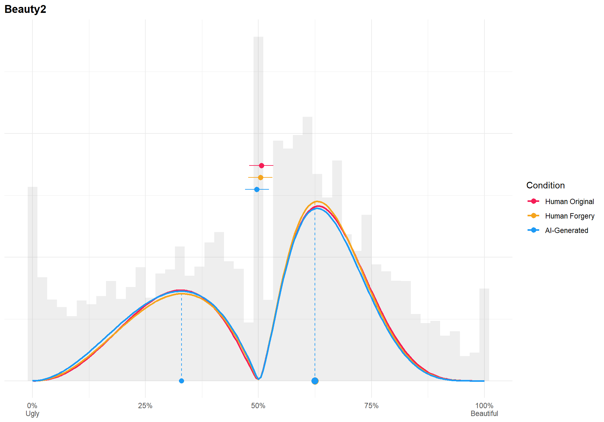{#fig-beauty2 fig-alt='Beauty rated again in the follow-up session (after participants were told all artworks were human originals): observed ratings with the model-implied CHOCO density per original label condition.' width=960}
:::
:::


### Self-Relevance


::: {.cell}

```{.r .cell-code}
make_report(estimates$SelfRelevance)
```

::: {.cell-output-display}

```{=html}
<div id="xokynsqsmx" style="padding-left:0px;padding-right:0px;padding-top:10px;padding-bottom:10px;overflow-x:auto;overflow-y:auto;width:auto;height:auto;">
<style>#xokynsqsmx table {
  font-family: system-ui, 'Segoe UI', Roboto, Helvetica, Arial, sans-serif, 'Apple Color Emoji', 'Segoe UI Emoji', 'Segoe UI Symbol', 'Noto Color Emoji';
  -webkit-font-smoothing: antialiased;
  -moz-osx-font-smoothing: grayscale;
}

#xokynsqsmx thead, #xokynsqsmx tbody, #xokynsqsmx tfoot, #xokynsqsmx tr, #xokynsqsmx td, #xokynsqsmx th {
  border-style: none;
}

#xokynsqsmx p {
  margin: 0;
  padding: 0;
}

#xokynsqsmx .gt_table {
  display: table;
  border-collapse: collapse;
  line-height: normal;
  margin-left: auto;
  margin-right: auto;
  color: #333333;
  font-size: 16px;
  font-weight: normal;
  font-style: normal;
  background-color: #FFFFFF;
  width: auto;
  border-top-style: solid;
  border-top-width: 2px;
  border-top-color: #A8A8A8;
  border-right-style: none;
  border-right-width: 2px;
  border-right-color: #D3D3D3;
  border-bottom-style: solid;
  border-bottom-width: 2px;
  border-bottom-color: #A8A8A8;
  border-left-style: none;
  border-left-width: 2px;
  border-left-color: #D3D3D3;
}

#xokynsqsmx .gt_caption {
  padding-top: 4px;
  padding-bottom: 4px;
}

#xokynsqsmx .gt_title {
  color: #333333;
  font-size: 125%;
  font-weight: initial;
  padding-top: 4px;
  padding-bottom: 4px;
  padding-left: 5px;
  padding-right: 5px;
  border-bottom-color: #FFFFFF;
  border-bottom-width: 0;
}

#xokynsqsmx .gt_subtitle {
  color: #333333;
  font-size: 85%;
  font-weight: initial;
  padding-top: 3px;
  padding-bottom: 5px;
  padding-left: 5px;
  padding-right: 5px;
  border-top-color: #FFFFFF;
  border-top-width: 0;
}

#xokynsqsmx .gt_heading {
  background-color: #FFFFFF;
  text-align: center;
  border-bottom-color: #FFFFFF;
  border-left-style: none;
  border-left-width: 1px;
  border-left-color: #D3D3D3;
  border-right-style: none;
  border-right-width: 1px;
  border-right-color: #D3D3D3;
}

#xokynsqsmx .gt_bottom_border {
  border-bottom-style: solid;
  border-bottom-width: 2px;
  border-bottom-color: #D3D3D3;
}

#xokynsqsmx .gt_col_headings {
  border-top-style: solid;
  border-top-width: 2px;
  border-top-color: #D3D3D3;
  border-bottom-style: solid;
  border-bottom-width: 2px;
  border-bottom-color: #D3D3D3;
  border-left-style: none;
  border-left-width: 1px;
  border-left-color: #D3D3D3;
  border-right-style: none;
  border-right-width: 1px;
  border-right-color: #D3D3D3;
}

#xokynsqsmx .gt_col_heading {
  color: #333333;
  background-color: #FFFFFF;
  font-size: 100%;
  font-weight: normal;
  text-transform: inherit;
  border-left-style: none;
  border-left-width: 1px;
  border-left-color: #D3D3D3;
  border-right-style: none;
  border-right-width: 1px;
  border-right-color: #D3D3D3;
  vertical-align: bottom;
  padding-top: 5px;
  padding-bottom: 6px;
  padding-left: 5px;
  padding-right: 5px;
  overflow-x: hidden;
}

#xokynsqsmx .gt_column_spanner_outer {
  color: #333333;
  background-color: #FFFFFF;
  font-size: 100%;
  font-weight: normal;
  text-transform: inherit;
  padding-top: 0;
  padding-bottom: 0;
  padding-left: 4px;
  padding-right: 4px;
}

#xokynsqsmx .gt_column_spanner_outer:first-child {
  padding-left: 0;
}

#xokynsqsmx .gt_column_spanner_outer:last-child {
  padding-right: 0;
}

#xokynsqsmx .gt_column_spanner {
  border-bottom-style: solid;
  border-bottom-width: 2px;
  border-bottom-color: #D3D3D3;
  vertical-align: bottom;
  padding-top: 5px;
  padding-bottom: 5px;
  overflow-x: hidden;
  display: inline-block;
  width: 100%;
}

#xokynsqsmx .gt_spanner_row {
  border-bottom-style: hidden;
}

#xokynsqsmx .gt_group_heading {
  padding-top: 8px;
  padding-bottom: 8px;
  padding-left: 5px;
  padding-right: 5px;
  color: #333333;
  background-color: #FFFFFF;
  font-size: 100%;
  font-weight: initial;
  text-transform: inherit;
  border-top-style: solid;
  border-top-width: 2px;
  border-top-color: #D3D3D3;
  border-bottom-style: solid;
  border-bottom-width: 2px;
  border-bottom-color: #D3D3D3;
  border-left-style: none;
  border-left-width: 1px;
  border-left-color: #D3D3D3;
  border-right-style: none;
  border-right-width: 1px;
  border-right-color: #D3D3D3;
  vertical-align: middle;
  text-align: left;
}

#xokynsqsmx .gt_empty_group_heading {
  padding: 0.5px;
  color: #333333;
  background-color: #FFFFFF;
  font-size: 100%;
  font-weight: initial;
  border-top-style: solid;
  border-top-width: 2px;
  border-top-color: #D3D3D3;
  border-bottom-style: solid;
  border-bottom-width: 2px;
  border-bottom-color: #D3D3D3;
  vertical-align: middle;
}

#xokynsqsmx .gt_from_md > :first-child {
  margin-top: 0;
}

#xokynsqsmx .gt_from_md > :last-child {
  margin-bottom: 0;
}

#xokynsqsmx .gt_row {
  padding-top: 8px;
  padding-bottom: 8px;
  padding-left: 5px;
  padding-right: 5px;
  margin: 10px;
  border-top-style: solid;
  border-top-width: 1px;
  border-top-color: #D3D3D3;
  border-left-style: none;
  border-left-width: 1px;
  border-left-color: #D3D3D3;
  border-right-style: none;
  border-right-width: 1px;
  border-right-color: #D3D3D3;
  vertical-align: middle;
  overflow-x: hidden;
}

#xokynsqsmx .gt_stub {
  color: #333333;
  background-color: #FFFFFF;
  font-size: 100%;
  font-weight: initial;
  text-transform: inherit;
  border-right-style: solid;
  border-right-width: 2px;
  border-right-color: #D3D3D3;
  padding-left: 5px;
  padding-right: 5px;
}

#xokynsqsmx .gt_stub_row_group {
  color: #333333;
  background-color: #FFFFFF;
  font-size: 100%;
  font-weight: initial;
  text-transform: inherit;
  border-right-style: solid;
  border-right-width: 2px;
  border-right-color: #D3D3D3;
  padding-left: 5px;
  padding-right: 5px;
  vertical-align: top;
}

#xokynsqsmx .gt_row_group_first td {
  border-top-width: 2px;
}

#xokynsqsmx .gt_row_group_first th {
  border-top-width: 2px;
}

#xokynsqsmx .gt_summary_row {
  color: #333333;
  background-color: #FFFFFF;
  text-transform: inherit;
  padding-top: 8px;
  padding-bottom: 8px;
  padding-left: 5px;
  padding-right: 5px;
}

#xokynsqsmx .gt_first_summary_row {
  border-top-style: solid;
  border-top-color: #D3D3D3;
}

#xokynsqsmx .gt_first_summary_row.thick {
  border-top-width: 2px;
}

#xokynsqsmx .gt_last_summary_row {
  padding-top: 8px;
  padding-bottom: 8px;
  padding-left: 5px;
  padding-right: 5px;
  border-bottom-style: solid;
  border-bottom-width: 2px;
  border-bottom-color: #D3D3D3;
}

#xokynsqsmx .gt_grand_summary_row {
  color: #333333;
  background-color: #FFFFFF;
  text-transform: inherit;
  padding-top: 8px;
  padding-bottom: 8px;
  padding-left: 5px;
  padding-right: 5px;
}

#xokynsqsmx .gt_first_grand_summary_row {
  padding-top: 8px;
  padding-bottom: 8px;
  padding-left: 5px;
  padding-right: 5px;
  border-top-style: double;
  border-top-width: 6px;
  border-top-color: #D3D3D3;
}

#xokynsqsmx .gt_last_grand_summary_row_top {
  padding-top: 8px;
  padding-bottom: 8px;
  padding-left: 5px;
  padding-right: 5px;
  border-bottom-style: double;
  border-bottom-width: 6px;
  border-bottom-color: #D3D3D3;
}

#xokynsqsmx .gt_striped {
  background-color: rgba(128, 128, 128, 0.05);
}

#xokynsqsmx .gt_table_body {
  border-top-style: solid;
  border-top-width: 2px;
  border-top-color: #D3D3D3;
  border-bottom-style: solid;
  border-bottom-width: 2px;
  border-bottom-color: #D3D3D3;
}

#xokynsqsmx .gt_footnotes {
  color: #333333;
  background-color: #FFFFFF;
  border-bottom-style: none;
  border-bottom-width: 2px;
  border-bottom-color: #D3D3D3;
  border-left-style: none;
  border-left-width: 2px;
  border-left-color: #D3D3D3;
  border-right-style: none;
  border-right-width: 2px;
  border-right-color: #D3D3D3;
}

#xokynsqsmx .gt_footnote {
  margin: 0px;
  font-size: 90%;
  padding-top: 4px;
  padding-bottom: 4px;
  padding-left: 5px;
  padding-right: 5px;
}

#xokynsqsmx .gt_sourcenotes {
  color: #333333;
  background-color: #FFFFFF;
  border-bottom-style: none;
  border-bottom-width: 2px;
  border-bottom-color: #D3D3D3;
  border-left-style: none;
  border-left-width: 2px;
  border-left-color: #D3D3D3;
  border-right-style: none;
  border-right-width: 2px;
  border-right-color: #D3D3D3;
}

#xokynsqsmx .gt_sourcenote {
  font-size: 90%;
  padding-top: 4px;
  padding-bottom: 4px;
  padding-left: 5px;
  padding-right: 5px;
}

#xokynsqsmx .gt_left {
  text-align: left;
}

#xokynsqsmx .gt_center {
  text-align: center;
}

#xokynsqsmx .gt_right {
  text-align: right;
  font-variant-numeric: tabular-nums;
}

#xokynsqsmx .gt_font_normal {
  font-weight: normal;
}

#xokynsqsmx .gt_font_bold {
  font-weight: bold;
}

#xokynsqsmx .gt_font_italic {
  font-style: italic;
}

#xokynsqsmx .gt_super {
  font-size: 65%;
}

#xokynsqsmx .gt_footnote_marks {
  font-size: 75%;
  vertical-align: 0.4em;
  position: initial;
}

#xokynsqsmx .gt_asterisk {
  font-size: 100%;
  vertical-align: 0;
}

#xokynsqsmx .gt_indent_1 {
  text-indent: 5px;
}

#xokynsqsmx .gt_indent_2 {
  text-indent: 10px;
}

#xokynsqsmx .gt_indent_3 {
  text-indent: 15px;
}

#xokynsqsmx .gt_indent_4 {
  text-indent: 20px;
}

#xokynsqsmx .gt_indent_5 {
  text-indent: 25px;
}

#xokynsqsmx .katex-display {
  display: inline-flex !important;
  margin-bottom: 0.75em !important;
}

#xokynsqsmx div.Reactable > div.rt-table > div.rt-thead > div.rt-tr.rt-tr-group-header > div.rt-th-group:after {
  height: 0px !important;
}
</style>
<table class="gt_table" data-quarto-disable-processing="false" data-quarto-bootstrap="false">
  <thead>
    <tr class="gt_col_headings">
      <th class="gt_col_heading gt_columns_bottom_border gt_left" rowspan="1" colspan="1" scope="col" id="Contrast">Contrast</th>
      <th class="gt_col_heading gt_columns_bottom_border gt_left" rowspan="1" colspan="1" scope="col" id="Parameters">Parameters</th>
    </tr>
  </thead>
  <tbody class="gt_table_body">
    <tr><td headers="Contrast" class="gt_row gt_left">Human Forgery - Human Original</td>
<td headers="Parameters" class="gt_row gt_left">None</td></tr>
    <tr><td headers="Contrast" class="gt_row gt_left">AI-Generated - Human Original</td>
<td headers="Parameters" class="gt_row gt_left">None</td></tr>
    <tr><td headers="Contrast" class="gt_row gt_left">AI-Generated - Human Forgery</td>
<td headers="Parameters" class="gt_row gt_left">None</td></tr>
  </tbody>
  
</table>
</div>
```

```{=html}
<div id="vxeixehcsd" style="padding-left:0px;padding-right:0px;padding-top:10px;padding-bottom:10px;overflow-x:auto;overflow-y:auto;width:auto;height:auto;">
<style>#vxeixehcsd table {
  font-family: system-ui, 'Segoe UI', Roboto, Helvetica, Arial, sans-serif, 'Apple Color Emoji', 'Segoe UI Emoji', 'Segoe UI Symbol', 'Noto Color Emoji';
  -webkit-font-smoothing: antialiased;
  -moz-osx-font-smoothing: grayscale;
}

#vxeixehcsd thead, #vxeixehcsd tbody, #vxeixehcsd tfoot, #vxeixehcsd tr, #vxeixehcsd td, #vxeixehcsd th {
  border-style: none;
}

#vxeixehcsd p {
  margin: 0;
  padding: 0;
}

#vxeixehcsd .gt_table {
  display: table;
  border-collapse: collapse;
  line-height: normal;
  margin-left: auto;
  margin-right: auto;
  color: #333333;
  font-size: 13px;
  font-weight: normal;
  font-style: normal;
  background-color: #FFFFFF;
  width: auto;
  border-top-style: solid;
  border-top-width: 3px;
  border-top-color: #D5D5D5;
  border-right-style: solid;
  border-right-width: 3px;
  border-right-color: #D5D5D5;
  border-bottom-style: solid;
  border-bottom-width: 3px;
  border-bottom-color: #D5D5D5;
  border-left-style: solid;
  border-left-width: 3px;
  border-left-color: #D5D5D5;
}

#vxeixehcsd .gt_caption {
  padding-top: 4px;
  padding-bottom: 4px;
}

#vxeixehcsd .gt_title {
  color: #333333;
  font-size: 125%;
  font-weight: initial;
  padding-top: 4px;
  padding-bottom: 4px;
  padding-left: 5px;
  padding-right: 5px;
  border-bottom-color: #FFFFFF;
  border-bottom-width: 0;
}

#vxeixehcsd .gt_subtitle {
  color: #333333;
  font-size: 85%;
  font-weight: initial;
  padding-top: 3px;
  padding-bottom: 5px;
  padding-left: 5px;
  padding-right: 5px;
  border-top-color: #FFFFFF;
  border-top-width: 0;
}

#vxeixehcsd .gt_heading {
  background-color: #FFFFFF;
  text-align: left;
  border-bottom-color: #FFFFFF;
  border-left-style: none;
  border-left-width: 1px;
  border-left-color: #D3D3D3;
  border-right-style: none;
  border-right-width: 1px;
  border-right-color: #D3D3D3;
}

#vxeixehcsd .gt_bottom_border {
  border-bottom-style: solid;
  border-bottom-width: 2px;
  border-bottom-color: #D5D5D5;
}

#vxeixehcsd .gt_col_headings {
  border-top-style: solid;
  border-top-width: 2px;
  border-top-color: #D5D5D5;
  border-bottom-style: solid;
  border-bottom-width: 2px;
  border-bottom-color: #D5D5D5;
  border-left-style: none;
  border-left-width: 1px;
  border-left-color: #D3D3D3;
  border-right-style: none;
  border-right-width: 1px;
  border-right-color: #D3D3D3;
}

#vxeixehcsd .gt_col_heading {
  color: #FFFFFF;
  background-color: #000000;
  font-size: 100%;
  font-weight: normal;
  text-transform: inherit;
  border-left-style: none;
  border-left-width: 1px;
  border-left-color: #D3D3D3;
  border-right-style: none;
  border-right-width: 1px;
  border-right-color: #D3D3D3;
  vertical-align: bottom;
  padding-top: 5px;
  padding-bottom: 6px;
  padding-left: 5px;
  padding-right: 5px;
  overflow-x: hidden;
}

#vxeixehcsd .gt_column_spanner_outer {
  color: #FFFFFF;
  background-color: #000000;
  font-size: 100%;
  font-weight: normal;
  text-transform: inherit;
  padding-top: 0;
  padding-bottom: 0;
  padding-left: 4px;
  padding-right: 4px;
}

#vxeixehcsd .gt_column_spanner_outer:first-child {
  padding-left: 0;
}

#vxeixehcsd .gt_column_spanner_outer:last-child {
  padding-right: 0;
}

#vxeixehcsd .gt_column_spanner {
  border-bottom-style: solid;
  border-bottom-width: 2px;
  border-bottom-color: #D5D5D5;
  vertical-align: bottom;
  padding-top: 5px;
  padding-bottom: 5px;
  overflow-x: hidden;
  display: inline-block;
  width: 100%;
}

#vxeixehcsd .gt_spanner_row {
  border-bottom-style: hidden;
}

#vxeixehcsd .gt_group_heading {
  padding-top: 8px;
  padding-bottom: 8px;
  padding-left: 5px;
  padding-right: 5px;
  color: #333333;
  background-color: #FFFFFF;
  font-size: 100%;
  font-weight: initial;
  text-transform: inherit;
  border-top-style: solid;
  border-top-width: 2px;
  border-top-color: #D5D5D5;
  border-bottom-style: solid;
  border-bottom-width: 2px;
  border-bottom-color: #D5D5D5;
  border-left-style: none;
  border-left-width: 1px;
  border-left-color: #D3D3D3;
  border-right-style: none;
  border-right-width: 1px;
  border-right-color: #D3D3D3;
  vertical-align: middle;
  text-align: left;
}

#vxeixehcsd .gt_empty_group_heading {
  padding: 0.5px;
  color: #333333;
  background-color: #FFFFFF;
  font-size: 100%;
  font-weight: initial;
  border-top-style: solid;
  border-top-width: 2px;
  border-top-color: #D5D5D5;
  border-bottom-style: solid;
  border-bottom-width: 2px;
  border-bottom-color: #D5D5D5;
  vertical-align: middle;
}

#vxeixehcsd .gt_from_md > :first-child {
  margin-top: 0;
}

#vxeixehcsd .gt_from_md > :last-child {
  margin-bottom: 0;
}

#vxeixehcsd .gt_row {
  padding-top: 8px;
  padding-bottom: 8px;
  padding-left: 5px;
  padding-right: 5px;
  margin: 10px;
  border-top-style: solid;
  border-top-width: 1px;
  border-top-color: #D5D5D5;
  border-left-style: solid;
  border-left-width: 1px;
  border-left-color: #D5D5D5;
  border-right-style: solid;
  border-right-width: 1px;
  border-right-color: #D5D5D5;
  vertical-align: middle;
  overflow-x: hidden;
}

#vxeixehcsd .gt_stub {
  color: #333333;
  background-color: #FFFFFF;
  font-size: 100%;
  font-weight: initial;
  text-transform: inherit;
  border-right-style: solid;
  border-right-width: 2px;
  border-right-color: #5F5F5F;
  padding-left: 5px;
  padding-right: 5px;
}

#vxeixehcsd .gt_stub_row_group {
  color: #333333;
  background-color: #FFFFFF;
  font-size: 100%;
  font-weight: initial;
  text-transform: inherit;
  border-right-style: solid;
  border-right-width: 2px;
  border-right-color: #D3D3D3;
  padding-left: 5px;
  padding-right: 5px;
  vertical-align: top;
}

#vxeixehcsd .gt_row_group_first td {
  border-top-width: 2px;
}

#vxeixehcsd .gt_row_group_first th {
  border-top-width: 2px;
}

#vxeixehcsd .gt_summary_row {
  color: #333333;
  background-color: #D5D5D5;
  text-transform: inherit;
  padding-top: 8px;
  padding-bottom: 8px;
  padding-left: 5px;
  padding-right: 5px;
}

#vxeixehcsd .gt_first_summary_row {
  border-top-style: solid;
  border-top-color: #D5D5D5;
}

#vxeixehcsd .gt_first_summary_row.thick {
  border-top-width: 2px;
}

#vxeixehcsd .gt_last_summary_row {
  padding-top: 8px;
  padding-bottom: 8px;
  padding-left: 5px;
  padding-right: 5px;
  border-bottom-style: solid;
  border-bottom-width: 2px;
  border-bottom-color: #D5D5D5;
}

#vxeixehcsd .gt_grand_summary_row {
  color: #FFFFFF;
  background-color: #929292;
  text-transform: inherit;
  padding-top: 8px;
  padding-bottom: 8px;
  padding-left: 5px;
  padding-right: 5px;
}

#vxeixehcsd .gt_first_grand_summary_row {
  padding-top: 8px;
  padding-bottom: 8px;
  padding-left: 5px;
  padding-right: 5px;
  border-top-style: double;
  border-top-width: 6px;
  border-top-color: #D5D5D5;
}

#vxeixehcsd .gt_last_grand_summary_row_top {
  padding-top: 8px;
  padding-bottom: 8px;
  padding-left: 5px;
  padding-right: 5px;
  border-bottom-style: double;
  border-bottom-width: 6px;
  border-bottom-color: #D5D5D5;
}

#vxeixehcsd .gt_striped {
  background-color: #F4F4F4;
}

#vxeixehcsd .gt_table_body {
  border-top-style: solid;
  border-top-width: 2px;
  border-top-color: #D5D5D5;
  border-bottom-style: solid;
  border-bottom-width: 2px;
  border-bottom-color: #D5D5D5;
}

#vxeixehcsd .gt_footnotes {
  color: #333333;
  background-color: #FFFFFF;
  border-bottom-style: none;
  border-bottom-width: 2px;
  border-bottom-color: #D3D3D3;
  border-left-style: none;
  border-left-width: 2px;
  border-left-color: #D3D3D3;
  border-right-style: none;
  border-right-width: 2px;
  border-right-color: #D3D3D3;
}

#vxeixehcsd .gt_footnote {
  margin: 0px;
  font-size: 90%;
  padding-top: 4px;
  padding-bottom: 4px;
  padding-left: 5px;
  padding-right: 5px;
}

#vxeixehcsd .gt_sourcenotes {
  color: #333333;
  background-color: #FFFFFF;
  border-bottom-style: none;
  border-bottom-width: 2px;
  border-bottom-color: #D3D3D3;
  border-left-style: none;
  border-left-width: 2px;
  border-left-color: #D3D3D3;
  border-right-style: none;
  border-right-width: 2px;
  border-right-color: #D3D3D3;
}

#vxeixehcsd .gt_sourcenote {
  font-size: 90%;
  padding-top: 4px;
  padding-bottom: 4px;
  padding-left: 5px;
  padding-right: 5px;
}

#vxeixehcsd .gt_left {
  text-align: left;
}

#vxeixehcsd .gt_center {
  text-align: center;
}

#vxeixehcsd .gt_right {
  text-align: right;
  font-variant-numeric: tabular-nums;
}

#vxeixehcsd .gt_font_normal {
  font-weight: normal;
}

#vxeixehcsd .gt_font_bold {
  font-weight: bold;
}

#vxeixehcsd .gt_font_italic {
  font-style: italic;
}

#vxeixehcsd .gt_super {
  font-size: 65%;
}

#vxeixehcsd .gt_footnote_marks {
  font-size: 75%;
  vertical-align: 0.4em;
  position: initial;
}

#vxeixehcsd .gt_asterisk {
  font-size: 100%;
  vertical-align: 0;
}

#vxeixehcsd .gt_indent_1 {
  text-indent: 5px;
}

#vxeixehcsd .gt_indent_2 {
  text-indent: 10px;
}

#vxeixehcsd .gt_indent_3 {
  text-indent: 15px;
}

#vxeixehcsd .gt_indent_4 {
  text-indent: 20px;
}

#vxeixehcsd .gt_indent_5 {
  text-indent: 25px;
}

#vxeixehcsd .katex-display {
  display: inline-flex !important;
  margin-bottom: 0.75em !important;
}

#vxeixehcsd div.Reactable > div.rt-table > div.rt-thead > div.rt-tr.rt-tr-group-header > div.rt-th-group:after {
  height: 0px !important;
}
</style>
<table class="gt_table" data-quarto-disable-processing="false" data-quarto-bootstrap="false">
  <thead>
    <tr class="gt_heading">
      <td colspan="10" class="gt_heading gt_title gt_font_normal gt_bottom_border" style>Self-Relevance: convergence</td>
    </tr>
    
    <tr class="gt_col_headings">
      <th class="gt_col_heading gt_columns_bottom_border gt_left" rowspan="1" colspan="1" scope="col" id="Model">Model</th>
      <th class="gt_col_heading gt_columns_bottom_border gt_left" rowspan="1" colspan="1" scope="col" id="Family">Family</th>
      <th class="gt_col_heading gt_columns_bottom_border gt_right" rowspan="1" colspan="1" scope="col" id="N_obs">N_obs</th>
      <th class="gt_col_heading gt_columns_bottom_border gt_right" rowspan="1" colspan="1" scope="col" id="N_participants">N_participants</th>
      <th class="gt_col_heading gt_columns_bottom_border gt_right" rowspan="1" colspan="1" scope="col" id="Chains">Chains</th>
      <th class="gt_col_heading gt_columns_bottom_border gt_right" rowspan="1" colspan="1" scope="col" id="Draws">Draws</th>
      <th class="gt_col_heading gt_columns_bottom_border gt_right" rowspan="1" colspan="1" scope="col" id="Max_Rhat">Max_Rhat</th>
      <th class="gt_col_heading gt_columns_bottom_border gt_right" rowspan="1" colspan="1" scope="col" id="Min_ESS_ratio">Min_ESS_ratio</th>
      <th class="gt_col_heading gt_columns_bottom_border gt_right" rowspan="1" colspan="1" scope="col" id="Divergent_pct">Divergent_pct</th>
      <th class="gt_col_heading gt_columns_bottom_border gt_left" rowspan="1" colspan="1" scope="col" id="Criterion">Criterion</th>
    </tr>
  </thead>
  <tbody class="gt_table_body">
    <tr><td headers="Model" class="gt_row gt_left">SelfRelevance</td>
<td headers="Family" class="gt_row gt_left">Cumulative (ordinal)</td>
<td headers="N_obs" class="gt_row gt_right">10560</td>
<td headers="N_participants" class="gt_row gt_right">220</td>
<td headers="Chains" class="gt_row gt_right">8</td>
<td headers="Draws" class="gt_row gt_right">4000</td>
<td headers="Max_Rhat" class="gt_row gt_right">1.085</td>
<td headers="Min_ESS_ratio" class="gt_row gt_right">0.021</td>
<td headers="Divergent_pct" class="gt_row gt_right">0</td>
<td headers="Criterion" class="gt_row gt_left">loo</td></tr>
  </tbody>
  
</table>
</div>
```


::: {.callout-note collapse="true" title="Self-Relevance: convergence (Markdown table, for text readers)"}

|Model         |Family               | N_obs| N_participants| Chains| Draws| Max_Rhat| Min_ESS_ratio| Divergent_pct|Criterion |
|:-------------|:--------------------|-----:|--------------:|------:|-----:|--------:|-------------:|-------------:|:---------|
|SelfRelevance |Cumulative (ordinal) | 10560|            220|      8|  4000|    1.085|         0.021|             0|loo       |

:::

```{=html}
<div id="xmzgyslubx" style="padding-left:0px;padding-right:0px;padding-top:10px;padding-bottom:10px;overflow-x:auto;overflow-y:auto;width:auto;height:auto;">
<style>#xmzgyslubx table {
  font-family: system-ui, 'Segoe UI', Roboto, Helvetica, Arial, sans-serif, 'Apple Color Emoji', 'Segoe UI Emoji', 'Segoe UI Symbol', 'Noto Color Emoji';
  -webkit-font-smoothing: antialiased;
  -moz-osx-font-smoothing: grayscale;
}

#xmzgyslubx thead, #xmzgyslubx tbody, #xmzgyslubx tfoot, #xmzgyslubx tr, #xmzgyslubx td, #xmzgyslubx th {
  border-style: none;
}

#xmzgyslubx p {
  margin: 0;
  padding: 0;
}

#xmzgyslubx .gt_table {
  display: table;
  border-collapse: collapse;
  line-height: normal;
  margin-left: auto;
  margin-right: auto;
  color: #333333;
  font-size: 13px;
  font-weight: normal;
  font-style: normal;
  background-color: #FFFFFF;
  width: auto;
  border-top-style: solid;
  border-top-width: 3px;
  border-top-color: #D5D5D5;
  border-right-style: solid;
  border-right-width: 3px;
  border-right-color: #D5D5D5;
  border-bottom-style: solid;
  border-bottom-width: 3px;
  border-bottom-color: #D5D5D5;
  border-left-style: solid;
  border-left-width: 3px;
  border-left-color: #D5D5D5;
}

#xmzgyslubx .gt_caption {
  padding-top: 4px;
  padding-bottom: 4px;
}

#xmzgyslubx .gt_title {
  color: #333333;
  font-size: 125%;
  font-weight: initial;
  padding-top: 4px;
  padding-bottom: 4px;
  padding-left: 5px;
  padding-right: 5px;
  border-bottom-color: #FFFFFF;
  border-bottom-width: 0;
}

#xmzgyslubx .gt_subtitle {
  color: #333333;
  font-size: 85%;
  font-weight: initial;
  padding-top: 3px;
  padding-bottom: 5px;
  padding-left: 5px;
  padding-right: 5px;
  border-top-color: #FFFFFF;
  border-top-width: 0;
}

#xmzgyslubx .gt_heading {
  background-color: #FFFFFF;
  text-align: left;
  border-bottom-color: #FFFFFF;
  border-left-style: none;
  border-left-width: 1px;
  border-left-color: #D3D3D3;
  border-right-style: none;
  border-right-width: 1px;
  border-right-color: #D3D3D3;
}

#xmzgyslubx .gt_bottom_border {
  border-bottom-style: solid;
  border-bottom-width: 2px;
  border-bottom-color: #D5D5D5;
}

#xmzgyslubx .gt_col_headings {
  border-top-style: solid;
  border-top-width: 2px;
  border-top-color: #D5D5D5;
  border-bottom-style: solid;
  border-bottom-width: 2px;
  border-bottom-color: #D5D5D5;
  border-left-style: none;
  border-left-width: 1px;
  border-left-color: #D3D3D3;
  border-right-style: none;
  border-right-width: 1px;
  border-right-color: #D3D3D3;
}

#xmzgyslubx .gt_col_heading {
  color: #FFFFFF;
  background-color: #000000;
  font-size: 100%;
  font-weight: normal;
  text-transform: inherit;
  border-left-style: none;
  border-left-width: 1px;
  border-left-color: #D3D3D3;
  border-right-style: none;
  border-right-width: 1px;
  border-right-color: #D3D3D3;
  vertical-align: bottom;
  padding-top: 5px;
  padding-bottom: 6px;
  padding-left: 5px;
  padding-right: 5px;
  overflow-x: hidden;
}

#xmzgyslubx .gt_column_spanner_outer {
  color: #FFFFFF;
  background-color: #000000;
  font-size: 100%;
  font-weight: normal;
  text-transform: inherit;
  padding-top: 0;
  padding-bottom: 0;
  padding-left: 4px;
  padding-right: 4px;
}

#xmzgyslubx .gt_column_spanner_outer:first-child {
  padding-left: 0;
}

#xmzgyslubx .gt_column_spanner_outer:last-child {
  padding-right: 0;
}

#xmzgyslubx .gt_column_spanner {
  border-bottom-style: solid;
  border-bottom-width: 2px;
  border-bottom-color: #D5D5D5;
  vertical-align: bottom;
  padding-top: 5px;
  padding-bottom: 5px;
  overflow-x: hidden;
  display: inline-block;
  width: 100%;
}

#xmzgyslubx .gt_spanner_row {
  border-bottom-style: hidden;
}

#xmzgyslubx .gt_group_heading {
  padding-top: 8px;
  padding-bottom: 8px;
  padding-left: 5px;
  padding-right: 5px;
  color: #333333;
  background-color: #FFFFFF;
  font-size: 100%;
  font-weight: initial;
  text-transform: inherit;
  border-top-style: solid;
  border-top-width: 2px;
  border-top-color: #D5D5D5;
  border-bottom-style: solid;
  border-bottom-width: 2px;
  border-bottom-color: #D5D5D5;
  border-left-style: none;
  border-left-width: 1px;
  border-left-color: #D3D3D3;
  border-right-style: none;
  border-right-width: 1px;
  border-right-color: #D3D3D3;
  vertical-align: middle;
  text-align: left;
}

#xmzgyslubx .gt_empty_group_heading {
  padding: 0.5px;
  color: #333333;
  background-color: #FFFFFF;
  font-size: 100%;
  font-weight: initial;
  border-top-style: solid;
  border-top-width: 2px;
  border-top-color: #D5D5D5;
  border-bottom-style: solid;
  border-bottom-width: 2px;
  border-bottom-color: #D5D5D5;
  vertical-align: middle;
}

#xmzgyslubx .gt_from_md > :first-child {
  margin-top: 0;
}

#xmzgyslubx .gt_from_md > :last-child {
  margin-bottom: 0;
}

#xmzgyslubx .gt_row {
  padding-top: 8px;
  padding-bottom: 8px;
  padding-left: 5px;
  padding-right: 5px;
  margin: 10px;
  border-top-style: solid;
  border-top-width: 1px;
  border-top-color: #D5D5D5;
  border-left-style: solid;
  border-left-width: 1px;
  border-left-color: #D5D5D5;
  border-right-style: solid;
  border-right-width: 1px;
  border-right-color: #D5D5D5;
  vertical-align: middle;
  overflow-x: hidden;
}

#xmzgyslubx .gt_stub {
  color: #333333;
  background-color: #FFFFFF;
  font-size: 100%;
  font-weight: initial;
  text-transform: inherit;
  border-right-style: solid;
  border-right-width: 2px;
  border-right-color: #5F5F5F;
  padding-left: 5px;
  padding-right: 5px;
}

#xmzgyslubx .gt_stub_row_group {
  color: #333333;
  background-color: #FFFFFF;
  font-size: 100%;
  font-weight: initial;
  text-transform: inherit;
  border-right-style: solid;
  border-right-width: 2px;
  border-right-color: #D3D3D3;
  padding-left: 5px;
  padding-right: 5px;
  vertical-align: top;
}

#xmzgyslubx .gt_row_group_first td {
  border-top-width: 2px;
}

#xmzgyslubx .gt_row_group_first th {
  border-top-width: 2px;
}

#xmzgyslubx .gt_summary_row {
  color: #333333;
  background-color: #D5D5D5;
  text-transform: inherit;
  padding-top: 8px;
  padding-bottom: 8px;
  padding-left: 5px;
  padding-right: 5px;
}

#xmzgyslubx .gt_first_summary_row {
  border-top-style: solid;
  border-top-color: #D5D5D5;
}

#xmzgyslubx .gt_first_summary_row.thick {
  border-top-width: 2px;
}

#xmzgyslubx .gt_last_summary_row {
  padding-top: 8px;
  padding-bottom: 8px;
  padding-left: 5px;
  padding-right: 5px;
  border-bottom-style: solid;
  border-bottom-width: 2px;
  border-bottom-color: #D5D5D5;
}

#xmzgyslubx .gt_grand_summary_row {
  color: #FFFFFF;
  background-color: #929292;
  text-transform: inherit;
  padding-top: 8px;
  padding-bottom: 8px;
  padding-left: 5px;
  padding-right: 5px;
}

#xmzgyslubx .gt_first_grand_summary_row {
  padding-top: 8px;
  padding-bottom: 8px;
  padding-left: 5px;
  padding-right: 5px;
  border-top-style: double;
  border-top-width: 6px;
  border-top-color: #D5D5D5;
}

#xmzgyslubx .gt_last_grand_summary_row_top {
  padding-top: 8px;
  padding-bottom: 8px;
  padding-left: 5px;
  padding-right: 5px;
  border-bottom-style: double;
  border-bottom-width: 6px;
  border-bottom-color: #D5D5D5;
}

#xmzgyslubx .gt_striped {
  background-color: #F4F4F4;
}

#xmzgyslubx .gt_table_body {
  border-top-style: solid;
  border-top-width: 2px;
  border-top-color: #D5D5D5;
  border-bottom-style: solid;
  border-bottom-width: 2px;
  border-bottom-color: #D5D5D5;
}

#xmzgyslubx .gt_footnotes {
  color: #333333;
  background-color: #FFFFFF;
  border-bottom-style: none;
  border-bottom-width: 2px;
  border-bottom-color: #D3D3D3;
  border-left-style: none;
  border-left-width: 2px;
  border-left-color: #D3D3D3;
  border-right-style: none;
  border-right-width: 2px;
  border-right-color: #D3D3D3;
}

#xmzgyslubx .gt_footnote {
  margin: 0px;
  font-size: 90%;
  padding-top: 4px;
  padding-bottom: 4px;
  padding-left: 5px;
  padding-right: 5px;
}

#xmzgyslubx .gt_sourcenotes {
  color: #333333;
  background-color: #FFFFFF;
  border-bottom-style: none;
  border-bottom-width: 2px;
  border-bottom-color: #D3D3D3;
  border-left-style: none;
  border-left-width: 2px;
  border-left-color: #D3D3D3;
  border-right-style: none;
  border-right-width: 2px;
  border-right-color: #D3D3D3;
}

#xmzgyslubx .gt_sourcenote {
  font-size: 90%;
  padding-top: 4px;
  padding-bottom: 4px;
  padding-left: 5px;
  padding-right: 5px;
}

#xmzgyslubx .gt_left {
  text-align: left;
}

#xmzgyslubx .gt_center {
  text-align: center;
}

#xmzgyslubx .gt_right {
  text-align: right;
  font-variant-numeric: tabular-nums;
}

#xmzgyslubx .gt_font_normal {
  font-weight: normal;
}

#xmzgyslubx .gt_font_bold {
  font-weight: bold;
}

#xmzgyslubx .gt_font_italic {
  font-style: italic;
}

#xmzgyslubx .gt_super {
  font-size: 65%;
}

#xmzgyslubx .gt_footnote_marks {
  font-size: 75%;
  vertical-align: 0.4em;
  position: initial;
}

#xmzgyslubx .gt_asterisk {
  font-size: 100%;
  vertical-align: 0;
}

#xmzgyslubx .gt_indent_1 {
  text-indent: 5px;
}

#xmzgyslubx .gt_indent_2 {
  text-indent: 10px;
}

#xmzgyslubx .gt_indent_3 {
  text-indent: 15px;
}

#xmzgyslubx .gt_indent_4 {
  text-indent: 20px;
}

#xmzgyslubx .gt_indent_5 {
  text-indent: 25px;
}

#xmzgyslubx .katex-display {
  display: inline-flex !important;
  margin-bottom: 0.75em !important;
}

#xmzgyslubx div.Reactable > div.rt-table > div.rt-thead > div.rt-tr.rt-tr-group-header > div.rt-th-group:after {
  height: 0px !important;
}
</style>
<table class="gt_table" data-quarto-disable-processing="false" data-quarto-bootstrap="false">
  <thead>
    <tr class="gt_heading">
      <td colspan="5" class="gt_heading gt_title gt_font_normal gt_bottom_border" style>Self-Relevance: marginal means per label condition (response scale)</td>
    </tr>
    
    <tr class="gt_col_headings">
      <th class="gt_col_heading gt_columns_bottom_border gt_center" rowspan="1" colspan="1" scope="col" id="Condition">Condition</th>
      <th class="gt_col_heading gt_columns_bottom_border gt_center" rowspan="1" colspan="1" scope="col" id="Response">Response</th>
      <th class="gt_col_heading gt_columns_bottom_border gt_right" rowspan="1" colspan="1" scope="col" id="Estimate">Estimate</th>
      <th class="gt_col_heading gt_columns_bottom_border gt_right" rowspan="1" colspan="1" scope="col" id="CI_low">CI_low</th>
      <th class="gt_col_heading gt_columns_bottom_border gt_right" rowspan="1" colspan="1" scope="col" id="CI_high">CI_high</th>
    </tr>
  </thead>
  <tbody class="gt_table_body">
    <tr><td headers="Condition" class="gt_row gt_center">Human Original</td>
<td headers="Response" class="gt_row gt_center">0</td>
<td headers="Estimate" class="gt_row gt_right">0.37</td>
<td headers="CI_low" class="gt_row gt_right">0.36</td>
<td headers="CI_high" class="gt_row gt_right">0.38</td></tr>
    <tr><td headers="Condition" class="gt_row gt_center gt_striped">Human Forgery</td>
<td headers="Response" class="gt_row gt_center gt_striped">0</td>
<td headers="Estimate" class="gt_row gt_right gt_striped">0.37</td>
<td headers="CI_low" class="gt_row gt_right gt_striped">0.36</td>
<td headers="CI_high" class="gt_row gt_right gt_striped">0.38</td></tr>
    <tr><td headers="Condition" class="gt_row gt_center">AI-Generated</td>
<td headers="Response" class="gt_row gt_center">0</td>
<td headers="Estimate" class="gt_row gt_right">0.38</td>
<td headers="CI_low" class="gt_row gt_right">0.37</td>
<td headers="CI_high" class="gt_row gt_right">0.39</td></tr>
    <tr><td headers="Condition" class="gt_row gt_center gt_striped">Human Original</td>
<td headers="Response" class="gt_row gt_center gt_striped">1</td>
<td headers="Estimate" class="gt_row gt_right gt_striped">0.17</td>
<td headers="CI_low" class="gt_row gt_right gt_striped">0.17</td>
<td headers="CI_high" class="gt_row gt_right gt_striped">0.18</td></tr>
    <tr><td headers="Condition" class="gt_row gt_center">Human Forgery</td>
<td headers="Response" class="gt_row gt_center">1</td>
<td headers="Estimate" class="gt_row gt_right">0.17</td>
<td headers="CI_low" class="gt_row gt_right">0.17</td>
<td headers="CI_high" class="gt_row gt_right">0.18</td></tr>
    <tr><td headers="Condition" class="gt_row gt_center gt_striped">AI-Generated</td>
<td headers="Response" class="gt_row gt_center gt_striped">1</td>
<td headers="Estimate" class="gt_row gt_right gt_striped">0.17</td>
<td headers="CI_low" class="gt_row gt_right gt_striped">0.16</td>
<td headers="CI_high" class="gt_row gt_right gt_striped">0.18</td></tr>
    <tr><td headers="Condition" class="gt_row gt_center">Human Original</td>
<td headers="Response" class="gt_row gt_center">2</td>
<td headers="Estimate" class="gt_row gt_right">0.14</td>
<td headers="CI_low" class="gt_row gt_right">0.14</td>
<td headers="CI_high" class="gt_row gt_right">0.15</td></tr>
    <tr><td headers="Condition" class="gt_row gt_center gt_striped">Human Forgery</td>
<td headers="Response" class="gt_row gt_center gt_striped">2</td>
<td headers="Estimate" class="gt_row gt_right gt_striped">0.14</td>
<td headers="CI_low" class="gt_row gt_right gt_striped">0.14</td>
<td headers="CI_high" class="gt_row gt_right gt_striped">0.15</td></tr>
    <tr><td headers="Condition" class="gt_row gt_center">AI-Generated</td>
<td headers="Response" class="gt_row gt_center">2</td>
<td headers="Estimate" class="gt_row gt_right">0.14</td>
<td headers="CI_low" class="gt_row gt_right">0.13</td>
<td headers="CI_high" class="gt_row gt_right">0.15</td></tr>
    <tr><td headers="Condition" class="gt_row gt_center gt_striped">Human Original</td>
<td headers="Response" class="gt_row gt_center gt_striped">3</td>
<td headers="Estimate" class="gt_row gt_right gt_striped">0.13</td>
<td headers="CI_low" class="gt_row gt_right gt_striped">0.12</td>
<td headers="CI_high" class="gt_row gt_right gt_striped">0.13</td></tr>
    <tr><td headers="Condition" class="gt_row gt_center">Human Forgery</td>
<td headers="Response" class="gt_row gt_center">3</td>
<td headers="Estimate" class="gt_row gt_right">0.13</td>
<td headers="CI_low" class="gt_row gt_right">0.12</td>
<td headers="CI_high" class="gt_row gt_right">0.13</td></tr>
    <tr><td headers="Condition" class="gt_row gt_center gt_striped">AI-Generated</td>
<td headers="Response" class="gt_row gt_center gt_striped">3</td>
<td headers="Estimate" class="gt_row gt_right gt_striped">0.13</td>
<td headers="CI_low" class="gt_row gt_right gt_striped">0.12</td>
<td headers="CI_high" class="gt_row gt_right gt_striped">0.13</td></tr>
    <tr><td headers="Condition" class="gt_row gt_center">Human Original</td>
<td headers="Response" class="gt_row gt_center">4</td>
<td headers="Estimate" class="gt_row gt_right">0.11</td>
<td headers="CI_low" class="gt_row gt_right">0.11</td>
<td headers="CI_high" class="gt_row gt_right">0.12</td></tr>
    <tr><td headers="Condition" class="gt_row gt_center gt_striped">Human Forgery</td>
<td headers="Response" class="gt_row gt_center gt_striped">4</td>
<td headers="Estimate" class="gt_row gt_right gt_striped">0.11</td>
<td headers="CI_low" class="gt_row gt_right gt_striped">0.11</td>
<td headers="CI_high" class="gt_row gt_right gt_striped">0.12</td></tr>
    <tr><td headers="Condition" class="gt_row gt_center">AI-Generated</td>
<td headers="Response" class="gt_row gt_center">4</td>
<td headers="Estimate" class="gt_row gt_right">0.11</td>
<td headers="CI_low" class="gt_row gt_right">0.11</td>
<td headers="CI_high" class="gt_row gt_right">0.12</td></tr>
    <tr><td headers="Condition" class="gt_row gt_center gt_striped">Human Original</td>
<td headers="Response" class="gt_row gt_center gt_striped">5</td>
<td headers="Estimate" class="gt_row gt_right gt_striped">0.06</td>
<td headers="CI_low" class="gt_row gt_right gt_striped">0.06</td>
<td headers="CI_high" class="gt_row gt_right gt_striped">0.07</td></tr>
    <tr><td headers="Condition" class="gt_row gt_center">Human Forgery</td>
<td headers="Response" class="gt_row gt_center">5</td>
<td headers="Estimate" class="gt_row gt_right">0.06</td>
<td headers="CI_low" class="gt_row gt_right">0.06</td>
<td headers="CI_high" class="gt_row gt_right">0.07</td></tr>
    <tr><td headers="Condition" class="gt_row gt_center gt_striped">AI-Generated</td>
<td headers="Response" class="gt_row gt_center gt_striped">5</td>
<td headers="Estimate" class="gt_row gt_right gt_striped">0.06</td>
<td headers="CI_low" class="gt_row gt_right gt_striped">0.06</td>
<td headers="CI_high" class="gt_row gt_right gt_striped">0.07</td></tr>
    <tr><td headers="Condition" class="gt_row gt_center">Human Original</td>
<td headers="Response" class="gt_row gt_center">6</td>
<td headers="Estimate" class="gt_row gt_right">0.02</td>
<td headers="CI_low" class="gt_row gt_right">0.01</td>
<td headers="CI_high" class="gt_row gt_right">0.02</td></tr>
    <tr><td headers="Condition" class="gt_row gt_center gt_striped">Human Forgery</td>
<td headers="Response" class="gt_row gt_center gt_striped">6</td>
<td headers="Estimate" class="gt_row gt_right gt_striped">0.02</td>
<td headers="CI_low" class="gt_row gt_right gt_striped">0.01</td>
<td headers="CI_high" class="gt_row gt_right gt_striped">0.02</td></tr>
    <tr><td headers="Condition" class="gt_row gt_center">AI-Generated</td>
<td headers="Response" class="gt_row gt_center">6</td>
<td headers="Estimate" class="gt_row gt_right">0.02</td>
<td headers="CI_low" class="gt_row gt_right">0.01</td>
<td headers="CI_high" class="gt_row gt_right">0.02</td></tr>
  </tbody>
  
</table>
</div>
```


::: {.callout-note collapse="true" title="Self-Relevance: marginal means per label condition (response scale) (Markdown table, for text readers)"}

|Condition      |Response |Estimate |CI_low |CI_high |
|:--------------|:--------|:--------|:------|:-------|
|Human Original |0        |0.37     |0.36   |0.38    |
|Human Forgery  |0        |0.37     |0.36   |0.38    |
|AI-Generated   |0        |0.38     |0.37   |0.39    |
|Human Original |1        |0.17     |0.17   |0.18    |
|Human Forgery  |1        |0.17     |0.17   |0.18    |
|AI-Generated   |1        |0.17     |0.16   |0.18    |
|Human Original |2        |0.14     |0.14   |0.15    |
|Human Forgery  |2        |0.14     |0.14   |0.15    |
|AI-Generated   |2        |0.14     |0.13   |0.15    |
|Human Original |3        |0.13     |0.12   |0.13    |
|Human Forgery  |3        |0.13     |0.12   |0.13    |
|AI-Generated   |3        |0.13     |0.12   |0.13    |
|Human Original |4        |0.11     |0.11   |0.12    |
|Human Forgery  |4        |0.11     |0.11   |0.12    |
|AI-Generated   |4        |0.11     |0.11   |0.12    |
|Human Original |5        |0.06     |0.06   |0.07    |
|Human Forgery  |5        |0.06     |0.06   |0.07    |
|AI-Generated   |5        |0.06     |0.06   |0.07    |
|Human Original |6        |0.02     |0.01   |0.02    |
|Human Forgery  |6        |0.02     |0.01   |0.02    |
|AI-Generated   |6        |0.02     |0.01   |0.02    |

:::

```{=html}
<div id="cdqgkdljnx" style="padding-left:0px;padding-right:0px;padding-top:10px;padding-bottom:10px;overflow-x:auto;overflow-y:auto;width:auto;height:auto;">
<style>#cdqgkdljnx table {
  font-family: system-ui, 'Segoe UI', Roboto, Helvetica, Arial, sans-serif, 'Apple Color Emoji', 'Segoe UI Emoji', 'Segoe UI Symbol', 'Noto Color Emoji';
  -webkit-font-smoothing: antialiased;
  -moz-osx-font-smoothing: grayscale;
}

#cdqgkdljnx thead, #cdqgkdljnx tbody, #cdqgkdljnx tfoot, #cdqgkdljnx tr, #cdqgkdljnx td, #cdqgkdljnx th {
  border-style: none;
}

#cdqgkdljnx p {
  margin: 0;
  padding: 0;
}

#cdqgkdljnx .gt_table {
  display: table;
  border-collapse: collapse;
  line-height: normal;
  margin-left: auto;
  margin-right: auto;
  color: #333333;
  font-size: 13px;
  font-weight: normal;
  font-style: normal;
  background-color: #FFFFFF;
  width: auto;
  border-top-style: solid;
  border-top-width: 3px;
  border-top-color: #D5D5D5;
  border-right-style: solid;
  border-right-width: 3px;
  border-right-color: #D5D5D5;
  border-bottom-style: solid;
  border-bottom-width: 3px;
  border-bottom-color: #D5D5D5;
  border-left-style: solid;
  border-left-width: 3px;
  border-left-color: #D5D5D5;
}

#cdqgkdljnx .gt_caption {
  padding-top: 4px;
  padding-bottom: 4px;
}

#cdqgkdljnx .gt_title {
  color: #333333;
  font-size: 125%;
  font-weight: initial;
  padding-top: 4px;
  padding-bottom: 4px;
  padding-left: 5px;
  padding-right: 5px;
  border-bottom-color: #FFFFFF;
  border-bottom-width: 0;
}

#cdqgkdljnx .gt_subtitle {
  color: #333333;
  font-size: 85%;
  font-weight: initial;
  padding-top: 3px;
  padding-bottom: 5px;
  padding-left: 5px;
  padding-right: 5px;
  border-top-color: #FFFFFF;
  border-top-width: 0;
}

#cdqgkdljnx .gt_heading {
  background-color: #FFFFFF;
  text-align: left;
  border-bottom-color: #FFFFFF;
  border-left-style: none;
  border-left-width: 1px;
  border-left-color: #D3D3D3;
  border-right-style: none;
  border-right-width: 1px;
  border-right-color: #D3D3D3;
}

#cdqgkdljnx .gt_bottom_border {
  border-bottom-style: solid;
  border-bottom-width: 2px;
  border-bottom-color: #D5D5D5;
}

#cdqgkdljnx .gt_col_headings {
  border-top-style: solid;
  border-top-width: 2px;
  border-top-color: #D5D5D5;
  border-bottom-style: solid;
  border-bottom-width: 2px;
  border-bottom-color: #D5D5D5;
  border-left-style: none;
  border-left-width: 1px;
  border-left-color: #D3D3D3;
  border-right-style: none;
  border-right-width: 1px;
  border-right-color: #D3D3D3;
}

#cdqgkdljnx .gt_col_heading {
  color: #FFFFFF;
  background-color: #000000;
  font-size: 100%;
  font-weight: normal;
  text-transform: inherit;
  border-left-style: none;
  border-left-width: 1px;
  border-left-color: #D3D3D3;
  border-right-style: none;
  border-right-width: 1px;
  border-right-color: #D3D3D3;
  vertical-align: bottom;
  padding-top: 5px;
  padding-bottom: 6px;
  padding-left: 5px;
  padding-right: 5px;
  overflow-x: hidden;
}

#cdqgkdljnx .gt_column_spanner_outer {
  color: #FFFFFF;
  background-color: #000000;
  font-size: 100%;
  font-weight: normal;
  text-transform: inherit;
  padding-top: 0;
  padding-bottom: 0;
  padding-left: 4px;
  padding-right: 4px;
}

#cdqgkdljnx .gt_column_spanner_outer:first-child {
  padding-left: 0;
}

#cdqgkdljnx .gt_column_spanner_outer:last-child {
  padding-right: 0;
}

#cdqgkdljnx .gt_column_spanner {
  border-bottom-style: solid;
  border-bottom-width: 2px;
  border-bottom-color: #D5D5D5;
  vertical-align: bottom;
  padding-top: 5px;
  padding-bottom: 5px;
  overflow-x: hidden;
  display: inline-block;
  width: 100%;
}

#cdqgkdljnx .gt_spanner_row {
  border-bottom-style: hidden;
}

#cdqgkdljnx .gt_group_heading {
  padding-top: 8px;
  padding-bottom: 8px;
  padding-left: 5px;
  padding-right: 5px;
  color: #333333;
  background-color: #FFFFFF;
  font-size: 100%;
  font-weight: initial;
  text-transform: inherit;
  border-top-style: solid;
  border-top-width: 2px;
  border-top-color: #D5D5D5;
  border-bottom-style: solid;
  border-bottom-width: 2px;
  border-bottom-color: #D5D5D5;
  border-left-style: none;
  border-left-width: 1px;
  border-left-color: #D3D3D3;
  border-right-style: none;
  border-right-width: 1px;
  border-right-color: #D3D3D3;
  vertical-align: middle;
  text-align: left;
}

#cdqgkdljnx .gt_empty_group_heading {
  padding: 0.5px;
  color: #333333;
  background-color: #FFFFFF;
  font-size: 100%;
  font-weight: initial;
  border-top-style: solid;
  border-top-width: 2px;
  border-top-color: #D5D5D5;
  border-bottom-style: solid;
  border-bottom-width: 2px;
  border-bottom-color: #D5D5D5;
  vertical-align: middle;
}

#cdqgkdljnx .gt_from_md > :first-child {
  margin-top: 0;
}

#cdqgkdljnx .gt_from_md > :last-child {
  margin-bottom: 0;
}

#cdqgkdljnx .gt_row {
  padding-top: 8px;
  padding-bottom: 8px;
  padding-left: 5px;
  padding-right: 5px;
  margin: 10px;
  border-top-style: solid;
  border-top-width: 1px;
  border-top-color: #D5D5D5;
  border-left-style: solid;
  border-left-width: 1px;
  border-left-color: #D5D5D5;
  border-right-style: solid;
  border-right-width: 1px;
  border-right-color: #D5D5D5;
  vertical-align: middle;
  overflow-x: hidden;
}

#cdqgkdljnx .gt_stub {
  color: #333333;
  background-color: #FFFFFF;
  font-size: 100%;
  font-weight: initial;
  text-transform: inherit;
  border-right-style: solid;
  border-right-width: 2px;
  border-right-color: #5F5F5F;
  padding-left: 5px;
  padding-right: 5px;
}

#cdqgkdljnx .gt_stub_row_group {
  color: #333333;
  background-color: #FFFFFF;
  font-size: 100%;
  font-weight: initial;
  text-transform: inherit;
  border-right-style: solid;
  border-right-width: 2px;
  border-right-color: #D3D3D3;
  padding-left: 5px;
  padding-right: 5px;
  vertical-align: top;
}

#cdqgkdljnx .gt_row_group_first td {
  border-top-width: 2px;
}

#cdqgkdljnx .gt_row_group_first th {
  border-top-width: 2px;
}

#cdqgkdljnx .gt_summary_row {
  color: #333333;
  background-color: #D5D5D5;
  text-transform: inherit;
  padding-top: 8px;
  padding-bottom: 8px;
  padding-left: 5px;
  padding-right: 5px;
}

#cdqgkdljnx .gt_first_summary_row {
  border-top-style: solid;
  border-top-color: #D5D5D5;
}

#cdqgkdljnx .gt_first_summary_row.thick {
  border-top-width: 2px;
}

#cdqgkdljnx .gt_last_summary_row {
  padding-top: 8px;
  padding-bottom: 8px;
  padding-left: 5px;
  padding-right: 5px;
  border-bottom-style: solid;
  border-bottom-width: 2px;
  border-bottom-color: #D5D5D5;
}

#cdqgkdljnx .gt_grand_summary_row {
  color: #FFFFFF;
  background-color: #929292;
  text-transform: inherit;
  padding-top: 8px;
  padding-bottom: 8px;
  padding-left: 5px;
  padding-right: 5px;
}

#cdqgkdljnx .gt_first_grand_summary_row {
  padding-top: 8px;
  padding-bottom: 8px;
  padding-left: 5px;
  padding-right: 5px;
  border-top-style: double;
  border-top-width: 6px;
  border-top-color: #D5D5D5;
}

#cdqgkdljnx .gt_last_grand_summary_row_top {
  padding-top: 8px;
  padding-bottom: 8px;
  padding-left: 5px;
  padding-right: 5px;
  border-bottom-style: double;
  border-bottom-width: 6px;
  border-bottom-color: #D5D5D5;
}

#cdqgkdljnx .gt_striped {
  background-color: #F4F4F4;
}

#cdqgkdljnx .gt_table_body {
  border-top-style: solid;
  border-top-width: 2px;
  border-top-color: #D5D5D5;
  border-bottom-style: solid;
  border-bottom-width: 2px;
  border-bottom-color: #D5D5D5;
}

#cdqgkdljnx .gt_footnotes {
  color: #333333;
  background-color: #FFFFFF;
  border-bottom-style: none;
  border-bottom-width: 2px;
  border-bottom-color: #D3D3D3;
  border-left-style: none;
  border-left-width: 2px;
  border-left-color: #D3D3D3;
  border-right-style: none;
  border-right-width: 2px;
  border-right-color: #D3D3D3;
}

#cdqgkdljnx .gt_footnote {
  margin: 0px;
  font-size: 90%;
  padding-top: 4px;
  padding-bottom: 4px;
  padding-left: 5px;
  padding-right: 5px;
}

#cdqgkdljnx .gt_sourcenotes {
  color: #333333;
  background-color: #FFFFFF;
  border-bottom-style: none;
  border-bottom-width: 2px;
  border-bottom-color: #D3D3D3;
  border-left-style: none;
  border-left-width: 2px;
  border-left-color: #D3D3D3;
  border-right-style: none;
  border-right-width: 2px;
  border-right-color: #D3D3D3;
}

#cdqgkdljnx .gt_sourcenote {
  font-size: 90%;
  padding-top: 4px;
  padding-bottom: 4px;
  padding-left: 5px;
  padding-right: 5px;
}

#cdqgkdljnx .gt_left {
  text-align: left;
}

#cdqgkdljnx .gt_center {
  text-align: center;
}

#cdqgkdljnx .gt_right {
  text-align: right;
  font-variant-numeric: tabular-nums;
}

#cdqgkdljnx .gt_font_normal {
  font-weight: normal;
}

#cdqgkdljnx .gt_font_bold {
  font-weight: bold;
}

#cdqgkdljnx .gt_font_italic {
  font-style: italic;
}

#cdqgkdljnx .gt_super {
  font-size: 65%;
}

#cdqgkdljnx .gt_footnote_marks {
  font-size: 75%;
  vertical-align: 0.4em;
  position: initial;
}

#cdqgkdljnx .gt_asterisk {
  font-size: 100%;
  vertical-align: 0;
}

#cdqgkdljnx .gt_indent_1 {
  text-indent: 5px;
}

#cdqgkdljnx .gt_indent_2 {
  text-indent: 10px;
}

#cdqgkdljnx .gt_indent_3 {
  text-indent: 15px;
}

#cdqgkdljnx .gt_indent_4 {
  text-indent: 20px;
}

#cdqgkdljnx .gt_indent_5 {
  text-indent: 25px;
}

#cdqgkdljnx .katex-display {
  display: inline-flex !important;
  margin-bottom: 0.75em !important;
}

#cdqgkdljnx div.Reactable > div.rt-table > div.rt-thead > div.rt-tr.rt-tr-group-header > div.rt-th-group:after {
  height: 0px !important;
}
</style>
<table class="gt_table" data-quarto-disable-processing="false" data-quarto-bootstrap="false">
  <thead>
    <tr class="gt_heading">
      <td colspan="6" class="gt_heading gt_title gt_font_normal gt_bottom_border" style>Self-Relevance: all contrasts between label conditions</td>
    </tr>
    
    <tr class="gt_col_headings">
      <th class="gt_col_heading gt_columns_bottom_border gt_left" rowspan="1" colspan="1" scope="col" id="Parameter">Parameter</th>
      <th class="gt_col_heading gt_columns_bottom_border gt_right" rowspan="1" colspan="1" scope="col" id="Diff">Diff</th>
      <th class="gt_col_heading gt_columns_bottom_border gt_left" rowspan="1" colspan="1" scope="col" id="CI">CI</th>
      <th class="gt_col_heading gt_columns_bottom_border gt_right" rowspan="1" colspan="1" scope="col" id="Unit">Unit</th>
      <th class="gt_col_heading gt_columns_bottom_border gt_right" rowspan="1" colspan="1" scope="col" id="pd_fmt">pd_fmt</th>
      <th class="gt_col_heading gt_columns_bottom_border gt_left" rowspan="1" colspan="1" scope="col" id="Effect">Effect</th>
    </tr>
  </thead>
  <tbody class="gt_table_body">
    <tr class="gt_group_heading_row">
      <th colspan="6" class="gt_group_heading" scope="colgroup" id="AI-Generated - Human Original">AI-Generated - Human Original</th>
    </tr>
    <tr class="gt_row_group_first"><td headers="AI-Generated - Human Original  Parameter" class="gt_row gt_left" style="color: #9E9E9E;">response - 0</td>
<td headers="AI-Generated - Human Original  Diff" class="gt_row gt_right" style="color: #9E9E9E;">1.03</td>
<td headers="AI-Generated - Human Original  CI" class="gt_row gt_left" style="color: #9E9E9E;">[-0.10, 2.04]</td>
<td headers="AI-Generated - Human Original  Unit" class="gt_row gt_right" style="color: #9E9E9E;">%</td>
<td headers="AI-Generated - Human Original  pd_fmt" class="gt_row gt_right" style="color: #9E9E9E;">96.80%</td>
<td headers="AI-Generated - Human Original  Effect" class="gt_row gt_left" style="color: #9E9E9E;">n.s.</td></tr>
    <tr><td headers="AI-Generated - Human Original  Parameter" class="gt_row gt_left gt_striped" style="color: #9E9E9E;">response - 1</td>
<td headers="AI-Generated - Human Original  Diff" class="gt_row gt_right gt_striped" style="color: #9E9E9E;">-0.06</td>
<td headers="AI-Generated - Human Original  CI" class="gt_row gt_left gt_striped" style="color: #9E9E9E;">[-0.49, 0.30]</td>
<td headers="AI-Generated - Human Original  Unit" class="gt_row gt_right gt_striped" style="color: #9E9E9E;">%</td>
<td headers="AI-Generated - Human Original  pd_fmt" class="gt_row gt_right gt_striped" style="color: #9E9E9E;">62.20%</td>
<td headers="AI-Generated - Human Original  Effect" class="gt_row gt_left gt_striped" style="color: #9E9E9E;">n.s.</td></tr>
    <tr><td headers="AI-Generated - Human Original  Parameter" class="gt_row gt_left" style="color: #9E9E9E;">response - 2</td>
<td headers="AI-Generated - Human Original  Diff" class="gt_row gt_right" style="color: #9E9E9E;">-0.25</td>
<td headers="AI-Generated - Human Original  CI" class="gt_row gt_left" style="color: #9E9E9E;">[-0.56, 0.04]</td>
<td headers="AI-Generated - Human Original  Unit" class="gt_row gt_right" style="color: #9E9E9E;">%</td>
<td headers="AI-Generated - Human Original  pd_fmt" class="gt_row gt_right" style="color: #9E9E9E;">95.00%</td>
<td headers="AI-Generated - Human Original  Effect" class="gt_row gt_left" style="color: #9E9E9E;">n.s.</td></tr>
    <tr><td headers="AI-Generated - Human Original  Parameter" class="gt_row gt_left gt_striped" style="color: #9E9E9E;">response - 3</td>
<td headers="AI-Generated - Human Original  Diff" class="gt_row gt_right gt_striped" style="color: #9E9E9E;">-0.30</td>
<td headers="AI-Generated - Human Original  CI" class="gt_row gt_left gt_striped" style="color: #9E9E9E;">[-0.60, 0.03]</td>
<td headers="AI-Generated - Human Original  Unit" class="gt_row gt_right gt_striped" style="color: #9E9E9E;">%</td>
<td headers="AI-Generated - Human Original  pd_fmt" class="gt_row gt_right gt_striped" style="color: #9E9E9E;">96.60%</td>
<td headers="AI-Generated - Human Original  Effect" class="gt_row gt_left gt_striped" style="color: #9E9E9E;">n.s.</td></tr>
    <tr><td headers="AI-Generated - Human Original  Parameter" class="gt_row gt_left" style="color: #9E9E9E;">response - 4</td>
<td headers="AI-Generated - Human Original  Diff" class="gt_row gt_right" style="color: #9E9E9E;">-0.25</td>
<td headers="AI-Generated - Human Original  CI" class="gt_row gt_left" style="color: #9E9E9E;">[-0.69, 0.19]</td>
<td headers="AI-Generated - Human Original  Unit" class="gt_row gt_right" style="color: #9E9E9E;">%</td>
<td headers="AI-Generated - Human Original  pd_fmt" class="gt_row gt_right" style="color: #9E9E9E;">85.60%</td>
<td headers="AI-Generated - Human Original  Effect" class="gt_row gt_left" style="color: #9E9E9E;">n.s.</td></tr>
    <tr><td headers="AI-Generated - Human Original  Parameter" class="gt_row gt_left gt_striped" style="color: #9E9E9E;">response - 5</td>
<td headers="AI-Generated - Human Original  Diff" class="gt_row gt_right gt_striped" style="color: #9E9E9E;">-0.12</td>
<td headers="AI-Generated - Human Original  CI" class="gt_row gt_left gt_striped" style="color: #9E9E9E;">[-0.45, 0.21]</td>
<td headers="AI-Generated - Human Original  Unit" class="gt_row gt_right gt_striped" style="color: #9E9E9E;">%</td>
<td headers="AI-Generated - Human Original  pd_fmt" class="gt_row gt_right gt_striped" style="color: #9E9E9E;">75.60%</td>
<td headers="AI-Generated - Human Original  Effect" class="gt_row gt_left gt_striped" style="color: #9E9E9E;">n.s.</td></tr>
    <tr><td headers="AI-Generated - Human Original  Parameter" class="gt_row gt_left" style="color: #9E9E9E;">response - 6</td>
<td headers="AI-Generated - Human Original  Diff" class="gt_row gt_right" style="color: #9E9E9E;">-0.03</td>
<td headers="AI-Generated - Human Original  CI" class="gt_row gt_left" style="color: #9E9E9E;">[-0.12, 0.05]</td>
<td headers="AI-Generated - Human Original  Unit" class="gt_row gt_right" style="color: #9E9E9E;">%</td>
<td headers="AI-Generated - Human Original  pd_fmt" class="gt_row gt_right" style="color: #9E9E9E;">75.40%</td>
<td headers="AI-Generated - Human Original  Effect" class="gt_row gt_left" style="color: #9E9E9E;">n.s.</td></tr>
    <tr><td headers="AI-Generated - Human Original  Parameter" class="gt_row gt_left gt_striped" style="color: #9E9E9E;">mu</td>
<td headers="AI-Generated - Human Original  Diff" class="gt_row gt_right gt_striped" style="color: #9E9E9E;">-0.92</td>
<td headers="AI-Generated - Human Original  CI" class="gt_row gt_left gt_striped" style="color: #9E9E9E;">[-2.32, 0.48]</td>
<td headers="AI-Generated - Human Original  Unit" class="gt_row gt_right gt_striped" style="color: #9E9E9E;">%</td>
<td headers="AI-Generated - Human Original  pd_fmt" class="gt_row gt_right gt_striped" style="color: #9E9E9E;">92.00%</td>
<td headers="AI-Generated - Human Original  Effect" class="gt_row gt_left gt_striped" style="color: #9E9E9E;">n.s.</td></tr>
    <tr class="gt_group_heading_row">
      <th colspan="6" class="gt_group_heading" scope="colgroup" id="Human Forgery - Human Original">Human Forgery - Human Original</th>
    </tr>
    <tr class="gt_row_group_first"><td headers="Human Forgery - Human Original  Parameter" class="gt_row gt_left" style="color: #9E9E9E;">response - 0</td>
<td headers="Human Forgery - Human Original  Diff" class="gt_row gt_right" style="color: #9E9E9E;">0.36</td>
<td headers="Human Forgery - Human Original  CI" class="gt_row gt_left" style="color: #9E9E9E;">[-0.83, 1.47]</td>
<td headers="Human Forgery - Human Original  Unit" class="gt_row gt_right" style="color: #9E9E9E;">%</td>
<td headers="Human Forgery - Human Original  pd_fmt" class="gt_row gt_right" style="color: #9E9E9E;">70.80%</td>
<td headers="Human Forgery - Human Original  Effect" class="gt_row gt_left" style="color: #9E9E9E;">n.s.</td></tr>
    <tr><td headers="Human Forgery - Human Original  Parameter" class="gt_row gt_left gt_striped" style="color: #9E9E9E;">response - 1</td>
<td headers="Human Forgery - Human Original  Diff" class="gt_row gt_right gt_striped" style="color: #9E9E9E;">0.09</td>
<td headers="Human Forgery - Human Original  CI" class="gt_row gt_left gt_striped" style="color: #9E9E9E;">[-0.20, 0.44]</td>
<td headers="Human Forgery - Human Original  Unit" class="gt_row gt_right gt_striped" style="color: #9E9E9E;">%</td>
<td headers="Human Forgery - Human Original  pd_fmt" class="gt_row gt_right gt_striped" style="color: #9E9E9E;">73.20%</td>
<td headers="Human Forgery - Human Original  Effect" class="gt_row gt_left gt_striped" style="color: #9E9E9E;">n.s.</td></tr>
    <tr><td headers="Human Forgery - Human Original  Parameter" class="gt_row gt_left" style="color: #9E9E9E;">response - 2</td>
<td headers="Human Forgery - Human Original  Diff" class="gt_row gt_right" style="color: #9E9E9E;">-0.02</td>
<td headers="Human Forgery - Human Original  CI" class="gt_row gt_left" style="color: #9E9E9E;">[-0.29, 0.28]</td>
<td headers="Human Forgery - Human Original  Unit" class="gt_row gt_right" style="color: #9E9E9E;">%</td>
<td headers="Human Forgery - Human Original  pd_fmt" class="gt_row gt_right" style="color: #9E9E9E;">55.00%</td>
<td headers="Human Forgery - Human Original  Effect" class="gt_row gt_left" style="color: #9E9E9E;">n.s.</td></tr>
    <tr><td headers="Human Forgery - Human Original  Parameter" class="gt_row gt_left gt_striped" style="color: #9E9E9E;">response - 3</td>
<td headers="Human Forgery - Human Original  Diff" class="gt_row gt_right gt_striped" style="color: #9E9E9E;">-0.10</td>
<td headers="Human Forgery - Human Original  CI" class="gt_row gt_left gt_striped" style="color: #9E9E9E;">[-0.44, 0.26]</td>
<td headers="Human Forgery - Human Original  Unit" class="gt_row gt_right gt_striped" style="color: #9E9E9E;">%</td>
<td headers="Human Forgery - Human Original  pd_fmt" class="gt_row gt_right gt_striped" style="color: #9E9E9E;">70.80%</td>
<td headers="Human Forgery - Human Original  Effect" class="gt_row gt_left gt_striped" style="color: #9E9E9E;">n.s.</td></tr>
    <tr><td headers="Human Forgery - Human Original  Parameter" class="gt_row gt_left" style="color: #9E9E9E;">response - 4</td>
<td headers="Human Forgery - Human Original  Diff" class="gt_row gt_right" style="color: #9E9E9E;">-0.18</td>
<td headers="Human Forgery - Human Original  CI" class="gt_row gt_left" style="color: #9E9E9E;">[-0.60, 0.28]</td>
<td headers="Human Forgery - Human Original  Unit" class="gt_row gt_right" style="color: #9E9E9E;">%</td>
<td headers="Human Forgery - Human Original  pd_fmt" class="gt_row gt_right" style="color: #9E9E9E;">75.00%</td>
<td headers="Human Forgery - Human Original  Effect" class="gt_row gt_left" style="color: #9E9E9E;">n.s.</td></tr>
    <tr><td headers="Human Forgery - Human Original  Parameter" class="gt_row gt_left gt_striped" style="color: #9E9E9E;">response - 5</td>
<td headers="Human Forgery - Human Original  Diff" class="gt_row gt_right gt_striped" style="color: #9E9E9E;">-0.13</td>
<td headers="Human Forgery - Human Original  CI" class="gt_row gt_left gt_striped" style="color: #9E9E9E;">[-0.46, 0.21]</td>
<td headers="Human Forgery - Human Original  Unit" class="gt_row gt_right gt_striped" style="color: #9E9E9E;">%</td>
<td headers="Human Forgery - Human Original  pd_fmt" class="gt_row gt_right gt_striped" style="color: #9E9E9E;">76.60%</td>
<td headers="Human Forgery - Human Original  Effect" class="gt_row gt_left gt_striped" style="color: #9E9E9E;">n.s.</td></tr>
    <tr><td headers="Human Forgery - Human Original  Parameter" class="gt_row gt_left" style="color: #9E9E9E;">response - 6</td>
<td headers="Human Forgery - Human Original  Diff" class="gt_row gt_right" style="color: #9E9E9E;">-0.04</td>
<td headers="Human Forgery - Human Original  CI" class="gt_row gt_left" style="color: #9E9E9E;">[-0.12, 0.05]</td>
<td headers="Human Forgery - Human Original  Unit" class="gt_row gt_right" style="color: #9E9E9E;">%</td>
<td headers="Human Forgery - Human Original  pd_fmt" class="gt_row gt_right" style="color: #9E9E9E;">80.00%</td>
<td headers="Human Forgery - Human Original  Effect" class="gt_row gt_left" style="color: #9E9E9E;">n.s.</td></tr>
    <tr><td headers="Human Forgery - Human Original  Parameter" class="gt_row gt_left gt_striped" style="color: #9E9E9E;">mu</td>
<td headers="Human Forgery - Human Original  Diff" class="gt_row gt_right gt_striped" style="color: #9E9E9E;">-0.60</td>
<td headers="Human Forgery - Human Original  CI" class="gt_row gt_left gt_striped" style="color: #9E9E9E;">[-1.84, 0.78]</td>
<td headers="Human Forgery - Human Original  Unit" class="gt_row gt_right gt_striped" style="color: #9E9E9E;">%</td>
<td headers="Human Forgery - Human Original  pd_fmt" class="gt_row gt_right gt_striped" style="color: #9E9E9E;">79.40%</td>
<td headers="Human Forgery - Human Original  Effect" class="gt_row gt_left gt_striped" style="color: #9E9E9E;">n.s.</td></tr>
    <tr class="gt_group_heading_row">
      <th colspan="6" class="gt_group_heading" scope="colgroup" id="AI-Generated - Human Forgery">AI-Generated - Human Forgery</th>
    </tr>
    <tr class="gt_row_group_first"><td headers="AI-Generated - Human Forgery  Parameter" class="gt_row gt_left" style="color: #9E9E9E;">response - 0</td>
<td headers="AI-Generated - Human Forgery  Diff" class="gt_row gt_right" style="color: #9E9E9E;">0.70</td>
<td headers="AI-Generated - Human Forgery  CI" class="gt_row gt_left" style="color: #9E9E9E;">[-0.58, 1.82]</td>
<td headers="AI-Generated - Human Forgery  Unit" class="gt_row gt_right" style="color: #9E9E9E;">%</td>
<td headers="AI-Generated - Human Forgery  pd_fmt" class="gt_row gt_right" style="color: #9E9E9E;">88.80%</td>
<td headers="AI-Generated - Human Forgery  Effect" class="gt_row gt_left" style="color: #9E9E9E;">n.s.</td></tr>
    <tr><td headers="AI-Generated - Human Forgery  Parameter" class="gt_row gt_left gt_striped" style="color: #9E9E9E;">response - 1</td>
<td headers="AI-Generated - Human Forgery  Diff" class="gt_row gt_right gt_striped" style="color: #9E9E9E;">-0.15</td>
<td headers="AI-Generated - Human Forgery  CI" class="gt_row gt_left gt_striped" style="color: #9E9E9E;">[-0.63, 0.26]</td>
<td headers="AI-Generated - Human Forgery  Unit" class="gt_row gt_right gt_striped" style="color: #9E9E9E;">%</td>
<td headers="AI-Generated - Human Forgery  pd_fmt" class="gt_row gt_right gt_striped" style="color: #9E9E9E;">77.80%</td>
<td headers="AI-Generated - Human Forgery  Effect" class="gt_row gt_left gt_striped" style="color: #9E9E9E;">n.s.</td></tr>
    <tr><td headers="AI-Generated - Human Forgery  Parameter" class="gt_row gt_left" style="color: #9E9E9E;">response - 2</td>
<td headers="AI-Generated - Human Forgery  Diff" class="gt_row gt_right" style="color: #9E9E9E;">-0.24</td>
<td headers="AI-Generated - Human Forgery  CI" class="gt_row gt_left" style="color: #9E9E9E;">[-0.60, 0.09]</td>
<td headers="AI-Generated - Human Forgery  Unit" class="gt_row gt_right" style="color: #9E9E9E;">%</td>
<td headers="AI-Generated - Human Forgery  pd_fmt" class="gt_row gt_right" style="color: #9E9E9E;">90.80%</td>
<td headers="AI-Generated - Human Forgery  Effect" class="gt_row gt_left" style="color: #9E9E9E;">n.s.</td></tr>
    <tr><td headers="AI-Generated - Human Forgery  Parameter" class="gt_row gt_left gt_striped" style="color: #9E9E9E;">response - 3</td>
<td headers="AI-Generated - Human Forgery  Diff" class="gt_row gt_right gt_striped" style="color: #9E9E9E;">-0.20</td>
<td headers="AI-Generated - Human Forgery  CI" class="gt_row gt_left gt_striped" style="color: #9E9E9E;">[-0.55, 0.19]</td>
<td headers="AI-Generated - Human Forgery  Unit" class="gt_row gt_right gt_striped" style="color: #9E9E9E;">%</td>
<td headers="AI-Generated - Human Forgery  pd_fmt" class="gt_row gt_right gt_striped" style="color: #9E9E9E;">86.20%</td>
<td headers="AI-Generated - Human Forgery  Effect" class="gt_row gt_left gt_striped" style="color: #9E9E9E;">n.s.</td></tr>
    <tr><td headers="AI-Generated - Human Forgery  Parameter" class="gt_row gt_left" style="color: #9E9E9E;">response - 4</td>
<td headers="AI-Generated - Human Forgery  Diff" class="gt_row gt_right" style="color: #9E9E9E;">-0.10</td>
<td headers="AI-Generated - Human Forgery  CI" class="gt_row gt_left" style="color: #9E9E9E;">[-0.58, 0.43]</td>
<td headers="AI-Generated - Human Forgery  Unit" class="gt_row gt_right" style="color: #9E9E9E;">%</td>
<td headers="AI-Generated - Human Forgery  pd_fmt" class="gt_row gt_right" style="color: #9E9E9E;">63.40%</td>
<td headers="AI-Generated - Human Forgery  Effect" class="gt_row gt_left" style="color: #9E9E9E;">n.s.</td></tr>
    <tr><td headers="AI-Generated - Human Forgery  Parameter" class="gt_row gt_left gt_striped" style="color: #9E9E9E;">response - 5</td>
<td headers="AI-Generated - Human Forgery  Diff" class="gt_row gt_right gt_striped" style="color: #9E9E9E;">-0.01</td>
<td headers="AI-Generated - Human Forgery  CI" class="gt_row gt_left gt_striped" style="color: #9E9E9E;">[-0.39, 0.41]</td>
<td headers="AI-Generated - Human Forgery  Unit" class="gt_row gt_right gt_striped" style="color: #9E9E9E;">%</td>
<td headers="AI-Generated - Human Forgery  pd_fmt" class="gt_row gt_right gt_striped" style="color: #9E9E9E;">52.80%</td>
<td headers="AI-Generated - Human Forgery  Effect" class="gt_row gt_left gt_striped" style="color: #9E9E9E;">n.s.</td></tr>
    <tr><td headers="AI-Generated - Human Forgery  Parameter" class="gt_row gt_left" style="color: #9E9E9E;">response - 6</td>
<td headers="AI-Generated - Human Forgery  Diff" class="gt_row gt_right" style="color: #9E9E9E;">0.00</td>
<td headers="AI-Generated - Human Forgery  CI" class="gt_row gt_left" style="color: #9E9E9E;">[-0.10, 0.11]</td>
<td headers="AI-Generated - Human Forgery  Unit" class="gt_row gt_right" style="color: #9E9E9E;">%</td>
<td headers="AI-Generated - Human Forgery  pd_fmt" class="gt_row gt_right" style="color: #9E9E9E;">52.80%</td>
<td headers="AI-Generated - Human Forgery  Effect" class="gt_row gt_left" style="color: #9E9E9E;">n.s.</td></tr>
    <tr><td headers="AI-Generated - Human Forgery  Parameter" class="gt_row gt_left gt_striped" style="color: #9E9E9E;">mu</td>
<td headers="AI-Generated - Human Forgery  Diff" class="gt_row gt_right gt_striped" style="color: #9E9E9E;">-0.38</td>
<td headers="AI-Generated - Human Forgery  CI" class="gt_row gt_left gt_striped" style="color: #9E9E9E;">[-1.80, 1.13]</td>
<td headers="AI-Generated - Human Forgery  Unit" class="gt_row gt_right gt_striped" style="color: #9E9E9E;">%</td>
<td headers="AI-Generated - Human Forgery  pd_fmt" class="gt_row gt_right gt_striped" style="color: #9E9E9E;">69.00%</td>
<td headers="AI-Generated - Human Forgery  Effect" class="gt_row gt_left gt_striped" style="color: #9E9E9E;">n.s.</td></tr>
  </tbody>
  
</table>
</div>
```


::: {.callout-note collapse="true" title="Self-Relevance: all contrasts between label conditions (Markdown table, for text readers)"}

|Contrast                       |Parameter    |Diff  |CI            |Unit |pd_fmt |Effect |
|:------------------------------|:------------|:-----|:-------------|:----|:------|:------|
|AI-Generated - Human Original  |response - 0 |1.03  |[-0.10, 2.04] |%    |96.80% |n.s.   |
|AI-Generated - Human Original  |response - 1 |-0.06 |[-0.49, 0.30] |%    |62.20% |n.s.   |
|AI-Generated - Human Original  |response - 2 |-0.25 |[-0.56, 0.04] |%    |95.00% |n.s.   |
|AI-Generated - Human Original  |response - 3 |-0.30 |[-0.60, 0.03] |%    |96.60% |n.s.   |
|AI-Generated - Human Original  |response - 4 |-0.25 |[-0.69, 0.19] |%    |85.60% |n.s.   |
|AI-Generated - Human Original  |response - 5 |-0.12 |[-0.45, 0.21] |%    |75.60% |n.s.   |
|AI-Generated - Human Original  |response - 6 |-0.03 |[-0.12, 0.05] |%    |75.40% |n.s.   |
|AI-Generated - Human Original  |mu           |-0.92 |[-2.32, 0.48] |%    |92.00% |n.s.   |
|Human Forgery - Human Original |response - 0 |0.36  |[-0.83, 1.47] |%    |70.80% |n.s.   |
|Human Forgery - Human Original |response - 1 |0.09  |[-0.20, 0.44] |%    |73.20% |n.s.   |
|Human Forgery - Human Original |response - 2 |-0.02 |[-0.29, 0.28] |%    |55.00% |n.s.   |
|Human Forgery - Human Original |response - 3 |-0.10 |[-0.44, 0.26] |%    |70.80% |n.s.   |
|Human Forgery - Human Original |response - 4 |-0.18 |[-0.60, 0.28] |%    |75.00% |n.s.   |
|Human Forgery - Human Original |response - 5 |-0.13 |[-0.46, 0.21] |%    |76.60% |n.s.   |
|Human Forgery - Human Original |response - 6 |-0.04 |[-0.12, 0.05] |%    |80.00% |n.s.   |
|Human Forgery - Human Original |mu           |-0.60 |[-1.84, 0.78] |%    |79.40% |n.s.   |
|AI-Generated - Human Forgery   |response - 0 |0.70  |[-0.58, 1.82] |%    |88.80% |n.s.   |
|AI-Generated - Human Forgery   |response - 1 |-0.15 |[-0.63, 0.26] |%    |77.80% |n.s.   |
|AI-Generated - Human Forgery   |response - 2 |-0.24 |[-0.60, 0.09] |%    |90.80% |n.s.   |
|AI-Generated - Human Forgery   |response - 3 |-0.20 |[-0.55, 0.19] |%    |86.20% |n.s.   |
|AI-Generated - Human Forgery   |response - 4 |-0.10 |[-0.58, 0.43] |%    |63.40% |n.s.   |
|AI-Generated - Human Forgery   |response - 5 |-0.01 |[-0.39, 0.41] |%    |52.80% |n.s.   |
|AI-Generated - Human Forgery   |response - 6 |0.00  |[-0.10, 0.11] |%    |52.80% |n.s.   |
|AI-Generated - Human Forgery   |mu           |-0.38 |[-1.80, 1.13] |%    |69.00% |n.s.   |

:::


::: {.callout-note collapse="true" title="Self-Relevance: contrasts within each stimulus emotion (Markdown table, for text readers)"}

|Emotion                   |Contrast                       |Parameter    |Diff  |CI             |Unit |pd_fmt |Effect   |
|:-------------------------|:------------------------------|:------------|:-----|:--------------|:----|:------|:--------|
|Positive - Low intensity  |AI-Generated - Human Original  |response - 0 |-0.21 |[-1.81, 1.45]  |%    |59.40% |n.s.     |
|Positive - Low intensity  |AI-Generated - Human Original  |response - 1 |-0.11 |[-0.71, 0.52]  |%    |63.00% |n.s.     |
|Positive - Low intensity  |AI-Generated - Human Original  |response - 2 |-0.07 |[-0.42, 0.23]  |%    |67.80% |n.s.     |
|Positive - Low intensity  |AI-Generated - Human Original  |response - 3 |0.03  |[-0.47, 0.48]  |%    |54.80% |n.s.     |
|Positive - Low intensity  |AI-Generated - Human Original  |response - 4 |0.18  |[-0.81, 1.13]  |%    |62.40% |n.s.     |
|Positive - Low intensity  |AI-Generated - Human Original  |response - 5 |0.15  |[-0.61, 0.91]  |%    |64.60% |n.s.     |
|Positive - Low intensity  |AI-Generated - Human Original  |response - 6 |0.04  |[-0.15, 0.22]  |%    |63.40% |n.s.     |
|Negative - Low intensity  |AI-Generated - Human Original  |response - 0 |2.51  |[0.31, 4.95]   |%    |99.00% |Positive |
|Negative - Low intensity  |AI-Generated - Human Original  |response - 1 |-0.20 |[-1.10, 0.50]  |%    |71.80% |n.s.     |
|Negative - Low intensity  |AI-Generated - Human Original  |response - 2 |-0.63 |[-1.36, -0.02] |%    |97.80% |Negative |
|Negative - Low intensity  |AI-Generated - Human Original  |response - 3 |-0.73 |[-1.43, -0.02] |%    |98.00% |Negative |
|Negative - Low intensity  |AI-Generated - Human Original  |response - 4 |-0.57 |[-1.41, 0.20]  |%    |92.00% |n.s.     |
|Negative - Low intensity  |AI-Generated - Human Original  |response - 5 |-0.25 |[-0.82, 0.29]  |%    |82.80% |n.s.     |
|Negative - Low intensity  |AI-Generated - Human Original  |response - 6 |-0.07 |[-0.21, 0.07]  |%    |81.80% |n.s.     |
|Positive - High intensity |AI-Generated - Human Original  |response - 0 |1.04  |[-1.01, 3.08]  |%    |81.60% |n.s.     |
|Positive - High intensity |AI-Generated - Human Original  |response - 1 |0.22  |[-0.36, 0.87]  |%    |80.40% |n.s.     |
|Positive - High intensity |AI-Generated - Human Original  |response - 2 |-0.09 |[-0.58, 0.38]  |%    |66.80% |n.s.     |
|Positive - High intensity |AI-Generated - Human Original  |response - 3 |-0.29 |[-0.92, 0.29]  |%    |80.40% |n.s.     |
|Positive - High intensity |AI-Generated - Human Original  |response - 4 |-0.49 |[-1.38, 0.44]  |%    |82.00% |n.s.     |
|Positive - High intensity |AI-Generated - Human Original  |response - 5 |-0.35 |[-1.03, 0.35]  |%    |82.20% |n.s.     |
|Positive - High intensity |AI-Generated - Human Original  |response - 6 |-0.07 |[-0.24, 0.09]  |%    |81.60% |n.s.     |
|Negative - High intensity |AI-Generated - Human Original  |response - 0 |0.88  |[-1.59, 3.10]  |%    |76.60% |n.s.     |
|Negative - High intensity |AI-Generated - Human Original  |response - 1 |-0.07 |[-0.81, 0.48]  |%    |60.20% |n.s.     |
|Negative - High intensity |AI-Generated - Human Original  |response - 2 |-0.19 |[-0.76, 0.42]  |%    |74.80% |n.s.     |
|Negative - High intensity |AI-Generated - Human Original  |response - 3 |-0.17 |[-0.74, 0.45]  |%    |70.00% |n.s.     |
|Negative - High intensity |AI-Generated - Human Original  |response - 4 |-0.22 |[-0.95, 0.49]  |%    |72.80% |n.s.     |
|Negative - High intensity |AI-Generated - Human Original  |response - 5 |-0.16 |[-0.64, 0.35]  |%    |73.20% |n.s.     |
|Negative - High intensity |AI-Generated - Human Original  |response - 6 |-0.03 |[-0.14, 0.07]  |%    |76.00% |n.s.     |
|Positive - Low intensity  |AI-Generated - Human Original  |mu           |0.56  |[-2.52, 3.93]  |%    |62.40% |n.s.     |
|Negative - Low intensity  |AI-Generated - Human Original  |mu           |-2.33 |[-4.89, 0.20]  |%    |95.60% |n.s.     |
|Positive - High intensity |AI-Generated - Human Original  |mu           |-1.43 |[-4.46, 1.27]  |%    |83.80% |n.s.     |
|Negative - High intensity |AI-Generated - Human Original  |mu           |-0.72 |[-3.22, 1.71]  |%    |72.00% |n.s.     |
|Positive - Low intensity  |Human Forgery - Human Original |response - 0 |0.07  |[-1.77, 1.62]  |%    |52.40% |n.s.     |
|Positive - Low intensity  |Human Forgery - Human Original |response - 1 |0.04  |[-0.62, 0.62]  |%    |54.40% |n.s.     |
|Positive - Low intensity  |Human Forgery - Human Original |response - 2 |0.00  |[-0.25, 0.28]  |%    |51.40% |n.s.     |
|Positive - Low intensity  |Human Forgery - Human Original |response - 3 |-0.02 |[-0.45, 0.47]  |%    |55.00% |n.s.     |
|Positive - Low intensity  |Human Forgery - Human Original |response - 4 |-0.07 |[-1.00, 1.03]  |%    |54.80% |n.s.     |
|Positive - Low intensity  |Human Forgery - Human Original |response - 5 |-0.05 |[-0.76, 0.81]  |%    |54.60% |n.s.     |
|Positive - Low intensity  |Human Forgery - Human Original |response - 6 |-0.01 |[-0.17, 0.18]  |%    |53.80% |n.s.     |
|Negative - Low intensity  |Human Forgery - Human Original |response - 0 |0.14  |[-1.96, 2.30]  |%    |56.00% |n.s.     |
|Negative - Low intensity  |Human Forgery - Human Original |response - 1 |0.01  |[-0.53, 0.59]  |%    |52.40% |n.s.     |
|Negative - Low intensity  |Human Forgery - Human Original |response - 2 |-0.04 |[-0.54, 0.45]  |%    |57.80% |n.s.     |
|Negative - Low intensity  |Human Forgery - Human Original |response - 3 |-0.04 |[-0.76, 0.62]  |%    |56.60% |n.s.     |
|Negative - Low intensity  |Human Forgery - Human Original |response - 4 |0.00  |[-0.90, 0.84]  |%    |50.60% |n.s.     |
|Negative - Low intensity  |Human Forgery - Human Original |response - 5 |-0.02 |[-0.54, 0.50]  |%    |53.60% |n.s.     |
|Negative - Low intensity  |Human Forgery - Human Original |response - 6 |-0.01 |[-0.15, 0.11]  |%    |57.60% |n.s.     |
|Positive - High intensity |Human Forgery - Human Original |response - 0 |1.09  |[-0.97, 3.20]  |%    |80.60% |n.s.     |
|Positive - High intensity |Human Forgery - Human Original |response - 1 |0.38  |[-0.29, 1.15]  |%    |88.40% |n.s.     |
|Positive - High intensity |Human Forgery - Human Original |response - 2 |0.10  |[-0.45, 0.76]  |%    |62.20% |n.s.     |
|Positive - High intensity |Human Forgery - Human Original |response - 3 |-0.26 |[-0.95, 0.38]  |%    |73.60% |n.s.     |
|Positive - High intensity |Human Forgery - Human Original |response - 4 |-0.62 |[-1.64, 0.22]  |%    |90.00% |n.s.     |
|Positive - High intensity |Human Forgery - Human Original |response - 5 |-0.49 |[-1.24, 0.13]  |%    |91.80% |n.s.     |
|Positive - High intensity |Human Forgery - Human Original |response - 6 |-0.13 |[-0.34, 0.02]  |%    |93.40% |n.s.     |
|Negative - High intensity |Human Forgery - Human Original |response - 0 |0.26  |[-1.99, 2.43]  |%    |58.60% |n.s.     |
|Negative - High intensity |Human Forgery - Human Original |response - 1 |0.01  |[-0.51, 0.46]  |%    |51.60% |n.s.     |
|Negative - High intensity |Human Forgery - Human Original |response - 2 |-0.07 |[-0.64, 0.44]  |%    |62.00% |n.s.     |
|Negative - High intensity |Human Forgery - Human Original |response - 3 |-0.08 |[-0.65, 0.49]  |%    |60.00% |n.s.     |
|Negative - High intensity |Human Forgery - Human Original |response - 4 |-0.07 |[-0.77, 0.62]  |%    |56.60% |n.s.     |
|Negative - High intensity |Human Forgery - Human Original |response - 5 |-0.04 |[-0.54, 0.46]  |%    |55.60% |n.s.     |
|Negative - High intensity |Human Forgery - Human Original |response - 6 |-0.01 |[-0.11, 0.11]  |%    |55.40% |n.s.     |
|Positive - Low intensity  |Human Forgery - Human Original |mu           |-0.05 |[-3.25, 2.94]  |%    |50.80% |n.s.     |
|Negative - Low intensity  |Human Forgery - Human Original |mu           |-0.18 |[-3.03, 2.50]  |%    |55.40% |n.s.     |
|Positive - High intensity |Human Forgery - Human Original |mu           |-1.91 |[-4.83, 1.01]  |%    |90.60% |n.s.     |
|Negative - High intensity |Human Forgery - Human Original |mu           |-0.06 |[-2.56, 2.41]  |%    |51.40% |n.s.     |
|Positive - Low intensity  |AI-Generated - Human Forgery   |response - 0 |-0.36 |[-1.93, 1.51]  |%    |64.20% |n.s.     |
|Positive - Low intensity  |AI-Generated - Human Forgery   |response - 1 |-0.14 |[-0.82, 0.66]  |%    |66.80% |n.s.     |
|Positive - Low intensity  |AI-Generated - Human Forgery   |response - 2 |-0.08 |[-0.46, 0.31]  |%    |65.60% |n.s.     |
|Positive - Low intensity  |AI-Generated - Human Forgery   |response - 3 |0.05  |[-0.47, 0.54]  |%    |58.80% |n.s.     |
|Positive - Low intensity  |AI-Generated - Human Forgery   |response - 4 |0.25  |[-0.95, 1.28]  |%    |64.40% |n.s.     |
|Positive - Low intensity  |AI-Generated - Human Forgery   |response - 5 |0.19  |[-0.82, 1.03]  |%    |66.20% |n.s.     |
|Positive - Low intensity  |AI-Generated - Human Forgery   |response - 6 |0.04  |[-0.19, 0.26]  |%    |66.00% |n.s.     |
|Negative - Low intensity  |AI-Generated - Human Forgery   |response - 0 |2.46  |[-0.27, 4.88]  |%    |95.80% |n.s.     |
|Negative - Low intensity  |AI-Generated - Human Forgery   |response - 1 |-0.26 |[-1.18, 0.60]  |%    |71.40% |n.s.     |
|Negative - Low intensity  |AI-Generated - Human Forgery   |response - 2 |-0.60 |[-1.37, 0.15]  |%    |93.00% |n.s.     |
|Negative - Low intensity  |AI-Generated - Human Forgery   |response - 3 |-0.71 |[-1.48, 0.10]  |%    |95.60% |n.s.     |
|Negative - Low intensity  |AI-Generated - Human Forgery   |response - 4 |-0.58 |[-1.51, 0.41]  |%    |87.80% |n.s.     |
|Negative - Low intensity  |AI-Generated - Human Forgery   |response - 5 |-0.24 |[-0.88, 0.37]  |%    |75.40% |n.s.     |
|Negative - Low intensity  |AI-Generated - Human Forgery   |response - 6 |-0.06 |[-0.21, 0.11]  |%    |75.60% |n.s.     |
|Positive - High intensity |AI-Generated - Human Forgery   |response - 0 |-0.07 |[-2.20, 2.51]  |%    |52.40% |n.s.     |
|Positive - High intensity |AI-Generated - Human Forgery   |response - 1 |-0.16 |[-0.96, 0.64]  |%    |67.80% |n.s.     |
|Positive - High intensity |AI-Generated - Human Forgery   |response - 2 |-0.20 |[-0.84, 0.46]  |%    |72.20% |n.s.     |
|Positive - High intensity |AI-Generated - Human Forgery   |response - 3 |-0.03 |[-0.82, 0.69]  |%    |52.40% |n.s.     |
|Positive - High intensity |AI-Generated - Human Forgery   |response - 4 |0.21  |[-0.89, 1.15]  |%    |63.20% |n.s.     |
|Positive - High intensity |AI-Generated - Human Forgery   |response - 5 |0.20  |[-0.59, 1.00]  |%    |68.20% |n.s.     |
|Positive - High intensity |AI-Generated - Human Forgery   |response - 6 |0.06  |[-0.12, 0.28]  |%    |75.80% |n.s.     |
|Negative - High intensity |AI-Generated - Human Forgery   |response - 0 |0.53  |[-1.96, 3.10]  |%    |68.40% |n.s.     |
|Negative - High intensity |AI-Generated - Human Forgery   |response - 1 |-0.10 |[-0.85, 0.58]  |%    |61.00% |n.s.     |
|Negative - High intensity |AI-Generated - Human Forgery   |response - 2 |-0.11 |[-0.79, 0.47]  |%    |67.60% |n.s.     |
|Negative - High intensity |AI-Generated - Human Forgery   |response - 3 |-0.07 |[-0.69, 0.61]  |%    |59.20% |n.s.     |
|Negative - High intensity |AI-Generated - Human Forgery   |response - 4 |-0.13 |[-0.86, 0.59]  |%    |63.20% |n.s.     |
|Negative - High intensity |AI-Generated - Human Forgery   |response - 5 |-0.12 |[-0.69, 0.41]  |%    |67.20% |n.s.     |
|Negative - High intensity |AI-Generated - Human Forgery   |response - 6 |-0.03 |[-0.17, 0.09]  |%    |69.40% |n.s.     |
|Positive - Low intensity  |AI-Generated - Human Forgery   |mu           |0.48  |[-2.81, 3.88]  |%    |62.80% |n.s.     |
|Negative - Low intensity  |AI-Generated - Human Forgery   |mu           |-2.06 |[-4.96, 0.80]  |%    |91.40% |n.s.     |
|Positive - High intensity |AI-Generated - Human Forgery   |mu           |0.49  |[-2.91, 3.39]  |%    |63.80% |n.s.     |
|Negative - High intensity |AI-Generated - Human Forgery   |mu           |-0.68 |[-3.49, 1.64]  |%    |69.40% |n.s.     |

:::

::: {.callout-tip title="Summary of credible effects (generated from the tables above)"}

**Self-Relevance** (Cumulative (ordinal)). Scale: 7 ordered categories 0 (Not at all) - 6 (Very much); `response - <k>` rows are differences in the probability of choosing category k. Differences are posterior medians with 95% CI, in % of the scale range for bounded parameters and on the parameter's own scale for those marked `raw`; `pd` is the probability of direction. An effect is called credible when the CI excludes 0.

- **AI-Generated - Human Original**: no credible difference on any parameter (response - 0, response - 1, response - 2, response - 3, response - 4, response - 5, response - 6, mu).
- **Human Forgery - Human Original**: no credible difference on any parameter (response - 0, response - 1, response - 2, response - 3, response - 4, response - 5, response - 6, mu).
- **AI-Generated - Human Forgery**: no credible difference on any parameter (response - 0, response - 1, response - 2, response - 3, response - 4, response - 5, response - 6, mu).

By stimulus emotion (same contrasts within each valence x arousal quadrant, main parameter only):
- **AI-Generated - Human Original** on `response - 0`: credible in Negative - Low intensity (2.51% [0.31, 4.95]); not in Positive - Low intensity, Positive - High intensity, Negative - High intensity.
- **Human Forgery - Human Original** on `response - 0`: credible in no quadrant.
- **AI-Generated - Human Forgery** on `response - 0`: credible in no quadrant.

:::

:::
:::


::: {#fig-selfrelevance .cell layout-ncol="1"}

```{.r .cell-code}
get_discrete_plot(estimates$SelfRelevance$discrete, title = "SelfRelevance", shift = 1) +
    scale_x_continuous(breaks = 0:6, labels = c("0\nNot at all", 1:5, "6\nVery much"))

get_discrete_plot(estimates$SelfRelevance$discrete_emo, title = "SelfRelevance", facet = ~Emotion, shift = 1) +
    scale_x_continuous(breaks = 0:6, labels = c("0\nNot at all", 1:5, "6\nVery much"))
```

::: {.cell-output-display}
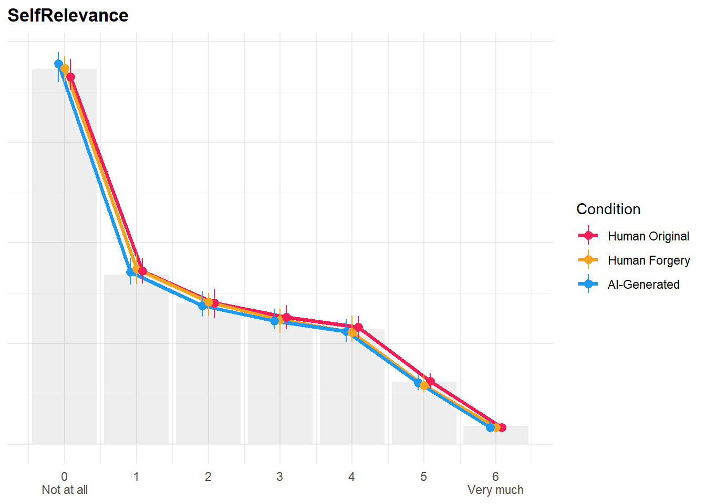{#fig-selfrelevance-1 width=672}
:::

::: {.cell-output-display}
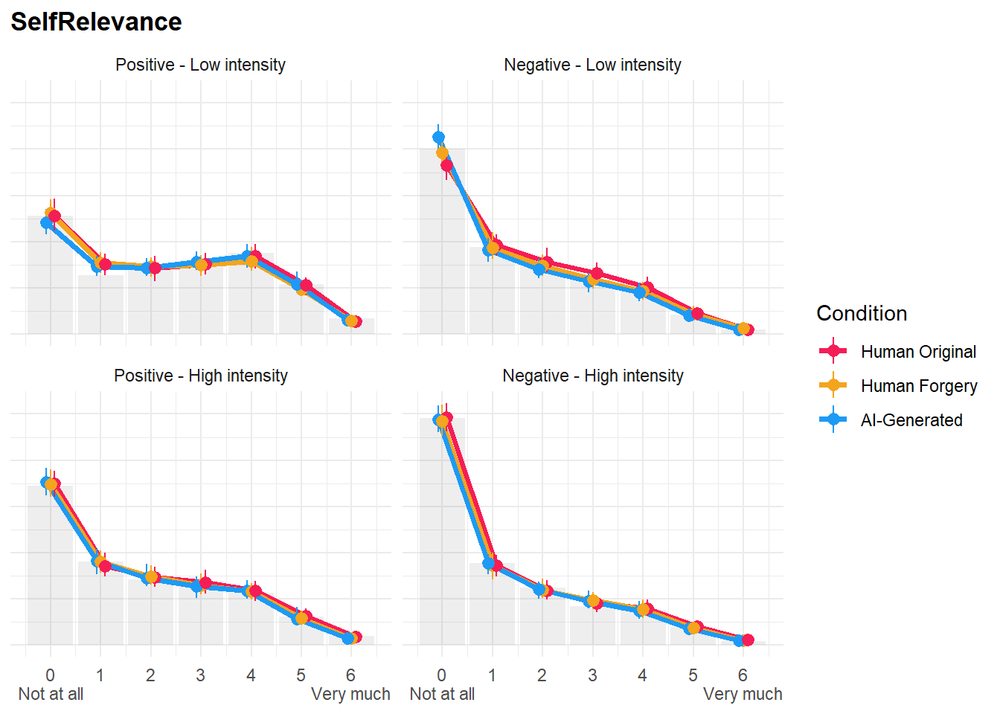{#fig-selfrelevance-2 width=672}
:::

Self-Relevance (0 = Not at all, 6 = Very much; follow-up session): observed proportion of each response and the model-implied probability per original label condition.
:::


### Artificiality


::: {.cell}

```{.r .cell-code}
make_report(estimates$Artificiality)
```

::: {.cell-output-display}

```{=html}
<div id="qywuzifekf" style="padding-left:0px;padding-right:0px;padding-top:10px;padding-bottom:10px;overflow-x:auto;overflow-y:auto;width:auto;height:auto;">
<style>#qywuzifekf table {
  font-family: system-ui, 'Segoe UI', Roboto, Helvetica, Arial, sans-serif, 'Apple Color Emoji', 'Segoe UI Emoji', 'Segoe UI Symbol', 'Noto Color Emoji';
  -webkit-font-smoothing: antialiased;
  -moz-osx-font-smoothing: grayscale;
}

#qywuzifekf thead, #qywuzifekf tbody, #qywuzifekf tfoot, #qywuzifekf tr, #qywuzifekf td, #qywuzifekf th {
  border-style: none;
}

#qywuzifekf p {
  margin: 0;
  padding: 0;
}

#qywuzifekf .gt_table {
  display: table;
  border-collapse: collapse;
  line-height: normal;
  margin-left: auto;
  margin-right: auto;
  color: #333333;
  font-size: 16px;
  font-weight: normal;
  font-style: normal;
  background-color: #FFFFFF;
  width: auto;
  border-top-style: solid;
  border-top-width: 2px;
  border-top-color: #A8A8A8;
  border-right-style: none;
  border-right-width: 2px;
  border-right-color: #D3D3D3;
  border-bottom-style: solid;
  border-bottom-width: 2px;
  border-bottom-color: #A8A8A8;
  border-left-style: none;
  border-left-width: 2px;
  border-left-color: #D3D3D3;
}

#qywuzifekf .gt_caption {
  padding-top: 4px;
  padding-bottom: 4px;
}

#qywuzifekf .gt_title {
  color: #333333;
  font-size: 125%;
  font-weight: initial;
  padding-top: 4px;
  padding-bottom: 4px;
  padding-left: 5px;
  padding-right: 5px;
  border-bottom-color: #FFFFFF;
  border-bottom-width: 0;
}

#qywuzifekf .gt_subtitle {
  color: #333333;
  font-size: 85%;
  font-weight: initial;
  padding-top: 3px;
  padding-bottom: 5px;
  padding-left: 5px;
  padding-right: 5px;
  border-top-color: #FFFFFF;
  border-top-width: 0;
}

#qywuzifekf .gt_heading {
  background-color: #FFFFFF;
  text-align: center;
  border-bottom-color: #FFFFFF;
  border-left-style: none;
  border-left-width: 1px;
  border-left-color: #D3D3D3;
  border-right-style: none;
  border-right-width: 1px;
  border-right-color: #D3D3D3;
}

#qywuzifekf .gt_bottom_border {
  border-bottom-style: solid;
  border-bottom-width: 2px;
  border-bottom-color: #D3D3D3;
}

#qywuzifekf .gt_col_headings {
  border-top-style: solid;
  border-top-width: 2px;
  border-top-color: #D3D3D3;
  border-bottom-style: solid;
  border-bottom-width: 2px;
  border-bottom-color: #D3D3D3;
  border-left-style: none;
  border-left-width: 1px;
  border-left-color: #D3D3D3;
  border-right-style: none;
  border-right-width: 1px;
  border-right-color: #D3D3D3;
}

#qywuzifekf .gt_col_heading {
  color: #333333;
  background-color: #FFFFFF;
  font-size: 100%;
  font-weight: normal;
  text-transform: inherit;
  border-left-style: none;
  border-left-width: 1px;
  border-left-color: #D3D3D3;
  border-right-style: none;
  border-right-width: 1px;
  border-right-color: #D3D3D3;
  vertical-align: bottom;
  padding-top: 5px;
  padding-bottom: 6px;
  padding-left: 5px;
  padding-right: 5px;
  overflow-x: hidden;
}

#qywuzifekf .gt_column_spanner_outer {
  color: #333333;
  background-color: #FFFFFF;
  font-size: 100%;
  font-weight: normal;
  text-transform: inherit;
  padding-top: 0;
  padding-bottom: 0;
  padding-left: 4px;
  padding-right: 4px;
}

#qywuzifekf .gt_column_spanner_outer:first-child {
  padding-left: 0;
}

#qywuzifekf .gt_column_spanner_outer:last-child {
  padding-right: 0;
}

#qywuzifekf .gt_column_spanner {
  border-bottom-style: solid;
  border-bottom-width: 2px;
  border-bottom-color: #D3D3D3;
  vertical-align: bottom;
  padding-top: 5px;
  padding-bottom: 5px;
  overflow-x: hidden;
  display: inline-block;
  width: 100%;
}

#qywuzifekf .gt_spanner_row {
  border-bottom-style: hidden;
}

#qywuzifekf .gt_group_heading {
  padding-top: 8px;
  padding-bottom: 8px;
  padding-left: 5px;
  padding-right: 5px;
  color: #333333;
  background-color: #FFFFFF;
  font-size: 100%;
  font-weight: initial;
  text-transform: inherit;
  border-top-style: solid;
  border-top-width: 2px;
  border-top-color: #D3D3D3;
  border-bottom-style: solid;
  border-bottom-width: 2px;
  border-bottom-color: #D3D3D3;
  border-left-style: none;
  border-left-width: 1px;
  border-left-color: #D3D3D3;
  border-right-style: none;
  border-right-width: 1px;
  border-right-color: #D3D3D3;
  vertical-align: middle;
  text-align: left;
}

#qywuzifekf .gt_empty_group_heading {
  padding: 0.5px;
  color: #333333;
  background-color: #FFFFFF;
  font-size: 100%;
  font-weight: initial;
  border-top-style: solid;
  border-top-width: 2px;
  border-top-color: #D3D3D3;
  border-bottom-style: solid;
  border-bottom-width: 2px;
  border-bottom-color: #D3D3D3;
  vertical-align: middle;
}

#qywuzifekf .gt_from_md > :first-child {
  margin-top: 0;
}

#qywuzifekf .gt_from_md > :last-child {
  margin-bottom: 0;
}

#qywuzifekf .gt_row {
  padding-top: 8px;
  padding-bottom: 8px;
  padding-left: 5px;
  padding-right: 5px;
  margin: 10px;
  border-top-style: solid;
  border-top-width: 1px;
  border-top-color: #D3D3D3;
  border-left-style: none;
  border-left-width: 1px;
  border-left-color: #D3D3D3;
  border-right-style: none;
  border-right-width: 1px;
  border-right-color: #D3D3D3;
  vertical-align: middle;
  overflow-x: hidden;
}

#qywuzifekf .gt_stub {
  color: #333333;
  background-color: #FFFFFF;
  font-size: 100%;
  font-weight: initial;
  text-transform: inherit;
  border-right-style: solid;
  border-right-width: 2px;
  border-right-color: #D3D3D3;
  padding-left: 5px;
  padding-right: 5px;
}

#qywuzifekf .gt_stub_row_group {
  color: #333333;
  background-color: #FFFFFF;
  font-size: 100%;
  font-weight: initial;
  text-transform: inherit;
  border-right-style: solid;
  border-right-width: 2px;
  border-right-color: #D3D3D3;
  padding-left: 5px;
  padding-right: 5px;
  vertical-align: top;
}

#qywuzifekf .gt_row_group_first td {
  border-top-width: 2px;
}

#qywuzifekf .gt_row_group_first th {
  border-top-width: 2px;
}

#qywuzifekf .gt_summary_row {
  color: #333333;
  background-color: #FFFFFF;
  text-transform: inherit;
  padding-top: 8px;
  padding-bottom: 8px;
  padding-left: 5px;
  padding-right: 5px;
}

#qywuzifekf .gt_first_summary_row {
  border-top-style: solid;
  border-top-color: #D3D3D3;
}

#qywuzifekf .gt_first_summary_row.thick {
  border-top-width: 2px;
}

#qywuzifekf .gt_last_summary_row {
  padding-top: 8px;
  padding-bottom: 8px;
  padding-left: 5px;
  padding-right: 5px;
  border-bottom-style: solid;
  border-bottom-width: 2px;
  border-bottom-color: #D3D3D3;
}

#qywuzifekf .gt_grand_summary_row {
  color: #333333;
  background-color: #FFFFFF;
  text-transform: inherit;
  padding-top: 8px;
  padding-bottom: 8px;
  padding-left: 5px;
  padding-right: 5px;
}

#qywuzifekf .gt_first_grand_summary_row {
  padding-top: 8px;
  padding-bottom: 8px;
  padding-left: 5px;
  padding-right: 5px;
  border-top-style: double;
  border-top-width: 6px;
  border-top-color: #D3D3D3;
}

#qywuzifekf .gt_last_grand_summary_row_top {
  padding-top: 8px;
  padding-bottom: 8px;
  padding-left: 5px;
  padding-right: 5px;
  border-bottom-style: double;
  border-bottom-width: 6px;
  border-bottom-color: #D3D3D3;
}

#qywuzifekf .gt_striped {
  background-color: rgba(128, 128, 128, 0.05);
}

#qywuzifekf .gt_table_body {
  border-top-style: solid;
  border-top-width: 2px;
  border-top-color: #D3D3D3;
  border-bottom-style: solid;
  border-bottom-width: 2px;
  border-bottom-color: #D3D3D3;
}

#qywuzifekf .gt_footnotes {
  color: #333333;
  background-color: #FFFFFF;
  border-bottom-style: none;
  border-bottom-width: 2px;
  border-bottom-color: #D3D3D3;
  border-left-style: none;
  border-left-width: 2px;
  border-left-color: #D3D3D3;
  border-right-style: none;
  border-right-width: 2px;
  border-right-color: #D3D3D3;
}

#qywuzifekf .gt_footnote {
  margin: 0px;
  font-size: 90%;
  padding-top: 4px;
  padding-bottom: 4px;
  padding-left: 5px;
  padding-right: 5px;
}

#qywuzifekf .gt_sourcenotes {
  color: #333333;
  background-color: #FFFFFF;
  border-bottom-style: none;
  border-bottom-width: 2px;
  border-bottom-color: #D3D3D3;
  border-left-style: none;
  border-left-width: 2px;
  border-left-color: #D3D3D3;
  border-right-style: none;
  border-right-width: 2px;
  border-right-color: #D3D3D3;
}

#qywuzifekf .gt_sourcenote {
  font-size: 90%;
  padding-top: 4px;
  padding-bottom: 4px;
  padding-left: 5px;
  padding-right: 5px;
}

#qywuzifekf .gt_left {
  text-align: left;
}

#qywuzifekf .gt_center {
  text-align: center;
}

#qywuzifekf .gt_right {
  text-align: right;
  font-variant-numeric: tabular-nums;
}

#qywuzifekf .gt_font_normal {
  font-weight: normal;
}

#qywuzifekf .gt_font_bold {
  font-weight: bold;
}

#qywuzifekf .gt_font_italic {
  font-style: italic;
}

#qywuzifekf .gt_super {
  font-size: 65%;
}

#qywuzifekf .gt_footnote_marks {
  font-size: 75%;
  vertical-align: 0.4em;
  position: initial;
}

#qywuzifekf .gt_asterisk {
  font-size: 100%;
  vertical-align: 0;
}

#qywuzifekf .gt_indent_1 {
  text-indent: 5px;
}

#qywuzifekf .gt_indent_2 {
  text-indent: 10px;
}

#qywuzifekf .gt_indent_3 {
  text-indent: 15px;
}

#qywuzifekf .gt_indent_4 {
  text-indent: 20px;
}

#qywuzifekf .gt_indent_5 {
  text-indent: 25px;
}

#qywuzifekf .katex-display {
  display: inline-flex !important;
  margin-bottom: 0.75em !important;
}

#qywuzifekf div.Reactable > div.rt-table > div.rt-thead > div.rt-tr.rt-tr-group-header > div.rt-th-group:after {
  height: 0px !important;
}
</style>
<table class="gt_table" data-quarto-disable-processing="false" data-quarto-bootstrap="false">
  <thead>
    <tr class="gt_col_headings">
      <th class="gt_col_heading gt_columns_bottom_border gt_left" rowspan="1" colspan="1" scope="col" id="Contrast">Contrast</th>
      <th class="gt_col_heading gt_columns_bottom_border gt_left" rowspan="1" colspan="1" scope="col" id="Parameters">Parameters</th>
    </tr>
  </thead>
  <tbody class="gt_table_body">
    <tr><td headers="Contrast" class="gt_row gt_left">Human Forgery - Human Original</td>
<td headers="Parameters" class="gt_row gt_left">pmid (0.00, [-0.01,  0.00])</td></tr>
    <tr><td headers="Contrast" class="gt_row gt_left">AI-Generated - Human Forgery</td>
<td headers="Parameters" class="gt_row gt_left">pmid (0.00, [ 0.00,  0.01])</td></tr>
  </tbody>
  
</table>
</div>
```

```{=html}
<div id="bcylhusrct" style="padding-left:0px;padding-right:0px;padding-top:10px;padding-bottom:10px;overflow-x:auto;overflow-y:auto;width:auto;height:auto;">
<style>#bcylhusrct table {
  font-family: system-ui, 'Segoe UI', Roboto, Helvetica, Arial, sans-serif, 'Apple Color Emoji', 'Segoe UI Emoji', 'Segoe UI Symbol', 'Noto Color Emoji';
  -webkit-font-smoothing: antialiased;
  -moz-osx-font-smoothing: grayscale;
}

#bcylhusrct thead, #bcylhusrct tbody, #bcylhusrct tfoot, #bcylhusrct tr, #bcylhusrct td, #bcylhusrct th {
  border-style: none;
}

#bcylhusrct p {
  margin: 0;
  padding: 0;
}

#bcylhusrct .gt_table {
  display: table;
  border-collapse: collapse;
  line-height: normal;
  margin-left: auto;
  margin-right: auto;
  color: #333333;
  font-size: 13px;
  font-weight: normal;
  font-style: normal;
  background-color: #FFFFFF;
  width: auto;
  border-top-style: solid;
  border-top-width: 3px;
  border-top-color: #D5D5D5;
  border-right-style: solid;
  border-right-width: 3px;
  border-right-color: #D5D5D5;
  border-bottom-style: solid;
  border-bottom-width: 3px;
  border-bottom-color: #D5D5D5;
  border-left-style: solid;
  border-left-width: 3px;
  border-left-color: #D5D5D5;
}

#bcylhusrct .gt_caption {
  padding-top: 4px;
  padding-bottom: 4px;
}

#bcylhusrct .gt_title {
  color: #333333;
  font-size: 125%;
  font-weight: initial;
  padding-top: 4px;
  padding-bottom: 4px;
  padding-left: 5px;
  padding-right: 5px;
  border-bottom-color: #FFFFFF;
  border-bottom-width: 0;
}

#bcylhusrct .gt_subtitle {
  color: #333333;
  font-size: 85%;
  font-weight: initial;
  padding-top: 3px;
  padding-bottom: 5px;
  padding-left: 5px;
  padding-right: 5px;
  border-top-color: #FFFFFF;
  border-top-width: 0;
}

#bcylhusrct .gt_heading {
  background-color: #FFFFFF;
  text-align: left;
  border-bottom-color: #FFFFFF;
  border-left-style: none;
  border-left-width: 1px;
  border-left-color: #D3D3D3;
  border-right-style: none;
  border-right-width: 1px;
  border-right-color: #D3D3D3;
}

#bcylhusrct .gt_bottom_border {
  border-bottom-style: solid;
  border-bottom-width: 2px;
  border-bottom-color: #D5D5D5;
}

#bcylhusrct .gt_col_headings {
  border-top-style: solid;
  border-top-width: 2px;
  border-top-color: #D5D5D5;
  border-bottom-style: solid;
  border-bottom-width: 2px;
  border-bottom-color: #D5D5D5;
  border-left-style: none;
  border-left-width: 1px;
  border-left-color: #D3D3D3;
  border-right-style: none;
  border-right-width: 1px;
  border-right-color: #D3D3D3;
}

#bcylhusrct .gt_col_heading {
  color: #FFFFFF;
  background-color: #000000;
  font-size: 100%;
  font-weight: normal;
  text-transform: inherit;
  border-left-style: none;
  border-left-width: 1px;
  border-left-color: #D3D3D3;
  border-right-style: none;
  border-right-width: 1px;
  border-right-color: #D3D3D3;
  vertical-align: bottom;
  padding-top: 5px;
  padding-bottom: 6px;
  padding-left: 5px;
  padding-right: 5px;
  overflow-x: hidden;
}

#bcylhusrct .gt_column_spanner_outer {
  color: #FFFFFF;
  background-color: #000000;
  font-size: 100%;
  font-weight: normal;
  text-transform: inherit;
  padding-top: 0;
  padding-bottom: 0;
  padding-left: 4px;
  padding-right: 4px;
}

#bcylhusrct .gt_column_spanner_outer:first-child {
  padding-left: 0;
}

#bcylhusrct .gt_column_spanner_outer:last-child {
  padding-right: 0;
}

#bcylhusrct .gt_column_spanner {
  border-bottom-style: solid;
  border-bottom-width: 2px;
  border-bottom-color: #D5D5D5;
  vertical-align: bottom;
  padding-top: 5px;
  padding-bottom: 5px;
  overflow-x: hidden;
  display: inline-block;
  width: 100%;
}

#bcylhusrct .gt_spanner_row {
  border-bottom-style: hidden;
}

#bcylhusrct .gt_group_heading {
  padding-top: 8px;
  padding-bottom: 8px;
  padding-left: 5px;
  padding-right: 5px;
  color: #333333;
  background-color: #FFFFFF;
  font-size: 100%;
  font-weight: initial;
  text-transform: inherit;
  border-top-style: solid;
  border-top-width: 2px;
  border-top-color: #D5D5D5;
  border-bottom-style: solid;
  border-bottom-width: 2px;
  border-bottom-color: #D5D5D5;
  border-left-style: none;
  border-left-width: 1px;
  border-left-color: #D3D3D3;
  border-right-style: none;
  border-right-width: 1px;
  border-right-color: #D3D3D3;
  vertical-align: middle;
  text-align: left;
}

#bcylhusrct .gt_empty_group_heading {
  padding: 0.5px;
  color: #333333;
  background-color: #FFFFFF;
  font-size: 100%;
  font-weight: initial;
  border-top-style: solid;
  border-top-width: 2px;
  border-top-color: #D5D5D5;
  border-bottom-style: solid;
  border-bottom-width: 2px;
  border-bottom-color: #D5D5D5;
  vertical-align: middle;
}

#bcylhusrct .gt_from_md > :first-child {
  margin-top: 0;
}

#bcylhusrct .gt_from_md > :last-child {
  margin-bottom: 0;
}

#bcylhusrct .gt_row {
  padding-top: 8px;
  padding-bottom: 8px;
  padding-left: 5px;
  padding-right: 5px;
  margin: 10px;
  border-top-style: solid;
  border-top-width: 1px;
  border-top-color: #D5D5D5;
  border-left-style: solid;
  border-left-width: 1px;
  border-left-color: #D5D5D5;
  border-right-style: solid;
  border-right-width: 1px;
  border-right-color: #D5D5D5;
  vertical-align: middle;
  overflow-x: hidden;
}

#bcylhusrct .gt_stub {
  color: #333333;
  background-color: #FFFFFF;
  font-size: 100%;
  font-weight: initial;
  text-transform: inherit;
  border-right-style: solid;
  border-right-width: 2px;
  border-right-color: #5F5F5F;
  padding-left: 5px;
  padding-right: 5px;
}

#bcylhusrct .gt_stub_row_group {
  color: #333333;
  background-color: #FFFFFF;
  font-size: 100%;
  font-weight: initial;
  text-transform: inherit;
  border-right-style: solid;
  border-right-width: 2px;
  border-right-color: #D3D3D3;
  padding-left: 5px;
  padding-right: 5px;
  vertical-align: top;
}

#bcylhusrct .gt_row_group_first td {
  border-top-width: 2px;
}

#bcylhusrct .gt_row_group_first th {
  border-top-width: 2px;
}

#bcylhusrct .gt_summary_row {
  color: #333333;
  background-color: #D5D5D5;
  text-transform: inherit;
  padding-top: 8px;
  padding-bottom: 8px;
  padding-left: 5px;
  padding-right: 5px;
}

#bcylhusrct .gt_first_summary_row {
  border-top-style: solid;
  border-top-color: #D5D5D5;
}

#bcylhusrct .gt_first_summary_row.thick {
  border-top-width: 2px;
}

#bcylhusrct .gt_last_summary_row {
  padding-top: 8px;
  padding-bottom: 8px;
  padding-left: 5px;
  padding-right: 5px;
  border-bottom-style: solid;
  border-bottom-width: 2px;
  border-bottom-color: #D5D5D5;
}

#bcylhusrct .gt_grand_summary_row {
  color: #FFFFFF;
  background-color: #929292;
  text-transform: inherit;
  padding-top: 8px;
  padding-bottom: 8px;
  padding-left: 5px;
  padding-right: 5px;
}

#bcylhusrct .gt_first_grand_summary_row {
  padding-top: 8px;
  padding-bottom: 8px;
  padding-left: 5px;
  padding-right: 5px;
  border-top-style: double;
  border-top-width: 6px;
  border-top-color: #D5D5D5;
}

#bcylhusrct .gt_last_grand_summary_row_top {
  padding-top: 8px;
  padding-bottom: 8px;
  padding-left: 5px;
  padding-right: 5px;
  border-bottom-style: double;
  border-bottom-width: 6px;
  border-bottom-color: #D5D5D5;
}

#bcylhusrct .gt_striped {
  background-color: #F4F4F4;
}

#bcylhusrct .gt_table_body {
  border-top-style: solid;
  border-top-width: 2px;
  border-top-color: #D5D5D5;
  border-bottom-style: solid;
  border-bottom-width: 2px;
  border-bottom-color: #D5D5D5;
}

#bcylhusrct .gt_footnotes {
  color: #333333;
  background-color: #FFFFFF;
  border-bottom-style: none;
  border-bottom-width: 2px;
  border-bottom-color: #D3D3D3;
  border-left-style: none;
  border-left-width: 2px;
  border-left-color: #D3D3D3;
  border-right-style: none;
  border-right-width: 2px;
  border-right-color: #D3D3D3;
}

#bcylhusrct .gt_footnote {
  margin: 0px;
  font-size: 90%;
  padding-top: 4px;
  padding-bottom: 4px;
  padding-left: 5px;
  padding-right: 5px;
}

#bcylhusrct .gt_sourcenotes {
  color: #333333;
  background-color: #FFFFFF;
  border-bottom-style: none;
  border-bottom-width: 2px;
  border-bottom-color: #D3D3D3;
  border-left-style: none;
  border-left-width: 2px;
  border-left-color: #D3D3D3;
  border-right-style: none;
  border-right-width: 2px;
  border-right-color: #D3D3D3;
}

#bcylhusrct .gt_sourcenote {
  font-size: 90%;
  padding-top: 4px;
  padding-bottom: 4px;
  padding-left: 5px;
  padding-right: 5px;
}

#bcylhusrct .gt_left {
  text-align: left;
}

#bcylhusrct .gt_center {
  text-align: center;
}

#bcylhusrct .gt_right {
  text-align: right;
  font-variant-numeric: tabular-nums;
}

#bcylhusrct .gt_font_normal {
  font-weight: normal;
}

#bcylhusrct .gt_font_bold {
  font-weight: bold;
}

#bcylhusrct .gt_font_italic {
  font-style: italic;
}

#bcylhusrct .gt_super {
  font-size: 65%;
}

#bcylhusrct .gt_footnote_marks {
  font-size: 75%;
  vertical-align: 0.4em;
  position: initial;
}

#bcylhusrct .gt_asterisk {
  font-size: 100%;
  vertical-align: 0;
}

#bcylhusrct .gt_indent_1 {
  text-indent: 5px;
}

#bcylhusrct .gt_indent_2 {
  text-indent: 10px;
}

#bcylhusrct .gt_indent_3 {
  text-indent: 15px;
}

#bcylhusrct .gt_indent_4 {
  text-indent: 20px;
}

#bcylhusrct .gt_indent_5 {
  text-indent: 25px;
}

#bcylhusrct .katex-display {
  display: inline-flex !important;
  margin-bottom: 0.75em !important;
}

#bcylhusrct div.Reactable > div.rt-table > div.rt-thead > div.rt-tr.rt-tr-group-header > div.rt-th-group:after {
  height: 0px !important;
}
</style>
<table class="gt_table" data-quarto-disable-processing="false" data-quarto-bootstrap="false">
  <thead>
    <tr class="gt_heading">
      <td colspan="10" class="gt_heading gt_title gt_font_normal gt_bottom_border" style>Perceived Artificiality: convergence</td>
    </tr>
    
    <tr class="gt_col_headings">
      <th class="gt_col_heading gt_columns_bottom_border gt_left" rowspan="1" colspan="1" scope="col" id="Model">Model</th>
      <th class="gt_col_heading gt_columns_bottom_border gt_left" rowspan="1" colspan="1" scope="col" id="Family">Family</th>
      <th class="gt_col_heading gt_columns_bottom_border gt_right" rowspan="1" colspan="1" scope="col" id="N_obs">N_obs</th>
      <th class="gt_col_heading gt_columns_bottom_border gt_right" rowspan="1" colspan="1" scope="col" id="N_participants">N_participants</th>
      <th class="gt_col_heading gt_columns_bottom_border gt_right" rowspan="1" colspan="1" scope="col" id="Chains">Chains</th>
      <th class="gt_col_heading gt_columns_bottom_border gt_right" rowspan="1" colspan="1" scope="col" id="Draws">Draws</th>
      <th class="gt_col_heading gt_columns_bottom_border gt_right" rowspan="1" colspan="1" scope="col" id="Max_Rhat">Max_Rhat</th>
      <th class="gt_col_heading gt_columns_bottom_border gt_right" rowspan="1" colspan="1" scope="col" id="Min_ESS_ratio">Min_ESS_ratio</th>
      <th class="gt_col_heading gt_columns_bottom_border gt_right" rowspan="1" colspan="1" scope="col" id="Divergent_pct">Divergent_pct</th>
      <th class="gt_col_heading gt_columns_bottom_border gt_left" rowspan="1" colspan="1" scope="col" id="Criterion">Criterion</th>
    </tr>
  </thead>
  <tbody class="gt_table_body">
    <tr><td headers="Model" class="gt_row gt_left">Artificiality</td>
<td headers="Family" class="gt_row gt_left">CHOCO</td>
<td headers="N_obs" class="gt_row gt_right">6009</td>
<td headers="N_participants" class="gt_row gt_right">220</td>
<td headers="Chains" class="gt_row gt_right">8</td>
<td headers="Draws" class="gt_row gt_right">4000</td>
<td headers="Max_Rhat" class="gt_row gt_right">1.038</td>
<td headers="Min_ESS_ratio" class="gt_row gt_right">0.047</td>
<td headers="Divergent_pct" class="gt_row gt_right">0</td>
<td headers="Criterion" class="gt_row gt_left">loo</td></tr>
  </tbody>
  
</table>
</div>
```


::: {.callout-note collapse="true" title="Perceived Artificiality: convergence (Markdown table, for text readers)"}

|Model         |Family | N_obs| N_participants| Chains| Draws| Max_Rhat| Min_ESS_ratio| Divergent_pct|Criterion |
|:-------------|:------|-----:|--------------:|------:|-----:|--------:|-------------:|-------------:|:---------|
|Artificiality |CHOCO  |  6009|            220|      8|  4000|    1.038|         0.047|             0|loo       |

:::

```{=html}
<div id="fujjgmblbr" style="padding-left:0px;padding-right:0px;padding-top:10px;padding-bottom:10px;overflow-x:auto;overflow-y:auto;width:auto;height:auto;">
<style>#fujjgmblbr table {
  font-family: system-ui, 'Segoe UI', Roboto, Helvetica, Arial, sans-serif, 'Apple Color Emoji', 'Segoe UI Emoji', 'Segoe UI Symbol', 'Noto Color Emoji';
  -webkit-font-smoothing: antialiased;
  -moz-osx-font-smoothing: grayscale;
}

#fujjgmblbr thead, #fujjgmblbr tbody, #fujjgmblbr tfoot, #fujjgmblbr tr, #fujjgmblbr td, #fujjgmblbr th {
  border-style: none;
}

#fujjgmblbr p {
  margin: 0;
  padding: 0;
}

#fujjgmblbr .gt_table {
  display: table;
  border-collapse: collapse;
  line-height: normal;
  margin-left: auto;
  margin-right: auto;
  color: #333333;
  font-size: 13px;
  font-weight: normal;
  font-style: normal;
  background-color: #FFFFFF;
  width: auto;
  border-top-style: solid;
  border-top-width: 3px;
  border-top-color: #D5D5D5;
  border-right-style: solid;
  border-right-width: 3px;
  border-right-color: #D5D5D5;
  border-bottom-style: solid;
  border-bottom-width: 3px;
  border-bottom-color: #D5D5D5;
  border-left-style: solid;
  border-left-width: 3px;
  border-left-color: #D5D5D5;
}

#fujjgmblbr .gt_caption {
  padding-top: 4px;
  padding-bottom: 4px;
}

#fujjgmblbr .gt_title {
  color: #333333;
  font-size: 125%;
  font-weight: initial;
  padding-top: 4px;
  padding-bottom: 4px;
  padding-left: 5px;
  padding-right: 5px;
  border-bottom-color: #FFFFFF;
  border-bottom-width: 0;
}

#fujjgmblbr .gt_subtitle {
  color: #333333;
  font-size: 85%;
  font-weight: initial;
  padding-top: 3px;
  padding-bottom: 5px;
  padding-left: 5px;
  padding-right: 5px;
  border-top-color: #FFFFFF;
  border-top-width: 0;
}

#fujjgmblbr .gt_heading {
  background-color: #FFFFFF;
  text-align: left;
  border-bottom-color: #FFFFFF;
  border-left-style: none;
  border-left-width: 1px;
  border-left-color: #D3D3D3;
  border-right-style: none;
  border-right-width: 1px;
  border-right-color: #D3D3D3;
}

#fujjgmblbr .gt_bottom_border {
  border-bottom-style: solid;
  border-bottom-width: 2px;
  border-bottom-color: #D5D5D5;
}

#fujjgmblbr .gt_col_headings {
  border-top-style: solid;
  border-top-width: 2px;
  border-top-color: #D5D5D5;
  border-bottom-style: solid;
  border-bottom-width: 2px;
  border-bottom-color: #D5D5D5;
  border-left-style: none;
  border-left-width: 1px;
  border-left-color: #D3D3D3;
  border-right-style: none;
  border-right-width: 1px;
  border-right-color: #D3D3D3;
}

#fujjgmblbr .gt_col_heading {
  color: #FFFFFF;
  background-color: #000000;
  font-size: 100%;
  font-weight: normal;
  text-transform: inherit;
  border-left-style: none;
  border-left-width: 1px;
  border-left-color: #D3D3D3;
  border-right-style: none;
  border-right-width: 1px;
  border-right-color: #D3D3D3;
  vertical-align: bottom;
  padding-top: 5px;
  padding-bottom: 6px;
  padding-left: 5px;
  padding-right: 5px;
  overflow-x: hidden;
}

#fujjgmblbr .gt_column_spanner_outer {
  color: #FFFFFF;
  background-color: #000000;
  font-size: 100%;
  font-weight: normal;
  text-transform: inherit;
  padding-top: 0;
  padding-bottom: 0;
  padding-left: 4px;
  padding-right: 4px;
}

#fujjgmblbr .gt_column_spanner_outer:first-child {
  padding-left: 0;
}

#fujjgmblbr .gt_column_spanner_outer:last-child {
  padding-right: 0;
}

#fujjgmblbr .gt_column_spanner {
  border-bottom-style: solid;
  border-bottom-width: 2px;
  border-bottom-color: #D5D5D5;
  vertical-align: bottom;
  padding-top: 5px;
  padding-bottom: 5px;
  overflow-x: hidden;
  display: inline-block;
  width: 100%;
}

#fujjgmblbr .gt_spanner_row {
  border-bottom-style: hidden;
}

#fujjgmblbr .gt_group_heading {
  padding-top: 8px;
  padding-bottom: 8px;
  padding-left: 5px;
  padding-right: 5px;
  color: #333333;
  background-color: #FFFFFF;
  font-size: 100%;
  font-weight: initial;
  text-transform: inherit;
  border-top-style: solid;
  border-top-width: 2px;
  border-top-color: #D5D5D5;
  border-bottom-style: solid;
  border-bottom-width: 2px;
  border-bottom-color: #D5D5D5;
  border-left-style: none;
  border-left-width: 1px;
  border-left-color: #D3D3D3;
  border-right-style: none;
  border-right-width: 1px;
  border-right-color: #D3D3D3;
  vertical-align: middle;
  text-align: left;
}

#fujjgmblbr .gt_empty_group_heading {
  padding: 0.5px;
  color: #333333;
  background-color: #FFFFFF;
  font-size: 100%;
  font-weight: initial;
  border-top-style: solid;
  border-top-width: 2px;
  border-top-color: #D5D5D5;
  border-bottom-style: solid;
  border-bottom-width: 2px;
  border-bottom-color: #D5D5D5;
  vertical-align: middle;
}

#fujjgmblbr .gt_from_md > :first-child {
  margin-top: 0;
}

#fujjgmblbr .gt_from_md > :last-child {
  margin-bottom: 0;
}

#fujjgmblbr .gt_row {
  padding-top: 8px;
  padding-bottom: 8px;
  padding-left: 5px;
  padding-right: 5px;
  margin: 10px;
  border-top-style: solid;
  border-top-width: 1px;
  border-top-color: #D5D5D5;
  border-left-style: solid;
  border-left-width: 1px;
  border-left-color: #D5D5D5;
  border-right-style: solid;
  border-right-width: 1px;
  border-right-color: #D5D5D5;
  vertical-align: middle;
  overflow-x: hidden;
}

#fujjgmblbr .gt_stub {
  color: #333333;
  background-color: #FFFFFF;
  font-size: 100%;
  font-weight: initial;
  text-transform: inherit;
  border-right-style: solid;
  border-right-width: 2px;
  border-right-color: #5F5F5F;
  padding-left: 5px;
  padding-right: 5px;
}

#fujjgmblbr .gt_stub_row_group {
  color: #333333;
  background-color: #FFFFFF;
  font-size: 100%;
  font-weight: initial;
  text-transform: inherit;
  border-right-style: solid;
  border-right-width: 2px;
  border-right-color: #D3D3D3;
  padding-left: 5px;
  padding-right: 5px;
  vertical-align: top;
}

#fujjgmblbr .gt_row_group_first td {
  border-top-width: 2px;
}

#fujjgmblbr .gt_row_group_first th {
  border-top-width: 2px;
}

#fujjgmblbr .gt_summary_row {
  color: #333333;
  background-color: #D5D5D5;
  text-transform: inherit;
  padding-top: 8px;
  padding-bottom: 8px;
  padding-left: 5px;
  padding-right: 5px;
}

#fujjgmblbr .gt_first_summary_row {
  border-top-style: solid;
  border-top-color: #D5D5D5;
}

#fujjgmblbr .gt_first_summary_row.thick {
  border-top-width: 2px;
}

#fujjgmblbr .gt_last_summary_row {
  padding-top: 8px;
  padding-bottom: 8px;
  padding-left: 5px;
  padding-right: 5px;
  border-bottom-style: solid;
  border-bottom-width: 2px;
  border-bottom-color: #D5D5D5;
}

#fujjgmblbr .gt_grand_summary_row {
  color: #FFFFFF;
  background-color: #929292;
  text-transform: inherit;
  padding-top: 8px;
  padding-bottom: 8px;
  padding-left: 5px;
  padding-right: 5px;
}

#fujjgmblbr .gt_first_grand_summary_row {
  padding-top: 8px;
  padding-bottom: 8px;
  padding-left: 5px;
  padding-right: 5px;
  border-top-style: double;
  border-top-width: 6px;
  border-top-color: #D5D5D5;
}

#fujjgmblbr .gt_last_grand_summary_row_top {
  padding-top: 8px;
  padding-bottom: 8px;
  padding-left: 5px;
  padding-right: 5px;
  border-bottom-style: double;
  border-bottom-width: 6px;
  border-bottom-color: #D5D5D5;
}

#fujjgmblbr .gt_striped {
  background-color: #F4F4F4;
}

#fujjgmblbr .gt_table_body {
  border-top-style: solid;
  border-top-width: 2px;
  border-top-color: #D5D5D5;
  border-bottom-style: solid;
  border-bottom-width: 2px;
  border-bottom-color: #D5D5D5;
}

#fujjgmblbr .gt_footnotes {
  color: #333333;
  background-color: #FFFFFF;
  border-bottom-style: none;
  border-bottom-width: 2px;
  border-bottom-color: #D3D3D3;
  border-left-style: none;
  border-left-width: 2px;
  border-left-color: #D3D3D3;
  border-right-style: none;
  border-right-width: 2px;
  border-right-color: #D3D3D3;
}

#fujjgmblbr .gt_footnote {
  margin: 0px;
  font-size: 90%;
  padding-top: 4px;
  padding-bottom: 4px;
  padding-left: 5px;
  padding-right: 5px;
}

#fujjgmblbr .gt_sourcenotes {
  color: #333333;
  background-color: #FFFFFF;
  border-bottom-style: none;
  border-bottom-width: 2px;
  border-bottom-color: #D3D3D3;
  border-left-style: none;
  border-left-width: 2px;
  border-left-color: #D3D3D3;
  border-right-style: none;
  border-right-width: 2px;
  border-right-color: #D3D3D3;
}

#fujjgmblbr .gt_sourcenote {
  font-size: 90%;
  padding-top: 4px;
  padding-bottom: 4px;
  padding-left: 5px;
  padding-right: 5px;
}

#fujjgmblbr .gt_left {
  text-align: left;
}

#fujjgmblbr .gt_center {
  text-align: center;
}

#fujjgmblbr .gt_right {
  text-align: right;
  font-variant-numeric: tabular-nums;
}

#fujjgmblbr .gt_font_normal {
  font-weight: normal;
}

#fujjgmblbr .gt_font_bold {
  font-weight: bold;
}

#fujjgmblbr .gt_font_italic {
  font-style: italic;
}

#fujjgmblbr .gt_super {
  font-size: 65%;
}

#fujjgmblbr .gt_footnote_marks {
  font-size: 75%;
  vertical-align: 0.4em;
  position: initial;
}

#fujjgmblbr .gt_asterisk {
  font-size: 100%;
  vertical-align: 0;
}

#fujjgmblbr .gt_indent_1 {
  text-indent: 5px;
}

#fujjgmblbr .gt_indent_2 {
  text-indent: 10px;
}

#fujjgmblbr .gt_indent_3 {
  text-indent: 15px;
}

#fujjgmblbr .gt_indent_4 {
  text-indent: 20px;
}

#fujjgmblbr .gt_indent_5 {
  text-indent: 25px;
}

#fujjgmblbr .katex-display {
  display: inline-flex !important;
  margin-bottom: 0.75em !important;
}

#fujjgmblbr div.Reactable > div.rt-table > div.rt-thead > div.rt-tr.rt-tr-group-header > div.rt-th-group:after {
  height: 0px !important;
}
</style>
<table class="gt_table" data-quarto-disable-processing="false" data-quarto-bootstrap="false">
  <thead>
    <tr class="gt_heading">
      <td colspan="4" class="gt_heading gt_title gt_font_normal gt_bottom_border" style>Perceived Artificiality: marginal means per label condition (response scale)</td>
    </tr>
    
    <tr class="gt_col_headings">
      <th class="gt_col_heading gt_columns_bottom_border gt_center" rowspan="1" colspan="1" scope="col" id="Condition">Condition</th>
      <th class="gt_col_heading gt_columns_bottom_border gt_right" rowspan="1" colspan="1" scope="col" id="Estimate">Estimate</th>
      <th class="gt_col_heading gt_columns_bottom_border gt_right" rowspan="1" colspan="1" scope="col" id="CI_low">CI_low</th>
      <th class="gt_col_heading gt_columns_bottom_border gt_right" rowspan="1" colspan="1" scope="col" id="CI_high">CI_high</th>
    </tr>
  </thead>
  <tbody class="gt_table_body">
    <tr><td headers="Condition" class="gt_row gt_center">Human Original</td>
<td headers="Estimate" class="gt_row gt_right">0.57</td>
<td headers="CI_low" class="gt_row gt_right">0.53</td>
<td headers="CI_high" class="gt_row gt_right">0.60</td></tr>
    <tr><td headers="Condition" class="gt_row gt_center gt_striped">Human Forgery</td>
<td headers="Estimate" class="gt_row gt_right gt_striped">0.58</td>
<td headers="CI_low" class="gt_row gt_right gt_striped">0.54</td>
<td headers="CI_high" class="gt_row gt_right gt_striped">0.61</td></tr>
    <tr><td headers="Condition" class="gt_row gt_center">AI-Generated</td>
<td headers="Estimate" class="gt_row gt_right">0.57</td>
<td headers="CI_low" class="gt_row gt_right">0.54</td>
<td headers="CI_high" class="gt_row gt_right">0.61</td></tr>
  </tbody>
  
</table>
</div>
```


::: {.callout-note collapse="true" title="Perceived Artificiality: marginal means per label condition (response scale) (Markdown table, for text readers)"}

|Condition      |Estimate |CI_low |CI_high |
|:--------------|:--------|:------|:-------|
|Human Original |0.57     |0.53   |0.60    |
|Human Forgery  |0.58     |0.54   |0.61    |
|AI-Generated   |0.57     |0.54   |0.61    |

:::

```{=html}
<div id="atxwlgukmi" style="padding-left:0px;padding-right:0px;padding-top:10px;padding-bottom:10px;overflow-x:auto;overflow-y:auto;width:auto;height:auto;">
<style>#atxwlgukmi table {
  font-family: system-ui, 'Segoe UI', Roboto, Helvetica, Arial, sans-serif, 'Apple Color Emoji', 'Segoe UI Emoji', 'Segoe UI Symbol', 'Noto Color Emoji';
  -webkit-font-smoothing: antialiased;
  -moz-osx-font-smoothing: grayscale;
}

#atxwlgukmi thead, #atxwlgukmi tbody, #atxwlgukmi tfoot, #atxwlgukmi tr, #atxwlgukmi td, #atxwlgukmi th {
  border-style: none;
}

#atxwlgukmi p {
  margin: 0;
  padding: 0;
}

#atxwlgukmi .gt_table {
  display: table;
  border-collapse: collapse;
  line-height: normal;
  margin-left: auto;
  margin-right: auto;
  color: #333333;
  font-size: 13px;
  font-weight: normal;
  font-style: normal;
  background-color: #FFFFFF;
  width: auto;
  border-top-style: solid;
  border-top-width: 3px;
  border-top-color: #D5D5D5;
  border-right-style: solid;
  border-right-width: 3px;
  border-right-color: #D5D5D5;
  border-bottom-style: solid;
  border-bottom-width: 3px;
  border-bottom-color: #D5D5D5;
  border-left-style: solid;
  border-left-width: 3px;
  border-left-color: #D5D5D5;
}

#atxwlgukmi .gt_caption {
  padding-top: 4px;
  padding-bottom: 4px;
}

#atxwlgukmi .gt_title {
  color: #333333;
  font-size: 125%;
  font-weight: initial;
  padding-top: 4px;
  padding-bottom: 4px;
  padding-left: 5px;
  padding-right: 5px;
  border-bottom-color: #FFFFFF;
  border-bottom-width: 0;
}

#atxwlgukmi .gt_subtitle {
  color: #333333;
  font-size: 85%;
  font-weight: initial;
  padding-top: 3px;
  padding-bottom: 5px;
  padding-left: 5px;
  padding-right: 5px;
  border-top-color: #FFFFFF;
  border-top-width: 0;
}

#atxwlgukmi .gt_heading {
  background-color: #FFFFFF;
  text-align: left;
  border-bottom-color: #FFFFFF;
  border-left-style: none;
  border-left-width: 1px;
  border-left-color: #D3D3D3;
  border-right-style: none;
  border-right-width: 1px;
  border-right-color: #D3D3D3;
}

#atxwlgukmi .gt_bottom_border {
  border-bottom-style: solid;
  border-bottom-width: 2px;
  border-bottom-color: #D5D5D5;
}

#atxwlgukmi .gt_col_headings {
  border-top-style: solid;
  border-top-width: 2px;
  border-top-color: #D5D5D5;
  border-bottom-style: solid;
  border-bottom-width: 2px;
  border-bottom-color: #D5D5D5;
  border-left-style: none;
  border-left-width: 1px;
  border-left-color: #D3D3D3;
  border-right-style: none;
  border-right-width: 1px;
  border-right-color: #D3D3D3;
}

#atxwlgukmi .gt_col_heading {
  color: #FFFFFF;
  background-color: #000000;
  font-size: 100%;
  font-weight: normal;
  text-transform: inherit;
  border-left-style: none;
  border-left-width: 1px;
  border-left-color: #D3D3D3;
  border-right-style: none;
  border-right-width: 1px;
  border-right-color: #D3D3D3;
  vertical-align: bottom;
  padding-top: 5px;
  padding-bottom: 6px;
  padding-left: 5px;
  padding-right: 5px;
  overflow-x: hidden;
}

#atxwlgukmi .gt_column_spanner_outer {
  color: #FFFFFF;
  background-color: #000000;
  font-size: 100%;
  font-weight: normal;
  text-transform: inherit;
  padding-top: 0;
  padding-bottom: 0;
  padding-left: 4px;
  padding-right: 4px;
}

#atxwlgukmi .gt_column_spanner_outer:first-child {
  padding-left: 0;
}

#atxwlgukmi .gt_column_spanner_outer:last-child {
  padding-right: 0;
}

#atxwlgukmi .gt_column_spanner {
  border-bottom-style: solid;
  border-bottom-width: 2px;
  border-bottom-color: #D5D5D5;
  vertical-align: bottom;
  padding-top: 5px;
  padding-bottom: 5px;
  overflow-x: hidden;
  display: inline-block;
  width: 100%;
}

#atxwlgukmi .gt_spanner_row {
  border-bottom-style: hidden;
}

#atxwlgukmi .gt_group_heading {
  padding-top: 8px;
  padding-bottom: 8px;
  padding-left: 5px;
  padding-right: 5px;
  color: #333333;
  background-color: #FFFFFF;
  font-size: 100%;
  font-weight: initial;
  text-transform: inherit;
  border-top-style: solid;
  border-top-width: 2px;
  border-top-color: #D5D5D5;
  border-bottom-style: solid;
  border-bottom-width: 2px;
  border-bottom-color: #D5D5D5;
  border-left-style: none;
  border-left-width: 1px;
  border-left-color: #D3D3D3;
  border-right-style: none;
  border-right-width: 1px;
  border-right-color: #D3D3D3;
  vertical-align: middle;
  text-align: left;
}

#atxwlgukmi .gt_empty_group_heading {
  padding: 0.5px;
  color: #333333;
  background-color: #FFFFFF;
  font-size: 100%;
  font-weight: initial;
  border-top-style: solid;
  border-top-width: 2px;
  border-top-color: #D5D5D5;
  border-bottom-style: solid;
  border-bottom-width: 2px;
  border-bottom-color: #D5D5D5;
  vertical-align: middle;
}

#atxwlgukmi .gt_from_md > :first-child {
  margin-top: 0;
}

#atxwlgukmi .gt_from_md > :last-child {
  margin-bottom: 0;
}

#atxwlgukmi .gt_row {
  padding-top: 8px;
  padding-bottom: 8px;
  padding-left: 5px;
  padding-right: 5px;
  margin: 10px;
  border-top-style: solid;
  border-top-width: 1px;
  border-top-color: #D5D5D5;
  border-left-style: solid;
  border-left-width: 1px;
  border-left-color: #D5D5D5;
  border-right-style: solid;
  border-right-width: 1px;
  border-right-color: #D5D5D5;
  vertical-align: middle;
  overflow-x: hidden;
}

#atxwlgukmi .gt_stub {
  color: #333333;
  background-color: #FFFFFF;
  font-size: 100%;
  font-weight: initial;
  text-transform: inherit;
  border-right-style: solid;
  border-right-width: 2px;
  border-right-color: #5F5F5F;
  padding-left: 5px;
  padding-right: 5px;
}

#atxwlgukmi .gt_stub_row_group {
  color: #333333;
  background-color: #FFFFFF;
  font-size: 100%;
  font-weight: initial;
  text-transform: inherit;
  border-right-style: solid;
  border-right-width: 2px;
  border-right-color: #D3D3D3;
  padding-left: 5px;
  padding-right: 5px;
  vertical-align: top;
}

#atxwlgukmi .gt_row_group_first td {
  border-top-width: 2px;
}

#atxwlgukmi .gt_row_group_first th {
  border-top-width: 2px;
}

#atxwlgukmi .gt_summary_row {
  color: #333333;
  background-color: #D5D5D5;
  text-transform: inherit;
  padding-top: 8px;
  padding-bottom: 8px;
  padding-left: 5px;
  padding-right: 5px;
}

#atxwlgukmi .gt_first_summary_row {
  border-top-style: solid;
  border-top-color: #D5D5D5;
}

#atxwlgukmi .gt_first_summary_row.thick {
  border-top-width: 2px;
}

#atxwlgukmi .gt_last_summary_row {
  padding-top: 8px;
  padding-bottom: 8px;
  padding-left: 5px;
  padding-right: 5px;
  border-bottom-style: solid;
  border-bottom-width: 2px;
  border-bottom-color: #D5D5D5;
}

#atxwlgukmi .gt_grand_summary_row {
  color: #FFFFFF;
  background-color: #929292;
  text-transform: inherit;
  padding-top: 8px;
  padding-bottom: 8px;
  padding-left: 5px;
  padding-right: 5px;
}

#atxwlgukmi .gt_first_grand_summary_row {
  padding-top: 8px;
  padding-bottom: 8px;
  padding-left: 5px;
  padding-right: 5px;
  border-top-style: double;
  border-top-width: 6px;
  border-top-color: #D5D5D5;
}

#atxwlgukmi .gt_last_grand_summary_row_top {
  padding-top: 8px;
  padding-bottom: 8px;
  padding-left: 5px;
  padding-right: 5px;
  border-bottom-style: double;
  border-bottom-width: 6px;
  border-bottom-color: #D5D5D5;
}

#atxwlgukmi .gt_striped {
  background-color: #F4F4F4;
}

#atxwlgukmi .gt_table_body {
  border-top-style: solid;
  border-top-width: 2px;
  border-top-color: #D5D5D5;
  border-bottom-style: solid;
  border-bottom-width: 2px;
  border-bottom-color: #D5D5D5;
}

#atxwlgukmi .gt_footnotes {
  color: #333333;
  background-color: #FFFFFF;
  border-bottom-style: none;
  border-bottom-width: 2px;
  border-bottom-color: #D3D3D3;
  border-left-style: none;
  border-left-width: 2px;
  border-left-color: #D3D3D3;
  border-right-style: none;
  border-right-width: 2px;
  border-right-color: #D3D3D3;
}

#atxwlgukmi .gt_footnote {
  margin: 0px;
  font-size: 90%;
  padding-top: 4px;
  padding-bottom: 4px;
  padding-left: 5px;
  padding-right: 5px;
}

#atxwlgukmi .gt_sourcenotes {
  color: #333333;
  background-color: #FFFFFF;
  border-bottom-style: none;
  border-bottom-width: 2px;
  border-bottom-color: #D3D3D3;
  border-left-style: none;
  border-left-width: 2px;
  border-left-color: #D3D3D3;
  border-right-style: none;
  border-right-width: 2px;
  border-right-color: #D3D3D3;
}

#atxwlgukmi .gt_sourcenote {
  font-size: 90%;
  padding-top: 4px;
  padding-bottom: 4px;
  padding-left: 5px;
  padding-right: 5px;
}

#atxwlgukmi .gt_left {
  text-align: left;
}

#atxwlgukmi .gt_center {
  text-align: center;
}

#atxwlgukmi .gt_right {
  text-align: right;
  font-variant-numeric: tabular-nums;
}

#atxwlgukmi .gt_font_normal {
  font-weight: normal;
}

#atxwlgukmi .gt_font_bold {
  font-weight: bold;
}

#atxwlgukmi .gt_font_italic {
  font-style: italic;
}

#atxwlgukmi .gt_super {
  font-size: 65%;
}

#atxwlgukmi .gt_footnote_marks {
  font-size: 75%;
  vertical-align: 0.4em;
  position: initial;
}

#atxwlgukmi .gt_asterisk {
  font-size: 100%;
  vertical-align: 0;
}

#atxwlgukmi .gt_indent_1 {
  text-indent: 5px;
}

#atxwlgukmi .gt_indent_2 {
  text-indent: 10px;
}

#atxwlgukmi .gt_indent_3 {
  text-indent: 15px;
}

#atxwlgukmi .gt_indent_4 {
  text-indent: 20px;
}

#atxwlgukmi .gt_indent_5 {
  text-indent: 25px;
}

#atxwlgukmi .katex-display {
  display: inline-flex !important;
  margin-bottom: 0.75em !important;
}

#atxwlgukmi div.Reactable > div.rt-table > div.rt-thead > div.rt-tr.rt-tr-group-header > div.rt-th-group:after {
  height: 0px !important;
}
</style>
<table class="gt_table" data-quarto-disable-processing="false" data-quarto-bootstrap="false">
  <thead>
    <tr class="gt_heading">
      <td colspan="6" class="gt_heading gt_title gt_font_normal gt_bottom_border" style>Perceived Artificiality: all contrasts between label conditions</td>
    </tr>
    
    <tr class="gt_col_headings">
      <th class="gt_col_heading gt_columns_bottom_border gt_left" rowspan="1" colspan="1" scope="col" id="Parameter">Parameter</th>
      <th class="gt_col_heading gt_columns_bottom_border gt_right" rowspan="1" colspan="1" scope="col" id="Diff">Diff</th>
      <th class="gt_col_heading gt_columns_bottom_border gt_left" rowspan="1" colspan="1" scope="col" id="CI">CI</th>
      <th class="gt_col_heading gt_columns_bottom_border gt_left" rowspan="1" colspan="1" scope="col" id="Unit">Unit</th>
      <th class="gt_col_heading gt_columns_bottom_border gt_right" rowspan="1" colspan="1" scope="col" id="pd_fmt">pd_fmt</th>
      <th class="gt_col_heading gt_columns_bottom_border gt_left" rowspan="1" colspan="1" scope="col" id="Effect">Effect</th>
    </tr>
  </thead>
  <tbody class="gt_table_body">
    <tr class="gt_group_heading_row">
      <th colspan="6" class="gt_group_heading" scope="colgroup" id="AI-Generated - Human Original">AI-Generated - Human Original</th>
    </tr>
    <tr class="gt_row_group_first"><td headers="AI-Generated - Human Original  Parameter" class="gt_row gt_left" style="color: #9E9E9E;">response</td>
<td headers="AI-Generated - Human Original  Diff" class="gt_row gt_right" style="color: #9E9E9E;">0.37</td>
<td headers="AI-Generated - Human Original  CI" class="gt_row gt_left" style="color: #9E9E9E;">[-1.77, 2.49]</td>
<td headers="AI-Generated - Human Original  Unit" class="gt_row gt_left" style="color: #9E9E9E;">%</td>
<td headers="AI-Generated - Human Original  pd_fmt" class="gt_row gt_right" style="color: #9E9E9E;">63.58%</td>
<td headers="AI-Generated - Human Original  Effect" class="gt_row gt_left" style="color: #9E9E9E;">n.s.</td></tr>
    <tr><td headers="AI-Generated - Human Original  Parameter" class="gt_row gt_left gt_striped" style="color: #9E9E9E;">mu</td>
<td headers="AI-Generated - Human Original  Diff" class="gt_row gt_right gt_striped" style="color: #9E9E9E;">0.13</td>
<td headers="AI-Generated - Human Original  CI" class="gt_row gt_left gt_striped" style="color: #9E9E9E;">[-4.73, 4.89]</td>
<td headers="AI-Generated - Human Original  Unit" class="gt_row gt_left gt_striped" style="color: #9E9E9E;">%</td>
<td headers="AI-Generated - Human Original  pd_fmt" class="gt_row gt_right gt_striped" style="color: #9E9E9E;">52.25%</td>
<td headers="AI-Generated - Human Original  Effect" class="gt_row gt_left gt_striped" style="color: #9E9E9E;">n.s.</td></tr>
    <tr><td headers="AI-Generated - Human Original  Parameter" class="gt_row gt_left" style="color: #9E9E9E;">confright</td>
<td headers="AI-Generated - Human Original  Diff" class="gt_row gt_right" style="color: #9E9E9E;">0.33</td>
<td headers="AI-Generated - Human Original  CI" class="gt_row gt_left" style="color: #9E9E9E;">[-1.40, 2.06]</td>
<td headers="AI-Generated - Human Original  Unit" class="gt_row gt_left" style="color: #9E9E9E;">%</td>
<td headers="AI-Generated - Human Original  pd_fmt" class="gt_row gt_right" style="color: #9E9E9E;">64.03%</td>
<td headers="AI-Generated - Human Original  Effect" class="gt_row gt_left" style="color: #9E9E9E;">n.s.</td></tr>
    <tr><td headers="AI-Generated - Human Original  Parameter" class="gt_row gt_left gt_striped" style="color: #9E9E9E;">confleft</td>
<td headers="AI-Generated - Human Original  Diff" class="gt_row gt_right gt_striped" style="color: #9E9E9E;">-1.03</td>
<td headers="AI-Generated - Human Original  CI" class="gt_row gt_left gt_striped" style="color: #9E9E9E;">[-3.06, 1.07]</td>
<td headers="AI-Generated - Human Original  Unit" class="gt_row gt_left gt_striped" style="color: #9E9E9E;">%</td>
<td headers="AI-Generated - Human Original  pd_fmt" class="gt_row gt_right gt_striped" style="color: #9E9E9E;">83.23%</td>
<td headers="AI-Generated - Human Original  Effect" class="gt_row gt_left gt_striped" style="color: #9E9E9E;">n.s.</td></tr>
    <tr><td headers="AI-Generated - Human Original  Parameter" class="gt_row gt_left" style="color: #9E9E9E;">precright</td>
<td headers="AI-Generated - Human Original  Diff" class="gt_row gt_right" style="color: #9E9E9E;">0.30</td>
<td headers="AI-Generated - Human Original  CI" class="gt_row gt_left" style="color: #9E9E9E;">[-0.11, 0.75]</td>
<td headers="AI-Generated - Human Original  Unit" class="gt_row gt_left" style="color: #9E9E9E;">raw</td>
<td headers="AI-Generated - Human Original  pd_fmt" class="gt_row gt_right" style="color: #9E9E9E;">92.70%</td>
<td headers="AI-Generated - Human Original  Effect" class="gt_row gt_left" style="color: #9E9E9E;">n.s.</td></tr>
    <tr><td headers="AI-Generated - Human Original  Parameter" class="gt_row gt_left gt_striped" style="color: #9E9E9E;">precleft</td>
<td headers="AI-Generated - Human Original  Diff" class="gt_row gt_right gt_striped" style="color: #9E9E9E;">0.10</td>
<td headers="AI-Generated - Human Original  CI" class="gt_row gt_left gt_striped" style="color: #9E9E9E;">[-0.40, 0.62]</td>
<td headers="AI-Generated - Human Original  Unit" class="gt_row gt_left gt_striped" style="color: #9E9E9E;">raw</td>
<td headers="AI-Generated - Human Original  pd_fmt" class="gt_row gt_right gt_striped" style="color: #9E9E9E;">64.78%</td>
<td headers="AI-Generated - Human Original  Effect" class="gt_row gt_left gt_striped" style="color: #9E9E9E;">n.s.</td></tr>
    <tr><td headers="AI-Generated - Human Original  Parameter" class="gt_row gt_left" style="color: #9E9E9E;">pex</td>
<td headers="AI-Generated - Human Original  Diff" class="gt_row gt_right" style="color: #9E9E9E;">0.09</td>
<td headers="AI-Generated - Human Original  CI" class="gt_row gt_left" style="color: #9E9E9E;">[-1.06, 1.27]</td>
<td headers="AI-Generated - Human Original  Unit" class="gt_row gt_left" style="color: #9E9E9E;">%</td>
<td headers="AI-Generated - Human Original  pd_fmt" class="gt_row gt_right" style="color: #9E9E9E;">57.10%</td>
<td headers="AI-Generated - Human Original  Effect" class="gt_row gt_left" style="color: #9E9E9E;">n.s.</td></tr>
    <tr><td headers="AI-Generated - Human Original  Parameter" class="gt_row gt_left gt_striped" style="color: #9E9E9E;">bex</td>
<td headers="AI-Generated - Human Original  Diff" class="gt_row gt_right gt_striped" style="color: #9E9E9E;">3.75</td>
<td headers="AI-Generated - Human Original  CI" class="gt_row gt_left gt_striped" style="color: #9E9E9E;">[-6.80, 15.00]</td>
<td headers="AI-Generated - Human Original  Unit" class="gt_row gt_left gt_striped" style="color: #9E9E9E;">%</td>
<td headers="AI-Generated - Human Original  pd_fmt" class="gt_row gt_right gt_striped" style="color: #9E9E9E;">76.02%</td>
<td headers="AI-Generated - Human Original  Effect" class="gt_row gt_left gt_striped" style="color: #9E9E9E;">n.s.</td></tr>
    <tr><td headers="AI-Generated - Human Original  Parameter" class="gt_row gt_left" style="color: #9E9E9E;">pmid</td>
<td headers="AI-Generated - Human Original  Diff" class="gt_row gt_right" style="color: #9E9E9E;">-0.03</td>
<td headers="AI-Generated - Human Original  CI" class="gt_row gt_left" style="color: #9E9E9E;">[-0.40, 0.34]</td>
<td headers="AI-Generated - Human Original  Unit" class="gt_row gt_left" style="color: #9E9E9E;">%</td>
<td headers="AI-Generated - Human Original  pd_fmt" class="gt_row gt_right" style="color: #9E9E9E;">56.85%</td>
<td headers="AI-Generated - Human Original  Effect" class="gt_row gt_left" style="color: #9E9E9E;">n.s.</td></tr>
    <tr class="gt_group_heading_row">
      <th colspan="6" class="gt_group_heading" scope="colgroup" id="Human Forgery - Human Original">Human Forgery - Human Original</th>
    </tr>
    <tr class="gt_row_group_first"><td headers="Human Forgery - Human Original  Parameter" class="gt_row gt_left gt_striped" style="color: #9E9E9E;">response</td>
<td headers="Human Forgery - Human Original  Diff" class="gt_row gt_right gt_striped" style="color: #9E9E9E;">0.74</td>
<td headers="Human Forgery - Human Original  CI" class="gt_row gt_left gt_striped" style="color: #9E9E9E;">[-1.38, 2.85]</td>
<td headers="Human Forgery - Human Original  Unit" class="gt_row gt_left gt_striped" style="color: #9E9E9E;">%</td>
<td headers="Human Forgery - Human Original  pd_fmt" class="gt_row gt_right gt_striped" style="color: #9E9E9E;">74.78%</td>
<td headers="Human Forgery - Human Original  Effect" class="gt_row gt_left gt_striped" style="color: #9E9E9E;">n.s.</td></tr>
    <tr><td headers="Human Forgery - Human Original  Parameter" class="gt_row gt_left" style="color: #9E9E9E;">mu</td>
<td headers="Human Forgery - Human Original  Diff" class="gt_row gt_right" style="color: #9E9E9E;">0.12</td>
<td headers="Human Forgery - Human Original  CI" class="gt_row gt_left" style="color: #9E9E9E;">[-4.58, 4.88]</td>
<td headers="Human Forgery - Human Original  Unit" class="gt_row gt_left" style="color: #9E9E9E;">%</td>
<td headers="Human Forgery - Human Original  pd_fmt" class="gt_row gt_right" style="color: #9E9E9E;">52.02%</td>
<td headers="Human Forgery - Human Original  Effect" class="gt_row gt_left" style="color: #9E9E9E;">n.s.</td></tr>
    <tr><td headers="Human Forgery - Human Original  Parameter" class="gt_row gt_left gt_striped" style="color: #9E9E9E;">confright</td>
<td headers="Human Forgery - Human Original  Diff" class="gt_row gt_right gt_striped" style="color: #9E9E9E;">1.02</td>
<td headers="Human Forgery - Human Original  CI" class="gt_row gt_left gt_striped" style="color: #9E9E9E;">[-0.79, 2.83]</td>
<td headers="Human Forgery - Human Original  Unit" class="gt_row gt_left gt_striped" style="color: #9E9E9E;">%</td>
<td headers="Human Forgery - Human Original  pd_fmt" class="gt_row gt_right gt_striped" style="color: #9E9E9E;">86.80%</td>
<td headers="Human Forgery - Human Original  Effect" class="gt_row gt_left gt_striped" style="color: #9E9E9E;">n.s.</td></tr>
    <tr><td headers="Human Forgery - Human Original  Parameter" class="gt_row gt_left" style="color: #9E9E9E;">confleft</td>
<td headers="Human Forgery - Human Original  Diff" class="gt_row gt_right" style="color: #9E9E9E;">-1.89</td>
<td headers="Human Forgery - Human Original  CI" class="gt_row gt_left" style="color: #9E9E9E;">[-4.33, 0.64]</td>
<td headers="Human Forgery - Human Original  Unit" class="gt_row gt_left" style="color: #9E9E9E;">%</td>
<td headers="Human Forgery - Human Original  pd_fmt" class="gt_row gt_right" style="color: #9E9E9E;">93.40%</td>
<td headers="Human Forgery - Human Original  Effect" class="gt_row gt_left" style="color: #9E9E9E;">n.s.</td></tr>
    <tr><td headers="Human Forgery - Human Original  Parameter" class="gt_row gt_left gt_striped" style="color: #9E9E9E;">precright</td>
<td headers="Human Forgery - Human Original  Diff" class="gt_row gt_right gt_striped" style="color: #9E9E9E;">0.18</td>
<td headers="Human Forgery - Human Original  CI" class="gt_row gt_left gt_striped" style="color: #9E9E9E;">[-0.24, 0.62]</td>
<td headers="Human Forgery - Human Original  Unit" class="gt_row gt_left gt_striped" style="color: #9E9E9E;">raw</td>
<td headers="Human Forgery - Human Original  pd_fmt" class="gt_row gt_right gt_striped" style="color: #9E9E9E;">80.77%</td>
<td headers="Human Forgery - Human Original  Effect" class="gt_row gt_left gt_striped" style="color: #9E9E9E;">n.s.</td></tr>
    <tr><td headers="Human Forgery - Human Original  Parameter" class="gt_row gt_left" style="color: #9E9E9E;">precleft</td>
<td headers="Human Forgery - Human Original  Diff" class="gt_row gt_right" style="color: #9E9E9E;">0.22</td>
<td headers="Human Forgery - Human Original  CI" class="gt_row gt_left" style="color: #9E9E9E;">[-0.26, 0.76]</td>
<td headers="Human Forgery - Human Original  Unit" class="gt_row gt_left" style="color: #9E9E9E;">raw</td>
<td headers="Human Forgery - Human Original  pd_fmt" class="gt_row gt_right" style="color: #9E9E9E;">80.67%</td>
<td headers="Human Forgery - Human Original  Effect" class="gt_row gt_left" style="color: #9E9E9E;">n.s.</td></tr>
    <tr><td headers="Human Forgery - Human Original  Parameter" class="gt_row gt_left gt_striped" style="color: #9E9E9E;">pex</td>
<td headers="Human Forgery - Human Original  Diff" class="gt_row gt_right gt_striped" style="color: #9E9E9E;">-0.14</td>
<td headers="Human Forgery - Human Original  CI" class="gt_row gt_left gt_striped" style="color: #9E9E9E;">[-1.31, 0.90]</td>
<td headers="Human Forgery - Human Original  Unit" class="gt_row gt_left gt_striped" style="color: #9E9E9E;">%</td>
<td headers="Human Forgery - Human Original  pd_fmt" class="gt_row gt_right gt_striped" style="color: #9E9E9E;">61.82%</td>
<td headers="Human Forgery - Human Original  Effect" class="gt_row gt_left gt_striped" style="color: #9E9E9E;">n.s.</td></tr>
    <tr><td headers="Human Forgery - Human Original  Parameter" class="gt_row gt_left" style="color: #9E9E9E;">bex</td>
<td headers="Human Forgery - Human Original  Diff" class="gt_row gt_right" style="color: #9E9E9E;">-1.18</td>
<td headers="Human Forgery - Human Original  CI" class="gt_row gt_left" style="color: #9E9E9E;">[-12.59, 9.86]</td>
<td headers="Human Forgery - Human Original  Unit" class="gt_row gt_left" style="color: #9E9E9E;">%</td>
<td headers="Human Forgery - Human Original  pd_fmt" class="gt_row gt_right" style="color: #9E9E9E;">58.15%</td>
<td headers="Human Forgery - Human Original  Effect" class="gt_row gt_left" style="color: #9E9E9E;">n.s.</td></tr>
    <tr><td headers="Human Forgery - Human Original  Parameter" class="gt_row gt_left gt_striped" style="background-color: #FFEBEE;">pmid</td>
<td headers="Human Forgery - Human Original  Diff" class="gt_row gt_right gt_striped" style="background-color: #FFEBEE;">-0.35</td>
<td headers="Human Forgery - Human Original  CI" class="gt_row gt_left gt_striped" style="background-color: #FFEBEE;">[-0.77, -0.06]</td>
<td headers="Human Forgery - Human Original  Unit" class="gt_row gt_left gt_striped" style="background-color: #FFEBEE;">%</td>
<td headers="Human Forgery - Human Original  pd_fmt" class="gt_row gt_right gt_striped" style="background-color: #FFEBEE;">99.15%</td>
<td headers="Human Forgery - Human Original  Effect" class="gt_row gt_left gt_striped" style="background-color: #FFEBEE;">Negative</td></tr>
    <tr class="gt_group_heading_row">
      <th colspan="6" class="gt_group_heading" scope="colgroup" id="AI-Generated - Human Forgery">AI-Generated - Human Forgery</th>
    </tr>
    <tr class="gt_row_group_first"><td headers="AI-Generated - Human Forgery  Parameter" class="gt_row gt_left" style="color: #9E9E9E;">response</td>
<td headers="AI-Generated - Human Forgery  Diff" class="gt_row gt_right" style="color: #9E9E9E;">-0.36</td>
<td headers="AI-Generated - Human Forgery  CI" class="gt_row gt_left" style="color: #9E9E9E;">[-2.41, 1.63]</td>
<td headers="AI-Generated - Human Forgery  Unit" class="gt_row gt_left" style="color: #9E9E9E;">%</td>
<td headers="AI-Generated - Human Forgery  pd_fmt" class="gt_row gt_right" style="color: #9E9E9E;">63.88%</td>
<td headers="AI-Generated - Human Forgery  Effect" class="gt_row gt_left" style="color: #9E9E9E;">n.s.</td></tr>
    <tr><td headers="AI-Generated - Human Forgery  Parameter" class="gt_row gt_left gt_striped" style="color: #9E9E9E;">mu</td>
<td headers="AI-Generated - Human Forgery  Diff" class="gt_row gt_right gt_striped" style="color: #9E9E9E;">-0.04</td>
<td headers="AI-Generated - Human Forgery  CI" class="gt_row gt_left gt_striped" style="color: #9E9E9E;">[-4.48, 4.53]</td>
<td headers="AI-Generated - Human Forgery  Unit" class="gt_row gt_left gt_striped" style="color: #9E9E9E;">%</td>
<td headers="AI-Generated - Human Forgery  pd_fmt" class="gt_row gt_right gt_striped" style="color: #9E9E9E;">50.45%</td>
<td headers="AI-Generated - Human Forgery  Effect" class="gt_row gt_left gt_striped" style="color: #9E9E9E;">n.s.</td></tr>
    <tr><td headers="AI-Generated - Human Forgery  Parameter" class="gt_row gt_left" style="color: #9E9E9E;">confright</td>
<td headers="AI-Generated - Human Forgery  Diff" class="gt_row gt_right" style="color: #9E9E9E;">-0.70</td>
<td headers="AI-Generated - Human Forgery  CI" class="gt_row gt_left" style="color: #9E9E9E;">[-2.47, 1.19]</td>
<td headers="AI-Generated - Human Forgery  Unit" class="gt_row gt_left" style="color: #9E9E9E;">%</td>
<td headers="AI-Generated - Human Forgery  pd_fmt" class="gt_row gt_right" style="color: #9E9E9E;">77.95%</td>
<td headers="AI-Generated - Human Forgery  Effect" class="gt_row gt_left" style="color: #9E9E9E;">n.s.</td></tr>
    <tr><td headers="AI-Generated - Human Forgery  Parameter" class="gt_row gt_left gt_striped" style="color: #9E9E9E;">confleft</td>
<td headers="AI-Generated - Human Forgery  Diff" class="gt_row gt_right gt_striped" style="color: #9E9E9E;">0.87</td>
<td headers="AI-Generated - Human Forgery  CI" class="gt_row gt_left gt_striped" style="color: #9E9E9E;">[-1.68, 3.52]</td>
<td headers="AI-Generated - Human Forgery  Unit" class="gt_row gt_left gt_striped" style="color: #9E9E9E;">%</td>
<td headers="AI-Generated - Human Forgery  pd_fmt" class="gt_row gt_right gt_striped" style="color: #9E9E9E;">74.02%</td>
<td headers="AI-Generated - Human Forgery  Effect" class="gt_row gt_left gt_striped" style="color: #9E9E9E;">n.s.</td></tr>
    <tr><td headers="AI-Generated - Human Forgery  Parameter" class="gt_row gt_left" style="color: #9E9E9E;">precright</td>
<td headers="AI-Generated - Human Forgery  Diff" class="gt_row gt_right" style="color: #9E9E9E;">0.12</td>
<td headers="AI-Generated - Human Forgery  CI" class="gt_row gt_left" style="color: #9E9E9E;">[-0.37, 0.62]</td>
<td headers="AI-Generated - Human Forgery  Unit" class="gt_row gt_left" style="color: #9E9E9E;">raw</td>
<td headers="AI-Generated - Human Forgery  pd_fmt" class="gt_row gt_right" style="color: #9E9E9E;">68.95%</td>
<td headers="AI-Generated - Human Forgery  Effect" class="gt_row gt_left" style="color: #9E9E9E;">n.s.</td></tr>
    <tr><td headers="AI-Generated - Human Forgery  Parameter" class="gt_row gt_left gt_striped" style="color: #9E9E9E;">precleft</td>
<td headers="AI-Generated - Human Forgery  Diff" class="gt_row gt_right gt_striped" style="color: #9E9E9E;">-0.13</td>
<td headers="AI-Generated - Human Forgery  CI" class="gt_row gt_left gt_striped" style="color: #9E9E9E;">[-0.74, 0.48]</td>
<td headers="AI-Generated - Human Forgery  Unit" class="gt_row gt_left gt_striped" style="color: #9E9E9E;">raw</td>
<td headers="AI-Generated - Human Forgery  pd_fmt" class="gt_row gt_right gt_striped" style="color: #9E9E9E;">67.30%</td>
<td headers="AI-Generated - Human Forgery  Effect" class="gt_row gt_left gt_striped" style="color: #9E9E9E;">n.s.</td></tr>
    <tr><td headers="AI-Generated - Human Forgery  Parameter" class="gt_row gt_left" style="color: #9E9E9E;">pex</td>
<td headers="AI-Generated - Human Forgery  Diff" class="gt_row gt_right" style="color: #9E9E9E;">0.24</td>
<td headers="AI-Generated - Human Forgery  CI" class="gt_row gt_left" style="color: #9E9E9E;">[-0.98, 1.53]</td>
<td headers="AI-Generated - Human Forgery  Unit" class="gt_row gt_left" style="color: #9E9E9E;">%</td>
<td headers="AI-Generated - Human Forgery  pd_fmt" class="gt_row gt_right" style="color: #9E9E9E;">66.60%</td>
<td headers="AI-Generated - Human Forgery  Effect" class="gt_row gt_left" style="color: #9E9E9E;">n.s.</td></tr>
    <tr><td headers="AI-Generated - Human Forgery  Parameter" class="gt_row gt_left gt_striped" style="color: #9E9E9E;">bex</td>
<td headers="AI-Generated - Human Forgery  Diff" class="gt_row gt_right gt_striped" style="color: #9E9E9E;">4.98</td>
<td headers="AI-Generated - Human Forgery  CI" class="gt_row gt_left gt_striped" style="color: #9E9E9E;">[-7.04, 17.02]</td>
<td headers="AI-Generated - Human Forgery  Unit" class="gt_row gt_left gt_striped" style="color: #9E9E9E;">%</td>
<td headers="AI-Generated - Human Forgery  pd_fmt" class="gt_row gt_right gt_striped" style="color: #9E9E9E;">79.77%</td>
<td headers="AI-Generated - Human Forgery  Effect" class="gt_row gt_left gt_striped" style="color: #9E9E9E;">n.s.</td></tr>
    <tr><td headers="AI-Generated - Human Forgery  Parameter" class="gt_row gt_left" style="background-color: #E8F5E9;">pmid</td>
<td headers="AI-Generated - Human Forgery  Diff" class="gt_row gt_right" style="background-color: #E8F5E9;">0.32</td>
<td headers="AI-Generated - Human Forgery  CI" class="gt_row gt_left" style="background-color: #E8F5E9;">[0.03, 0.75]</td>
<td headers="AI-Generated - Human Forgery  Unit" class="gt_row gt_left" style="background-color: #E8F5E9;">%</td>
<td headers="AI-Generated - Human Forgery  pd_fmt" class="gt_row gt_right" style="background-color: #E8F5E9;">98.60%</td>
<td headers="AI-Generated - Human Forgery  Effect" class="gt_row gt_left" style="background-color: #E8F5E9;">Positive</td></tr>
  </tbody>
  
</table>
</div>
```


::: {.callout-note collapse="true" title="Perceived Artificiality: all contrasts between label conditions (Markdown table, for text readers)"}

|Contrast                       |Parameter |Diff  |CI             |Unit |pd_fmt |Effect   |
|:------------------------------|:---------|:-----|:--------------|:----|:------|:--------|
|AI-Generated - Human Original  |response  |0.37  |[-1.77, 2.49]  |%    |63.58% |n.s.     |
|AI-Generated - Human Original  |mu        |0.13  |[-4.73, 4.89]  |%    |52.25% |n.s.     |
|AI-Generated - Human Original  |confright |0.33  |[-1.40, 2.06]  |%    |64.03% |n.s.     |
|AI-Generated - Human Original  |confleft  |-1.03 |[-3.06, 1.07]  |%    |83.23% |n.s.     |
|AI-Generated - Human Original  |precright |0.30  |[-0.11, 0.75]  |raw  |92.70% |n.s.     |
|AI-Generated - Human Original  |precleft  |0.10  |[-0.40, 0.62]  |raw  |64.78% |n.s.     |
|AI-Generated - Human Original  |pex       |0.09  |[-1.06, 1.27]  |%    |57.10% |n.s.     |
|AI-Generated - Human Original  |bex       |3.75  |[-6.80, 15.00] |%    |76.02% |n.s.     |
|AI-Generated - Human Original  |pmid      |-0.03 |[-0.40, 0.34]  |%    |56.85% |n.s.     |
|Human Forgery - Human Original |response  |0.74  |[-1.38, 2.85]  |%    |74.78% |n.s.     |
|Human Forgery - Human Original |mu        |0.12  |[-4.58, 4.88]  |%    |52.02% |n.s.     |
|Human Forgery - Human Original |confright |1.02  |[-0.79, 2.83]  |%    |86.80% |n.s.     |
|Human Forgery - Human Original |confleft  |-1.89 |[-4.33, 0.64]  |%    |93.40% |n.s.     |
|Human Forgery - Human Original |precright |0.18  |[-0.24, 0.62]  |raw  |80.77% |n.s.     |
|Human Forgery - Human Original |precleft  |0.22  |[-0.26, 0.76]  |raw  |80.67% |n.s.     |
|Human Forgery - Human Original |pex       |-0.14 |[-1.31, 0.90]  |%    |61.82% |n.s.     |
|Human Forgery - Human Original |bex       |-1.18 |[-12.59, 9.86] |%    |58.15% |n.s.     |
|Human Forgery - Human Original |pmid      |-0.35 |[-0.77, -0.06] |%    |99.15% |Negative |
|AI-Generated - Human Forgery   |response  |-0.36 |[-2.41, 1.63]  |%    |63.88% |n.s.     |
|AI-Generated - Human Forgery   |mu        |-0.04 |[-4.48, 4.53]  |%    |50.45% |n.s.     |
|AI-Generated - Human Forgery   |confright |-0.70 |[-2.47, 1.19]  |%    |77.95% |n.s.     |
|AI-Generated - Human Forgery   |confleft  |0.87  |[-1.68, 3.52]  |%    |74.02% |n.s.     |
|AI-Generated - Human Forgery   |precright |0.12  |[-0.37, 0.62]  |raw  |68.95% |n.s.     |
|AI-Generated - Human Forgery   |precleft  |-0.13 |[-0.74, 0.48]  |raw  |67.30% |n.s.     |
|AI-Generated - Human Forgery   |pex       |0.24  |[-0.98, 1.53]  |%    |66.60% |n.s.     |
|AI-Generated - Human Forgery   |bex       |4.98  |[-7.04, 17.02] |%    |79.77% |n.s.     |
|AI-Generated - Human Forgery   |pmid      |0.32  |[0.03, 0.75]   |%    |98.60% |Positive |

:::


::: {.callout-note collapse="true" title="Perceived Artificiality: contrasts within each stimulus emotion (Markdown table, for text readers)"}

|Emotion                   |Contrast                       |Parameter |Diff  |CI             |Unit |pd_fmt |Effect   |
|:-------------------------|:------------------------------|:---------|:-----|:--------------|:----|:------|:--------|
|Positive - Low intensity  |AI-Generated - Human Original  |response  |0.95  |[-2.85, 4.73]  |%    |69.90% |n.s.     |
|Negative - Low intensity  |AI-Generated - Human Original  |response  |1.52  |[-2.66, 5.69]  |%    |76.95% |n.s.     |
|Positive - High intensity |AI-Generated - Human Original  |response  |0.84  |[-3.39, 4.80]  |%    |64.60% |n.s.     |
|Negative - High intensity |AI-Generated - Human Original  |response  |-1.74 |[-6.12, 2.47]  |%    |79.00% |n.s.     |
|Positive - Low intensity  |AI-Generated - Human Original  |mu        |0.61  |[-7.89, 8.97]  |%    |56.15% |n.s.     |
|Negative - Low intensity  |AI-Generated - Human Original  |mu        |3.56  |[-5.54, 12.86] |%    |78.30% |n.s.     |
|Positive - High intensity |AI-Generated - Human Original  |mu        |0.75  |[-8.99, 9.53]  |%    |56.60% |n.s.     |
|Negative - High intensity |AI-Generated - Human Original  |mu        |-4.19 |[-13.77, 5.01] |%    |81.30% |n.s.     |
|Positive - Low intensity  |AI-Generated - Human Original  |confright |1.17  |[-1.81, 4.47]  |%    |78.08% |n.s.     |
|Negative - Low intensity  |AI-Generated - Human Original  |confright |-1.19 |[-4.71, 2.35]  |%    |74.30% |n.s.     |
|Positive - High intensity |AI-Generated - Human Original  |confright |2.03  |[-1.46, 5.38]  |%    |88.17% |n.s.     |
|Negative - High intensity |AI-Generated - Human Original  |confright |-0.79 |[-4.25, 2.68]  |%    |66.70% |n.s.     |
|Positive - Low intensity  |AI-Generated - Human Original  |confleft  |-1.44 |[-5.06, 2.08]  |%    |79.75% |n.s.     |
|Negative - Low intensity  |AI-Generated - Human Original  |confleft  |-2.17 |[-6.15, 1.84]  |%    |85.22% |n.s.     |
|Positive - High intensity |AI-Generated - Human Original  |confleft  |1.39  |[-2.94, 5.78]  |%    |72.88% |n.s.     |
|Negative - High intensity |AI-Generated - Human Original  |confleft  |-1.82 |[-6.11, 2.68]  |%    |79.25% |n.s.     |
|Positive - Low intensity  |AI-Generated - Human Original  |precright |0.13  |[-0.34, 0.64]  |raw  |70.25% |n.s.     |
|Negative - Low intensity  |AI-Generated - Human Original  |precright |0.48  |[-0.21, 1.24]  |raw  |91.72% |n.s.     |
|Positive - High intensity |AI-Generated - Human Original  |precright |0.43  |[-0.27, 1.16]  |raw  |88.80% |n.s.     |
|Negative - High intensity |AI-Generated - Human Original  |precright |0.16  |[-0.52, 0.86]  |raw  |66.90% |n.s.     |
|Positive - Low intensity  |AI-Generated - Human Original  |precleft  |0.05  |[-0.47, 0.59]  |raw  |57.55% |n.s.     |
|Negative - Low intensity  |AI-Generated - Human Original  |precleft  |0.01  |[-0.74, 0.74]  |raw  |51.32% |n.s.     |
|Positive - High intensity |AI-Generated - Human Original  |precleft  |-0.14 |[-0.95, 0.75]  |raw  |62.28% |n.s.     |
|Negative - High intensity |AI-Generated - Human Original  |precleft  |0.47  |[-0.38, 1.33]  |raw  |85.85% |n.s.     |
|Positive - Low intensity  |Human Forgery - Human Original |response  |0.77  |[-2.82, 4.58]  |%    |66.42% |n.s.     |
|Negative - Low intensity  |Human Forgery - Human Original |response  |1.71  |[-2.33, 6.02]  |%    |79.03% |n.s.     |
|Positive - High intensity |Human Forgery - Human Original |response  |1.21  |[-2.83, 5.42]  |%    |73.05% |n.s.     |
|Negative - High intensity |Human Forgery - Human Original |response  |-0.87 |[-4.82, 3.36]  |%    |65.53% |n.s.     |
|Positive - Low intensity  |Human Forgery - Human Original |mu        |-0.73 |[-8.90, 7.71]  |%    |56.65% |n.s.     |
|Negative - Low intensity  |Human Forgery - Human Original |mu        |2.66  |[-6.51, 12.21] |%    |71.25% |n.s.     |
|Positive - High intensity |Human Forgery - Human Original |mu        |1.68  |[-7.27, 11.24] |%    |64.88% |n.s.     |
|Negative - High intensity |Human Forgery - Human Original |mu        |-3.21 |[-11.69, 5.90] |%    |74.90% |n.s.     |
|Positive - Low intensity  |Human Forgery - Human Original |confright |0.54  |[-2.61, 3.63]  |%    |63.10% |n.s.     |
|Negative - Low intensity  |Human Forgery - Human Original |confright |1.13  |[-2.58, 5.04]  |%    |72.35% |n.s.     |
|Positive - High intensity |Human Forgery - Human Original |confright |2.05  |[-1.50, 5.68]  |%    |86.00% |n.s.     |
|Negative - High intensity |Human Forgery - Human Original |confright |0.44  |[-3.17, 3.87]  |%    |59.25% |n.s.     |
|Positive - Low intensity  |Human Forgery - Human Original |confleft  |-5.00 |[-9.23, -0.87] |%    |99.17% |Negative |
|Negative - Low intensity  |Human Forgery - Human Original |confleft  |-1.25 |[-5.87, 3.35]  |%    |70.88% |n.s.     |
|Positive - High intensity |Human Forgery - Human Original |confleft  |1.18  |[-3.62, 6.11]  |%    |68.97% |n.s.     |
|Negative - High intensity |Human Forgery - Human Original |confleft  |-2.48 |[-7.39, 2.54]  |%    |83.53% |n.s.     |
|Positive - Low intensity  |Human Forgery - Human Original |precright |0.22  |[-0.26, 0.69]  |raw  |82.05% |n.s.     |
|Negative - Low intensity  |Human Forgery - Human Original |precright |0.00  |[-0.66, 0.70]  |raw  |50.60% |n.s.     |
|Positive - High intensity |Human Forgery - Human Original |precright |0.28  |[-0.45, 1.03]  |raw  |77.12% |n.s.     |
|Negative - High intensity |Human Forgery - Human Original |precright |0.22  |[-0.44, 0.93]  |raw  |73.55% |n.s.     |
|Positive - Low intensity  |Human Forgery - Human Original |precleft  |0.08  |[-0.44, 0.62]  |raw  |62.45% |n.s.     |
|Negative - Low intensity  |Human Forgery - Human Original |precleft  |0.26  |[-0.53, 1.08]  |raw  |73.55% |n.s.     |
|Positive - High intensity |Human Forgery - Human Original |precleft  |0.20  |[-0.62, 1.07]  |raw  |67.50% |n.s.     |
|Negative - High intensity |Human Forgery - Human Original |precleft  |0.37  |[-0.41, 1.21]  |raw  |80.95% |n.s.     |
|Positive - Low intensity  |AI-Generated - Human Forgery   |response  |0.17  |[-3.47, 3.58]  |%    |54.50% |n.s.     |
|Negative - Low intensity  |AI-Generated - Human Forgery   |response  |-0.19 |[-4.13, 3.47]  |%    |53.92% |n.s.     |
|Positive - High intensity |AI-Generated - Human Forgery   |response  |-0.38 |[-4.85, 3.65]  |%    |57.48% |n.s.     |
|Negative - High intensity |AI-Generated - Human Forgery   |response  |-0.87 |[-5.23, 3.21]  |%    |66.42% |n.s.     |
|Positive - Low intensity  |AI-Generated - Human Forgery   |mu        |1.31  |[-6.91, 8.93]  |%    |63.05% |n.s.     |
|Negative - Low intensity  |AI-Generated - Human Forgery   |mu        |0.87  |[-8.24, 9.01]  |%    |57.80% |n.s.     |
|Positive - High intensity |AI-Generated - Human Forgery   |mu        |-1.12 |[-10.45, 7.71] |%    |59.45% |n.s.     |
|Negative - High intensity |AI-Generated - Human Forgery   |mu        |-1.04 |[-10.53, 7.92] |%    |58.13% |n.s.     |
|Positive - Low intensity  |AI-Generated - Human Forgery   |confright |0.70  |[-2.46, 3.89]  |%    |66.57% |n.s.     |
|Negative - Low intensity  |AI-Generated - Human Forgery   |confright |-2.35 |[-6.06, 1.46]  |%    |89.12% |n.s.     |
|Positive - High intensity |AI-Generated - Human Forgery   |confright |0.02  |[-3.66, 3.71]  |%    |50.38% |n.s.     |
|Negative - High intensity |AI-Generated - Human Forgery   |confright |-1.17 |[-4.72, 2.44]  |%    |74.95% |n.s.     |
|Positive - Low intensity  |AI-Generated - Human Forgery   |confleft  |3.52  |[-0.99, 8.15]  |%    |93.33% |n.s.     |
|Negative - Low intensity  |AI-Generated - Human Forgery   |confleft  |-0.93 |[-5.79, 4.04]  |%    |63.70% |n.s.     |
|Positive - High intensity |AI-Generated - Human Forgery   |confleft  |0.13  |[-5.28, 5.61]  |%    |51.62% |n.s.     |
|Negative - High intensity |AI-Generated - Human Forgery   |confleft  |0.69  |[-4.47, 5.73]  |%    |60.60% |n.s.     |
|Positive - Low intensity  |AI-Generated - Human Forgery   |precright |-0.08 |[-0.68, 0.50]  |raw  |60.58% |n.s.     |
|Negative - Low intensity  |AI-Generated - Human Forgery   |precright |0.48  |[-0.35, 1.31]  |raw  |87.20% |n.s.     |
|Positive - High intensity |AI-Generated - Human Forgery   |precright |0.16  |[-0.78, 1.04]  |raw  |62.32% |n.s.     |
|Negative - High intensity |AI-Generated - Human Forgery   |precright |-0.06 |[-0.92, 0.76]  |raw  |55.75% |n.s.     |
|Positive - Low intensity  |AI-Generated - Human Forgery   |precleft  |-0.03 |[-0.65, 0.59]  |raw  |53.47% |n.s.     |
|Negative - Low intensity  |AI-Generated - Human Forgery   |precleft  |-0.25 |[-1.19, 0.69]  |raw  |70.00% |n.s.     |
|Positive - High intensity |AI-Generated - Human Forgery   |precleft  |-0.34 |[-1.41, 0.80]  |raw  |72.35% |n.s.     |
|Negative - High intensity |AI-Generated - Human Forgery   |precleft  |0.09  |[-0.98, 1.17]  |raw  |56.60% |n.s.     |

:::

::: {.callout-tip title="Summary of credible effects (generated from the tables above)"}

**Perceived Artificiality** (CHOCO). Scale: slider rescaled to 0 (Very Human) - 1 (Very Artificial), follow-up, items judged 'new' only. Differences are posterior medians with 95% CI, in % of the scale range for bounded parameters and on the parameter's own scale for those marked `raw`; `pd` is the probability of direction. An effect is called credible when the CI excludes 0.

- **AI-Generated - Human Original**: no credible difference on any parameter (response, mu, confright, confleft, precright, precleft, pex, bex, pmid).
- **Human Forgery - Human Original**: lower `pmid` -0.35% [-0.77, -0.06]. No credible difference on `response`, `mu`, `confright`, `confleft`, `precright`, `precleft`, `pex`, `bex`.
- **AI-Generated - Human Forgery**: higher `pmid` 0.32% [0.03, 0.75]. No credible difference on `response`, `mu`, `confright`, `confleft`, `precright`, `precleft`, `pex`, `bex`.

By stimulus emotion (same contrasts within each valence x arousal quadrant, main parameter only):
- **AI-Generated - Human Original** on `response`: credible in no quadrant.
- **Human Forgery - Human Original** on `response`: credible in no quadrant.
- **AI-Generated - Human Forgery** on `response`: credible in no quadrant.

:::

:::
:::


::: {.cell}

```{.r .cell-code}
dens_artificiality <- get_marginal_densities(estimates$Artificiality$marginal, adjust = 0.8)
p_artificiality <- get_choco_plot(dens_artificiality, title = "Artificiality", observed = "PerceivedArtificiality", xlabs = c("0%\nVery Human", "100%\nVery Artificial"))
p_artificiality
```

::: {.cell-output-display}
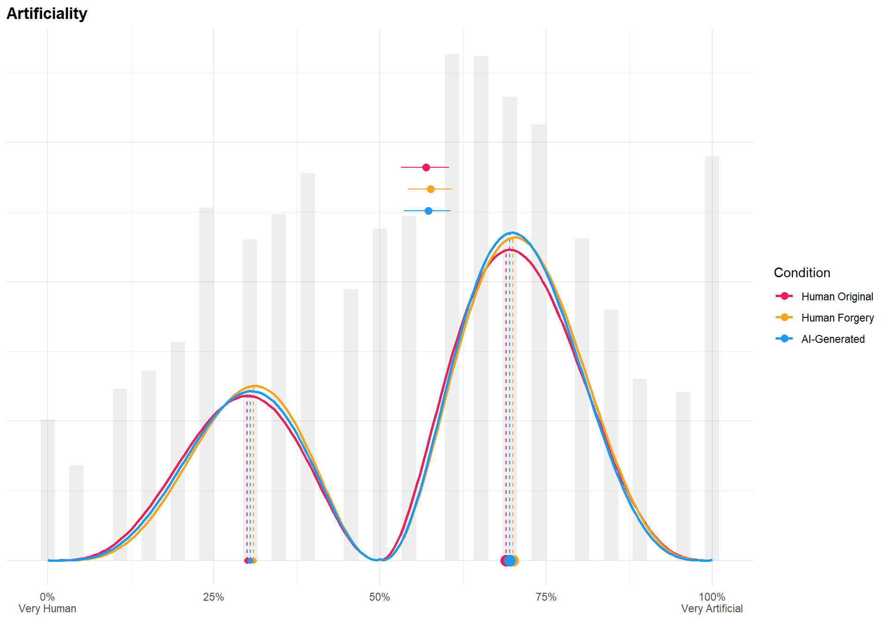{#fig-artificiality fig-alt='Perceived Artificiality (follow-up, items judged as new; 0 = Very Human, 1 = Very Artificial): observed ratings with the model-implied CHOCO density per original label condition.' width=960}
:::
:::


:::

## Summary

- `data/results_contrasts.csv`: every contrast x parameter x (overall, within an emotion quadrant, or between emotion quadrants), raw and % columns.
- `data/results_means.csv`: marginal means per label condition (response scale).
- `data/results_means_emotion.csv`: marginal means per emotion category (response scale), for the models whose estimates carry them; `results_contrasts.csv` has the matching between-category contrasts under `Emotion = "Between emotions"`.


::: {.cell}

```{.r .cell-code}
# Document order (outcome_info is grouped by family)
section_order <- c("Beauty", "Valence", "ValenceExtremity", "Meaning", "Worth",
                   "Entropy", "pLeft", "pCenter", "Shift",
                   "Reality", "Authenticity",
                   "Beauty2", "SelfRelevance", "Artificiality")
section_order <- intersect(section_order, names(estimates)) # optional models once extracted
# unname(): bind_rows() reads the names of two named lists as columns
reps <- unname(lapply(estimates[section_order], `[[`, "report"))

results_contrasts <- bind_rows(
  lapply(reps, function(r) mutate(r$contrasts, Emotion = "Overall")),
  lapply(reps, function(r) r$contrasts_emo),
  # Contrasts *between* emotion categories (the stimulus main effect, RQ2;
  # `extra_contrast = "Emotion"` in estimates.R, extracted 2026-09-26), the
  # Contrast column then naming the two categories
  lapply(reps, function(r) if (!is.null(r$contrasts_extra)) mutate(r$contrasts_extra, Emotion = "Between emotions") else NULL)
) |>
  select(Outcome, Emotion, Contrast, Parameter, Unit, Difference, CI_low, CI_high,
         Difference_pct, CI_low_pct, CI_high_pct, pd, Credible, Effect) |>
  mutate(Contrast = as.character(Contrast)) |>
  arrange(Outcome, Emotion, Contrast, Parameter)
write.csv(results_contrasts, "../data/results_contrasts.csv", row.names = FALSE)

results_means <- bind_rows(lapply(reps, function(r) cbind(Outcome = r$diag$Model, r$means)))
write.csv(results_means, "../data/results_means.csv", row.names = FALSE)
# Marginal means per emotion category (response scale), where extracted
results_means_emotion <- bind_rows(lapply(unname(estimates[section_order]), function(e) {
  if (is.null(e$means_extra) || !"Emotion" %in% names(e$means_extra)) return(NULL)
  cbind(Outcome = e$diag$Model, e$means_extra)
}))
write.csv(results_means_emotion, "../data/results_means_emotion.csv", row.names = FALSE)

diag_all <- bind_rows(lapply(reps, `[[`, "diag"))
make_tables(diag_all, names(diag_all), "Convergence of all models")
```

::: {.cell-output-display}

```{=html}
<div id="dlihpgukrs" style="padding-left:0px;padding-right:0px;padding-top:10px;padding-bottom:10px;overflow-x:auto;overflow-y:auto;width:auto;height:auto;">
<style>#dlihpgukrs table {
  font-family: system-ui, 'Segoe UI', Roboto, Helvetica, Arial, sans-serif, 'Apple Color Emoji', 'Segoe UI Emoji', 'Segoe UI Symbol', 'Noto Color Emoji';
  -webkit-font-smoothing: antialiased;
  -moz-osx-font-smoothing: grayscale;
}

#dlihpgukrs thead, #dlihpgukrs tbody, #dlihpgukrs tfoot, #dlihpgukrs tr, #dlihpgukrs td, #dlihpgukrs th {
  border-style: none;
}

#dlihpgukrs p {
  margin: 0;
  padding: 0;
}

#dlihpgukrs .gt_table {
  display: table;
  border-collapse: collapse;
  line-height: normal;
  margin-left: auto;
  margin-right: auto;
  color: #333333;
  font-size: 13px;
  font-weight: normal;
  font-style: normal;
  background-color: #FFFFFF;
  width: auto;
  border-top-style: solid;
  border-top-width: 3px;
  border-top-color: #D5D5D5;
  border-right-style: solid;
  border-right-width: 3px;
  border-right-color: #D5D5D5;
  border-bottom-style: solid;
  border-bottom-width: 3px;
  border-bottom-color: #D5D5D5;
  border-left-style: solid;
  border-left-width: 3px;
  border-left-color: #D5D5D5;
}

#dlihpgukrs .gt_caption {
  padding-top: 4px;
  padding-bottom: 4px;
}

#dlihpgukrs .gt_title {
  color: #333333;
  font-size: 125%;
  font-weight: initial;
  padding-top: 4px;
  padding-bottom: 4px;
  padding-left: 5px;
  padding-right: 5px;
  border-bottom-color: #FFFFFF;
  border-bottom-width: 0;
}

#dlihpgukrs .gt_subtitle {
  color: #333333;
  font-size: 85%;
  font-weight: initial;
  padding-top: 3px;
  padding-bottom: 5px;
  padding-left: 5px;
  padding-right: 5px;
  border-top-color: #FFFFFF;
  border-top-width: 0;
}

#dlihpgukrs .gt_heading {
  background-color: #FFFFFF;
  text-align: left;
  border-bottom-color: #FFFFFF;
  border-left-style: none;
  border-left-width: 1px;
  border-left-color: #D3D3D3;
  border-right-style: none;
  border-right-width: 1px;
  border-right-color: #D3D3D3;
}

#dlihpgukrs .gt_bottom_border {
  border-bottom-style: solid;
  border-bottom-width: 2px;
  border-bottom-color: #D5D5D5;
}

#dlihpgukrs .gt_col_headings {
  border-top-style: solid;
  border-top-width: 2px;
  border-top-color: #D5D5D5;
  border-bottom-style: solid;
  border-bottom-width: 2px;
  border-bottom-color: #D5D5D5;
  border-left-style: none;
  border-left-width: 1px;
  border-left-color: #D3D3D3;
  border-right-style: none;
  border-right-width: 1px;
  border-right-color: #D3D3D3;
}

#dlihpgukrs .gt_col_heading {
  color: #FFFFFF;
  background-color: #000000;
  font-size: 100%;
  font-weight: normal;
  text-transform: inherit;
  border-left-style: none;
  border-left-width: 1px;
  border-left-color: #D3D3D3;
  border-right-style: none;
  border-right-width: 1px;
  border-right-color: #D3D3D3;
  vertical-align: bottom;
  padding-top: 5px;
  padding-bottom: 6px;
  padding-left: 5px;
  padding-right: 5px;
  overflow-x: hidden;
}

#dlihpgukrs .gt_column_spanner_outer {
  color: #FFFFFF;
  background-color: #000000;
  font-size: 100%;
  font-weight: normal;
  text-transform: inherit;
  padding-top: 0;
  padding-bottom: 0;
  padding-left: 4px;
  padding-right: 4px;
}

#dlihpgukrs .gt_column_spanner_outer:first-child {
  padding-left: 0;
}

#dlihpgukrs .gt_column_spanner_outer:last-child {
  padding-right: 0;
}

#dlihpgukrs .gt_column_spanner {
  border-bottom-style: solid;
  border-bottom-width: 2px;
  border-bottom-color: #D5D5D5;
  vertical-align: bottom;
  padding-top: 5px;
  padding-bottom: 5px;
  overflow-x: hidden;
  display: inline-block;
  width: 100%;
}

#dlihpgukrs .gt_spanner_row {
  border-bottom-style: hidden;
}

#dlihpgukrs .gt_group_heading {
  padding-top: 8px;
  padding-bottom: 8px;
  padding-left: 5px;
  padding-right: 5px;
  color: #333333;
  background-color: #FFFFFF;
  font-size: 100%;
  font-weight: initial;
  text-transform: inherit;
  border-top-style: solid;
  border-top-width: 2px;
  border-top-color: #D5D5D5;
  border-bottom-style: solid;
  border-bottom-width: 2px;
  border-bottom-color: #D5D5D5;
  border-left-style: none;
  border-left-width: 1px;
  border-left-color: #D3D3D3;
  border-right-style: none;
  border-right-width: 1px;
  border-right-color: #D3D3D3;
  vertical-align: middle;
  text-align: left;
}

#dlihpgukrs .gt_empty_group_heading {
  padding: 0.5px;
  color: #333333;
  background-color: #FFFFFF;
  font-size: 100%;
  font-weight: initial;
  border-top-style: solid;
  border-top-width: 2px;
  border-top-color: #D5D5D5;
  border-bottom-style: solid;
  border-bottom-width: 2px;
  border-bottom-color: #D5D5D5;
  vertical-align: middle;
}

#dlihpgukrs .gt_from_md > :first-child {
  margin-top: 0;
}

#dlihpgukrs .gt_from_md > :last-child {
  margin-bottom: 0;
}

#dlihpgukrs .gt_row {
  padding-top: 8px;
  padding-bottom: 8px;
  padding-left: 5px;
  padding-right: 5px;
  margin: 10px;
  border-top-style: solid;
  border-top-width: 1px;
  border-top-color: #D5D5D5;
  border-left-style: solid;
  border-left-width: 1px;
  border-left-color: #D5D5D5;
  border-right-style: solid;
  border-right-width: 1px;
  border-right-color: #D5D5D5;
  vertical-align: middle;
  overflow-x: hidden;
}

#dlihpgukrs .gt_stub {
  color: #333333;
  background-color: #FFFFFF;
  font-size: 100%;
  font-weight: initial;
  text-transform: inherit;
  border-right-style: solid;
  border-right-width: 2px;
  border-right-color: #5F5F5F;
  padding-left: 5px;
  padding-right: 5px;
}

#dlihpgukrs .gt_stub_row_group {
  color: #333333;
  background-color: #FFFFFF;
  font-size: 100%;
  font-weight: initial;
  text-transform: inherit;
  border-right-style: solid;
  border-right-width: 2px;
  border-right-color: #D3D3D3;
  padding-left: 5px;
  padding-right: 5px;
  vertical-align: top;
}

#dlihpgukrs .gt_row_group_first td {
  border-top-width: 2px;
}

#dlihpgukrs .gt_row_group_first th {
  border-top-width: 2px;
}

#dlihpgukrs .gt_summary_row {
  color: #333333;
  background-color: #D5D5D5;
  text-transform: inherit;
  padding-top: 8px;
  padding-bottom: 8px;
  padding-left: 5px;
  padding-right: 5px;
}

#dlihpgukrs .gt_first_summary_row {
  border-top-style: solid;
  border-top-color: #D5D5D5;
}

#dlihpgukrs .gt_first_summary_row.thick {
  border-top-width: 2px;
}

#dlihpgukrs .gt_last_summary_row {
  padding-top: 8px;
  padding-bottom: 8px;
  padding-left: 5px;
  padding-right: 5px;
  border-bottom-style: solid;
  border-bottom-width: 2px;
  border-bottom-color: #D5D5D5;
}

#dlihpgukrs .gt_grand_summary_row {
  color: #FFFFFF;
  background-color: #929292;
  text-transform: inherit;
  padding-top: 8px;
  padding-bottom: 8px;
  padding-left: 5px;
  padding-right: 5px;
}

#dlihpgukrs .gt_first_grand_summary_row {
  padding-top: 8px;
  padding-bottom: 8px;
  padding-left: 5px;
  padding-right: 5px;
  border-top-style: double;
  border-top-width: 6px;
  border-top-color: #D5D5D5;
}

#dlihpgukrs .gt_last_grand_summary_row_top {
  padding-top: 8px;
  padding-bottom: 8px;
  padding-left: 5px;
  padding-right: 5px;
  border-bottom-style: double;
  border-bottom-width: 6px;
  border-bottom-color: #D5D5D5;
}

#dlihpgukrs .gt_striped {
  background-color: #F4F4F4;
}

#dlihpgukrs .gt_table_body {
  border-top-style: solid;
  border-top-width: 2px;
  border-top-color: #D5D5D5;
  border-bottom-style: solid;
  border-bottom-width: 2px;
  border-bottom-color: #D5D5D5;
}

#dlihpgukrs .gt_footnotes {
  color: #333333;
  background-color: #FFFFFF;
  border-bottom-style: none;
  border-bottom-width: 2px;
  border-bottom-color: #D3D3D3;
  border-left-style: none;
  border-left-width: 2px;
  border-left-color: #D3D3D3;
  border-right-style: none;
  border-right-width: 2px;
  border-right-color: #D3D3D3;
}

#dlihpgukrs .gt_footnote {
  margin: 0px;
  font-size: 90%;
  padding-top: 4px;
  padding-bottom: 4px;
  padding-left: 5px;
  padding-right: 5px;
}

#dlihpgukrs .gt_sourcenotes {
  color: #333333;
  background-color: #FFFFFF;
  border-bottom-style: none;
  border-bottom-width: 2px;
  border-bottom-color: #D3D3D3;
  border-left-style: none;
  border-left-width: 2px;
  border-left-color: #D3D3D3;
  border-right-style: none;
  border-right-width: 2px;
  border-right-color: #D3D3D3;
}

#dlihpgukrs .gt_sourcenote {
  font-size: 90%;
  padding-top: 4px;
  padding-bottom: 4px;
  padding-left: 5px;
  padding-right: 5px;
}

#dlihpgukrs .gt_left {
  text-align: left;
}

#dlihpgukrs .gt_center {
  text-align: center;
}

#dlihpgukrs .gt_right {
  text-align: right;
  font-variant-numeric: tabular-nums;
}

#dlihpgukrs .gt_font_normal {
  font-weight: normal;
}

#dlihpgukrs .gt_font_bold {
  font-weight: bold;
}

#dlihpgukrs .gt_font_italic {
  font-style: italic;
}

#dlihpgukrs .gt_super {
  font-size: 65%;
}

#dlihpgukrs .gt_footnote_marks {
  font-size: 75%;
  vertical-align: 0.4em;
  position: initial;
}

#dlihpgukrs .gt_asterisk {
  font-size: 100%;
  vertical-align: 0;
}

#dlihpgukrs .gt_indent_1 {
  text-indent: 5px;
}

#dlihpgukrs .gt_indent_2 {
  text-indent: 10px;
}

#dlihpgukrs .gt_indent_3 {
  text-indent: 15px;
}

#dlihpgukrs .gt_indent_4 {
  text-indent: 20px;
}

#dlihpgukrs .gt_indent_5 {
  text-indent: 25px;
}

#dlihpgukrs .katex-display {
  display: inline-flex !important;
  margin-bottom: 0.75em !important;
}

#dlihpgukrs div.Reactable > div.rt-table > div.rt-thead > div.rt-tr.rt-tr-group-header > div.rt-th-group:after {
  height: 0px !important;
}
</style>
<table class="gt_table" data-quarto-disable-processing="false" data-quarto-bootstrap="false">
  <thead>
    <tr class="gt_heading">
      <td colspan="10" class="gt_heading gt_title gt_font_normal gt_bottom_border" style>Convergence of all models</td>
    </tr>
    
    <tr class="gt_col_headings">
      <th class="gt_col_heading gt_columns_bottom_border gt_left" rowspan="1" colspan="1" scope="col" id="Model">Model</th>
      <th class="gt_col_heading gt_columns_bottom_border gt_left" rowspan="1" colspan="1" scope="col" id="Family">Family</th>
      <th class="gt_col_heading gt_columns_bottom_border gt_right" rowspan="1" colspan="1" scope="col" id="N_obs">N_obs</th>
      <th class="gt_col_heading gt_columns_bottom_border gt_right" rowspan="1" colspan="1" scope="col" id="N_participants">N_participants</th>
      <th class="gt_col_heading gt_columns_bottom_border gt_right" rowspan="1" colspan="1" scope="col" id="Chains">Chains</th>
      <th class="gt_col_heading gt_columns_bottom_border gt_right" rowspan="1" colspan="1" scope="col" id="Draws">Draws</th>
      <th class="gt_col_heading gt_columns_bottom_border gt_right" rowspan="1" colspan="1" scope="col" id="Max_Rhat">Max_Rhat</th>
      <th class="gt_col_heading gt_columns_bottom_border gt_right" rowspan="1" colspan="1" scope="col" id="Min_ESS_ratio">Min_ESS_ratio</th>
      <th class="gt_col_heading gt_columns_bottom_border gt_right" rowspan="1" colspan="1" scope="col" id="Divergent_pct">Divergent_pct</th>
      <th class="gt_col_heading gt_columns_bottom_border gt_left" rowspan="1" colspan="1" scope="col" id="Criterion">Criterion</th>
    </tr>
  </thead>
  <tbody class="gt_table_body">
    <tr><td headers="Model" class="gt_row gt_left">Beauty</td>
<td headers="Family" class="gt_row gt_left">CHOCO</td>
<td headers="N_obs" class="gt_row gt_right">15552</td>
<td headers="N_participants" class="gt_row gt_right">324</td>
<td headers="Chains" class="gt_row gt_right">8</td>
<td headers="Draws" class="gt_row gt_right">4000</td>
<td headers="Max_Rhat" class="gt_row gt_right">1.068</td>
<td headers="Min_ESS_ratio" class="gt_row gt_right">0.023</td>
<td headers="Divergent_pct" class="gt_row gt_right">0.0</td>
<td headers="Criterion" class="gt_row gt_left">loo</td></tr>
    <tr><td headers="Model" class="gt_row gt_left gt_striped">Valence</td>
<td headers="Family" class="gt_row gt_left gt_striped">Discrete Beta (k = 7)</td>
<td headers="N_obs" class="gt_row gt_right gt_striped">15552</td>
<td headers="N_participants" class="gt_row gt_right gt_striped">324</td>
<td headers="Chains" class="gt_row gt_right gt_striped">8</td>
<td headers="Draws" class="gt_row gt_right gt_striped">4000</td>
<td headers="Max_Rhat" class="gt_row gt_right gt_striped">1.039</td>
<td headers="Min_ESS_ratio" class="gt_row gt_right gt_striped">0.035</td>
<td headers="Divergent_pct" class="gt_row gt_right gt_striped">0.1</td>
<td headers="Criterion" class="gt_row gt_left gt_striped">loo</td></tr>
    <tr><td headers="Model" class="gt_row gt_left">Meaning</td>
<td headers="Family" class="gt_row gt_left">Discrete Beta (k = 6) with zero hurdle</td>
<td headers="N_obs" class="gt_row gt_right">15552</td>
<td headers="N_participants" class="gt_row gt_right">324</td>
<td headers="Chains" class="gt_row gt_right">8</td>
<td headers="Draws" class="gt_row gt_right">4000</td>
<td headers="Max_Rhat" class="gt_row gt_right">1.041</td>
<td headers="Min_ESS_ratio" class="gt_row gt_right">0.050</td>
<td headers="Divergent_pct" class="gt_row gt_right">0.1</td>
<td headers="Criterion" class="gt_row gt_left">loo</td></tr>
    <tr><td headers="Model" class="gt_row gt_left gt_striped">Worth</td>
<td headers="Family" class="gt_row gt_left gt_striped">Cumulative (ordinal)</td>
<td headers="N_obs" class="gt_row gt_right gt_striped">15552</td>
<td headers="N_participants" class="gt_row gt_right gt_striped">324</td>
<td headers="Chains" class="gt_row gt_right gt_striped">8</td>
<td headers="Draws" class="gt_row gt_right gt_striped">4000</td>
<td headers="Max_Rhat" class="gt_row gt_right gt_striped">1.037</td>
<td headers="Min_ESS_ratio" class="gt_row gt_right gt_striped">0.078</td>
<td headers="Divergent_pct" class="gt_row gt_right gt_striped">0.0</td>
<td headers="Criterion" class="gt_row gt_left gt_striped">loo</td></tr>
    <tr><td headers="Model" class="gt_row gt_left">Entropy</td>
<td headers="Family" class="gt_row gt_left">Beta</td>
<td headers="N_obs" class="gt_row gt_right">12220</td>
<td headers="N_participants" class="gt_row gt_right">274</td>
<td headers="Chains" class="gt_row gt_right">8</td>
<td headers="Draws" class="gt_row gt_right">4000</td>
<td headers="Max_Rhat" class="gt_row gt_right">1.021</td>
<td headers="Min_ESS_ratio" class="gt_row gt_right">0.089</td>
<td headers="Divergent_pct" class="gt_row gt_right">0.0</td>
<td headers="Criterion" class="gt_row gt_left">loo</td></tr>
    <tr><td headers="Model" class="gt_row gt_left gt_striped">pLeft</td>
<td headers="Family" class="gt_row gt_left gt_striped">Zero-one-inflated Beta</td>
<td headers="N_obs" class="gt_row gt_right gt_striped">12220</td>
<td headers="N_participants" class="gt_row gt_right gt_striped">274</td>
<td headers="Chains" class="gt_row gt_right gt_striped">8</td>
<td headers="Draws" class="gt_row gt_right gt_striped">4000</td>
<td headers="Max_Rhat" class="gt_row gt_right gt_striped">1.058</td>
<td headers="Min_ESS_ratio" class="gt_row gt_right gt_striped">0.033</td>
<td headers="Divergent_pct" class="gt_row gt_right gt_striped">0.0</td>
<td headers="Criterion" class="gt_row gt_left gt_striped">loo</td></tr>
    <tr><td headers="Model" class="gt_row gt_left">pCenter</td>
<td headers="Family" class="gt_row gt_left">Zero-one-inflated Beta</td>
<td headers="N_obs" class="gt_row gt_right">12220</td>
<td headers="N_participants" class="gt_row gt_right">274</td>
<td headers="Chains" class="gt_row gt_right">8</td>
<td headers="Draws" class="gt_row gt_right">4000</td>
<td headers="Max_Rhat" class="gt_row gt_right">1.037</td>
<td headers="Min_ESS_ratio" class="gt_row gt_right">0.057</td>
<td headers="Divergent_pct" class="gt_row gt_right">0.0</td>
<td headers="Criterion" class="gt_row gt_left">loo</td></tr>
    <tr><td headers="Model" class="gt_row gt_left gt_striped">Shift</td>
<td headers="Family" class="gt_row gt_left gt_striped">LogNormal</td>
<td headers="N_obs" class="gt_row gt_right gt_striped">11772</td>
<td headers="N_participants" class="gt_row gt_right gt_striped">273</td>
<td headers="Chains" class="gt_row gt_right gt_striped">8</td>
<td headers="Draws" class="gt_row gt_right gt_striped">4000</td>
<td headers="Max_Rhat" class="gt_row gt_right gt_striped">1.018</td>
<td headers="Min_ESS_ratio" class="gt_row gt_right gt_striped">0.100</td>
<td headers="Divergent_pct" class="gt_row gt_right gt_striped">0.0</td>
<td headers="Criterion" class="gt_row gt_left gt_striped">loo</td></tr>
    <tr><td headers="Model" class="gt_row gt_left">Reality</td>
<td headers="Family" class="gt_row gt_left">CHOCO</td>
<td headers="N_obs" class="gt_row gt_right">15216</td>
<td headers="N_participants" class="gt_row gt_right">317</td>
<td headers="Chains" class="gt_row gt_right">8</td>
<td headers="Draws" class="gt_row gt_right">4000</td>
<td headers="Max_Rhat" class="gt_row gt_right">1.071</td>
<td headers="Min_ESS_ratio" class="gt_row gt_right">0.020</td>
<td headers="Divergent_pct" class="gt_row gt_right">0.0</td>
<td headers="Criterion" class="gt_row gt_left">loo</td></tr>
    <tr><td headers="Model" class="gt_row gt_left gt_striped">Authenticity</td>
<td headers="Family" class="gt_row gt_left gt_striped">CHOCO</td>
<td headers="N_obs" class="gt_row gt_right gt_striped">15216</td>
<td headers="N_participants" class="gt_row gt_right gt_striped">317</td>
<td headers="Chains" class="gt_row gt_right gt_striped">8</td>
<td headers="Draws" class="gt_row gt_right gt_striped">4000</td>
<td headers="Max_Rhat" class="gt_row gt_right gt_striped">1.065</td>
<td headers="Min_ESS_ratio" class="gt_row gt_right gt_striped">0.025</td>
<td headers="Divergent_pct" class="gt_row gt_right gt_striped">0.0</td>
<td headers="Criterion" class="gt_row gt_left gt_striped">loo</td></tr>
    <tr><td headers="Model" class="gt_row gt_left">Beauty2</td>
<td headers="Family" class="gt_row gt_left">CHOCO</td>
<td headers="N_obs" class="gt_row gt_right">10560</td>
<td headers="N_participants" class="gt_row gt_right">220</td>
<td headers="Chains" class="gt_row gt_right">8</td>
<td headers="Draws" class="gt_row gt_right">4000</td>
<td headers="Max_Rhat" class="gt_row gt_right">1.088</td>
<td headers="Min_ESS_ratio" class="gt_row gt_right">0.023</td>
<td headers="Divergent_pct" class="gt_row gt_right">0.0</td>
<td headers="Criterion" class="gt_row gt_left">loo</td></tr>
    <tr><td headers="Model" class="gt_row gt_left gt_striped">SelfRelevance</td>
<td headers="Family" class="gt_row gt_left gt_striped">Cumulative (ordinal)</td>
<td headers="N_obs" class="gt_row gt_right gt_striped">10560</td>
<td headers="N_participants" class="gt_row gt_right gt_striped">220</td>
<td headers="Chains" class="gt_row gt_right gt_striped">8</td>
<td headers="Draws" class="gt_row gt_right gt_striped">4000</td>
<td headers="Max_Rhat" class="gt_row gt_right gt_striped">1.085</td>
<td headers="Min_ESS_ratio" class="gt_row gt_right gt_striped">0.021</td>
<td headers="Divergent_pct" class="gt_row gt_right gt_striped">0.0</td>
<td headers="Criterion" class="gt_row gt_left gt_striped">loo</td></tr>
    <tr><td headers="Model" class="gt_row gt_left">Artificiality</td>
<td headers="Family" class="gt_row gt_left">CHOCO</td>
<td headers="N_obs" class="gt_row gt_right">6009</td>
<td headers="N_participants" class="gt_row gt_right">220</td>
<td headers="Chains" class="gt_row gt_right">8</td>
<td headers="Draws" class="gt_row gt_right">4000</td>
<td headers="Max_Rhat" class="gt_row gt_right">1.038</td>
<td headers="Min_ESS_ratio" class="gt_row gt_right">0.047</td>
<td headers="Divergent_pct" class="gt_row gt_right">0.0</td>
<td headers="Criterion" class="gt_row gt_left">loo</td></tr>
  </tbody>
  
</table>
</div>
```


::: {.callout-note collapse="true" title="Convergence of all models (Markdown table, for text readers)"}

|Model         |Family                                 | N_obs| N_participants| Chains| Draws| Max_Rhat| Min_ESS_ratio| Divergent_pct|Criterion |
|:-------------|:--------------------------------------|-----:|--------------:|------:|-----:|--------:|-------------:|-------------:|:---------|
|Beauty        |CHOCO                                  | 15552|            324|      8|  4000|    1.068|         0.023|           0.0|loo       |
|Valence       |Discrete Beta (k = 7)                  | 15552|            324|      8|  4000|    1.039|         0.035|           0.1|loo       |
|Meaning       |Discrete Beta (k = 6) with zero hurdle | 15552|            324|      8|  4000|    1.041|         0.050|           0.1|loo       |
|Worth         |Cumulative (ordinal)                   | 15552|            324|      8|  4000|    1.037|         0.078|           0.0|loo       |
|Entropy       |Beta                                   | 12220|            274|      8|  4000|    1.021|         0.089|           0.0|loo       |
|pLeft         |Zero-one-inflated Beta                 | 12220|            274|      8|  4000|    1.058|         0.033|           0.0|loo       |
|pCenter       |Zero-one-inflated Beta                 | 12220|            274|      8|  4000|    1.037|         0.057|           0.0|loo       |
|Shift         |LogNormal                              | 11772|            273|      8|  4000|    1.018|         0.100|           0.0|loo       |
|Reality       |CHOCO                                  | 15216|            317|      8|  4000|    1.071|         0.020|           0.0|loo       |
|Authenticity  |CHOCO                                  | 15216|            317|      8|  4000|    1.065|         0.025|           0.0|loo       |
|Beauty2       |CHOCO                                  | 10560|            220|      8|  4000|    1.088|         0.023|           0.0|loo       |
|SelfRelevance |Cumulative (ordinal)                   | 10560|            220|      8|  4000|    1.085|         0.021|           0.0|loo       |
|Artificiality |CHOCO                                  |  6009|            220|      8|  4000|    1.038|         0.047|           0.0|loo       |

:::

:::
:::


::: {.cell}

```{.r .cell-code}
(p_beauty | p_reality) +
  plot_layout(guides = "collect")
```

::: {.cell-output-display}
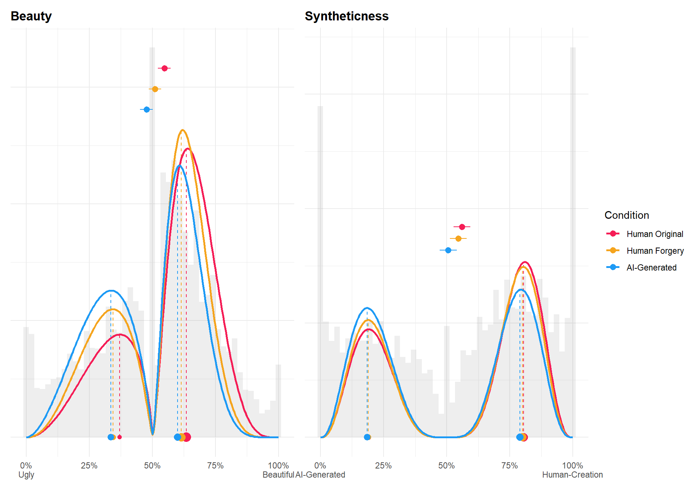{#fig-summary-beauty-reality fig-alt='Two panels of histograms with overlaid density curves in three colours, one per label condition.' width=960}
:::
:::


::: {.cell}

```{.r .cell-code}
rez_con <- results_contrasts |>
  filter(Emotion != "Between emotions") |> # label contrasts only (overall and per quadrant)
  filter(Parameter %in% c("response", "mu", "confright", "confleft", "pzero"), Unit == "%") |>
  mutate(Difference = Difference_pct, CI_low = CI_low_pct, CI_high = CI_high_pct) |>
  mutate(Effect = fct_relevel(Effect, "Negative", "n.s.", "Positive"),
         Contrast = fct_relevel(Contrast, "AI-Generated - Human Original", "Human Forgery - Human Original", "AI-Generated - Human Forgery"))

rez_con |>
  filter(Emotion == "Overall") |>
  ggplot(aes(x = Difference, y = Parameter, color = Effect)) +
  geom_point(size = 2) +
  geom_errorbar(aes(xmin = CI_low, xmax = CI_high), width = 0.2) +
  geom_point(data = filter(rez_con, Emotion != "Overall"), aes(shape = Emotion), size = 2, position = position_nudge(y = 0.18)) +
  geom_vline(xintercept = 0, linetype = "dashed", color = "gray50") +
  facet_grid(
  Contrast ~ Outcome,
  scales = "free_y",
  switch = "y"
) +
  scale_shape_manual(values = c("Positive - High intensity" = "square plus", "Positive - Low intensity" = "square",
                                "Negative - Low intensity" = "circle", "Negative - High intensity" = "circle plus")) +
  scale_y_discrete(position = "right") +
  scale_color_manual(values = c("Negative" = "#F44336", "n.s." = "#FF9800", "Positive" = "#4CAF50")) +
  theme_bw() +
  labs(
    title = "Effect Sizes by Contrast and Outcome",
    x = "Difference in % of the scale range (with 95% CI)",
    y = "Model Parameter"
  ) +
  theme(
  strip.placement = "outside",
  strip.background = element_rect(fill = "grey90"),
  strip.text.y.left = element_text(angle = 0),
  legend.position = "bottom"
)
```

::: {.cell-output-display}
{#fig-summary-effects fig-alt='Grid of dot-and-whisker plots, one cell per contrast and outcome, coloured by direction and credibility of the effect.' width=1152}
:::
:::


::: {.cell}

```{.r .cell-code}
credible_main <- results_contrasts |>
  filter(Emotion == "Overall", Credible, Parameter %in% c("response", "mu") | grepl("^response", Parameter)) |>
  mutate(shown_d = ifelse(Unit == "%", Difference_pct, Difference),
         shown_lo = ifelse(Unit == "%", CI_low_pct, CI_low),
         shown_hi = ifelse(Unit == "%", CI_high_pct, CI_high),
         Diff = insight::format_value(shown_d, zap_small = TRUE),
         CI = sprintf("[%s, %s]", insight::format_value(shown_lo, zap_small = TRUE), insight::format_value(shown_hi, zap_small = TRUE)),
         pd_fmt = insight::format_pd(pd, name = NULL)) |>
  select(Outcome, Contrast, Parameter, Diff, CI, Unit, pd_fmt, Effect)

make_tables(credible_main, names(credible_main),
            "Credible overall effects of the label on the main parameter of each model (response / mu), in % of the scale range")
```

::: {.cell-output-display}

```{=html}
<div id="tjgovjdkli" style="padding-left:0px;padding-right:0px;padding-top:10px;padding-bottom:10px;overflow-x:auto;overflow-y:auto;width:auto;height:auto;">
<style>#tjgovjdkli table {
  font-family: system-ui, 'Segoe UI', Roboto, Helvetica, Arial, sans-serif, 'Apple Color Emoji', 'Segoe UI Emoji', 'Segoe UI Symbol', 'Noto Color Emoji';
  -webkit-font-smoothing: antialiased;
  -moz-osx-font-smoothing: grayscale;
}

#tjgovjdkli thead, #tjgovjdkli tbody, #tjgovjdkli tfoot, #tjgovjdkli tr, #tjgovjdkli td, #tjgovjdkli th {
  border-style: none;
}

#tjgovjdkli p {
  margin: 0;
  padding: 0;
}

#tjgovjdkli .gt_table {
  display: table;
  border-collapse: collapse;
  line-height: normal;
  margin-left: auto;
  margin-right: auto;
  color: #333333;
  font-size: 13px;
  font-weight: normal;
  font-style: normal;
  background-color: #FFFFFF;
  width: auto;
  border-top-style: solid;
  border-top-width: 3px;
  border-top-color: #D5D5D5;
  border-right-style: solid;
  border-right-width: 3px;
  border-right-color: #D5D5D5;
  border-bottom-style: solid;
  border-bottom-width: 3px;
  border-bottom-color: #D5D5D5;
  border-left-style: solid;
  border-left-width: 3px;
  border-left-color: #D5D5D5;
}

#tjgovjdkli .gt_caption {
  padding-top: 4px;
  padding-bottom: 4px;
}

#tjgovjdkli .gt_title {
  color: #333333;
  font-size: 125%;
  font-weight: initial;
  padding-top: 4px;
  padding-bottom: 4px;
  padding-left: 5px;
  padding-right: 5px;
  border-bottom-color: #FFFFFF;
  border-bottom-width: 0;
}

#tjgovjdkli .gt_subtitle {
  color: #333333;
  font-size: 85%;
  font-weight: initial;
  padding-top: 3px;
  padding-bottom: 5px;
  padding-left: 5px;
  padding-right: 5px;
  border-top-color: #FFFFFF;
  border-top-width: 0;
}

#tjgovjdkli .gt_heading {
  background-color: #FFFFFF;
  text-align: left;
  border-bottom-color: #FFFFFF;
  border-left-style: none;
  border-left-width: 1px;
  border-left-color: #D3D3D3;
  border-right-style: none;
  border-right-width: 1px;
  border-right-color: #D3D3D3;
}

#tjgovjdkli .gt_bottom_border {
  border-bottom-style: solid;
  border-bottom-width: 2px;
  border-bottom-color: #D5D5D5;
}

#tjgovjdkli .gt_col_headings {
  border-top-style: solid;
  border-top-width: 2px;
  border-top-color: #D5D5D5;
  border-bottom-style: solid;
  border-bottom-width: 2px;
  border-bottom-color: #D5D5D5;
  border-left-style: none;
  border-left-width: 1px;
  border-left-color: #D3D3D3;
  border-right-style: none;
  border-right-width: 1px;
  border-right-color: #D3D3D3;
}

#tjgovjdkli .gt_col_heading {
  color: #FFFFFF;
  background-color: #000000;
  font-size: 100%;
  font-weight: normal;
  text-transform: inherit;
  border-left-style: none;
  border-left-width: 1px;
  border-left-color: #D3D3D3;
  border-right-style: none;
  border-right-width: 1px;
  border-right-color: #D3D3D3;
  vertical-align: bottom;
  padding-top: 5px;
  padding-bottom: 6px;
  padding-left: 5px;
  padding-right: 5px;
  overflow-x: hidden;
}

#tjgovjdkli .gt_column_spanner_outer {
  color: #FFFFFF;
  background-color: #000000;
  font-size: 100%;
  font-weight: normal;
  text-transform: inherit;
  padding-top: 0;
  padding-bottom: 0;
  padding-left: 4px;
  padding-right: 4px;
}

#tjgovjdkli .gt_column_spanner_outer:first-child {
  padding-left: 0;
}

#tjgovjdkli .gt_column_spanner_outer:last-child {
  padding-right: 0;
}

#tjgovjdkli .gt_column_spanner {
  border-bottom-style: solid;
  border-bottom-width: 2px;
  border-bottom-color: #D5D5D5;
  vertical-align: bottom;
  padding-top: 5px;
  padding-bottom: 5px;
  overflow-x: hidden;
  display: inline-block;
  width: 100%;
}

#tjgovjdkli .gt_spanner_row {
  border-bottom-style: hidden;
}

#tjgovjdkli .gt_group_heading {
  padding-top: 8px;
  padding-bottom: 8px;
  padding-left: 5px;
  padding-right: 5px;
  color: #333333;
  background-color: #FFFFFF;
  font-size: 100%;
  font-weight: initial;
  text-transform: inherit;
  border-top-style: solid;
  border-top-width: 2px;
  border-top-color: #D5D5D5;
  border-bottom-style: solid;
  border-bottom-width: 2px;
  border-bottom-color: #D5D5D5;
  border-left-style: none;
  border-left-width: 1px;
  border-left-color: #D3D3D3;
  border-right-style: none;
  border-right-width: 1px;
  border-right-color: #D3D3D3;
  vertical-align: middle;
  text-align: left;
}

#tjgovjdkli .gt_empty_group_heading {
  padding: 0.5px;
  color: #333333;
  background-color: #FFFFFF;
  font-size: 100%;
  font-weight: initial;
  border-top-style: solid;
  border-top-width: 2px;
  border-top-color: #D5D5D5;
  border-bottom-style: solid;
  border-bottom-width: 2px;
  border-bottom-color: #D5D5D5;
  vertical-align: middle;
}

#tjgovjdkli .gt_from_md > :first-child {
  margin-top: 0;
}

#tjgovjdkli .gt_from_md > :last-child {
  margin-bottom: 0;
}

#tjgovjdkli .gt_row {
  padding-top: 8px;
  padding-bottom: 8px;
  padding-left: 5px;
  padding-right: 5px;
  margin: 10px;
  border-top-style: solid;
  border-top-width: 1px;
  border-top-color: #D5D5D5;
  border-left-style: solid;
  border-left-width: 1px;
  border-left-color: #D5D5D5;
  border-right-style: solid;
  border-right-width: 1px;
  border-right-color: #D5D5D5;
  vertical-align: middle;
  overflow-x: hidden;
}

#tjgovjdkli .gt_stub {
  color: #333333;
  background-color: #FFFFFF;
  font-size: 100%;
  font-weight: initial;
  text-transform: inherit;
  border-right-style: solid;
  border-right-width: 2px;
  border-right-color: #5F5F5F;
  padding-left: 5px;
  padding-right: 5px;
}

#tjgovjdkli .gt_stub_row_group {
  color: #333333;
  background-color: #FFFFFF;
  font-size: 100%;
  font-weight: initial;
  text-transform: inherit;
  border-right-style: solid;
  border-right-width: 2px;
  border-right-color: #D3D3D3;
  padding-left: 5px;
  padding-right: 5px;
  vertical-align: top;
}

#tjgovjdkli .gt_row_group_first td {
  border-top-width: 2px;
}

#tjgovjdkli .gt_row_group_first th {
  border-top-width: 2px;
}

#tjgovjdkli .gt_summary_row {
  color: #333333;
  background-color: #D5D5D5;
  text-transform: inherit;
  padding-top: 8px;
  padding-bottom: 8px;
  padding-left: 5px;
  padding-right: 5px;
}

#tjgovjdkli .gt_first_summary_row {
  border-top-style: solid;
  border-top-color: #D5D5D5;
}

#tjgovjdkli .gt_first_summary_row.thick {
  border-top-width: 2px;
}

#tjgovjdkli .gt_last_summary_row {
  padding-top: 8px;
  padding-bottom: 8px;
  padding-left: 5px;
  padding-right: 5px;
  border-bottom-style: solid;
  border-bottom-width: 2px;
  border-bottom-color: #D5D5D5;
}

#tjgovjdkli .gt_grand_summary_row {
  color: #FFFFFF;
  background-color: #929292;
  text-transform: inherit;
  padding-top: 8px;
  padding-bottom: 8px;
  padding-left: 5px;
  padding-right: 5px;
}

#tjgovjdkli .gt_first_grand_summary_row {
  padding-top: 8px;
  padding-bottom: 8px;
  padding-left: 5px;
  padding-right: 5px;
  border-top-style: double;
  border-top-width: 6px;
  border-top-color: #D5D5D5;
}

#tjgovjdkli .gt_last_grand_summary_row_top {
  padding-top: 8px;
  padding-bottom: 8px;
  padding-left: 5px;
  padding-right: 5px;
  border-bottom-style: double;
  border-bottom-width: 6px;
  border-bottom-color: #D5D5D5;
}

#tjgovjdkli .gt_striped {
  background-color: #F4F4F4;
}

#tjgovjdkli .gt_table_body {
  border-top-style: solid;
  border-top-width: 2px;
  border-top-color: #D5D5D5;
  border-bottom-style: solid;
  border-bottom-width: 2px;
  border-bottom-color: #D5D5D5;
}

#tjgovjdkli .gt_footnotes {
  color: #333333;
  background-color: #FFFFFF;
  border-bottom-style: none;
  border-bottom-width: 2px;
  border-bottom-color: #D3D3D3;
  border-left-style: none;
  border-left-width: 2px;
  border-left-color: #D3D3D3;
  border-right-style: none;
  border-right-width: 2px;
  border-right-color: #D3D3D3;
}

#tjgovjdkli .gt_footnote {
  margin: 0px;
  font-size: 90%;
  padding-top: 4px;
  padding-bottom: 4px;
  padding-left: 5px;
  padding-right: 5px;
}

#tjgovjdkli .gt_sourcenotes {
  color: #333333;
  background-color: #FFFFFF;
  border-bottom-style: none;
  border-bottom-width: 2px;
  border-bottom-color: #D3D3D3;
  border-left-style: none;
  border-left-width: 2px;
  border-left-color: #D3D3D3;
  border-right-style: none;
  border-right-width: 2px;
  border-right-color: #D3D3D3;
}

#tjgovjdkli .gt_sourcenote {
  font-size: 90%;
  padding-top: 4px;
  padding-bottom: 4px;
  padding-left: 5px;
  padding-right: 5px;
}

#tjgovjdkli .gt_left {
  text-align: left;
}

#tjgovjdkli .gt_center {
  text-align: center;
}

#tjgovjdkli .gt_right {
  text-align: right;
  font-variant-numeric: tabular-nums;
}

#tjgovjdkli .gt_font_normal {
  font-weight: normal;
}

#tjgovjdkli .gt_font_bold {
  font-weight: bold;
}

#tjgovjdkli .gt_font_italic {
  font-style: italic;
}

#tjgovjdkli .gt_super {
  font-size: 65%;
}

#tjgovjdkli .gt_footnote_marks {
  font-size: 75%;
  vertical-align: 0.4em;
  position: initial;
}

#tjgovjdkli .gt_asterisk {
  font-size: 100%;
  vertical-align: 0;
}

#tjgovjdkli .gt_indent_1 {
  text-indent: 5px;
}

#tjgovjdkli .gt_indent_2 {
  text-indent: 10px;
}

#tjgovjdkli .gt_indent_3 {
  text-indent: 15px;
}

#tjgovjdkli .gt_indent_4 {
  text-indent: 20px;
}

#tjgovjdkli .gt_indent_5 {
  text-indent: 25px;
}

#tjgovjdkli .katex-display {
  display: inline-flex !important;
  margin-bottom: 0.75em !important;
}

#tjgovjdkli div.Reactable > div.rt-table > div.rt-thead > div.rt-tr.rt-tr-group-header > div.rt-th-group:after {
  height: 0px !important;
}
</style>
<table class="gt_table" data-quarto-disable-processing="false" data-quarto-bootstrap="false">
  <thead>
    <tr class="gt_heading">
      <td colspan="7" class="gt_heading gt_title gt_font_normal gt_bottom_border" style>Credible overall effects of the label on the main parameter of each model (response / mu), in % of the scale range</td>
    </tr>
    
    <tr class="gt_col_headings">
      <th class="gt_col_heading gt_columns_bottom_border gt_left" rowspan="1" colspan="1" scope="col" id="Outcome">Outcome</th>
      <th class="gt_col_heading gt_columns_bottom_border gt_left" rowspan="1" colspan="1" scope="col" id="Parameter">Parameter</th>
      <th class="gt_col_heading gt_columns_bottom_border gt_right" rowspan="1" colspan="1" scope="col" id="Diff">Diff</th>
      <th class="gt_col_heading gt_columns_bottom_border gt_left" rowspan="1" colspan="1" scope="col" id="CI">CI</th>
      <th class="gt_col_heading gt_columns_bottom_border gt_right" rowspan="1" colspan="1" scope="col" id="Unit">Unit</th>
      <th class="gt_col_heading gt_columns_bottom_border gt_right" rowspan="1" colspan="1" scope="col" id="pd_fmt">pd_fmt</th>
      <th class="gt_col_heading gt_columns_bottom_border gt_left" rowspan="1" colspan="1" scope="col" id="Effect">Effect</th>
    </tr>
  </thead>
  <tbody class="gt_table_body">
    <tr class="gt_group_heading_row">
      <th colspan="7" class="gt_group_heading" scope="colgroup" id="AI-Generated - Human Original">AI-Generated - Human Original</th>
    </tr>
    <tr class="gt_row_group_first"><td headers="AI-Generated - Human Original  Outcome" class="gt_row gt_left" style="background-color: #FFEBEE;">Authenticity</td>
<td headers="AI-Generated - Human Original  Parameter" class="gt_row gt_left" style="background-color: #FFEBEE;">mu</td>
<td headers="AI-Generated - Human Original  Diff" class="gt_row gt_right" style="background-color: #FFEBEE;">-2.10</td>
<td headers="AI-Generated - Human Original  CI" class="gt_row gt_left" style="background-color: #FFEBEE;">[-4.26, -0.05]</td>
<td headers="AI-Generated - Human Original  Unit" class="gt_row gt_right" style="background-color: #FFEBEE;">%</td>
<td headers="AI-Generated - Human Original  pd_fmt" class="gt_row gt_right" style="background-color: #FFEBEE;">97.72%</td>
<td headers="AI-Generated - Human Original  Effect" class="gt_row gt_left" style="background-color: #FFEBEE;">Negative</td></tr>
    <tr><td headers="AI-Generated - Human Original  Outcome" class="gt_row gt_left gt_striped" style="background-color: #FFEBEE;">Authenticity</td>
<td headers="AI-Generated - Human Original  Parameter" class="gt_row gt_left gt_striped" style="background-color: #FFEBEE;">response</td>
<td headers="AI-Generated - Human Original  Diff" class="gt_row gt_right gt_striped" style="background-color: #FFEBEE;">-1.39</td>
<td headers="AI-Generated - Human Original  CI" class="gt_row gt_left gt_striped" style="background-color: #FFEBEE;">[-2.64, -0.19]</td>
<td headers="AI-Generated - Human Original  Unit" class="gt_row gt_right gt_striped" style="background-color: #FFEBEE;">%</td>
<td headers="AI-Generated - Human Original  pd_fmt" class="gt_row gt_right gt_striped" style="background-color: #FFEBEE;">98.65%</td>
<td headers="AI-Generated - Human Original  Effect" class="gt_row gt_left gt_striped" style="background-color: #FFEBEE;">Negative</td></tr>
    <tr><td headers="AI-Generated - Human Original  Outcome" class="gt_row gt_left" style="background-color: #FFEBEE;">Beauty</td>
<td headers="AI-Generated - Human Original  Parameter" class="gt_row gt_left" style="background-color: #FFEBEE;">mu</td>
<td headers="AI-Generated - Human Original  Diff" class="gt_row gt_right" style="background-color: #FFEBEE;">-15.92</td>
<td headers="AI-Generated - Human Original  CI" class="gt_row gt_left" style="background-color: #FFEBEE;">[-19.33, -12.53]</td>
<td headers="AI-Generated - Human Original  Unit" class="gt_row gt_right" style="background-color: #FFEBEE;">%</td>
<td headers="AI-Generated - Human Original  pd_fmt" class="gt_row gt_right" style="background-color: #FFEBEE;">100%</td>
<td headers="AI-Generated - Human Original  Effect" class="gt_row gt_left" style="background-color: #FFEBEE;">Negative</td></tr>
    <tr><td headers="AI-Generated - Human Original  Outcome" class="gt_row gt_left gt_striped" style="background-color: #FFEBEE;">Beauty</td>
<td headers="AI-Generated - Human Original  Parameter" class="gt_row gt_left gt_striped" style="background-color: #FFEBEE;">response</td>
<td headers="AI-Generated - Human Original  Diff" class="gt_row gt_right gt_striped" style="background-color: #FFEBEE;">-7.06</td>
<td headers="AI-Generated - Human Original  CI" class="gt_row gt_left gt_striped" style="background-color: #FFEBEE;">[-8.22, -5.92]</td>
<td headers="AI-Generated - Human Original  Unit" class="gt_row gt_right gt_striped" style="background-color: #FFEBEE;">%</td>
<td headers="AI-Generated - Human Original  pd_fmt" class="gt_row gt_right gt_striped" style="background-color: #FFEBEE;">100%</td>
<td headers="AI-Generated - Human Original  Effect" class="gt_row gt_left gt_striped" style="background-color: #FFEBEE;">Negative</td></tr>
    <tr><td headers="AI-Generated - Human Original  Outcome" class="gt_row gt_left" style="background-color: #FFEBEE;">Meaning</td>
<td headers="AI-Generated - Human Original  Parameter" class="gt_row gt_left" style="background-color: #FFEBEE;">mu</td>
<td headers="AI-Generated - Human Original  Diff" class="gt_row gt_right" style="background-color: #FFEBEE;">-8.60</td>
<td headers="AI-Generated - Human Original  CI" class="gt_row gt_left" style="background-color: #FFEBEE;">[-9.87, -7.32]</td>
<td headers="AI-Generated - Human Original  Unit" class="gt_row gt_right" style="background-color: #FFEBEE;">%</td>
<td headers="AI-Generated - Human Original  pd_fmt" class="gt_row gt_right" style="background-color: #FFEBEE;">100%</td>
<td headers="AI-Generated - Human Original  Effect" class="gt_row gt_left" style="background-color: #FFEBEE;">Negative</td></tr>
    <tr><td headers="AI-Generated - Human Original  Outcome" class="gt_row gt_left gt_striped" style="background-color: #FFEBEE;">Meaning</td>
<td headers="AI-Generated - Human Original  Parameter" class="gt_row gt_left gt_striped" style="background-color: #FFEBEE;">response</td>
<td headers="AI-Generated - Human Original  Diff" class="gt_row gt_right gt_striped" style="background-color: #FFEBEE;">-10.40</td>
<td headers="AI-Generated - Human Original  CI" class="gt_row gt_left gt_striped" style="background-color: #FFEBEE;">[-11.93, -8.96]</td>
<td headers="AI-Generated - Human Original  Unit" class="gt_row gt_right gt_striped" style="background-color: #FFEBEE;">%</td>
<td headers="AI-Generated - Human Original  pd_fmt" class="gt_row gt_right gt_striped" style="background-color: #FFEBEE;">100%</td>
<td headers="AI-Generated - Human Original  Effect" class="gt_row gt_left gt_striped" style="background-color: #FFEBEE;">Negative</td></tr>
    <tr><td headers="AI-Generated - Human Original  Outcome" class="gt_row gt_left" style="background-color: #FFEBEE;">Reality</td>
<td headers="AI-Generated - Human Original  Parameter" class="gt_row gt_left" style="background-color: #FFEBEE;">mu</td>
<td headers="AI-Generated - Human Original  Diff" class="gt_row gt_right" style="background-color: #FFEBEE;">-8.09</td>
<td headers="AI-Generated - Human Original  CI" class="gt_row gt_left" style="background-color: #FFEBEE;">[-10.39, -5.76]</td>
<td headers="AI-Generated - Human Original  Unit" class="gt_row gt_right" style="background-color: #FFEBEE;">%</td>
<td headers="AI-Generated - Human Original  pd_fmt" class="gt_row gt_right" style="background-color: #FFEBEE;">100%</td>
<td headers="AI-Generated - Human Original  Effect" class="gt_row gt_left" style="background-color: #FFEBEE;">Negative</td></tr>
    <tr><td headers="AI-Generated - Human Original  Outcome" class="gt_row gt_left gt_striped" style="background-color: #FFEBEE;">Reality</td>
<td headers="AI-Generated - Human Original  Parameter" class="gt_row gt_left gt_striped" style="background-color: #FFEBEE;">response</td>
<td headers="AI-Generated - Human Original  Diff" class="gt_row gt_right gt_striped" style="background-color: #FFEBEE;">-5.51</td>
<td headers="AI-Generated - Human Original  CI" class="gt_row gt_left gt_striped" style="background-color: #FFEBEE;">[-6.94, -4.12]</td>
<td headers="AI-Generated - Human Original  Unit" class="gt_row gt_right gt_striped" style="background-color: #FFEBEE;">%</td>
<td headers="AI-Generated - Human Original  pd_fmt" class="gt_row gt_right gt_striped" style="background-color: #FFEBEE;">100%</td>
<td headers="AI-Generated - Human Original  Effect" class="gt_row gt_left gt_striped" style="background-color: #FFEBEE;">Negative</td></tr>
    <tr><td headers="AI-Generated - Human Original  Outcome" class="gt_row gt_left" style="background-color: #FFEBEE;">Valence</td>
<td headers="AI-Generated - Human Original  Parameter" class="gt_row gt_left" style="background-color: #FFEBEE;">mu</td>
<td headers="AI-Generated - Human Original  Diff" class="gt_row gt_right" style="background-color: #FFEBEE;">-5.47</td>
<td headers="AI-Generated - Human Original  CI" class="gt_row gt_left" style="background-color: #FFEBEE;">[-6.40, -4.54]</td>
<td headers="AI-Generated - Human Original  Unit" class="gt_row gt_right" style="background-color: #FFEBEE;">%</td>
<td headers="AI-Generated - Human Original  pd_fmt" class="gt_row gt_right" style="background-color: #FFEBEE;">100%</td>
<td headers="AI-Generated - Human Original  Effect" class="gt_row gt_left" style="background-color: #FFEBEE;">Negative</td></tr>
    <tr><td headers="AI-Generated - Human Original  Outcome" class="gt_row gt_left gt_striped" style="background-color: #FFEBEE;">Valence</td>
<td headers="AI-Generated - Human Original  Parameter" class="gt_row gt_left gt_striped" style="background-color: #FFEBEE;">response</td>
<td headers="AI-Generated - Human Original  Diff" class="gt_row gt_right gt_striped" style="background-color: #FFEBEE;">-6.17</td>
<td headers="AI-Generated - Human Original  CI" class="gt_row gt_left gt_striped" style="background-color: #FFEBEE;">[-7.23, -5.13]</td>
<td headers="AI-Generated - Human Original  Unit" class="gt_row gt_right gt_striped" style="background-color: #FFEBEE;">%</td>
<td headers="AI-Generated - Human Original  pd_fmt" class="gt_row gt_right gt_striped" style="background-color: #FFEBEE;">100%</td>
<td headers="AI-Generated - Human Original  Effect" class="gt_row gt_left gt_striped" style="background-color: #FFEBEE;">Negative</td></tr>
    <tr><td headers="AI-Generated - Human Original  Outcome" class="gt_row gt_left" style="background-color: #FFEBEE;">Worth</td>
<td headers="AI-Generated - Human Original  Parameter" class="gt_row gt_left" style="background-color: #FFEBEE;">mu</td>
<td headers="AI-Generated - Human Original  Diff" class="gt_row gt_right" style="background-color: #FFEBEE;">-23.77</td>
<td headers="AI-Generated - Human Original  CI" class="gt_row gt_left" style="background-color: #FFEBEE;">[-25.66, -21.26]</td>
<td headers="AI-Generated - Human Original  Unit" class="gt_row gt_right" style="background-color: #FFEBEE;">%</td>
<td headers="AI-Generated - Human Original  pd_fmt" class="gt_row gt_right" style="background-color: #FFEBEE;">100%</td>
<td headers="AI-Generated - Human Original  Effect" class="gt_row gt_left" style="background-color: #FFEBEE;">Negative</td></tr>
    <tr><td headers="AI-Generated - Human Original  Outcome" class="gt_row gt_left gt_striped" style="background-color: #E8F5E9;">Worth</td>
<td headers="AI-Generated - Human Original  Parameter" class="gt_row gt_left gt_striped" style="background-color: #E8F5E9;">response - 0</td>
<td headers="AI-Generated - Human Original  Diff" class="gt_row gt_right gt_striped" style="background-color: #E8F5E9;">18.33</td>
<td headers="AI-Generated - Human Original  CI" class="gt_row gt_left gt_striped" style="background-color: #E8F5E9;">[17.13, 19.46]</td>
<td headers="AI-Generated - Human Original  Unit" class="gt_row gt_right gt_striped" style="background-color: #E8F5E9;">%</td>
<td headers="AI-Generated - Human Original  pd_fmt" class="gt_row gt_right gt_striped" style="background-color: #E8F5E9;">100%</td>
<td headers="AI-Generated - Human Original  Effect" class="gt_row gt_left gt_striped" style="background-color: #E8F5E9;">Positive</td></tr>
    <tr><td headers="AI-Generated - Human Original  Outcome" class="gt_row gt_left" style="background-color: #E8F5E9;">Worth</td>
<td headers="AI-Generated - Human Original  Parameter" class="gt_row gt_left" style="background-color: #E8F5E9;">response - 10</td>
<td headers="AI-Generated - Human Original  Diff" class="gt_row gt_right" style="background-color: #E8F5E9;">1.60</td>
<td headers="AI-Generated - Human Original  CI" class="gt_row gt_left" style="background-color: #E8F5E9;">[0.77, 2.32]</td>
<td headers="AI-Generated - Human Original  Unit" class="gt_row gt_right" style="background-color: #E8F5E9;">%</td>
<td headers="AI-Generated - Human Original  pd_fmt" class="gt_row gt_right" style="background-color: #E8F5E9;">100%</td>
<td headers="AI-Generated - Human Original  Effect" class="gt_row gt_left" style="background-color: #E8F5E9;">Positive</td></tr>
    <tr><td headers="AI-Generated - Human Original  Outcome" class="gt_row gt_left gt_striped" style="background-color: #FFEBEE;">Worth</td>
<td headers="AI-Generated - Human Original  Parameter" class="gt_row gt_left gt_striped" style="background-color: #FFEBEE;">response - 100</td>
<td headers="AI-Generated - Human Original  Diff" class="gt_row gt_right gt_striped" style="background-color: #FFEBEE;">-7.25</td>
<td headers="AI-Generated - Human Original  CI" class="gt_row gt_left gt_striped" style="background-color: #FFEBEE;">[-7.97, -6.50]</td>
<td headers="AI-Generated - Human Original  Unit" class="gt_row gt_right gt_striped" style="background-color: #FFEBEE;">%</td>
<td headers="AI-Generated - Human Original  pd_fmt" class="gt_row gt_right gt_striped" style="background-color: #FFEBEE;">100%</td>
<td headers="AI-Generated - Human Original  Effect" class="gt_row gt_left gt_striped" style="background-color: #FFEBEE;">Negative</td></tr>
    <tr><td headers="AI-Generated - Human Original  Outcome" class="gt_row gt_left" style="background-color: #FFEBEE;">Worth</td>
<td headers="AI-Generated - Human Original  Parameter" class="gt_row gt_left" style="background-color: #FFEBEE;">response - 1000</td>
<td headers="AI-Generated - Human Original  Diff" class="gt_row gt_right" style="background-color: #FFEBEE;">-8.93</td>
<td headers="AI-Generated - Human Original  CI" class="gt_row gt_left" style="background-color: #FFEBEE;">[-9.52, -8.27]</td>
<td headers="AI-Generated - Human Original  Unit" class="gt_row gt_right" style="background-color: #FFEBEE;">%</td>
<td headers="AI-Generated - Human Original  pd_fmt" class="gt_row gt_right" style="background-color: #FFEBEE;">100%</td>
<td headers="AI-Generated - Human Original  Effect" class="gt_row gt_left" style="background-color: #FFEBEE;">Negative</td></tr>
    <tr><td headers="AI-Generated - Human Original  Outcome" class="gt_row gt_left gt_striped" style="background-color: #FFEBEE;">Worth</td>
<td headers="AI-Generated - Human Original  Parameter" class="gt_row gt_left gt_striped" style="background-color: #FFEBEE;">response - 10000</td>
<td headers="AI-Generated - Human Original  Diff" class="gt_row gt_right gt_striped" style="background-color: #FFEBEE;">-3.08</td>
<td headers="AI-Generated - Human Original  CI" class="gt_row gt_left gt_striped" style="background-color: #FFEBEE;">[-3.47, -2.74]</td>
<td headers="AI-Generated - Human Original  Unit" class="gt_row gt_right gt_striped" style="background-color: #FFEBEE;">%</td>
<td headers="AI-Generated - Human Original  pd_fmt" class="gt_row gt_right gt_striped" style="background-color: #FFEBEE;">100%</td>
<td headers="AI-Generated - Human Original  Effect" class="gt_row gt_left gt_striped" style="background-color: #FFEBEE;">Negative</td></tr>
    <tr><td headers="AI-Generated - Human Original  Outcome" class="gt_row gt_left" style="background-color: #FFEBEE;">Worth</td>
<td headers="AI-Generated - Human Original  Parameter" class="gt_row gt_left" style="background-color: #FFEBEE;">response - 100000</td>
<td headers="AI-Generated - Human Original  Diff" class="gt_row gt_right" style="background-color: #FFEBEE;">-0.62</td>
<td headers="AI-Generated - Human Original  CI" class="gt_row gt_left" style="background-color: #FFEBEE;">[-0.76, -0.49]</td>
<td headers="AI-Generated - Human Original  Unit" class="gt_row gt_right" style="background-color: #FFEBEE;">%</td>
<td headers="AI-Generated - Human Original  pd_fmt" class="gt_row gt_right" style="background-color: #FFEBEE;">100%</td>
<td headers="AI-Generated - Human Original  Effect" class="gt_row gt_left" style="background-color: #FFEBEE;">Negative</td></tr>
    <tr class="gt_group_heading_row">
      <th colspan="7" class="gt_group_heading" scope="colgroup" id="Human Forgery - Human Original">Human Forgery - Human Original</th>
    </tr>
    <tr class="gt_row_group_first"><td headers="Human Forgery - Human Original  Outcome" class="gt_row gt_left gt_striped" style="background-color: #FFEBEE;">Authenticity</td>
<td headers="Human Forgery - Human Original  Parameter" class="gt_row gt_left gt_striped" style="background-color: #FFEBEE;">mu</td>
<td headers="Human Forgery - Human Original  Diff" class="gt_row gt_right gt_striped" style="background-color: #FFEBEE;">-3.52</td>
<td headers="Human Forgery - Human Original  CI" class="gt_row gt_left gt_striped" style="background-color: #FFEBEE;">[-5.60, -1.40]</td>
<td headers="Human Forgery - Human Original  Unit" class="gt_row gt_right gt_striped" style="background-color: #FFEBEE;">%</td>
<td headers="Human Forgery - Human Original  pd_fmt" class="gt_row gt_right gt_striped" style="background-color: #FFEBEE;">100%</td>
<td headers="Human Forgery - Human Original  Effect" class="gt_row gt_left gt_striped" style="background-color: #FFEBEE;">Negative</td></tr>
    <tr><td headers="Human Forgery - Human Original  Outcome" class="gt_row gt_left" style="background-color: #FFEBEE;">Authenticity</td>
<td headers="Human Forgery - Human Original  Parameter" class="gt_row gt_left" style="background-color: #FFEBEE;">response</td>
<td headers="Human Forgery - Human Original  Diff" class="gt_row gt_right" style="background-color: #FFEBEE;">-2.05</td>
<td headers="Human Forgery - Human Original  CI" class="gt_row gt_left" style="background-color: #FFEBEE;">[-3.31, -0.86]</td>
<td headers="Human Forgery - Human Original  Unit" class="gt_row gt_right" style="background-color: #FFEBEE;">%</td>
<td headers="Human Forgery - Human Original  pd_fmt" class="gt_row gt_right" style="background-color: #FFEBEE;">99.92%</td>
<td headers="Human Forgery - Human Original  Effect" class="gt_row gt_left" style="background-color: #FFEBEE;">Negative</td></tr>
    <tr><td headers="Human Forgery - Human Original  Outcome" class="gt_row gt_left gt_striped" style="background-color: #FFEBEE;">Beauty</td>
<td headers="Human Forgery - Human Original  Parameter" class="gt_row gt_left gt_striped" style="background-color: #FFEBEE;">mu</td>
<td headers="Human Forgery - Human Original  Diff" class="gt_row gt_right gt_striped" style="background-color: #FFEBEE;">-6.76</td>
<td headers="Human Forgery - Human Original  CI" class="gt_row gt_left gt_striped" style="background-color: #FFEBEE;">[-9.57, -4.04]</td>
<td headers="Human Forgery - Human Original  Unit" class="gt_row gt_right gt_striped" style="background-color: #FFEBEE;">%</td>
<td headers="Human Forgery - Human Original  pd_fmt" class="gt_row gt_right gt_striped" style="background-color: #FFEBEE;">100%</td>
<td headers="Human Forgery - Human Original  Effect" class="gt_row gt_left gt_striped" style="background-color: #FFEBEE;">Negative</td></tr>
    <tr><td headers="Human Forgery - Human Original  Outcome" class="gt_row gt_left" style="background-color: #FFEBEE;">Beauty</td>
<td headers="Human Forgery - Human Original  Parameter" class="gt_row gt_left" style="background-color: #FFEBEE;">response</td>
<td headers="Human Forgery - Human Original  Diff" class="gt_row gt_right" style="background-color: #FFEBEE;">-3.66</td>
<td headers="Human Forgery - Human Original  CI" class="gt_row gt_left" style="background-color: #FFEBEE;">[-4.59, -2.80]</td>
<td headers="Human Forgery - Human Original  Unit" class="gt_row gt_right" style="background-color: #FFEBEE;">%</td>
<td headers="Human Forgery - Human Original  pd_fmt" class="gt_row gt_right" style="background-color: #FFEBEE;">100%</td>
<td headers="Human Forgery - Human Original  Effect" class="gt_row gt_left" style="background-color: #FFEBEE;">Negative</td></tr>
    <tr><td headers="Human Forgery - Human Original  Outcome" class="gt_row gt_left gt_striped" style="background-color: #FFEBEE;">Meaning</td>
<td headers="Human Forgery - Human Original  Parameter" class="gt_row gt_left gt_striped" style="background-color: #FFEBEE;">mu</td>
<td headers="Human Forgery - Human Original  Diff" class="gt_row gt_right gt_striped" style="background-color: #FFEBEE;">-3.98</td>
<td headers="Human Forgery - Human Original  CI" class="gt_row gt_left gt_striped" style="background-color: #FFEBEE;">[-4.96, -3.01]</td>
<td headers="Human Forgery - Human Original  Unit" class="gt_row gt_right gt_striped" style="background-color: #FFEBEE;">%</td>
<td headers="Human Forgery - Human Original  pd_fmt" class="gt_row gt_right gt_striped" style="background-color: #FFEBEE;">100%</td>
<td headers="Human Forgery - Human Original  Effect" class="gt_row gt_left gt_striped" style="background-color: #FFEBEE;">Negative</td></tr>
    <tr><td headers="Human Forgery - Human Original  Outcome" class="gt_row gt_left" style="background-color: #FFEBEE;">Meaning</td>
<td headers="Human Forgery - Human Original  Parameter" class="gt_row gt_left" style="background-color: #FFEBEE;">response</td>
<td headers="Human Forgery - Human Original  Diff" class="gt_row gt_right" style="background-color: #FFEBEE;">-4.26</td>
<td headers="Human Forgery - Human Original  CI" class="gt_row gt_left" style="background-color: #FFEBEE;">[-5.27, -3.27]</td>
<td headers="Human Forgery - Human Original  Unit" class="gt_row gt_right" style="background-color: #FFEBEE;">%</td>
<td headers="Human Forgery - Human Original  pd_fmt" class="gt_row gt_right" style="background-color: #FFEBEE;">100%</td>
<td headers="Human Forgery - Human Original  Effect" class="gt_row gt_left" style="background-color: #FFEBEE;">Negative</td></tr>
    <tr><td headers="Human Forgery - Human Original  Outcome" class="gt_row gt_left gt_striped" style="background-color: #FFEBEE;">Reality</td>
<td headers="Human Forgery - Human Original  Parameter" class="gt_row gt_left gt_striped" style="background-color: #FFEBEE;">response</td>
<td headers="Human Forgery - Human Original  Diff" class="gt_row gt_right gt_striped" style="background-color: #FFEBEE;">-1.48</td>
<td headers="Human Forgery - Human Original  CI" class="gt_row gt_left gt_striped" style="background-color: #FFEBEE;">[-2.91, -0.11]</td>
<td headers="Human Forgery - Human Original  Unit" class="gt_row gt_right gt_striped" style="background-color: #FFEBEE;">%</td>
<td headers="Human Forgery - Human Original  pd_fmt" class="gt_row gt_right gt_striped" style="background-color: #FFEBEE;">98.30%</td>
<td headers="Human Forgery - Human Original  Effect" class="gt_row gt_left gt_striped" style="background-color: #FFEBEE;">Negative</td></tr>
    <tr><td headers="Human Forgery - Human Original  Outcome" class="gt_row gt_left" style="background-color: #FFEBEE;">Valence</td>
<td headers="Human Forgery - Human Original  Parameter" class="gt_row gt_left" style="background-color: #FFEBEE;">mu</td>
<td headers="Human Forgery - Human Original  Diff" class="gt_row gt_right" style="background-color: #FFEBEE;">-3.10</td>
<td headers="Human Forgery - Human Original  CI" class="gt_row gt_left" style="background-color: #FFEBEE;">[-3.86, -2.38]</td>
<td headers="Human Forgery - Human Original  Unit" class="gt_row gt_right" style="background-color: #FFEBEE;">%</td>
<td headers="Human Forgery - Human Original  pd_fmt" class="gt_row gt_right" style="background-color: #FFEBEE;">100%</td>
<td headers="Human Forgery - Human Original  Effect" class="gt_row gt_left" style="background-color: #FFEBEE;">Negative</td></tr>
    <tr><td headers="Human Forgery - Human Original  Outcome" class="gt_row gt_left gt_striped" style="background-color: #FFEBEE;">Valence</td>
<td headers="Human Forgery - Human Original  Parameter" class="gt_row gt_left gt_striped" style="background-color: #FFEBEE;">response</td>
<td headers="Human Forgery - Human Original  Diff" class="gt_row gt_right gt_striped" style="background-color: #FFEBEE;">-3.51</td>
<td headers="Human Forgery - Human Original  CI" class="gt_row gt_left gt_striped" style="background-color: #FFEBEE;">[-4.35, -2.71]</td>
<td headers="Human Forgery - Human Original  Unit" class="gt_row gt_right gt_striped" style="background-color: #FFEBEE;">%</td>
<td headers="Human Forgery - Human Original  pd_fmt" class="gt_row gt_right gt_striped" style="background-color: #FFEBEE;">100%</td>
<td headers="Human Forgery - Human Original  Effect" class="gt_row gt_left gt_striped" style="background-color: #FFEBEE;">Negative</td></tr>
    <tr><td headers="Human Forgery - Human Original  Outcome" class="gt_row gt_left" style="background-color: #FFEBEE;">Worth</td>
<td headers="Human Forgery - Human Original  Parameter" class="gt_row gt_left" style="background-color: #FFEBEE;">mu</td>
<td headers="Human Forgery - Human Original  Diff" class="gt_row gt_right" style="background-color: #FFEBEE;">-13.60</td>
<td headers="Human Forgery - Human Original  CI" class="gt_row gt_left" style="background-color: #FFEBEE;">[-15.02, -12.26]</td>
<td headers="Human Forgery - Human Original  Unit" class="gt_row gt_right" style="background-color: #FFEBEE;">%</td>
<td headers="Human Forgery - Human Original  pd_fmt" class="gt_row gt_right" style="background-color: #FFEBEE;">100%</td>
<td headers="Human Forgery - Human Original  Effect" class="gt_row gt_left" style="background-color: #FFEBEE;">Negative</td></tr>
    <tr><td headers="Human Forgery - Human Original  Outcome" class="gt_row gt_left gt_striped" style="background-color: #E8F5E9;">Worth</td>
<td headers="Human Forgery - Human Original  Parameter" class="gt_row gt_left gt_striped" style="background-color: #E8F5E9;">response - 0</td>
<td headers="Human Forgery - Human Original  Diff" class="gt_row gt_right gt_striped" style="background-color: #E8F5E9;">9.47</td>
<td headers="Human Forgery - Human Original  CI" class="gt_row gt_left gt_striped" style="background-color: #E8F5E9;">[8.29, 10.61]</td>
<td headers="Human Forgery - Human Original  Unit" class="gt_row gt_right gt_striped" style="background-color: #E8F5E9;">%</td>
<td headers="Human Forgery - Human Original  pd_fmt" class="gt_row gt_right gt_striped" style="background-color: #E8F5E9;">100%</td>
<td headers="Human Forgery - Human Original  Effect" class="gt_row gt_left gt_striped" style="background-color: #E8F5E9;">Positive</td></tr>
    <tr><td headers="Human Forgery - Human Original  Outcome" class="gt_row gt_left" style="background-color: #E8F5E9;">Worth</td>
<td headers="Human Forgery - Human Original  Parameter" class="gt_row gt_left" style="background-color: #E8F5E9;">response - 10</td>
<td headers="Human Forgery - Human Original  Diff" class="gt_row gt_right" style="background-color: #E8F5E9;">1.89</td>
<td headers="Human Forgery - Human Original  CI" class="gt_row gt_left" style="background-color: #E8F5E9;">[1.16, 2.67]</td>
<td headers="Human Forgery - Human Original  Unit" class="gt_row gt_right" style="background-color: #E8F5E9;">%</td>
<td headers="Human Forgery - Human Original  pd_fmt" class="gt_row gt_right" style="background-color: #E8F5E9;">100%</td>
<td headers="Human Forgery - Human Original  Effect" class="gt_row gt_left" style="background-color: #E8F5E9;">Positive</td></tr>
    <tr><td headers="Human Forgery - Human Original  Outcome" class="gt_row gt_left gt_striped" style="background-color: #FFEBEE;">Worth</td>
<td headers="Human Forgery - Human Original  Parameter" class="gt_row gt_left gt_striped" style="background-color: #FFEBEE;">response - 100</td>
<td headers="Human Forgery - Human Original  Diff" class="gt_row gt_right gt_striped" style="background-color: #FFEBEE;">-3.02</td>
<td headers="Human Forgery - Human Original  CI" class="gt_row gt_left gt_striped" style="background-color: #FFEBEE;">[-3.71, -2.32]</td>
<td headers="Human Forgery - Human Original  Unit" class="gt_row gt_right gt_striped" style="background-color: #FFEBEE;">%</td>
<td headers="Human Forgery - Human Original  pd_fmt" class="gt_row gt_right gt_striped" style="background-color: #FFEBEE;">100%</td>
<td headers="Human Forgery - Human Original  Effect" class="gt_row gt_left gt_striped" style="background-color: #FFEBEE;">Negative</td></tr>
    <tr><td headers="Human Forgery - Human Original  Outcome" class="gt_row gt_left" style="background-color: #FFEBEE;">Worth</td>
<td headers="Human Forgery - Human Original  Parameter" class="gt_row gt_left" style="background-color: #FFEBEE;">response - 1000</td>
<td headers="Human Forgery - Human Original  Diff" class="gt_row gt_right" style="background-color: #FFEBEE;">-5.58</td>
<td headers="Human Forgery - Human Original  CI" class="gt_row gt_left" style="background-color: #FFEBEE;">[-6.24, -4.99]</td>
<td headers="Human Forgery - Human Original  Unit" class="gt_row gt_right" style="background-color: #FFEBEE;">%</td>
<td headers="Human Forgery - Human Original  pd_fmt" class="gt_row gt_right" style="background-color: #FFEBEE;">100%</td>
<td headers="Human Forgery - Human Original  Effect" class="gt_row gt_left" style="background-color: #FFEBEE;">Negative</td></tr>
    <tr><td headers="Human Forgery - Human Original  Outcome" class="gt_row gt_left gt_striped" style="background-color: #FFEBEE;">Worth</td>
<td headers="Human Forgery - Human Original  Parameter" class="gt_row gt_left gt_striped" style="background-color: #FFEBEE;">response - 10000</td>
<td headers="Human Forgery - Human Original  Diff" class="gt_row gt_right gt_striped" style="background-color: #FFEBEE;">-2.30</td>
<td headers="Human Forgery - Human Original  CI" class="gt_row gt_left gt_striped" style="background-color: #FFEBEE;">[-2.64, -2.00]</td>
<td headers="Human Forgery - Human Original  Unit" class="gt_row gt_right gt_striped" style="background-color: #FFEBEE;">%</td>
<td headers="Human Forgery - Human Original  pd_fmt" class="gt_row gt_right gt_striped" style="background-color: #FFEBEE;">100%</td>
<td headers="Human Forgery - Human Original  Effect" class="gt_row gt_left gt_striped" style="background-color: #FFEBEE;">Negative</td></tr>
    <tr><td headers="Human Forgery - Human Original  Outcome" class="gt_row gt_left" style="background-color: #FFEBEE;">Worth</td>
<td headers="Human Forgery - Human Original  Parameter" class="gt_row gt_left" style="background-color: #FFEBEE;">response - 100000</td>
<td headers="Human Forgery - Human Original  Diff" class="gt_row gt_right" style="background-color: #FFEBEE;">-0.45</td>
<td headers="Human Forgery - Human Original  CI" class="gt_row gt_left" style="background-color: #FFEBEE;">[-0.58, -0.34]</td>
<td headers="Human Forgery - Human Original  Unit" class="gt_row gt_right" style="background-color: #FFEBEE;">%</td>
<td headers="Human Forgery - Human Original  pd_fmt" class="gt_row gt_right" style="background-color: #FFEBEE;">100%</td>
<td headers="Human Forgery - Human Original  Effect" class="gt_row gt_left" style="background-color: #FFEBEE;">Negative</td></tr>
    <tr class="gt_group_heading_row">
      <th colspan="7" class="gt_group_heading" scope="colgroup" id="AI-Generated - Human Forgery">AI-Generated - Human Forgery</th>
    </tr>
    <tr class="gt_row_group_first"><td headers="AI-Generated - Human Forgery  Outcome" class="gt_row gt_left gt_striped" style="background-color: #FFEBEE;">Beauty</td>
<td headers="AI-Generated - Human Forgery  Parameter" class="gt_row gt_left gt_striped" style="background-color: #FFEBEE;">mu</td>
<td headers="AI-Generated - Human Forgery  Diff" class="gt_row gt_right gt_striped" style="background-color: #FFEBEE;">-9.18</td>
<td headers="AI-Generated - Human Forgery  CI" class="gt_row gt_left gt_striped" style="background-color: #FFEBEE;">[-12.58, -5.86]</td>
<td headers="AI-Generated - Human Forgery  Unit" class="gt_row gt_right gt_striped" style="background-color: #FFEBEE;">%</td>
<td headers="AI-Generated - Human Forgery  pd_fmt" class="gt_row gt_right gt_striped" style="background-color: #FFEBEE;">100%</td>
<td headers="AI-Generated - Human Forgery  Effect" class="gt_row gt_left gt_striped" style="background-color: #FFEBEE;">Negative</td></tr>
    <tr><td headers="AI-Generated - Human Forgery  Outcome" class="gt_row gt_left" style="background-color: #FFEBEE;">Beauty</td>
<td headers="AI-Generated - Human Forgery  Parameter" class="gt_row gt_left" style="background-color: #FFEBEE;">response</td>
<td headers="AI-Generated - Human Forgery  Diff" class="gt_row gt_right" style="background-color: #FFEBEE;">-3.39</td>
<td headers="AI-Generated - Human Forgery  CI" class="gt_row gt_left" style="background-color: #FFEBEE;">[-4.49, -2.32]</td>
<td headers="AI-Generated - Human Forgery  Unit" class="gt_row gt_right" style="background-color: #FFEBEE;">%</td>
<td headers="AI-Generated - Human Forgery  pd_fmt" class="gt_row gt_right" style="background-color: #FFEBEE;">100%</td>
<td headers="AI-Generated - Human Forgery  Effect" class="gt_row gt_left" style="background-color: #FFEBEE;">Negative</td></tr>
    <tr><td headers="AI-Generated - Human Forgery  Outcome" class="gt_row gt_left gt_striped" style="background-color: #FFEBEE;">Meaning</td>
<td headers="AI-Generated - Human Forgery  Parameter" class="gt_row gt_left gt_striped" style="background-color: #FFEBEE;">mu</td>
<td headers="AI-Generated - Human Forgery  Diff" class="gt_row gt_right gt_striped" style="background-color: #FFEBEE;">-4.63</td>
<td headers="AI-Generated - Human Forgery  CI" class="gt_row gt_left gt_striped" style="background-color: #FFEBEE;">[-5.79, -3.40]</td>
<td headers="AI-Generated - Human Forgery  Unit" class="gt_row gt_right gt_striped" style="background-color: #FFEBEE;">%</td>
<td headers="AI-Generated - Human Forgery  pd_fmt" class="gt_row gt_right gt_striped" style="background-color: #FFEBEE;">100%</td>
<td headers="AI-Generated - Human Forgery  Effect" class="gt_row gt_left gt_striped" style="background-color: #FFEBEE;">Negative</td></tr>
    <tr><td headers="AI-Generated - Human Forgery  Outcome" class="gt_row gt_left" style="background-color: #FFEBEE;">Meaning</td>
<td headers="AI-Generated - Human Forgery  Parameter" class="gt_row gt_left" style="background-color: #FFEBEE;">response</td>
<td headers="AI-Generated - Human Forgery  Diff" class="gt_row gt_right" style="background-color: #FFEBEE;">-6.16</td>
<td headers="AI-Generated - Human Forgery  CI" class="gt_row gt_left" style="background-color: #FFEBEE;">[-7.58, -4.77]</td>
<td headers="AI-Generated - Human Forgery  Unit" class="gt_row gt_right" style="background-color: #FFEBEE;">%</td>
<td headers="AI-Generated - Human Forgery  pd_fmt" class="gt_row gt_right" style="background-color: #FFEBEE;">100%</td>
<td headers="AI-Generated - Human Forgery  Effect" class="gt_row gt_left" style="background-color: #FFEBEE;">Negative</td></tr>
    <tr><td headers="AI-Generated - Human Forgery  Outcome" class="gt_row gt_left gt_striped" style="background-color: #FFEBEE;">Reality</td>
<td headers="AI-Generated - Human Forgery  Parameter" class="gt_row gt_left gt_striped" style="background-color: #FFEBEE;">mu</td>
<td headers="AI-Generated - Human Forgery  Diff" class="gt_row gt_right gt_striped" style="background-color: #FFEBEE;">-5.99</td>
<td headers="AI-Generated - Human Forgery  CI" class="gt_row gt_left gt_striped" style="background-color: #FFEBEE;">[-8.47, -3.49]</td>
<td headers="AI-Generated - Human Forgery  Unit" class="gt_row gt_right gt_striped" style="background-color: #FFEBEE;">%</td>
<td headers="AI-Generated - Human Forgery  pd_fmt" class="gt_row gt_right gt_striped" style="background-color: #FFEBEE;">100%</td>
<td headers="AI-Generated - Human Forgery  Effect" class="gt_row gt_left gt_striped" style="background-color: #FFEBEE;">Negative</td></tr>
    <tr><td headers="AI-Generated - Human Forgery  Outcome" class="gt_row gt_left" style="background-color: #FFEBEE;">Reality</td>
<td headers="AI-Generated - Human Forgery  Parameter" class="gt_row gt_left" style="background-color: #FFEBEE;">response</td>
<td headers="AI-Generated - Human Forgery  Diff" class="gt_row gt_right" style="background-color: #FFEBEE;">-4.00</td>
<td headers="AI-Generated - Human Forgery  CI" class="gt_row gt_left" style="background-color: #FFEBEE;">[-5.54, -2.54]</td>
<td headers="AI-Generated - Human Forgery  Unit" class="gt_row gt_right" style="background-color: #FFEBEE;">%</td>
<td headers="AI-Generated - Human Forgery  pd_fmt" class="gt_row gt_right" style="background-color: #FFEBEE;">100%</td>
<td headers="AI-Generated - Human Forgery  Effect" class="gt_row gt_left" style="background-color: #FFEBEE;">Negative</td></tr>
    <tr><td headers="AI-Generated - Human Forgery  Outcome" class="gt_row gt_left gt_striped" style="background-color: #FFEBEE;">Valence</td>
<td headers="AI-Generated - Human Forgery  Parameter" class="gt_row gt_left gt_striped" style="background-color: #FFEBEE;">mu</td>
<td headers="AI-Generated - Human Forgery  Diff" class="gt_row gt_right gt_striped" style="background-color: #FFEBEE;">-2.37</td>
<td headers="AI-Generated - Human Forgery  CI" class="gt_row gt_left gt_striped" style="background-color: #FFEBEE;">[-3.19, -1.49]</td>
<td headers="AI-Generated - Human Forgery  Unit" class="gt_row gt_right gt_striped" style="background-color: #FFEBEE;">%</td>
<td headers="AI-Generated - Human Forgery  pd_fmt" class="gt_row gt_right gt_striped" style="background-color: #FFEBEE;">100%</td>
<td headers="AI-Generated - Human Forgery  Effect" class="gt_row gt_left gt_striped" style="background-color: #FFEBEE;">Negative</td></tr>
    <tr><td headers="AI-Generated - Human Forgery  Outcome" class="gt_row gt_left" style="background-color: #FFEBEE;">Valence</td>
<td headers="AI-Generated - Human Forgery  Parameter" class="gt_row gt_left" style="background-color: #FFEBEE;">response</td>
<td headers="AI-Generated - Human Forgery  Diff" class="gt_row gt_right" style="background-color: #FFEBEE;">-2.67</td>
<td headers="AI-Generated - Human Forgery  CI" class="gt_row gt_left" style="background-color: #FFEBEE;">[-3.60, -1.67]</td>
<td headers="AI-Generated - Human Forgery  Unit" class="gt_row gt_right" style="background-color: #FFEBEE;">%</td>
<td headers="AI-Generated - Human Forgery  pd_fmt" class="gt_row gt_right" style="background-color: #FFEBEE;">100%</td>
<td headers="AI-Generated - Human Forgery  Effect" class="gt_row gt_left" style="background-color: #FFEBEE;">Negative</td></tr>
    <tr><td headers="AI-Generated - Human Forgery  Outcome" class="gt_row gt_left gt_striped" style="background-color: #FFEBEE;">Worth</td>
<td headers="AI-Generated - Human Forgery  Parameter" class="gt_row gt_left gt_striped" style="background-color: #FFEBEE;">mu</td>
<td headers="AI-Generated - Human Forgery  Diff" class="gt_row gt_right gt_striped" style="background-color: #FFEBEE;">-10.09</td>
<td headers="AI-Generated - Human Forgery  CI" class="gt_row gt_left gt_striped" style="background-color: #FFEBEE;">[-11.69, -8.30]</td>
<td headers="AI-Generated - Human Forgery  Unit" class="gt_row gt_right gt_striped" style="background-color: #FFEBEE;">%</td>
<td headers="AI-Generated - Human Forgery  pd_fmt" class="gt_row gt_right gt_striped" style="background-color: #FFEBEE;">100%</td>
<td headers="AI-Generated - Human Forgery  Effect" class="gt_row gt_left gt_striped" style="background-color: #FFEBEE;">Negative</td></tr>
    <tr><td headers="AI-Generated - Human Forgery  Outcome" class="gt_row gt_left" style="background-color: #E8F5E9;">Worth</td>
<td headers="AI-Generated - Human Forgery  Parameter" class="gt_row gt_left" style="background-color: #E8F5E9;">response - 0</td>
<td headers="AI-Generated - Human Forgery  Diff" class="gt_row gt_right" style="background-color: #E8F5E9;">8.83</td>
<td headers="AI-Generated - Human Forgery  CI" class="gt_row gt_left" style="background-color: #E8F5E9;">[7.65, 10.10]</td>
<td headers="AI-Generated - Human Forgery  Unit" class="gt_row gt_right" style="background-color: #E8F5E9;">%</td>
<td headers="AI-Generated - Human Forgery  pd_fmt" class="gt_row gt_right" style="background-color: #E8F5E9;">100%</td>
<td headers="AI-Generated - Human Forgery  Effect" class="gt_row gt_left" style="background-color: #E8F5E9;">Positive</td></tr>
    <tr><td headers="AI-Generated - Human Forgery  Outcome" class="gt_row gt_left gt_striped" style="background-color: #FFEBEE;">Worth</td>
<td headers="AI-Generated - Human Forgery  Parameter" class="gt_row gt_left gt_striped" style="background-color: #FFEBEE;">response - 100</td>
<td headers="AI-Generated - Human Forgery  Diff" class="gt_row gt_right gt_striped" style="background-color: #FFEBEE;">-4.23</td>
<td headers="AI-Generated - Human Forgery  CI" class="gt_row gt_left gt_striped" style="background-color: #FFEBEE;">[-4.91, -3.58]</td>
<td headers="AI-Generated - Human Forgery  Unit" class="gt_row gt_right gt_striped" style="background-color: #FFEBEE;">%</td>
<td headers="AI-Generated - Human Forgery  pd_fmt" class="gt_row gt_right gt_striped" style="background-color: #FFEBEE;">100%</td>
<td headers="AI-Generated - Human Forgery  Effect" class="gt_row gt_left gt_striped" style="background-color: #FFEBEE;">Negative</td></tr>
    <tr><td headers="AI-Generated - Human Forgery  Outcome" class="gt_row gt_left" style="background-color: #FFEBEE;">Worth</td>
<td headers="AI-Generated - Human Forgery  Parameter" class="gt_row gt_left" style="background-color: #FFEBEE;">response - 1000</td>
<td headers="AI-Generated - Human Forgery  Diff" class="gt_row gt_right" style="background-color: #FFEBEE;">-3.35</td>
<td headers="AI-Generated - Human Forgery  CI" class="gt_row gt_left" style="background-color: #FFEBEE;">[-3.83, -2.81]</td>
<td headers="AI-Generated - Human Forgery  Unit" class="gt_row gt_right" style="background-color: #FFEBEE;">%</td>
<td headers="AI-Generated - Human Forgery  pd_fmt" class="gt_row gt_right" style="background-color: #FFEBEE;">100%</td>
<td headers="AI-Generated - Human Forgery  Effect" class="gt_row gt_left" style="background-color: #FFEBEE;">Negative</td></tr>
    <tr><td headers="AI-Generated - Human Forgery  Outcome" class="gt_row gt_left gt_striped" style="background-color: #FFEBEE;">Worth</td>
<td headers="AI-Generated - Human Forgery  Parameter" class="gt_row gt_left gt_striped" style="background-color: #FFEBEE;">response - 10000</td>
<td headers="AI-Generated - Human Forgery  Diff" class="gt_row gt_right gt_striped" style="background-color: #FFEBEE;">-0.79</td>
<td headers="AI-Generated - Human Forgery  CI" class="gt_row gt_left gt_striped" style="background-color: #FFEBEE;">[-1.03, -0.53]</td>
<td headers="AI-Generated - Human Forgery  Unit" class="gt_row gt_right gt_striped" style="background-color: #FFEBEE;">%</td>
<td headers="AI-Generated - Human Forgery  pd_fmt" class="gt_row gt_right gt_striped" style="background-color: #FFEBEE;">100%</td>
<td headers="AI-Generated - Human Forgery  Effect" class="gt_row gt_left gt_striped" style="background-color: #FFEBEE;">Negative</td></tr>
    <tr><td headers="AI-Generated - Human Forgery  Outcome" class="gt_row gt_left" style="background-color: #FFEBEE;">Worth</td>
<td headers="AI-Generated - Human Forgery  Parameter" class="gt_row gt_left" style="background-color: #FFEBEE;">response - 100000</td>
<td headers="AI-Generated - Human Forgery  Diff" class="gt_row gt_right" style="background-color: #FFEBEE;">-0.17</td>
<td headers="AI-Generated - Human Forgery  CI" class="gt_row gt_left" style="background-color: #FFEBEE;">[-0.24, -0.11]</td>
<td headers="AI-Generated - Human Forgery  Unit" class="gt_row gt_right" style="background-color: #FFEBEE;">%</td>
<td headers="AI-Generated - Human Forgery  pd_fmt" class="gt_row gt_right" style="background-color: #FFEBEE;">100%</td>
<td headers="AI-Generated - Human Forgery  Effect" class="gt_row gt_left" style="background-color: #FFEBEE;">Negative</td></tr>
  </tbody>
  
</table>
</div>
```


::: {.callout-note collapse="true" title="Credible overall effects of the label on the main parameter of each model (response / mu), in % of the scale range (Markdown table, for text readers)"}

|Outcome      |Contrast                       |Parameter         |Diff   |CI               |Unit |pd_fmt |Effect   |
|:------------|:------------------------------|:-----------------|:------|:----------------|:----|:------|:--------|
|Authenticity |AI-Generated - Human Original  |mu                |-2.10  |[-4.26, -0.05]   |%    |97.72% |Negative |
|Authenticity |AI-Generated - Human Original  |response          |-1.39  |[-2.64, -0.19]   |%    |98.65% |Negative |
|Authenticity |Human Forgery - Human Original |mu                |-3.52  |[-5.60, -1.40]   |%    |100%   |Negative |
|Authenticity |Human Forgery - Human Original |response          |-2.05  |[-3.31, -0.86]   |%    |99.92% |Negative |
|Beauty       |AI-Generated - Human Forgery   |mu                |-9.18  |[-12.58, -5.86]  |%    |100%   |Negative |
|Beauty       |AI-Generated - Human Forgery   |response          |-3.39  |[-4.49, -2.32]   |%    |100%   |Negative |
|Beauty       |AI-Generated - Human Original  |mu                |-15.92 |[-19.33, -12.53] |%    |100%   |Negative |
|Beauty       |AI-Generated - Human Original  |response          |-7.06  |[-8.22, -5.92]   |%    |100%   |Negative |
|Beauty       |Human Forgery - Human Original |mu                |-6.76  |[-9.57, -4.04]   |%    |100%   |Negative |
|Beauty       |Human Forgery - Human Original |response          |-3.66  |[-4.59, -2.80]   |%    |100%   |Negative |
|Meaning      |AI-Generated - Human Forgery   |mu                |-4.63  |[-5.79, -3.40]   |%    |100%   |Negative |
|Meaning      |AI-Generated - Human Forgery   |response          |-6.16  |[-7.58, -4.77]   |%    |100%   |Negative |
|Meaning      |AI-Generated - Human Original  |mu                |-8.60  |[-9.87, -7.32]   |%    |100%   |Negative |
|Meaning      |AI-Generated - Human Original  |response          |-10.40 |[-11.93, -8.96]  |%    |100%   |Negative |
|Meaning      |Human Forgery - Human Original |mu                |-3.98  |[-4.96, -3.01]   |%    |100%   |Negative |
|Meaning      |Human Forgery - Human Original |response          |-4.26  |[-5.27, -3.27]   |%    |100%   |Negative |
|Reality      |AI-Generated - Human Forgery   |mu                |-5.99  |[-8.47, -3.49]   |%    |100%   |Negative |
|Reality      |AI-Generated - Human Forgery   |response          |-4.00  |[-5.54, -2.54]   |%    |100%   |Negative |
|Reality      |AI-Generated - Human Original  |mu                |-8.09  |[-10.39, -5.76]  |%    |100%   |Negative |
|Reality      |AI-Generated - Human Original  |response          |-5.51  |[-6.94, -4.12]   |%    |100%   |Negative |
|Reality      |Human Forgery - Human Original |response          |-1.48  |[-2.91, -0.11]   |%    |98.30% |Negative |
|Valence      |AI-Generated - Human Forgery   |mu                |-2.37  |[-3.19, -1.49]   |%    |100%   |Negative |
|Valence      |AI-Generated - Human Forgery   |response          |-2.67  |[-3.60, -1.67]   |%    |100%   |Negative |
|Valence      |AI-Generated - Human Original  |mu                |-5.47  |[-6.40, -4.54]   |%    |100%   |Negative |
|Valence      |AI-Generated - Human Original  |response          |-6.17  |[-7.23, -5.13]   |%    |100%   |Negative |
|Valence      |Human Forgery - Human Original |mu                |-3.10  |[-3.86, -2.38]   |%    |100%   |Negative |
|Valence      |Human Forgery - Human Original |response          |-3.51  |[-4.35, -2.71]   |%    |100%   |Negative |
|Worth        |AI-Generated - Human Forgery   |mu                |-10.09 |[-11.69, -8.30]  |%    |100%   |Negative |
|Worth        |AI-Generated - Human Forgery   |response - 0      |8.83   |[7.65, 10.10]    |%    |100%   |Positive |
|Worth        |AI-Generated - Human Forgery   |response - 100    |-4.23  |[-4.91, -3.58]   |%    |100%   |Negative |
|Worth        |AI-Generated - Human Forgery   |response - 1000   |-3.35  |[-3.83, -2.81]   |%    |100%   |Negative |
|Worth        |AI-Generated - Human Forgery   |response - 10000  |-0.79  |[-1.03, -0.53]   |%    |100%   |Negative |
|Worth        |AI-Generated - Human Forgery   |response - 100000 |-0.17  |[-0.24, -0.11]   |%    |100%   |Negative |
|Worth        |AI-Generated - Human Original  |mu                |-23.77 |[-25.66, -21.26] |%    |100%   |Negative |
|Worth        |AI-Generated - Human Original  |response - 0      |18.33  |[17.13, 19.46]   |%    |100%   |Positive |
|Worth        |AI-Generated - Human Original  |response - 10     |1.60   |[0.77, 2.32]     |%    |100%   |Positive |
|Worth        |AI-Generated - Human Original  |response - 100    |-7.25  |[-7.97, -6.50]   |%    |100%   |Negative |
|Worth        |AI-Generated - Human Original  |response - 1000   |-8.93  |[-9.52, -8.27]   |%    |100%   |Negative |
|Worth        |AI-Generated - Human Original  |response - 10000  |-3.08  |[-3.47, -2.74]   |%    |100%   |Negative |
|Worth        |AI-Generated - Human Original  |response - 100000 |-0.62  |[-0.76, -0.49]   |%    |100%   |Negative |
|Worth        |Human Forgery - Human Original |mu                |-13.60 |[-15.02, -12.26] |%    |100%   |Negative |
|Worth        |Human Forgery - Human Original |response - 0      |9.47   |[8.29, 10.61]    |%    |100%   |Positive |
|Worth        |Human Forgery - Human Original |response - 10     |1.89   |[1.16, 2.67]     |%    |100%   |Positive |
|Worth        |Human Forgery - Human Original |response - 100    |-3.02  |[-3.71, -2.32]   |%    |100%   |Negative |
|Worth        |Human Forgery - Human Original |response - 1000   |-5.58  |[-6.24, -4.99]   |%    |100%   |Negative |
|Worth        |Human Forgery - Human Original |response - 10000  |-2.30  |[-2.64, -2.00]   |%    |100%   |Negative |
|Worth        |Human Forgery - Human Original |response - 100000 |-0.45  |[-0.58, -0.34]   |%    |100%   |Negative |

:::

:::
:::


## Animations

### Beauty


::: {.cell}

```{.python .cell-code}
import matplotlib.pyplot as plt
import matplotlib.animation as animation
import pandas as pd
import numpy as np


# ─── Data from R ──────────────────────────────────────────────────────────────
df_dens  = r.dens_beauty["dens"]
df_annot = r.dens_beauty["annot"]
df_par   = r.dens_beauty["par"]
df_task  = r.dftask

conditions = ["Human Original", "Human Forgery", "AI-Generated"]
colors = {
    "Human Original": "#F51D56",
    "Human Forgery":  "#F5A41D",
    "AI-Generated":   "#1D9AF5",
}

# ─── Figure — match minimal R aesthetic ───────────────────────────────────────
fig, ax = plt.subplots(figsize=(12, 8), dpi=150)
fig.patch.set_facecolor("white")
ax.set_facecolor("white")

max_y = df_dens["y"].max()

# Slider-scale band below y = 0 — tightened up vs. before.
slider_y = -max_y * 0.20     # vertical position of the slider track
pct_y    = slider_y - max_y * 0.09   # live % readout, just under the pill
anchor_y = slider_y - max_y * 0.20   # "Ugly" / "Beautiful" anchor labels
y_bottom = -max_y * 0.32             # margin below the anchor labels
ax.set_xlim(0, 1)
ax.set_ylim(y_bottom, max_y * 1.55)

for spine in ["top", "right", "bottom"]:
    ax.spines[spine].set_visible(False)
ax.spines["left"].set_color("#cccccc")
ax.spines["left"].set_linewidth(0.8)
ax.spines["left"].set_bounds(0, max_y * 1.55)

ax.tick_params(length=0, labelbottom=False)
ax.set_yticks([])
ax.set_xticks([0, 0.25, 0.50, 0.75, 1.0])
ax.set_ylabel("Likelihood of Response", fontsize=11, color="#333333", labelpad=8)
ax.grid(True, alpha=0.2, linestyle="-", color="#aaaaaa", linewidth=0.5, zorder=0)
ax.set_axisbelow(True)

ax.hist(df_task["Beauty"].dropna(), bins=47, density=True,
        alpha=0.1, color="gray", zorder=1)

# ─── Slider track + static anchors (the handle + % readout are animated, set up below) ─
ax.plot([0, 1], [slider_y, slider_y], color="#cccccc", linewidth=3,
        solid_capstyle="round", zorder=2, clip_on=False)
ax.plot([0, 1], [slider_y, slider_y], "o", markersize=6,
        color="#bbbbbb", zorder=3, clip_on=False)
ax.text(0, anchor_y, "Ugly", ha="center", va="top",
        fontsize=10.5, color="#666666", style="italic", clip_on=False)
ax.text(1, anchor_y, "Beautiful", ha="center", va="top",
        fontsize=10.5, color="#666666", style="italic", clip_on=False)

# ─── Frame plan ───────────────────────────────────────────────────────────────
F_LINE  = 55   # frames per density line
PAUSE   = 10   # quiet gap between phases
F_SLIDE = 40   # pointranges slide in
F_DROP  = 40   # vertical lines fall
F_DOT   = 18   # bottom dots grow in
TAIL    = 30   # hold at end

p1_end   = 3 * F_LINE                  # 165
p2_start = p1_end   + PAUSE            # 175
p2_end   = p2_start + F_SLIDE          # 215
p3_start = p2_end   + PAUSE            # 225
p3_end   = p3_start + F_DROP           # 265
p4_start = p3_end                      # 265  (dots pop as lines finish)
p4_end   = p4_start + F_DOT            # 283
N_FRAMES = p4_end   + TAIL             # 313

# Slider-handle intro: middle → wait → slow drag left → brief pause → drag
# right to settle on the Human Original mean.
HANDLE_START = 0.5
HANDLE_LEFT  = 0.15     # how far left it explores before committing
F_WAIT       = 40
F_DRAG_LEFT  = 80       # the first drag left
F_PAUSE_LEFT = 10
F_DRAG_RIGHT = 90       # On the way to the answer
h_wait_end  = F_WAIT
h_left_end  = h_wait_end  + F_DRAG_LEFT
h_pause_end = h_left_end  + F_PAUSE_LEFT
h_end       = h_pause_end + F_DRAG_RIGHT   
assert h_end <= N_FRAMES

# ─── Pre-process data per condition ───────────────────────────────────────────
dens  = {c: df_dens [df_dens ["Condition"] == c].sort_values("x").reset_index(drop=True) for c in conditions}
annot = {c: df_annot[df_annot["Condition"] == c].iloc[0]  for c in conditions}
par   = {c: df_par  [df_par  ["Condition"] == c].iloc[0]  for c in conditions}

# ─── Artists ──────────────────────────────────────────────────────────────────
# Phase 1: smooth density curves
dens_lines = {}
for cond in conditions:
    (l,) = ax.plot([], [], lw=2, color=colors[cond], zorder=3,
                   solid_capstyle="round", label=cond)
    dens_lines[cond] = l

# Phase 2: horizontal pointranges (line + centre dot)
pr_segs = {}
pr_dots = {}
for cond in conditions:
    (s,) = ax.plot([], [], lw=1.2, color=colors[cond], zorder=5, solid_capstyle="round")
    (d,) = ax.plot([], [], "o",    ms=0,  color=colors[cond], zorder=6)
    pr_segs[cond] = s
    pr_dots[cond] = d

# Phase 3: vertical dashed lines (left & right per condition)
vl_left  = {}
vl_right = {}
for cond in conditions:
    (ll,) = ax.plot([], [], "--", lw=0.9, color=colors[cond], alpha=0.75, zorder=4)
    (lr,) = ax.plot([], [], "--", lw=0.9, color=colors[cond], alpha=0.75, zorder=4)
    vl_left[cond]  = ll
    vl_right[cond] = lr

# Phase 4: bottom dots — clip_on=False so they're not half-swallowed by the axis
bdot_left  = {}
bdot_right = {}
for cond in conditions:
    (dl,) = ax.plot([], [], "o", color=colors[cond], zorder=7, clip_on=False)
    (dr,) = ax.plot([], [], "o", color=colors[cond], zorder=7, clip_on=False)
    bdot_left[cond]  = dl
    bdot_right[cond] = dr

ax.legend(
    handles=[dens_lines[c] for c in conditions],
    labels=conditions,
    frameon=False, loc="upper right",
    fontsize=9, title="Condition", title_fontsize=9.5,
)

handle_text = ax.text(HANDLE_START, slider_y, "Beauty", ha="center", va="center",
                       fontsize=9.5, color="white", fontweight="bold", zorder=5,
                       clip_on=False,
                       bbox=dict(boxstyle="round,pad=0.55", facecolor="#555555", edgecolor="none"))
pct_text = ax.text(HANDLE_START, pct_y, "50%", ha="center", va="top",
                    fontsize=9, color="#888888", clip_on=False)

# ─── Easing ───────────────────────────────────────────────────────────────────
def ease_out(t: float) -> float:
    t = max(0.0, min(1.0, t))
    return 1 - (1 - t) ** 2

def ease_in_out(t: float) -> float:
    t = max(0.0, min(1.0, t))
    return t * t * (3 - 2 * t)
  
# ─── Update ───────────────────────────────────────────────────────────────────
def update(frame: int):

    # ── Phase 1: draw density lines one by one, left→right ────────────────────
    for i, cond in enumerate(conditions):
        fs, fe = i * F_LINE, (i + 1) * F_LINE
        d = dens[cond]
        if frame >= fe:
            dens_lines[cond].set_data(d["x"], d["y"])
        elif frame >= fs:
            t = ease_out((frame - fs) / F_LINE)
            n = max(1, int(t * len(d)))
            dens_lines[cond].set_data(d["x"].iloc[:n], d["y"].iloc[:n])

    # ── Phase 2: all three pointranges slide in from the left simultaneously ───
    if frame >= p2_start:
        t = ease_out((frame - p2_start) / F_SLIDE)
        for cond in conditions:
            p = par[cond]
            low, high, mean, y_pr = p["Mean_low"], p["Mean_high"], p["Mean"], p["Mean_y"]
            cur_hi = low + t * (high - low)
            pr_segs[cond].set_data([low, cur_hi], [y_pr, y_pr])
            # Centre dot appears once the sliding front reaches the mean position
            frac = (mean - low) / max(high - low, 1e-9)
            if t >= frac:
                dot_t = ease_out((t - frac) / max(1.0 - frac, 1e-9))
                pr_dots[cond].set_data([mean], [y_pr])
                pr_dots[cond].set_markersize(5.5 * dot_t)
            else:
                pr_dots[cond].set_data([], [])

    # ── Phase 3: vertical lines fall downward from the density peak ────────────
    # Top stays pinned at the curve; bottom drops from peak → 0
    if frame >= p3_start:
        t = ease_out((frame - p3_start) / F_DROP)
        for cond in conditions:
            a = annot[cond]
            bot_r = a["right_y"] * (1 - t)   # bottom falls from right_y to 0
            bot_l = a["left_y"]  * (1 - t)
            vl_right[cond].set_data([a["right_x"], a["right_x"]], [bot_r, a["right_y"]])
            vl_left[cond].set_data( [a["left_x"],  a["left_x"] ], [bot_l, a["left_y"] ])

    # ── Phase 4: bottom dots grow in at y = 0 ─────────────────────────────────
    # Sizes mirror R's geom_point(aes(size = right_size * 6)) with scale_size_identity()
    # ggplot size in mm → matplotlib markersize in pts: × 2.835
    if frame >= p4_start:
        t = ease_out((frame - p4_start) / F_DOT)
        for cond in conditions:
            a = annot[cond]
            ms_r = a["right_size"] * 6 * 2.835 * t
            ms_l = a["left_size"]  * 6 * 2.835 * t
            bdot_right[cond].set_data([a["right_x"]], [0])
            bdot_right[cond].set_markersize(max(0.1, ms_r))
            bdot_left[cond].set_data( [a["left_x"]],  [0])
            bdot_left[cond].set_markersize(max(0.1, ms_l))
            
    # ── Slider handle: middle → wait → drag left → drag right to the mean ─────
    target_x = par["Human Original"]["Mean"]
    if frame <= h_wait_end:
        x = HANDLE_START
    elif frame <= h_left_end:
        t = ease_in_out((frame - h_wait_end) / F_DRAG_LEFT)
        x = HANDLE_START + t * (HANDLE_LEFT - HANDLE_START)
    elif frame <= h_pause_end:
        x = HANDLE_LEFT
    elif frame <= h_end:
        t = ease_in_out((frame - h_pause_end) / F_DRAG_RIGHT)
        x = HANDLE_LEFT + t * (target_x - HANDLE_LEFT)
    else:
        x = target_x

    handle_text.set_x(x)
    pct_text.set_x(x)
    pct_text.set_text(f"{x * 100:.0f}%")

    return (
        list(dens_lines.values())
        + list(pr_segs.values())
        + list(pr_dots.values())
        + list(vl_left.values())
        + list(vl_right.values())
        + list(bdot_left.values())
        + list(bdot_right.values())
        + [handle_text, pct_text]
    )

# ─── Build & save ─────────────────────────────────────────────────────────────
ani = animation.FuncAnimation(
    fig, update,
    frames=N_FRAMES,
    interval=40,
    blit=False,   # False is safer with clip_on=False artists
    repeat=False,
)

ani.save("figures/anim_beauty.gif", writer="pillow", fps=30, dpi=150)
plt.close()
print("✓ Saved anim_beauty.gif")
```
:::


### Beauty by Emotion


::: {.cell}

```{.python .cell-code}
import matplotlib.pyplot as plt
from matplotlib.patches import Polygon
from matplotlib.colors import to_rgb
from PIL import Image
import pandas as pd
import numpy as np

# ─── Data from R ──────────────────────────────────────────────────────────────
df_dens_neutral  = r.dens_beauty["dens"]
df_annot_neutral = r.dens_beauty["annot"]
df_par_neutral   = r.dens_beauty["par"]

df_dens_emo  = r.dens_beauty_emo["dens"]
df_annot_emo = r.dens_beauty_emo["annot"]
df_par_emo   = r.dens_beauty_emo["par"]

df_task = r.dftask

conditions = ["Human Original", "Human Forgery", "AI-Generated"]
colors = {
    "Human Original": "#F51D56",
    "Human Forgery":  "#F5A41D",
    "AI-Generated":   "#1D9AF5",
}

# ─── Cycle order (loops back to Neutral) ──────────────────────────────────────
state_order = [
    "Neutral",
    "Positive - High intensity",
    "Positive - Low intensity",
    "Negative - Low intensity",
    "Negative - High intensity",
]
N_STATES = len(state_order)

quadrant_coords = {
    "Neutral":                    (0.0,   0.0),
    "Positive - High intensity":  (0.65,  0.65),
    "Positive - Low intensity":   (0.65, -0.65),
    "Negative - Low intensity":   (-0.65, -0.65),
    "Negative - High intensity":  (-0.65,  0.65),
}

quad_colors = {
    "Neutral":                    "#1a1a1a",
    "Positive - High intensity":  "#2E9E4F",
    "Positive - Low intensity":   "#2E9E4F",
    "Negative - Low intensity":   "#D1453D",
    "Negative - High intensity":  "#D1453D",
}

# ─── Build per-state, per-condition lookups ───────────────────────────────────
def build_state_dict(dens_df, annot_df, par_df, emotion=None):
    out = {}
    for cond in conditions:
        if emotion is None:
            d = dens_df[dens_df["Condition"] == cond].sort_values("x").reset_index(drop=True)
            a = annot_df[annot_df["Condition"] == cond].iloc[0]
            p = par_df[par_df["Condition"] == cond].iloc[0]
        else:
            d = dens_df[(dens_df["Condition"] == cond) & (dens_df["Emotion"] == emotion)] \
                    .sort_values("x").reset_index(drop=True)
            a = annot_df[(annot_df["Condition"] == cond) & (annot_df["Emotion"] == emotion)].iloc[0]
            p = par_df[(par_df["Condition"] == cond) & (par_df["Emotion"] == emotion)].iloc[0]
        out[cond] = {"x": d["x"].to_numpy(), "y": d["y"].to_numpy(), "annot": a, "par": p}
    return out

states = {"Neutral": build_state_dict(df_dens_neutral, df_annot_neutral, df_par_neutral, emotion=None)}
for emo in state_order[1:]:
    states[emo] = build_state_dict(df_dens_emo, df_annot_emo, df_par_emo, emotion=emo)

# ─── Global axis scaling ────────────────────────────────────────────────────
max_y = max(df_dens_neutral["y"].max(), df_dens_emo["y"].max())
all_par = pd.concat([df_par_neutral, df_par_emo], ignore_index=True, sort=False)
y_top = max(max_y * 1.35, all_par["Mean_y"].max() * 1.15)
y_bottom = -max_y * 0.12

# ─── Figure ────────────────────────────────────────────────────────────────────
fig, ax = plt.subplots(figsize=(11, 8), dpi=150)
fig.patch.set_facecolor("white")
ax.set_facecolor("white")

# reserve headroom above the axes so the raised legend/quadrant never clip
fig.subplots_adjust(top=0.97, bottom=0.10, left=0.07, right=0.95)

ax.set_xlim(0, 1)
ax.set_ylim(y_bottom, y_top)
for spine in ["top", "right", "bottom"]:
    ax.spines[spine].set_visible(False)
ax.spines["left"].set_color("#cccccc")
ax.spines["left"].set_linewidth(0.8)
ax.spines["left"].set_bounds(0, y_top)
ax.tick_params(length=0, labelbottom=True)
ax.set_yticks([])
ax.set_xticks([0, 0.25, 0.50, 0.75, 1.0])
ax.set_xticklabels(["0%\nUgly", "25%", "50%", "75%", "100%\nBeautiful"], fontsize=9.5)
ax.set_ylabel("Likelihood of Response", fontsize=11, color="#333333", labelpad=8, fontweight='bold')
ax.set_xlabel("Beauty Rating", fontsize=11, color="#333333", labelpad=10, fontweight='bold')
ax.grid(True, alpha=0.2, linestyle="-", color="#aaaaaa", linewidth=0.5, zorder=0)
ax.set_axisbelow(True)

if "Beauty" in df_task.columns:
    ax.hist(df_task["Beauty"].dropna(), bins=47, density=True,
            alpha=0.1, color="gray", zorder=1)

# ─── Artists: density curves, pointranges, vertical lines, bottom dots ────────
dens_lines, pr_segs, pr_dots = {}, {}, {}
vl_left, vl_right, bdot_left, bdot_right = {}, {}, {}, {}
for cond in conditions:
    (l,)  = ax.plot([], [], lw=2, color=colors[cond], zorder=3, solid_capstyle="round", label=cond)
    (s,)  = ax.plot([], [], lw=1.2, color=colors[cond], zorder=5, solid_capstyle="round")
    (d,)  = ax.plot([], [], "o", ms=5.5, color=colors[cond], zorder=6)
    (ll,) = ax.plot([], [], "--", lw=0.9, color=colors[cond], alpha=0.75, zorder=4)
    (lr,) = ax.plot([], [], "--", lw=0.9, color=colors[cond], alpha=0.75, zorder=4)
    (dl,) = ax.plot([], [], "o", color=colors[cond], zorder=7, clip_on=False)
    (dr,) = ax.plot([], [], "o", color=colors[cond], zorder=7, clip_on=False)
    dens_lines[cond] = l
    pr_segs[cond]    = s
    pr_dots[cond]    = d
    vl_left[cond]    = ll
    vl_right[cond]   = lr
    bdot_left[cond]  = dl
    bdot_right[cond] = dr

leg = ax.legend(
    handles=[dens_lines[c] for c in conditions], labels=conditions,
    frameon=False, loc="upper right", bbox_to_anchor=(0.995, 0.9),
    fontsize=9, title="Condition", title_fontsize=9.5,
)
leg.get_title().set_fontweight("bold")
leg.get_title().set_color("#333333")

# ─── Valence × Intensity quadrant inset ───────────────────────────────────────
QUAD_SIZE = 0.33
ax_quad = ax.inset_axes([-0.04, 0.86 - QUAD_SIZE, QUAD_SIZE, QUAD_SIZE])
ax_quad.set_xlim(-1.6, 1.6)
ax_quad.set_ylim(-1.6, 1.6)
ax_quad.set_aspect("equal")
ax_quad.set_facecolor("white")
ax_quad.patch.set_alpha(0.85)
for spine in ax_quad.spines.values():
    spine.set_visible(False)
ax_quad.set_xticks([])
ax_quad.set_yticks([])

ax_quad.set_title("Emotion", fontsize=9.5, fontweight="bold", color="#333333", pad=6)

ax_quad.annotate("", xy=(1.3, 0), xytext=(-1.3, 0),
                  arrowprops=dict(arrowstyle="-|>", color="#cccccc", lw=0.8,
                                   shrinkA=0, shrinkB=0))
ax_quad.annotate("", xy=(0, 1.3), xytext=(0, -1.3),
                  arrowprops=dict(arrowstyle="-|>", color="#cccccc", lw=0.8,
                                   shrinkA=0, shrinkB=0))

ax_quad.text(-1.4, 0.12, "Negative", ha="left", va="bottom", fontsize=7.6, color="#888888")
ax_quad.text(1.4, 0.12, "Positive", ha="right", va="bottom", fontsize=7.6, color="#888888")
ax_quad.text(0.12, 1.32, "High", ha="left", va="center", fontsize=7.6, color="#888888")
ax_quad.text(0.12, -1.32, "Low", ha="left", va="center", fontsize=7.6, color="#888888")

def star_vertices(cx, cy, outer_r, spikiness, n_points=5, rotation=np.pi / 2):
    spikiness = np.clip(spikiness, 0.0, 1.0)
    inner_r = outer_r * (1 - spikiness * 0.62)
    n = n_points * 2
    angles = rotation + np.arange(n) * (2 * np.pi / n)
    radii = np.where(np.arange(n) % 2 == 0, outer_r, inner_r)
    return np.column_stack([cx + radii * np.cos(angles), cy + radii * np.sin(angles)])

quad_dot = Polygon(star_vertices(0, 0, 0.20, 0.0), closed=True,
                    facecolor=quad_colors["Neutral"], edgecolor="white",
                    linewidth=0.7, zorder=6)
ax_quad.add_patch(quad_dot)

# ─── Easing / interpolation helpers ───────────────────────────────────────────
def ease_in_out(t: float) -> float:
    t = max(0.0, min(1.0, t))
    return t * t * (3 - 2 * t)

def lerp(a, b, t):
    return a + t * (b - a)

def lerp_color(c0, c1, t):
    rgb0, rgb1 = np.array(to_rgb(c0)), np.array(to_rgb(c1))
    return tuple(lerp(rgb0, rgb1, t))

# ─── Frame plan ───────────────────────────────────────────────────────────────
F_HOLD  = 45
F_TRANS = 55
SEG = F_HOLD + F_TRANS
N_FRAMES = N_STATES * SEG  # last morph lands back on Neutral -> seamless loop

# ─── Update (mutates all artists for a given frame) ───────────────────────────
def update(frame: int):
    s = frame // SEG
    local = frame % SEG
    cur_state = state_order[s]
    nxt_state = state_order[(s + 1) % N_STATES]
    t = 0.0 if local < F_HOLD else ease_in_out((local - F_HOLD) / F_TRANS)

    cur = states[cur_state]
    nxt = states[nxt_state]

    for cond in conditions:
        c0, c1 = cur[cond], nxt[cond]
        y = lerp(c0["y"], c1["y"], t)
        dens_lines[cond].set_data(c0["x"], y)

        a0, a1 = c0["annot"], c1["annot"]
        p0, p1 = c0["par"], c1["par"]

        rx = lerp(a0["right_x"], a1["right_x"], t)
        ry = lerp(a0["right_y"], a1["right_y"], t)
        lx = lerp(a0["left_x"],  a1["left_x"],  t)
        ly = lerp(a0["left_y"],  a1["left_y"],  t)
        r_size = lerp(a0["right_size"], a1["right_size"], t)
        l_size = lerp(a0["left_size"],  a1["left_size"],  t)

        vl_right[cond].set_data([rx, rx], [0, ry])
        vl_left[cond].set_data([lx, lx], [0, ly])
        bdot_right[cond].set_data([rx], [0])
        bdot_right[cond].set_markersize(max(0.1, r_size * 6 * 2.835))
        bdot_left[cond].set_data([lx], [0])
        bdot_left[cond].set_markersize(max(0.1, l_size * 6 * 2.835))

        mean   = lerp(p0["Mean"], p1["Mean"], t)
        m_low  = lerp(p0["Mean_low"], p1["Mean_low"], t)
        m_high = lerp(p0["Mean_high"], p1["Mean_high"], t)
        m_y    = lerp(p0["Mean_y"], p1["Mean_y"], t)

        pr_segs[cond].set_data([m_low, m_high], [m_y, m_y])
        pr_dots[cond].set_data([mean], [m_y])

    qx0, qy0 = quadrant_coords[cur_state]
    qx1, qy1 = quadrant_coords[nxt_state]
    qx, qy = lerp(qx0, qx1, t), lerp(qy0, qy1, t)

    col = lerp_color(quad_colors[cur_state], quad_colors[nxt_state], t)
    spikiness = np.clip(qy / 0.65, 0.0, 1.0)
    quad_dot.set_xy(star_vertices(qx, qy, 0.20, spikiness))
    quad_dot.set_facecolor(col)

# Manual render loop with a fixed global GIF palette 
def render_frame_image():
    fig.canvas.draw()
    buf = np.asarray(fig.canvas.buffer_rgba())
    return Image.fromarray(buf).convert("RGB")

# Sample a handful of frames spanning every hold + transition, so the shared
# palette actually contains black, green, red, and the in-between hues.
calibration_frames = sorted(set(
    [0, N_FRAMES - 1] +
    [i * SEG for i in range(N_STATES)] +
    [i * SEG + F_HOLD // 2 for i in range(N_STATES)] +
    [i * SEG + F_HOLD + F_TRANS // 2 for i in range(N_STATES)]
))
calib_imgs = []
for f in calibration_frames:
    update(f)
    calib_imgs.append(render_frame_image())

calib_strip = Image.new("RGB", (calib_imgs[0].width, calib_imgs[0].height * len(calib_imgs)))
for i, im_ in enumerate(calib_imgs):
    calib_strip.paste(im_, (0, i * im_.height))
base_palette_img = calib_strip.quantize(colors=256, method=Image.MEDIANCUT)

# Now render every real frame and quantize it against that ONE shared palette.
# dither=Image.NONE keeps flat color regions (backgrounds, lines) perfectly
# stable frame-to-frame -- this is what actually removes the flicker.
quantized_frames = []
for frame in range(N_FRAMES):
    update(frame)
    img = render_frame_image()
    quantized_frames.append(img.quantize(palette=base_palette_img, dither=Image.NONE))

# NOTE: do NOT pass optimize=True below -- it can silently re-quantize frames
# per-frame and reintroduce the exact flicker we just fixed.
quantized_frames[0].save(
    "figures/anim_beauty_emotion.gif",
    save_all=True,
    append_images=quantized_frames[1:],
    duration=33,   # ~30fps
    loop=0,
    disposal=2,
)
plt.close()
print("✓ Saved anim_beauty_emotion.gif")
```
:::


