<!-- Estimates are computed on the cluster (`./hpc extract`, see server/estimates.R) and read from models/estimates/. -->

## Data Preparation


::: {.cell}

```{.r .cell-code  code-fold="false"}
library(tidyverse)
library(easystats)
library(patchwork)

df <- read.csv("../data/data_memory_task.csv") |>
  mutate(Condition = fct_relevel(Condition, "Human Original", "Human Forgery", "AI-Generated", "New Items"),
         AnswerCondition = fct_relevel(AnswerCondition, "Human Original", "Human Forgery", "AI-Generated", "Not recognized"),
         AnswerBelief = fct_relevel(AnswerBelief, "Human Original", "Human Forgery", "AI Original", "AI Copy", "Not recognized"),
         Belief = fct_relevel(Belief, "Human Original", "Human Forgery", "AI Original", "AI Copy", "None"))

dfsub <- read.csv("../data/data_participants.csv") |> 
  filter(Participant %in% df$Participant)

cols <- c(
  # Condition
  "Human Original" = "#F51D56",
  "Human Forgery" = "#F5A41D",
  "AI-Generated" = "#1D9AF5",
  "AI Original" = "#1D9AF5",
  "AI Copy" = "#4CAF50",
  "Not recognized" = "#607D8B",
  # Style
  "Abstract and Avant-garde" = "#E41A1C", 
  "Classical" = "#377EB8", 
  "Impressionist and Expressionist" = "#4DAF4A",
  "Romantic and Realism" = "#FF7F00"
)

source("server/estimates.R") # memory_info
source("report.R")           # make_asis(), make_tables(), make_markdown(), read_estimates()

estimates <- read_estimates(names(memory_info))
provenance_table(estimates)
```

::: {.cell-output-display}


Table: Provenance of the estimates read by this report.

|Model                    |Fit                          | Draws| Max_Rhat|Extracted        |
|:------------------------|:----------------------------|-----:|--------:|:----------------|
|MemoryCondition          |MemoryCondition.rds          |  4000|    1.131|2026-09-22 20:32 |
|MemoryBelief             |MemoryBelief.rds             |  4000|    1.043|2026-09-22 20:33 |
|MemoryConditionBelief    |MemoryConditionBelief.rds    |  4000|    1.031|2026-09-23 15:50 |
|MemoryBeliefAppraisal    |MemoryBeliefAppraisal.rds    |  4000|    1.013|2026-09-26 09:24 |
|MemoryConditionAppraisal |MemoryConditionAppraisal.rds |  4000|    1.016|2026-09-26 09:25 |


:::
:::


## How to read this report

Four Bayesian categorical mixed models of what participants remembered in the
follow-up session (220 participants × 96 items = 21,120 rows: 48 seen in Phase 1,
48 new).

| model | outcome | predictor | levels of the predictor |
| --- | --- | --- | --- |
| **Memory of Condition** | `AnswerCondition`: which label the participant recalls being shown | `Condition`: the label actually shown in Phase 1 | Human Original, Human Forgery, AI-Generated, **New Items** (never seen) |
| **Memory of Beliefs** | `AnswerBelief`: what the participant recalls believing the artwork was | `Belief`: what they actually reported believing in Phase 2 | Human Original, Human Forgery, AI Original, AI Copy, None |
| **Memory of the Condition by Belief** | `AnswerCondition` | `Condition` **+** `Belief` (additive; old items with a recorded belief only, 10,416 rows) | Belief: Human Original, Human Forgery, AI Original, AI Copy |
| **Memory by Phase-1 Appraisal** (MemoryAppraisal, its own section) | `AnswerCondition` | `Condition` + Phase-1 beauty and valence, each centred within participant, with quadratic terms (old items only, 10,560 rows) | continuous |
| **Memory of Beliefs, controlling the appraisal** (MemoryBeliefAppraisal) | `AnswerBelief` | `Belief` + Phase-1 beauty, follow-up beauty and self-relevance of the artwork, each centred within participant (old items with a recorded belief, 10,416 rows) | Belief levels as above; ratings continuous |
| **Memory of the Condition by Belief, controlling the appraisal** (MemoryConditionAppraisal) | `AnswerCondition` | `Condition` + `Belief` + the same three ratings (same rows) | as above |
| **Durability** (Beauty2Recognition, Beauty2Reality; their own section) | `Beauty2`, the follow-up beauty slider (CHOCO) | `Condition * Recognition` (old items, 10,560 rows); `Condition * Reality_w + Beauty_w` (Phase-2 syntheticness and Phase-1 beauty, centred within participant; 217 participants) | Recognition Yes / No; continuous |

All outcomes include **Not recognized** (item judged "new"): correct for
`New Items`, forgetting for the seen levels. The third model asks whether the
recalled label is reconstructed from one's own Phase-2 belief: its `Belief`
means and contrasts are averaged over the label actually shown (computed over
the observed trials, see `memory_observed()` in `server/estimates.R`), so a
`Belief` effect is the effect of the belief with the label held constant.
The two "controlling the appraisal" models (2026-09-26) ask whether those
`Belief` effects are memory of the belief or a fresh inference from the
current impression of the work: follow-up beauty and self-relevance were rated
right before the memory questions, Phase-1 beauty is what drove the belief in
the first place. Their `Belief` contrasts are computed the same way (ratings
at their observed values); the ratings' own effects come from population-level
predictions over a grid of each rating (`by_rating`, as MemoryAppraisal).
The durability models ask whether the (null) label effect on follow-up beauty
hides a residual effect among the artworks still recognised, or an effect
carried by the syntheticness belief the label had induced in Phase 2.

Each section: figure of the probability of each answer per level, convergence,
marginal means, contrasts (coloured tables of interest + the complete set), and
an auto-generated summary. Every table has a folded Markdown twin; the Summary
section writes `data/results_memory_contrasts.csv` and
`data/results_memory_means.csv`.

Estimates are probabilities and contrasts (`Level1 - Level2`) differences of
probabilities, reported in percentage points as posterior medians with 95% CI
and probability of direction (`pd`). "Credible" = CI excludes 0 (no
multiplicity correction).

## Delay


::: {.cell}

```{.r .cell-code}
dfsub |> 
  ggplot(aes(x=Delay)) +
  geom_histogram(bins=30) +
  theme_minimal()
```

::: {.cell-output-display}
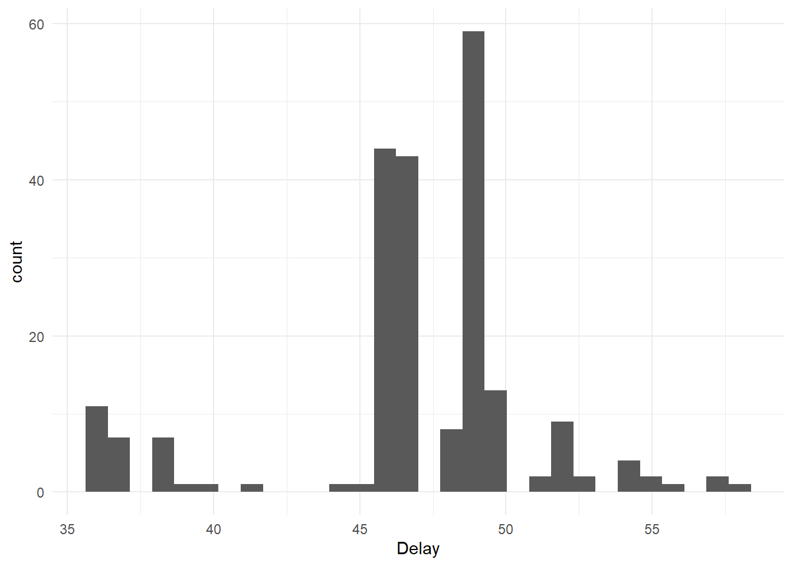{width=672}
:::
:::


The mean and median days between the two experiments were 46.95 and 47.00, respectively.

## Memory of Condition

### Main Model


::: {.cell}

```{.r .cell-code}
# Dodging order of the answers in the figures
make_group <- function(resp, covariate = NULL) {
  group <- case_when(  
    resp == "Not recognized" ~ 0,
    resp == "Human Original" ~ 1,
    resp == "AI-Generated" ~ 2,
    resp == "AI Original" ~ 2,
    resp == "Human Forgery" ~ 3,
    resp == "AI Copy" ~ 4,
    .default = NA)
  
  if(!is.null(covariate)) {
    covariate <- insight::format_value(normalize(covariate), style_positive="plus")
    group <- paste0(group, covariate)
  }
  group
}

dat_cond1 <- estimates$MemoryCondition$means |>
  mutate(group = make_group(Response))

p_cond1 <- dat_cond1 |> 
  ggplot(aes(x=Condition,  y = Median, color = Response)) +
  geom_line(aes(group=group), position = position_dodge(width=0.1), linewidth = 1,
            show.legend = FALSE) +
  geom_pointrange(aes(group=group, ymin = CI_low, ymax = CI_high), position = position_dodge(width=0.1),
                  key_glyph = "point") +
  scale_y_continuous(label = scales::percent, limits = c(0,1), expand = c(0, 0)) +
  scale_color_manual(values = cols) +
  guides(color = guide_legend(override.aes = list(size = 3))) +
  labs(y="Proportion of answers", color = "Answer", x =  "Experimental Condition",
       title = "Memory of the Experimental Condition") +
  theme_minimal() 
p_cond1
```

::: {.cell-output-display}
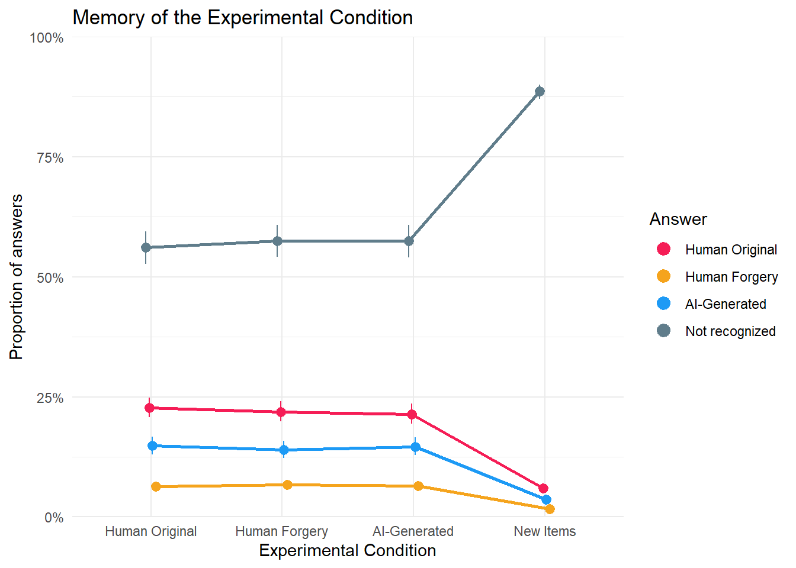{width=672}
:::
:::


::: {.cell}

```{.r .cell-code}
make_contrasts <- function(c, answer=NULL, condition=NULL, title="Marginal Contrasts") {

  if(!is.null(answer)) {
    c <- filter(c, str_detect(Response1, answer) & str_detect(Response2, answer))
  }
  if(!is.null(condition)) {
    c <- filter(c, str_detect(Level1, condition) & str_detect(Level2, condition))
  }

  # Collapse a constant Response/Level pair into one Category column
  if(length(unique(c$Response1)) == 1 & all(c$Response1 == c$Response2)) {
    c <- cbind(data.frame("Category" = c$Response1[1]), c)
    c$Response1 <- NULL
    c$Response2 <- NULL
  }
  if(length(unique(c$Level1)) == 1 & all(c$Level1 == c$Level2)) {
    c <- cbind(data.frame("Category" = c$Level1[1]), c)
    c$Level1 <- NULL
    c$Level2 <- NULL
  }

  c <- arrange(c, desc(abs(Median)))
  t <- format_table(c, zap_small = TRUE)

  t$effectsize <- as.numeric(c$Median)
  t$sig <- as.numeric(c$pd)

  g <- gt::gt(t) |>
    gt::data_color(columns = "effectsize", target_columns = "Median", method = "numeric",
palette = c("red", "red", "white", "green", "green"), domain = c(-0.7, 0.7)) |>
    gt::data_color(columns = "sig", target_columns = "pd", fn = \(x) {
      ifelse(x > 0.99, "#FFC107", ifelse(x > 0.97, "#FFEB3B", ifelse(x > 0.95, "#FFF59D", "white")))
    }) |>
    gt::cols_hide(c("effectsize", "sig")) |>
    gt::tab_header(title = title)

  # Markdown twin: colour coding replaced by an Effect column
  md <- t[setdiff(names(t), c("effectsize", "sig"))]
  md$Effect <- ifelse(sign(c$CI_low) != sign(c$CI_high), "n.s.",
                      ifelse(c$Median < 0, "Negative", "Positive"))
  make_asis(as.character(knitr::knit_print(g)), "", make_markdown(md, title), "")
}

# Convergence, marginal means and the complete contrast set
make_memory_tables <- function(est) {
  means_fmt <- as.data.frame(est$means)[c(est$by, "Response", "Median", "CI_low", "CI_high")]
  num <- vapply(means_fmt, is.numeric, logical(1))
  means_fmt[num] <- lapply(means_fmt[num], insight::format_value, zap_small = TRUE)

  all_con <- as.data.frame(est$contrasts)
  all_con$Effect <- ifelse(sign(all_con$CI_low) != sign(all_con$CI_high), "n.s.",
                           ifelse(all_con$Median < 0, "Negative", "Positive"))
  all_fmt <- all_con[c("Level1", "Response1", "Level2", "Response2", "Median", "CI_low", "CI_high", "pd", "Effect")]
  n <- vapply(all_fmt, is.numeric, logical(1))
  all_fmt[n] <- lapply(all_fmt[n], insight::format_value, zap_small = TRUE)

  make_asis(
    make_tables(est$diag,
                c("Model", "Family", "N_obs", "N_participants", "Chains", "Draws",
                  "Max_Rhat", "Min_ESS_ratio", "Divergent_pct", "Criterion"),
                sprintf("%s: convergence", est$label)),
    make_tables(means_fmt, names(means_fmt),
                sprintf("%s: probability of each answer per %s (marginal means)", est$label, est$by)),
    # Markdown only (120-300 rows)
    make_markdown(all_fmt, sprintf("%s: all %d contrasts", est$label, nrow(all_fmt)))
  )
}

# Generated summary of the credible same-answer contrasts
make_memory_summary <- function(est) {
  d <- as.data.frame(est$contrasts)
  d <- d[d$Response1 == d$Response2, ]
  d$Credible <- sign(d$CI_low) == sign(d$CI_high)
  pp <- function(x) insight::format_value(100 * x)
  out <- c(sprintf(
    "**%s.** Each row of the model is the probability of one answer. The differences below are between %s levels *within* the same answer, in percentage points, as posterior medians with 95%% CI; `pd` is the probability of direction. An effect is called credible when the CI excludes 0. Contrasts *across* answers are in the full table above.",
    est$label, est$by), "")
  for (r in unique(d$Response1)) {
    dr <- d[d$Response1 == r, ]
    cred <- dr[dr$Credible, ]
    if (nrow(cred) == 0) {
      out <- c(out, sprintf("- **%s**: no credible difference between any pair of %s levels.", r, est$by))
      next
    }
    cred <- cred[order(-abs(cred$Median)), ]
    out <- c(out, sprintf("- **%s**: %s.%s", r,
      paste(sprintf("%s - %s %s pp [%s, %s]", cred$Level1, cred$Level2,
                    pp(cred$Median), pp(cred$CI_low), pp(cred$CI_high)), collapse = "; "),
      if (nrow(cred) < nrow(dr)) sprintf(" The other %d pair(s) are not credible.", nrow(dr) - nrow(cred)) else ""))
  }
  make_asis("", '::: {.callout-tip title="Summary of credible effects (generated from the tables above)"}',
            "", out, "", ":::", "")
}
```
:::


::: {.cell}

```{.r .cell-code}
make_memory_tables(estimates$MemoryCondition)
```

::: {.cell-output-display}

```{=html}
<div id="iqhbtbcqky" style="padding-left:0px;padding-right:0px;padding-top:10px;padding-bottom:10px;overflow-x:auto;overflow-y:auto;width:auto;height:auto;">
<style>#iqhbtbcqky table {
  font-family: system-ui, 'Segoe UI', Roboto, Helvetica, Arial, sans-serif, 'Apple Color Emoji', 'Segoe UI Emoji', 'Segoe UI Symbol', 'Noto Color Emoji';
  -webkit-font-smoothing: antialiased;
  -moz-osx-font-smoothing: grayscale;
}

#iqhbtbcqky thead, #iqhbtbcqky tbody, #iqhbtbcqky tfoot, #iqhbtbcqky tr, #iqhbtbcqky td, #iqhbtbcqky th {
  border-style: none;
}

#iqhbtbcqky p {
  margin: 0;
  padding: 0;
}

#iqhbtbcqky .gt_table {
  display: table;
  border-collapse: collapse;
  line-height: normal;
  margin-left: auto;
  margin-right: auto;
  color: #333333;
  font-size: 13px;
  font-weight: normal;
  font-style: normal;
  background-color: #FFFFFF;
  width: auto;
  border-top-style: solid;
  border-top-width: 3px;
  border-top-color: #D5D5D5;
  border-right-style: solid;
  border-right-width: 3px;
  border-right-color: #D5D5D5;
  border-bottom-style: solid;
  border-bottom-width: 3px;
  border-bottom-color: #D5D5D5;
  border-left-style: solid;
  border-left-width: 3px;
  border-left-color: #D5D5D5;
}

#iqhbtbcqky .gt_caption {
  padding-top: 4px;
  padding-bottom: 4px;
}

#iqhbtbcqky .gt_title {
  color: #333333;
  font-size: 125%;
  font-weight: initial;
  padding-top: 4px;
  padding-bottom: 4px;
  padding-left: 5px;
  padding-right: 5px;
  border-bottom-color: #FFFFFF;
  border-bottom-width: 0;
}

#iqhbtbcqky .gt_subtitle {
  color: #333333;
  font-size: 85%;
  font-weight: initial;
  padding-top: 3px;
  padding-bottom: 5px;
  padding-left: 5px;
  padding-right: 5px;
  border-top-color: #FFFFFF;
  border-top-width: 0;
}

#iqhbtbcqky .gt_heading {
  background-color: #FFFFFF;
  text-align: left;
  border-bottom-color: #FFFFFF;
  border-left-style: none;
  border-left-width: 1px;
  border-left-color: #D3D3D3;
  border-right-style: none;
  border-right-width: 1px;
  border-right-color: #D3D3D3;
}

#iqhbtbcqky .gt_bottom_border {
  border-bottom-style: solid;
  border-bottom-width: 2px;
  border-bottom-color: #D5D5D5;
}

#iqhbtbcqky .gt_col_headings {
  border-top-style: solid;
  border-top-width: 2px;
  border-top-color: #D5D5D5;
  border-bottom-style: solid;
  border-bottom-width: 2px;
  border-bottom-color: #D5D5D5;
  border-left-style: none;
  border-left-width: 1px;
  border-left-color: #D3D3D3;
  border-right-style: none;
  border-right-width: 1px;
  border-right-color: #D3D3D3;
}

#iqhbtbcqky .gt_col_heading {
  color: #FFFFFF;
  background-color: #000000;
  font-size: 100%;
  font-weight: normal;
  text-transform: inherit;
  border-left-style: none;
  border-left-width: 1px;
  border-left-color: #D3D3D3;
  border-right-style: none;
  border-right-width: 1px;
  border-right-color: #D3D3D3;
  vertical-align: bottom;
  padding-top: 5px;
  padding-bottom: 6px;
  padding-left: 5px;
  padding-right: 5px;
  overflow-x: hidden;
}

#iqhbtbcqky .gt_column_spanner_outer {
  color: #FFFFFF;
  background-color: #000000;
  font-size: 100%;
  font-weight: normal;
  text-transform: inherit;
  padding-top: 0;
  padding-bottom: 0;
  padding-left: 4px;
  padding-right: 4px;
}

#iqhbtbcqky .gt_column_spanner_outer:first-child {
  padding-left: 0;
}

#iqhbtbcqky .gt_column_spanner_outer:last-child {
  padding-right: 0;
}

#iqhbtbcqky .gt_column_spanner {
  border-bottom-style: solid;
  border-bottom-width: 2px;
  border-bottom-color: #D5D5D5;
  vertical-align: bottom;
  padding-top: 5px;
  padding-bottom: 5px;
  overflow-x: hidden;
  display: inline-block;
  width: 100%;
}

#iqhbtbcqky .gt_spanner_row {
  border-bottom-style: hidden;
}

#iqhbtbcqky .gt_group_heading {
  padding-top: 8px;
  padding-bottom: 8px;
  padding-left: 5px;
  padding-right: 5px;
  color: #333333;
  background-color: #FFFFFF;
  font-size: 100%;
  font-weight: initial;
  text-transform: inherit;
  border-top-style: solid;
  border-top-width: 2px;
  border-top-color: #D5D5D5;
  border-bottom-style: solid;
  border-bottom-width: 2px;
  border-bottom-color: #D5D5D5;
  border-left-style: none;
  border-left-width: 1px;
  border-left-color: #D3D3D3;
  border-right-style: none;
  border-right-width: 1px;
  border-right-color: #D3D3D3;
  vertical-align: middle;
  text-align: left;
}

#iqhbtbcqky .gt_empty_group_heading {
  padding: 0.5px;
  color: #333333;
  background-color: #FFFFFF;
  font-size: 100%;
  font-weight: initial;
  border-top-style: solid;
  border-top-width: 2px;
  border-top-color: #D5D5D5;
  border-bottom-style: solid;
  border-bottom-width: 2px;
  border-bottom-color: #D5D5D5;
  vertical-align: middle;
}

#iqhbtbcqky .gt_from_md > :first-child {
  margin-top: 0;
}

#iqhbtbcqky .gt_from_md > :last-child {
  margin-bottom: 0;
}

#iqhbtbcqky .gt_row {
  padding-top: 8px;
  padding-bottom: 8px;
  padding-left: 5px;
  padding-right: 5px;
  margin: 10px;
  border-top-style: solid;
  border-top-width: 1px;
  border-top-color: #D5D5D5;
  border-left-style: solid;
  border-left-width: 1px;
  border-left-color: #D5D5D5;
  border-right-style: solid;
  border-right-width: 1px;
  border-right-color: #D5D5D5;
  vertical-align: middle;
  overflow-x: hidden;
}

#iqhbtbcqky .gt_stub {
  color: #333333;
  background-color: #FFFFFF;
  font-size: 100%;
  font-weight: initial;
  text-transform: inherit;
  border-right-style: solid;
  border-right-width: 2px;
  border-right-color: #5F5F5F;
  padding-left: 5px;
  padding-right: 5px;
}

#iqhbtbcqky .gt_stub_row_group {
  color: #333333;
  background-color: #FFFFFF;
  font-size: 100%;
  font-weight: initial;
  text-transform: inherit;
  border-right-style: solid;
  border-right-width: 2px;
  border-right-color: #D3D3D3;
  padding-left: 5px;
  padding-right: 5px;
  vertical-align: top;
}

#iqhbtbcqky .gt_row_group_first td {
  border-top-width: 2px;
}

#iqhbtbcqky .gt_row_group_first th {
  border-top-width: 2px;
}

#iqhbtbcqky .gt_summary_row {
  color: #333333;
  background-color: #D5D5D5;
  text-transform: inherit;
  padding-top: 8px;
  padding-bottom: 8px;
  padding-left: 5px;
  padding-right: 5px;
}

#iqhbtbcqky .gt_first_summary_row {
  border-top-style: solid;
  border-top-color: #D5D5D5;
}

#iqhbtbcqky .gt_first_summary_row.thick {
  border-top-width: 2px;
}

#iqhbtbcqky .gt_last_summary_row {
  padding-top: 8px;
  padding-bottom: 8px;
  padding-left: 5px;
  padding-right: 5px;
  border-bottom-style: solid;
  border-bottom-width: 2px;
  border-bottom-color: #D5D5D5;
}

#iqhbtbcqky .gt_grand_summary_row {
  color: #FFFFFF;
  background-color: #929292;
  text-transform: inherit;
  padding-top: 8px;
  padding-bottom: 8px;
  padding-left: 5px;
  padding-right: 5px;
}

#iqhbtbcqky .gt_first_grand_summary_row {
  padding-top: 8px;
  padding-bottom: 8px;
  padding-left: 5px;
  padding-right: 5px;
  border-top-style: double;
  border-top-width: 6px;
  border-top-color: #D5D5D5;
}

#iqhbtbcqky .gt_last_grand_summary_row_top {
  padding-top: 8px;
  padding-bottom: 8px;
  padding-left: 5px;
  padding-right: 5px;
  border-bottom-style: double;
  border-bottom-width: 6px;
  border-bottom-color: #D5D5D5;
}

#iqhbtbcqky .gt_striped {
  background-color: #F4F4F4;
}

#iqhbtbcqky .gt_table_body {
  border-top-style: solid;
  border-top-width: 2px;
  border-top-color: #D5D5D5;
  border-bottom-style: solid;
  border-bottom-width: 2px;
  border-bottom-color: #D5D5D5;
}

#iqhbtbcqky .gt_footnotes {
  color: #333333;
  background-color: #FFFFFF;
  border-bottom-style: none;
  border-bottom-width: 2px;
  border-bottom-color: #D3D3D3;
  border-left-style: none;
  border-left-width: 2px;
  border-left-color: #D3D3D3;
  border-right-style: none;
  border-right-width: 2px;
  border-right-color: #D3D3D3;
}

#iqhbtbcqky .gt_footnote {
  margin: 0px;
  font-size: 90%;
  padding-top: 4px;
  padding-bottom: 4px;
  padding-left: 5px;
  padding-right: 5px;
}

#iqhbtbcqky .gt_sourcenotes {
  color: #333333;
  background-color: #FFFFFF;
  border-bottom-style: none;
  border-bottom-width: 2px;
  border-bottom-color: #D3D3D3;
  border-left-style: none;
  border-left-width: 2px;
  border-left-color: #D3D3D3;
  border-right-style: none;
  border-right-width: 2px;
  border-right-color: #D3D3D3;
}

#iqhbtbcqky .gt_sourcenote {
  font-size: 90%;
  padding-top: 4px;
  padding-bottom: 4px;
  padding-left: 5px;
  padding-right: 5px;
}

#iqhbtbcqky .gt_left {
  text-align: left;
}

#iqhbtbcqky .gt_center {
  text-align: center;
}

#iqhbtbcqky .gt_right {
  text-align: right;
  font-variant-numeric: tabular-nums;
}

#iqhbtbcqky .gt_font_normal {
  font-weight: normal;
}

#iqhbtbcqky .gt_font_bold {
  font-weight: bold;
}

#iqhbtbcqky .gt_font_italic {
  font-style: italic;
}

#iqhbtbcqky .gt_super {
  font-size: 65%;
}

#iqhbtbcqky .gt_footnote_marks {
  font-size: 75%;
  vertical-align: 0.4em;
  position: initial;
}

#iqhbtbcqky .gt_asterisk {
  font-size: 100%;
  vertical-align: 0;
}

#iqhbtbcqky .gt_indent_1 {
  text-indent: 5px;
}

#iqhbtbcqky .gt_indent_2 {
  text-indent: 10px;
}

#iqhbtbcqky .gt_indent_3 {
  text-indent: 15px;
}

#iqhbtbcqky .gt_indent_4 {
  text-indent: 20px;
}

#iqhbtbcqky .gt_indent_5 {
  text-indent: 25px;
}

#iqhbtbcqky .katex-display {
  display: inline-flex !important;
  margin-bottom: 0.75em !important;
}

#iqhbtbcqky div.Reactable > div.rt-table > div.rt-thead > div.rt-tr.rt-tr-group-header > div.rt-th-group:after {
  height: 0px !important;
}
</style>
<table class="gt_table" data-quarto-disable-processing="false" data-quarto-bootstrap="false">
  <thead>
    <tr class="gt_heading">
      <td colspan="10" class="gt_heading gt_title gt_font_normal gt_bottom_border" style>Memory of the Experimental Condition: convergence</td>
    </tr>
    
    <tr class="gt_col_headings">
      <th class="gt_col_heading gt_columns_bottom_border gt_left" rowspan="1" colspan="1" scope="col" id="Model">Model</th>
      <th class="gt_col_heading gt_columns_bottom_border gt_left" rowspan="1" colspan="1" scope="col" id="Family">Family</th>
      <th class="gt_col_heading gt_columns_bottom_border gt_right" rowspan="1" colspan="1" scope="col" id="N_obs">N_obs</th>
      <th class="gt_col_heading gt_columns_bottom_border gt_right" rowspan="1" colspan="1" scope="col" id="N_participants">N_participants</th>
      <th class="gt_col_heading gt_columns_bottom_border gt_right" rowspan="1" colspan="1" scope="col" id="Chains">Chains</th>
      <th class="gt_col_heading gt_columns_bottom_border gt_right" rowspan="1" colspan="1" scope="col" id="Draws">Draws</th>
      <th class="gt_col_heading gt_columns_bottom_border gt_right" rowspan="1" colspan="1" scope="col" id="Max_Rhat">Max_Rhat</th>
      <th class="gt_col_heading gt_columns_bottom_border gt_right" rowspan="1" colspan="1" scope="col" id="Min_ESS_ratio">Min_ESS_ratio</th>
      <th class="gt_col_heading gt_columns_bottom_border gt_right" rowspan="1" colspan="1" scope="col" id="Divergent_pct">Divergent_pct</th>
      <th class="gt_col_heading gt_columns_bottom_border gt_left" rowspan="1" colspan="1" scope="col" id="Criterion">Criterion</th>
    </tr>
  </thead>
  <tbody class="gt_table_body">
    <tr><td headers="Model" class="gt_row gt_left">MemoryCondition</td>
<td headers="Family" class="gt_row gt_left">Categorical</td>
<td headers="N_obs" class="gt_row gt_right">21120</td>
<td headers="N_participants" class="gt_row gt_right">220</td>
<td headers="Chains" class="gt_row gt_right">8</td>
<td headers="Draws" class="gt_row gt_right">4000</td>
<td headers="Max_Rhat" class="gt_row gt_right">1.131</td>
<td headers="Min_ESS_ratio" class="gt_row gt_right">0.011</td>
<td headers="Divergent_pct" class="gt_row gt_right">1.45</td>
<td headers="Criterion" class="gt_row gt_left">loo</td></tr>
  </tbody>
  
</table>
</div>
```


::: {.callout-note collapse="true" title="Memory of the Experimental Condition: convergence (Markdown table, for text readers)"}

|Model           |Family      | N_obs| N_participants| Chains| Draws| Max_Rhat| Min_ESS_ratio| Divergent_pct|Criterion |
|:---------------|:-----------|-----:|--------------:|------:|-----:|--------:|-------------:|-------------:|:---------|
|MemoryCondition |Categorical | 21120|            220|      8|  4000|    1.131|         0.011|          1.45|loo       |

:::

```{=html}
<div id="rzskhytyza" style="padding-left:0px;padding-right:0px;padding-top:10px;padding-bottom:10px;overflow-x:auto;overflow-y:auto;width:auto;height:auto;">
<style>#rzskhytyza table {
  font-family: system-ui, 'Segoe UI', Roboto, Helvetica, Arial, sans-serif, 'Apple Color Emoji', 'Segoe UI Emoji', 'Segoe UI Symbol', 'Noto Color Emoji';
  -webkit-font-smoothing: antialiased;
  -moz-osx-font-smoothing: grayscale;
}

#rzskhytyza thead, #rzskhytyza tbody, #rzskhytyza tfoot, #rzskhytyza tr, #rzskhytyza td, #rzskhytyza th {
  border-style: none;
}

#rzskhytyza p {
  margin: 0;
  padding: 0;
}

#rzskhytyza .gt_table {
  display: table;
  border-collapse: collapse;
  line-height: normal;
  margin-left: auto;
  margin-right: auto;
  color: #333333;
  font-size: 13px;
  font-weight: normal;
  font-style: normal;
  background-color: #FFFFFF;
  width: auto;
  border-top-style: solid;
  border-top-width: 3px;
  border-top-color: #D5D5D5;
  border-right-style: solid;
  border-right-width: 3px;
  border-right-color: #D5D5D5;
  border-bottom-style: solid;
  border-bottom-width: 3px;
  border-bottom-color: #D5D5D5;
  border-left-style: solid;
  border-left-width: 3px;
  border-left-color: #D5D5D5;
}

#rzskhytyza .gt_caption {
  padding-top: 4px;
  padding-bottom: 4px;
}

#rzskhytyza .gt_title {
  color: #333333;
  font-size: 125%;
  font-weight: initial;
  padding-top: 4px;
  padding-bottom: 4px;
  padding-left: 5px;
  padding-right: 5px;
  border-bottom-color: #FFFFFF;
  border-bottom-width: 0;
}

#rzskhytyza .gt_subtitle {
  color: #333333;
  font-size: 85%;
  font-weight: initial;
  padding-top: 3px;
  padding-bottom: 5px;
  padding-left: 5px;
  padding-right: 5px;
  border-top-color: #FFFFFF;
  border-top-width: 0;
}

#rzskhytyza .gt_heading {
  background-color: #FFFFFF;
  text-align: left;
  border-bottom-color: #FFFFFF;
  border-left-style: none;
  border-left-width: 1px;
  border-left-color: #D3D3D3;
  border-right-style: none;
  border-right-width: 1px;
  border-right-color: #D3D3D3;
}

#rzskhytyza .gt_bottom_border {
  border-bottom-style: solid;
  border-bottom-width: 2px;
  border-bottom-color: #D5D5D5;
}

#rzskhytyza .gt_col_headings {
  border-top-style: solid;
  border-top-width: 2px;
  border-top-color: #D5D5D5;
  border-bottom-style: solid;
  border-bottom-width: 2px;
  border-bottom-color: #D5D5D5;
  border-left-style: none;
  border-left-width: 1px;
  border-left-color: #D3D3D3;
  border-right-style: none;
  border-right-width: 1px;
  border-right-color: #D3D3D3;
}

#rzskhytyza .gt_col_heading {
  color: #FFFFFF;
  background-color: #000000;
  font-size: 100%;
  font-weight: normal;
  text-transform: inherit;
  border-left-style: none;
  border-left-width: 1px;
  border-left-color: #D3D3D3;
  border-right-style: none;
  border-right-width: 1px;
  border-right-color: #D3D3D3;
  vertical-align: bottom;
  padding-top: 5px;
  padding-bottom: 6px;
  padding-left: 5px;
  padding-right: 5px;
  overflow-x: hidden;
}

#rzskhytyza .gt_column_spanner_outer {
  color: #FFFFFF;
  background-color: #000000;
  font-size: 100%;
  font-weight: normal;
  text-transform: inherit;
  padding-top: 0;
  padding-bottom: 0;
  padding-left: 4px;
  padding-right: 4px;
}

#rzskhytyza .gt_column_spanner_outer:first-child {
  padding-left: 0;
}

#rzskhytyza .gt_column_spanner_outer:last-child {
  padding-right: 0;
}

#rzskhytyza .gt_column_spanner {
  border-bottom-style: solid;
  border-bottom-width: 2px;
  border-bottom-color: #D5D5D5;
  vertical-align: bottom;
  padding-top: 5px;
  padding-bottom: 5px;
  overflow-x: hidden;
  display: inline-block;
  width: 100%;
}

#rzskhytyza .gt_spanner_row {
  border-bottom-style: hidden;
}

#rzskhytyza .gt_group_heading {
  padding-top: 8px;
  padding-bottom: 8px;
  padding-left: 5px;
  padding-right: 5px;
  color: #333333;
  background-color: #FFFFFF;
  font-size: 100%;
  font-weight: initial;
  text-transform: inherit;
  border-top-style: solid;
  border-top-width: 2px;
  border-top-color: #D5D5D5;
  border-bottom-style: solid;
  border-bottom-width: 2px;
  border-bottom-color: #D5D5D5;
  border-left-style: none;
  border-left-width: 1px;
  border-left-color: #D3D3D3;
  border-right-style: none;
  border-right-width: 1px;
  border-right-color: #D3D3D3;
  vertical-align: middle;
  text-align: left;
}

#rzskhytyza .gt_empty_group_heading {
  padding: 0.5px;
  color: #333333;
  background-color: #FFFFFF;
  font-size: 100%;
  font-weight: initial;
  border-top-style: solid;
  border-top-width: 2px;
  border-top-color: #D5D5D5;
  border-bottom-style: solid;
  border-bottom-width: 2px;
  border-bottom-color: #D5D5D5;
  vertical-align: middle;
}

#rzskhytyza .gt_from_md > :first-child {
  margin-top: 0;
}

#rzskhytyza .gt_from_md > :last-child {
  margin-bottom: 0;
}

#rzskhytyza .gt_row {
  padding-top: 8px;
  padding-bottom: 8px;
  padding-left: 5px;
  padding-right: 5px;
  margin: 10px;
  border-top-style: solid;
  border-top-width: 1px;
  border-top-color: #D5D5D5;
  border-left-style: solid;
  border-left-width: 1px;
  border-left-color: #D5D5D5;
  border-right-style: solid;
  border-right-width: 1px;
  border-right-color: #D5D5D5;
  vertical-align: middle;
  overflow-x: hidden;
}

#rzskhytyza .gt_stub {
  color: #333333;
  background-color: #FFFFFF;
  font-size: 100%;
  font-weight: initial;
  text-transform: inherit;
  border-right-style: solid;
  border-right-width: 2px;
  border-right-color: #5F5F5F;
  padding-left: 5px;
  padding-right: 5px;
}

#rzskhytyza .gt_stub_row_group {
  color: #333333;
  background-color: #FFFFFF;
  font-size: 100%;
  font-weight: initial;
  text-transform: inherit;
  border-right-style: solid;
  border-right-width: 2px;
  border-right-color: #D3D3D3;
  padding-left: 5px;
  padding-right: 5px;
  vertical-align: top;
}

#rzskhytyza .gt_row_group_first td {
  border-top-width: 2px;
}

#rzskhytyza .gt_row_group_first th {
  border-top-width: 2px;
}

#rzskhytyza .gt_summary_row {
  color: #333333;
  background-color: #D5D5D5;
  text-transform: inherit;
  padding-top: 8px;
  padding-bottom: 8px;
  padding-left: 5px;
  padding-right: 5px;
}

#rzskhytyza .gt_first_summary_row {
  border-top-style: solid;
  border-top-color: #D5D5D5;
}

#rzskhytyza .gt_first_summary_row.thick {
  border-top-width: 2px;
}

#rzskhytyza .gt_last_summary_row {
  padding-top: 8px;
  padding-bottom: 8px;
  padding-left: 5px;
  padding-right: 5px;
  border-bottom-style: solid;
  border-bottom-width: 2px;
  border-bottom-color: #D5D5D5;
}

#rzskhytyza .gt_grand_summary_row {
  color: #FFFFFF;
  background-color: #929292;
  text-transform: inherit;
  padding-top: 8px;
  padding-bottom: 8px;
  padding-left: 5px;
  padding-right: 5px;
}

#rzskhytyza .gt_first_grand_summary_row {
  padding-top: 8px;
  padding-bottom: 8px;
  padding-left: 5px;
  padding-right: 5px;
  border-top-style: double;
  border-top-width: 6px;
  border-top-color: #D5D5D5;
}

#rzskhytyza .gt_last_grand_summary_row_top {
  padding-top: 8px;
  padding-bottom: 8px;
  padding-left: 5px;
  padding-right: 5px;
  border-bottom-style: double;
  border-bottom-width: 6px;
  border-bottom-color: #D5D5D5;
}

#rzskhytyza .gt_striped {
  background-color: #F4F4F4;
}

#rzskhytyza .gt_table_body {
  border-top-style: solid;
  border-top-width: 2px;
  border-top-color: #D5D5D5;
  border-bottom-style: solid;
  border-bottom-width: 2px;
  border-bottom-color: #D5D5D5;
}

#rzskhytyza .gt_footnotes {
  color: #333333;
  background-color: #FFFFFF;
  border-bottom-style: none;
  border-bottom-width: 2px;
  border-bottom-color: #D3D3D3;
  border-left-style: none;
  border-left-width: 2px;
  border-left-color: #D3D3D3;
  border-right-style: none;
  border-right-width: 2px;
  border-right-color: #D3D3D3;
}

#rzskhytyza .gt_footnote {
  margin: 0px;
  font-size: 90%;
  padding-top: 4px;
  padding-bottom: 4px;
  padding-left: 5px;
  padding-right: 5px;
}

#rzskhytyza .gt_sourcenotes {
  color: #333333;
  background-color: #FFFFFF;
  border-bottom-style: none;
  border-bottom-width: 2px;
  border-bottom-color: #D3D3D3;
  border-left-style: none;
  border-left-width: 2px;
  border-left-color: #D3D3D3;
  border-right-style: none;
  border-right-width: 2px;
  border-right-color: #D3D3D3;
}

#rzskhytyza .gt_sourcenote {
  font-size: 90%;
  padding-top: 4px;
  padding-bottom: 4px;
  padding-left: 5px;
  padding-right: 5px;
}

#rzskhytyza .gt_left {
  text-align: left;
}

#rzskhytyza .gt_center {
  text-align: center;
}

#rzskhytyza .gt_right {
  text-align: right;
  font-variant-numeric: tabular-nums;
}

#rzskhytyza .gt_font_normal {
  font-weight: normal;
}

#rzskhytyza .gt_font_bold {
  font-weight: bold;
}

#rzskhytyza .gt_font_italic {
  font-style: italic;
}

#rzskhytyza .gt_super {
  font-size: 65%;
}

#rzskhytyza .gt_footnote_marks {
  font-size: 75%;
  vertical-align: 0.4em;
  position: initial;
}

#rzskhytyza .gt_asterisk {
  font-size: 100%;
  vertical-align: 0;
}

#rzskhytyza .gt_indent_1 {
  text-indent: 5px;
}

#rzskhytyza .gt_indent_2 {
  text-indent: 10px;
}

#rzskhytyza .gt_indent_3 {
  text-indent: 15px;
}

#rzskhytyza .gt_indent_4 {
  text-indent: 20px;
}

#rzskhytyza .gt_indent_5 {
  text-indent: 25px;
}

#rzskhytyza .katex-display {
  display: inline-flex !important;
  margin-bottom: 0.75em !important;
}

#rzskhytyza div.Reactable > div.rt-table > div.rt-thead > div.rt-tr.rt-tr-group-header > div.rt-th-group:after {
  height: 0px !important;
}
</style>
<table class="gt_table" data-quarto-disable-processing="false" data-quarto-bootstrap="false">
  <thead>
    <tr class="gt_heading">
      <td colspan="5" class="gt_heading gt_title gt_font_normal gt_bottom_border" style>Memory of the Experimental Condition: probability of each answer per Condition (marginal means)</td>
    </tr>
    
    <tr class="gt_col_headings">
      <th class="gt_col_heading gt_columns_bottom_border gt_center" rowspan="1" colspan="1" scope="col" id="Condition">Condition</th>
      <th class="gt_col_heading gt_columns_bottom_border gt_center" rowspan="1" colspan="1" scope="col" id="Response">Response</th>
      <th class="gt_col_heading gt_columns_bottom_border gt_right" rowspan="1" colspan="1" scope="col" id="Median">Median</th>
      <th class="gt_col_heading gt_columns_bottom_border gt_right" rowspan="1" colspan="1" scope="col" id="CI_low">CI_low</th>
      <th class="gt_col_heading gt_columns_bottom_border gt_right" rowspan="1" colspan="1" scope="col" id="CI_high">CI_high</th>
    </tr>
  </thead>
  <tbody class="gt_table_body">
    <tr><td headers="Condition" class="gt_row gt_center">Human Original</td>
<td headers="Response" class="gt_row gt_center">Human Original</td>
<td headers="Median" class="gt_row gt_right">0.23</td>
<td headers="CI_low" class="gt_row gt_right">0.21</td>
<td headers="CI_high" class="gt_row gt_right">0.25</td></tr>
    <tr><td headers="Condition" class="gt_row gt_center gt_striped">Human Forgery</td>
<td headers="Response" class="gt_row gt_center gt_striped">Human Original</td>
<td headers="Median" class="gt_row gt_right gt_striped">0.22</td>
<td headers="CI_low" class="gt_row gt_right gt_striped">0.20</td>
<td headers="CI_high" class="gt_row gt_right gt_striped">0.24</td></tr>
    <tr><td headers="Condition" class="gt_row gt_center">AI-Generated</td>
<td headers="Response" class="gt_row gt_center">Human Original</td>
<td headers="Median" class="gt_row gt_right">0.21</td>
<td headers="CI_low" class="gt_row gt_right">0.19</td>
<td headers="CI_high" class="gt_row gt_right">0.24</td></tr>
    <tr><td headers="Condition" class="gt_row gt_center gt_striped">New Items</td>
<td headers="Response" class="gt_row gt_center gt_striped">Human Original</td>
<td headers="Median" class="gt_row gt_right gt_striped">0.06</td>
<td headers="CI_low" class="gt_row gt_right gt_striped">0.05</td>
<td headers="CI_high" class="gt_row gt_right gt_striped">0.07</td></tr>
    <tr><td headers="Condition" class="gt_row gt_center">Human Original</td>
<td headers="Response" class="gt_row gt_center">Human Forgery</td>
<td headers="Median" class="gt_row gt_right">0.06</td>
<td headers="CI_low" class="gt_row gt_right">0.06</td>
<td headers="CI_high" class="gt_row gt_right">0.07</td></tr>
    <tr><td headers="Condition" class="gt_row gt_center gt_striped">Human Forgery</td>
<td headers="Response" class="gt_row gt_center gt_striped">Human Forgery</td>
<td headers="Median" class="gt_row gt_right gt_striped">0.07</td>
<td headers="CI_low" class="gt_row gt_right gt_striped">0.06</td>
<td headers="CI_high" class="gt_row gt_right gt_striped">0.08</td></tr>
    <tr><td headers="Condition" class="gt_row gt_center">AI-Generated</td>
<td headers="Response" class="gt_row gt_center">Human Forgery</td>
<td headers="Median" class="gt_row gt_right">0.07</td>
<td headers="CI_low" class="gt_row gt_right">0.06</td>
<td headers="CI_high" class="gt_row gt_right">0.07</td></tr>
    <tr><td headers="Condition" class="gt_row gt_center gt_striped">New Items</td>
<td headers="Response" class="gt_row gt_center gt_striped">Human Forgery</td>
<td headers="Median" class="gt_row gt_right gt_striped">0.02</td>
<td headers="CI_low" class="gt_row gt_right gt_striped">0.01</td>
<td headers="CI_high" class="gt_row gt_right gt_striped">0.02</td></tr>
    <tr><td headers="Condition" class="gt_row gt_center">Human Original</td>
<td headers="Response" class="gt_row gt_center">AI-Generated</td>
<td headers="Median" class="gt_row gt_right">0.15</td>
<td headers="CI_low" class="gt_row gt_right">0.13</td>
<td headers="CI_high" class="gt_row gt_right">0.17</td></tr>
    <tr><td headers="Condition" class="gt_row gt_center gt_striped">Human Forgery</td>
<td headers="Response" class="gt_row gt_center gt_striped">AI-Generated</td>
<td headers="Median" class="gt_row gt_right gt_striped">0.14</td>
<td headers="CI_low" class="gt_row gt_right gt_striped">0.12</td>
<td headers="CI_high" class="gt_row gt_right gt_striped">0.16</td></tr>
    <tr><td headers="Condition" class="gt_row gt_center">AI-Generated</td>
<td headers="Response" class="gt_row gt_center">AI-Generated</td>
<td headers="Median" class="gt_row gt_right">0.15</td>
<td headers="CI_low" class="gt_row gt_right">0.13</td>
<td headers="CI_high" class="gt_row gt_right">0.17</td></tr>
    <tr><td headers="Condition" class="gt_row gt_center gt_striped">New Items</td>
<td headers="Response" class="gt_row gt_center gt_striped">AI-Generated</td>
<td headers="Median" class="gt_row gt_right gt_striped">0.04</td>
<td headers="CI_low" class="gt_row gt_right gt_striped">0.03</td>
<td headers="CI_high" class="gt_row gt_right gt_striped">0.04</td></tr>
    <tr><td headers="Condition" class="gt_row gt_center">Human Original</td>
<td headers="Response" class="gt_row gt_center">Not recognized</td>
<td headers="Median" class="gt_row gt_right">0.56</td>
<td headers="CI_low" class="gt_row gt_right">0.53</td>
<td headers="CI_high" class="gt_row gt_right">0.59</td></tr>
    <tr><td headers="Condition" class="gt_row gt_center gt_striped">Human Forgery</td>
<td headers="Response" class="gt_row gt_center gt_striped">Not recognized</td>
<td headers="Median" class="gt_row gt_right gt_striped">0.57</td>
<td headers="CI_low" class="gt_row gt_right gt_striped">0.54</td>
<td headers="CI_high" class="gt_row gt_right gt_striped">0.61</td></tr>
    <tr><td headers="Condition" class="gt_row gt_center">AI-Generated</td>
<td headers="Response" class="gt_row gt_center">Not recognized</td>
<td headers="Median" class="gt_row gt_right">0.57</td>
<td headers="CI_low" class="gt_row gt_right">0.54</td>
<td headers="CI_high" class="gt_row gt_right">0.61</td></tr>
    <tr><td headers="Condition" class="gt_row gt_center gt_striped">New Items</td>
<td headers="Response" class="gt_row gt_center gt_striped">Not recognized</td>
<td headers="Median" class="gt_row gt_right gt_striped">0.89</td>
<td headers="CI_low" class="gt_row gt_right gt_striped">0.87</td>
<td headers="CI_high" class="gt_row gt_right gt_striped">0.90</td></tr>
  </tbody>
  
</table>
</div>
```


::: {.callout-note collapse="true" title="Memory of the Experimental Condition: probability of each answer per Condition (marginal means) (Markdown table, for text readers)"}

|Condition      |Response       |Median |CI_low |CI_high |
|:--------------|:--------------|:------|:------|:-------|
|Human Original |Human Original |0.23   |0.21   |0.25    |
|Human Forgery  |Human Original |0.22   |0.20   |0.24    |
|AI-Generated   |Human Original |0.21   |0.19   |0.24    |
|New Items      |Human Original |0.06   |0.05   |0.07    |
|Human Original |Human Forgery  |0.06   |0.06   |0.07    |
|Human Forgery  |Human Forgery  |0.07   |0.06   |0.08    |
|AI-Generated   |Human Forgery  |0.07   |0.06   |0.07    |
|New Items      |Human Forgery  |0.02   |0.01   |0.02    |
|Human Original |AI-Generated   |0.15   |0.13   |0.17    |
|Human Forgery  |AI-Generated   |0.14   |0.12   |0.16    |
|AI-Generated   |AI-Generated   |0.15   |0.13   |0.17    |
|New Items      |AI-Generated   |0.04   |0.03   |0.04    |
|Human Original |Not recognized |0.56   |0.53   |0.59    |
|Human Forgery  |Not recognized |0.57   |0.54   |0.61    |
|AI-Generated   |Not recognized |0.57   |0.54   |0.61    |
|New Items      |Not recognized |0.89   |0.87   |0.90    |

:::

::: {.callout-note collapse="true" title="Memory of the Experimental Condition: all 120 contrasts (Markdown table, for text readers)"}

|Level1         |Response1      |Level2         |Response2      |Median |CI_low |CI_high |pd   |Effect   |
|:--------------|:--------------|:--------------|:--------------|:------|:------|:-------|:----|:--------|
|Human Forgery  |Human Original |Human Original |Human Original |-0.01  |-0.03  |0.01    |0.82 |n.s.     |
|AI-Generated   |Human Original |Human Original |Human Original |-0.01  |-0.03  |0.01    |0.91 |n.s.     |
|New Items      |Human Original |Human Original |Human Original |-0.17  |-0.19  |-0.14   |1.00 |Negative |
|Human Original |Human Forgery  |Human Original |Human Original |-0.16  |-0.19  |-0.14   |1.00 |Negative |
|Human Forgery  |Human Forgery  |Human Original |Human Original |-0.16  |-0.18  |-0.14   |1.00 |Negative |
|AI-Generated   |Human Forgery  |Human Original |Human Original |-0.16  |-0.18  |-0.14   |1.00 |Negative |
|New Items      |Human Forgery  |Human Original |Human Original |-0.21  |-0.23  |-0.19   |1.00 |Negative |
|Human Original |AI-Generated   |Human Original |Human Original |-0.08  |-0.10  |-0.05   |1.00 |Negative |
|Human Forgery  |AI-Generated   |Human Original |Human Original |-0.09  |-0.11  |-0.06   |1.00 |Negative |
|AI-Generated   |AI-Generated   |Human Original |Human Original |-0.08  |-0.11  |-0.06   |1.00 |Negative |
|New Items      |AI-Generated   |Human Original |Human Original |-0.19  |-0.21  |-0.17   |1.00 |Negative |
|Human Original |Not recognized |Human Original |Human Original |0.33   |0.28   |0.39    |1.00 |Positive |
|Human Forgery  |Not recognized |Human Original |Human Original |0.35   |0.30   |0.40    |1.00 |Positive |
|AI-Generated   |Not recognized |Human Original |Human Original |0.35   |0.30   |0.40    |1.00 |Positive |
|New Items      |Not recognized |Human Original |Human Original |0.66   |0.64   |0.68    |1.00 |Positive |
|AI-Generated   |Human Original |Human Forgery  |Human Original |0.00   |-0.02  |0.01    |0.69 |n.s.     |
|New Items      |Human Original |Human Forgery  |Human Original |-0.16  |-0.18  |-0.13   |1.00 |Negative |
|Human Original |Human Forgery  |Human Forgery  |Human Original |-0.16  |-0.18  |-0.14   |1.00 |Negative |
|Human Forgery  |Human Forgery  |Human Forgery  |Human Original |-0.15  |-0.17  |-0.13   |1.00 |Negative |
|AI-Generated   |Human Forgery  |Human Forgery  |Human Original |-0.15  |-0.17  |-0.13   |1.00 |Negative |
|New Items      |Human Forgery  |Human Forgery  |Human Original |-0.20  |-0.22  |-0.18   |1.00 |Negative |
|Human Original |AI-Generated   |Human Forgery  |Human Original |-0.07  |-0.09  |-0.05   |1.00 |Negative |
|Human Forgery  |AI-Generated   |Human Forgery  |Human Original |-0.08  |-0.10  |-0.05   |1.00 |Negative |
|AI-Generated   |AI-Generated   |Human Forgery  |Human Original |-0.07  |-0.10  |-0.05   |1.00 |Negative |
|New Items      |AI-Generated   |Human Forgery  |Human Original |-0.18  |-0.21  |-0.16   |1.00 |Negative |
|Human Original |Not recognized |Human Forgery  |Human Original |0.34   |0.29   |0.39    |1.00 |Positive |
|Human Forgery  |Not recognized |Human Forgery  |Human Original |0.36   |0.30   |0.41    |1.00 |Positive |
|AI-Generated   |Not recognized |Human Forgery  |Human Original |0.36   |0.31   |0.40    |1.00 |Positive |
|New Items      |Not recognized |Human Forgery  |Human Original |0.67   |0.65   |0.68    |1.00 |Positive |
|New Items      |Human Original |AI-Generated   |Human Original |-0.15  |-0.18  |-0.13   |1.00 |Negative |
|Human Original |Human Forgery  |AI-Generated   |Human Original |-0.15  |-0.17  |-0.13   |1.00 |Negative |
|Human Forgery  |Human Forgery  |AI-Generated   |Human Original |-0.15  |-0.17  |-0.13   |1.00 |Negative |
|AI-Generated   |Human Forgery  |AI-Generated   |Human Original |-0.15  |-0.17  |-0.13   |1.00 |Negative |
|New Items      |Human Forgery  |AI-Generated   |Human Original |-0.20  |-0.22  |-0.18   |1.00 |Negative |
|Human Original |AI-Generated   |AI-Generated   |Human Original |-0.07  |-0.09  |-0.04   |1.00 |Negative |
|Human Forgery  |AI-Generated   |AI-Generated   |Human Original |-0.07  |-0.10  |-0.05   |1.00 |Negative |
|AI-Generated   |AI-Generated   |AI-Generated   |Human Original |-0.07  |-0.09  |-0.04   |1.00 |Negative |
|New Items      |AI-Generated   |AI-Generated   |Human Original |-0.18  |-0.20  |-0.15   |1.00 |Negative |
|Human Original |Not recognized |AI-Generated   |Human Original |0.35   |0.30   |0.39    |1.00 |Positive |
|Human Forgery  |Not recognized |AI-Generated   |Human Original |0.36   |0.31   |0.41    |1.00 |Positive |
|AI-Generated   |Not recognized |AI-Generated   |Human Original |0.36   |0.31   |0.41    |1.00 |Positive |
|New Items      |Not recognized |AI-Generated   |Human Original |0.67   |0.65   |0.69    |1.00 |Positive |
|Human Original |Human Forgery  |New Items      |Human Original |0.00   |-0.01  |0.02    |0.67 |n.s.     |
|Human Forgery  |Human Forgery  |New Items      |Human Original |0.01   |-0.01  |0.02    |0.82 |n.s.     |
|AI-Generated   |Human Forgery  |New Items      |Human Original |0.00   |-0.01  |0.02    |0.75 |n.s.     |
|New Items      |Human Forgery  |New Items      |Human Original |-0.04  |-0.05  |-0.04   |1.00 |Negative |
|Human Original |AI-Generated   |New Items      |Human Original |0.09   |0.06   |0.11    |1.00 |Positive |
|Human Forgery  |AI-Generated   |New Items      |Human Original |0.08   |0.06   |0.10    |1.00 |Positive |
|AI-Generated   |AI-Generated   |New Items      |Human Original |0.09   |0.06   |0.11    |1.00 |Positive |
|New Items      |AI-Generated   |New Items      |Human Original |-0.02  |-0.03  |-0.02   |1.00 |Negative |
|Human Original |Not recognized |New Items      |Human Original |0.50   |0.47   |0.53    |1.00 |Positive |
|Human Forgery  |Not recognized |New Items      |Human Original |0.51   |0.48   |0.54    |1.00 |Positive |
|AI-Generated   |Not recognized |New Items      |Human Original |0.51   |0.48   |0.54    |1.00 |Positive |
|New Items      |Not recognized |New Items      |Human Original |0.83   |0.80   |0.85    |1.00 |Positive |
|Human Forgery  |Human Forgery  |Human Original |Human Forgery  |0.00   |-0.01  |0.02    |0.73 |n.s.     |
|AI-Generated   |Human Forgery  |Human Original |Human Forgery  |0.00   |-0.01  |0.01    |0.63 |n.s.     |
|New Items      |Human Forgery  |Human Original |Human Forgery  |-0.05  |-0.06  |-0.04   |1.00 |Negative |
|Human Original |AI-Generated   |Human Original |Human Forgery  |0.08   |0.07   |0.11    |1.00 |Positive |
|Human Forgery  |AI-Generated   |Human Original |Human Forgery  |0.08   |0.06   |0.10    |1.00 |Positive |
|AI-Generated   |AI-Generated   |Human Original |Human Forgery  |0.08   |0.06   |0.10    |1.00 |Positive |
|New Items      |AI-Generated   |Human Original |Human Forgery  |-0.03  |-0.04  |-0.01   |1.00 |Negative |
|Human Original |Not recognized |Human Original |Human Forgery  |0.50   |0.46   |0.54    |1.00 |Positive |
|Human Forgery  |Not recognized |Human Original |Human Forgery  |0.51   |0.47   |0.55    |1.00 |Positive |
|AI-Generated   |Not recognized |Human Original |Human Forgery  |0.51   |0.47   |0.55    |1.00 |Positive |
|New Items      |Not recognized |Human Original |Human Forgery  |0.82   |0.81   |0.84    |1.00 |Positive |
|AI-Generated   |Human Forgery  |Human Forgery  |Human Forgery  |0.00   |-0.01  |0.01    |0.61 |n.s.     |
|New Items      |Human Forgery  |Human Forgery  |Human Forgery  |-0.05  |-0.06  |-0.04   |1.00 |Negative |
|Human Original |AI-Generated   |Human Forgery  |Human Forgery  |0.08   |0.06   |0.10    |1.00 |Positive |
|Human Forgery  |AI-Generated   |Human Forgery  |Human Forgery  |0.07   |0.05   |0.09    |1.00 |Positive |
|AI-Generated   |AI-Generated   |Human Forgery  |Human Forgery  |0.08   |0.06   |0.10    |1.00 |Positive |
|New Items      |AI-Generated   |Human Forgery  |Human Forgery  |-0.03  |-0.04  |-0.02   |1.00 |Negative |
|Human Original |Not recognized |Human Forgery  |Human Forgery  |0.49   |0.46   |0.53    |1.00 |Positive |
|Human Forgery  |Not recognized |Human Forgery  |Human Forgery  |0.51   |0.47   |0.55    |1.00 |Positive |
|AI-Generated   |Not recognized |Human Forgery  |Human Forgery  |0.51   |0.47   |0.55    |1.00 |Positive |
|New Items      |Not recognized |Human Forgery  |Human Forgery  |0.82   |0.80   |0.83    |1.00 |Positive |
|New Items      |Human Forgery  |AI-Generated   |Human Forgery  |-0.05  |-0.06  |-0.04   |1.00 |Negative |
|Human Original |AI-Generated   |AI-Generated   |Human Forgery  |0.08   |0.06   |0.10    |1.00 |Positive |
|Human Forgery  |AI-Generated   |AI-Generated   |Human Forgery  |0.07   |0.06   |0.09    |1.00 |Positive |
|AI-Generated   |AI-Generated   |AI-Generated   |Human Forgery  |0.08   |0.06   |0.10    |1.00 |Positive |
|New Items      |AI-Generated   |AI-Generated   |Human Forgery  |-0.03  |-0.04  |-0.02   |1.00 |Negative |
|Human Original |Not recognized |AI-Generated   |Human Forgery  |0.50   |0.46   |0.53    |1.00 |Positive |
|Human Forgery  |Not recognized |AI-Generated   |Human Forgery  |0.51   |0.47   |0.55    |1.00 |Positive |
|AI-Generated   |Not recognized |AI-Generated   |Human Forgery  |0.51   |0.47   |0.55    |1.00 |Positive |
|New Items      |Not recognized |AI-Generated   |Human Forgery  |0.82   |0.81   |0.83    |1.00 |Positive |
|Human Original |AI-Generated   |New Items      |Human Forgery  |0.13   |0.11   |0.15    |1.00 |Positive |
|Human Forgery  |AI-Generated   |New Items      |Human Forgery  |0.12   |0.10   |0.14    |1.00 |Positive |
|AI-Generated   |AI-Generated   |New Items      |Human Forgery  |0.13   |0.11   |0.15    |1.00 |Positive |
|New Items      |AI-Generated   |New Items      |Human Forgery  |0.02   |0.01   |0.03    |1.00 |Positive |
|Human Original |Not recognized |New Items      |Human Forgery  |0.54   |0.51   |0.58    |1.00 |Positive |
|Human Forgery  |Not recognized |New Items      |Human Forgery  |0.56   |0.53   |0.59    |1.00 |Positive |
|AI-Generated   |Not recognized |New Items      |Human Forgery  |0.56   |0.52   |0.59    |1.00 |Positive |
|New Items      |Not recognized |New Items      |Human Forgery  |0.87   |0.85   |0.88    |1.00 |Positive |
|Human Forgery  |AI-Generated   |Human Original |AI-Generated   |-0.01  |-0.02  |0.01    |0.85 |n.s.     |
|AI-Generated   |AI-Generated   |Human Original |AI-Generated   |0.00   |-0.02  |0.01    |0.62 |n.s.     |
|New Items      |AI-Generated   |Human Original |AI-Generated   |-0.11  |-0.13  |-0.09   |1.00 |Negative |
|Human Original |Not recognized |Human Original |AI-Generated   |0.41   |0.36   |0.46    |1.00 |Positive |
|Human Forgery  |Not recognized |Human Original |AI-Generated   |0.43   |0.38   |0.47    |1.00 |Positive |
|AI-Generated   |Not recognized |Human Original |AI-Generated   |0.43   |0.38   |0.47    |1.00 |Positive |
|New Items      |Not recognized |Human Original |AI-Generated   |0.74   |0.72   |0.75    |1.00 |Positive |
|AI-Generated   |AI-Generated   |Human Forgery  |AI-Generated   |0.01   |-0.01  |0.02    |0.76 |n.s.     |
|New Items      |AI-Generated   |Human Forgery  |AI-Generated   |-0.10  |-0.13  |-0.08   |1.00 |Negative |
|Human Original |Not recognized |Human Forgery  |AI-Generated   |0.42   |0.37   |0.47    |1.00 |Positive |
|Human Forgery  |Not recognized |Human Forgery  |AI-Generated   |0.43   |0.39   |0.48    |1.00 |Positive |
|AI-Generated   |Not recognized |Human Forgery  |AI-Generated   |0.43   |0.39   |0.48    |1.00 |Positive |
|New Items      |Not recognized |Human Forgery  |AI-Generated   |0.75   |0.73   |0.76    |1.00 |Positive |
|New Items      |AI-Generated   |AI-Generated   |AI-Generated   |-0.11  |-0.13  |-0.09   |1.00 |Negative |
|Human Original |Not recognized |AI-Generated   |AI-Generated   |0.42   |0.37   |0.46    |1.00 |Positive |
|Human Forgery  |Not recognized |AI-Generated   |AI-Generated   |0.43   |0.38   |0.47    |1.00 |Positive |
|AI-Generated   |Not recognized |AI-Generated   |AI-Generated   |0.43   |0.38   |0.48    |1.00 |Positive |
|New Items      |Not recognized |AI-Generated   |AI-Generated   |0.74   |0.72   |0.76    |1.00 |Positive |
|Human Original |Not recognized |New Items      |AI-Generated   |0.52   |0.49   |0.55    |1.00 |Positive |
|Human Forgery  |Not recognized |New Items      |AI-Generated   |0.54   |0.51   |0.57    |1.00 |Positive |
|AI-Generated   |Not recognized |New Items      |AI-Generated   |0.54   |0.51   |0.57    |1.00 |Positive |
|New Items      |Not recognized |New Items      |AI-Generated   |0.85   |0.83   |0.87    |1.00 |Positive |
|Human Forgery  |Not recognized |Human Original |Not recognized |0.01   |-0.01  |0.03    |0.90 |n.s.     |
|AI-Generated   |Not recognized |Human Original |Not recognized |0.01   |-0.01  |0.03    |0.90 |n.s.     |
|New Items      |Not recognized |Human Original |Not recognized |0.32   |0.28   |0.37    |1.00 |Positive |
|AI-Generated   |Not recognized |Human Forgery  |Not recognized |0.00   |-0.02  |0.02    |0.51 |n.s.     |
|New Items      |Not recognized |Human Forgery  |Not recognized |0.31   |0.27   |0.36    |1.00 |Positive |
|New Items      |Not recognized |AI-Generated   |Not recognized |0.31   |0.27   |0.36    |1.00 |Positive |

:::
:::
:::


::: {.cell}

```{.r .cell-code}
c <- estimates$MemoryCondition$contrasts
make_contrasts(c, answer="Not recognized",
               title="Memory of Condition: forgetting ('Not recognized') by condition")
```

::: {.cell-output-display}

```{=html}
<div id="anxcitbgpe" style="padding-left:0px;padding-right:0px;padding-top:10px;padding-bottom:10px;overflow-x:auto;overflow-y:auto;width:auto;height:auto;">
<style>#anxcitbgpe table {
  font-family: system-ui, 'Segoe UI', Roboto, Helvetica, Arial, sans-serif, 'Apple Color Emoji', 'Segoe UI Emoji', 'Segoe UI Symbol', 'Noto Color Emoji';
  -webkit-font-smoothing: antialiased;
  -moz-osx-font-smoothing: grayscale;
}

#anxcitbgpe thead, #anxcitbgpe tbody, #anxcitbgpe tfoot, #anxcitbgpe tr, #anxcitbgpe td, #anxcitbgpe th {
  border-style: none;
}

#anxcitbgpe p {
  margin: 0;
  padding: 0;
}

#anxcitbgpe .gt_table {
  display: table;
  border-collapse: collapse;
  line-height: normal;
  margin-left: auto;
  margin-right: auto;
  color: #333333;
  font-size: 16px;
  font-weight: normal;
  font-style: normal;
  background-color: #FFFFFF;
  width: auto;
  border-top-style: solid;
  border-top-width: 2px;
  border-top-color: #A8A8A8;
  border-right-style: none;
  border-right-width: 2px;
  border-right-color: #D3D3D3;
  border-bottom-style: solid;
  border-bottom-width: 2px;
  border-bottom-color: #A8A8A8;
  border-left-style: none;
  border-left-width: 2px;
  border-left-color: #D3D3D3;
}

#anxcitbgpe .gt_caption {
  padding-top: 4px;
  padding-bottom: 4px;
}

#anxcitbgpe .gt_title {
  color: #333333;
  font-size: 125%;
  font-weight: initial;
  padding-top: 4px;
  padding-bottom: 4px;
  padding-left: 5px;
  padding-right: 5px;
  border-bottom-color: #FFFFFF;
  border-bottom-width: 0;
}

#anxcitbgpe .gt_subtitle {
  color: #333333;
  font-size: 85%;
  font-weight: initial;
  padding-top: 3px;
  padding-bottom: 5px;
  padding-left: 5px;
  padding-right: 5px;
  border-top-color: #FFFFFF;
  border-top-width: 0;
}

#anxcitbgpe .gt_heading {
  background-color: #FFFFFF;
  text-align: center;
  border-bottom-color: #FFFFFF;
  border-left-style: none;
  border-left-width: 1px;
  border-left-color: #D3D3D3;
  border-right-style: none;
  border-right-width: 1px;
  border-right-color: #D3D3D3;
}

#anxcitbgpe .gt_bottom_border {
  border-bottom-style: solid;
  border-bottom-width: 2px;
  border-bottom-color: #D3D3D3;
}

#anxcitbgpe .gt_col_headings {
  border-top-style: solid;
  border-top-width: 2px;
  border-top-color: #D3D3D3;
  border-bottom-style: solid;
  border-bottom-width: 2px;
  border-bottom-color: #D3D3D3;
  border-left-style: none;
  border-left-width: 1px;
  border-left-color: #D3D3D3;
  border-right-style: none;
  border-right-width: 1px;
  border-right-color: #D3D3D3;
}

#anxcitbgpe .gt_col_heading {
  color: #333333;
  background-color: #FFFFFF;
  font-size: 100%;
  font-weight: normal;
  text-transform: inherit;
  border-left-style: none;
  border-left-width: 1px;
  border-left-color: #D3D3D3;
  border-right-style: none;
  border-right-width: 1px;
  border-right-color: #D3D3D3;
  vertical-align: bottom;
  padding-top: 5px;
  padding-bottom: 6px;
  padding-left: 5px;
  padding-right: 5px;
  overflow-x: hidden;
}

#anxcitbgpe .gt_column_spanner_outer {
  color: #333333;
  background-color: #FFFFFF;
  font-size: 100%;
  font-weight: normal;
  text-transform: inherit;
  padding-top: 0;
  padding-bottom: 0;
  padding-left: 4px;
  padding-right: 4px;
}

#anxcitbgpe .gt_column_spanner_outer:first-child {
  padding-left: 0;
}

#anxcitbgpe .gt_column_spanner_outer:last-child {
  padding-right: 0;
}

#anxcitbgpe .gt_column_spanner {
  border-bottom-style: solid;
  border-bottom-width: 2px;
  border-bottom-color: #D3D3D3;
  vertical-align: bottom;
  padding-top: 5px;
  padding-bottom: 5px;
  overflow-x: hidden;
  display: inline-block;
  width: 100%;
}

#anxcitbgpe .gt_spanner_row {
  border-bottom-style: hidden;
}

#anxcitbgpe .gt_group_heading {
  padding-top: 8px;
  padding-bottom: 8px;
  padding-left: 5px;
  padding-right: 5px;
  color: #333333;
  background-color: #FFFFFF;
  font-size: 100%;
  font-weight: initial;
  text-transform: inherit;
  border-top-style: solid;
  border-top-width: 2px;
  border-top-color: #D3D3D3;
  border-bottom-style: solid;
  border-bottom-width: 2px;
  border-bottom-color: #D3D3D3;
  border-left-style: none;
  border-left-width: 1px;
  border-left-color: #D3D3D3;
  border-right-style: none;
  border-right-width: 1px;
  border-right-color: #D3D3D3;
  vertical-align: middle;
  text-align: left;
}

#anxcitbgpe .gt_empty_group_heading {
  padding: 0.5px;
  color: #333333;
  background-color: #FFFFFF;
  font-size: 100%;
  font-weight: initial;
  border-top-style: solid;
  border-top-width: 2px;
  border-top-color: #D3D3D3;
  border-bottom-style: solid;
  border-bottom-width: 2px;
  border-bottom-color: #D3D3D3;
  vertical-align: middle;
}

#anxcitbgpe .gt_from_md > :first-child {
  margin-top: 0;
}

#anxcitbgpe .gt_from_md > :last-child {
  margin-bottom: 0;
}

#anxcitbgpe .gt_row {
  padding-top: 8px;
  padding-bottom: 8px;
  padding-left: 5px;
  padding-right: 5px;
  margin: 10px;
  border-top-style: solid;
  border-top-width: 1px;
  border-top-color: #D3D3D3;
  border-left-style: none;
  border-left-width: 1px;
  border-left-color: #D3D3D3;
  border-right-style: none;
  border-right-width: 1px;
  border-right-color: #D3D3D3;
  vertical-align: middle;
  overflow-x: hidden;
}

#anxcitbgpe .gt_stub {
  color: #333333;
  background-color: #FFFFFF;
  font-size: 100%;
  font-weight: initial;
  text-transform: inherit;
  border-right-style: solid;
  border-right-width: 2px;
  border-right-color: #D3D3D3;
  padding-left: 5px;
  padding-right: 5px;
}

#anxcitbgpe .gt_stub_row_group {
  color: #333333;
  background-color: #FFFFFF;
  font-size: 100%;
  font-weight: initial;
  text-transform: inherit;
  border-right-style: solid;
  border-right-width: 2px;
  border-right-color: #D3D3D3;
  padding-left: 5px;
  padding-right: 5px;
  vertical-align: top;
}

#anxcitbgpe .gt_row_group_first td {
  border-top-width: 2px;
}

#anxcitbgpe .gt_row_group_first th {
  border-top-width: 2px;
}

#anxcitbgpe .gt_summary_row {
  color: #333333;
  background-color: #FFFFFF;
  text-transform: inherit;
  padding-top: 8px;
  padding-bottom: 8px;
  padding-left: 5px;
  padding-right: 5px;
}

#anxcitbgpe .gt_first_summary_row {
  border-top-style: solid;
  border-top-color: #D3D3D3;
}

#anxcitbgpe .gt_first_summary_row.thick {
  border-top-width: 2px;
}

#anxcitbgpe .gt_last_summary_row {
  padding-top: 8px;
  padding-bottom: 8px;
  padding-left: 5px;
  padding-right: 5px;
  border-bottom-style: solid;
  border-bottom-width: 2px;
  border-bottom-color: #D3D3D3;
}

#anxcitbgpe .gt_grand_summary_row {
  color: #333333;
  background-color: #FFFFFF;
  text-transform: inherit;
  padding-top: 8px;
  padding-bottom: 8px;
  padding-left: 5px;
  padding-right: 5px;
}

#anxcitbgpe .gt_first_grand_summary_row {
  padding-top: 8px;
  padding-bottom: 8px;
  padding-left: 5px;
  padding-right: 5px;
  border-top-style: double;
  border-top-width: 6px;
  border-top-color: #D3D3D3;
}

#anxcitbgpe .gt_last_grand_summary_row_top {
  padding-top: 8px;
  padding-bottom: 8px;
  padding-left: 5px;
  padding-right: 5px;
  border-bottom-style: double;
  border-bottom-width: 6px;
  border-bottom-color: #D3D3D3;
}

#anxcitbgpe .gt_striped {
  background-color: rgba(128, 128, 128, 0.05);
}

#anxcitbgpe .gt_table_body {
  border-top-style: solid;
  border-top-width: 2px;
  border-top-color: #D3D3D3;
  border-bottom-style: solid;
  border-bottom-width: 2px;
  border-bottom-color: #D3D3D3;
}

#anxcitbgpe .gt_footnotes {
  color: #333333;
  background-color: #FFFFFF;
  border-bottom-style: none;
  border-bottom-width: 2px;
  border-bottom-color: #D3D3D3;
  border-left-style: none;
  border-left-width: 2px;
  border-left-color: #D3D3D3;
  border-right-style: none;
  border-right-width: 2px;
  border-right-color: #D3D3D3;
}

#anxcitbgpe .gt_footnote {
  margin: 0px;
  font-size: 90%;
  padding-top: 4px;
  padding-bottom: 4px;
  padding-left: 5px;
  padding-right: 5px;
}

#anxcitbgpe .gt_sourcenotes {
  color: #333333;
  background-color: #FFFFFF;
  border-bottom-style: none;
  border-bottom-width: 2px;
  border-bottom-color: #D3D3D3;
  border-left-style: none;
  border-left-width: 2px;
  border-left-color: #D3D3D3;
  border-right-style: none;
  border-right-width: 2px;
  border-right-color: #D3D3D3;
}

#anxcitbgpe .gt_sourcenote {
  font-size: 90%;
  padding-top: 4px;
  padding-bottom: 4px;
  padding-left: 5px;
  padding-right: 5px;
}

#anxcitbgpe .gt_left {
  text-align: left;
}

#anxcitbgpe .gt_center {
  text-align: center;
}

#anxcitbgpe .gt_right {
  text-align: right;
  font-variant-numeric: tabular-nums;
}

#anxcitbgpe .gt_font_normal {
  font-weight: normal;
}

#anxcitbgpe .gt_font_bold {
  font-weight: bold;
}

#anxcitbgpe .gt_font_italic {
  font-style: italic;
}

#anxcitbgpe .gt_super {
  font-size: 65%;
}

#anxcitbgpe .gt_footnote_marks {
  font-size: 75%;
  vertical-align: 0.4em;
  position: initial;
}

#anxcitbgpe .gt_asterisk {
  font-size: 100%;
  vertical-align: 0;
}

#anxcitbgpe .gt_indent_1 {
  text-indent: 5px;
}

#anxcitbgpe .gt_indent_2 {
  text-indent: 10px;
}

#anxcitbgpe .gt_indent_3 {
  text-indent: 15px;
}

#anxcitbgpe .gt_indent_4 {
  text-indent: 20px;
}

#anxcitbgpe .gt_indent_5 {
  text-indent: 25px;
}

#anxcitbgpe .katex-display {
  display: inline-flex !important;
  margin-bottom: 0.75em !important;
}

#anxcitbgpe div.Reactable > div.rt-table > div.rt-thead > div.rt-tr.rt-tr-group-header > div.rt-th-group:after {
  height: 0px !important;
}
</style>
<table class="gt_table" data-quarto-disable-processing="false" data-quarto-bootstrap="false">
  <thead>
    <tr class="gt_heading">
      <td colspan="6" class="gt_heading gt_title gt_font_normal gt_bottom_border" style>Memory of Condition: forgetting ('Not recognized') by condition</td>
    </tr>
    
    <tr class="gt_col_headings">
      <th class="gt_col_heading gt_columns_bottom_border gt_left" rowspan="1" colspan="1" scope="col" id="Category">Category</th>
      <th class="gt_col_heading gt_columns_bottom_border gt_left" rowspan="1" colspan="1" scope="col" id="Level1">Level1</th>
      <th class="gt_col_heading gt_columns_bottom_border gt_left" rowspan="1" colspan="1" scope="col" id="Level2">Level2</th>
      <th class="gt_col_heading gt_columns_bottom_border gt_right" rowspan="1" colspan="1" scope="col" id="Median">Median</th>
      <th class="gt_col_heading gt_columns_bottom_border gt_left" rowspan="1" colspan="1" scope="col" id="CI">CI</th>
      <th class="gt_col_heading gt_columns_bottom_border gt_right" rowspan="1" colspan="1" scope="col" id="pd">pd</th>
    </tr>
  </thead>
  <tbody class="gt_table_body">
    <tr><td headers="Category" class="gt_row gt_left">Not recognized</td>
<td headers="Level1" class="gt_row gt_left">New Items</td>
<td headers="Level2" class="gt_row gt_left">Human Original</td>
<td headers="Median" class="gt_row gt_right" style="background-color: #42FF30; color: #000000;">0.32</td>
<td headers="CI" class="gt_row gt_left">[ 0.28, 0.37]</td>
<td headers="pd" class="gt_row gt_right" style="background-color: #FFC107; color: #000000;">100%</td></tr>
    <tr><td headers="Category" class="gt_row gt_left">Not recognized</td>
<td headers="Level1" class="gt_row gt_left">New Items</td>
<td headers="Level2" class="gt_row gt_left">Human Forgery</td>
<td headers="Median" class="gt_row gt_right" style="background-color: #52FF3D; color: #000000;">0.31</td>
<td headers="CI" class="gt_row gt_left">[ 0.27, 0.36]</td>
<td headers="pd" class="gt_row gt_right" style="background-color: #FFC107; color: #000000;">100%</td></tr>
    <tr><td headers="Category" class="gt_row gt_left">Not recognized</td>
<td headers="Level1" class="gt_row gt_left">New Items</td>
<td headers="Level2" class="gt_row gt_left">AI-Generated</td>
<td headers="Median" class="gt_row gt_right" style="background-color: #52FF3D; color: #000000;">0.31</td>
<td headers="CI" class="gt_row gt_left">[ 0.27, 0.36]</td>
<td headers="pd" class="gt_row gt_right" style="background-color: #FFC107; color: #000000;">100%</td></tr>
    <tr><td headers="Category" class="gt_row gt_left">Not recognized</td>
<td headers="Level1" class="gt_row gt_left">AI-Generated</td>
<td headers="Level2" class="gt_row gt_left">Human Original</td>
<td headers="Median" class="gt_row gt_right" style="background-color: #FAFFF7; color: #000000;">0.01</td>
<td headers="CI" class="gt_row gt_left">[-0.01, 0.03]</td>
<td headers="pd" class="gt_row gt_right" style="background-color: #FFFFFF; color: #000000;">90.10%</td></tr>
    <tr><td headers="Category" class="gt_row gt_left">Not recognized</td>
<td headers="Level1" class="gt_row gt_left">Human Forgery</td>
<td headers="Level2" class="gt_row gt_left">Human Original</td>
<td headers="Median" class="gt_row gt_right" style="background-color: #FAFFF7; color: #000000;">0.01</td>
<td headers="CI" class="gt_row gt_left">[-0.01, 0.03]</td>
<td headers="pd" class="gt_row gt_right" style="background-color: #FFFFFF; color: #000000;">89.98%</td></tr>
    <tr><td headers="Category" class="gt_row gt_left">Not recognized</td>
<td headers="Level1" class="gt_row gt_left">AI-Generated</td>
<td headers="Level2" class="gt_row gt_left">Human Forgery</td>
<td headers="Median" class="gt_row gt_right" style="background-color: #FFFFFF; color: #000000;">0.00</td>
<td headers="CI" class="gt_row gt_left">[-0.02, 0.02]</td>
<td headers="pd" class="gt_row gt_right" style="background-color: #FFFFFF; color: #000000;">50.55%</td></tr>
  </tbody>
  
</table>
</div>
```


::: {.callout-note collapse="true" title="Memory of Condition: forgetting ('Not recognized') by condition (Markdown table, for text readers)"}

|Category       |Level1        |Level2         |Median |CI            |pd     |Effect   |
|:--------------|:-------------|:--------------|:------|:-------------|:------|:--------|
|Not recognized |New Items     |Human Original |0.32   |[ 0.28, 0.37] |100%   |Positive |
|Not recognized |New Items     |Human Forgery  |0.31   |[ 0.27, 0.36] |100%   |Positive |
|Not recognized |New Items     |AI-Generated   |0.31   |[ 0.27, 0.36] |100%   |Positive |
|Not recognized |AI-Generated  |Human Original |0.01   |[-0.01, 0.03] |90.10% |n.s.     |
|Not recognized |Human Forgery |Human Original |0.01   |[-0.01, 0.03] |89.98% |n.s.     |
|Not recognized |AI-Generated  |Human Forgery  |0.00   |[-0.02, 0.02] |50.55% |n.s.     |

:::

:::

```{.r .cell-code}
make_contrasts(c, condition="Human Original",
               title="Memory of Condition: which answer, within the Human Original condition")
```

::: {.cell-output-display}

```{=html}
<div id="ndzelnhmad" style="padding-left:0px;padding-right:0px;padding-top:10px;padding-bottom:10px;overflow-x:auto;overflow-y:auto;width:auto;height:auto;">
<style>#ndzelnhmad table {
  font-family: system-ui, 'Segoe UI', Roboto, Helvetica, Arial, sans-serif, 'Apple Color Emoji', 'Segoe UI Emoji', 'Segoe UI Symbol', 'Noto Color Emoji';
  -webkit-font-smoothing: antialiased;
  -moz-osx-font-smoothing: grayscale;
}

#ndzelnhmad thead, #ndzelnhmad tbody, #ndzelnhmad tfoot, #ndzelnhmad tr, #ndzelnhmad td, #ndzelnhmad th {
  border-style: none;
}

#ndzelnhmad p {
  margin: 0;
  padding: 0;
}

#ndzelnhmad .gt_table {
  display: table;
  border-collapse: collapse;
  line-height: normal;
  margin-left: auto;
  margin-right: auto;
  color: #333333;
  font-size: 16px;
  font-weight: normal;
  font-style: normal;
  background-color: #FFFFFF;
  width: auto;
  border-top-style: solid;
  border-top-width: 2px;
  border-top-color: #A8A8A8;
  border-right-style: none;
  border-right-width: 2px;
  border-right-color: #D3D3D3;
  border-bottom-style: solid;
  border-bottom-width: 2px;
  border-bottom-color: #A8A8A8;
  border-left-style: none;
  border-left-width: 2px;
  border-left-color: #D3D3D3;
}

#ndzelnhmad .gt_caption {
  padding-top: 4px;
  padding-bottom: 4px;
}

#ndzelnhmad .gt_title {
  color: #333333;
  font-size: 125%;
  font-weight: initial;
  padding-top: 4px;
  padding-bottom: 4px;
  padding-left: 5px;
  padding-right: 5px;
  border-bottom-color: #FFFFFF;
  border-bottom-width: 0;
}

#ndzelnhmad .gt_subtitle {
  color: #333333;
  font-size: 85%;
  font-weight: initial;
  padding-top: 3px;
  padding-bottom: 5px;
  padding-left: 5px;
  padding-right: 5px;
  border-top-color: #FFFFFF;
  border-top-width: 0;
}

#ndzelnhmad .gt_heading {
  background-color: #FFFFFF;
  text-align: center;
  border-bottom-color: #FFFFFF;
  border-left-style: none;
  border-left-width: 1px;
  border-left-color: #D3D3D3;
  border-right-style: none;
  border-right-width: 1px;
  border-right-color: #D3D3D3;
}

#ndzelnhmad .gt_bottom_border {
  border-bottom-style: solid;
  border-bottom-width: 2px;
  border-bottom-color: #D3D3D3;
}

#ndzelnhmad .gt_col_headings {
  border-top-style: solid;
  border-top-width: 2px;
  border-top-color: #D3D3D3;
  border-bottom-style: solid;
  border-bottom-width: 2px;
  border-bottom-color: #D3D3D3;
  border-left-style: none;
  border-left-width: 1px;
  border-left-color: #D3D3D3;
  border-right-style: none;
  border-right-width: 1px;
  border-right-color: #D3D3D3;
}

#ndzelnhmad .gt_col_heading {
  color: #333333;
  background-color: #FFFFFF;
  font-size: 100%;
  font-weight: normal;
  text-transform: inherit;
  border-left-style: none;
  border-left-width: 1px;
  border-left-color: #D3D3D3;
  border-right-style: none;
  border-right-width: 1px;
  border-right-color: #D3D3D3;
  vertical-align: bottom;
  padding-top: 5px;
  padding-bottom: 6px;
  padding-left: 5px;
  padding-right: 5px;
  overflow-x: hidden;
}

#ndzelnhmad .gt_column_spanner_outer {
  color: #333333;
  background-color: #FFFFFF;
  font-size: 100%;
  font-weight: normal;
  text-transform: inherit;
  padding-top: 0;
  padding-bottom: 0;
  padding-left: 4px;
  padding-right: 4px;
}

#ndzelnhmad .gt_column_spanner_outer:first-child {
  padding-left: 0;
}

#ndzelnhmad .gt_column_spanner_outer:last-child {
  padding-right: 0;
}

#ndzelnhmad .gt_column_spanner {
  border-bottom-style: solid;
  border-bottom-width: 2px;
  border-bottom-color: #D3D3D3;
  vertical-align: bottom;
  padding-top: 5px;
  padding-bottom: 5px;
  overflow-x: hidden;
  display: inline-block;
  width: 100%;
}

#ndzelnhmad .gt_spanner_row {
  border-bottom-style: hidden;
}

#ndzelnhmad .gt_group_heading {
  padding-top: 8px;
  padding-bottom: 8px;
  padding-left: 5px;
  padding-right: 5px;
  color: #333333;
  background-color: #FFFFFF;
  font-size: 100%;
  font-weight: initial;
  text-transform: inherit;
  border-top-style: solid;
  border-top-width: 2px;
  border-top-color: #D3D3D3;
  border-bottom-style: solid;
  border-bottom-width: 2px;
  border-bottom-color: #D3D3D3;
  border-left-style: none;
  border-left-width: 1px;
  border-left-color: #D3D3D3;
  border-right-style: none;
  border-right-width: 1px;
  border-right-color: #D3D3D3;
  vertical-align: middle;
  text-align: left;
}

#ndzelnhmad .gt_empty_group_heading {
  padding: 0.5px;
  color: #333333;
  background-color: #FFFFFF;
  font-size: 100%;
  font-weight: initial;
  border-top-style: solid;
  border-top-width: 2px;
  border-top-color: #D3D3D3;
  border-bottom-style: solid;
  border-bottom-width: 2px;
  border-bottom-color: #D3D3D3;
  vertical-align: middle;
}

#ndzelnhmad .gt_from_md > :first-child {
  margin-top: 0;
}

#ndzelnhmad .gt_from_md > :last-child {
  margin-bottom: 0;
}

#ndzelnhmad .gt_row {
  padding-top: 8px;
  padding-bottom: 8px;
  padding-left: 5px;
  padding-right: 5px;
  margin: 10px;
  border-top-style: solid;
  border-top-width: 1px;
  border-top-color: #D3D3D3;
  border-left-style: none;
  border-left-width: 1px;
  border-left-color: #D3D3D3;
  border-right-style: none;
  border-right-width: 1px;
  border-right-color: #D3D3D3;
  vertical-align: middle;
  overflow-x: hidden;
}

#ndzelnhmad .gt_stub {
  color: #333333;
  background-color: #FFFFFF;
  font-size: 100%;
  font-weight: initial;
  text-transform: inherit;
  border-right-style: solid;
  border-right-width: 2px;
  border-right-color: #D3D3D3;
  padding-left: 5px;
  padding-right: 5px;
}

#ndzelnhmad .gt_stub_row_group {
  color: #333333;
  background-color: #FFFFFF;
  font-size: 100%;
  font-weight: initial;
  text-transform: inherit;
  border-right-style: solid;
  border-right-width: 2px;
  border-right-color: #D3D3D3;
  padding-left: 5px;
  padding-right: 5px;
  vertical-align: top;
}

#ndzelnhmad .gt_row_group_first td {
  border-top-width: 2px;
}

#ndzelnhmad .gt_row_group_first th {
  border-top-width: 2px;
}

#ndzelnhmad .gt_summary_row {
  color: #333333;
  background-color: #FFFFFF;
  text-transform: inherit;
  padding-top: 8px;
  padding-bottom: 8px;
  padding-left: 5px;
  padding-right: 5px;
}

#ndzelnhmad .gt_first_summary_row {
  border-top-style: solid;
  border-top-color: #D3D3D3;
}

#ndzelnhmad .gt_first_summary_row.thick {
  border-top-width: 2px;
}

#ndzelnhmad .gt_last_summary_row {
  padding-top: 8px;
  padding-bottom: 8px;
  padding-left: 5px;
  padding-right: 5px;
  border-bottom-style: solid;
  border-bottom-width: 2px;
  border-bottom-color: #D3D3D3;
}

#ndzelnhmad .gt_grand_summary_row {
  color: #333333;
  background-color: #FFFFFF;
  text-transform: inherit;
  padding-top: 8px;
  padding-bottom: 8px;
  padding-left: 5px;
  padding-right: 5px;
}

#ndzelnhmad .gt_first_grand_summary_row {
  padding-top: 8px;
  padding-bottom: 8px;
  padding-left: 5px;
  padding-right: 5px;
  border-top-style: double;
  border-top-width: 6px;
  border-top-color: #D3D3D3;
}

#ndzelnhmad .gt_last_grand_summary_row_top {
  padding-top: 8px;
  padding-bottom: 8px;
  padding-left: 5px;
  padding-right: 5px;
  border-bottom-style: double;
  border-bottom-width: 6px;
  border-bottom-color: #D3D3D3;
}

#ndzelnhmad .gt_striped {
  background-color: rgba(128, 128, 128, 0.05);
}

#ndzelnhmad .gt_table_body {
  border-top-style: solid;
  border-top-width: 2px;
  border-top-color: #D3D3D3;
  border-bottom-style: solid;
  border-bottom-width: 2px;
  border-bottom-color: #D3D3D3;
}

#ndzelnhmad .gt_footnotes {
  color: #333333;
  background-color: #FFFFFF;
  border-bottom-style: none;
  border-bottom-width: 2px;
  border-bottom-color: #D3D3D3;
  border-left-style: none;
  border-left-width: 2px;
  border-left-color: #D3D3D3;
  border-right-style: none;
  border-right-width: 2px;
  border-right-color: #D3D3D3;
}

#ndzelnhmad .gt_footnote {
  margin: 0px;
  font-size: 90%;
  padding-top: 4px;
  padding-bottom: 4px;
  padding-left: 5px;
  padding-right: 5px;
}

#ndzelnhmad .gt_sourcenotes {
  color: #333333;
  background-color: #FFFFFF;
  border-bottom-style: none;
  border-bottom-width: 2px;
  border-bottom-color: #D3D3D3;
  border-left-style: none;
  border-left-width: 2px;
  border-left-color: #D3D3D3;
  border-right-style: none;
  border-right-width: 2px;
  border-right-color: #D3D3D3;
}

#ndzelnhmad .gt_sourcenote {
  font-size: 90%;
  padding-top: 4px;
  padding-bottom: 4px;
  padding-left: 5px;
  padding-right: 5px;
}

#ndzelnhmad .gt_left {
  text-align: left;
}

#ndzelnhmad .gt_center {
  text-align: center;
}

#ndzelnhmad .gt_right {
  text-align: right;
  font-variant-numeric: tabular-nums;
}

#ndzelnhmad .gt_font_normal {
  font-weight: normal;
}

#ndzelnhmad .gt_font_bold {
  font-weight: bold;
}

#ndzelnhmad .gt_font_italic {
  font-style: italic;
}

#ndzelnhmad .gt_super {
  font-size: 65%;
}

#ndzelnhmad .gt_footnote_marks {
  font-size: 75%;
  vertical-align: 0.4em;
  position: initial;
}

#ndzelnhmad .gt_asterisk {
  font-size: 100%;
  vertical-align: 0;
}

#ndzelnhmad .gt_indent_1 {
  text-indent: 5px;
}

#ndzelnhmad .gt_indent_2 {
  text-indent: 10px;
}

#ndzelnhmad .gt_indent_3 {
  text-indent: 15px;
}

#ndzelnhmad .gt_indent_4 {
  text-indent: 20px;
}

#ndzelnhmad .gt_indent_5 {
  text-indent: 25px;
}

#ndzelnhmad .katex-display {
  display: inline-flex !important;
  margin-bottom: 0.75em !important;
}

#ndzelnhmad div.Reactable > div.rt-table > div.rt-thead > div.rt-tr.rt-tr-group-header > div.rt-th-group:after {
  height: 0px !important;
}
</style>
<table class="gt_table" data-quarto-disable-processing="false" data-quarto-bootstrap="false">
  <thead>
    <tr class="gt_heading">
      <td colspan="6" class="gt_heading gt_title gt_font_normal gt_bottom_border" style>Memory of Condition: which answer, within the Human Original condition</td>
    </tr>
    
    <tr class="gt_col_headings">
      <th class="gt_col_heading gt_columns_bottom_border gt_left" rowspan="1" colspan="1" scope="col" id="Category">Category</th>
      <th class="gt_col_heading gt_columns_bottom_border gt_left" rowspan="1" colspan="1" scope="col" id="Response1">Response1</th>
      <th class="gt_col_heading gt_columns_bottom_border gt_left" rowspan="1" colspan="1" scope="col" id="Response2">Response2</th>
      <th class="gt_col_heading gt_columns_bottom_border gt_right" rowspan="1" colspan="1" scope="col" id="Median">Median</th>
      <th class="gt_col_heading gt_columns_bottom_border gt_left" rowspan="1" colspan="1" scope="col" id="CI">CI</th>
      <th class="gt_col_heading gt_columns_bottom_border gt_right" rowspan="1" colspan="1" scope="col" id="pd">pd</th>
    </tr>
  </thead>
  <tbody class="gt_table_body">
    <tr><td headers="Category" class="gt_row gt_left">Human Original</td>
<td headers="Response1" class="gt_row gt_left">Not recognized</td>
<td headers="Response2" class="gt_row gt_left">Human Forgery</td>
<td headers="Median" class="gt_row gt_right" style="background-color: #00FF00; color: #000000;">0.50</td>
<td headers="CI" class="gt_row gt_left">[ 0.46,  0.54]</td>
<td headers="pd" class="gt_row gt_right" style="background-color: #FFC107; color: #000000;">100%</td></tr>
    <tr><td headers="Category" class="gt_row gt_left">Human Original</td>
<td headers="Response1" class="gt_row gt_left">Not recognized</td>
<td headers="Response2" class="gt_row gt_left">AI-Generated</td>
<td headers="Median" class="gt_row gt_right" style="background-color: #00FF00; color: #000000;">0.41</td>
<td headers="CI" class="gt_row gt_left">[ 0.36,  0.46]</td>
<td headers="pd" class="gt_row gt_right" style="background-color: #FFC107; color: #000000;">100%</td></tr>
    <tr><td headers="Category" class="gt_row gt_left">Human Original</td>
<td headers="Response1" class="gt_row gt_left">Not recognized</td>
<td headers="Response2" class="gt_row gt_left">Human Original</td>
<td headers="Median" class="gt_row gt_right" style="background-color: #34FF24; color: #000000;">0.33</td>
<td headers="CI" class="gt_row gt_left">[ 0.28,  0.39]</td>
<td headers="pd" class="gt_row gt_right" style="background-color: #FFC107; color: #000000;">100%</td></tr>
    <tr><td headers="Category" class="gt_row gt_left">Human Original</td>
<td headers="Response1" class="gt_row gt_left">Human Forgery</td>
<td headers="Response2" class="gt_row gt_left">Human Original</td>
<td headers="Median" class="gt_row gt_right" style="background-color: #FFA489; color: #000000;">-0.16</td>
<td headers="CI" class="gt_row gt_left">[-0.19, -0.14]</td>
<td headers="pd" class="gt_row gt_right" style="background-color: #FFC107; color: #000000;">100%</td></tr>
    <tr><td headers="Category" class="gt_row gt_left">Human Original</td>
<td headers="Response1" class="gt_row gt_left">AI-Generated</td>
<td headers="Response2" class="gt_row gt_left">Human Forgery</td>
<td headers="Median" class="gt_row gt_right" style="background-color: #DCFFCF; color: #000000;">0.08</td>
<td headers="CI" class="gt_row gt_left">[ 0.07,  0.11]</td>
<td headers="pd" class="gt_row gt_right" style="background-color: #FFC107; color: #000000;">100%</td></tr>
    <tr><td headers="Category" class="gt_row gt_left">Human Original</td>
<td headers="Response1" class="gt_row gt_left">AI-Generated</td>
<td headers="Response2" class="gt_row gt_left">Human Original</td>
<td headers="Median" class="gt_row gt_right" style="background-color: #FFD4C5; color: #000000;">-0.08</td>
<td headers="CI" class="gt_row gt_left">[-0.10, -0.05]</td>
<td headers="pd" class="gt_row gt_right" style="background-color: #FFC107; color: #000000;">100%</td></tr>
  </tbody>
  
</table>
</div>
```


::: {.callout-note collapse="true" title="Memory of Condition: which answer, within the Human Original condition (Markdown table, for text readers)"}

|Category       |Response1      |Response2      |Median |CI             |pd   |Effect   |
|:--------------|:--------------|:--------------|:------|:--------------|:----|:--------|
|Human Original |Not recognized |Human Forgery  |0.50   |[ 0.46,  0.54] |100% |Positive |
|Human Original |Not recognized |AI-Generated   |0.41   |[ 0.36,  0.46] |100% |Positive |
|Human Original |Not recognized |Human Original |0.33   |[ 0.28,  0.39] |100% |Positive |
|Human Original |Human Forgery  |Human Original |-0.16  |[-0.19, -0.14] |100% |Negative |
|Human Original |AI-Generated   |Human Forgery  |0.08   |[ 0.07,  0.11] |100% |Positive |
|Human Original |AI-Generated   |Human Original |-0.08  |[-0.10, -0.05] |100% |Negative |

:::

:::

```{.r .cell-code}
make_contrasts(c, condition="New Items",
               title="Memory of Condition: which answer, within the New Items condition")
```

::: {.cell-output .cell-output-stderr}

```
Warning: Some values were outside the color scale and will be treated as NA
```


:::

::: {.cell-output-display}

```{=html}
<div id="wwquivaqir" style="padding-left:0px;padding-right:0px;padding-top:10px;padding-bottom:10px;overflow-x:auto;overflow-y:auto;width:auto;height:auto;">
<style>#wwquivaqir table {
  font-family: system-ui, 'Segoe UI', Roboto, Helvetica, Arial, sans-serif, 'Apple Color Emoji', 'Segoe UI Emoji', 'Segoe UI Symbol', 'Noto Color Emoji';
  -webkit-font-smoothing: antialiased;
  -moz-osx-font-smoothing: grayscale;
}

#wwquivaqir thead, #wwquivaqir tbody, #wwquivaqir tfoot, #wwquivaqir tr, #wwquivaqir td, #wwquivaqir th {
  border-style: none;
}

#wwquivaqir p {
  margin: 0;
  padding: 0;
}

#wwquivaqir .gt_table {
  display: table;
  border-collapse: collapse;
  line-height: normal;
  margin-left: auto;
  margin-right: auto;
  color: #333333;
  font-size: 16px;
  font-weight: normal;
  font-style: normal;
  background-color: #FFFFFF;
  width: auto;
  border-top-style: solid;
  border-top-width: 2px;
  border-top-color: #A8A8A8;
  border-right-style: none;
  border-right-width: 2px;
  border-right-color: #D3D3D3;
  border-bottom-style: solid;
  border-bottom-width: 2px;
  border-bottom-color: #A8A8A8;
  border-left-style: none;
  border-left-width: 2px;
  border-left-color: #D3D3D3;
}

#wwquivaqir .gt_caption {
  padding-top: 4px;
  padding-bottom: 4px;
}

#wwquivaqir .gt_title {
  color: #333333;
  font-size: 125%;
  font-weight: initial;
  padding-top: 4px;
  padding-bottom: 4px;
  padding-left: 5px;
  padding-right: 5px;
  border-bottom-color: #FFFFFF;
  border-bottom-width: 0;
}

#wwquivaqir .gt_subtitle {
  color: #333333;
  font-size: 85%;
  font-weight: initial;
  padding-top: 3px;
  padding-bottom: 5px;
  padding-left: 5px;
  padding-right: 5px;
  border-top-color: #FFFFFF;
  border-top-width: 0;
}

#wwquivaqir .gt_heading {
  background-color: #FFFFFF;
  text-align: center;
  border-bottom-color: #FFFFFF;
  border-left-style: none;
  border-left-width: 1px;
  border-left-color: #D3D3D3;
  border-right-style: none;
  border-right-width: 1px;
  border-right-color: #D3D3D3;
}

#wwquivaqir .gt_bottom_border {
  border-bottom-style: solid;
  border-bottom-width: 2px;
  border-bottom-color: #D3D3D3;
}

#wwquivaqir .gt_col_headings {
  border-top-style: solid;
  border-top-width: 2px;
  border-top-color: #D3D3D3;
  border-bottom-style: solid;
  border-bottom-width: 2px;
  border-bottom-color: #D3D3D3;
  border-left-style: none;
  border-left-width: 1px;
  border-left-color: #D3D3D3;
  border-right-style: none;
  border-right-width: 1px;
  border-right-color: #D3D3D3;
}

#wwquivaqir .gt_col_heading {
  color: #333333;
  background-color: #FFFFFF;
  font-size: 100%;
  font-weight: normal;
  text-transform: inherit;
  border-left-style: none;
  border-left-width: 1px;
  border-left-color: #D3D3D3;
  border-right-style: none;
  border-right-width: 1px;
  border-right-color: #D3D3D3;
  vertical-align: bottom;
  padding-top: 5px;
  padding-bottom: 6px;
  padding-left: 5px;
  padding-right: 5px;
  overflow-x: hidden;
}

#wwquivaqir .gt_column_spanner_outer {
  color: #333333;
  background-color: #FFFFFF;
  font-size: 100%;
  font-weight: normal;
  text-transform: inherit;
  padding-top: 0;
  padding-bottom: 0;
  padding-left: 4px;
  padding-right: 4px;
}

#wwquivaqir .gt_column_spanner_outer:first-child {
  padding-left: 0;
}

#wwquivaqir .gt_column_spanner_outer:last-child {
  padding-right: 0;
}

#wwquivaqir .gt_column_spanner {
  border-bottom-style: solid;
  border-bottom-width: 2px;
  border-bottom-color: #D3D3D3;
  vertical-align: bottom;
  padding-top: 5px;
  padding-bottom: 5px;
  overflow-x: hidden;
  display: inline-block;
  width: 100%;
}

#wwquivaqir .gt_spanner_row {
  border-bottom-style: hidden;
}

#wwquivaqir .gt_group_heading {
  padding-top: 8px;
  padding-bottom: 8px;
  padding-left: 5px;
  padding-right: 5px;
  color: #333333;
  background-color: #FFFFFF;
  font-size: 100%;
  font-weight: initial;
  text-transform: inherit;
  border-top-style: solid;
  border-top-width: 2px;
  border-top-color: #D3D3D3;
  border-bottom-style: solid;
  border-bottom-width: 2px;
  border-bottom-color: #D3D3D3;
  border-left-style: none;
  border-left-width: 1px;
  border-left-color: #D3D3D3;
  border-right-style: none;
  border-right-width: 1px;
  border-right-color: #D3D3D3;
  vertical-align: middle;
  text-align: left;
}

#wwquivaqir .gt_empty_group_heading {
  padding: 0.5px;
  color: #333333;
  background-color: #FFFFFF;
  font-size: 100%;
  font-weight: initial;
  border-top-style: solid;
  border-top-width: 2px;
  border-top-color: #D3D3D3;
  border-bottom-style: solid;
  border-bottom-width: 2px;
  border-bottom-color: #D3D3D3;
  vertical-align: middle;
}

#wwquivaqir .gt_from_md > :first-child {
  margin-top: 0;
}

#wwquivaqir .gt_from_md > :last-child {
  margin-bottom: 0;
}

#wwquivaqir .gt_row {
  padding-top: 8px;
  padding-bottom: 8px;
  padding-left: 5px;
  padding-right: 5px;
  margin: 10px;
  border-top-style: solid;
  border-top-width: 1px;
  border-top-color: #D3D3D3;
  border-left-style: none;
  border-left-width: 1px;
  border-left-color: #D3D3D3;
  border-right-style: none;
  border-right-width: 1px;
  border-right-color: #D3D3D3;
  vertical-align: middle;
  overflow-x: hidden;
}

#wwquivaqir .gt_stub {
  color: #333333;
  background-color: #FFFFFF;
  font-size: 100%;
  font-weight: initial;
  text-transform: inherit;
  border-right-style: solid;
  border-right-width: 2px;
  border-right-color: #D3D3D3;
  padding-left: 5px;
  padding-right: 5px;
}

#wwquivaqir .gt_stub_row_group {
  color: #333333;
  background-color: #FFFFFF;
  font-size: 100%;
  font-weight: initial;
  text-transform: inherit;
  border-right-style: solid;
  border-right-width: 2px;
  border-right-color: #D3D3D3;
  padding-left: 5px;
  padding-right: 5px;
  vertical-align: top;
}

#wwquivaqir .gt_row_group_first td {
  border-top-width: 2px;
}

#wwquivaqir .gt_row_group_first th {
  border-top-width: 2px;
}

#wwquivaqir .gt_summary_row {
  color: #333333;
  background-color: #FFFFFF;
  text-transform: inherit;
  padding-top: 8px;
  padding-bottom: 8px;
  padding-left: 5px;
  padding-right: 5px;
}

#wwquivaqir .gt_first_summary_row {
  border-top-style: solid;
  border-top-color: #D3D3D3;
}

#wwquivaqir .gt_first_summary_row.thick {
  border-top-width: 2px;
}

#wwquivaqir .gt_last_summary_row {
  padding-top: 8px;
  padding-bottom: 8px;
  padding-left: 5px;
  padding-right: 5px;
  border-bottom-style: solid;
  border-bottom-width: 2px;
  border-bottom-color: #D3D3D3;
}

#wwquivaqir .gt_grand_summary_row {
  color: #333333;
  background-color: #FFFFFF;
  text-transform: inherit;
  padding-top: 8px;
  padding-bottom: 8px;
  padding-left: 5px;
  padding-right: 5px;
}

#wwquivaqir .gt_first_grand_summary_row {
  padding-top: 8px;
  padding-bottom: 8px;
  padding-left: 5px;
  padding-right: 5px;
  border-top-style: double;
  border-top-width: 6px;
  border-top-color: #D3D3D3;
}

#wwquivaqir .gt_last_grand_summary_row_top {
  padding-top: 8px;
  padding-bottom: 8px;
  padding-left: 5px;
  padding-right: 5px;
  border-bottom-style: double;
  border-bottom-width: 6px;
  border-bottom-color: #D3D3D3;
}

#wwquivaqir .gt_striped {
  background-color: rgba(128, 128, 128, 0.05);
}

#wwquivaqir .gt_table_body {
  border-top-style: solid;
  border-top-width: 2px;
  border-top-color: #D3D3D3;
  border-bottom-style: solid;
  border-bottom-width: 2px;
  border-bottom-color: #D3D3D3;
}

#wwquivaqir .gt_footnotes {
  color: #333333;
  background-color: #FFFFFF;
  border-bottom-style: none;
  border-bottom-width: 2px;
  border-bottom-color: #D3D3D3;
  border-left-style: none;
  border-left-width: 2px;
  border-left-color: #D3D3D3;
  border-right-style: none;
  border-right-width: 2px;
  border-right-color: #D3D3D3;
}

#wwquivaqir .gt_footnote {
  margin: 0px;
  font-size: 90%;
  padding-top: 4px;
  padding-bottom: 4px;
  padding-left: 5px;
  padding-right: 5px;
}

#wwquivaqir .gt_sourcenotes {
  color: #333333;
  background-color: #FFFFFF;
  border-bottom-style: none;
  border-bottom-width: 2px;
  border-bottom-color: #D3D3D3;
  border-left-style: none;
  border-left-width: 2px;
  border-left-color: #D3D3D3;
  border-right-style: none;
  border-right-width: 2px;
  border-right-color: #D3D3D3;
}

#wwquivaqir .gt_sourcenote {
  font-size: 90%;
  padding-top: 4px;
  padding-bottom: 4px;
  padding-left: 5px;
  padding-right: 5px;
}

#wwquivaqir .gt_left {
  text-align: left;
}

#wwquivaqir .gt_center {
  text-align: center;
}

#wwquivaqir .gt_right {
  text-align: right;
  font-variant-numeric: tabular-nums;
}

#wwquivaqir .gt_font_normal {
  font-weight: normal;
}

#wwquivaqir .gt_font_bold {
  font-weight: bold;
}

#wwquivaqir .gt_font_italic {
  font-style: italic;
}

#wwquivaqir .gt_super {
  font-size: 65%;
}

#wwquivaqir .gt_footnote_marks {
  font-size: 75%;
  vertical-align: 0.4em;
  position: initial;
}

#wwquivaqir .gt_asterisk {
  font-size: 100%;
  vertical-align: 0;
}

#wwquivaqir .gt_indent_1 {
  text-indent: 5px;
}

#wwquivaqir .gt_indent_2 {
  text-indent: 10px;
}

#wwquivaqir .gt_indent_3 {
  text-indent: 15px;
}

#wwquivaqir .gt_indent_4 {
  text-indent: 20px;
}

#wwquivaqir .gt_indent_5 {
  text-indent: 25px;
}

#wwquivaqir .katex-display {
  display: inline-flex !important;
  margin-bottom: 0.75em !important;
}

#wwquivaqir div.Reactable > div.rt-table > div.rt-thead > div.rt-tr.rt-tr-group-header > div.rt-th-group:after {
  height: 0px !important;
}
</style>
<table class="gt_table" data-quarto-disable-processing="false" data-quarto-bootstrap="false">
  <thead>
    <tr class="gt_heading">
      <td colspan="6" class="gt_heading gt_title gt_font_normal gt_bottom_border" style>Memory of Condition: which answer, within the New Items condition</td>
    </tr>
    
    <tr class="gt_col_headings">
      <th class="gt_col_heading gt_columns_bottom_border gt_left" rowspan="1" colspan="1" scope="col" id="Category">Category</th>
      <th class="gt_col_heading gt_columns_bottom_border gt_left" rowspan="1" colspan="1" scope="col" id="Response1">Response1</th>
      <th class="gt_col_heading gt_columns_bottom_border gt_left" rowspan="1" colspan="1" scope="col" id="Response2">Response2</th>
      <th class="gt_col_heading gt_columns_bottom_border gt_right" rowspan="1" colspan="1" scope="col" id="Median">Median</th>
      <th class="gt_col_heading gt_columns_bottom_border gt_left" rowspan="1" colspan="1" scope="col" id="CI">CI</th>
      <th class="gt_col_heading gt_columns_bottom_border gt_right" rowspan="1" colspan="1" scope="col" id="pd">pd</th>
    </tr>
  </thead>
  <tbody class="gt_table_body">
    <tr><td headers="Category" class="gt_row gt_left">New Items</td>
<td headers="Response1" class="gt_row gt_left">Not recognized</td>
<td headers="Response2" class="gt_row gt_left">Human Forgery</td>
<td headers="Median" class="gt_row gt_right" style="background-color: #808080; color: #FFFFFF;">0.87</td>
<td headers="CI" class="gt_row gt_left">[ 0.85,  0.88]</td>
<td headers="pd" class="gt_row gt_right" style="background-color: #FFC107; color: #000000;">100%</td></tr>
    <tr><td headers="Category" class="gt_row gt_left">New Items</td>
<td headers="Response1" class="gt_row gt_left">Not recognized</td>
<td headers="Response2" class="gt_row gt_left">AI-Generated</td>
<td headers="Median" class="gt_row gt_right" style="background-color: #808080; color: #FFFFFF;">0.85</td>
<td headers="CI" class="gt_row gt_left">[ 0.83,  0.87]</td>
<td headers="pd" class="gt_row gt_right" style="background-color: #FFC107; color: #000000;">100%</td></tr>
    <tr><td headers="Category" class="gt_row gt_left">New Items</td>
<td headers="Response1" class="gt_row gt_left">Not recognized</td>
<td headers="Response2" class="gt_row gt_left">Human Original</td>
<td headers="Median" class="gt_row gt_right" style="background-color: #808080; color: #FFFFFF;">0.83</td>
<td headers="CI" class="gt_row gt_left">[ 0.80,  0.85]</td>
<td headers="pd" class="gt_row gt_right" style="background-color: #FFC107; color: #000000;">100%</td></tr>
    <tr><td headers="Category" class="gt_row gt_left">New Items</td>
<td headers="Response1" class="gt_row gt_left">Human Forgery</td>
<td headers="Response2" class="gt_row gt_left">Human Original</td>
<td headers="Median" class="gt_row gt_right" style="background-color: #FFE7DF; color: #000000;">-0.04</td>
<td headers="CI" class="gt_row gt_left">[-0.05, -0.04]</td>
<td headers="pd" class="gt_row gt_right" style="background-color: #FFC107; color: #000000;">100%</td></tr>
    <tr><td headers="Category" class="gt_row gt_left">New Items</td>
<td headers="Response1" class="gt_row gt_left">AI-Generated</td>
<td headers="Response2" class="gt_row gt_left">Human Original</td>
<td headers="Median" class="gt_row gt_right" style="background-color: #FFF2ED; color: #000000;">-0.02</td>
<td headers="CI" class="gt_row gt_left">[-0.03, -0.02]</td>
<td headers="pd" class="gt_row gt_right" style="background-color: #FFC107; color: #000000;">100%</td></tr>
    <tr><td headers="Category" class="gt_row gt_left">New Items</td>
<td headers="Response1" class="gt_row gt_left">AI-Generated</td>
<td headers="Response2" class="gt_row gt_left">Human Forgery</td>
<td headers="Median" class="gt_row gt_right" style="background-color: #F7FFF4; color: #000000;">0.02</td>
<td headers="CI" class="gt_row gt_left">[ 0.01,  0.03]</td>
<td headers="pd" class="gt_row gt_right" style="background-color: #FFC107; color: #000000;">100%</td></tr>
  </tbody>
  
</table>
</div>
```


::: {.callout-note collapse="true" title="Memory of Condition: which answer, within the New Items condition (Markdown table, for text readers)"}

|Category  |Response1      |Response2      |Median |CI             |pd   |Effect   |
|:---------|:--------------|:--------------|:------|:--------------|:----|:--------|
|New Items |Not recognized |Human Forgery  |0.87   |[ 0.85,  0.88] |100% |Positive |
|New Items |Not recognized |AI-Generated   |0.85   |[ 0.83,  0.87] |100% |Positive |
|New Items |Not recognized |Human Original |0.83   |[ 0.80,  0.85] |100% |Positive |
|New Items |Human Forgery  |Human Original |-0.04  |[-0.05, -0.04] |100% |Negative |
|New Items |AI-Generated   |Human Original |-0.02  |[-0.03, -0.02] |100% |Negative |
|New Items |AI-Generated   |Human Forgery  |0.02   |[ 0.01,  0.03] |100% |Positive |

:::

:::
:::


::: {.cell}

```{.r .cell-code}
make_memory_summary(estimates$MemoryCondition)
```

::: {.cell-output-display}

::: {.callout-tip title="Summary of credible effects (generated from the tables above)"}

**Memory of the Experimental Condition.** Each row of the model is the probability of one answer. The differences below are between Condition levels *within* the same answer, in percentage points, as posterior medians with 95% CI; `pd` is the probability of direction. An effect is called credible when the CI excludes 0. Contrasts *across* answers are in the full table above.

- **Human Original**: New Items - Human Original -16.66 pp [-19.31, -14.11]; New Items - Human Forgery -15.85 pp [-18.46, -13.29]; New Items - AI-Generated -15.38 pp [-18.06, -12.84]. The other 3 pair(s) are not credible.
- **Human Forgery**: New Items - Human Forgery -5.02 pp [-6.12, -3.98]; New Items - AI-Generated -4.84 pp [-5.94, -3.83]; New Items - Human Original -4.65 pp [-5.70, -3.68]. The other 3 pair(s) are not credible.
- **AI-Generated**: New Items - Human Original -11.15 pp [-13.44, -8.84]; New Items - AI-Generated -10.92 pp [-13.25, -8.70]; New Items - Human Forgery -10.30 pp [-12.51, -8.11]. The other 3 pair(s) are not credible.
- **Not recognized**: New Items - Human Original 32.50 pp [28.02, 36.86]; New Items - Human Forgery 31.22 pp [26.71, 35.51]; New Items - AI-Generated 31.22 pp [26.65, 35.59]. The other 3 pair(s) are not credible.

:::

:::
:::


## Memory of Beliefs

### Main Model


::: {.cell}

```{.r .cell-code}
dat_belief1a <- estimates$MemoryBelief$means |>
  mutate(group = make_group(Response))

p_belief1a <- dat_belief1a |> 
  ggplot(aes(x=Belief,  y = Median, color = Response)) +
  geom_line(aes(group=group), position = position_dodge(width=0.1), linewidth = 1, 
            show.legend = FALSE) +
  geom_pointrange(aes(group=group, ymin = CI_low, ymax = CI_high), position = position_dodge(width=0.1),
                  key_glyph = "point") +
  scale_y_continuous(label = scales::percent, limits = c(0,1), expand = c(0, 0)) +
  scale_color_manual(values = cols) +
  guides(color = guide_legend(override.aes = list(size = 3))) +
  labs(y="Proportion of answers", color = "Answer", x =  "Original Belief",
       title = "Memory of Beliefs") +
  theme_minimal()
p_belief1a
```

::: {.cell-output-display}
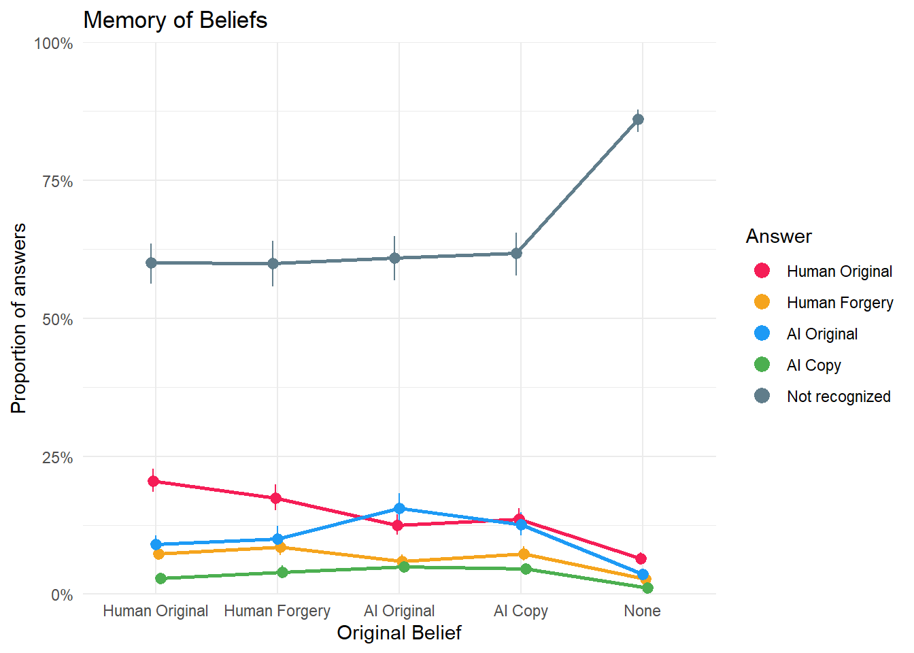{width=672}
:::
:::


::: {.cell}

```{.r .cell-code}
make_memory_tables(estimates$MemoryBelief)
```

::: {.cell-output-display}

```{=html}
<div id="ykgnnixqeu" style="padding-left:0px;padding-right:0px;padding-top:10px;padding-bottom:10px;overflow-x:auto;overflow-y:auto;width:auto;height:auto;">
<style>#ykgnnixqeu table {
  font-family: system-ui, 'Segoe UI', Roboto, Helvetica, Arial, sans-serif, 'Apple Color Emoji', 'Segoe UI Emoji', 'Segoe UI Symbol', 'Noto Color Emoji';
  -webkit-font-smoothing: antialiased;
  -moz-osx-font-smoothing: grayscale;
}

#ykgnnixqeu thead, #ykgnnixqeu tbody, #ykgnnixqeu tfoot, #ykgnnixqeu tr, #ykgnnixqeu td, #ykgnnixqeu th {
  border-style: none;
}

#ykgnnixqeu p {
  margin: 0;
  padding: 0;
}

#ykgnnixqeu .gt_table {
  display: table;
  border-collapse: collapse;
  line-height: normal;
  margin-left: auto;
  margin-right: auto;
  color: #333333;
  font-size: 13px;
  font-weight: normal;
  font-style: normal;
  background-color: #FFFFFF;
  width: auto;
  border-top-style: solid;
  border-top-width: 3px;
  border-top-color: #D5D5D5;
  border-right-style: solid;
  border-right-width: 3px;
  border-right-color: #D5D5D5;
  border-bottom-style: solid;
  border-bottom-width: 3px;
  border-bottom-color: #D5D5D5;
  border-left-style: solid;
  border-left-width: 3px;
  border-left-color: #D5D5D5;
}

#ykgnnixqeu .gt_caption {
  padding-top: 4px;
  padding-bottom: 4px;
}

#ykgnnixqeu .gt_title {
  color: #333333;
  font-size: 125%;
  font-weight: initial;
  padding-top: 4px;
  padding-bottom: 4px;
  padding-left: 5px;
  padding-right: 5px;
  border-bottom-color: #FFFFFF;
  border-bottom-width: 0;
}

#ykgnnixqeu .gt_subtitle {
  color: #333333;
  font-size: 85%;
  font-weight: initial;
  padding-top: 3px;
  padding-bottom: 5px;
  padding-left: 5px;
  padding-right: 5px;
  border-top-color: #FFFFFF;
  border-top-width: 0;
}

#ykgnnixqeu .gt_heading {
  background-color: #FFFFFF;
  text-align: left;
  border-bottom-color: #FFFFFF;
  border-left-style: none;
  border-left-width: 1px;
  border-left-color: #D3D3D3;
  border-right-style: none;
  border-right-width: 1px;
  border-right-color: #D3D3D3;
}

#ykgnnixqeu .gt_bottom_border {
  border-bottom-style: solid;
  border-bottom-width: 2px;
  border-bottom-color: #D5D5D5;
}

#ykgnnixqeu .gt_col_headings {
  border-top-style: solid;
  border-top-width: 2px;
  border-top-color: #D5D5D5;
  border-bottom-style: solid;
  border-bottom-width: 2px;
  border-bottom-color: #D5D5D5;
  border-left-style: none;
  border-left-width: 1px;
  border-left-color: #D3D3D3;
  border-right-style: none;
  border-right-width: 1px;
  border-right-color: #D3D3D3;
}

#ykgnnixqeu .gt_col_heading {
  color: #FFFFFF;
  background-color: #000000;
  font-size: 100%;
  font-weight: normal;
  text-transform: inherit;
  border-left-style: none;
  border-left-width: 1px;
  border-left-color: #D3D3D3;
  border-right-style: none;
  border-right-width: 1px;
  border-right-color: #D3D3D3;
  vertical-align: bottom;
  padding-top: 5px;
  padding-bottom: 6px;
  padding-left: 5px;
  padding-right: 5px;
  overflow-x: hidden;
}

#ykgnnixqeu .gt_column_spanner_outer {
  color: #FFFFFF;
  background-color: #000000;
  font-size: 100%;
  font-weight: normal;
  text-transform: inherit;
  padding-top: 0;
  padding-bottom: 0;
  padding-left: 4px;
  padding-right: 4px;
}

#ykgnnixqeu .gt_column_spanner_outer:first-child {
  padding-left: 0;
}

#ykgnnixqeu .gt_column_spanner_outer:last-child {
  padding-right: 0;
}

#ykgnnixqeu .gt_column_spanner {
  border-bottom-style: solid;
  border-bottom-width: 2px;
  border-bottom-color: #D5D5D5;
  vertical-align: bottom;
  padding-top: 5px;
  padding-bottom: 5px;
  overflow-x: hidden;
  display: inline-block;
  width: 100%;
}

#ykgnnixqeu .gt_spanner_row {
  border-bottom-style: hidden;
}

#ykgnnixqeu .gt_group_heading {
  padding-top: 8px;
  padding-bottom: 8px;
  padding-left: 5px;
  padding-right: 5px;
  color: #333333;
  background-color: #FFFFFF;
  font-size: 100%;
  font-weight: initial;
  text-transform: inherit;
  border-top-style: solid;
  border-top-width: 2px;
  border-top-color: #D5D5D5;
  border-bottom-style: solid;
  border-bottom-width: 2px;
  border-bottom-color: #D5D5D5;
  border-left-style: none;
  border-left-width: 1px;
  border-left-color: #D3D3D3;
  border-right-style: none;
  border-right-width: 1px;
  border-right-color: #D3D3D3;
  vertical-align: middle;
  text-align: left;
}

#ykgnnixqeu .gt_empty_group_heading {
  padding: 0.5px;
  color: #333333;
  background-color: #FFFFFF;
  font-size: 100%;
  font-weight: initial;
  border-top-style: solid;
  border-top-width: 2px;
  border-top-color: #D5D5D5;
  border-bottom-style: solid;
  border-bottom-width: 2px;
  border-bottom-color: #D5D5D5;
  vertical-align: middle;
}

#ykgnnixqeu .gt_from_md > :first-child {
  margin-top: 0;
}

#ykgnnixqeu .gt_from_md > :last-child {
  margin-bottom: 0;
}

#ykgnnixqeu .gt_row {
  padding-top: 8px;
  padding-bottom: 8px;
  padding-left: 5px;
  padding-right: 5px;
  margin: 10px;
  border-top-style: solid;
  border-top-width: 1px;
  border-top-color: #D5D5D5;
  border-left-style: solid;
  border-left-width: 1px;
  border-left-color: #D5D5D5;
  border-right-style: solid;
  border-right-width: 1px;
  border-right-color: #D5D5D5;
  vertical-align: middle;
  overflow-x: hidden;
}

#ykgnnixqeu .gt_stub {
  color: #333333;
  background-color: #FFFFFF;
  font-size: 100%;
  font-weight: initial;
  text-transform: inherit;
  border-right-style: solid;
  border-right-width: 2px;
  border-right-color: #5F5F5F;
  padding-left: 5px;
  padding-right: 5px;
}

#ykgnnixqeu .gt_stub_row_group {
  color: #333333;
  background-color: #FFFFFF;
  font-size: 100%;
  font-weight: initial;
  text-transform: inherit;
  border-right-style: solid;
  border-right-width: 2px;
  border-right-color: #D3D3D3;
  padding-left: 5px;
  padding-right: 5px;
  vertical-align: top;
}

#ykgnnixqeu .gt_row_group_first td {
  border-top-width: 2px;
}

#ykgnnixqeu .gt_row_group_first th {
  border-top-width: 2px;
}

#ykgnnixqeu .gt_summary_row {
  color: #333333;
  background-color: #D5D5D5;
  text-transform: inherit;
  padding-top: 8px;
  padding-bottom: 8px;
  padding-left: 5px;
  padding-right: 5px;
}

#ykgnnixqeu .gt_first_summary_row {
  border-top-style: solid;
  border-top-color: #D5D5D5;
}

#ykgnnixqeu .gt_first_summary_row.thick {
  border-top-width: 2px;
}

#ykgnnixqeu .gt_last_summary_row {
  padding-top: 8px;
  padding-bottom: 8px;
  padding-left: 5px;
  padding-right: 5px;
  border-bottom-style: solid;
  border-bottom-width: 2px;
  border-bottom-color: #D5D5D5;
}

#ykgnnixqeu .gt_grand_summary_row {
  color: #FFFFFF;
  background-color: #929292;
  text-transform: inherit;
  padding-top: 8px;
  padding-bottom: 8px;
  padding-left: 5px;
  padding-right: 5px;
}

#ykgnnixqeu .gt_first_grand_summary_row {
  padding-top: 8px;
  padding-bottom: 8px;
  padding-left: 5px;
  padding-right: 5px;
  border-top-style: double;
  border-top-width: 6px;
  border-top-color: #D5D5D5;
}

#ykgnnixqeu .gt_last_grand_summary_row_top {
  padding-top: 8px;
  padding-bottom: 8px;
  padding-left: 5px;
  padding-right: 5px;
  border-bottom-style: double;
  border-bottom-width: 6px;
  border-bottom-color: #D5D5D5;
}

#ykgnnixqeu .gt_striped {
  background-color: #F4F4F4;
}

#ykgnnixqeu .gt_table_body {
  border-top-style: solid;
  border-top-width: 2px;
  border-top-color: #D5D5D5;
  border-bottom-style: solid;
  border-bottom-width: 2px;
  border-bottom-color: #D5D5D5;
}

#ykgnnixqeu .gt_footnotes {
  color: #333333;
  background-color: #FFFFFF;
  border-bottom-style: none;
  border-bottom-width: 2px;
  border-bottom-color: #D3D3D3;
  border-left-style: none;
  border-left-width: 2px;
  border-left-color: #D3D3D3;
  border-right-style: none;
  border-right-width: 2px;
  border-right-color: #D3D3D3;
}

#ykgnnixqeu .gt_footnote {
  margin: 0px;
  font-size: 90%;
  padding-top: 4px;
  padding-bottom: 4px;
  padding-left: 5px;
  padding-right: 5px;
}

#ykgnnixqeu .gt_sourcenotes {
  color: #333333;
  background-color: #FFFFFF;
  border-bottom-style: none;
  border-bottom-width: 2px;
  border-bottom-color: #D3D3D3;
  border-left-style: none;
  border-left-width: 2px;
  border-left-color: #D3D3D3;
  border-right-style: none;
  border-right-width: 2px;
  border-right-color: #D3D3D3;
}

#ykgnnixqeu .gt_sourcenote {
  font-size: 90%;
  padding-top: 4px;
  padding-bottom: 4px;
  padding-left: 5px;
  padding-right: 5px;
}

#ykgnnixqeu .gt_left {
  text-align: left;
}

#ykgnnixqeu .gt_center {
  text-align: center;
}

#ykgnnixqeu .gt_right {
  text-align: right;
  font-variant-numeric: tabular-nums;
}

#ykgnnixqeu .gt_font_normal {
  font-weight: normal;
}

#ykgnnixqeu .gt_font_bold {
  font-weight: bold;
}

#ykgnnixqeu .gt_font_italic {
  font-style: italic;
}

#ykgnnixqeu .gt_super {
  font-size: 65%;
}

#ykgnnixqeu .gt_footnote_marks {
  font-size: 75%;
  vertical-align: 0.4em;
  position: initial;
}

#ykgnnixqeu .gt_asterisk {
  font-size: 100%;
  vertical-align: 0;
}

#ykgnnixqeu .gt_indent_1 {
  text-indent: 5px;
}

#ykgnnixqeu .gt_indent_2 {
  text-indent: 10px;
}

#ykgnnixqeu .gt_indent_3 {
  text-indent: 15px;
}

#ykgnnixqeu .gt_indent_4 {
  text-indent: 20px;
}

#ykgnnixqeu .gt_indent_5 {
  text-indent: 25px;
}

#ykgnnixqeu .katex-display {
  display: inline-flex !important;
  margin-bottom: 0.75em !important;
}

#ykgnnixqeu div.Reactable > div.rt-table > div.rt-thead > div.rt-tr.rt-tr-group-header > div.rt-th-group:after {
  height: 0px !important;
}
</style>
<table class="gt_table" data-quarto-disable-processing="false" data-quarto-bootstrap="false">
  <thead>
    <tr class="gt_heading">
      <td colspan="10" class="gt_heading gt_title gt_font_normal gt_bottom_border" style>Memory of Beliefs: convergence</td>
    </tr>
    
    <tr class="gt_col_headings">
      <th class="gt_col_heading gt_columns_bottom_border gt_left" rowspan="1" colspan="1" scope="col" id="Model">Model</th>
      <th class="gt_col_heading gt_columns_bottom_border gt_left" rowspan="1" colspan="1" scope="col" id="Family">Family</th>
      <th class="gt_col_heading gt_columns_bottom_border gt_right" rowspan="1" colspan="1" scope="col" id="N_obs">N_obs</th>
      <th class="gt_col_heading gt_columns_bottom_border gt_right" rowspan="1" colspan="1" scope="col" id="N_participants">N_participants</th>
      <th class="gt_col_heading gt_columns_bottom_border gt_right" rowspan="1" colspan="1" scope="col" id="Chains">Chains</th>
      <th class="gt_col_heading gt_columns_bottom_border gt_right" rowspan="1" colspan="1" scope="col" id="Draws">Draws</th>
      <th class="gt_col_heading gt_columns_bottom_border gt_right" rowspan="1" colspan="1" scope="col" id="Max_Rhat">Max_Rhat</th>
      <th class="gt_col_heading gt_columns_bottom_border gt_right" rowspan="1" colspan="1" scope="col" id="Min_ESS_ratio">Min_ESS_ratio</th>
      <th class="gt_col_heading gt_columns_bottom_border gt_right" rowspan="1" colspan="1" scope="col" id="Divergent_pct">Divergent_pct</th>
      <th class="gt_col_heading gt_columns_bottom_border gt_left" rowspan="1" colspan="1" scope="col" id="Criterion">Criterion</th>
    </tr>
  </thead>
  <tbody class="gt_table_body">
    <tr><td headers="Model" class="gt_row gt_left">MemoryBelief</td>
<td headers="Family" class="gt_row gt_left">Categorical</td>
<td headers="N_obs" class="gt_row gt_right">21120</td>
<td headers="N_participants" class="gt_row gt_right">220</td>
<td headers="Chains" class="gt_row gt_right">8</td>
<td headers="Draws" class="gt_row gt_right">4000</td>
<td headers="Max_Rhat" class="gt_row gt_right">1.043</td>
<td headers="Min_ESS_ratio" class="gt_row gt_right">0.035</td>
<td headers="Divergent_pct" class="gt_row gt_right">0</td>
<td headers="Criterion" class="gt_row gt_left">loo</td></tr>
  </tbody>
  
</table>
</div>
```


::: {.callout-note collapse="true" title="Memory of Beliefs: convergence (Markdown table, for text readers)"}

|Model        |Family      | N_obs| N_participants| Chains| Draws| Max_Rhat| Min_ESS_ratio| Divergent_pct|Criterion |
|:------------|:-----------|-----:|--------------:|------:|-----:|--------:|-------------:|-------------:|:---------|
|MemoryBelief |Categorical | 21120|            220|      8|  4000|    1.043|         0.035|             0|loo       |

:::

```{=html}
<div id="wwqaegnoqe" style="padding-left:0px;padding-right:0px;padding-top:10px;padding-bottom:10px;overflow-x:auto;overflow-y:auto;width:auto;height:auto;">
<style>#wwqaegnoqe table {
  font-family: system-ui, 'Segoe UI', Roboto, Helvetica, Arial, sans-serif, 'Apple Color Emoji', 'Segoe UI Emoji', 'Segoe UI Symbol', 'Noto Color Emoji';
  -webkit-font-smoothing: antialiased;
  -moz-osx-font-smoothing: grayscale;
}

#wwqaegnoqe thead, #wwqaegnoqe tbody, #wwqaegnoqe tfoot, #wwqaegnoqe tr, #wwqaegnoqe td, #wwqaegnoqe th {
  border-style: none;
}

#wwqaegnoqe p {
  margin: 0;
  padding: 0;
}

#wwqaegnoqe .gt_table {
  display: table;
  border-collapse: collapse;
  line-height: normal;
  margin-left: auto;
  margin-right: auto;
  color: #333333;
  font-size: 13px;
  font-weight: normal;
  font-style: normal;
  background-color: #FFFFFF;
  width: auto;
  border-top-style: solid;
  border-top-width: 3px;
  border-top-color: #D5D5D5;
  border-right-style: solid;
  border-right-width: 3px;
  border-right-color: #D5D5D5;
  border-bottom-style: solid;
  border-bottom-width: 3px;
  border-bottom-color: #D5D5D5;
  border-left-style: solid;
  border-left-width: 3px;
  border-left-color: #D5D5D5;
}

#wwqaegnoqe .gt_caption {
  padding-top: 4px;
  padding-bottom: 4px;
}

#wwqaegnoqe .gt_title {
  color: #333333;
  font-size: 125%;
  font-weight: initial;
  padding-top: 4px;
  padding-bottom: 4px;
  padding-left: 5px;
  padding-right: 5px;
  border-bottom-color: #FFFFFF;
  border-bottom-width: 0;
}

#wwqaegnoqe .gt_subtitle {
  color: #333333;
  font-size: 85%;
  font-weight: initial;
  padding-top: 3px;
  padding-bottom: 5px;
  padding-left: 5px;
  padding-right: 5px;
  border-top-color: #FFFFFF;
  border-top-width: 0;
}

#wwqaegnoqe .gt_heading {
  background-color: #FFFFFF;
  text-align: left;
  border-bottom-color: #FFFFFF;
  border-left-style: none;
  border-left-width: 1px;
  border-left-color: #D3D3D3;
  border-right-style: none;
  border-right-width: 1px;
  border-right-color: #D3D3D3;
}

#wwqaegnoqe .gt_bottom_border {
  border-bottom-style: solid;
  border-bottom-width: 2px;
  border-bottom-color: #D5D5D5;
}

#wwqaegnoqe .gt_col_headings {
  border-top-style: solid;
  border-top-width: 2px;
  border-top-color: #D5D5D5;
  border-bottom-style: solid;
  border-bottom-width: 2px;
  border-bottom-color: #D5D5D5;
  border-left-style: none;
  border-left-width: 1px;
  border-left-color: #D3D3D3;
  border-right-style: none;
  border-right-width: 1px;
  border-right-color: #D3D3D3;
}

#wwqaegnoqe .gt_col_heading {
  color: #FFFFFF;
  background-color: #000000;
  font-size: 100%;
  font-weight: normal;
  text-transform: inherit;
  border-left-style: none;
  border-left-width: 1px;
  border-left-color: #D3D3D3;
  border-right-style: none;
  border-right-width: 1px;
  border-right-color: #D3D3D3;
  vertical-align: bottom;
  padding-top: 5px;
  padding-bottom: 6px;
  padding-left: 5px;
  padding-right: 5px;
  overflow-x: hidden;
}

#wwqaegnoqe .gt_column_spanner_outer {
  color: #FFFFFF;
  background-color: #000000;
  font-size: 100%;
  font-weight: normal;
  text-transform: inherit;
  padding-top: 0;
  padding-bottom: 0;
  padding-left: 4px;
  padding-right: 4px;
}

#wwqaegnoqe .gt_column_spanner_outer:first-child {
  padding-left: 0;
}

#wwqaegnoqe .gt_column_spanner_outer:last-child {
  padding-right: 0;
}

#wwqaegnoqe .gt_column_spanner {
  border-bottom-style: solid;
  border-bottom-width: 2px;
  border-bottom-color: #D5D5D5;
  vertical-align: bottom;
  padding-top: 5px;
  padding-bottom: 5px;
  overflow-x: hidden;
  display: inline-block;
  width: 100%;
}

#wwqaegnoqe .gt_spanner_row {
  border-bottom-style: hidden;
}

#wwqaegnoqe .gt_group_heading {
  padding-top: 8px;
  padding-bottom: 8px;
  padding-left: 5px;
  padding-right: 5px;
  color: #333333;
  background-color: #FFFFFF;
  font-size: 100%;
  font-weight: initial;
  text-transform: inherit;
  border-top-style: solid;
  border-top-width: 2px;
  border-top-color: #D5D5D5;
  border-bottom-style: solid;
  border-bottom-width: 2px;
  border-bottom-color: #D5D5D5;
  border-left-style: none;
  border-left-width: 1px;
  border-left-color: #D3D3D3;
  border-right-style: none;
  border-right-width: 1px;
  border-right-color: #D3D3D3;
  vertical-align: middle;
  text-align: left;
}

#wwqaegnoqe .gt_empty_group_heading {
  padding: 0.5px;
  color: #333333;
  background-color: #FFFFFF;
  font-size: 100%;
  font-weight: initial;
  border-top-style: solid;
  border-top-width: 2px;
  border-top-color: #D5D5D5;
  border-bottom-style: solid;
  border-bottom-width: 2px;
  border-bottom-color: #D5D5D5;
  vertical-align: middle;
}

#wwqaegnoqe .gt_from_md > :first-child {
  margin-top: 0;
}

#wwqaegnoqe .gt_from_md > :last-child {
  margin-bottom: 0;
}

#wwqaegnoqe .gt_row {
  padding-top: 8px;
  padding-bottom: 8px;
  padding-left: 5px;
  padding-right: 5px;
  margin: 10px;
  border-top-style: solid;
  border-top-width: 1px;
  border-top-color: #D5D5D5;
  border-left-style: solid;
  border-left-width: 1px;
  border-left-color: #D5D5D5;
  border-right-style: solid;
  border-right-width: 1px;
  border-right-color: #D5D5D5;
  vertical-align: middle;
  overflow-x: hidden;
}

#wwqaegnoqe .gt_stub {
  color: #333333;
  background-color: #FFFFFF;
  font-size: 100%;
  font-weight: initial;
  text-transform: inherit;
  border-right-style: solid;
  border-right-width: 2px;
  border-right-color: #5F5F5F;
  padding-left: 5px;
  padding-right: 5px;
}

#wwqaegnoqe .gt_stub_row_group {
  color: #333333;
  background-color: #FFFFFF;
  font-size: 100%;
  font-weight: initial;
  text-transform: inherit;
  border-right-style: solid;
  border-right-width: 2px;
  border-right-color: #D3D3D3;
  padding-left: 5px;
  padding-right: 5px;
  vertical-align: top;
}

#wwqaegnoqe .gt_row_group_first td {
  border-top-width: 2px;
}

#wwqaegnoqe .gt_row_group_first th {
  border-top-width: 2px;
}

#wwqaegnoqe .gt_summary_row {
  color: #333333;
  background-color: #D5D5D5;
  text-transform: inherit;
  padding-top: 8px;
  padding-bottom: 8px;
  padding-left: 5px;
  padding-right: 5px;
}

#wwqaegnoqe .gt_first_summary_row {
  border-top-style: solid;
  border-top-color: #D5D5D5;
}

#wwqaegnoqe .gt_first_summary_row.thick {
  border-top-width: 2px;
}

#wwqaegnoqe .gt_last_summary_row {
  padding-top: 8px;
  padding-bottom: 8px;
  padding-left: 5px;
  padding-right: 5px;
  border-bottom-style: solid;
  border-bottom-width: 2px;
  border-bottom-color: #D5D5D5;
}

#wwqaegnoqe .gt_grand_summary_row {
  color: #FFFFFF;
  background-color: #929292;
  text-transform: inherit;
  padding-top: 8px;
  padding-bottom: 8px;
  padding-left: 5px;
  padding-right: 5px;
}

#wwqaegnoqe .gt_first_grand_summary_row {
  padding-top: 8px;
  padding-bottom: 8px;
  padding-left: 5px;
  padding-right: 5px;
  border-top-style: double;
  border-top-width: 6px;
  border-top-color: #D5D5D5;
}

#wwqaegnoqe .gt_last_grand_summary_row_top {
  padding-top: 8px;
  padding-bottom: 8px;
  padding-left: 5px;
  padding-right: 5px;
  border-bottom-style: double;
  border-bottom-width: 6px;
  border-bottom-color: #D5D5D5;
}

#wwqaegnoqe .gt_striped {
  background-color: #F4F4F4;
}

#wwqaegnoqe .gt_table_body {
  border-top-style: solid;
  border-top-width: 2px;
  border-top-color: #D5D5D5;
  border-bottom-style: solid;
  border-bottom-width: 2px;
  border-bottom-color: #D5D5D5;
}

#wwqaegnoqe .gt_footnotes {
  color: #333333;
  background-color: #FFFFFF;
  border-bottom-style: none;
  border-bottom-width: 2px;
  border-bottom-color: #D3D3D3;
  border-left-style: none;
  border-left-width: 2px;
  border-left-color: #D3D3D3;
  border-right-style: none;
  border-right-width: 2px;
  border-right-color: #D3D3D3;
}

#wwqaegnoqe .gt_footnote {
  margin: 0px;
  font-size: 90%;
  padding-top: 4px;
  padding-bottom: 4px;
  padding-left: 5px;
  padding-right: 5px;
}

#wwqaegnoqe .gt_sourcenotes {
  color: #333333;
  background-color: #FFFFFF;
  border-bottom-style: none;
  border-bottom-width: 2px;
  border-bottom-color: #D3D3D3;
  border-left-style: none;
  border-left-width: 2px;
  border-left-color: #D3D3D3;
  border-right-style: none;
  border-right-width: 2px;
  border-right-color: #D3D3D3;
}

#wwqaegnoqe .gt_sourcenote {
  font-size: 90%;
  padding-top: 4px;
  padding-bottom: 4px;
  padding-left: 5px;
  padding-right: 5px;
}

#wwqaegnoqe .gt_left {
  text-align: left;
}

#wwqaegnoqe .gt_center {
  text-align: center;
}

#wwqaegnoqe .gt_right {
  text-align: right;
  font-variant-numeric: tabular-nums;
}

#wwqaegnoqe .gt_font_normal {
  font-weight: normal;
}

#wwqaegnoqe .gt_font_bold {
  font-weight: bold;
}

#wwqaegnoqe .gt_font_italic {
  font-style: italic;
}

#wwqaegnoqe .gt_super {
  font-size: 65%;
}

#wwqaegnoqe .gt_footnote_marks {
  font-size: 75%;
  vertical-align: 0.4em;
  position: initial;
}

#wwqaegnoqe .gt_asterisk {
  font-size: 100%;
  vertical-align: 0;
}

#wwqaegnoqe .gt_indent_1 {
  text-indent: 5px;
}

#wwqaegnoqe .gt_indent_2 {
  text-indent: 10px;
}

#wwqaegnoqe .gt_indent_3 {
  text-indent: 15px;
}

#wwqaegnoqe .gt_indent_4 {
  text-indent: 20px;
}

#wwqaegnoqe .gt_indent_5 {
  text-indent: 25px;
}

#wwqaegnoqe .katex-display {
  display: inline-flex !important;
  margin-bottom: 0.75em !important;
}

#wwqaegnoqe div.Reactable > div.rt-table > div.rt-thead > div.rt-tr.rt-tr-group-header > div.rt-th-group:after {
  height: 0px !important;
}
</style>
<table class="gt_table" data-quarto-disable-processing="false" data-quarto-bootstrap="false">
  <thead>
    <tr class="gt_heading">
      <td colspan="5" class="gt_heading gt_title gt_font_normal gt_bottom_border" style>Memory of Beliefs: probability of each answer per Belief (marginal means)</td>
    </tr>
    
    <tr class="gt_col_headings">
      <th class="gt_col_heading gt_columns_bottom_border gt_center" rowspan="1" colspan="1" scope="col" id="Belief">Belief</th>
      <th class="gt_col_heading gt_columns_bottom_border gt_center" rowspan="1" colspan="1" scope="col" id="Response">Response</th>
      <th class="gt_col_heading gt_columns_bottom_border gt_right" rowspan="1" colspan="1" scope="col" id="Median">Median</th>
      <th class="gt_col_heading gt_columns_bottom_border gt_right" rowspan="1" colspan="1" scope="col" id="CI_low">CI_low</th>
      <th class="gt_col_heading gt_columns_bottom_border gt_right" rowspan="1" colspan="1" scope="col" id="CI_high">CI_high</th>
    </tr>
  </thead>
  <tbody class="gt_table_body">
    <tr><td headers="Belief" class="gt_row gt_center">Human Original</td>
<td headers="Response" class="gt_row gt_center">Human Original</td>
<td headers="Median" class="gt_row gt_right">0.21</td>
<td headers="CI_low" class="gt_row gt_right">0.19</td>
<td headers="CI_high" class="gt_row gt_right">0.23</td></tr>
    <tr><td headers="Belief" class="gt_row gt_center gt_striped">Human Forgery</td>
<td headers="Response" class="gt_row gt_center gt_striped">Human Original</td>
<td headers="Median" class="gt_row gt_right gt_striped">0.17</td>
<td headers="CI_low" class="gt_row gt_right gt_striped">0.15</td>
<td headers="CI_high" class="gt_row gt_right gt_striped">0.20</td></tr>
    <tr><td headers="Belief" class="gt_row gt_center">AI Original</td>
<td headers="Response" class="gt_row gt_center">Human Original</td>
<td headers="Median" class="gt_row gt_right">0.13</td>
<td headers="CI_low" class="gt_row gt_right">0.11</td>
<td headers="CI_high" class="gt_row gt_right">0.14</td></tr>
    <tr><td headers="Belief" class="gt_row gt_center gt_striped">AI Copy</td>
<td headers="Response" class="gt_row gt_center gt_striped">Human Original</td>
<td headers="Median" class="gt_row gt_right gt_striped">0.14</td>
<td headers="CI_low" class="gt_row gt_right gt_striped">0.12</td>
<td headers="CI_high" class="gt_row gt_right gt_striped">0.16</td></tr>
    <tr><td headers="Belief" class="gt_row gt_center">None</td>
<td headers="Response" class="gt_row gt_center">Human Original</td>
<td headers="Median" class="gt_row gt_right">0.06</td>
<td headers="CI_low" class="gt_row gt_right">0.06</td>
<td headers="CI_high" class="gt_row gt_right">0.08</td></tr>
    <tr><td headers="Belief" class="gt_row gt_center gt_striped">Human Original</td>
<td headers="Response" class="gt_row gt_center gt_striped">Human Forgery</td>
<td headers="Median" class="gt_row gt_right gt_striped">0.07</td>
<td headers="CI_low" class="gt_row gt_right gt_striped">0.06</td>
<td headers="CI_high" class="gt_row gt_right gt_striped">0.08</td></tr>
    <tr><td headers="Belief" class="gt_row gt_center">Human Forgery</td>
<td headers="Response" class="gt_row gt_center">Human Forgery</td>
<td headers="Median" class="gt_row gt_right">0.09</td>
<td headers="CI_low" class="gt_row gt_right">0.07</td>
<td headers="CI_high" class="gt_row gt_right">0.10</td></tr>
    <tr><td headers="Belief" class="gt_row gt_center gt_striped">AI Original</td>
<td headers="Response" class="gt_row gt_center gt_striped">Human Forgery</td>
<td headers="Median" class="gt_row gt_right gt_striped">0.06</td>
<td headers="CI_low" class="gt_row gt_right gt_striped">0.05</td>
<td headers="CI_high" class="gt_row gt_right gt_striped">0.07</td></tr>
    <tr><td headers="Belief" class="gt_row gt_center">AI Copy</td>
<td headers="Response" class="gt_row gt_center">Human Forgery</td>
<td headers="Median" class="gt_row gt_right">0.07</td>
<td headers="CI_low" class="gt_row gt_right">0.06</td>
<td headers="CI_high" class="gt_row gt_right">0.09</td></tr>
    <tr><td headers="Belief" class="gt_row gt_center gt_striped">None</td>
<td headers="Response" class="gt_row gt_center gt_striped">Human Forgery</td>
<td headers="Median" class="gt_row gt_right gt_striped">0.03</td>
<td headers="CI_low" class="gt_row gt_right gt_striped">0.02</td>
<td headers="CI_high" class="gt_row gt_right gt_striped">0.03</td></tr>
    <tr><td headers="Belief" class="gt_row gt_center">Human Original</td>
<td headers="Response" class="gt_row gt_center">AI Original</td>
<td headers="Median" class="gt_row gt_right">0.09</td>
<td headers="CI_low" class="gt_row gt_right">0.08</td>
<td headers="CI_high" class="gt_row gt_right">0.11</td></tr>
    <tr><td headers="Belief" class="gt_row gt_center gt_striped">Human Forgery</td>
<td headers="Response" class="gt_row gt_center gt_striped">AI Original</td>
<td headers="Median" class="gt_row gt_right gt_striped">0.10</td>
<td headers="CI_low" class="gt_row gt_right gt_striped">0.08</td>
<td headers="CI_high" class="gt_row gt_right gt_striped">0.12</td></tr>
    <tr><td headers="Belief" class="gt_row gt_center">AI Original</td>
<td headers="Response" class="gt_row gt_center">AI Original</td>
<td headers="Median" class="gt_row gt_right">0.16</td>
<td headers="CI_low" class="gt_row gt_right">0.13</td>
<td headers="CI_high" class="gt_row gt_right">0.18</td></tr>
    <tr><td headers="Belief" class="gt_row gt_center gt_striped">AI Copy</td>
<td headers="Response" class="gt_row gt_center gt_striped">AI Original</td>
<td headers="Median" class="gt_row gt_right gt_striped">0.13</td>
<td headers="CI_low" class="gt_row gt_right gt_striped">0.11</td>
<td headers="CI_high" class="gt_row gt_right gt_striped">0.15</td></tr>
    <tr><td headers="Belief" class="gt_row gt_center">None</td>
<td headers="Response" class="gt_row gt_center">AI Original</td>
<td headers="Median" class="gt_row gt_right">0.04</td>
<td headers="CI_low" class="gt_row gt_right">0.03</td>
<td headers="CI_high" class="gt_row gt_right">0.05</td></tr>
    <tr><td headers="Belief" class="gt_row gt_center gt_striped">Human Original</td>
<td headers="Response" class="gt_row gt_center gt_striped">AI Copy</td>
<td headers="Median" class="gt_row gt_right gt_striped">0.03</td>
<td headers="CI_low" class="gt_row gt_right gt_striped">0.02</td>
<td headers="CI_high" class="gt_row gt_right gt_striped">0.04</td></tr>
    <tr><td headers="Belief" class="gt_row gt_center">Human Forgery</td>
<td headers="Response" class="gt_row gt_center">AI Copy</td>
<td headers="Median" class="gt_row gt_right">0.04</td>
<td headers="CI_low" class="gt_row gt_right">0.03</td>
<td headers="CI_high" class="gt_row gt_right">0.05</td></tr>
    <tr><td headers="Belief" class="gt_row gt_center gt_striped">AI Original</td>
<td headers="Response" class="gt_row gt_center gt_striped">AI Copy</td>
<td headers="Median" class="gt_row gt_right gt_striped">0.05</td>
<td headers="CI_low" class="gt_row gt_right gt_striped">0.04</td>
<td headers="CI_high" class="gt_row gt_right gt_striped">0.06</td></tr>
    <tr><td headers="Belief" class="gt_row gt_center">AI Copy</td>
<td headers="Response" class="gt_row gt_center">AI Copy</td>
<td headers="Median" class="gt_row gt_right">0.05</td>
<td headers="CI_low" class="gt_row gt_right">0.04</td>
<td headers="CI_high" class="gt_row gt_right">0.06</td></tr>
    <tr><td headers="Belief" class="gt_row gt_center gt_striped">None</td>
<td headers="Response" class="gt_row gt_center gt_striped">AI Copy</td>
<td headers="Median" class="gt_row gt_right gt_striped">0.01</td>
<td headers="CI_low" class="gt_row gt_right gt_striped">0.01</td>
<td headers="CI_high" class="gt_row gt_right gt_striped">0.01</td></tr>
    <tr><td headers="Belief" class="gt_row gt_center">Human Original</td>
<td headers="Response" class="gt_row gt_center">Not recognized</td>
<td headers="Median" class="gt_row gt_right">0.60</td>
<td headers="CI_low" class="gt_row gt_right">0.56</td>
<td headers="CI_high" class="gt_row gt_right">0.64</td></tr>
    <tr><td headers="Belief" class="gt_row gt_center gt_striped">Human Forgery</td>
<td headers="Response" class="gt_row gt_center gt_striped">Not recognized</td>
<td headers="Median" class="gt_row gt_right gt_striped">0.60</td>
<td headers="CI_low" class="gt_row gt_right gt_striped">0.56</td>
<td headers="CI_high" class="gt_row gt_right gt_striped">0.64</td></tr>
    <tr><td headers="Belief" class="gt_row gt_center">AI Original</td>
<td headers="Response" class="gt_row gt_center">Not recognized</td>
<td headers="Median" class="gt_row gt_right">0.61</td>
<td headers="CI_low" class="gt_row gt_right">0.57</td>
<td headers="CI_high" class="gt_row gt_right">0.65</td></tr>
    <tr><td headers="Belief" class="gt_row gt_center gt_striped">AI Copy</td>
<td headers="Response" class="gt_row gt_center gt_striped">Not recognized</td>
<td headers="Median" class="gt_row gt_right gt_striped">0.62</td>
<td headers="CI_low" class="gt_row gt_right gt_striped">0.58</td>
<td headers="CI_high" class="gt_row gt_right gt_striped">0.65</td></tr>
    <tr><td headers="Belief" class="gt_row gt_center">None</td>
<td headers="Response" class="gt_row gt_center">Not recognized</td>
<td headers="Median" class="gt_row gt_right">0.86</td>
<td headers="CI_low" class="gt_row gt_right">0.84</td>
<td headers="CI_high" class="gt_row gt_right">0.88</td></tr>
  </tbody>
  
</table>
</div>
```


::: {.callout-note collapse="true" title="Memory of Beliefs: probability of each answer per Belief (marginal means) (Markdown table, for text readers)"}

|Belief         |Response       |Median |CI_low |CI_high |
|:--------------|:--------------|:------|:------|:-------|
|Human Original |Human Original |0.21   |0.19   |0.23    |
|Human Forgery  |Human Original |0.17   |0.15   |0.20    |
|AI Original    |Human Original |0.13   |0.11   |0.14    |
|AI Copy        |Human Original |0.14   |0.12   |0.16    |
|None           |Human Original |0.06   |0.06   |0.08    |
|Human Original |Human Forgery  |0.07   |0.06   |0.08    |
|Human Forgery  |Human Forgery  |0.09   |0.07   |0.10    |
|AI Original    |Human Forgery  |0.06   |0.05   |0.07    |
|AI Copy        |Human Forgery  |0.07   |0.06   |0.09    |
|None           |Human Forgery  |0.03   |0.02   |0.03    |
|Human Original |AI Original    |0.09   |0.08   |0.11    |
|Human Forgery  |AI Original    |0.10   |0.08   |0.12    |
|AI Original    |AI Original    |0.16   |0.13   |0.18    |
|AI Copy        |AI Original    |0.13   |0.11   |0.15    |
|None           |AI Original    |0.04   |0.03   |0.05    |
|Human Original |AI Copy        |0.03   |0.02   |0.04    |
|Human Forgery  |AI Copy        |0.04   |0.03   |0.05    |
|AI Original    |AI Copy        |0.05   |0.04   |0.06    |
|AI Copy        |AI Copy        |0.05   |0.04   |0.06    |
|None           |AI Copy        |0.01   |0.01   |0.01    |
|Human Original |Not recognized |0.60   |0.56   |0.64    |
|Human Forgery  |Not recognized |0.60   |0.56   |0.64    |
|AI Original    |Not recognized |0.61   |0.57   |0.65    |
|AI Copy        |Not recognized |0.62   |0.58   |0.65    |
|None           |Not recognized |0.86   |0.84   |0.88    |

:::

::: {.callout-note collapse="true" title="Memory of Beliefs: all 300 contrasts (Markdown table, for text readers)"}

|Level1         |Response1      |Level2         |Response2      |Median |CI_low |CI_high |pd   |Effect   |
|:--------------|:--------------|:--------------|:--------------|:------|:------|:-------|:----|:--------|
|Human Forgery  |Human Original |Human Original |Human Original |-0.03  |-0.05  |-0.01   |1.00 |Negative |
|AI Original    |Human Original |Human Original |Human Original |-0.08  |-0.10  |-0.06   |1.00 |Negative |
|AI Copy        |Human Original |Human Original |Human Original |-0.07  |-0.09  |-0.05   |1.00 |Negative |
|None           |Human Original |Human Original |Human Original |-0.14  |-0.17  |-0.11   |1.00 |Negative |
|Human Original |Human Forgery  |Human Original |Human Original |-0.13  |-0.15  |-0.11   |1.00 |Negative |
|Human Forgery  |Human Forgery  |Human Original |Human Original |-0.12  |-0.14  |-0.10   |1.00 |Negative |
|AI Original    |Human Forgery  |Human Original |Human Original |-0.15  |-0.17  |-0.13   |1.00 |Negative |
|AI Copy        |Human Forgery  |Human Original |Human Original |-0.13  |-0.15  |-0.11   |1.00 |Negative |
|None           |Human Forgery  |Human Original |Human Original |-0.18  |-0.20  |-0.16   |1.00 |Negative |
|Human Original |AI Original    |Human Original |Human Original |-0.11  |-0.14  |-0.09   |1.00 |Negative |
|Human Forgery  |AI Original    |Human Original |Human Original |-0.10  |-0.13  |-0.08   |1.00 |Negative |
|AI Original    |AI Original    |Human Original |Human Original |-0.05  |-0.07  |-0.02   |1.00 |Negative |
|AI Copy        |AI Original    |Human Original |Human Original |-0.08  |-0.10  |-0.06   |1.00 |Negative |
|None           |AI Original    |Human Original |Human Original |-0.17  |-0.19  |-0.15   |1.00 |Negative |
|Human Original |AI Copy        |Human Original |Human Original |-0.18  |-0.20  |-0.16   |1.00 |Negative |
|Human Forgery  |AI Copy        |Human Original |Human Original |-0.17  |-0.19  |-0.14   |1.00 |Negative |
|AI Original    |AI Copy        |Human Original |Human Original |-0.16  |-0.18  |-0.14   |1.00 |Negative |
|AI Copy        |AI Copy        |Human Original |Human Original |-0.16  |-0.18  |-0.14   |1.00 |Negative |
|None           |AI Copy        |Human Original |Human Original |-0.19  |-0.22  |-0.17   |1.00 |Negative |
|Human Original |Not recognized |Human Original |Human Original |0.40   |0.34   |0.45    |1.00 |Positive |
|Human Forgery  |Not recognized |Human Original |Human Original |0.39   |0.33   |0.45    |1.00 |Positive |
|AI Original    |Not recognized |Human Original |Human Original |0.40   |0.34   |0.46    |1.00 |Positive |
|AI Copy        |Not recognized |Human Original |Human Original |0.41   |0.35   |0.46    |1.00 |Positive |
|None           |Not recognized |Human Original |Human Original |0.66   |0.63   |0.67    |1.00 |Positive |
|AI Original    |Human Original |Human Forgery  |Human Original |-0.05  |-0.07  |-0.03   |1.00 |Negative |
|AI Copy        |Human Original |Human Forgery  |Human Original |-0.04  |-0.06  |-0.01   |1.00 |Negative |
|None           |Human Original |Human Forgery  |Human Original |-0.11  |-0.14  |-0.08   |1.00 |Negative |
|Human Original |Human Forgery  |Human Forgery  |Human Original |-0.10  |-0.12  |-0.08   |1.00 |Negative |
|Human Forgery  |Human Forgery  |Human Forgery  |Human Original |-0.09  |-0.11  |-0.06   |1.00 |Negative |
|AI Original    |Human Forgery  |Human Forgery  |Human Original |-0.11  |-0.14  |-0.09   |1.00 |Negative |
|AI Copy        |Human Forgery  |Human Forgery  |Human Original |-0.10  |-0.12  |-0.08   |1.00 |Negative |
|None           |Human Forgery  |Human Forgery  |Human Original |-0.15  |-0.17  |-0.12   |1.00 |Negative |
|Human Original |AI Original    |Human Forgery  |Human Original |-0.08  |-0.11  |-0.06   |1.00 |Negative |
|Human Forgery  |AI Original    |Human Forgery  |Human Original |-0.07  |-0.10  |-0.04   |1.00 |Negative |
|AI Original    |AI Original    |Human Forgery  |Human Original |-0.02  |-0.05  |0.01    |0.89 |n.s.     |
|AI Copy        |AI Original    |Human Forgery  |Human Original |-0.05  |-0.07  |-0.02   |1.00 |Negative |
|None           |AI Original    |Human Forgery  |Human Original |-0.14  |-0.16  |-0.11   |1.00 |Negative |
|Human Original |AI Copy        |Human Forgery  |Human Original |-0.14  |-0.17  |-0.12   |1.00 |Negative |
|Human Forgery  |AI Copy        |Human Forgery  |Human Original |-0.13  |-0.16  |-0.11   |1.00 |Negative |
|AI Original    |AI Copy        |Human Forgery  |Human Original |-0.12  |-0.15  |-0.10   |1.00 |Negative |
|AI Copy        |AI Copy        |Human Forgery  |Human Original |-0.13  |-0.15  |-0.11   |1.00 |Negative |
|None           |AI Copy        |Human Forgery  |Human Original |-0.16  |-0.19  |-0.14   |1.00 |Negative |
|Human Original |Not recognized |Human Forgery  |Human Original |0.43   |0.37   |0.48    |1.00 |Positive |
|Human Forgery  |Not recognized |Human Forgery  |Human Original |0.43   |0.36   |0.48    |1.00 |Positive |
|AI Original    |Not recognized |Human Forgery  |Human Original |0.44   |0.38   |0.49    |1.00 |Positive |
|AI Copy        |Not recognized |Human Forgery  |Human Original |0.44   |0.39   |0.49    |1.00 |Positive |
|None           |Not recognized |Human Forgery  |Human Original |0.69   |0.66   |0.71    |1.00 |Positive |
|AI Copy        |Human Original |AI Original    |Human Original |0.01   |-0.01  |0.03    |0.86 |n.s.     |
|None           |Human Original |AI Original    |Human Original |-0.06  |-0.08  |-0.04   |1.00 |Negative |
|Human Original |Human Forgery  |AI Original    |Human Original |-0.05  |-0.07  |-0.04   |1.00 |Negative |
|Human Forgery  |Human Forgery  |AI Original    |Human Original |-0.04  |-0.06  |-0.02   |1.00 |Negative |
|AI Original    |Human Forgery  |AI Original    |Human Original |-0.07  |-0.09  |-0.05   |1.00 |Negative |
|AI Copy        |Human Forgery  |AI Original    |Human Original |-0.05  |-0.07  |-0.03   |1.00 |Negative |
|None           |Human Forgery  |AI Original    |Human Original |-0.10  |-0.12  |-0.08   |1.00 |Negative |
|Human Original |AI Original    |AI Original    |Human Original |-0.03  |-0.05  |-0.01   |1.00 |Negative |
|Human Forgery  |AI Original    |AI Original    |Human Original |-0.02  |-0.05  |0.00    |0.97 |n.s.     |
|AI Original    |AI Original    |AI Original    |Human Original |0.03   |0.00   |0.06    |0.99 |Positive |
|AI Copy        |AI Original    |AI Original    |Human Original |0.00   |-0.02  |0.03    |0.52 |n.s.     |
|None           |AI Original    |AI Original    |Human Original |-0.09  |-0.11  |-0.07   |1.00 |Negative |
|Human Original |AI Copy        |AI Original    |Human Original |-0.10  |-0.11  |-0.08   |1.00 |Negative |
|Human Forgery  |AI Copy        |AI Original    |Human Original |-0.09  |-0.11  |-0.07   |1.00 |Negative |
|AI Original    |AI Copy        |AI Original    |Human Original |-0.08  |-0.10  |-0.06   |1.00 |Negative |
|AI Copy        |AI Copy        |AI Original    |Human Original |-0.08  |-0.10  |-0.06   |1.00 |Negative |
|None           |AI Copy        |AI Original    |Human Original |-0.11  |-0.13  |-0.10   |1.00 |Negative |
|Human Original |Not recognized |AI Original    |Human Original |0.48   |0.43   |0.52    |1.00 |Positive |
|Human Forgery  |Not recognized |AI Original    |Human Original |0.47   |0.42   |0.52    |1.00 |Positive |
|AI Original    |Not recognized |AI Original    |Human Original |0.48   |0.43   |0.54    |1.00 |Positive |
|AI Copy        |Not recognized |AI Original    |Human Original |0.49   |0.44   |0.54    |1.00 |Positive |
|None           |Not recognized |AI Original    |Human Original |0.74   |0.71   |0.75    |1.00 |Positive |
|None           |Human Original |AI Copy        |Human Original |-0.07  |-0.10  |-0.05   |1.00 |Negative |
|Human Original |Human Forgery  |AI Copy        |Human Original |-0.06  |-0.08  |-0.05   |1.00 |Negative |
|Human Forgery  |Human Forgery  |AI Copy        |Human Original |-0.05  |-0.07  |-0.03   |1.00 |Negative |
|AI Original    |Human Forgery  |AI Copy        |Human Original |-0.08  |-0.10  |-0.06   |1.00 |Negative |
|AI Copy        |Human Forgery  |AI Copy        |Human Original |-0.06  |-0.08  |-0.04   |1.00 |Negative |
|None           |Human Forgery  |AI Copy        |Human Original |-0.11  |-0.13  |-0.09   |1.00 |Negative |
|Human Original |AI Original    |AI Copy        |Human Original |-0.05  |-0.07  |-0.02   |1.00 |Negative |
|Human Forgery  |AI Original    |AI Copy        |Human Original |-0.04  |-0.06  |-0.01   |0.99 |Negative |
|AI Original    |AI Original    |AI Copy        |Human Original |0.02   |-0.01  |0.05    |0.94 |n.s.     |
|AI Copy        |AI Original    |AI Copy        |Human Original |-0.01  |-0.03  |0.02    |0.79 |n.s.     |
|None           |AI Original    |AI Copy        |Human Original |-0.10  |-0.12  |-0.08   |1.00 |Negative |
|Human Original |AI Copy        |AI Copy        |Human Original |-0.11  |-0.13  |-0.09   |1.00 |Negative |
|Human Forgery  |AI Copy        |AI Copy        |Human Original |-0.10  |-0.12  |-0.08   |1.00 |Negative |
|AI Original    |AI Copy        |AI Copy        |Human Original |-0.09  |-0.11  |-0.07   |1.00 |Negative |
|AI Copy        |AI Copy        |AI Copy        |Human Original |-0.09  |-0.11  |-0.07   |1.00 |Negative |
|None           |AI Copy        |AI Copy        |Human Original |-0.12  |-0.15  |-0.11   |1.00 |Negative |
|Human Original |Not recognized |AI Copy        |Human Original |0.46   |0.41   |0.51    |1.00 |Positive |
|Human Forgery  |Not recognized |AI Copy        |Human Original |0.46   |0.41   |0.51    |1.00 |Positive |
|AI Original    |Not recognized |AI Copy        |Human Original |0.47   |0.42   |0.52    |1.00 |Positive |
|AI Copy        |Not recognized |AI Copy        |Human Original |0.48   |0.42   |0.53    |1.00 |Positive |
|None           |Not recognized |AI Copy        |Human Original |0.72   |0.70   |0.74    |1.00 |Positive |
|Human Original |Human Forgery  |None           |Human Original |0.01   |-0.01  |0.02    |0.83 |n.s.     |
|Human Forgery  |Human Forgery  |None           |Human Original |0.02   |0.00   |0.04    |0.97 |n.s.     |
|AI Original    |Human Forgery  |None           |Human Original |-0.01  |-0.02  |0.01    |0.74 |n.s.     |
|AI Copy        |Human Forgery  |None           |Human Original |0.01   |-0.01  |0.03    |0.82 |n.s.     |
|None           |Human Forgery  |None           |Human Original |-0.04  |-0.05  |-0.03   |1.00 |Negative |
|Human Original |AI Original    |None           |Human Original |0.03   |0.01   |0.05    |1.00 |Positive |
|Human Forgery  |AI Original    |None           |Human Original |0.04   |0.01   |0.06    |1.00 |Positive |
|AI Original    |AI Original    |None           |Human Original |0.09   |0.06   |0.12    |1.00 |Positive |
|AI Copy        |AI Original    |None           |Human Original |0.06   |0.04   |0.09    |1.00 |Positive |
|None           |AI Original    |None           |Human Original |-0.03  |-0.04  |-0.02   |1.00 |Negative |
|Human Original |AI Copy        |None           |Human Original |-0.04  |-0.05  |-0.02   |1.00 |Negative |
|Human Forgery  |AI Copy        |None           |Human Original |-0.03  |-0.04  |-0.01   |1.00 |Negative |
|AI Original    |AI Copy        |None           |Human Original |-0.01  |-0.03  |0.00    |0.97 |n.s.     |
|AI Copy        |AI Copy        |None           |Human Original |-0.02  |-0.04  |0.00    |1.00 |Negative |
|None           |AI Copy        |None           |Human Original |-0.05  |-0.06  |-0.05   |1.00 |Negative |
|Human Original |Not recognized |None           |Human Original |0.54   |0.50   |0.57    |1.00 |Positive |
|Human Forgery  |Not recognized |None           |Human Original |0.53   |0.49   |0.57    |1.00 |Positive |
|AI Original    |Not recognized |None           |Human Original |0.54   |0.50   |0.58    |1.00 |Positive |
|AI Copy        |Not recognized |None           |Human Original |0.55   |0.51   |0.59    |1.00 |Positive |
|None           |Not recognized |None           |Human Original |0.80   |0.76   |0.82    |1.00 |Positive |
|Human Forgery  |Human Forgery  |Human Original |Human Forgery  |0.01   |0.00   |0.03    |0.95 |n.s.     |
|AI Original    |Human Forgery  |Human Original |Human Forgery  |-0.01  |-0.03  |0.00    |0.98 |Negative |
|AI Copy        |Human Forgery  |Human Original |Human Forgery  |0.00   |-0.01  |0.01    |0.53 |n.s.     |
|None           |Human Forgery  |Human Original |Human Forgery  |-0.05  |-0.06  |-0.03   |1.00 |Negative |
|Human Original |AI Original    |Human Original |Human Forgery  |0.02   |0.00   |0.04    |0.99 |Positive |
|Human Forgery  |AI Original    |Human Original |Human Forgery  |0.03   |0.01   |0.05    |1.00 |Positive |
|AI Original    |AI Original    |Human Original |Human Forgery  |0.08   |0.06   |0.11    |1.00 |Positive |
|AI Copy        |AI Original    |Human Original |Human Forgery  |0.05   |0.03   |0.07    |1.00 |Positive |
|None           |AI Original    |Human Original |Human Forgery  |-0.04  |-0.05  |-0.02   |1.00 |Negative |
|Human Original |AI Copy        |Human Original |Human Forgery  |-0.04  |-0.05  |-0.03   |1.00 |Negative |
|Human Forgery  |AI Copy        |Human Original |Human Forgery  |-0.03  |-0.05  |-0.02   |1.00 |Negative |
|AI Original    |AI Copy        |Human Original |Human Forgery  |-0.02  |-0.03  |-0.01   |1.00 |Negative |
|AI Copy        |AI Copy        |Human Original |Human Forgery  |-0.03  |-0.04  |-0.02   |1.00 |Negative |
|None           |AI Copy        |Human Original |Human Forgery  |-0.06  |-0.07  |-0.05   |1.00 |Negative |
|Human Original |Not recognized |Human Original |Human Forgery  |0.53   |0.48   |0.57    |1.00 |Positive |
|Human Forgery  |Not recognized |Human Original |Human Forgery  |0.53   |0.48   |0.57    |1.00 |Positive |
|AI Original    |Not recognized |Human Original |Human Forgery  |0.54   |0.49   |0.58    |1.00 |Positive |
|AI Copy        |Not recognized |Human Original |Human Forgery  |0.55   |0.50   |0.59    |1.00 |Positive |
|None           |Not recognized |Human Original |Human Forgery  |0.79   |0.76   |0.80    |1.00 |Positive |
|AI Original    |Human Forgery  |Human Forgery  |Human Forgery  |-0.03  |-0.04  |-0.01   |1.00 |Negative |
|AI Copy        |Human Forgery  |Human Forgery  |Human Forgery  |-0.01  |-0.03  |0.01    |0.91 |n.s.     |
|None           |Human Forgery  |Human Forgery  |Human Forgery  |-0.06  |-0.08  |-0.04   |1.00 |Negative |
|Human Original |AI Original    |Human Forgery  |Human Forgery  |0.01   |-0.01  |0.03    |0.73 |n.s.     |
|Human Forgery  |AI Original    |Human Forgery  |Human Forgery  |0.02   |-0.01  |0.04    |0.89 |n.s.     |
|AI Original    |AI Original    |Human Forgery  |Human Forgery  |0.07   |0.05   |0.10    |1.00 |Positive |
|AI Copy        |AI Original    |Human Forgery  |Human Forgery  |0.04   |0.02   |0.07    |1.00 |Positive |
|None           |AI Original    |Human Forgery  |Human Forgery  |-0.05  |-0.07  |-0.03   |1.00 |Negative |
|Human Original |AI Copy        |Human Forgery  |Human Forgery  |-0.06  |-0.07  |-0.04   |1.00 |Negative |
|Human Forgery  |AI Copy        |Human Forgery  |Human Forgery  |-0.05  |-0.06  |-0.03   |1.00 |Negative |
|AI Original    |AI Copy        |Human Forgery  |Human Forgery  |-0.04  |-0.05  |-0.02   |1.00 |Negative |
|AI Copy        |AI Copy        |Human Forgery  |Human Forgery  |-0.04  |-0.06  |-0.02   |1.00 |Negative |
|None           |AI Copy        |Human Forgery  |Human Forgery  |-0.07  |-0.09  |-0.06   |1.00 |Negative |
|Human Original |Not recognized |Human Forgery  |Human Forgery  |0.52   |0.47   |0.56    |1.00 |Positive |
|Human Forgery  |Not recognized |Human Forgery  |Human Forgery  |0.51   |0.46   |0.56    |1.00 |Positive |
|AI Original    |Not recognized |Human Forgery  |Human Forgery  |0.52   |0.47   |0.57    |1.00 |Positive |
|AI Copy        |Not recognized |Human Forgery  |Human Forgery  |0.53   |0.48   |0.58    |1.00 |Positive |
|None           |Not recognized |Human Forgery  |Human Forgery  |0.77   |0.75   |0.79    |1.00 |Positive |
|AI Copy        |Human Forgery  |AI Original    |Human Forgery  |0.01   |0.00   |0.03    |0.96 |n.s.     |
|None           |Human Forgery  |AI Original    |Human Forgery  |-0.03  |-0.05  |-0.02   |1.00 |Negative |
|Human Original |AI Original    |AI Original    |Human Forgery  |0.03   |0.01   |0.05    |1.00 |Positive |
|Human Forgery  |AI Original    |AI Original    |Human Forgery  |0.04   |0.02   |0.07    |1.00 |Positive |
|AI Original    |AI Original    |AI Original    |Human Forgery  |0.10   |0.07   |0.12    |1.00 |Positive |
|AI Copy        |AI Original    |AI Original    |Human Forgery  |0.07   |0.05   |0.09    |1.00 |Positive |
|None           |AI Original    |AI Original    |Human Forgery  |-0.02  |-0.04  |-0.01   |1.00 |Negative |
|Human Original |AI Copy        |AI Original    |Human Forgery  |-0.03  |-0.04  |-0.02   |1.00 |Negative |
|Human Forgery  |AI Copy        |AI Original    |Human Forgery  |-0.02  |-0.04  |0.00    |0.99 |Negative |
|AI Original    |AI Copy        |AI Original    |Human Forgery  |-0.01  |-0.02  |0.01    |0.89 |n.s.     |
|AI Copy        |AI Copy        |AI Original    |Human Forgery  |-0.01  |-0.03  |0.00    |0.98 |Negative |
|None           |AI Copy        |AI Original    |Human Forgery  |-0.05  |-0.06  |-0.04   |1.00 |Negative |
|Human Original |Not recognized |AI Original    |Human Forgery  |0.54   |0.50   |0.58    |1.00 |Positive |
|Human Forgery  |Not recognized |AI Original    |Human Forgery  |0.54   |0.49   |0.58    |1.00 |Positive |
|AI Original    |Not recognized |AI Original    |Human Forgery  |0.55   |0.50   |0.59    |1.00 |Positive |
|AI Copy        |Not recognized |AI Original    |Human Forgery  |0.56   |0.51   |0.60    |1.00 |Positive |
|None           |Not recognized |AI Original    |Human Forgery  |0.80   |0.78   |0.82    |1.00 |Positive |
|None           |Human Forgery  |AI Copy        |Human Forgery  |-0.05  |-0.06  |-0.03   |1.00 |Negative |
|Human Original |AI Original    |AI Copy        |Human Forgery  |0.02   |0.00   |0.04    |0.98 |Positive |
|Human Forgery  |AI Original    |AI Copy        |Human Forgery  |0.03   |0.01   |0.05    |0.99 |Positive |
|AI Original    |AI Original    |AI Copy        |Human Forgery  |0.08   |0.06   |0.11    |1.00 |Positive |
|AI Copy        |AI Original    |AI Copy        |Human Forgery  |0.05   |0.03   |0.08    |1.00 |Positive |
|None           |AI Original    |AI Copy        |Human Forgery  |-0.04  |-0.05  |-0.02   |1.00 |Negative |
|Human Original |AI Copy        |AI Copy        |Human Forgery  |-0.04  |-0.06  |-0.03   |1.00 |Negative |
|Human Forgery  |AI Copy        |AI Copy        |Human Forgery  |-0.03  |-0.05  |-0.02   |1.00 |Negative |
|AI Original    |AI Copy        |AI Copy        |Human Forgery  |-0.02  |-0.04  |-0.01   |1.00 |Negative |
|AI Copy        |AI Copy        |AI Copy        |Human Forgery  |-0.03  |-0.04  |-0.01   |1.00 |Negative |
|None           |AI Copy        |AI Copy        |Human Forgery  |-0.06  |-0.08  |-0.05   |1.00 |Negative |
|Human Original |Not recognized |AI Copy        |Human Forgery  |0.53   |0.48   |0.57    |1.00 |Positive |
|Human Forgery  |Not recognized |AI Copy        |Human Forgery  |0.53   |0.48   |0.57    |1.00 |Positive |
|AI Original    |Not recognized |AI Copy        |Human Forgery  |0.54   |0.49   |0.58    |1.00 |Positive |
|AI Copy        |Not recognized |AI Copy        |Human Forgery  |0.54   |0.49   |0.59    |1.00 |Positive |
|None           |Not recognized |AI Copy        |Human Forgery  |0.79   |0.76   |0.81    |1.00 |Positive |
|Human Original |AI Original    |None           |Human Forgery  |0.06   |0.05   |0.08    |1.00 |Positive |
|Human Forgery  |AI Original    |None           |Human Forgery  |0.07   |0.05   |0.10    |1.00 |Positive |
|AI Original    |AI Original    |None           |Human Forgery  |0.13   |0.10   |0.16    |1.00 |Positive |
|AI Copy        |AI Original    |None           |Human Forgery  |0.10   |0.08   |0.12    |1.00 |Positive |
|None           |AI Original    |None           |Human Forgery  |0.01   |0.00   |0.02    |0.98 |Positive |
|Human Original |AI Copy        |None           |Human Forgery  |0.00   |-0.01  |0.01    |0.69 |n.s.     |
|Human Forgery  |AI Copy        |None           |Human Forgery  |0.01   |0.00   |0.03    |0.98 |Positive |
|AI Original    |AI Copy        |None           |Human Forgery  |0.02   |0.01   |0.04    |1.00 |Positive |
|AI Copy        |AI Copy        |None           |Human Forgery  |0.02   |0.01   |0.03    |1.00 |Positive |
|None           |AI Copy        |None           |Human Forgery  |-0.02  |-0.02  |-0.01   |1.00 |Negative |
|Human Original |Not recognized |None           |Human Forgery  |0.57   |0.54   |0.61    |1.00 |Positive |
|Human Forgery  |Not recognized |None           |Human Forgery  |0.57   |0.53   |0.61    |1.00 |Positive |
|AI Original    |Not recognized |None           |Human Forgery  |0.58   |0.54   |0.62    |1.00 |Positive |
|AI Copy        |Not recognized |None           |Human Forgery  |0.59   |0.55   |0.63    |1.00 |Positive |
|None           |Not recognized |None           |Human Forgery  |0.83   |0.81   |0.85    |1.00 |Positive |
|Human Forgery  |AI Original    |Human Original |AI Original    |0.01   |-0.01  |0.03    |0.86 |n.s.     |
|AI Original    |AI Original    |Human Original |AI Original    |0.06   |0.05   |0.09    |1.00 |Positive |
|AI Copy        |AI Original    |Human Original |AI Original    |0.03   |0.02   |0.05    |1.00 |Positive |
|None           |AI Original    |Human Original |AI Original    |-0.06  |-0.08  |-0.04   |1.00 |Negative |
|Human Original |AI Copy        |Human Original |AI Original    |-0.06  |-0.08  |-0.05   |1.00 |Negative |
|Human Forgery  |AI Copy        |Human Original |AI Original    |-0.05  |-0.07  |-0.03   |1.00 |Negative |
|AI Original    |AI Copy        |Human Original |AI Original    |-0.04  |-0.06  |-0.03   |1.00 |Negative |
|AI Copy        |AI Copy        |Human Original |AI Original    |-0.05  |-0.06  |-0.03   |1.00 |Negative |
|None           |AI Copy        |Human Original |AI Original    |-0.08  |-0.10  |-0.07   |1.00 |Negative |
|Human Original |Not recognized |Human Original |AI Original    |0.51   |0.46   |0.55    |1.00 |Positive |
|Human Forgery  |Not recognized |Human Original |AI Original    |0.51   |0.46   |0.56    |1.00 |Positive |
|AI Original    |Not recognized |Human Original |AI Original    |0.52   |0.47   |0.57    |1.00 |Positive |
|AI Copy        |Not recognized |Human Original |AI Original    |0.53   |0.47   |0.57    |1.00 |Positive |
|None           |Not recognized |Human Original |AI Original    |0.77   |0.74   |0.79    |1.00 |Positive |
|AI Original    |AI Original    |Human Forgery  |AI Original    |0.06   |0.03   |0.08    |1.00 |Positive |
|AI Copy        |AI Original    |Human Forgery  |AI Original    |0.03   |0.00   |0.05    |0.99 |Positive |
|None           |AI Original    |Human Forgery  |AI Original    |-0.06  |-0.09  |-0.04   |1.00 |Negative |
|Human Original |AI Copy        |Human Forgery  |AI Original    |-0.07  |-0.09  |-0.05   |1.00 |Negative |
|Human Forgery  |AI Copy        |Human Forgery  |AI Original    |-0.06  |-0.09  |-0.04   |1.00 |Negative |
|AI Original    |AI Copy        |Human Forgery  |AI Original    |-0.05  |-0.07  |-0.03   |1.00 |Negative |
|AI Copy        |AI Copy        |Human Forgery  |AI Original    |-0.05  |-0.08  |-0.03   |1.00 |Negative |
|None           |AI Copy        |Human Forgery  |AI Original    |-0.09  |-0.11  |-0.07   |1.00 |Negative |
|Human Original |Not recognized |Human Forgery  |AI Original    |0.50   |0.45   |0.55    |1.00 |Positive |
|Human Forgery  |Not recognized |Human Forgery  |AI Original    |0.50   |0.44   |0.55    |1.00 |Positive |
|AI Original    |Not recognized |Human Forgery  |AI Original    |0.51   |0.45   |0.56    |1.00 |Positive |
|AI Copy        |Not recognized |Human Forgery  |AI Original    |0.52   |0.46   |0.57    |1.00 |Positive |
|None           |Not recognized |Human Forgery  |AI Original    |0.76   |0.73   |0.78    |1.00 |Positive |
|AI Copy        |AI Original    |AI Original    |AI Original    |-0.03  |-0.05  |-0.01   |1.00 |Negative |
|None           |AI Original    |AI Original    |AI Original    |-0.12  |-0.15  |-0.09   |1.00 |Negative |
|Human Original |AI Copy        |AI Original    |AI Original    |-0.13  |-0.15  |-0.10   |1.00 |Negative |
|Human Forgery  |AI Copy        |AI Original    |AI Original    |-0.12  |-0.14  |-0.09   |1.00 |Negative |
|AI Original    |AI Copy        |AI Original    |AI Original    |-0.11  |-0.13  |-0.08   |1.00 |Negative |
|AI Copy        |AI Copy        |AI Original    |AI Original    |-0.11  |-0.14  |-0.09   |1.00 |Negative |
|None           |AI Copy        |AI Original    |AI Original    |-0.14  |-0.17  |-0.12   |1.00 |Negative |
|Human Original |Not recognized |AI Original    |AI Original    |0.45   |0.39   |0.50    |1.00 |Positive |
|Human Forgery  |Not recognized |AI Original    |AI Original    |0.44   |0.38   |0.50    |1.00 |Positive |
|AI Original    |Not recognized |AI Original    |AI Original    |0.45   |0.39   |0.51    |1.00 |Positive |
|AI Copy        |Not recognized |AI Original    |AI Original    |0.46   |0.40   |0.52    |1.00 |Positive |
|None           |Not recognized |AI Original    |AI Original    |0.70   |0.67   |0.73    |1.00 |Positive |
|None           |AI Original    |AI Copy        |AI Original    |-0.09  |-0.12  |-0.07   |1.00 |Negative |
|Human Original |AI Copy        |AI Copy        |AI Original    |-0.10  |-0.12  |-0.08   |1.00 |Negative |
|Human Forgery  |AI Copy        |AI Copy        |AI Original    |-0.09  |-0.11  |-0.06   |1.00 |Negative |
|AI Original    |AI Copy        |AI Copy        |AI Original    |-0.08  |-0.10  |-0.05   |1.00 |Negative |
|AI Copy        |AI Copy        |AI Copy        |AI Original    |-0.08  |-0.10  |-0.06   |1.00 |Negative |
|None           |AI Copy        |AI Copy        |AI Original    |-0.11  |-0.14  |-0.09   |1.00 |Negative |
|Human Original |Not recognized |AI Copy        |AI Original    |0.48   |0.42   |0.52    |1.00 |Positive |
|Human Forgery  |Not recognized |AI Copy        |AI Original    |0.47   |0.42   |0.53    |1.00 |Positive |
|AI Original    |Not recognized |AI Copy        |AI Original    |0.48   |0.43   |0.54    |1.00 |Positive |
|AI Copy        |Not recognized |AI Copy        |AI Original    |0.49   |0.43   |0.54    |1.00 |Positive |
|None           |Not recognized |AI Copy        |AI Original    |0.73   |0.71   |0.76    |1.00 |Positive |
|Human Original |AI Copy        |None           |AI Original    |-0.01  |-0.02  |0.00    |0.90 |n.s.     |
|Human Forgery  |AI Copy        |None           |AI Original    |0.00   |-0.01  |0.02    |0.70 |n.s.     |
|AI Original    |AI Copy        |None           |AI Original    |0.01   |0.00   |0.03    |0.97 |n.s.     |
|AI Copy        |AI Copy        |None           |AI Original    |0.01   |0.00   |0.02    |0.92 |n.s.     |
|None           |AI Copy        |None           |AI Original    |-0.02  |-0.03  |-0.02   |1.00 |Negative |
|Human Original |Not recognized |None           |AI Original    |0.56   |0.53   |0.60    |1.00 |Positive |
|Human Forgery  |Not recognized |None           |AI Original    |0.56   |0.52   |0.60    |1.00 |Positive |
|AI Original    |Not recognized |None           |AI Original    |0.57   |0.53   |0.61    |1.00 |Positive |
|AI Copy        |Not recognized |None           |AI Original    |0.58   |0.54   |0.62    |1.00 |Positive |
|None           |Not recognized |None           |AI Original    |0.82   |0.79   |0.85    |1.00 |Positive |
|Human Forgery  |AI Copy        |Human Original |AI Copy        |0.01   |0.00   |0.02    |0.96 |n.s.     |
|AI Original    |AI Copy        |Human Original |AI Copy        |0.02   |0.01   |0.03    |1.00 |Positive |
|AI Copy        |AI Copy        |Human Original |AI Copy        |0.02   |0.01   |0.03    |1.00 |Positive |
|None           |AI Copy        |Human Original |AI Copy        |-0.02  |-0.03  |-0.01   |1.00 |Negative |
|Human Original |Not recognized |Human Original |AI Copy        |0.57   |0.53   |0.61    |1.00 |Positive |
|Human Forgery  |Not recognized |Human Original |AI Copy        |0.57   |0.52   |0.61    |1.00 |Positive |
|AI Original    |Not recognized |Human Original |AI Copy        |0.58   |0.54   |0.62    |1.00 |Positive |
|AI Copy        |Not recognized |Human Original |AI Copy        |0.59   |0.54   |0.63    |1.00 |Positive |
|None           |Not recognized |Human Original |AI Copy        |0.83   |0.81   |0.85    |1.00 |Positive |
|AI Original    |AI Copy        |Human Forgery  |AI Copy        |0.01   |-0.01  |0.02    |0.91 |n.s.     |
|AI Copy        |AI Copy        |Human Forgery  |AI Copy        |0.01   |-0.01  |0.02    |0.79 |n.s.     |
|None           |AI Copy        |Human Forgery  |AI Copy        |-0.03  |-0.04  |-0.02   |1.00 |Negative |
|Human Original |Not recognized |Human Forgery  |AI Copy        |0.56   |0.52   |0.60    |1.00 |Positive |
|Human Forgery  |Not recognized |Human Forgery  |AI Copy        |0.56   |0.51   |0.60    |1.00 |Positive |
|AI Original    |Not recognized |Human Forgery  |AI Copy        |0.57   |0.52   |0.61    |1.00 |Positive |
|AI Copy        |Not recognized |Human Forgery  |AI Copy        |0.58   |0.53   |0.62    |1.00 |Positive |
|None           |Not recognized |Human Forgery  |AI Copy        |0.82   |0.80   |0.84    |1.00 |Positive |
|AI Copy        |AI Copy        |AI Original    |AI Copy        |0.00   |-0.02  |0.01    |0.75 |n.s.     |
|None           |AI Copy        |AI Original    |AI Copy        |-0.04  |-0.05  |-0.03   |1.00 |Negative |
|Human Original |Not recognized |AI Original    |AI Copy        |0.55   |0.51   |0.59    |1.00 |Positive |
|Human Forgery  |Not recognized |AI Original    |AI Copy        |0.55   |0.50   |0.59    |1.00 |Positive |
|AI Original    |Not recognized |AI Original    |AI Copy        |0.56   |0.51   |0.60    |1.00 |Positive |
|AI Copy        |Not recognized |AI Original    |AI Copy        |0.57   |0.52   |0.61    |1.00 |Positive |
|None           |Not recognized |AI Original    |AI Copy        |0.81   |0.79   |0.83    |1.00 |Positive |
|None           |AI Copy        |AI Copy        |AI Copy        |-0.03  |-0.05  |-0.02   |1.00 |Negative |
|Human Original |Not recognized |AI Copy        |AI Copy        |0.56   |0.51   |0.59    |1.00 |Positive |
|Human Forgery  |Not recognized |AI Copy        |AI Copy        |0.55   |0.51   |0.60    |1.00 |Positive |
|AI Original    |Not recognized |AI Copy        |AI Copy        |0.56   |0.52   |0.61    |1.00 |Positive |
|AI Copy        |Not recognized |AI Copy        |AI Copy        |0.57   |0.53   |0.61    |1.00 |Positive |
|None           |Not recognized |AI Copy        |AI Copy        |0.81   |0.79   |0.83    |1.00 |Positive |
|Human Original |Not recognized |None           |AI Copy        |0.59   |0.55   |0.62    |1.00 |Positive |
|Human Forgery  |Not recognized |None           |AI Copy        |0.59   |0.55   |0.63    |1.00 |Positive |
|AI Original    |Not recognized |None           |AI Copy        |0.60   |0.56   |0.64    |1.00 |Positive |
|AI Copy        |Not recognized |None           |AI Copy        |0.61   |0.57   |0.64    |1.00 |Positive |
|None           |Not recognized |None           |AI Copy        |0.85   |0.82   |0.87    |1.00 |Positive |
|Human Forgery  |Not recognized |Human Original |Not recognized |0.00   |-0.03  |0.03    |0.54 |n.s.     |
|AI Original    |Not recognized |Human Original |Not recognized |0.01   |-0.02  |0.03    |0.75 |n.s.     |
|AI Copy        |Not recognized |Human Original |Not recognized |0.02   |-0.01  |0.04    |0.93 |n.s.     |
|None           |Not recognized |Human Original |Not recognized |0.26   |0.21   |0.31    |1.00 |Positive |
|AI Original    |Not recognized |Human Forgery  |Not recognized |0.01   |-0.02  |0.04    |0.72 |n.s.     |
|AI Copy        |Not recognized |Human Forgery  |Not recognized |0.02   |-0.01  |0.05    |0.88 |n.s.     |
|None           |Not recognized |Human Forgery  |Not recognized |0.26   |0.21   |0.31    |1.00 |Positive |
|AI Copy        |Not recognized |AI Original    |Not recognized |0.01   |-0.02  |0.04    |0.74 |n.s.     |
|None           |Not recognized |AI Original    |Not recognized |0.25   |0.20   |0.30    |1.00 |Positive |
|None           |Not recognized |AI Copy        |Not recognized |0.24   |0.19   |0.29    |1.00 |Positive |

:::
:::
:::


::: {.cell}

```{.r .cell-code}
c <- estimates$MemoryBelief$contrasts
make_contrasts(c, answer="Not recognized",
               title="Memory of Beliefs: forgetting ('Not recognized') by original belief")
```

::: {.cell-output-display}

```{=html}
<div id="outxgrmumm" style="padding-left:0px;padding-right:0px;padding-top:10px;padding-bottom:10px;overflow-x:auto;overflow-y:auto;width:auto;height:auto;">
<style>#outxgrmumm table {
  font-family: system-ui, 'Segoe UI', Roboto, Helvetica, Arial, sans-serif, 'Apple Color Emoji', 'Segoe UI Emoji', 'Segoe UI Symbol', 'Noto Color Emoji';
  -webkit-font-smoothing: antialiased;
  -moz-osx-font-smoothing: grayscale;
}

#outxgrmumm thead, #outxgrmumm tbody, #outxgrmumm tfoot, #outxgrmumm tr, #outxgrmumm td, #outxgrmumm th {
  border-style: none;
}

#outxgrmumm p {
  margin: 0;
  padding: 0;
}

#outxgrmumm .gt_table {
  display: table;
  border-collapse: collapse;
  line-height: normal;
  margin-left: auto;
  margin-right: auto;
  color: #333333;
  font-size: 16px;
  font-weight: normal;
  font-style: normal;
  background-color: #FFFFFF;
  width: auto;
  border-top-style: solid;
  border-top-width: 2px;
  border-top-color: #A8A8A8;
  border-right-style: none;
  border-right-width: 2px;
  border-right-color: #D3D3D3;
  border-bottom-style: solid;
  border-bottom-width: 2px;
  border-bottom-color: #A8A8A8;
  border-left-style: none;
  border-left-width: 2px;
  border-left-color: #D3D3D3;
}

#outxgrmumm .gt_caption {
  padding-top: 4px;
  padding-bottom: 4px;
}

#outxgrmumm .gt_title {
  color: #333333;
  font-size: 125%;
  font-weight: initial;
  padding-top: 4px;
  padding-bottom: 4px;
  padding-left: 5px;
  padding-right: 5px;
  border-bottom-color: #FFFFFF;
  border-bottom-width: 0;
}

#outxgrmumm .gt_subtitle {
  color: #333333;
  font-size: 85%;
  font-weight: initial;
  padding-top: 3px;
  padding-bottom: 5px;
  padding-left: 5px;
  padding-right: 5px;
  border-top-color: #FFFFFF;
  border-top-width: 0;
}

#outxgrmumm .gt_heading {
  background-color: #FFFFFF;
  text-align: center;
  border-bottom-color: #FFFFFF;
  border-left-style: none;
  border-left-width: 1px;
  border-left-color: #D3D3D3;
  border-right-style: none;
  border-right-width: 1px;
  border-right-color: #D3D3D3;
}

#outxgrmumm .gt_bottom_border {
  border-bottom-style: solid;
  border-bottom-width: 2px;
  border-bottom-color: #D3D3D3;
}

#outxgrmumm .gt_col_headings {
  border-top-style: solid;
  border-top-width: 2px;
  border-top-color: #D3D3D3;
  border-bottom-style: solid;
  border-bottom-width: 2px;
  border-bottom-color: #D3D3D3;
  border-left-style: none;
  border-left-width: 1px;
  border-left-color: #D3D3D3;
  border-right-style: none;
  border-right-width: 1px;
  border-right-color: #D3D3D3;
}

#outxgrmumm .gt_col_heading {
  color: #333333;
  background-color: #FFFFFF;
  font-size: 100%;
  font-weight: normal;
  text-transform: inherit;
  border-left-style: none;
  border-left-width: 1px;
  border-left-color: #D3D3D3;
  border-right-style: none;
  border-right-width: 1px;
  border-right-color: #D3D3D3;
  vertical-align: bottom;
  padding-top: 5px;
  padding-bottom: 6px;
  padding-left: 5px;
  padding-right: 5px;
  overflow-x: hidden;
}

#outxgrmumm .gt_column_spanner_outer {
  color: #333333;
  background-color: #FFFFFF;
  font-size: 100%;
  font-weight: normal;
  text-transform: inherit;
  padding-top: 0;
  padding-bottom: 0;
  padding-left: 4px;
  padding-right: 4px;
}

#outxgrmumm .gt_column_spanner_outer:first-child {
  padding-left: 0;
}

#outxgrmumm .gt_column_spanner_outer:last-child {
  padding-right: 0;
}

#outxgrmumm .gt_column_spanner {
  border-bottom-style: solid;
  border-bottom-width: 2px;
  border-bottom-color: #D3D3D3;
  vertical-align: bottom;
  padding-top: 5px;
  padding-bottom: 5px;
  overflow-x: hidden;
  display: inline-block;
  width: 100%;
}

#outxgrmumm .gt_spanner_row {
  border-bottom-style: hidden;
}

#outxgrmumm .gt_group_heading {
  padding-top: 8px;
  padding-bottom: 8px;
  padding-left: 5px;
  padding-right: 5px;
  color: #333333;
  background-color: #FFFFFF;
  font-size: 100%;
  font-weight: initial;
  text-transform: inherit;
  border-top-style: solid;
  border-top-width: 2px;
  border-top-color: #D3D3D3;
  border-bottom-style: solid;
  border-bottom-width: 2px;
  border-bottom-color: #D3D3D3;
  border-left-style: none;
  border-left-width: 1px;
  border-left-color: #D3D3D3;
  border-right-style: none;
  border-right-width: 1px;
  border-right-color: #D3D3D3;
  vertical-align: middle;
  text-align: left;
}

#outxgrmumm .gt_empty_group_heading {
  padding: 0.5px;
  color: #333333;
  background-color: #FFFFFF;
  font-size: 100%;
  font-weight: initial;
  border-top-style: solid;
  border-top-width: 2px;
  border-top-color: #D3D3D3;
  border-bottom-style: solid;
  border-bottom-width: 2px;
  border-bottom-color: #D3D3D3;
  vertical-align: middle;
}

#outxgrmumm .gt_from_md > :first-child {
  margin-top: 0;
}

#outxgrmumm .gt_from_md > :last-child {
  margin-bottom: 0;
}

#outxgrmumm .gt_row {
  padding-top: 8px;
  padding-bottom: 8px;
  padding-left: 5px;
  padding-right: 5px;
  margin: 10px;
  border-top-style: solid;
  border-top-width: 1px;
  border-top-color: #D3D3D3;
  border-left-style: none;
  border-left-width: 1px;
  border-left-color: #D3D3D3;
  border-right-style: none;
  border-right-width: 1px;
  border-right-color: #D3D3D3;
  vertical-align: middle;
  overflow-x: hidden;
}

#outxgrmumm .gt_stub {
  color: #333333;
  background-color: #FFFFFF;
  font-size: 100%;
  font-weight: initial;
  text-transform: inherit;
  border-right-style: solid;
  border-right-width: 2px;
  border-right-color: #D3D3D3;
  padding-left: 5px;
  padding-right: 5px;
}

#outxgrmumm .gt_stub_row_group {
  color: #333333;
  background-color: #FFFFFF;
  font-size: 100%;
  font-weight: initial;
  text-transform: inherit;
  border-right-style: solid;
  border-right-width: 2px;
  border-right-color: #D3D3D3;
  padding-left: 5px;
  padding-right: 5px;
  vertical-align: top;
}

#outxgrmumm .gt_row_group_first td {
  border-top-width: 2px;
}

#outxgrmumm .gt_row_group_first th {
  border-top-width: 2px;
}

#outxgrmumm .gt_summary_row {
  color: #333333;
  background-color: #FFFFFF;
  text-transform: inherit;
  padding-top: 8px;
  padding-bottom: 8px;
  padding-left: 5px;
  padding-right: 5px;
}

#outxgrmumm .gt_first_summary_row {
  border-top-style: solid;
  border-top-color: #D3D3D3;
}

#outxgrmumm .gt_first_summary_row.thick {
  border-top-width: 2px;
}

#outxgrmumm .gt_last_summary_row {
  padding-top: 8px;
  padding-bottom: 8px;
  padding-left: 5px;
  padding-right: 5px;
  border-bottom-style: solid;
  border-bottom-width: 2px;
  border-bottom-color: #D3D3D3;
}

#outxgrmumm .gt_grand_summary_row {
  color: #333333;
  background-color: #FFFFFF;
  text-transform: inherit;
  padding-top: 8px;
  padding-bottom: 8px;
  padding-left: 5px;
  padding-right: 5px;
}

#outxgrmumm .gt_first_grand_summary_row {
  padding-top: 8px;
  padding-bottom: 8px;
  padding-left: 5px;
  padding-right: 5px;
  border-top-style: double;
  border-top-width: 6px;
  border-top-color: #D3D3D3;
}

#outxgrmumm .gt_last_grand_summary_row_top {
  padding-top: 8px;
  padding-bottom: 8px;
  padding-left: 5px;
  padding-right: 5px;
  border-bottom-style: double;
  border-bottom-width: 6px;
  border-bottom-color: #D3D3D3;
}

#outxgrmumm .gt_striped {
  background-color: rgba(128, 128, 128, 0.05);
}

#outxgrmumm .gt_table_body {
  border-top-style: solid;
  border-top-width: 2px;
  border-top-color: #D3D3D3;
  border-bottom-style: solid;
  border-bottom-width: 2px;
  border-bottom-color: #D3D3D3;
}

#outxgrmumm .gt_footnotes {
  color: #333333;
  background-color: #FFFFFF;
  border-bottom-style: none;
  border-bottom-width: 2px;
  border-bottom-color: #D3D3D3;
  border-left-style: none;
  border-left-width: 2px;
  border-left-color: #D3D3D3;
  border-right-style: none;
  border-right-width: 2px;
  border-right-color: #D3D3D3;
}

#outxgrmumm .gt_footnote {
  margin: 0px;
  font-size: 90%;
  padding-top: 4px;
  padding-bottom: 4px;
  padding-left: 5px;
  padding-right: 5px;
}

#outxgrmumm .gt_sourcenotes {
  color: #333333;
  background-color: #FFFFFF;
  border-bottom-style: none;
  border-bottom-width: 2px;
  border-bottom-color: #D3D3D3;
  border-left-style: none;
  border-left-width: 2px;
  border-left-color: #D3D3D3;
  border-right-style: none;
  border-right-width: 2px;
  border-right-color: #D3D3D3;
}

#outxgrmumm .gt_sourcenote {
  font-size: 90%;
  padding-top: 4px;
  padding-bottom: 4px;
  padding-left: 5px;
  padding-right: 5px;
}

#outxgrmumm .gt_left {
  text-align: left;
}

#outxgrmumm .gt_center {
  text-align: center;
}

#outxgrmumm .gt_right {
  text-align: right;
  font-variant-numeric: tabular-nums;
}

#outxgrmumm .gt_font_normal {
  font-weight: normal;
}

#outxgrmumm .gt_font_bold {
  font-weight: bold;
}

#outxgrmumm .gt_font_italic {
  font-style: italic;
}

#outxgrmumm .gt_super {
  font-size: 65%;
}

#outxgrmumm .gt_footnote_marks {
  font-size: 75%;
  vertical-align: 0.4em;
  position: initial;
}

#outxgrmumm .gt_asterisk {
  font-size: 100%;
  vertical-align: 0;
}

#outxgrmumm .gt_indent_1 {
  text-indent: 5px;
}

#outxgrmumm .gt_indent_2 {
  text-indent: 10px;
}

#outxgrmumm .gt_indent_3 {
  text-indent: 15px;
}

#outxgrmumm .gt_indent_4 {
  text-indent: 20px;
}

#outxgrmumm .gt_indent_5 {
  text-indent: 25px;
}

#outxgrmumm .katex-display {
  display: inline-flex !important;
  margin-bottom: 0.75em !important;
}

#outxgrmumm div.Reactable > div.rt-table > div.rt-thead > div.rt-tr.rt-tr-group-header > div.rt-th-group:after {
  height: 0px !important;
}
</style>
<table class="gt_table" data-quarto-disable-processing="false" data-quarto-bootstrap="false">
  <thead>
    <tr class="gt_heading">
      <td colspan="6" class="gt_heading gt_title gt_font_normal gt_bottom_border" style>Memory of Beliefs: forgetting ('Not recognized') by original belief</td>
    </tr>
    
    <tr class="gt_col_headings">
      <th class="gt_col_heading gt_columns_bottom_border gt_left" rowspan="1" colspan="1" scope="col" id="Category">Category</th>
      <th class="gt_col_heading gt_columns_bottom_border gt_left" rowspan="1" colspan="1" scope="col" id="Level1">Level1</th>
      <th class="gt_col_heading gt_columns_bottom_border gt_left" rowspan="1" colspan="1" scope="col" id="Level2">Level2</th>
      <th class="gt_col_heading gt_columns_bottom_border gt_right" rowspan="1" colspan="1" scope="col" id="Median">Median</th>
      <th class="gt_col_heading gt_columns_bottom_border gt_left" rowspan="1" colspan="1" scope="col" id="CI">CI</th>
      <th class="gt_col_heading gt_columns_bottom_border gt_right" rowspan="1" colspan="1" scope="col" id="pd">pd</th>
    </tr>
  </thead>
  <tbody class="gt_table_body">
    <tr><td headers="Category" class="gt_row gt_left">Not recognized</td>
<td headers="Level1" class="gt_row gt_left">None</td>
<td headers="Level2" class="gt_row gt_left">Human Forgery</td>
<td headers="Median" class="gt_row gt_right" style="background-color: #7EFF65; color: #000000;">0.26</td>
<td headers="CI" class="gt_row gt_left">[ 0.21, 0.31]</td>
<td headers="pd" class="gt_row gt_right" style="background-color: #FFC107; color: #000000;">100%</td></tr>
    <tr><td headers="Category" class="gt_row gt_left">Not recognized</td>
<td headers="Level1" class="gt_row gt_left">None</td>
<td headers="Level2" class="gt_row gt_left">Human Original</td>
<td headers="Median" class="gt_row gt_right" style="background-color: #7FFF66; color: #000000;">0.26</td>
<td headers="CI" class="gt_row gt_left">[ 0.21, 0.31]</td>
<td headers="pd" class="gt_row gt_right" style="background-color: #FFC107; color: #000000;">100%</td></tr>
    <tr><td headers="Category" class="gt_row gt_left">Not recognized</td>
<td headers="Level1" class="gt_row gt_left">None</td>
<td headers="Level2" class="gt_row gt_left">AI Original</td>
<td headers="Median" class="gt_row gt_right" style="background-color: #85FF6B; color: #000000;">0.25</td>
<td headers="CI" class="gt_row gt_left">[ 0.20, 0.30]</td>
<td headers="pd" class="gt_row gt_right" style="background-color: #FFC107; color: #000000;">100%</td></tr>
    <tr><td headers="Category" class="gt_row gt_left">Not recognized</td>
<td headers="Level1" class="gt_row gt_left">None</td>
<td headers="Level2" class="gt_row gt_left">AI Copy</td>
<td headers="Median" class="gt_row gt_right" style="background-color: #8BFF71; color: #000000;">0.24</td>
<td headers="CI" class="gt_row gt_left">[ 0.19, 0.29]</td>
<td headers="pd" class="gt_row gt_right" style="background-color: #FFC107; color: #000000;">100%</td></tr>
    <tr><td headers="Category" class="gt_row gt_left">Not recognized</td>
<td headers="Level1" class="gt_row gt_left">AI Copy</td>
<td headers="Level2" class="gt_row gt_left">Human Forgery</td>
<td headers="Median" class="gt_row gt_right" style="background-color: #F8FFF4; color: #000000;">0.02</td>
<td headers="CI" class="gt_row gt_left">[-0.01, 0.05]</td>
<td headers="pd" class="gt_row gt_right" style="background-color: #FFFFFF; color: #000000;">87.60%</td></tr>
    <tr><td headers="Category" class="gt_row gt_left">Not recognized</td>
<td headers="Level1" class="gt_row gt_left">AI Copy</td>
<td headers="Level2" class="gt_row gt_left">Human Original</td>
<td headers="Median" class="gt_row gt_right" style="background-color: #F8FFF5; color: #000000;">0.02</td>
<td headers="CI" class="gt_row gt_left">[-0.01, 0.04]</td>
<td headers="pd" class="gt_row gt_right" style="background-color: #FFFFFF; color: #000000;">92.58%</td></tr>
    <tr><td headers="Category" class="gt_row gt_left">Not recognized</td>
<td headers="Level1" class="gt_row gt_left">AI Original</td>
<td headers="Level2" class="gt_row gt_left">Human Forgery</td>
<td headers="Median" class="gt_row gt_right" style="background-color: #FBFFF9; color: #000000;">0.01</td>
<td headers="CI" class="gt_row gt_left">[-0.02, 0.04]</td>
<td headers="pd" class="gt_row gt_right" style="background-color: #FFFFFF; color: #000000;">72.00%</td></tr>
    <tr><td headers="Category" class="gt_row gt_left">Not recognized</td>
<td headers="Level1" class="gt_row gt_left">AI Copy</td>
<td headers="Level2" class="gt_row gt_left">AI Original</td>
<td headers="Median" class="gt_row gt_right" style="background-color: #FBFFFA; color: #000000;">0.01</td>
<td headers="CI" class="gt_row gt_left">[-0.02, 0.04]</td>
<td headers="pd" class="gt_row gt_right" style="background-color: #FFFFFF; color: #000000;">73.90%</td></tr>
    <tr><td headers="Category" class="gt_row gt_left">Not recognized</td>
<td headers="Level1" class="gt_row gt_left">AI Original</td>
<td headers="Level2" class="gt_row gt_left">Human Original</td>
<td headers="Median" class="gt_row gt_right" style="background-color: #FCFFFA; color: #000000;">0.01</td>
<td headers="CI" class="gt_row gt_left">[-0.02, 0.03]</td>
<td headers="pd" class="gt_row gt_right" style="background-color: #FFFFFF; color: #000000;">74.52%</td></tr>
    <tr><td headers="Category" class="gt_row gt_left">Not recognized</td>
<td headers="Level1" class="gt_row gt_left">Human Forgery</td>
<td headers="Level2" class="gt_row gt_left">Human Original</td>
<td headers="Median" class="gt_row gt_right" style="background-color: #FFFEFE; color: #000000;">0.00</td>
<td headers="CI" class="gt_row gt_left">[-0.03, 0.03]</td>
<td headers="pd" class="gt_row gt_right" style="background-color: #FFFFFF; color: #000000;">53.55%</td></tr>
  </tbody>
  
</table>
</div>
```


::: {.callout-note collapse="true" title="Memory of Beliefs: forgetting ('Not recognized') by original belief (Markdown table, for text readers)"}

|Category       |Level1        |Level2         |Median |CI            |pd     |Effect   |
|:--------------|:-------------|:--------------|:------|:-------------|:------|:--------|
|Not recognized |None          |Human Forgery  |0.26   |[ 0.21, 0.31] |100%   |Positive |
|Not recognized |None          |Human Original |0.26   |[ 0.21, 0.31] |100%   |Positive |
|Not recognized |None          |AI Original    |0.25   |[ 0.20, 0.30] |100%   |Positive |
|Not recognized |None          |AI Copy        |0.24   |[ 0.19, 0.29] |100%   |Positive |
|Not recognized |AI Copy       |Human Forgery  |0.02   |[-0.01, 0.05] |87.60% |n.s.     |
|Not recognized |AI Copy       |Human Original |0.02   |[-0.01, 0.04] |92.58% |n.s.     |
|Not recognized |AI Original   |Human Forgery  |0.01   |[-0.02, 0.04] |72.00% |n.s.     |
|Not recognized |AI Copy       |AI Original    |0.01   |[-0.02, 0.04] |73.90% |n.s.     |
|Not recognized |AI Original   |Human Original |0.01   |[-0.02, 0.03] |74.52% |n.s.     |
|Not recognized |Human Forgery |Human Original |0.00   |[-0.03, 0.03] |53.55% |n.s.     |

:::

:::

```{.r .cell-code}
make_contrasts(c, condition="Human Original",
               title="Memory of Beliefs: which answer, within the Human Original belief")
```

::: {.cell-output-display}

```{=html}
<div id="duwazcwhhg" style="padding-left:0px;padding-right:0px;padding-top:10px;padding-bottom:10px;overflow-x:auto;overflow-y:auto;width:auto;height:auto;">
<style>#duwazcwhhg table {
  font-family: system-ui, 'Segoe UI', Roboto, Helvetica, Arial, sans-serif, 'Apple Color Emoji', 'Segoe UI Emoji', 'Segoe UI Symbol', 'Noto Color Emoji';
  -webkit-font-smoothing: antialiased;
  -moz-osx-font-smoothing: grayscale;
}

#duwazcwhhg thead, #duwazcwhhg tbody, #duwazcwhhg tfoot, #duwazcwhhg tr, #duwazcwhhg td, #duwazcwhhg th {
  border-style: none;
}

#duwazcwhhg p {
  margin: 0;
  padding: 0;
}

#duwazcwhhg .gt_table {
  display: table;
  border-collapse: collapse;
  line-height: normal;
  margin-left: auto;
  margin-right: auto;
  color: #333333;
  font-size: 16px;
  font-weight: normal;
  font-style: normal;
  background-color: #FFFFFF;
  width: auto;
  border-top-style: solid;
  border-top-width: 2px;
  border-top-color: #A8A8A8;
  border-right-style: none;
  border-right-width: 2px;
  border-right-color: #D3D3D3;
  border-bottom-style: solid;
  border-bottom-width: 2px;
  border-bottom-color: #A8A8A8;
  border-left-style: none;
  border-left-width: 2px;
  border-left-color: #D3D3D3;
}

#duwazcwhhg .gt_caption {
  padding-top: 4px;
  padding-bottom: 4px;
}

#duwazcwhhg .gt_title {
  color: #333333;
  font-size: 125%;
  font-weight: initial;
  padding-top: 4px;
  padding-bottom: 4px;
  padding-left: 5px;
  padding-right: 5px;
  border-bottom-color: #FFFFFF;
  border-bottom-width: 0;
}

#duwazcwhhg .gt_subtitle {
  color: #333333;
  font-size: 85%;
  font-weight: initial;
  padding-top: 3px;
  padding-bottom: 5px;
  padding-left: 5px;
  padding-right: 5px;
  border-top-color: #FFFFFF;
  border-top-width: 0;
}

#duwazcwhhg .gt_heading {
  background-color: #FFFFFF;
  text-align: center;
  border-bottom-color: #FFFFFF;
  border-left-style: none;
  border-left-width: 1px;
  border-left-color: #D3D3D3;
  border-right-style: none;
  border-right-width: 1px;
  border-right-color: #D3D3D3;
}

#duwazcwhhg .gt_bottom_border {
  border-bottom-style: solid;
  border-bottom-width: 2px;
  border-bottom-color: #D3D3D3;
}

#duwazcwhhg .gt_col_headings {
  border-top-style: solid;
  border-top-width: 2px;
  border-top-color: #D3D3D3;
  border-bottom-style: solid;
  border-bottom-width: 2px;
  border-bottom-color: #D3D3D3;
  border-left-style: none;
  border-left-width: 1px;
  border-left-color: #D3D3D3;
  border-right-style: none;
  border-right-width: 1px;
  border-right-color: #D3D3D3;
}

#duwazcwhhg .gt_col_heading {
  color: #333333;
  background-color: #FFFFFF;
  font-size: 100%;
  font-weight: normal;
  text-transform: inherit;
  border-left-style: none;
  border-left-width: 1px;
  border-left-color: #D3D3D3;
  border-right-style: none;
  border-right-width: 1px;
  border-right-color: #D3D3D3;
  vertical-align: bottom;
  padding-top: 5px;
  padding-bottom: 6px;
  padding-left: 5px;
  padding-right: 5px;
  overflow-x: hidden;
}

#duwazcwhhg .gt_column_spanner_outer {
  color: #333333;
  background-color: #FFFFFF;
  font-size: 100%;
  font-weight: normal;
  text-transform: inherit;
  padding-top: 0;
  padding-bottom: 0;
  padding-left: 4px;
  padding-right: 4px;
}

#duwazcwhhg .gt_column_spanner_outer:first-child {
  padding-left: 0;
}

#duwazcwhhg .gt_column_spanner_outer:last-child {
  padding-right: 0;
}

#duwazcwhhg .gt_column_spanner {
  border-bottom-style: solid;
  border-bottom-width: 2px;
  border-bottom-color: #D3D3D3;
  vertical-align: bottom;
  padding-top: 5px;
  padding-bottom: 5px;
  overflow-x: hidden;
  display: inline-block;
  width: 100%;
}

#duwazcwhhg .gt_spanner_row {
  border-bottom-style: hidden;
}

#duwazcwhhg .gt_group_heading {
  padding-top: 8px;
  padding-bottom: 8px;
  padding-left: 5px;
  padding-right: 5px;
  color: #333333;
  background-color: #FFFFFF;
  font-size: 100%;
  font-weight: initial;
  text-transform: inherit;
  border-top-style: solid;
  border-top-width: 2px;
  border-top-color: #D3D3D3;
  border-bottom-style: solid;
  border-bottom-width: 2px;
  border-bottom-color: #D3D3D3;
  border-left-style: none;
  border-left-width: 1px;
  border-left-color: #D3D3D3;
  border-right-style: none;
  border-right-width: 1px;
  border-right-color: #D3D3D3;
  vertical-align: middle;
  text-align: left;
}

#duwazcwhhg .gt_empty_group_heading {
  padding: 0.5px;
  color: #333333;
  background-color: #FFFFFF;
  font-size: 100%;
  font-weight: initial;
  border-top-style: solid;
  border-top-width: 2px;
  border-top-color: #D3D3D3;
  border-bottom-style: solid;
  border-bottom-width: 2px;
  border-bottom-color: #D3D3D3;
  vertical-align: middle;
}

#duwazcwhhg .gt_from_md > :first-child {
  margin-top: 0;
}

#duwazcwhhg .gt_from_md > :last-child {
  margin-bottom: 0;
}

#duwazcwhhg .gt_row {
  padding-top: 8px;
  padding-bottom: 8px;
  padding-left: 5px;
  padding-right: 5px;
  margin: 10px;
  border-top-style: solid;
  border-top-width: 1px;
  border-top-color: #D3D3D3;
  border-left-style: none;
  border-left-width: 1px;
  border-left-color: #D3D3D3;
  border-right-style: none;
  border-right-width: 1px;
  border-right-color: #D3D3D3;
  vertical-align: middle;
  overflow-x: hidden;
}

#duwazcwhhg .gt_stub {
  color: #333333;
  background-color: #FFFFFF;
  font-size: 100%;
  font-weight: initial;
  text-transform: inherit;
  border-right-style: solid;
  border-right-width: 2px;
  border-right-color: #D3D3D3;
  padding-left: 5px;
  padding-right: 5px;
}

#duwazcwhhg .gt_stub_row_group {
  color: #333333;
  background-color: #FFFFFF;
  font-size: 100%;
  font-weight: initial;
  text-transform: inherit;
  border-right-style: solid;
  border-right-width: 2px;
  border-right-color: #D3D3D3;
  padding-left: 5px;
  padding-right: 5px;
  vertical-align: top;
}

#duwazcwhhg .gt_row_group_first td {
  border-top-width: 2px;
}

#duwazcwhhg .gt_row_group_first th {
  border-top-width: 2px;
}

#duwazcwhhg .gt_summary_row {
  color: #333333;
  background-color: #FFFFFF;
  text-transform: inherit;
  padding-top: 8px;
  padding-bottom: 8px;
  padding-left: 5px;
  padding-right: 5px;
}

#duwazcwhhg .gt_first_summary_row {
  border-top-style: solid;
  border-top-color: #D3D3D3;
}

#duwazcwhhg .gt_first_summary_row.thick {
  border-top-width: 2px;
}

#duwazcwhhg .gt_last_summary_row {
  padding-top: 8px;
  padding-bottom: 8px;
  padding-left: 5px;
  padding-right: 5px;
  border-bottom-style: solid;
  border-bottom-width: 2px;
  border-bottom-color: #D3D3D3;
}

#duwazcwhhg .gt_grand_summary_row {
  color: #333333;
  background-color: #FFFFFF;
  text-transform: inherit;
  padding-top: 8px;
  padding-bottom: 8px;
  padding-left: 5px;
  padding-right: 5px;
}

#duwazcwhhg .gt_first_grand_summary_row {
  padding-top: 8px;
  padding-bottom: 8px;
  padding-left: 5px;
  padding-right: 5px;
  border-top-style: double;
  border-top-width: 6px;
  border-top-color: #D3D3D3;
}

#duwazcwhhg .gt_last_grand_summary_row_top {
  padding-top: 8px;
  padding-bottom: 8px;
  padding-left: 5px;
  padding-right: 5px;
  border-bottom-style: double;
  border-bottom-width: 6px;
  border-bottom-color: #D3D3D3;
}

#duwazcwhhg .gt_striped {
  background-color: rgba(128, 128, 128, 0.05);
}

#duwazcwhhg .gt_table_body {
  border-top-style: solid;
  border-top-width: 2px;
  border-top-color: #D3D3D3;
  border-bottom-style: solid;
  border-bottom-width: 2px;
  border-bottom-color: #D3D3D3;
}

#duwazcwhhg .gt_footnotes {
  color: #333333;
  background-color: #FFFFFF;
  border-bottom-style: none;
  border-bottom-width: 2px;
  border-bottom-color: #D3D3D3;
  border-left-style: none;
  border-left-width: 2px;
  border-left-color: #D3D3D3;
  border-right-style: none;
  border-right-width: 2px;
  border-right-color: #D3D3D3;
}

#duwazcwhhg .gt_footnote {
  margin: 0px;
  font-size: 90%;
  padding-top: 4px;
  padding-bottom: 4px;
  padding-left: 5px;
  padding-right: 5px;
}

#duwazcwhhg .gt_sourcenotes {
  color: #333333;
  background-color: #FFFFFF;
  border-bottom-style: none;
  border-bottom-width: 2px;
  border-bottom-color: #D3D3D3;
  border-left-style: none;
  border-left-width: 2px;
  border-left-color: #D3D3D3;
  border-right-style: none;
  border-right-width: 2px;
  border-right-color: #D3D3D3;
}

#duwazcwhhg .gt_sourcenote {
  font-size: 90%;
  padding-top: 4px;
  padding-bottom: 4px;
  padding-left: 5px;
  padding-right: 5px;
}

#duwazcwhhg .gt_left {
  text-align: left;
}

#duwazcwhhg .gt_center {
  text-align: center;
}

#duwazcwhhg .gt_right {
  text-align: right;
  font-variant-numeric: tabular-nums;
}

#duwazcwhhg .gt_font_normal {
  font-weight: normal;
}

#duwazcwhhg .gt_font_bold {
  font-weight: bold;
}

#duwazcwhhg .gt_font_italic {
  font-style: italic;
}

#duwazcwhhg .gt_super {
  font-size: 65%;
}

#duwazcwhhg .gt_footnote_marks {
  font-size: 75%;
  vertical-align: 0.4em;
  position: initial;
}

#duwazcwhhg .gt_asterisk {
  font-size: 100%;
  vertical-align: 0;
}

#duwazcwhhg .gt_indent_1 {
  text-indent: 5px;
}

#duwazcwhhg .gt_indent_2 {
  text-indent: 10px;
}

#duwazcwhhg .gt_indent_3 {
  text-indent: 15px;
}

#duwazcwhhg .gt_indent_4 {
  text-indent: 20px;
}

#duwazcwhhg .gt_indent_5 {
  text-indent: 25px;
}

#duwazcwhhg .katex-display {
  display: inline-flex !important;
  margin-bottom: 0.75em !important;
}

#duwazcwhhg div.Reactable > div.rt-table > div.rt-thead > div.rt-tr.rt-tr-group-header > div.rt-th-group:after {
  height: 0px !important;
}
</style>
<table class="gt_table" data-quarto-disable-processing="false" data-quarto-bootstrap="false">
  <thead>
    <tr class="gt_heading">
      <td colspan="6" class="gt_heading gt_title gt_font_normal gt_bottom_border" style>Memory of Beliefs: which answer, within the Human Original belief</td>
    </tr>
    
    <tr class="gt_col_headings">
      <th class="gt_col_heading gt_columns_bottom_border gt_left" rowspan="1" colspan="1" scope="col" id="Category">Category</th>
      <th class="gt_col_heading gt_columns_bottom_border gt_left" rowspan="1" colspan="1" scope="col" id="Response1">Response1</th>
      <th class="gt_col_heading gt_columns_bottom_border gt_left" rowspan="1" colspan="1" scope="col" id="Response2">Response2</th>
      <th class="gt_col_heading gt_columns_bottom_border gt_right" rowspan="1" colspan="1" scope="col" id="Median">Median</th>
      <th class="gt_col_heading gt_columns_bottom_border gt_left" rowspan="1" colspan="1" scope="col" id="CI">CI</th>
      <th class="gt_col_heading gt_columns_bottom_border gt_right" rowspan="1" colspan="1" scope="col" id="pd">pd</th>
    </tr>
  </thead>
  <tbody class="gt_table_body">
    <tr><td headers="Category" class="gt_row gt_left">Human Original</td>
<td headers="Response1" class="gt_row gt_left">Not recognized</td>
<td headers="Response2" class="gt_row gt_left">AI Copy</td>
<td headers="Median" class="gt_row gt_right" style="background-color: #00FF00; color: #000000;">0.57</td>
<td headers="CI" class="gt_row gt_left">[ 0.53,  0.61]</td>
<td headers="pd" class="gt_row gt_right" style="background-color: #FFC107; color: #000000;">100%</td></tr>
    <tr><td headers="Category" class="gt_row gt_left">Human Original</td>
<td headers="Response1" class="gt_row gt_left">Not recognized</td>
<td headers="Response2" class="gt_row gt_left">Human Forgery</td>
<td headers="Median" class="gt_row gt_right" style="background-color: #00FF00; color: #000000;">0.53</td>
<td headers="CI" class="gt_row gt_left">[ 0.48,  0.57]</td>
<td headers="pd" class="gt_row gt_right" style="background-color: #FFC107; color: #000000;">100%</td></tr>
    <tr><td headers="Category" class="gt_row gt_left">Human Original</td>
<td headers="Response1" class="gt_row gt_left">Not recognized</td>
<td headers="Response2" class="gt_row gt_left">AI Original</td>
<td headers="Median" class="gt_row gt_right" style="background-color: #00FF00; color: #000000;">0.51</td>
<td headers="CI" class="gt_row gt_left">[ 0.46,  0.55]</td>
<td headers="pd" class="gt_row gt_right" style="background-color: #FFC107; color: #000000;">100%</td></tr>
    <tr><td headers="Category" class="gt_row gt_left">Human Original</td>
<td headers="Response1" class="gt_row gt_left">Not recognized</td>
<td headers="Response2" class="gt_row gt_left">Human Original</td>
<td headers="Median" class="gt_row gt_right" style="background-color: #00FF00; color: #000000;">0.40</td>
<td headers="CI" class="gt_row gt_left">[ 0.34,  0.45]</td>
<td headers="pd" class="gt_row gt_right" style="background-color: #FFC107; color: #000000;">100%</td></tr>
    <tr><td headers="Category" class="gt_row gt_left">Human Original</td>
<td headers="Response1" class="gt_row gt_left">AI Copy</td>
<td headers="Response2" class="gt_row gt_left">Human Original</td>
<td headers="Median" class="gt_row gt_right" style="background-color: #FF9D81; color: #000000;">-0.18</td>
<td headers="CI" class="gt_row gt_left">[-0.20, -0.16]</td>
<td headers="pd" class="gt_row gt_right" style="background-color: #FFC107; color: #000000;">100%</td></tr>
    <tr><td headers="Category" class="gt_row gt_left">Human Original</td>
<td headers="Response1" class="gt_row gt_left">Human Forgery</td>
<td headers="Response2" class="gt_row gt_left">Human Original</td>
<td headers="Median" class="gt_row gt_right" style="background-color: #FFB69F; color: #000000;">-0.13</td>
<td headers="CI" class="gt_row gt_left">[-0.15, -0.11]</td>
<td headers="pd" class="gt_row gt_right" style="background-color: #FFC107; color: #000000;">100%</td></tr>
    <tr><td headers="Category" class="gt_row gt_left">Human Original</td>
<td headers="Response1" class="gt_row gt_left">AI Original</td>
<td headers="Response2" class="gt_row gt_left">Human Original</td>
<td headers="Median" class="gt_row gt_right" style="background-color: #FFC0AC; color: #000000;">-0.11</td>
<td headers="CI" class="gt_row gt_left">[-0.14, -0.09]</td>
<td headers="pd" class="gt_row gt_right" style="background-color: #FFC107; color: #000000;">100%</td></tr>
    <tr><td headers="Category" class="gt_row gt_left">Human Original</td>
<td headers="Response1" class="gt_row gt_left">AI Copy</td>
<td headers="Response2" class="gt_row gt_left">AI Original</td>
<td headers="Median" class="gt_row gt_right" style="background-color: #FFDED2; color: #000000;">-0.06</td>
<td headers="CI" class="gt_row gt_left">[-0.08, -0.05]</td>
<td headers="pd" class="gt_row gt_right" style="background-color: #FFC107; color: #000000;">100%</td></tr>
    <tr><td headers="Category" class="gt_row gt_left">Human Original</td>
<td headers="Response1" class="gt_row gt_left">AI Copy</td>
<td headers="Response2" class="gt_row gt_left">Human Forgery</td>
<td headers="Median" class="gt_row gt_right" style="background-color: #FFE7DF; color: #000000;">-0.04</td>
<td headers="CI" class="gt_row gt_left">[-0.05, -0.03]</td>
<td headers="pd" class="gt_row gt_right" style="background-color: #FFC107; color: #000000;">100%</td></tr>
    <tr><td headers="Category" class="gt_row gt_left">Human Original</td>
<td headers="Response1" class="gt_row gt_left">AI Original</td>
<td headers="Response2" class="gt_row gt_left">Human Forgery</td>
<td headers="Median" class="gt_row gt_right" style="background-color: #F8FFF5; color: #000000;">0.02</td>
<td headers="CI" class="gt_row gt_left">[ 0.00,  0.04]</td>
<td headers="pd" class="gt_row gt_right" style="background-color: #FFC107; color: #000000;">99.22%</td></tr>
  </tbody>
  
</table>
</div>
```


::: {.callout-note collapse="true" title="Memory of Beliefs: which answer, within the Human Original belief (Markdown table, for text readers)"}

|Category       |Response1      |Response2      |Median |CI             |pd     |Effect   |
|:--------------|:--------------|:--------------|:------|:--------------|:------|:--------|
|Human Original |Not recognized |AI Copy        |0.57   |[ 0.53,  0.61] |100%   |Positive |
|Human Original |Not recognized |Human Forgery  |0.53   |[ 0.48,  0.57] |100%   |Positive |
|Human Original |Not recognized |AI Original    |0.51   |[ 0.46,  0.55] |100%   |Positive |
|Human Original |Not recognized |Human Original |0.40   |[ 0.34,  0.45] |100%   |Positive |
|Human Original |AI Copy        |Human Original |-0.18  |[-0.20, -0.16] |100%   |Negative |
|Human Original |Human Forgery  |Human Original |-0.13  |[-0.15, -0.11] |100%   |Negative |
|Human Original |AI Original    |Human Original |-0.11  |[-0.14, -0.09] |100%   |Negative |
|Human Original |AI Copy        |AI Original    |-0.06  |[-0.08, -0.05] |100%   |Negative |
|Human Original |AI Copy        |Human Forgery  |-0.04  |[-0.05, -0.03] |100%   |Negative |
|Human Original |AI Original    |Human Forgery  |0.02   |[ 0.00,  0.04] |99.22% |Positive |

:::

:::
:::


::: {.cell}

```{.r .cell-code}
make_memory_summary(estimates$MemoryBelief)
```

::: {.cell-output-display}

::: {.callout-tip title="Summary of credible effects (generated from the tables above)"}

**Memory of Beliefs.** Each row of the model is the probability of one answer. The differences below are between Belief levels *within* the same answer, in percentage points, as posterior medians with 95% CI; `pd` is the probability of direction. An effect is called credible when the CI excludes 0. Contrasts *across* answers are in the full table above.

- **Human Original**: None - Human Original -14.08 pp [-16.68, -11.39]; None - Human Forgery -10.94 pp [-13.75, -8.15]; AI Original - Human Original -8.02 pp [-9.95, -6.15]; None - AI Copy -7.12 pp [-9.51, -4.80]; AI Copy - Human Original -6.90 pp [-8.79, -5.09]; None - AI Original -6.01 pp [-8.33, -3.77]; AI Original - Human Forgery -4.89 pp [-7.27, -2.61]; AI Copy - Human Forgery -3.77 pp [-6.17, -1.46]; Human Forgery - Human Original -3.16 pp [-5.27, -0.98]. The other 1 pair(s) are not credible.
- **Human Forgery**: None - Human Forgery -5.78 pp [-7.60, -4.08]; None - AI Copy -4.60 pp [-6.14, -3.14]; None - Human Original -4.55 pp [-5.78, -3.34]; None - AI Original -3.19 pp [-4.70, -1.85]; AI Original - Human Forgery -2.56 pp [-4.32, -0.89]; AI Original - Human Original -1.37 pp [-2.58, -0.05]. The other 4 pair(s) are not credible.
- **AI Original**: None - AI Original -11.99 pp [-15.04, -9.22]; None - AI Copy -8.99 pp [-11.64, -6.56]; AI Original - Human Original 6.47 pp [4.65, 8.52]; None - Human Forgery -6.44 pp [-9.10, -4.07]; AI Original - Human Forgery 5.54 pp [3.27, 7.87]; None - Human Original -5.52 pp [-7.56, -3.57]; AI Copy - Human Original 3.49 pp [1.87, 5.19]; AI Copy - AI Original -2.97 pp [-5.19, -0.88]; AI Copy - Human Forgery 2.54 pp [0.41, 4.63]. The other 1 pair(s) are not credible.
- **AI Copy**: None - AI Original -3.84 pp [-5.06, -2.75]; None - AI Copy -3.40 pp [-4.55, -2.41]; None - Human Forgery -2.80 pp [-4.21, -1.70]; AI Original - Human Original 2.05 pp [1.03, 3.16]; None - Human Original -1.79 pp [-2.51, -1.12]; AI Copy - Human Original 1.60 pp [0.68, 2.66]. The other 4 pair(s) are not credible.
- **Not recognized**: None - Human Forgery 26.05 pp [20.71, 31.17]; None - Human Original 25.98 pp [20.93, 30.73]; None - AI Original 25.14 pp [19.75, 30.08]; None - AI Copy 24.20 pp [19.18, 29.17]. The other 6 pair(s) are not credible.

:::

:::
:::


## Memory of the Condition by Belief

Does the recalled label follow what the participant came to believe about the
artwork (Phase 2), once the label actually shown is controlled for?


::: {.cell}

```{.r .cell-code}
dat_cb <- estimates$MemoryConditionBelief$means |>
  mutate(group = make_group(Response))

dat_cb |>
  ggplot(aes(x = Belief, y = Median, color = Response)) +
  geom_line(aes(group = group), position = position_dodge(width = 0.1), linewidth = 1,
            show.legend = FALSE) +
  geom_pointrange(aes(group = group, ymin = CI_low, ymax = CI_high), position = position_dodge(width = 0.1),
                  key_glyph = "point") +
  scale_y_continuous(label = scales::percent, limits = c(0, 1), expand = c(0, 0)) +
  scale_color_manual(values = cols) +
  guides(color = guide_legend(override.aes = list(size = 3))) +
  labs(y = "Proportion of answers (averaged over the label shown)", color = "Recalled label",
       x = "Own belief in Phase 2", title = "Memory of the Condition by Belief") +
  theme_minimal()
```

::: {.cell-output-display}
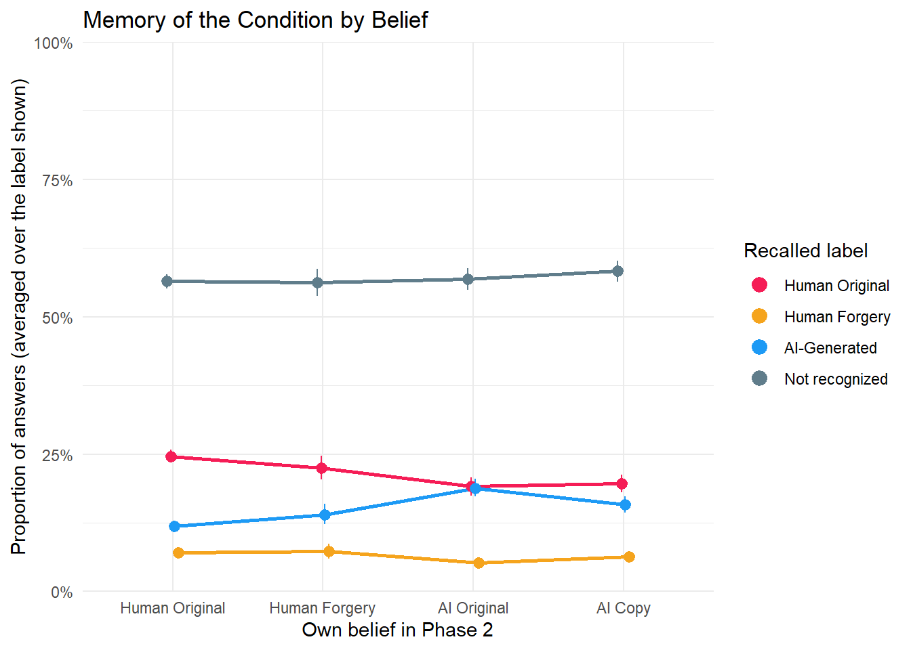{width=672}
:::
:::


::: {.cell}

```{.r .cell-code}
make_memory_tables(estimates$MemoryConditionBelief)
```

::: {.cell-output-display}

```{=html}
<div id="ruvlwjtvpe" style="padding-left:0px;padding-right:0px;padding-top:10px;padding-bottom:10px;overflow-x:auto;overflow-y:auto;width:auto;height:auto;">
<style>#ruvlwjtvpe table {
  font-family: system-ui, 'Segoe UI', Roboto, Helvetica, Arial, sans-serif, 'Apple Color Emoji', 'Segoe UI Emoji', 'Segoe UI Symbol', 'Noto Color Emoji';
  -webkit-font-smoothing: antialiased;
  -moz-osx-font-smoothing: grayscale;
}

#ruvlwjtvpe thead, #ruvlwjtvpe tbody, #ruvlwjtvpe tfoot, #ruvlwjtvpe tr, #ruvlwjtvpe td, #ruvlwjtvpe th {
  border-style: none;
}

#ruvlwjtvpe p {
  margin: 0;
  padding: 0;
}

#ruvlwjtvpe .gt_table {
  display: table;
  border-collapse: collapse;
  line-height: normal;
  margin-left: auto;
  margin-right: auto;
  color: #333333;
  font-size: 13px;
  font-weight: normal;
  font-style: normal;
  background-color: #FFFFFF;
  width: auto;
  border-top-style: solid;
  border-top-width: 3px;
  border-top-color: #D5D5D5;
  border-right-style: solid;
  border-right-width: 3px;
  border-right-color: #D5D5D5;
  border-bottom-style: solid;
  border-bottom-width: 3px;
  border-bottom-color: #D5D5D5;
  border-left-style: solid;
  border-left-width: 3px;
  border-left-color: #D5D5D5;
}

#ruvlwjtvpe .gt_caption {
  padding-top: 4px;
  padding-bottom: 4px;
}

#ruvlwjtvpe .gt_title {
  color: #333333;
  font-size: 125%;
  font-weight: initial;
  padding-top: 4px;
  padding-bottom: 4px;
  padding-left: 5px;
  padding-right: 5px;
  border-bottom-color: #FFFFFF;
  border-bottom-width: 0;
}

#ruvlwjtvpe .gt_subtitle {
  color: #333333;
  font-size: 85%;
  font-weight: initial;
  padding-top: 3px;
  padding-bottom: 5px;
  padding-left: 5px;
  padding-right: 5px;
  border-top-color: #FFFFFF;
  border-top-width: 0;
}

#ruvlwjtvpe .gt_heading {
  background-color: #FFFFFF;
  text-align: left;
  border-bottom-color: #FFFFFF;
  border-left-style: none;
  border-left-width: 1px;
  border-left-color: #D3D3D3;
  border-right-style: none;
  border-right-width: 1px;
  border-right-color: #D3D3D3;
}

#ruvlwjtvpe .gt_bottom_border {
  border-bottom-style: solid;
  border-bottom-width: 2px;
  border-bottom-color: #D5D5D5;
}

#ruvlwjtvpe .gt_col_headings {
  border-top-style: solid;
  border-top-width: 2px;
  border-top-color: #D5D5D5;
  border-bottom-style: solid;
  border-bottom-width: 2px;
  border-bottom-color: #D5D5D5;
  border-left-style: none;
  border-left-width: 1px;
  border-left-color: #D3D3D3;
  border-right-style: none;
  border-right-width: 1px;
  border-right-color: #D3D3D3;
}

#ruvlwjtvpe .gt_col_heading {
  color: #FFFFFF;
  background-color: #000000;
  font-size: 100%;
  font-weight: normal;
  text-transform: inherit;
  border-left-style: none;
  border-left-width: 1px;
  border-left-color: #D3D3D3;
  border-right-style: none;
  border-right-width: 1px;
  border-right-color: #D3D3D3;
  vertical-align: bottom;
  padding-top: 5px;
  padding-bottom: 6px;
  padding-left: 5px;
  padding-right: 5px;
  overflow-x: hidden;
}

#ruvlwjtvpe .gt_column_spanner_outer {
  color: #FFFFFF;
  background-color: #000000;
  font-size: 100%;
  font-weight: normal;
  text-transform: inherit;
  padding-top: 0;
  padding-bottom: 0;
  padding-left: 4px;
  padding-right: 4px;
}

#ruvlwjtvpe .gt_column_spanner_outer:first-child {
  padding-left: 0;
}

#ruvlwjtvpe .gt_column_spanner_outer:last-child {
  padding-right: 0;
}

#ruvlwjtvpe .gt_column_spanner {
  border-bottom-style: solid;
  border-bottom-width: 2px;
  border-bottom-color: #D5D5D5;
  vertical-align: bottom;
  padding-top: 5px;
  padding-bottom: 5px;
  overflow-x: hidden;
  display: inline-block;
  width: 100%;
}

#ruvlwjtvpe .gt_spanner_row {
  border-bottom-style: hidden;
}

#ruvlwjtvpe .gt_group_heading {
  padding-top: 8px;
  padding-bottom: 8px;
  padding-left: 5px;
  padding-right: 5px;
  color: #333333;
  background-color: #FFFFFF;
  font-size: 100%;
  font-weight: initial;
  text-transform: inherit;
  border-top-style: solid;
  border-top-width: 2px;
  border-top-color: #D5D5D5;
  border-bottom-style: solid;
  border-bottom-width: 2px;
  border-bottom-color: #D5D5D5;
  border-left-style: none;
  border-left-width: 1px;
  border-left-color: #D3D3D3;
  border-right-style: none;
  border-right-width: 1px;
  border-right-color: #D3D3D3;
  vertical-align: middle;
  text-align: left;
}

#ruvlwjtvpe .gt_empty_group_heading {
  padding: 0.5px;
  color: #333333;
  background-color: #FFFFFF;
  font-size: 100%;
  font-weight: initial;
  border-top-style: solid;
  border-top-width: 2px;
  border-top-color: #D5D5D5;
  border-bottom-style: solid;
  border-bottom-width: 2px;
  border-bottom-color: #D5D5D5;
  vertical-align: middle;
}

#ruvlwjtvpe .gt_from_md > :first-child {
  margin-top: 0;
}

#ruvlwjtvpe .gt_from_md > :last-child {
  margin-bottom: 0;
}

#ruvlwjtvpe .gt_row {
  padding-top: 8px;
  padding-bottom: 8px;
  padding-left: 5px;
  padding-right: 5px;
  margin: 10px;
  border-top-style: solid;
  border-top-width: 1px;
  border-top-color: #D5D5D5;
  border-left-style: solid;
  border-left-width: 1px;
  border-left-color: #D5D5D5;
  border-right-style: solid;
  border-right-width: 1px;
  border-right-color: #D5D5D5;
  vertical-align: middle;
  overflow-x: hidden;
}

#ruvlwjtvpe .gt_stub {
  color: #333333;
  background-color: #FFFFFF;
  font-size: 100%;
  font-weight: initial;
  text-transform: inherit;
  border-right-style: solid;
  border-right-width: 2px;
  border-right-color: #5F5F5F;
  padding-left: 5px;
  padding-right: 5px;
}

#ruvlwjtvpe .gt_stub_row_group {
  color: #333333;
  background-color: #FFFFFF;
  font-size: 100%;
  font-weight: initial;
  text-transform: inherit;
  border-right-style: solid;
  border-right-width: 2px;
  border-right-color: #D3D3D3;
  padding-left: 5px;
  padding-right: 5px;
  vertical-align: top;
}

#ruvlwjtvpe .gt_row_group_first td {
  border-top-width: 2px;
}

#ruvlwjtvpe .gt_row_group_first th {
  border-top-width: 2px;
}

#ruvlwjtvpe .gt_summary_row {
  color: #333333;
  background-color: #D5D5D5;
  text-transform: inherit;
  padding-top: 8px;
  padding-bottom: 8px;
  padding-left: 5px;
  padding-right: 5px;
}

#ruvlwjtvpe .gt_first_summary_row {
  border-top-style: solid;
  border-top-color: #D5D5D5;
}

#ruvlwjtvpe .gt_first_summary_row.thick {
  border-top-width: 2px;
}

#ruvlwjtvpe .gt_last_summary_row {
  padding-top: 8px;
  padding-bottom: 8px;
  padding-left: 5px;
  padding-right: 5px;
  border-bottom-style: solid;
  border-bottom-width: 2px;
  border-bottom-color: #D5D5D5;
}

#ruvlwjtvpe .gt_grand_summary_row {
  color: #FFFFFF;
  background-color: #929292;
  text-transform: inherit;
  padding-top: 8px;
  padding-bottom: 8px;
  padding-left: 5px;
  padding-right: 5px;
}

#ruvlwjtvpe .gt_first_grand_summary_row {
  padding-top: 8px;
  padding-bottom: 8px;
  padding-left: 5px;
  padding-right: 5px;
  border-top-style: double;
  border-top-width: 6px;
  border-top-color: #D5D5D5;
}

#ruvlwjtvpe .gt_last_grand_summary_row_top {
  padding-top: 8px;
  padding-bottom: 8px;
  padding-left: 5px;
  padding-right: 5px;
  border-bottom-style: double;
  border-bottom-width: 6px;
  border-bottom-color: #D5D5D5;
}

#ruvlwjtvpe .gt_striped {
  background-color: #F4F4F4;
}

#ruvlwjtvpe .gt_table_body {
  border-top-style: solid;
  border-top-width: 2px;
  border-top-color: #D5D5D5;
  border-bottom-style: solid;
  border-bottom-width: 2px;
  border-bottom-color: #D5D5D5;
}

#ruvlwjtvpe .gt_footnotes {
  color: #333333;
  background-color: #FFFFFF;
  border-bottom-style: none;
  border-bottom-width: 2px;
  border-bottom-color: #D3D3D3;
  border-left-style: none;
  border-left-width: 2px;
  border-left-color: #D3D3D3;
  border-right-style: none;
  border-right-width: 2px;
  border-right-color: #D3D3D3;
}

#ruvlwjtvpe .gt_footnote {
  margin: 0px;
  font-size: 90%;
  padding-top: 4px;
  padding-bottom: 4px;
  padding-left: 5px;
  padding-right: 5px;
}

#ruvlwjtvpe .gt_sourcenotes {
  color: #333333;
  background-color: #FFFFFF;
  border-bottom-style: none;
  border-bottom-width: 2px;
  border-bottom-color: #D3D3D3;
  border-left-style: none;
  border-left-width: 2px;
  border-left-color: #D3D3D3;
  border-right-style: none;
  border-right-width: 2px;
  border-right-color: #D3D3D3;
}

#ruvlwjtvpe .gt_sourcenote {
  font-size: 90%;
  padding-top: 4px;
  padding-bottom: 4px;
  padding-left: 5px;
  padding-right: 5px;
}

#ruvlwjtvpe .gt_left {
  text-align: left;
}

#ruvlwjtvpe .gt_center {
  text-align: center;
}

#ruvlwjtvpe .gt_right {
  text-align: right;
  font-variant-numeric: tabular-nums;
}

#ruvlwjtvpe .gt_font_normal {
  font-weight: normal;
}

#ruvlwjtvpe .gt_font_bold {
  font-weight: bold;
}

#ruvlwjtvpe .gt_font_italic {
  font-style: italic;
}

#ruvlwjtvpe .gt_super {
  font-size: 65%;
}

#ruvlwjtvpe .gt_footnote_marks {
  font-size: 75%;
  vertical-align: 0.4em;
  position: initial;
}

#ruvlwjtvpe .gt_asterisk {
  font-size: 100%;
  vertical-align: 0;
}

#ruvlwjtvpe .gt_indent_1 {
  text-indent: 5px;
}

#ruvlwjtvpe .gt_indent_2 {
  text-indent: 10px;
}

#ruvlwjtvpe .gt_indent_3 {
  text-indent: 15px;
}

#ruvlwjtvpe .gt_indent_4 {
  text-indent: 20px;
}

#ruvlwjtvpe .gt_indent_5 {
  text-indent: 25px;
}

#ruvlwjtvpe .katex-display {
  display: inline-flex !important;
  margin-bottom: 0.75em !important;
}

#ruvlwjtvpe div.Reactable > div.rt-table > div.rt-thead > div.rt-tr.rt-tr-group-header > div.rt-th-group:after {
  height: 0px !important;
}
</style>
<table class="gt_table" data-quarto-disable-processing="false" data-quarto-bootstrap="false">
  <thead>
    <tr class="gt_heading">
      <td colspan="10" class="gt_heading gt_title gt_font_normal gt_bottom_border" style>Memory of the Condition by Belief: convergence</td>
    </tr>
    
    <tr class="gt_col_headings">
      <th class="gt_col_heading gt_columns_bottom_border gt_left" rowspan="1" colspan="1" scope="col" id="Model">Model</th>
      <th class="gt_col_heading gt_columns_bottom_border gt_left" rowspan="1" colspan="1" scope="col" id="Family">Family</th>
      <th class="gt_col_heading gt_columns_bottom_border gt_right" rowspan="1" colspan="1" scope="col" id="N_obs">N_obs</th>
      <th class="gt_col_heading gt_columns_bottom_border gt_right" rowspan="1" colspan="1" scope="col" id="N_participants">N_participants</th>
      <th class="gt_col_heading gt_columns_bottom_border gt_right" rowspan="1" colspan="1" scope="col" id="Chains">Chains</th>
      <th class="gt_col_heading gt_columns_bottom_border gt_right" rowspan="1" colspan="1" scope="col" id="Draws">Draws</th>
      <th class="gt_col_heading gt_columns_bottom_border gt_right" rowspan="1" colspan="1" scope="col" id="Max_Rhat">Max_Rhat</th>
      <th class="gt_col_heading gt_columns_bottom_border gt_right" rowspan="1" colspan="1" scope="col" id="Min_ESS_ratio">Min_ESS_ratio</th>
      <th class="gt_col_heading gt_columns_bottom_border gt_right" rowspan="1" colspan="1" scope="col" id="Divergent_pct">Divergent_pct</th>
      <th class="gt_col_heading gt_columns_bottom_border gt_left" rowspan="1" colspan="1" scope="col" id="Criterion">Criterion</th>
    </tr>
  </thead>
  <tbody class="gt_table_body">
    <tr><td headers="Model" class="gt_row gt_left">MemoryConditionBelief</td>
<td headers="Family" class="gt_row gt_left">Categorical</td>
<td headers="N_obs" class="gt_row gt_right">10416</td>
<td headers="N_participants" class="gt_row gt_right">217</td>
<td headers="Chains" class="gt_row gt_right">8</td>
<td headers="Draws" class="gt_row gt_right">4000</td>
<td headers="Max_Rhat" class="gt_row gt_right">1.031</td>
<td headers="Min_ESS_ratio" class="gt_row gt_right">0.078</td>
<td headers="Divergent_pct" class="gt_row gt_right">0</td>
<td headers="Criterion" class="gt_row gt_left">loo</td></tr>
  </tbody>
  
</table>
</div>
```


::: {.callout-note collapse="true" title="Memory of the Condition by Belief: convergence (Markdown table, for text readers)"}

|Model                 |Family      | N_obs| N_participants| Chains| Draws| Max_Rhat| Min_ESS_ratio| Divergent_pct|Criterion |
|:---------------------|:-----------|-----:|--------------:|------:|-----:|--------:|-------------:|-------------:|:---------|
|MemoryConditionBelief |Categorical | 10416|            217|      8|  4000|    1.031|         0.078|             0|loo       |

:::

```{=html}
<div id="soateuorcv" style="padding-left:0px;padding-right:0px;padding-top:10px;padding-bottom:10px;overflow-x:auto;overflow-y:auto;width:auto;height:auto;">
<style>#soateuorcv table {
  font-family: system-ui, 'Segoe UI', Roboto, Helvetica, Arial, sans-serif, 'Apple Color Emoji', 'Segoe UI Emoji', 'Segoe UI Symbol', 'Noto Color Emoji';
  -webkit-font-smoothing: antialiased;
  -moz-osx-font-smoothing: grayscale;
}

#soateuorcv thead, #soateuorcv tbody, #soateuorcv tfoot, #soateuorcv tr, #soateuorcv td, #soateuorcv th {
  border-style: none;
}

#soateuorcv p {
  margin: 0;
  padding: 0;
}

#soateuorcv .gt_table {
  display: table;
  border-collapse: collapse;
  line-height: normal;
  margin-left: auto;
  margin-right: auto;
  color: #333333;
  font-size: 13px;
  font-weight: normal;
  font-style: normal;
  background-color: #FFFFFF;
  width: auto;
  border-top-style: solid;
  border-top-width: 3px;
  border-top-color: #D5D5D5;
  border-right-style: solid;
  border-right-width: 3px;
  border-right-color: #D5D5D5;
  border-bottom-style: solid;
  border-bottom-width: 3px;
  border-bottom-color: #D5D5D5;
  border-left-style: solid;
  border-left-width: 3px;
  border-left-color: #D5D5D5;
}

#soateuorcv .gt_caption {
  padding-top: 4px;
  padding-bottom: 4px;
}

#soateuorcv .gt_title {
  color: #333333;
  font-size: 125%;
  font-weight: initial;
  padding-top: 4px;
  padding-bottom: 4px;
  padding-left: 5px;
  padding-right: 5px;
  border-bottom-color: #FFFFFF;
  border-bottom-width: 0;
}

#soateuorcv .gt_subtitle {
  color: #333333;
  font-size: 85%;
  font-weight: initial;
  padding-top: 3px;
  padding-bottom: 5px;
  padding-left: 5px;
  padding-right: 5px;
  border-top-color: #FFFFFF;
  border-top-width: 0;
}

#soateuorcv .gt_heading {
  background-color: #FFFFFF;
  text-align: left;
  border-bottom-color: #FFFFFF;
  border-left-style: none;
  border-left-width: 1px;
  border-left-color: #D3D3D3;
  border-right-style: none;
  border-right-width: 1px;
  border-right-color: #D3D3D3;
}

#soateuorcv .gt_bottom_border {
  border-bottom-style: solid;
  border-bottom-width: 2px;
  border-bottom-color: #D5D5D5;
}

#soateuorcv .gt_col_headings {
  border-top-style: solid;
  border-top-width: 2px;
  border-top-color: #D5D5D5;
  border-bottom-style: solid;
  border-bottom-width: 2px;
  border-bottom-color: #D5D5D5;
  border-left-style: none;
  border-left-width: 1px;
  border-left-color: #D3D3D3;
  border-right-style: none;
  border-right-width: 1px;
  border-right-color: #D3D3D3;
}

#soateuorcv .gt_col_heading {
  color: #FFFFFF;
  background-color: #000000;
  font-size: 100%;
  font-weight: normal;
  text-transform: inherit;
  border-left-style: none;
  border-left-width: 1px;
  border-left-color: #D3D3D3;
  border-right-style: none;
  border-right-width: 1px;
  border-right-color: #D3D3D3;
  vertical-align: bottom;
  padding-top: 5px;
  padding-bottom: 6px;
  padding-left: 5px;
  padding-right: 5px;
  overflow-x: hidden;
}

#soateuorcv .gt_column_spanner_outer {
  color: #FFFFFF;
  background-color: #000000;
  font-size: 100%;
  font-weight: normal;
  text-transform: inherit;
  padding-top: 0;
  padding-bottom: 0;
  padding-left: 4px;
  padding-right: 4px;
}

#soateuorcv .gt_column_spanner_outer:first-child {
  padding-left: 0;
}

#soateuorcv .gt_column_spanner_outer:last-child {
  padding-right: 0;
}

#soateuorcv .gt_column_spanner {
  border-bottom-style: solid;
  border-bottom-width: 2px;
  border-bottom-color: #D5D5D5;
  vertical-align: bottom;
  padding-top: 5px;
  padding-bottom: 5px;
  overflow-x: hidden;
  display: inline-block;
  width: 100%;
}

#soateuorcv .gt_spanner_row {
  border-bottom-style: hidden;
}

#soateuorcv .gt_group_heading {
  padding-top: 8px;
  padding-bottom: 8px;
  padding-left: 5px;
  padding-right: 5px;
  color: #333333;
  background-color: #FFFFFF;
  font-size: 100%;
  font-weight: initial;
  text-transform: inherit;
  border-top-style: solid;
  border-top-width: 2px;
  border-top-color: #D5D5D5;
  border-bottom-style: solid;
  border-bottom-width: 2px;
  border-bottom-color: #D5D5D5;
  border-left-style: none;
  border-left-width: 1px;
  border-left-color: #D3D3D3;
  border-right-style: none;
  border-right-width: 1px;
  border-right-color: #D3D3D3;
  vertical-align: middle;
  text-align: left;
}

#soateuorcv .gt_empty_group_heading {
  padding: 0.5px;
  color: #333333;
  background-color: #FFFFFF;
  font-size: 100%;
  font-weight: initial;
  border-top-style: solid;
  border-top-width: 2px;
  border-top-color: #D5D5D5;
  border-bottom-style: solid;
  border-bottom-width: 2px;
  border-bottom-color: #D5D5D5;
  vertical-align: middle;
}

#soateuorcv .gt_from_md > :first-child {
  margin-top: 0;
}

#soateuorcv .gt_from_md > :last-child {
  margin-bottom: 0;
}

#soateuorcv .gt_row {
  padding-top: 8px;
  padding-bottom: 8px;
  padding-left: 5px;
  padding-right: 5px;
  margin: 10px;
  border-top-style: solid;
  border-top-width: 1px;
  border-top-color: #D5D5D5;
  border-left-style: solid;
  border-left-width: 1px;
  border-left-color: #D5D5D5;
  border-right-style: solid;
  border-right-width: 1px;
  border-right-color: #D5D5D5;
  vertical-align: middle;
  overflow-x: hidden;
}

#soateuorcv .gt_stub {
  color: #333333;
  background-color: #FFFFFF;
  font-size: 100%;
  font-weight: initial;
  text-transform: inherit;
  border-right-style: solid;
  border-right-width: 2px;
  border-right-color: #5F5F5F;
  padding-left: 5px;
  padding-right: 5px;
}

#soateuorcv .gt_stub_row_group {
  color: #333333;
  background-color: #FFFFFF;
  font-size: 100%;
  font-weight: initial;
  text-transform: inherit;
  border-right-style: solid;
  border-right-width: 2px;
  border-right-color: #D3D3D3;
  padding-left: 5px;
  padding-right: 5px;
  vertical-align: top;
}

#soateuorcv .gt_row_group_first td {
  border-top-width: 2px;
}

#soateuorcv .gt_row_group_first th {
  border-top-width: 2px;
}

#soateuorcv .gt_summary_row {
  color: #333333;
  background-color: #D5D5D5;
  text-transform: inherit;
  padding-top: 8px;
  padding-bottom: 8px;
  padding-left: 5px;
  padding-right: 5px;
}

#soateuorcv .gt_first_summary_row {
  border-top-style: solid;
  border-top-color: #D5D5D5;
}

#soateuorcv .gt_first_summary_row.thick {
  border-top-width: 2px;
}

#soateuorcv .gt_last_summary_row {
  padding-top: 8px;
  padding-bottom: 8px;
  padding-left: 5px;
  padding-right: 5px;
  border-bottom-style: solid;
  border-bottom-width: 2px;
  border-bottom-color: #D5D5D5;
}

#soateuorcv .gt_grand_summary_row {
  color: #FFFFFF;
  background-color: #929292;
  text-transform: inherit;
  padding-top: 8px;
  padding-bottom: 8px;
  padding-left: 5px;
  padding-right: 5px;
}

#soateuorcv .gt_first_grand_summary_row {
  padding-top: 8px;
  padding-bottom: 8px;
  padding-left: 5px;
  padding-right: 5px;
  border-top-style: double;
  border-top-width: 6px;
  border-top-color: #D5D5D5;
}

#soateuorcv .gt_last_grand_summary_row_top {
  padding-top: 8px;
  padding-bottom: 8px;
  padding-left: 5px;
  padding-right: 5px;
  border-bottom-style: double;
  border-bottom-width: 6px;
  border-bottom-color: #D5D5D5;
}

#soateuorcv .gt_striped {
  background-color: #F4F4F4;
}

#soateuorcv .gt_table_body {
  border-top-style: solid;
  border-top-width: 2px;
  border-top-color: #D5D5D5;
  border-bottom-style: solid;
  border-bottom-width: 2px;
  border-bottom-color: #D5D5D5;
}

#soateuorcv .gt_footnotes {
  color: #333333;
  background-color: #FFFFFF;
  border-bottom-style: none;
  border-bottom-width: 2px;
  border-bottom-color: #D3D3D3;
  border-left-style: none;
  border-left-width: 2px;
  border-left-color: #D3D3D3;
  border-right-style: none;
  border-right-width: 2px;
  border-right-color: #D3D3D3;
}

#soateuorcv .gt_footnote {
  margin: 0px;
  font-size: 90%;
  padding-top: 4px;
  padding-bottom: 4px;
  padding-left: 5px;
  padding-right: 5px;
}

#soateuorcv .gt_sourcenotes {
  color: #333333;
  background-color: #FFFFFF;
  border-bottom-style: none;
  border-bottom-width: 2px;
  border-bottom-color: #D3D3D3;
  border-left-style: none;
  border-left-width: 2px;
  border-left-color: #D3D3D3;
  border-right-style: none;
  border-right-width: 2px;
  border-right-color: #D3D3D3;
}

#soateuorcv .gt_sourcenote {
  font-size: 90%;
  padding-top: 4px;
  padding-bottom: 4px;
  padding-left: 5px;
  padding-right: 5px;
}

#soateuorcv .gt_left {
  text-align: left;
}

#soateuorcv .gt_center {
  text-align: center;
}

#soateuorcv .gt_right {
  text-align: right;
  font-variant-numeric: tabular-nums;
}

#soateuorcv .gt_font_normal {
  font-weight: normal;
}

#soateuorcv .gt_font_bold {
  font-weight: bold;
}

#soateuorcv .gt_font_italic {
  font-style: italic;
}

#soateuorcv .gt_super {
  font-size: 65%;
}

#soateuorcv .gt_footnote_marks {
  font-size: 75%;
  vertical-align: 0.4em;
  position: initial;
}

#soateuorcv .gt_asterisk {
  font-size: 100%;
  vertical-align: 0;
}

#soateuorcv .gt_indent_1 {
  text-indent: 5px;
}

#soateuorcv .gt_indent_2 {
  text-indent: 10px;
}

#soateuorcv .gt_indent_3 {
  text-indent: 15px;
}

#soateuorcv .gt_indent_4 {
  text-indent: 20px;
}

#soateuorcv .gt_indent_5 {
  text-indent: 25px;
}

#soateuorcv .katex-display {
  display: inline-flex !important;
  margin-bottom: 0.75em !important;
}

#soateuorcv div.Reactable > div.rt-table > div.rt-thead > div.rt-tr.rt-tr-group-header > div.rt-th-group:after {
  height: 0px !important;
}
</style>
<table class="gt_table" data-quarto-disable-processing="false" data-quarto-bootstrap="false">
  <thead>
    <tr class="gt_heading">
      <td colspan="5" class="gt_heading gt_title gt_font_normal gt_bottom_border" style>Memory of the Condition by Belief: probability of each answer per Belief (marginal means)</td>
    </tr>
    
    <tr class="gt_col_headings">
      <th class="gt_col_heading gt_columns_bottom_border gt_center" rowspan="1" colspan="1" scope="col" id="Belief">Belief</th>
      <th class="gt_col_heading gt_columns_bottom_border gt_center" rowspan="1" colspan="1" scope="col" id="Response">Response</th>
      <th class="gt_col_heading gt_columns_bottom_border gt_right" rowspan="1" colspan="1" scope="col" id="Median">Median</th>
      <th class="gt_col_heading gt_columns_bottom_border gt_right" rowspan="1" colspan="1" scope="col" id="CI_low">CI_low</th>
      <th class="gt_col_heading gt_columns_bottom_border gt_right" rowspan="1" colspan="1" scope="col" id="CI_high">CI_high</th>
    </tr>
  </thead>
  <tbody class="gt_table_body">
    <tr><td headers="Belief" class="gt_row gt_center">Human Original</td>
<td headers="Response" class="gt_row gt_center">Human Original</td>
<td headers="Median" class="gt_row gt_right">0.25</td>
<td headers="CI_low" class="gt_row gt_right">0.23</td>
<td headers="CI_high" class="gt_row gt_right">0.26</td></tr>
    <tr><td headers="Belief" class="gt_row gt_center gt_striped">Human Forgery</td>
<td headers="Response" class="gt_row gt_center gt_striped">Human Original</td>
<td headers="Median" class="gt_row gt_right gt_striped">0.22</td>
<td headers="CI_low" class="gt_row gt_right gt_striped">0.20</td>
<td headers="CI_high" class="gt_row gt_right gt_striped">0.25</td></tr>
    <tr><td headers="Belief" class="gt_row gt_center">AI Original</td>
<td headers="Response" class="gt_row gt_center">Human Original</td>
<td headers="Median" class="gt_row gt_right">0.19</td>
<td headers="CI_low" class="gt_row gt_right">0.17</td>
<td headers="CI_high" class="gt_row gt_right">0.21</td></tr>
    <tr><td headers="Belief" class="gt_row gt_center gt_striped">AI Copy</td>
<td headers="Response" class="gt_row gt_center gt_striped">Human Original</td>
<td headers="Median" class="gt_row gt_right gt_striped">0.20</td>
<td headers="CI_low" class="gt_row gt_right gt_striped">0.18</td>
<td headers="CI_high" class="gt_row gt_right gt_striped">0.21</td></tr>
    <tr><td headers="Belief" class="gt_row gt_center">Human Original</td>
<td headers="Response" class="gt_row gt_center">Human Forgery</td>
<td headers="Median" class="gt_row gt_right">0.07</td>
<td headers="CI_low" class="gt_row gt_right">0.06</td>
<td headers="CI_high" class="gt_row gt_right">0.08</td></tr>
    <tr><td headers="Belief" class="gt_row gt_center gt_striped">Human Forgery</td>
<td headers="Response" class="gt_row gt_center gt_striped">Human Forgery</td>
<td headers="Median" class="gt_row gt_right gt_striped">0.07</td>
<td headers="CI_low" class="gt_row gt_right gt_striped">0.06</td>
<td headers="CI_high" class="gt_row gt_right gt_striped">0.09</td></tr>
    <tr><td headers="Belief" class="gt_row gt_center">AI Original</td>
<td headers="Response" class="gt_row gt_center">Human Forgery</td>
<td headers="Median" class="gt_row gt_right">0.05</td>
<td headers="CI_low" class="gt_row gt_right">0.04</td>
<td headers="CI_high" class="gt_row gt_right">0.06</td></tr>
    <tr><td headers="Belief" class="gt_row gt_center gt_striped">AI Copy</td>
<td headers="Response" class="gt_row gt_center gt_striped">Human Forgery</td>
<td headers="Median" class="gt_row gt_right gt_striped">0.06</td>
<td headers="CI_low" class="gt_row gt_right gt_striped">0.05</td>
<td headers="CI_high" class="gt_row gt_right gt_striped">0.07</td></tr>
    <tr><td headers="Belief" class="gt_row gt_center">Human Original</td>
<td headers="Response" class="gt_row gt_center">AI-Generated</td>
<td headers="Median" class="gt_row gt_right">0.12</td>
<td headers="CI_low" class="gt_row gt_right">0.11</td>
<td headers="CI_high" class="gt_row gt_right">0.13</td></tr>
    <tr><td headers="Belief" class="gt_row gt_center gt_striped">Human Forgery</td>
<td headers="Response" class="gt_row gt_center gt_striped">AI-Generated</td>
<td headers="Median" class="gt_row gt_right gt_striped">0.14</td>
<td headers="CI_low" class="gt_row gt_right gt_striped">0.12</td>
<td headers="CI_high" class="gt_row gt_right gt_striped">0.16</td></tr>
    <tr><td headers="Belief" class="gt_row gt_center">AI Original</td>
<td headers="Response" class="gt_row gt_center">AI-Generated</td>
<td headers="Median" class="gt_row gt_right">0.19</td>
<td headers="CI_low" class="gt_row gt_right">0.17</td>
<td headers="CI_high" class="gt_row gt_right">0.21</td></tr>
    <tr><td headers="Belief" class="gt_row gt_center gt_striped">AI Copy</td>
<td headers="Response" class="gt_row gt_center gt_striped">AI-Generated</td>
<td headers="Median" class="gt_row gt_right gt_striped">0.16</td>
<td headers="CI_low" class="gt_row gt_right gt_striped">0.14</td>
<td headers="CI_high" class="gt_row gt_right gt_striped">0.17</td></tr>
    <tr><td headers="Belief" class="gt_row gt_center">Human Original</td>
<td headers="Response" class="gt_row gt_center">Not recognized</td>
<td headers="Median" class="gt_row gt_right">0.56</td>
<td headers="CI_low" class="gt_row gt_right">0.55</td>
<td headers="CI_high" class="gt_row gt_right">0.58</td></tr>
    <tr><td headers="Belief" class="gt_row gt_center gt_striped">Human Forgery</td>
<td headers="Response" class="gt_row gt_center gt_striped">Not recognized</td>
<td headers="Median" class="gt_row gt_right gt_striped">0.56</td>
<td headers="CI_low" class="gt_row gt_right gt_striped">0.54</td>
<td headers="CI_high" class="gt_row gt_right gt_striped">0.59</td></tr>
    <tr><td headers="Belief" class="gt_row gt_center">AI Original</td>
<td headers="Response" class="gt_row gt_center">Not recognized</td>
<td headers="Median" class="gt_row gt_right">0.57</td>
<td headers="CI_low" class="gt_row gt_right">0.55</td>
<td headers="CI_high" class="gt_row gt_right">0.59</td></tr>
    <tr><td headers="Belief" class="gt_row gt_center gt_striped">AI Copy</td>
<td headers="Response" class="gt_row gt_center gt_striped">Not recognized</td>
<td headers="Median" class="gt_row gt_right gt_striped">0.58</td>
<td headers="CI_low" class="gt_row gt_right gt_striped">0.56</td>
<td headers="CI_high" class="gt_row gt_right gt_striped">0.60</td></tr>
  </tbody>
  
</table>
</div>
```


::: {.callout-note collapse="true" title="Memory of the Condition by Belief: probability of each answer per Belief (marginal means) (Markdown table, for text readers)"}

|Belief         |Response       |Median |CI_low |CI_high |
|:--------------|:--------------|:------|:------|:-------|
|Human Original |Human Original |0.25   |0.23   |0.26    |
|Human Forgery  |Human Original |0.22   |0.20   |0.25    |
|AI Original    |Human Original |0.19   |0.17   |0.21    |
|AI Copy        |Human Original |0.20   |0.18   |0.21    |
|Human Original |Human Forgery  |0.07   |0.06   |0.08    |
|Human Forgery  |Human Forgery  |0.07   |0.06   |0.09    |
|AI Original    |Human Forgery  |0.05   |0.04   |0.06    |
|AI Copy        |Human Forgery  |0.06   |0.05   |0.07    |
|Human Original |AI-Generated   |0.12   |0.11   |0.13    |
|Human Forgery  |AI-Generated   |0.14   |0.12   |0.16    |
|AI Original    |AI-Generated   |0.19   |0.17   |0.21    |
|AI Copy        |AI-Generated   |0.16   |0.14   |0.17    |
|Human Original |Not recognized |0.56   |0.55   |0.58    |
|Human Forgery  |Not recognized |0.56   |0.54   |0.59    |
|AI Original    |Not recognized |0.57   |0.55   |0.59    |
|AI Copy        |Not recognized |0.58   |0.56   |0.60    |

:::

::: {.callout-note collapse="true" title="Memory of the Condition by Belief: all 120 contrasts (Markdown table, for text readers)"}

|Level1         |Response1      |Level2         |Response2      |Median |CI_low |CI_high |pd   |Effect   |
|:--------------|:--------------|:--------------|:--------------|:------|:------|:-------|:----|:--------|
|Human Original |Human Original |Human Forgery  |Human Original |0.02   |0.00   |0.05    |0.95 |n.s.     |
|Human Original |Human Original |AI Original    |Human Original |0.05   |0.03   |0.08    |1.00 |Positive |
|Human Original |Human Original |AI Copy        |Human Original |0.05   |0.03   |0.07    |1.00 |Positive |
|Human Original |Human Original |Human Original |Human Forgery  |0.18   |0.16   |0.19    |1.00 |Positive |
|Human Original |Human Original |Human Forgery  |Human Forgery  |0.17   |0.16   |0.19    |1.00 |Positive |
|Human Original |Human Original |AI Original    |Human Forgery  |0.19   |0.18   |0.21    |1.00 |Positive |
|Human Original |Human Original |AI Copy        |Human Forgery  |0.18   |0.17   |0.20    |1.00 |Positive |
|Human Original |Human Original |Human Original |AI-Generated   |0.13   |0.11   |0.14    |1.00 |Positive |
|Human Original |Human Original |Human Forgery  |AI-Generated   |0.11   |0.08   |0.13    |1.00 |Positive |
|Human Original |Human Original |AI Original    |AI-Generated   |0.06   |0.04   |0.08    |1.00 |Positive |
|Human Original |Human Original |AI Copy        |AI-Generated   |0.09   |0.07   |0.11    |1.00 |Positive |
|Human Original |Human Original |Human Original |Not recognized |-0.32  |-0.34  |-0.30   |1.00 |Negative |
|Human Original |Human Original |Human Forgery  |Not recognized |-0.32  |-0.34  |-0.29   |1.00 |Negative |
|Human Original |Human Original |AI Original    |Not recognized |-0.32  |-0.34  |-0.30   |1.00 |Negative |
|Human Original |Human Original |AI Copy        |Not recognized |-0.34  |-0.36  |-0.31   |1.00 |Negative |
|Human Forgery  |Human Original |AI Original    |Human Original |0.03   |0.01   |0.06    |0.99 |Positive |
|Human Forgery  |Human Original |AI Copy        |Human Original |0.03   |0.00   |0.06    |0.99 |Positive |
|Human Forgery  |Human Original |Human Original |Human Forgery  |0.15   |0.13   |0.18    |1.00 |Positive |
|Human Forgery  |Human Original |Human Forgery  |Human Forgery  |0.15   |0.13   |0.18    |1.00 |Positive |
|Human Forgery  |Human Original |AI Original    |Human Forgery  |0.17   |0.15   |0.20    |1.00 |Positive |
|Human Forgery  |Human Original |AI Copy        |Human Forgery  |0.16   |0.14   |0.19    |1.00 |Positive |
|Human Forgery  |Human Original |Human Original |AI-Generated   |0.11   |0.08   |0.13    |1.00 |Positive |
|Human Forgery  |Human Original |Human Forgery  |AI-Generated   |0.09   |0.05   |0.12    |1.00 |Positive |
|Human Forgery  |Human Original |AI Original    |AI-Generated   |0.04   |0.01   |0.06    |1.00 |Positive |
|Human Forgery  |Human Original |AI Copy        |AI-Generated   |0.07   |0.04   |0.09    |1.00 |Positive |
|Human Forgery  |Human Original |Human Original |Not recognized |-0.34  |-0.36  |-0.31   |1.00 |Negative |
|Human Forgery  |Human Original |Human Forgery  |Not recognized |-0.34  |-0.38  |-0.30   |1.00 |Negative |
|Human Forgery  |Human Original |AI Original    |Not recognized |-0.34  |-0.37  |-0.31   |1.00 |Negative |
|Human Forgery  |Human Original |AI Copy        |Not recognized |-0.36  |-0.39  |-0.33   |1.00 |Negative |
|AI Original    |Human Original |AI Copy        |Human Original |0.00   |-0.03  |0.02    |0.66 |n.s.     |
|AI Original    |Human Original |Human Original |Human Forgery  |0.12   |0.10   |0.14    |1.00 |Positive |
|AI Original    |Human Original |Human Forgery  |Human Forgery  |0.12   |0.10   |0.14    |1.00 |Positive |
|AI Original    |Human Original |AI Original    |Human Forgery  |0.14   |0.12   |0.16    |1.00 |Positive |
|AI Original    |Human Original |AI Copy        |Human Forgery  |0.13   |0.11   |0.15    |1.00 |Positive |
|AI Original    |Human Original |Human Original |AI-Generated   |0.07   |0.05   |0.09    |1.00 |Positive |
|AI Original    |Human Original |Human Forgery  |AI-Generated   |0.05   |0.03   |0.08    |1.00 |Positive |
|AI Original    |Human Original |AI Original    |AI-Generated   |0.00   |-0.02  |0.03    |0.59 |n.s.     |
|AI Original    |Human Original |AI Copy        |AI-Generated   |0.03   |0.01   |0.05    |1.00 |Positive |
|AI Original    |Human Original |Human Original |Not recognized |-0.37  |-0.39  |-0.35   |1.00 |Negative |
|AI Original    |Human Original |Human Forgery  |Not recognized |-0.37  |-0.40  |-0.34   |1.00 |Negative |
|AI Original    |Human Original |AI Original    |Not recognized |-0.38  |-0.41  |-0.34   |1.00 |Negative |
|AI Original    |Human Original |AI Copy        |Not recognized |-0.39  |-0.42  |-0.37   |1.00 |Negative |
|AI Copy        |Human Original |Human Original |Human Forgery  |0.13   |0.11   |0.14    |1.00 |Positive |
|AI Copy        |Human Original |Human Forgery  |Human Forgery  |0.12   |0.10   |0.14    |1.00 |Positive |
|AI Copy        |Human Original |AI Original    |Human Forgery  |0.14   |0.12   |0.16    |1.00 |Positive |
|AI Copy        |Human Original |AI Copy        |Human Forgery  |0.13   |0.11   |0.15    |1.00 |Positive |
|AI Copy        |Human Original |Human Original |AI-Generated   |0.08   |0.06   |0.10    |1.00 |Positive |
|AI Copy        |Human Original |Human Forgery  |AI-Generated   |0.06   |0.03   |0.08    |1.00 |Positive |
|AI Copy        |Human Original |AI Original    |AI-Generated   |0.01   |-0.02  |0.03    |0.75 |n.s.     |
|AI Copy        |Human Original |AI Copy        |AI-Generated   |0.04   |0.01   |0.06    |1.00 |Positive |
|AI Copy        |Human Original |Human Original |Not recognized |-0.37  |-0.39  |-0.35   |1.00 |Negative |
|AI Copy        |Human Original |Human Forgery  |Not recognized |-0.37  |-0.40  |-0.34   |1.00 |Negative |
|AI Copy        |Human Original |AI Original    |Not recognized |-0.37  |-0.40  |-0.35   |1.00 |Negative |
|AI Copy        |Human Original |AI Copy        |Not recognized |-0.39  |-0.42  |-0.36   |1.00 |Negative |
|Human Original |Human Forgery  |Human Forgery  |Human Forgery  |0.00   |-0.02  |0.01    |0.60 |n.s.     |
|Human Original |Human Forgery  |AI Original    |Human Forgery  |0.02   |0.01   |0.03    |1.00 |Positive |
|Human Original |Human Forgery  |AI Copy        |Human Forgery  |0.01   |0.00   |0.02    |0.90 |n.s.     |
|Human Original |Human Forgery  |Human Original |AI-Generated   |-0.05  |-0.06  |-0.04   |1.00 |Negative |
|Human Original |Human Forgery  |Human Forgery  |AI-Generated   |-0.07  |-0.09  |-0.05   |1.00 |Negative |
|Human Original |Human Forgery  |AI Original    |AI-Generated   |-0.12  |-0.14  |-0.10   |1.00 |Negative |
|Human Original |Human Forgery  |AI Copy        |AI-Generated   |-0.09  |-0.10  |-0.07   |1.00 |Negative |
|Human Original |Human Forgery  |Human Original |Not recognized |-0.49  |-0.51  |-0.48   |1.00 |Negative |
|Human Original |Human Forgery  |Human Forgery  |Not recognized |-0.49  |-0.52  |-0.47   |1.00 |Negative |
|Human Original |Human Forgery  |AI Original    |Not recognized |-0.50  |-0.52  |-0.48   |1.00 |Negative |
|Human Original |Human Forgery  |AI Copy        |Not recognized |-0.51  |-0.53  |-0.49   |1.00 |Negative |
|Human Forgery  |Human Forgery  |AI Original    |Human Forgery  |0.02   |0.00   |0.04    |0.99 |Positive |
|Human Forgery  |Human Forgery  |AI Copy        |Human Forgery  |0.01   |-0.01  |0.03    |0.88 |n.s.     |
|Human Forgery  |Human Forgery  |Human Original |AI-Generated   |-0.05  |-0.06  |-0.03   |1.00 |Negative |
|Human Forgery  |Human Forgery  |Human Forgery  |AI-Generated   |-0.07  |-0.09  |-0.04   |1.00 |Negative |
|Human Forgery  |Human Forgery  |AI Original    |AI-Generated   |-0.12  |-0.14  |-0.09   |1.00 |Negative |
|Human Forgery  |Human Forgery  |AI Copy        |AI-Generated   |-0.09  |-0.11  |-0.07   |1.00 |Negative |
|Human Forgery  |Human Forgery  |Human Original |Not recognized |-0.49  |-0.51  |-0.47   |1.00 |Negative |
|Human Forgery  |Human Forgery  |Human Forgery  |Not recognized |-0.49  |-0.52  |-0.46   |1.00 |Negative |
|Human Forgery  |Human Forgery  |AI Original    |Not recognized |-0.50  |-0.52  |-0.47   |1.00 |Negative |
|Human Forgery  |Human Forgery  |AI Copy        |Not recognized |-0.51  |-0.53  |-0.49   |1.00 |Negative |
|AI Original    |Human Forgery  |AI Copy        |Human Forgery  |-0.01  |-0.03  |0.00    |0.94 |n.s.     |
|AI Original    |Human Forgery  |Human Original |AI-Generated   |-0.07  |-0.08  |-0.05   |1.00 |Negative |
|AI Original    |Human Forgery  |Human Forgery  |AI-Generated   |-0.09  |-0.11  |-0.07   |1.00 |Negative |
|AI Original    |Human Forgery  |AI Original    |AI-Generated   |-0.14  |-0.16  |-0.12   |1.00 |Negative |
|AI Original    |Human Forgery  |AI Copy        |AI-Generated   |-0.11  |-0.12  |-0.09   |1.00 |Negative |
|AI Original    |Human Forgery  |Human Original |Not recognized |-0.51  |-0.53  |-0.50   |1.00 |Negative |
|AI Original    |Human Forgery  |Human Forgery  |Not recognized |-0.51  |-0.54  |-0.48   |1.00 |Negative |
|AI Original    |Human Forgery  |AI Original    |Not recognized |-0.52  |-0.54  |-0.49   |1.00 |Negative |
|AI Original    |Human Forgery  |AI Copy        |Not recognized |-0.53  |-0.55  |-0.51   |1.00 |Negative |
|AI Copy        |Human Forgery  |Human Original |AI-Generated   |-0.06  |-0.07  |-0.04   |1.00 |Negative |
|AI Copy        |Human Forgery  |Human Forgery  |AI-Generated   |-0.08  |-0.10  |-0.06   |1.00 |Negative |
|AI Copy        |Human Forgery  |AI Original    |AI-Generated   |-0.13  |-0.14  |-0.11   |1.00 |Negative |
|AI Copy        |Human Forgery  |AI Copy        |AI-Generated   |-0.10  |-0.11  |-0.08   |1.00 |Negative |
|AI Copy        |Human Forgery  |Human Original |Not recognized |-0.50  |-0.52  |-0.49   |1.00 |Negative |
|AI Copy        |Human Forgery  |Human Forgery  |Not recognized |-0.50  |-0.53  |-0.47   |1.00 |Negative |
|AI Copy        |Human Forgery  |AI Original    |Not recognized |-0.51  |-0.53  |-0.48   |1.00 |Negative |
|AI Copy        |Human Forgery  |AI Copy        |Not recognized |-0.52  |-0.54  |-0.50   |1.00 |Negative |
|Human Original |AI-Generated   |Human Forgery  |AI-Generated   |-0.02  |-0.04  |0.00    |0.98 |Negative |
|Human Original |AI-Generated   |AI Original    |AI-Generated   |-0.07  |-0.09  |-0.05   |1.00 |Negative |
|Human Original |AI-Generated   |AI Copy        |AI-Generated   |-0.04  |-0.06  |-0.02   |1.00 |Negative |
|Human Original |AI-Generated   |Human Original |Not recognized |-0.45  |-0.46  |-0.43   |1.00 |Negative |
|Human Original |AI-Generated   |Human Forgery  |Not recognized |-0.44  |-0.47  |-0.42   |1.00 |Negative |
|Human Original |AI-Generated   |AI Original    |Not recognized |-0.45  |-0.47  |-0.43   |1.00 |Negative |
|Human Original |AI-Generated   |AI Copy        |Not recognized |-0.46  |-0.48  |-0.44   |1.00 |Negative |
|Human Forgery  |AI-Generated   |AI Original    |AI-Generated   |-0.05  |-0.07  |-0.02   |1.00 |Negative |
|Human Forgery  |AI-Generated   |AI Copy        |AI-Generated   |-0.02  |-0.04  |0.01    |0.94 |n.s.     |
|Human Forgery  |AI-Generated   |Human Original |Not recognized |-0.42  |-0.45  |-0.40   |1.00 |Negative |
|Human Forgery  |AI-Generated   |Human Forgery  |Not recognized |-0.42  |-0.46  |-0.39   |1.00 |Negative |
|Human Forgery  |AI-Generated   |AI Original    |Not recognized |-0.43  |-0.45  |-0.40   |1.00 |Negative |
|Human Forgery  |AI-Generated   |AI Copy        |Not recognized |-0.44  |-0.47  |-0.42   |1.00 |Negative |
|AI Original    |AI-Generated   |AI Copy        |AI-Generated   |0.03   |0.01   |0.05    |1.00 |Positive |
|AI Original    |AI-Generated   |Human Original |Not recognized |-0.38  |-0.40  |-0.36   |1.00 |Negative |
|AI Original    |AI-Generated   |Human Forgery  |Not recognized |-0.37  |-0.40  |-0.35   |1.00 |Negative |
|AI Original    |AI-Generated   |AI Original    |Not recognized |-0.38  |-0.41  |-0.35   |1.00 |Negative |
|AI Original    |AI-Generated   |AI Copy        |Not recognized |-0.39  |-0.42  |-0.37   |1.00 |Negative |
|AI Copy        |AI-Generated   |Human Original |Not recognized |-0.41  |-0.43  |-0.39   |1.00 |Negative |
|AI Copy        |AI-Generated   |Human Forgery  |Not recognized |-0.40  |-0.43  |-0.38   |1.00 |Negative |
|AI Copy        |AI-Generated   |AI Original    |Not recognized |-0.41  |-0.43  |-0.39   |1.00 |Negative |
|AI Copy        |AI-Generated   |AI Copy        |Not recognized |-0.42  |-0.45  |-0.40   |1.00 |Negative |
|Human Original |Not recognized |Human Forgery  |Not recognized |0.00   |-0.03  |0.03    |0.55 |n.s.     |
|Human Original |Not recognized |AI Original    |Not recognized |0.00   |-0.03  |0.02    |0.64 |n.s.     |
|Human Original |Not recognized |AI Copy        |Not recognized |-0.02  |-0.04  |0.00    |0.94 |n.s.     |
|Human Forgery  |Not recognized |AI Original    |Not recognized |-0.01  |-0.04  |0.03    |0.65 |n.s.     |
|Human Forgery  |Not recognized |AI Copy        |Not recognized |-0.02  |-0.05  |0.01    |0.90 |n.s.     |
|AI Original    |Not recognized |AI Copy        |Not recognized |-0.01  |-0.04  |0.01    |0.85 |n.s.     |

:::
:::
:::


::: {.cell}

```{.r .cell-code}
c <- estimates$MemoryConditionBelief$contrasts
make_contrasts(c, answer = "AI-Generated",
               title = "Memory of the Condition by Belief: recalling 'AI-Generated', by own belief")
```

::: {.cell-output-display}

```{=html}
<div id="uwhxnkhjsk" style="padding-left:0px;padding-right:0px;padding-top:10px;padding-bottom:10px;overflow-x:auto;overflow-y:auto;width:auto;height:auto;">
<style>#uwhxnkhjsk table {
  font-family: system-ui, 'Segoe UI', Roboto, Helvetica, Arial, sans-serif, 'Apple Color Emoji', 'Segoe UI Emoji', 'Segoe UI Symbol', 'Noto Color Emoji';
  -webkit-font-smoothing: antialiased;
  -moz-osx-font-smoothing: grayscale;
}

#uwhxnkhjsk thead, #uwhxnkhjsk tbody, #uwhxnkhjsk tfoot, #uwhxnkhjsk tr, #uwhxnkhjsk td, #uwhxnkhjsk th {
  border-style: none;
}

#uwhxnkhjsk p {
  margin: 0;
  padding: 0;
}

#uwhxnkhjsk .gt_table {
  display: table;
  border-collapse: collapse;
  line-height: normal;
  margin-left: auto;
  margin-right: auto;
  color: #333333;
  font-size: 16px;
  font-weight: normal;
  font-style: normal;
  background-color: #FFFFFF;
  width: auto;
  border-top-style: solid;
  border-top-width: 2px;
  border-top-color: #A8A8A8;
  border-right-style: none;
  border-right-width: 2px;
  border-right-color: #D3D3D3;
  border-bottom-style: solid;
  border-bottom-width: 2px;
  border-bottom-color: #A8A8A8;
  border-left-style: none;
  border-left-width: 2px;
  border-left-color: #D3D3D3;
}

#uwhxnkhjsk .gt_caption {
  padding-top: 4px;
  padding-bottom: 4px;
}

#uwhxnkhjsk .gt_title {
  color: #333333;
  font-size: 125%;
  font-weight: initial;
  padding-top: 4px;
  padding-bottom: 4px;
  padding-left: 5px;
  padding-right: 5px;
  border-bottom-color: #FFFFFF;
  border-bottom-width: 0;
}

#uwhxnkhjsk .gt_subtitle {
  color: #333333;
  font-size: 85%;
  font-weight: initial;
  padding-top: 3px;
  padding-bottom: 5px;
  padding-left: 5px;
  padding-right: 5px;
  border-top-color: #FFFFFF;
  border-top-width: 0;
}

#uwhxnkhjsk .gt_heading {
  background-color: #FFFFFF;
  text-align: center;
  border-bottom-color: #FFFFFF;
  border-left-style: none;
  border-left-width: 1px;
  border-left-color: #D3D3D3;
  border-right-style: none;
  border-right-width: 1px;
  border-right-color: #D3D3D3;
}

#uwhxnkhjsk .gt_bottom_border {
  border-bottom-style: solid;
  border-bottom-width: 2px;
  border-bottom-color: #D3D3D3;
}

#uwhxnkhjsk .gt_col_headings {
  border-top-style: solid;
  border-top-width: 2px;
  border-top-color: #D3D3D3;
  border-bottom-style: solid;
  border-bottom-width: 2px;
  border-bottom-color: #D3D3D3;
  border-left-style: none;
  border-left-width: 1px;
  border-left-color: #D3D3D3;
  border-right-style: none;
  border-right-width: 1px;
  border-right-color: #D3D3D3;
}

#uwhxnkhjsk .gt_col_heading {
  color: #333333;
  background-color: #FFFFFF;
  font-size: 100%;
  font-weight: normal;
  text-transform: inherit;
  border-left-style: none;
  border-left-width: 1px;
  border-left-color: #D3D3D3;
  border-right-style: none;
  border-right-width: 1px;
  border-right-color: #D3D3D3;
  vertical-align: bottom;
  padding-top: 5px;
  padding-bottom: 6px;
  padding-left: 5px;
  padding-right: 5px;
  overflow-x: hidden;
}

#uwhxnkhjsk .gt_column_spanner_outer {
  color: #333333;
  background-color: #FFFFFF;
  font-size: 100%;
  font-weight: normal;
  text-transform: inherit;
  padding-top: 0;
  padding-bottom: 0;
  padding-left: 4px;
  padding-right: 4px;
}

#uwhxnkhjsk .gt_column_spanner_outer:first-child {
  padding-left: 0;
}

#uwhxnkhjsk .gt_column_spanner_outer:last-child {
  padding-right: 0;
}

#uwhxnkhjsk .gt_column_spanner {
  border-bottom-style: solid;
  border-bottom-width: 2px;
  border-bottom-color: #D3D3D3;
  vertical-align: bottom;
  padding-top: 5px;
  padding-bottom: 5px;
  overflow-x: hidden;
  display: inline-block;
  width: 100%;
}

#uwhxnkhjsk .gt_spanner_row {
  border-bottom-style: hidden;
}

#uwhxnkhjsk .gt_group_heading {
  padding-top: 8px;
  padding-bottom: 8px;
  padding-left: 5px;
  padding-right: 5px;
  color: #333333;
  background-color: #FFFFFF;
  font-size: 100%;
  font-weight: initial;
  text-transform: inherit;
  border-top-style: solid;
  border-top-width: 2px;
  border-top-color: #D3D3D3;
  border-bottom-style: solid;
  border-bottom-width: 2px;
  border-bottom-color: #D3D3D3;
  border-left-style: none;
  border-left-width: 1px;
  border-left-color: #D3D3D3;
  border-right-style: none;
  border-right-width: 1px;
  border-right-color: #D3D3D3;
  vertical-align: middle;
  text-align: left;
}

#uwhxnkhjsk .gt_empty_group_heading {
  padding: 0.5px;
  color: #333333;
  background-color: #FFFFFF;
  font-size: 100%;
  font-weight: initial;
  border-top-style: solid;
  border-top-width: 2px;
  border-top-color: #D3D3D3;
  border-bottom-style: solid;
  border-bottom-width: 2px;
  border-bottom-color: #D3D3D3;
  vertical-align: middle;
}

#uwhxnkhjsk .gt_from_md > :first-child {
  margin-top: 0;
}

#uwhxnkhjsk .gt_from_md > :last-child {
  margin-bottom: 0;
}

#uwhxnkhjsk .gt_row {
  padding-top: 8px;
  padding-bottom: 8px;
  padding-left: 5px;
  padding-right: 5px;
  margin: 10px;
  border-top-style: solid;
  border-top-width: 1px;
  border-top-color: #D3D3D3;
  border-left-style: none;
  border-left-width: 1px;
  border-left-color: #D3D3D3;
  border-right-style: none;
  border-right-width: 1px;
  border-right-color: #D3D3D3;
  vertical-align: middle;
  overflow-x: hidden;
}

#uwhxnkhjsk .gt_stub {
  color: #333333;
  background-color: #FFFFFF;
  font-size: 100%;
  font-weight: initial;
  text-transform: inherit;
  border-right-style: solid;
  border-right-width: 2px;
  border-right-color: #D3D3D3;
  padding-left: 5px;
  padding-right: 5px;
}

#uwhxnkhjsk .gt_stub_row_group {
  color: #333333;
  background-color: #FFFFFF;
  font-size: 100%;
  font-weight: initial;
  text-transform: inherit;
  border-right-style: solid;
  border-right-width: 2px;
  border-right-color: #D3D3D3;
  padding-left: 5px;
  padding-right: 5px;
  vertical-align: top;
}

#uwhxnkhjsk .gt_row_group_first td {
  border-top-width: 2px;
}

#uwhxnkhjsk .gt_row_group_first th {
  border-top-width: 2px;
}

#uwhxnkhjsk .gt_summary_row {
  color: #333333;
  background-color: #FFFFFF;
  text-transform: inherit;
  padding-top: 8px;
  padding-bottom: 8px;
  padding-left: 5px;
  padding-right: 5px;
}

#uwhxnkhjsk .gt_first_summary_row {
  border-top-style: solid;
  border-top-color: #D3D3D3;
}

#uwhxnkhjsk .gt_first_summary_row.thick {
  border-top-width: 2px;
}

#uwhxnkhjsk .gt_last_summary_row {
  padding-top: 8px;
  padding-bottom: 8px;
  padding-left: 5px;
  padding-right: 5px;
  border-bottom-style: solid;
  border-bottom-width: 2px;
  border-bottom-color: #D3D3D3;
}

#uwhxnkhjsk .gt_grand_summary_row {
  color: #333333;
  background-color: #FFFFFF;
  text-transform: inherit;
  padding-top: 8px;
  padding-bottom: 8px;
  padding-left: 5px;
  padding-right: 5px;
}

#uwhxnkhjsk .gt_first_grand_summary_row {
  padding-top: 8px;
  padding-bottom: 8px;
  padding-left: 5px;
  padding-right: 5px;
  border-top-style: double;
  border-top-width: 6px;
  border-top-color: #D3D3D3;
}

#uwhxnkhjsk .gt_last_grand_summary_row_top {
  padding-top: 8px;
  padding-bottom: 8px;
  padding-left: 5px;
  padding-right: 5px;
  border-bottom-style: double;
  border-bottom-width: 6px;
  border-bottom-color: #D3D3D3;
}

#uwhxnkhjsk .gt_striped {
  background-color: rgba(128, 128, 128, 0.05);
}

#uwhxnkhjsk .gt_table_body {
  border-top-style: solid;
  border-top-width: 2px;
  border-top-color: #D3D3D3;
  border-bottom-style: solid;
  border-bottom-width: 2px;
  border-bottom-color: #D3D3D3;
}

#uwhxnkhjsk .gt_footnotes {
  color: #333333;
  background-color: #FFFFFF;
  border-bottom-style: none;
  border-bottom-width: 2px;
  border-bottom-color: #D3D3D3;
  border-left-style: none;
  border-left-width: 2px;
  border-left-color: #D3D3D3;
  border-right-style: none;
  border-right-width: 2px;
  border-right-color: #D3D3D3;
}

#uwhxnkhjsk .gt_footnote {
  margin: 0px;
  font-size: 90%;
  padding-top: 4px;
  padding-bottom: 4px;
  padding-left: 5px;
  padding-right: 5px;
}

#uwhxnkhjsk .gt_sourcenotes {
  color: #333333;
  background-color: #FFFFFF;
  border-bottom-style: none;
  border-bottom-width: 2px;
  border-bottom-color: #D3D3D3;
  border-left-style: none;
  border-left-width: 2px;
  border-left-color: #D3D3D3;
  border-right-style: none;
  border-right-width: 2px;
  border-right-color: #D3D3D3;
}

#uwhxnkhjsk .gt_sourcenote {
  font-size: 90%;
  padding-top: 4px;
  padding-bottom: 4px;
  padding-left: 5px;
  padding-right: 5px;
}

#uwhxnkhjsk .gt_left {
  text-align: left;
}

#uwhxnkhjsk .gt_center {
  text-align: center;
}

#uwhxnkhjsk .gt_right {
  text-align: right;
  font-variant-numeric: tabular-nums;
}

#uwhxnkhjsk .gt_font_normal {
  font-weight: normal;
}

#uwhxnkhjsk .gt_font_bold {
  font-weight: bold;
}

#uwhxnkhjsk .gt_font_italic {
  font-style: italic;
}

#uwhxnkhjsk .gt_super {
  font-size: 65%;
}

#uwhxnkhjsk .gt_footnote_marks {
  font-size: 75%;
  vertical-align: 0.4em;
  position: initial;
}

#uwhxnkhjsk .gt_asterisk {
  font-size: 100%;
  vertical-align: 0;
}

#uwhxnkhjsk .gt_indent_1 {
  text-indent: 5px;
}

#uwhxnkhjsk .gt_indent_2 {
  text-indent: 10px;
}

#uwhxnkhjsk .gt_indent_3 {
  text-indent: 15px;
}

#uwhxnkhjsk .gt_indent_4 {
  text-indent: 20px;
}

#uwhxnkhjsk .gt_indent_5 {
  text-indent: 25px;
}

#uwhxnkhjsk .katex-display {
  display: inline-flex !important;
  margin-bottom: 0.75em !important;
}

#uwhxnkhjsk div.Reactable > div.rt-table > div.rt-thead > div.rt-tr.rt-tr-group-header > div.rt-th-group:after {
  height: 0px !important;
}
</style>
<table class="gt_table" data-quarto-disable-processing="false" data-quarto-bootstrap="false">
  <thead>
    <tr class="gt_heading">
      <td colspan="6" class="gt_heading gt_title gt_font_normal gt_bottom_border" style>Memory of the Condition by Belief: recalling 'AI-Generated', by own belief</td>
    </tr>
    
    <tr class="gt_col_headings">
      <th class="gt_col_heading gt_columns_bottom_border gt_left" rowspan="1" colspan="1" scope="col" id="Category">Category</th>
      <th class="gt_col_heading gt_columns_bottom_border gt_left" rowspan="1" colspan="1" scope="col" id="Level1">Level1</th>
      <th class="gt_col_heading gt_columns_bottom_border gt_left" rowspan="1" colspan="1" scope="col" id="Level2">Level2</th>
      <th class="gt_col_heading gt_columns_bottom_border gt_right" rowspan="1" colspan="1" scope="col" id="Median">Median</th>
      <th class="gt_col_heading gt_columns_bottom_border gt_left" rowspan="1" colspan="1" scope="col" id="CI">CI</th>
      <th class="gt_col_heading gt_columns_bottom_border gt_right" rowspan="1" colspan="1" scope="col" id="pd">pd</th>
    </tr>
  </thead>
  <tbody class="gt_table_body">
    <tr><td headers="Category" class="gt_row gt_left">AI-Generated</td>
<td headers="Level1" class="gt_row gt_left">Human Original</td>
<td headers="Level2" class="gt_row gt_left">AI Original</td>
<td headers="Median" class="gt_row gt_right" style="background-color: #FFD9CC; color: #000000;">-0.07</td>
<td headers="CI" class="gt_row gt_left">[-0.09, -0.05]</td>
<td headers="pd" class="gt_row gt_right" style="background-color: #FFC107; color: #000000;">100%</td></tr>
    <tr><td headers="Category" class="gt_row gt_left">AI-Generated</td>
<td headers="Level1" class="gt_row gt_left">Human Forgery</td>
<td headers="Level2" class="gt_row gt_left">AI Original</td>
<td headers="Median" class="gt_row gt_right" style="background-color: #FFE4DB; color: #000000;">-0.05</td>
<td headers="CI" class="gt_row gt_left">[-0.07, -0.02]</td>
<td headers="pd" class="gt_row gt_right" style="background-color: #FFC107; color: #000000;">100%</td></tr>
    <tr><td headers="Category" class="gt_row gt_left">AI-Generated</td>
<td headers="Level1" class="gt_row gt_left">Human Original</td>
<td headers="Level2" class="gt_row gt_left">AI Copy</td>
<td headers="Median" class="gt_row gt_right" style="background-color: #FFE9E2; color: #000000;">-0.04</td>
<td headers="CI" class="gt_row gt_left">[-0.06, -0.02]</td>
<td headers="pd" class="gt_row gt_right" style="background-color: #FFC107; color: #000000;">100%</td></tr>
    <tr><td headers="Category" class="gt_row gt_left">AI-Generated</td>
<td headers="Level1" class="gt_row gt_left">AI Original</td>
<td headers="Level2" class="gt_row gt_left">AI Copy</td>
<td headers="Median" class="gt_row gt_right" style="background-color: #F3FFEE; color: #000000;">0.03</td>
<td headers="CI" class="gt_row gt_left">[ 0.01,  0.05]</td>
<td headers="pd" class="gt_row gt_right" style="background-color: #FFC107; color: #000000;">99.62%</td></tr>
    <tr><td headers="Category" class="gt_row gt_left">AI-Generated</td>
<td headers="Level1" class="gt_row gt_left">Human Original</td>
<td headers="Level2" class="gt_row gt_left">Human Forgery</td>
<td headers="Median" class="gt_row gt_right" style="background-color: #FFF4EF; color: #000000;">-0.02</td>
<td headers="CI" class="gt_row gt_left">[-0.04,  0.00]</td>
<td headers="pd" class="gt_row gt_right" style="background-color: #FFEB3B; color: #000000;">97.78%</td></tr>
    <tr><td headers="Category" class="gt_row gt_left">AI-Generated</td>
<td headers="Level1" class="gt_row gt_left">Human Forgery</td>
<td headers="Level2" class="gt_row gt_left">AI Copy</td>
<td headers="Median" class="gt_row gt_right" style="background-color: #FFF5F1; color: #000000;">-0.02</td>
<td headers="CI" class="gt_row gt_left">[-0.04,  0.01]</td>
<td headers="pd" class="gt_row gt_right" style="background-color: #FFFFFF; color: #000000;">94.30%</td></tr>
  </tbody>
  
</table>
</div>
```


::: {.callout-note collapse="true" title="Memory of the Condition by Belief: recalling 'AI-Generated', by own belief (Markdown table, for text readers)"}

|Category     |Level1         |Level2        |Median |CI             |pd     |Effect   |
|:------------|:--------------|:-------------|:------|:--------------|:------|:--------|
|AI-Generated |Human Original |AI Original   |-0.07  |[-0.09, -0.05] |100%   |Negative |
|AI-Generated |Human Forgery  |AI Original   |-0.05  |[-0.07, -0.02] |100%   |Negative |
|AI-Generated |Human Original |AI Copy       |-0.04  |[-0.06, -0.02] |100%   |Negative |
|AI-Generated |AI Original    |AI Copy       |0.03   |[ 0.01,  0.05] |99.62% |Positive |
|AI-Generated |Human Original |Human Forgery |-0.02  |[-0.04,  0.00] |97.78% |Negative |
|AI-Generated |Human Forgery  |AI Copy       |-0.02  |[-0.04,  0.01] |94.30% |n.s.     |

:::

:::

```{.r .cell-code}
make_contrasts(c, answer = "Human Original",
               title = "Memory of the Condition by Belief: recalling 'Human Original', by own belief")
```

::: {.cell-output-display}

```{=html}
<div id="zxvakeoyjt" style="padding-left:0px;padding-right:0px;padding-top:10px;padding-bottom:10px;overflow-x:auto;overflow-y:auto;width:auto;height:auto;">
<style>#zxvakeoyjt table {
  font-family: system-ui, 'Segoe UI', Roboto, Helvetica, Arial, sans-serif, 'Apple Color Emoji', 'Segoe UI Emoji', 'Segoe UI Symbol', 'Noto Color Emoji';
  -webkit-font-smoothing: antialiased;
  -moz-osx-font-smoothing: grayscale;
}

#zxvakeoyjt thead, #zxvakeoyjt tbody, #zxvakeoyjt tfoot, #zxvakeoyjt tr, #zxvakeoyjt td, #zxvakeoyjt th {
  border-style: none;
}

#zxvakeoyjt p {
  margin: 0;
  padding: 0;
}

#zxvakeoyjt .gt_table {
  display: table;
  border-collapse: collapse;
  line-height: normal;
  margin-left: auto;
  margin-right: auto;
  color: #333333;
  font-size: 16px;
  font-weight: normal;
  font-style: normal;
  background-color: #FFFFFF;
  width: auto;
  border-top-style: solid;
  border-top-width: 2px;
  border-top-color: #A8A8A8;
  border-right-style: none;
  border-right-width: 2px;
  border-right-color: #D3D3D3;
  border-bottom-style: solid;
  border-bottom-width: 2px;
  border-bottom-color: #A8A8A8;
  border-left-style: none;
  border-left-width: 2px;
  border-left-color: #D3D3D3;
}

#zxvakeoyjt .gt_caption {
  padding-top: 4px;
  padding-bottom: 4px;
}

#zxvakeoyjt .gt_title {
  color: #333333;
  font-size: 125%;
  font-weight: initial;
  padding-top: 4px;
  padding-bottom: 4px;
  padding-left: 5px;
  padding-right: 5px;
  border-bottom-color: #FFFFFF;
  border-bottom-width: 0;
}

#zxvakeoyjt .gt_subtitle {
  color: #333333;
  font-size: 85%;
  font-weight: initial;
  padding-top: 3px;
  padding-bottom: 5px;
  padding-left: 5px;
  padding-right: 5px;
  border-top-color: #FFFFFF;
  border-top-width: 0;
}

#zxvakeoyjt .gt_heading {
  background-color: #FFFFFF;
  text-align: center;
  border-bottom-color: #FFFFFF;
  border-left-style: none;
  border-left-width: 1px;
  border-left-color: #D3D3D3;
  border-right-style: none;
  border-right-width: 1px;
  border-right-color: #D3D3D3;
}

#zxvakeoyjt .gt_bottom_border {
  border-bottom-style: solid;
  border-bottom-width: 2px;
  border-bottom-color: #D3D3D3;
}

#zxvakeoyjt .gt_col_headings {
  border-top-style: solid;
  border-top-width: 2px;
  border-top-color: #D3D3D3;
  border-bottom-style: solid;
  border-bottom-width: 2px;
  border-bottom-color: #D3D3D3;
  border-left-style: none;
  border-left-width: 1px;
  border-left-color: #D3D3D3;
  border-right-style: none;
  border-right-width: 1px;
  border-right-color: #D3D3D3;
}

#zxvakeoyjt .gt_col_heading {
  color: #333333;
  background-color: #FFFFFF;
  font-size: 100%;
  font-weight: normal;
  text-transform: inherit;
  border-left-style: none;
  border-left-width: 1px;
  border-left-color: #D3D3D3;
  border-right-style: none;
  border-right-width: 1px;
  border-right-color: #D3D3D3;
  vertical-align: bottom;
  padding-top: 5px;
  padding-bottom: 6px;
  padding-left: 5px;
  padding-right: 5px;
  overflow-x: hidden;
}

#zxvakeoyjt .gt_column_spanner_outer {
  color: #333333;
  background-color: #FFFFFF;
  font-size: 100%;
  font-weight: normal;
  text-transform: inherit;
  padding-top: 0;
  padding-bottom: 0;
  padding-left: 4px;
  padding-right: 4px;
}

#zxvakeoyjt .gt_column_spanner_outer:first-child {
  padding-left: 0;
}

#zxvakeoyjt .gt_column_spanner_outer:last-child {
  padding-right: 0;
}

#zxvakeoyjt .gt_column_spanner {
  border-bottom-style: solid;
  border-bottom-width: 2px;
  border-bottom-color: #D3D3D3;
  vertical-align: bottom;
  padding-top: 5px;
  padding-bottom: 5px;
  overflow-x: hidden;
  display: inline-block;
  width: 100%;
}

#zxvakeoyjt .gt_spanner_row {
  border-bottom-style: hidden;
}

#zxvakeoyjt .gt_group_heading {
  padding-top: 8px;
  padding-bottom: 8px;
  padding-left: 5px;
  padding-right: 5px;
  color: #333333;
  background-color: #FFFFFF;
  font-size: 100%;
  font-weight: initial;
  text-transform: inherit;
  border-top-style: solid;
  border-top-width: 2px;
  border-top-color: #D3D3D3;
  border-bottom-style: solid;
  border-bottom-width: 2px;
  border-bottom-color: #D3D3D3;
  border-left-style: none;
  border-left-width: 1px;
  border-left-color: #D3D3D3;
  border-right-style: none;
  border-right-width: 1px;
  border-right-color: #D3D3D3;
  vertical-align: middle;
  text-align: left;
}

#zxvakeoyjt .gt_empty_group_heading {
  padding: 0.5px;
  color: #333333;
  background-color: #FFFFFF;
  font-size: 100%;
  font-weight: initial;
  border-top-style: solid;
  border-top-width: 2px;
  border-top-color: #D3D3D3;
  border-bottom-style: solid;
  border-bottom-width: 2px;
  border-bottom-color: #D3D3D3;
  vertical-align: middle;
}

#zxvakeoyjt .gt_from_md > :first-child {
  margin-top: 0;
}

#zxvakeoyjt .gt_from_md > :last-child {
  margin-bottom: 0;
}

#zxvakeoyjt .gt_row {
  padding-top: 8px;
  padding-bottom: 8px;
  padding-left: 5px;
  padding-right: 5px;
  margin: 10px;
  border-top-style: solid;
  border-top-width: 1px;
  border-top-color: #D3D3D3;
  border-left-style: none;
  border-left-width: 1px;
  border-left-color: #D3D3D3;
  border-right-style: none;
  border-right-width: 1px;
  border-right-color: #D3D3D3;
  vertical-align: middle;
  overflow-x: hidden;
}

#zxvakeoyjt .gt_stub {
  color: #333333;
  background-color: #FFFFFF;
  font-size: 100%;
  font-weight: initial;
  text-transform: inherit;
  border-right-style: solid;
  border-right-width: 2px;
  border-right-color: #D3D3D3;
  padding-left: 5px;
  padding-right: 5px;
}

#zxvakeoyjt .gt_stub_row_group {
  color: #333333;
  background-color: #FFFFFF;
  font-size: 100%;
  font-weight: initial;
  text-transform: inherit;
  border-right-style: solid;
  border-right-width: 2px;
  border-right-color: #D3D3D3;
  padding-left: 5px;
  padding-right: 5px;
  vertical-align: top;
}

#zxvakeoyjt .gt_row_group_first td {
  border-top-width: 2px;
}

#zxvakeoyjt .gt_row_group_first th {
  border-top-width: 2px;
}

#zxvakeoyjt .gt_summary_row {
  color: #333333;
  background-color: #FFFFFF;
  text-transform: inherit;
  padding-top: 8px;
  padding-bottom: 8px;
  padding-left: 5px;
  padding-right: 5px;
}

#zxvakeoyjt .gt_first_summary_row {
  border-top-style: solid;
  border-top-color: #D3D3D3;
}

#zxvakeoyjt .gt_first_summary_row.thick {
  border-top-width: 2px;
}

#zxvakeoyjt .gt_last_summary_row {
  padding-top: 8px;
  padding-bottom: 8px;
  padding-left: 5px;
  padding-right: 5px;
  border-bottom-style: solid;
  border-bottom-width: 2px;
  border-bottom-color: #D3D3D3;
}

#zxvakeoyjt .gt_grand_summary_row {
  color: #333333;
  background-color: #FFFFFF;
  text-transform: inherit;
  padding-top: 8px;
  padding-bottom: 8px;
  padding-left: 5px;
  padding-right: 5px;
}

#zxvakeoyjt .gt_first_grand_summary_row {
  padding-top: 8px;
  padding-bottom: 8px;
  padding-left: 5px;
  padding-right: 5px;
  border-top-style: double;
  border-top-width: 6px;
  border-top-color: #D3D3D3;
}

#zxvakeoyjt .gt_last_grand_summary_row_top {
  padding-top: 8px;
  padding-bottom: 8px;
  padding-left: 5px;
  padding-right: 5px;
  border-bottom-style: double;
  border-bottom-width: 6px;
  border-bottom-color: #D3D3D3;
}

#zxvakeoyjt .gt_striped {
  background-color: rgba(128, 128, 128, 0.05);
}

#zxvakeoyjt .gt_table_body {
  border-top-style: solid;
  border-top-width: 2px;
  border-top-color: #D3D3D3;
  border-bottom-style: solid;
  border-bottom-width: 2px;
  border-bottom-color: #D3D3D3;
}

#zxvakeoyjt .gt_footnotes {
  color: #333333;
  background-color: #FFFFFF;
  border-bottom-style: none;
  border-bottom-width: 2px;
  border-bottom-color: #D3D3D3;
  border-left-style: none;
  border-left-width: 2px;
  border-left-color: #D3D3D3;
  border-right-style: none;
  border-right-width: 2px;
  border-right-color: #D3D3D3;
}

#zxvakeoyjt .gt_footnote {
  margin: 0px;
  font-size: 90%;
  padding-top: 4px;
  padding-bottom: 4px;
  padding-left: 5px;
  padding-right: 5px;
}

#zxvakeoyjt .gt_sourcenotes {
  color: #333333;
  background-color: #FFFFFF;
  border-bottom-style: none;
  border-bottom-width: 2px;
  border-bottom-color: #D3D3D3;
  border-left-style: none;
  border-left-width: 2px;
  border-left-color: #D3D3D3;
  border-right-style: none;
  border-right-width: 2px;
  border-right-color: #D3D3D3;
}

#zxvakeoyjt .gt_sourcenote {
  font-size: 90%;
  padding-top: 4px;
  padding-bottom: 4px;
  padding-left: 5px;
  padding-right: 5px;
}

#zxvakeoyjt .gt_left {
  text-align: left;
}

#zxvakeoyjt .gt_center {
  text-align: center;
}

#zxvakeoyjt .gt_right {
  text-align: right;
  font-variant-numeric: tabular-nums;
}

#zxvakeoyjt .gt_font_normal {
  font-weight: normal;
}

#zxvakeoyjt .gt_font_bold {
  font-weight: bold;
}

#zxvakeoyjt .gt_font_italic {
  font-style: italic;
}

#zxvakeoyjt .gt_super {
  font-size: 65%;
}

#zxvakeoyjt .gt_footnote_marks {
  font-size: 75%;
  vertical-align: 0.4em;
  position: initial;
}

#zxvakeoyjt .gt_asterisk {
  font-size: 100%;
  vertical-align: 0;
}

#zxvakeoyjt .gt_indent_1 {
  text-indent: 5px;
}

#zxvakeoyjt .gt_indent_2 {
  text-indent: 10px;
}

#zxvakeoyjt .gt_indent_3 {
  text-indent: 15px;
}

#zxvakeoyjt .gt_indent_4 {
  text-indent: 20px;
}

#zxvakeoyjt .gt_indent_5 {
  text-indent: 25px;
}

#zxvakeoyjt .katex-display {
  display: inline-flex !important;
  margin-bottom: 0.75em !important;
}

#zxvakeoyjt div.Reactable > div.rt-table > div.rt-thead > div.rt-tr.rt-tr-group-header > div.rt-th-group:after {
  height: 0px !important;
}
</style>
<table class="gt_table" data-quarto-disable-processing="false" data-quarto-bootstrap="false">
  <thead>
    <tr class="gt_heading">
      <td colspan="6" class="gt_heading gt_title gt_font_normal gt_bottom_border" style>Memory of the Condition by Belief: recalling 'Human Original', by own belief</td>
    </tr>
    
    <tr class="gt_col_headings">
      <th class="gt_col_heading gt_columns_bottom_border gt_left" rowspan="1" colspan="1" scope="col" id="Category">Category</th>
      <th class="gt_col_heading gt_columns_bottom_border gt_left" rowspan="1" colspan="1" scope="col" id="Level1">Level1</th>
      <th class="gt_col_heading gt_columns_bottom_border gt_left" rowspan="1" colspan="1" scope="col" id="Level2">Level2</th>
      <th class="gt_col_heading gt_columns_bottom_border gt_right" rowspan="1" colspan="1" scope="col" id="Median">Median</th>
      <th class="gt_col_heading gt_columns_bottom_border gt_left" rowspan="1" colspan="1" scope="col" id="CI">CI</th>
      <th class="gt_col_heading gt_columns_bottom_border gt_right" rowspan="1" colspan="1" scope="col" id="pd">pd</th>
    </tr>
  </thead>
  <tbody class="gt_table_body">
    <tr><td headers="Category" class="gt_row gt_left">Human Original</td>
<td headers="Level1" class="gt_row gt_left">Human Original</td>
<td headers="Level2" class="gt_row gt_left">AI Original</td>
<td headers="Median" class="gt_row gt_right" style="background-color: #E9FFE0; color: #000000;">0.05</td>
<td headers="CI" class="gt_row gt_left">[ 0.03, 0.08]</td>
<td headers="pd" class="gt_row gt_right" style="background-color: #FFC107; color: #000000;">100%</td></tr>
    <tr><td headers="Category" class="gt_row gt_left">Human Original</td>
<td headers="Level1" class="gt_row gt_left">Human Original</td>
<td headers="Level2" class="gt_row gt_left">AI Copy</td>
<td headers="Median" class="gt_row gt_right" style="background-color: #EBFFE3; color: #000000;">0.05</td>
<td headers="CI" class="gt_row gt_left">[ 0.03, 0.07]</td>
<td headers="pd" class="gt_row gt_right" style="background-color: #FFC107; color: #000000;">100%</td></tr>
    <tr><td headers="Category" class="gt_row gt_left">Human Original</td>
<td headers="Level1" class="gt_row gt_left">Human Forgery</td>
<td headers="Level2" class="gt_row gt_left">AI Original</td>
<td headers="Median" class="gt_row gt_right" style="background-color: #F1FFEC; color: #000000;">0.03</td>
<td headers="CI" class="gt_row gt_left">[ 0.01, 0.06]</td>
<td headers="pd" class="gt_row gt_right" style="background-color: #FFC107; color: #000000;">99.40%</td></tr>
    <tr><td headers="Category" class="gt_row gt_left">Human Original</td>
<td headers="Level1" class="gt_row gt_left">Human Forgery</td>
<td headers="Level2" class="gt_row gt_left">AI Copy</td>
<td headers="Median" class="gt_row gt_right" style="background-color: #F3FFEF; color: #000000;">0.03</td>
<td headers="CI" class="gt_row gt_left">[ 0.00, 0.06]</td>
<td headers="pd" class="gt_row gt_right" style="background-color: #FFEB3B; color: #000000;">98.52%</td></tr>
    <tr><td headers="Category" class="gt_row gt_left">Human Original</td>
<td headers="Level1" class="gt_row gt_left">Human Original</td>
<td headers="Level2" class="gt_row gt_left">Human Forgery</td>
<td headers="Median" class="gt_row gt_right" style="background-color: #F6FFF3; color: #000000;">0.02</td>
<td headers="CI" class="gt_row gt_left">[ 0.00, 0.05]</td>
<td headers="pd" class="gt_row gt_right" style="background-color: #FFF59D; color: #000000;">95.23%</td></tr>
    <tr><td headers="Category" class="gt_row gt_left">Human Original</td>
<td headers="Level1" class="gt_row gt_left">AI Original</td>
<td headers="Level2" class="gt_row gt_left">AI Copy</td>
<td headers="Median" class="gt_row gt_right" style="background-color: #FFFCFB; color: #000000;">0.00</td>
<td headers="CI" class="gt_row gt_left">[-0.03, 0.02]</td>
<td headers="pd" class="gt_row gt_right" style="background-color: #FFFFFF; color: #000000;">66.12%</td></tr>
  </tbody>
  
</table>
</div>
```


::: {.callout-note collapse="true" title="Memory of the Condition by Belief: recalling 'Human Original', by own belief (Markdown table, for text readers)"}

|Category       |Level1         |Level2        |Median |CI            |pd     |Effect   |
|:--------------|:--------------|:-------------|:------|:-------------|:------|:--------|
|Human Original |Human Original |AI Original   |0.05   |[ 0.03, 0.08] |100%   |Positive |
|Human Original |Human Original |AI Copy       |0.05   |[ 0.03, 0.07] |100%   |Positive |
|Human Original |Human Forgery  |AI Original   |0.03   |[ 0.01, 0.06] |99.40% |Positive |
|Human Original |Human Forgery  |AI Copy       |0.03   |[ 0.00, 0.06] |98.52% |Positive |
|Human Original |Human Original |Human Forgery |0.02   |[ 0.00, 0.05] |95.23% |n.s.     |
|Human Original |AI Original    |AI Copy       |0.00   |[-0.03, 0.02] |66.12% |n.s.     |

:::

:::

```{.r .cell-code}
make_contrasts(c, answer = "Human Forgery",
               title = "Memory of the Condition by Belief: recalling 'Human Forgery', by own belief")
```

::: {.cell-output-display}

```{=html}
<div id="qccqhvyubv" style="padding-left:0px;padding-right:0px;padding-top:10px;padding-bottom:10px;overflow-x:auto;overflow-y:auto;width:auto;height:auto;">
<style>#qccqhvyubv table {
  font-family: system-ui, 'Segoe UI', Roboto, Helvetica, Arial, sans-serif, 'Apple Color Emoji', 'Segoe UI Emoji', 'Segoe UI Symbol', 'Noto Color Emoji';
  -webkit-font-smoothing: antialiased;
  -moz-osx-font-smoothing: grayscale;
}

#qccqhvyubv thead, #qccqhvyubv tbody, #qccqhvyubv tfoot, #qccqhvyubv tr, #qccqhvyubv td, #qccqhvyubv th {
  border-style: none;
}

#qccqhvyubv p {
  margin: 0;
  padding: 0;
}

#qccqhvyubv .gt_table {
  display: table;
  border-collapse: collapse;
  line-height: normal;
  margin-left: auto;
  margin-right: auto;
  color: #333333;
  font-size: 16px;
  font-weight: normal;
  font-style: normal;
  background-color: #FFFFFF;
  width: auto;
  border-top-style: solid;
  border-top-width: 2px;
  border-top-color: #A8A8A8;
  border-right-style: none;
  border-right-width: 2px;
  border-right-color: #D3D3D3;
  border-bottom-style: solid;
  border-bottom-width: 2px;
  border-bottom-color: #A8A8A8;
  border-left-style: none;
  border-left-width: 2px;
  border-left-color: #D3D3D3;
}

#qccqhvyubv .gt_caption {
  padding-top: 4px;
  padding-bottom: 4px;
}

#qccqhvyubv .gt_title {
  color: #333333;
  font-size: 125%;
  font-weight: initial;
  padding-top: 4px;
  padding-bottom: 4px;
  padding-left: 5px;
  padding-right: 5px;
  border-bottom-color: #FFFFFF;
  border-bottom-width: 0;
}

#qccqhvyubv .gt_subtitle {
  color: #333333;
  font-size: 85%;
  font-weight: initial;
  padding-top: 3px;
  padding-bottom: 5px;
  padding-left: 5px;
  padding-right: 5px;
  border-top-color: #FFFFFF;
  border-top-width: 0;
}

#qccqhvyubv .gt_heading {
  background-color: #FFFFFF;
  text-align: center;
  border-bottom-color: #FFFFFF;
  border-left-style: none;
  border-left-width: 1px;
  border-left-color: #D3D3D3;
  border-right-style: none;
  border-right-width: 1px;
  border-right-color: #D3D3D3;
}

#qccqhvyubv .gt_bottom_border {
  border-bottom-style: solid;
  border-bottom-width: 2px;
  border-bottom-color: #D3D3D3;
}

#qccqhvyubv .gt_col_headings {
  border-top-style: solid;
  border-top-width: 2px;
  border-top-color: #D3D3D3;
  border-bottom-style: solid;
  border-bottom-width: 2px;
  border-bottom-color: #D3D3D3;
  border-left-style: none;
  border-left-width: 1px;
  border-left-color: #D3D3D3;
  border-right-style: none;
  border-right-width: 1px;
  border-right-color: #D3D3D3;
}

#qccqhvyubv .gt_col_heading {
  color: #333333;
  background-color: #FFFFFF;
  font-size: 100%;
  font-weight: normal;
  text-transform: inherit;
  border-left-style: none;
  border-left-width: 1px;
  border-left-color: #D3D3D3;
  border-right-style: none;
  border-right-width: 1px;
  border-right-color: #D3D3D3;
  vertical-align: bottom;
  padding-top: 5px;
  padding-bottom: 6px;
  padding-left: 5px;
  padding-right: 5px;
  overflow-x: hidden;
}

#qccqhvyubv .gt_column_spanner_outer {
  color: #333333;
  background-color: #FFFFFF;
  font-size: 100%;
  font-weight: normal;
  text-transform: inherit;
  padding-top: 0;
  padding-bottom: 0;
  padding-left: 4px;
  padding-right: 4px;
}

#qccqhvyubv .gt_column_spanner_outer:first-child {
  padding-left: 0;
}

#qccqhvyubv .gt_column_spanner_outer:last-child {
  padding-right: 0;
}

#qccqhvyubv .gt_column_spanner {
  border-bottom-style: solid;
  border-bottom-width: 2px;
  border-bottom-color: #D3D3D3;
  vertical-align: bottom;
  padding-top: 5px;
  padding-bottom: 5px;
  overflow-x: hidden;
  display: inline-block;
  width: 100%;
}

#qccqhvyubv .gt_spanner_row {
  border-bottom-style: hidden;
}

#qccqhvyubv .gt_group_heading {
  padding-top: 8px;
  padding-bottom: 8px;
  padding-left: 5px;
  padding-right: 5px;
  color: #333333;
  background-color: #FFFFFF;
  font-size: 100%;
  font-weight: initial;
  text-transform: inherit;
  border-top-style: solid;
  border-top-width: 2px;
  border-top-color: #D3D3D3;
  border-bottom-style: solid;
  border-bottom-width: 2px;
  border-bottom-color: #D3D3D3;
  border-left-style: none;
  border-left-width: 1px;
  border-left-color: #D3D3D3;
  border-right-style: none;
  border-right-width: 1px;
  border-right-color: #D3D3D3;
  vertical-align: middle;
  text-align: left;
}

#qccqhvyubv .gt_empty_group_heading {
  padding: 0.5px;
  color: #333333;
  background-color: #FFFFFF;
  font-size: 100%;
  font-weight: initial;
  border-top-style: solid;
  border-top-width: 2px;
  border-top-color: #D3D3D3;
  border-bottom-style: solid;
  border-bottom-width: 2px;
  border-bottom-color: #D3D3D3;
  vertical-align: middle;
}

#qccqhvyubv .gt_from_md > :first-child {
  margin-top: 0;
}

#qccqhvyubv .gt_from_md > :last-child {
  margin-bottom: 0;
}

#qccqhvyubv .gt_row {
  padding-top: 8px;
  padding-bottom: 8px;
  padding-left: 5px;
  padding-right: 5px;
  margin: 10px;
  border-top-style: solid;
  border-top-width: 1px;
  border-top-color: #D3D3D3;
  border-left-style: none;
  border-left-width: 1px;
  border-left-color: #D3D3D3;
  border-right-style: none;
  border-right-width: 1px;
  border-right-color: #D3D3D3;
  vertical-align: middle;
  overflow-x: hidden;
}

#qccqhvyubv .gt_stub {
  color: #333333;
  background-color: #FFFFFF;
  font-size: 100%;
  font-weight: initial;
  text-transform: inherit;
  border-right-style: solid;
  border-right-width: 2px;
  border-right-color: #D3D3D3;
  padding-left: 5px;
  padding-right: 5px;
}

#qccqhvyubv .gt_stub_row_group {
  color: #333333;
  background-color: #FFFFFF;
  font-size: 100%;
  font-weight: initial;
  text-transform: inherit;
  border-right-style: solid;
  border-right-width: 2px;
  border-right-color: #D3D3D3;
  padding-left: 5px;
  padding-right: 5px;
  vertical-align: top;
}

#qccqhvyubv .gt_row_group_first td {
  border-top-width: 2px;
}

#qccqhvyubv .gt_row_group_first th {
  border-top-width: 2px;
}

#qccqhvyubv .gt_summary_row {
  color: #333333;
  background-color: #FFFFFF;
  text-transform: inherit;
  padding-top: 8px;
  padding-bottom: 8px;
  padding-left: 5px;
  padding-right: 5px;
}

#qccqhvyubv .gt_first_summary_row {
  border-top-style: solid;
  border-top-color: #D3D3D3;
}

#qccqhvyubv .gt_first_summary_row.thick {
  border-top-width: 2px;
}

#qccqhvyubv .gt_last_summary_row {
  padding-top: 8px;
  padding-bottom: 8px;
  padding-left: 5px;
  padding-right: 5px;
  border-bottom-style: solid;
  border-bottom-width: 2px;
  border-bottom-color: #D3D3D3;
}

#qccqhvyubv .gt_grand_summary_row {
  color: #333333;
  background-color: #FFFFFF;
  text-transform: inherit;
  padding-top: 8px;
  padding-bottom: 8px;
  padding-left: 5px;
  padding-right: 5px;
}

#qccqhvyubv .gt_first_grand_summary_row {
  padding-top: 8px;
  padding-bottom: 8px;
  padding-left: 5px;
  padding-right: 5px;
  border-top-style: double;
  border-top-width: 6px;
  border-top-color: #D3D3D3;
}

#qccqhvyubv .gt_last_grand_summary_row_top {
  padding-top: 8px;
  padding-bottom: 8px;
  padding-left: 5px;
  padding-right: 5px;
  border-bottom-style: double;
  border-bottom-width: 6px;
  border-bottom-color: #D3D3D3;
}

#qccqhvyubv .gt_striped {
  background-color: rgba(128, 128, 128, 0.05);
}

#qccqhvyubv .gt_table_body {
  border-top-style: solid;
  border-top-width: 2px;
  border-top-color: #D3D3D3;
  border-bottom-style: solid;
  border-bottom-width: 2px;
  border-bottom-color: #D3D3D3;
}

#qccqhvyubv .gt_footnotes {
  color: #333333;
  background-color: #FFFFFF;
  border-bottom-style: none;
  border-bottom-width: 2px;
  border-bottom-color: #D3D3D3;
  border-left-style: none;
  border-left-width: 2px;
  border-left-color: #D3D3D3;
  border-right-style: none;
  border-right-width: 2px;
  border-right-color: #D3D3D3;
}

#qccqhvyubv .gt_footnote {
  margin: 0px;
  font-size: 90%;
  padding-top: 4px;
  padding-bottom: 4px;
  padding-left: 5px;
  padding-right: 5px;
}

#qccqhvyubv .gt_sourcenotes {
  color: #333333;
  background-color: #FFFFFF;
  border-bottom-style: none;
  border-bottom-width: 2px;
  border-bottom-color: #D3D3D3;
  border-left-style: none;
  border-left-width: 2px;
  border-left-color: #D3D3D3;
  border-right-style: none;
  border-right-width: 2px;
  border-right-color: #D3D3D3;
}

#qccqhvyubv .gt_sourcenote {
  font-size: 90%;
  padding-top: 4px;
  padding-bottom: 4px;
  padding-left: 5px;
  padding-right: 5px;
}

#qccqhvyubv .gt_left {
  text-align: left;
}

#qccqhvyubv .gt_center {
  text-align: center;
}

#qccqhvyubv .gt_right {
  text-align: right;
  font-variant-numeric: tabular-nums;
}

#qccqhvyubv .gt_font_normal {
  font-weight: normal;
}

#qccqhvyubv .gt_font_bold {
  font-weight: bold;
}

#qccqhvyubv .gt_font_italic {
  font-style: italic;
}

#qccqhvyubv .gt_super {
  font-size: 65%;
}

#qccqhvyubv .gt_footnote_marks {
  font-size: 75%;
  vertical-align: 0.4em;
  position: initial;
}

#qccqhvyubv .gt_asterisk {
  font-size: 100%;
  vertical-align: 0;
}

#qccqhvyubv .gt_indent_1 {
  text-indent: 5px;
}

#qccqhvyubv .gt_indent_2 {
  text-indent: 10px;
}

#qccqhvyubv .gt_indent_3 {
  text-indent: 15px;
}

#qccqhvyubv .gt_indent_4 {
  text-indent: 20px;
}

#qccqhvyubv .gt_indent_5 {
  text-indent: 25px;
}

#qccqhvyubv .katex-display {
  display: inline-flex !important;
  margin-bottom: 0.75em !important;
}

#qccqhvyubv div.Reactable > div.rt-table > div.rt-thead > div.rt-tr.rt-tr-group-header > div.rt-th-group:after {
  height: 0px !important;
}
</style>
<table class="gt_table" data-quarto-disable-processing="false" data-quarto-bootstrap="false">
  <thead>
    <tr class="gt_heading">
      <td colspan="6" class="gt_heading gt_title gt_font_normal gt_bottom_border" style>Memory of the Condition by Belief: recalling 'Human Forgery', by own belief</td>
    </tr>
    
    <tr class="gt_col_headings">
      <th class="gt_col_heading gt_columns_bottom_border gt_left" rowspan="1" colspan="1" scope="col" id="Category">Category</th>
      <th class="gt_col_heading gt_columns_bottom_border gt_left" rowspan="1" colspan="1" scope="col" id="Level1">Level1</th>
      <th class="gt_col_heading gt_columns_bottom_border gt_left" rowspan="1" colspan="1" scope="col" id="Level2">Level2</th>
      <th class="gt_col_heading gt_columns_bottom_border gt_right" rowspan="1" colspan="1" scope="col" id="Median">Median</th>
      <th class="gt_col_heading gt_columns_bottom_border gt_left" rowspan="1" colspan="1" scope="col" id="CI">CI</th>
      <th class="gt_col_heading gt_columns_bottom_border gt_right" rowspan="1" colspan="1" scope="col" id="pd">pd</th>
    </tr>
  </thead>
  <tbody class="gt_table_body">
    <tr><td headers="Category" class="gt_row gt_left">Human Forgery</td>
<td headers="Level1" class="gt_row gt_left">Human Forgery</td>
<td headers="Level2" class="gt_row gt_left">AI Original</td>
<td headers="Median" class="gt_row gt_right" style="background-color: #F7FFF3; color: #000000;">0.02</td>
<td headers="CI" class="gt_row gt_left">[ 0.00, 0.04]</td>
<td headers="pd" class="gt_row gt_right" style="background-color: #FFC107; color: #000000;">99.38%</td></tr>
    <tr><td headers="Category" class="gt_row gt_left">Human Forgery</td>
<td headers="Level1" class="gt_row gt_left">Human Original</td>
<td headers="Level2" class="gt_row gt_left">AI Original</td>
<td headers="Median" class="gt_row gt_right" style="background-color: #F8FFF4; color: #000000;">0.02</td>
<td headers="CI" class="gt_row gt_left">[ 0.01, 0.03]</td>
<td headers="pd" class="gt_row gt_right" style="background-color: #FFC107; color: #000000;">99.88%</td></tr>
    <tr><td headers="Category" class="gt_row gt_left">Human Forgery</td>
<td headers="Level1" class="gt_row gt_left">AI Original</td>
<td headers="Level2" class="gt_row gt_left">AI Copy</td>
<td headers="Median" class="gt_row gt_right" style="background-color: #FFF9F7; color: #000000;">-0.01</td>
<td headers="CI" class="gt_row gt_left">[-0.03, 0.00]</td>
<td headers="pd" class="gt_row gt_right" style="background-color: #FFFFFF; color: #000000;">93.53%</td></tr>
    <tr><td headers="Category" class="gt_row gt_left">Human Forgery</td>
<td headers="Level1" class="gt_row gt_left">Human Forgery</td>
<td headers="Level2" class="gt_row gt_left">AI Copy</td>
<td headers="Median" class="gt_row gt_right" style="background-color: #FBFFF9; color: #000000;">0.01</td>
<td headers="CI" class="gt_row gt_left">[-0.01, 0.03]</td>
<td headers="pd" class="gt_row gt_right" style="background-color: #FFFFFF; color: #000000;">87.58%</td></tr>
    <tr><td headers="Category" class="gt_row gt_left">Human Forgery</td>
<td headers="Level1" class="gt_row gt_left">Human Original</td>
<td headers="Level2" class="gt_row gt_left">AI Copy</td>
<td headers="Median" class="gt_row gt_right" style="background-color: #FCFFFA; color: #000000;">0.01</td>
<td headers="CI" class="gt_row gt_left">[ 0.00, 0.02]</td>
<td headers="pd" class="gt_row gt_right" style="background-color: #FFFFFF; color: #000000;">89.95%</td></tr>
    <tr><td headers="Category" class="gt_row gt_left">Human Forgery</td>
<td headers="Level1" class="gt_row gt_left">Human Original</td>
<td headers="Level2" class="gt_row gt_left">Human Forgery</td>
<td headers="Median" class="gt_row gt_right" style="background-color: #FFFEFD; color: #000000;">0.00</td>
<td headers="CI" class="gt_row gt_left">[-0.02, 0.01]</td>
<td headers="pd" class="gt_row gt_right" style="background-color: #FFFFFF; color: #000000;">59.88%</td></tr>
  </tbody>
  
</table>
</div>
```


::: {.callout-note collapse="true" title="Memory of the Condition by Belief: recalling 'Human Forgery', by own belief (Markdown table, for text readers)"}

|Category      |Level1         |Level2        |Median |CI            |pd     |Effect   |
|:-------------|:--------------|:-------------|:------|:-------------|:------|:--------|
|Human Forgery |Human Forgery  |AI Original   |0.02   |[ 0.00, 0.04] |99.38% |Positive |
|Human Forgery |Human Original |AI Original   |0.02   |[ 0.01, 0.03] |99.88% |Positive |
|Human Forgery |AI Original    |AI Copy       |-0.01  |[-0.03, 0.00] |93.53% |n.s.     |
|Human Forgery |Human Forgery  |AI Copy       |0.01   |[-0.01, 0.03] |87.58% |n.s.     |
|Human Forgery |Human Original |AI Copy       |0.01   |[ 0.00, 0.02] |89.95% |n.s.     |
|Human Forgery |Human Original |Human Forgery |0.00   |[-0.02, 0.01] |59.88% |n.s.     |

:::

:::
:::


Among **recognised** items only (each answer probability divided by the
probability of recognising the item, per draw), and the difference from the
Human Original belief:


```{.r .cell-code}
D <- estimates$MemoryConditionBelief$draws # draws x Belief x answer
rec <- 1 - D[, , "Not recognized"]
describe_pp <- function(x) {
  ci <- bayestestR::eti(x)
  data.frame(Median = 100 * median(x), CI_low = 100 * ci$CI_low, CI_high = 100 * ci$CI_high,
             pd = as.numeric(bayestestR::p_direction(x)))
}
dat_rec <- bind_rows(lapply(setdiff(dimnames(D)[[3]], "Not recognized"), function(a) {
  bind_rows(lapply(dimnames(D)[[2]], function(b) {
    p <- D[, b, a] / rec[, b]
    p0 <- D[, "Human Original", a] / rec[, "Human Original"]
    cbind(data.frame(Answer = a, Belief = b),
          setNames(describe_pp(p)[1:3], c("P", "P_low", "P_high")),
          describe_pp(p - p0))
  }))
})) |>
  mutate(P = sprintf("%s [%s, %s]", insight::format_value(P), insight::format_value(P_low), insight::format_value(P_high)),
         Diff = ifelse(Belief == "Human Original", "", insight::format_value(Median)),
         CI = ifelse(Belief == "Human Original", "", sprintf("[%s, %s]", insight::format_value(CI_low), insight::format_value(CI_high))),
         pd_fmt = ifelse(Belief == "Human Original", "", insight::format_pd(pd, name = NULL)),
         Effect = ifelse(Belief == "Human Original", "",
                         ifelse(sign(CI_low) != sign(CI_high), "n.s.", ifelse(Median < 0, "Negative", "Positive")))) |>
  rename(Contrast = Answer)
make_tables(dat_rec, c("Contrast", "Belief", "P", "Diff", "CI", "pd_fmt", "Effect"),
            "Memory of the Condition by Belief: P(recalled label | recognised), in %, and difference from the Human Original belief (percentage points)")
```

```{=html}
<div id="tamxtoktnj" style="padding-left:0px;padding-right:0px;padding-top:10px;padding-bottom:10px;overflow-x:auto;overflow-y:auto;width:auto;height:auto;">
<style>#tamxtoktnj table {
  font-family: system-ui, 'Segoe UI', Roboto, Helvetica, Arial, sans-serif, 'Apple Color Emoji', 'Segoe UI Emoji', 'Segoe UI Symbol', 'Noto Color Emoji';
  -webkit-font-smoothing: antialiased;
  -moz-osx-font-smoothing: grayscale;
}

#tamxtoktnj thead, #tamxtoktnj tbody, #tamxtoktnj tfoot, #tamxtoktnj tr, #tamxtoktnj td, #tamxtoktnj th {
  border-style: none;
}

#tamxtoktnj p {
  margin: 0;
  padding: 0;
}

#tamxtoktnj .gt_table {
  display: table;
  border-collapse: collapse;
  line-height: normal;
  margin-left: auto;
  margin-right: auto;
  color: #333333;
  font-size: 13px;
  font-weight: normal;
  font-style: normal;
  background-color: #FFFFFF;
  width: auto;
  border-top-style: solid;
  border-top-width: 3px;
  border-top-color: #D5D5D5;
  border-right-style: solid;
  border-right-width: 3px;
  border-right-color: #D5D5D5;
  border-bottom-style: solid;
  border-bottom-width: 3px;
  border-bottom-color: #D5D5D5;
  border-left-style: solid;
  border-left-width: 3px;
  border-left-color: #D5D5D5;
}

#tamxtoktnj .gt_caption {
  padding-top: 4px;
  padding-bottom: 4px;
}

#tamxtoktnj .gt_title {
  color: #333333;
  font-size: 125%;
  font-weight: initial;
  padding-top: 4px;
  padding-bottom: 4px;
  padding-left: 5px;
  padding-right: 5px;
  border-bottom-color: #FFFFFF;
  border-bottom-width: 0;
}

#tamxtoktnj .gt_subtitle {
  color: #333333;
  font-size: 85%;
  font-weight: initial;
  padding-top: 3px;
  padding-bottom: 5px;
  padding-left: 5px;
  padding-right: 5px;
  border-top-color: #FFFFFF;
  border-top-width: 0;
}

#tamxtoktnj .gt_heading {
  background-color: #FFFFFF;
  text-align: left;
  border-bottom-color: #FFFFFF;
  border-left-style: none;
  border-left-width: 1px;
  border-left-color: #D3D3D3;
  border-right-style: none;
  border-right-width: 1px;
  border-right-color: #D3D3D3;
}

#tamxtoktnj .gt_bottom_border {
  border-bottom-style: solid;
  border-bottom-width: 2px;
  border-bottom-color: #D5D5D5;
}

#tamxtoktnj .gt_col_headings {
  border-top-style: solid;
  border-top-width: 2px;
  border-top-color: #D5D5D5;
  border-bottom-style: solid;
  border-bottom-width: 2px;
  border-bottom-color: #D5D5D5;
  border-left-style: none;
  border-left-width: 1px;
  border-left-color: #D3D3D3;
  border-right-style: none;
  border-right-width: 1px;
  border-right-color: #D3D3D3;
}

#tamxtoktnj .gt_col_heading {
  color: #FFFFFF;
  background-color: #000000;
  font-size: 100%;
  font-weight: normal;
  text-transform: inherit;
  border-left-style: none;
  border-left-width: 1px;
  border-left-color: #D3D3D3;
  border-right-style: none;
  border-right-width: 1px;
  border-right-color: #D3D3D3;
  vertical-align: bottom;
  padding-top: 5px;
  padding-bottom: 6px;
  padding-left: 5px;
  padding-right: 5px;
  overflow-x: hidden;
}

#tamxtoktnj .gt_column_spanner_outer {
  color: #FFFFFF;
  background-color: #000000;
  font-size: 100%;
  font-weight: normal;
  text-transform: inherit;
  padding-top: 0;
  padding-bottom: 0;
  padding-left: 4px;
  padding-right: 4px;
}

#tamxtoktnj .gt_column_spanner_outer:first-child {
  padding-left: 0;
}

#tamxtoktnj .gt_column_spanner_outer:last-child {
  padding-right: 0;
}

#tamxtoktnj .gt_column_spanner {
  border-bottom-style: solid;
  border-bottom-width: 2px;
  border-bottom-color: #D5D5D5;
  vertical-align: bottom;
  padding-top: 5px;
  padding-bottom: 5px;
  overflow-x: hidden;
  display: inline-block;
  width: 100%;
}

#tamxtoktnj .gt_spanner_row {
  border-bottom-style: hidden;
}

#tamxtoktnj .gt_group_heading {
  padding-top: 8px;
  padding-bottom: 8px;
  padding-left: 5px;
  padding-right: 5px;
  color: #333333;
  background-color: #FFFFFF;
  font-size: 100%;
  font-weight: initial;
  text-transform: inherit;
  border-top-style: solid;
  border-top-width: 2px;
  border-top-color: #D5D5D5;
  border-bottom-style: solid;
  border-bottom-width: 2px;
  border-bottom-color: #D5D5D5;
  border-left-style: none;
  border-left-width: 1px;
  border-left-color: #D3D3D3;
  border-right-style: none;
  border-right-width: 1px;
  border-right-color: #D3D3D3;
  vertical-align: middle;
  text-align: left;
}

#tamxtoktnj .gt_empty_group_heading {
  padding: 0.5px;
  color: #333333;
  background-color: #FFFFFF;
  font-size: 100%;
  font-weight: initial;
  border-top-style: solid;
  border-top-width: 2px;
  border-top-color: #D5D5D5;
  border-bottom-style: solid;
  border-bottom-width: 2px;
  border-bottom-color: #D5D5D5;
  vertical-align: middle;
}

#tamxtoktnj .gt_from_md > :first-child {
  margin-top: 0;
}

#tamxtoktnj .gt_from_md > :last-child {
  margin-bottom: 0;
}

#tamxtoktnj .gt_row {
  padding-top: 8px;
  padding-bottom: 8px;
  padding-left: 5px;
  padding-right: 5px;
  margin: 10px;
  border-top-style: solid;
  border-top-width: 1px;
  border-top-color: #D5D5D5;
  border-left-style: solid;
  border-left-width: 1px;
  border-left-color: #D5D5D5;
  border-right-style: solid;
  border-right-width: 1px;
  border-right-color: #D5D5D5;
  vertical-align: middle;
  overflow-x: hidden;
}

#tamxtoktnj .gt_stub {
  color: #333333;
  background-color: #FFFFFF;
  font-size: 100%;
  font-weight: initial;
  text-transform: inherit;
  border-right-style: solid;
  border-right-width: 2px;
  border-right-color: #5F5F5F;
  padding-left: 5px;
  padding-right: 5px;
}

#tamxtoktnj .gt_stub_row_group {
  color: #333333;
  background-color: #FFFFFF;
  font-size: 100%;
  font-weight: initial;
  text-transform: inherit;
  border-right-style: solid;
  border-right-width: 2px;
  border-right-color: #D3D3D3;
  padding-left: 5px;
  padding-right: 5px;
  vertical-align: top;
}

#tamxtoktnj .gt_row_group_first td {
  border-top-width: 2px;
}

#tamxtoktnj .gt_row_group_first th {
  border-top-width: 2px;
}

#tamxtoktnj .gt_summary_row {
  color: #333333;
  background-color: #D5D5D5;
  text-transform: inherit;
  padding-top: 8px;
  padding-bottom: 8px;
  padding-left: 5px;
  padding-right: 5px;
}

#tamxtoktnj .gt_first_summary_row {
  border-top-style: solid;
  border-top-color: #D5D5D5;
}

#tamxtoktnj .gt_first_summary_row.thick {
  border-top-width: 2px;
}

#tamxtoktnj .gt_last_summary_row {
  padding-top: 8px;
  padding-bottom: 8px;
  padding-left: 5px;
  padding-right: 5px;
  border-bottom-style: solid;
  border-bottom-width: 2px;
  border-bottom-color: #D5D5D5;
}

#tamxtoktnj .gt_grand_summary_row {
  color: #FFFFFF;
  background-color: #929292;
  text-transform: inherit;
  padding-top: 8px;
  padding-bottom: 8px;
  padding-left: 5px;
  padding-right: 5px;
}

#tamxtoktnj .gt_first_grand_summary_row {
  padding-top: 8px;
  padding-bottom: 8px;
  padding-left: 5px;
  padding-right: 5px;
  border-top-style: double;
  border-top-width: 6px;
  border-top-color: #D5D5D5;
}

#tamxtoktnj .gt_last_grand_summary_row_top {
  padding-top: 8px;
  padding-bottom: 8px;
  padding-left: 5px;
  padding-right: 5px;
  border-bottom-style: double;
  border-bottom-width: 6px;
  border-bottom-color: #D5D5D5;
}

#tamxtoktnj .gt_striped {
  background-color: #F4F4F4;
}

#tamxtoktnj .gt_table_body {
  border-top-style: solid;
  border-top-width: 2px;
  border-top-color: #D5D5D5;
  border-bottom-style: solid;
  border-bottom-width: 2px;
  border-bottom-color: #D5D5D5;
}

#tamxtoktnj .gt_footnotes {
  color: #333333;
  background-color: #FFFFFF;
  border-bottom-style: none;
  border-bottom-width: 2px;
  border-bottom-color: #D3D3D3;
  border-left-style: none;
  border-left-width: 2px;
  border-left-color: #D3D3D3;
  border-right-style: none;
  border-right-width: 2px;
  border-right-color: #D3D3D3;
}

#tamxtoktnj .gt_footnote {
  margin: 0px;
  font-size: 90%;
  padding-top: 4px;
  padding-bottom: 4px;
  padding-left: 5px;
  padding-right: 5px;
}

#tamxtoktnj .gt_sourcenotes {
  color: #333333;
  background-color: #FFFFFF;
  border-bottom-style: none;
  border-bottom-width: 2px;
  border-bottom-color: #D3D3D3;
  border-left-style: none;
  border-left-width: 2px;
  border-left-color: #D3D3D3;
  border-right-style: none;
  border-right-width: 2px;
  border-right-color: #D3D3D3;
}

#tamxtoktnj .gt_sourcenote {
  font-size: 90%;
  padding-top: 4px;
  padding-bottom: 4px;
  padding-left: 5px;
  padding-right: 5px;
}

#tamxtoktnj .gt_left {
  text-align: left;
}

#tamxtoktnj .gt_center {
  text-align: center;
}

#tamxtoktnj .gt_right {
  text-align: right;
  font-variant-numeric: tabular-nums;
}

#tamxtoktnj .gt_font_normal {
  font-weight: normal;
}

#tamxtoktnj .gt_font_bold {
  font-weight: bold;
}

#tamxtoktnj .gt_font_italic {
  font-style: italic;
}

#tamxtoktnj .gt_super {
  font-size: 65%;
}

#tamxtoktnj .gt_footnote_marks {
  font-size: 75%;
  vertical-align: 0.4em;
  position: initial;
}

#tamxtoktnj .gt_asterisk {
  font-size: 100%;
  vertical-align: 0;
}

#tamxtoktnj .gt_indent_1 {
  text-indent: 5px;
}

#tamxtoktnj .gt_indent_2 {
  text-indent: 10px;
}

#tamxtoktnj .gt_indent_3 {
  text-indent: 15px;
}

#tamxtoktnj .gt_indent_4 {
  text-indent: 20px;
}

#tamxtoktnj .gt_indent_5 {
  text-indent: 25px;
}

#tamxtoktnj .katex-display {
  display: inline-flex !important;
  margin-bottom: 0.75em !important;
}

#tamxtoktnj div.Reactable > div.rt-table > div.rt-thead > div.rt-tr.rt-tr-group-header > div.rt-th-group:after {
  height: 0px !important;
}
</style>
<table class="gt_table" data-quarto-disable-processing="false" data-quarto-bootstrap="false">
  <thead>
    <tr class="gt_heading">
      <td colspan="6" class="gt_heading gt_title gt_font_normal gt_bottom_border" style>Memory of the Condition by Belief: P(recalled label | recognised), in %, and difference from the Human Original belief (percentage points)</td>
    </tr>
    
    <tr class="gt_col_headings">
      <th class="gt_col_heading gt_columns_bottom_border gt_left" rowspan="1" colspan="1" scope="col" id="Belief">Belief</th>
      <th class="gt_col_heading gt_columns_bottom_border gt_left" rowspan="1" colspan="1" scope="col" id="P">P</th>
      <th class="gt_col_heading gt_columns_bottom_border gt_right" rowspan="1" colspan="1" scope="col" id="Diff">Diff</th>
      <th class="gt_col_heading gt_columns_bottom_border gt_left" rowspan="1" colspan="1" scope="col" id="CI">CI</th>
      <th class="gt_col_heading gt_columns_bottom_border gt_right" rowspan="1" colspan="1" scope="col" id="pd_fmt">pd_fmt</th>
      <th class="gt_col_heading gt_columns_bottom_border gt_left" rowspan="1" colspan="1" scope="col" id="Effect">Effect</th>
    </tr>
  </thead>
  <tbody class="gt_table_body">
    <tr class="gt_group_heading_row">
      <th colspan="6" class="gt_group_heading" scope="colgroup" id="Human Original">Human Original</th>
    </tr>
    <tr class="gt_row_group_first"><td headers="Human Original  Belief" class="gt_row gt_left">Human Original</td>
<td headers="Human Original  P" class="gt_row gt_left">56.49 [54.33, 58.62]</td>
<td headers="Human Original  Diff" class="gt_row gt_right"></td>
<td headers="Human Original  CI" class="gt_row gt_left"></td>
<td headers="Human Original  pd_fmt" class="gt_row gt_right"></td>
<td headers="Human Original  Effect" class="gt_row gt_left"></td></tr>
    <tr><td headers="Human Original  Belief" class="gt_row gt_left gt_striped" style="background-color: #FFEBEE;">Human Forgery</td>
<td headers="Human Original  P" class="gt_row gt_left gt_striped" style="background-color: #FFEBEE;">51.40 [47.52, 55.33]</td>
<td headers="Human Original  Diff" class="gt_row gt_right gt_striped" style="background-color: #FFEBEE;">-5.09</td>
<td headers="Human Original  CI" class="gt_row gt_left gt_striped" style="background-color: #FFEBEE;">[-9.61, -0.73]</td>
<td headers="Human Original  pd_fmt" class="gt_row gt_right gt_striped" style="background-color: #FFEBEE;">98.90%</td>
<td headers="Human Original  Effect" class="gt_row gt_left gt_striped" style="background-color: #FFEBEE;">Negative</td></tr>
    <tr><td headers="Human Original  Belief" class="gt_row gt_left" style="background-color: #FFEBEE;">AI Original</td>
<td headers="Human Original  P" class="gt_row gt_left" style="background-color: #FFEBEE;">44.25 [40.96, 47.46]</td>
<td headers="Human Original  Diff" class="gt_row gt_right" style="background-color: #FFEBEE;">-12.21</td>
<td headers="Human Original  CI" class="gt_row gt_left" style="background-color: #FFEBEE;">[-16.17, -8.30]</td>
<td headers="Human Original  pd_fmt" class="gt_row gt_right" style="background-color: #FFEBEE;">100%</td>
<td headers="Human Original  Effect" class="gt_row gt_left" style="background-color: #FFEBEE;">Negative</td></tr>
    <tr><td headers="Human Original  Belief" class="gt_row gt_left gt_striped" style="background-color: #FFEBEE;">AI Copy</td>
<td headers="Human Original  P" class="gt_row gt_left gt_striped" style="background-color: #FFEBEE;">47.02 [43.87, 50.17]</td>
<td headers="Human Original  Diff" class="gt_row gt_right gt_striped" style="background-color: #FFEBEE;">-9.53</td>
<td headers="Human Original  CI" class="gt_row gt_left gt_striped" style="background-color: #FFEBEE;">[-13.36, -5.51]</td>
<td headers="Human Original  pd_fmt" class="gt_row gt_right gt_striped" style="background-color: #FFEBEE;">100%</td>
<td headers="Human Original  Effect" class="gt_row gt_left gt_striped" style="background-color: #FFEBEE;">Negative</td></tr>
    <tr class="gt_group_heading_row">
      <th colspan="6" class="gt_group_heading" scope="colgroup" id="Human Forgery">Human Forgery</th>
    </tr>
    <tr class="gt_row_group_first"><td headers="Human Forgery  Belief" class="gt_row gt_left">Human Original</td>
<td headers="Human Forgery  P" class="gt_row gt_left">16.23 [14.70, 17.81]</td>
<td headers="Human Forgery  Diff" class="gt_row gt_right"></td>
<td headers="Human Forgery  CI" class="gt_row gt_left"></td>
<td headers="Human Forgery  pd_fmt" class="gt_row gt_right"></td>
<td headers="Human Forgery  Effect" class="gt_row gt_left"></td></tr>
    <tr><td headers="Human Forgery  Belief" class="gt_row gt_left gt_striped" style="color: #9E9E9E;">Human Forgery</td>
<td headers="Human Forgery  P" class="gt_row gt_left gt_striped" style="color: #9E9E9E;">16.60 [13.74, 19.62]</td>
<td headers="Human Forgery  Diff" class="gt_row gt_right gt_striped" style="color: #9E9E9E;">0.36</td>
<td headers="Human Forgery  CI" class="gt_row gt_left gt_striped" style="color: #9E9E9E;">[-2.97, 3.78]</td>
<td headers="Human Forgery  pd_fmt" class="gt_row gt_right gt_striped" style="color: #9E9E9E;">59.30%</td>
<td headers="Human Forgery  Effect" class="gt_row gt_left gt_striped" style="color: #9E9E9E;">n.s.</td></tr>
    <tr><td headers="Human Forgery  Belief" class="gt_row gt_left" style="background-color: #FFEBEE;">AI Original</td>
<td headers="Human Forgery  P" class="gt_row gt_left" style="background-color: #FFEBEE;">12.08 [9.96, 14.39]</td>
<td headers="Human Forgery  Diff" class="gt_row gt_right" style="background-color: #FFEBEE;">-4.18</td>
<td headers="Human Forgery  CI" class="gt_row gt_left" style="background-color: #FFEBEE;">[-6.83, -1.33]</td>
<td headers="Human Forgery  pd_fmt" class="gt_row gt_right" style="background-color: #FFEBEE;">99.80%</td>
<td headers="Human Forgery  Effect" class="gt_row gt_left" style="background-color: #FFEBEE;">Negative</td></tr>
    <tr><td headers="Human Forgery  Belief" class="gt_row gt_left gt_striped" style="color: #9E9E9E;">AI Copy</td>
<td headers="Human Forgery  P" class="gt_row gt_left gt_striped" style="color: #9E9E9E;">15.03 [12.91, 17.40]</td>
<td headers="Human Forgery  Diff" class="gt_row gt_right gt_striped" style="color: #9E9E9E;">-1.21</td>
<td headers="Human Forgery  CI" class="gt_row gt_left gt_striped" style="color: #9E9E9E;">[-3.82, 1.61]</td>
<td headers="Human Forgery  pd_fmt" class="gt_row gt_right gt_striped" style="color: #9E9E9E;">79.85%</td>
<td headers="Human Forgery  Effect" class="gt_row gt_left gt_striped" style="color: #9E9E9E;">n.s.</td></tr>
    <tr class="gt_group_heading_row">
      <th colspan="6" class="gt_group_heading" scope="colgroup" id="AI-Generated">AI-Generated</th>
    </tr>
    <tr class="gt_row_group_first"><td headers="AI-Generated  Belief" class="gt_row gt_left">Human Original</td>
<td headers="AI-Generated  P" class="gt_row gt_left">27.28 [25.25, 29.29]</td>
<td headers="AI-Generated  Diff" class="gt_row gt_right"></td>
<td headers="AI-Generated  CI" class="gt_row gt_left"></td>
<td headers="AI-Generated  pd_fmt" class="gt_row gt_right"></td>
<td headers="AI-Generated  Effect" class="gt_row gt_left"></td></tr>
    <tr><td headers="AI-Generated  Belief" class="gt_row gt_left gt_striped" style="background-color: #E8F5E9;">Human Forgery</td>
<td headers="AI-Generated  P" class="gt_row gt_left gt_striped" style="background-color: #E8F5E9;">31.96 [28.39, 35.83]</td>
<td headers="AI-Generated  Diff" class="gt_row gt_right gt_striped" style="background-color: #E8F5E9;">4.66</td>
<td headers="AI-Generated  CI" class="gt_row gt_left gt_striped" style="background-color: #E8F5E9;">[0.48, 9.07]</td>
<td headers="AI-Generated  pd_fmt" class="gt_row gt_right gt_striped" style="background-color: #E8F5E9;">98.52%</td>
<td headers="AI-Generated  Effect" class="gt_row gt_left gt_striped" style="background-color: #E8F5E9;">Positive</td></tr>
    <tr><td headers="AI-Generated  Belief" class="gt_row gt_left" style="background-color: #E8F5E9;">AI Original</td>
<td headers="AI-Generated  P" class="gt_row gt_left" style="background-color: #E8F5E9;">43.61 [40.41, 46.86]</td>
<td headers="AI-Generated  Diff" class="gt_row gt_right" style="background-color: #E8F5E9;">16.39</td>
<td headers="AI-Generated  CI" class="gt_row gt_left" style="background-color: #E8F5E9;">[12.42, 20.24]</td>
<td headers="AI-Generated  pd_fmt" class="gt_row gt_right" style="background-color: #E8F5E9;">100%</td>
<td headers="AI-Generated  Effect" class="gt_row gt_left" style="background-color: #E8F5E9;">Positive</td></tr>
    <tr><td headers="AI-Generated  Belief" class="gt_row gt_left gt_striped" style="background-color: #E8F5E9;">AI Copy</td>
<td headers="AI-Generated  P" class="gt_row gt_left gt_striped" style="background-color: #E8F5E9;">37.95 [34.77, 41.04]</td>
<td headers="AI-Generated  Diff" class="gt_row gt_right gt_striped" style="background-color: #E8F5E9;">10.70</td>
<td headers="AI-Generated  CI" class="gt_row gt_left gt_striped" style="background-color: #E8F5E9;">[6.88, 14.46]</td>
<td headers="AI-Generated  pd_fmt" class="gt_row gt_right gt_striped" style="background-color: #E8F5E9;">100%</td>
<td headers="AI-Generated  Effect" class="gt_row gt_left gt_striped" style="background-color: #E8F5E9;">Positive</td></tr>
  </tbody>
  
</table>
</div>
```


::: {.callout-note collapse="true" title="Memory of the Condition by Belief: P(recalled label | recognised), in %, and difference from the Human Original belief (percentage points) (Markdown table, for text readers)"}

|Contrast       |Belief         |P                    |Diff   |CI              |pd_fmt |Effect   |
|:--------------|:--------------|:--------------------|:------|:---------------|:------|:--------|
|Human Original |Human Original |56.49 [54.33, 58.62] |       |                |       |         |
|Human Original |Human Forgery  |51.40 [47.52, 55.33] |-5.09  |[-9.61, -0.73]  |98.90% |Negative |
|Human Original |AI Original    |44.25 [40.96, 47.46] |-12.21 |[-16.17, -8.30] |100%   |Negative |
|Human Original |AI Copy        |47.02 [43.87, 50.17] |-9.53  |[-13.36, -5.51] |100%   |Negative |
|Human Forgery  |Human Original |16.23 [14.70, 17.81] |       |                |       |         |
|Human Forgery  |Human Forgery  |16.60 [13.74, 19.62] |0.36   |[-2.97, 3.78]   |59.30% |n.s.     |
|Human Forgery  |AI Original    |12.08 [9.96, 14.39]  |-4.18  |[-6.83, -1.33]  |99.80% |Negative |
|Human Forgery  |AI Copy        |15.03 [12.91, 17.40] |-1.21  |[-3.82, 1.61]   |79.85% |n.s.     |
|AI-Generated   |Human Original |27.28 [25.25, 29.29] |       |                |       |         |
|AI-Generated   |Human Forgery  |31.96 [28.39, 35.83] |4.66   |[0.48, 9.07]    |98.52% |Positive |
|AI-Generated   |AI Original    |43.61 [40.41, 46.86] |16.39  |[12.42, 20.24]  |100%   |Positive |
|AI-Generated   |AI Copy        |37.95 [34.77, 41.04] |10.70  |[6.88, 14.46]   |100%   |Positive |

:::


::: {.cell}

```{.r .cell-code}
make_memory_summary(estimates$MemoryConditionBelief)
```

::: {.cell-output-display}

::: {.callout-tip title="Summary of credible effects (generated from the tables above)"}

**Memory of the Condition by Belief.** Each row of the model is the probability of one answer. The differences below are between Belief levels *within* the same answer, in percentage points, as posterior medians with 95% CI; `pd` is the probability of direction. An effect is called credible when the CI excludes 0. Contrasts *across* answers are in the full table above.

- **Human Original**: Human Original - AI Original 5.49 pp [3.41, 7.60]; Human Original - AI Copy 5.00 pp [2.92, 7.07]; Human Forgery - AI Original 3.37 pp [0.73, 6.07]; Human Forgery - AI Copy 2.89 pp [0.27, 5.58]. The other 2 pair(s) are not credible.
- **Human Forgery**: Human Forgery - AI Original 2.03 pp [0.42, 3.75]; Human Original - AI Original 1.86 pp [0.61, 3.05]. The other 4 pair(s) are not credible.
- **AI-Generated**: Human Original - AI Original -6.95 pp [-8.93, -5.01]; Human Forgery - AI Original -4.87 pp [-7.30, -2.32]; Human Original - AI Copy -3.95 pp [-5.75, -2.18]; AI Original - AI Copy 2.97 pp [0.77, 5.29]; Human Original - Human Forgery -2.09 pp [-4.22, -0.05]. The other 1 pair(s) are not credible.
- **Not recognized**: no credible difference between any pair of Belief levels.

:::

:::
:::


## Memory or Re-inference? Controlling for the Appraisal

The recalled belief follows the actual Phase-2 belief (Memory of Beliefs),
and the recalled label follows it too (Memory of the Condition by Belief).
But the belief was itself driven by beauty ("beautiful = human",
`5_realitydeterminants.qmd`), and beauty and self-relevance are rated again
right before the memory questions, so both correspondences could be fresh
inferences from the current impression of the work rather than memories.
**MemoryBeliefAppraisal** and **MemoryConditionAppraisal** (`server/models.R`)
add the Phase-1 beauty (what drove the belief), the follow-up beauty and the
self-relevance of the artwork (the current impression), centred within
participant, to the two models above. A `Belief` effect that survives them
is what memory has to explain; a rating effect on the answer, with the belief
held constant, is re-inference.


::: {.cell}

```{.r .cell-code}
# Same-answer cells the manuscript quotes, in the two models with and without
# the ratings: Level1 - Level2 on the probability of `Response`, in
# percentage points. memory_observed() stores each pair once, in either
# orientation, so the sign is flipped where needed.
cell_contrast <- function(est, level1, level2, response) {
  c <- as.data.frame(est$contrasts)
  r <- c[c$Response1 == response & c$Response2 == response &
           ((c$Level1 == level1 & c$Level2 == level2) | (c$Level1 == level2 & c$Level2 == level1)), ]
  if (nrow(r) != 1) return(data.frame(Median = NA, CI_low = NA, CI_high = NA, pd = NA))
  k <- if (r$Level1 == level1) 1 else -1
  data.frame(Median = k * r$Median, CI_low = min(k * r$CI_low, k * r$CI_high),
             CI_high = max(k * r$CI_low, k * r$CI_high), pd = r$pd)
}
compare_models <- function(cells, with, without) {
  fmt <- function(x) sprintf("%s [%s, %s]", insight::format_value(100 * x$Median),
                             insight::format_value(100 * x$CI_low), insight::format_value(100 * x$CI_high))
  eff <- function(x) ifelse(sign(x$CI_low) != sign(x$CI_high), "n.s.", ifelse(x$Median < 0, "Negative", "Positive"))
  bind_rows(lapply(seq_len(nrow(cells)), function(i) {
    a <- cell_contrast(without, cells$Level1[i], cells$Level2[i], cells$Response[i])
    b <- cell_contrast(with, cells$Level1[i], cells$Level2[i], cells$Response[i])
    data.frame(Answer = cells$Response[i], Contrast = paste(cells$Level1[i], "-", cells$Level2[i]),
               Without = fmt(a), Effect_without = eff(a), With = fmt(b), Effect_with = eff(b))
  }))
}
rating_labels <- c(Beauty_w = "Phase-1 beauty", Beauty2_w = "Follow-up beauty", SR_w = "Self-relevance")
rating_cols <- c("Phase-1 beauty" = "#E91E63", "Follow-up beauty" = "#9C27B0", "Self-relevance" = "#26A69A")
fmt_eff <- function(d) {
  d |> mutate(Effect = ifelse(sign(CI_low) != sign(CI_high), "n.s.", ifelse(Median < 0, "Negative", "Positive")),
              Diff = insight::format_value(Median),
              CI = sprintf("[%s, %s]", insight::format_value(CI_low), insight::format_value(CI_high)),
              pd_fmt = insight::format_pd(pd, name = NULL))
}
rating_tables <- function(est, what) {
  fixed <- est$by_rating$fixed |>
    filter(str_detect(Parameter, "Beauty_w|Beauty2_w|SR_w")) |>
    mutate(Answer = str_match(Parameter, "^b_mu([^_]+)_")[, 2],
           Term = rating_labels[str_remove(Parameter, "^b_mu[^_]+_")]) |>
    fmt_eff()
  eff <- memory_grid_effects(est$by_rating)$effects |>
    filter(Type == "unique", Effect %in% c("-2 SD", "+2 SD")) |>
    mutate(Predictor = rating_labels[Predictor], At = Effect) |>
    fmt_eff()
  make_asis(
    make_tables(fixed, c("Answer", "Term", "Diff", "CI", "pd_fmt", "Effect"),
                sprintf("%s: fixed effects of the ratings (log-odds of each answer vs. the reference answer, per full range of the rating; belief and label held constant)", what)),
    make_tables(eff, c("Outcome", "Predictor", "At", "Diff", "CI", "pd_fmt", "Effect"),
                sprintf("%s: P(recognised) and P(answer | recognised) at -2 / +2 SD of the rating minus at the participant's mean (other ratings at the mean, averaged over the beliefs and labels), percentage points", what))
  )
}
plot_rating_curves <- function(est, title) {
  memory_grid_effects(est$by_rating)$curves |>
    filter(Type == "unique", abs(x) <= 0.5) |>
    mutate(Predictor = rating_labels[Predictor]) |>
    ggplot(aes(x = 100 * x, y = Median, color = Predictor, fill = Predictor)) +
    geom_ribbon(aes(ymin = CI_low, ymax = CI_high), alpha = 0.15, color = NA) +
    geom_line(linewidth = 1) +
    facet_wrap(~fct_relevel(Outcome, "P(recognised)"), scales = "free_y", nrow = 1) +
    scale_color_manual(values = rating_cols) +
    scale_fill_manual(values = rating_cols) +
    labs(x = "Rating relative to the participant's mean (points of the scale)", y = "Probability (%)",
         color = NULL, fill = NULL, title = title,
         caption = "Population-level predictions (random effects at 0; other ratings at the participant's mean; averaged over the beliefs and labels) with 95% CI.") +
    theme_minimal() +
    theme(legend.position = "top", strip.text = element_text(face = "bold", size = 8))
}
```
:::


### Memory of Beliefs, controlling the appraisal


::: {.cell}

```{.r .cell-code}
estimates$MemoryBeliefAppraisal$means |>
  mutate(group = make_group(Response)) |>
  ggplot(aes(x = Belief, y = Median, color = Response)) +
  geom_line(aes(group = group), position = position_dodge(width = 0.1), linewidth = 1, show.legend = FALSE) +
  geom_pointrange(aes(group = group, ymin = CI_low, ymax = CI_high), position = position_dodge(width = 0.1), key_glyph = "point") +
  scale_y_continuous(label = scales::percent, limits = c(0, 1), expand = c(0, 0)) +
  scale_color_manual(values = cols) +
  guides(color = guide_legend(override.aes = list(size = 3))) +
  labs(y = "Proportion of answers (ratings at their observed values)", color = "Answer", x = "Original Belief",
       title = "Memory of Beliefs, controlling the appraisal") +
  theme_minimal()
```

::: {.cell-output-display}
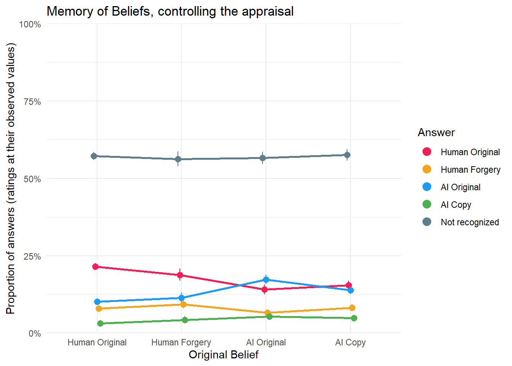{width=672}
:::
:::


::: {.cell}

```{.r .cell-code}
make_memory_tables(estimates$MemoryBeliefAppraisal)
```

::: {.cell-output-display}

```{=html}
<div id="ruxzmxsmqd" style="padding-left:0px;padding-right:0px;padding-top:10px;padding-bottom:10px;overflow-x:auto;overflow-y:auto;width:auto;height:auto;">
<style>#ruxzmxsmqd table {
  font-family: system-ui, 'Segoe UI', Roboto, Helvetica, Arial, sans-serif, 'Apple Color Emoji', 'Segoe UI Emoji', 'Segoe UI Symbol', 'Noto Color Emoji';
  -webkit-font-smoothing: antialiased;
  -moz-osx-font-smoothing: grayscale;
}

#ruxzmxsmqd thead, #ruxzmxsmqd tbody, #ruxzmxsmqd tfoot, #ruxzmxsmqd tr, #ruxzmxsmqd td, #ruxzmxsmqd th {
  border-style: none;
}

#ruxzmxsmqd p {
  margin: 0;
  padding: 0;
}

#ruxzmxsmqd .gt_table {
  display: table;
  border-collapse: collapse;
  line-height: normal;
  margin-left: auto;
  margin-right: auto;
  color: #333333;
  font-size: 13px;
  font-weight: normal;
  font-style: normal;
  background-color: #FFFFFF;
  width: auto;
  border-top-style: solid;
  border-top-width: 3px;
  border-top-color: #D5D5D5;
  border-right-style: solid;
  border-right-width: 3px;
  border-right-color: #D5D5D5;
  border-bottom-style: solid;
  border-bottom-width: 3px;
  border-bottom-color: #D5D5D5;
  border-left-style: solid;
  border-left-width: 3px;
  border-left-color: #D5D5D5;
}

#ruxzmxsmqd .gt_caption {
  padding-top: 4px;
  padding-bottom: 4px;
}

#ruxzmxsmqd .gt_title {
  color: #333333;
  font-size: 125%;
  font-weight: initial;
  padding-top: 4px;
  padding-bottom: 4px;
  padding-left: 5px;
  padding-right: 5px;
  border-bottom-color: #FFFFFF;
  border-bottom-width: 0;
}

#ruxzmxsmqd .gt_subtitle {
  color: #333333;
  font-size: 85%;
  font-weight: initial;
  padding-top: 3px;
  padding-bottom: 5px;
  padding-left: 5px;
  padding-right: 5px;
  border-top-color: #FFFFFF;
  border-top-width: 0;
}

#ruxzmxsmqd .gt_heading {
  background-color: #FFFFFF;
  text-align: left;
  border-bottom-color: #FFFFFF;
  border-left-style: none;
  border-left-width: 1px;
  border-left-color: #D3D3D3;
  border-right-style: none;
  border-right-width: 1px;
  border-right-color: #D3D3D3;
}

#ruxzmxsmqd .gt_bottom_border {
  border-bottom-style: solid;
  border-bottom-width: 2px;
  border-bottom-color: #D5D5D5;
}

#ruxzmxsmqd .gt_col_headings {
  border-top-style: solid;
  border-top-width: 2px;
  border-top-color: #D5D5D5;
  border-bottom-style: solid;
  border-bottom-width: 2px;
  border-bottom-color: #D5D5D5;
  border-left-style: none;
  border-left-width: 1px;
  border-left-color: #D3D3D3;
  border-right-style: none;
  border-right-width: 1px;
  border-right-color: #D3D3D3;
}

#ruxzmxsmqd .gt_col_heading {
  color: #FFFFFF;
  background-color: #000000;
  font-size: 100%;
  font-weight: normal;
  text-transform: inherit;
  border-left-style: none;
  border-left-width: 1px;
  border-left-color: #D3D3D3;
  border-right-style: none;
  border-right-width: 1px;
  border-right-color: #D3D3D3;
  vertical-align: bottom;
  padding-top: 5px;
  padding-bottom: 6px;
  padding-left: 5px;
  padding-right: 5px;
  overflow-x: hidden;
}

#ruxzmxsmqd .gt_column_spanner_outer {
  color: #FFFFFF;
  background-color: #000000;
  font-size: 100%;
  font-weight: normal;
  text-transform: inherit;
  padding-top: 0;
  padding-bottom: 0;
  padding-left: 4px;
  padding-right: 4px;
}

#ruxzmxsmqd .gt_column_spanner_outer:first-child {
  padding-left: 0;
}

#ruxzmxsmqd .gt_column_spanner_outer:last-child {
  padding-right: 0;
}

#ruxzmxsmqd .gt_column_spanner {
  border-bottom-style: solid;
  border-bottom-width: 2px;
  border-bottom-color: #D5D5D5;
  vertical-align: bottom;
  padding-top: 5px;
  padding-bottom: 5px;
  overflow-x: hidden;
  display: inline-block;
  width: 100%;
}

#ruxzmxsmqd .gt_spanner_row {
  border-bottom-style: hidden;
}

#ruxzmxsmqd .gt_group_heading {
  padding-top: 8px;
  padding-bottom: 8px;
  padding-left: 5px;
  padding-right: 5px;
  color: #333333;
  background-color: #FFFFFF;
  font-size: 100%;
  font-weight: initial;
  text-transform: inherit;
  border-top-style: solid;
  border-top-width: 2px;
  border-top-color: #D5D5D5;
  border-bottom-style: solid;
  border-bottom-width: 2px;
  border-bottom-color: #D5D5D5;
  border-left-style: none;
  border-left-width: 1px;
  border-left-color: #D3D3D3;
  border-right-style: none;
  border-right-width: 1px;
  border-right-color: #D3D3D3;
  vertical-align: middle;
  text-align: left;
}

#ruxzmxsmqd .gt_empty_group_heading {
  padding: 0.5px;
  color: #333333;
  background-color: #FFFFFF;
  font-size: 100%;
  font-weight: initial;
  border-top-style: solid;
  border-top-width: 2px;
  border-top-color: #D5D5D5;
  border-bottom-style: solid;
  border-bottom-width: 2px;
  border-bottom-color: #D5D5D5;
  vertical-align: middle;
}

#ruxzmxsmqd .gt_from_md > :first-child {
  margin-top: 0;
}

#ruxzmxsmqd .gt_from_md > :last-child {
  margin-bottom: 0;
}

#ruxzmxsmqd .gt_row {
  padding-top: 8px;
  padding-bottom: 8px;
  padding-left: 5px;
  padding-right: 5px;
  margin: 10px;
  border-top-style: solid;
  border-top-width: 1px;
  border-top-color: #D5D5D5;
  border-left-style: solid;
  border-left-width: 1px;
  border-left-color: #D5D5D5;
  border-right-style: solid;
  border-right-width: 1px;
  border-right-color: #D5D5D5;
  vertical-align: middle;
  overflow-x: hidden;
}

#ruxzmxsmqd .gt_stub {
  color: #333333;
  background-color: #FFFFFF;
  font-size: 100%;
  font-weight: initial;
  text-transform: inherit;
  border-right-style: solid;
  border-right-width: 2px;
  border-right-color: #5F5F5F;
  padding-left: 5px;
  padding-right: 5px;
}

#ruxzmxsmqd .gt_stub_row_group {
  color: #333333;
  background-color: #FFFFFF;
  font-size: 100%;
  font-weight: initial;
  text-transform: inherit;
  border-right-style: solid;
  border-right-width: 2px;
  border-right-color: #D3D3D3;
  padding-left: 5px;
  padding-right: 5px;
  vertical-align: top;
}

#ruxzmxsmqd .gt_row_group_first td {
  border-top-width: 2px;
}

#ruxzmxsmqd .gt_row_group_first th {
  border-top-width: 2px;
}

#ruxzmxsmqd .gt_summary_row {
  color: #333333;
  background-color: #D5D5D5;
  text-transform: inherit;
  padding-top: 8px;
  padding-bottom: 8px;
  padding-left: 5px;
  padding-right: 5px;
}

#ruxzmxsmqd .gt_first_summary_row {
  border-top-style: solid;
  border-top-color: #D5D5D5;
}

#ruxzmxsmqd .gt_first_summary_row.thick {
  border-top-width: 2px;
}

#ruxzmxsmqd .gt_last_summary_row {
  padding-top: 8px;
  padding-bottom: 8px;
  padding-left: 5px;
  padding-right: 5px;
  border-bottom-style: solid;
  border-bottom-width: 2px;
  border-bottom-color: #D5D5D5;
}

#ruxzmxsmqd .gt_grand_summary_row {
  color: #FFFFFF;
  background-color: #929292;
  text-transform: inherit;
  padding-top: 8px;
  padding-bottom: 8px;
  padding-left: 5px;
  padding-right: 5px;
}

#ruxzmxsmqd .gt_first_grand_summary_row {
  padding-top: 8px;
  padding-bottom: 8px;
  padding-left: 5px;
  padding-right: 5px;
  border-top-style: double;
  border-top-width: 6px;
  border-top-color: #D5D5D5;
}

#ruxzmxsmqd .gt_last_grand_summary_row_top {
  padding-top: 8px;
  padding-bottom: 8px;
  padding-left: 5px;
  padding-right: 5px;
  border-bottom-style: double;
  border-bottom-width: 6px;
  border-bottom-color: #D5D5D5;
}

#ruxzmxsmqd .gt_striped {
  background-color: #F4F4F4;
}

#ruxzmxsmqd .gt_table_body {
  border-top-style: solid;
  border-top-width: 2px;
  border-top-color: #D5D5D5;
  border-bottom-style: solid;
  border-bottom-width: 2px;
  border-bottom-color: #D5D5D5;
}

#ruxzmxsmqd .gt_footnotes {
  color: #333333;
  background-color: #FFFFFF;
  border-bottom-style: none;
  border-bottom-width: 2px;
  border-bottom-color: #D3D3D3;
  border-left-style: none;
  border-left-width: 2px;
  border-left-color: #D3D3D3;
  border-right-style: none;
  border-right-width: 2px;
  border-right-color: #D3D3D3;
}

#ruxzmxsmqd .gt_footnote {
  margin: 0px;
  font-size: 90%;
  padding-top: 4px;
  padding-bottom: 4px;
  padding-left: 5px;
  padding-right: 5px;
}

#ruxzmxsmqd .gt_sourcenotes {
  color: #333333;
  background-color: #FFFFFF;
  border-bottom-style: none;
  border-bottom-width: 2px;
  border-bottom-color: #D3D3D3;
  border-left-style: none;
  border-left-width: 2px;
  border-left-color: #D3D3D3;
  border-right-style: none;
  border-right-width: 2px;
  border-right-color: #D3D3D3;
}

#ruxzmxsmqd .gt_sourcenote {
  font-size: 90%;
  padding-top: 4px;
  padding-bottom: 4px;
  padding-left: 5px;
  padding-right: 5px;
}

#ruxzmxsmqd .gt_left {
  text-align: left;
}

#ruxzmxsmqd .gt_center {
  text-align: center;
}

#ruxzmxsmqd .gt_right {
  text-align: right;
  font-variant-numeric: tabular-nums;
}

#ruxzmxsmqd .gt_font_normal {
  font-weight: normal;
}

#ruxzmxsmqd .gt_font_bold {
  font-weight: bold;
}

#ruxzmxsmqd .gt_font_italic {
  font-style: italic;
}

#ruxzmxsmqd .gt_super {
  font-size: 65%;
}

#ruxzmxsmqd .gt_footnote_marks {
  font-size: 75%;
  vertical-align: 0.4em;
  position: initial;
}

#ruxzmxsmqd .gt_asterisk {
  font-size: 100%;
  vertical-align: 0;
}

#ruxzmxsmqd .gt_indent_1 {
  text-indent: 5px;
}

#ruxzmxsmqd .gt_indent_2 {
  text-indent: 10px;
}

#ruxzmxsmqd .gt_indent_3 {
  text-indent: 15px;
}

#ruxzmxsmqd .gt_indent_4 {
  text-indent: 20px;
}

#ruxzmxsmqd .gt_indent_5 {
  text-indent: 25px;
}

#ruxzmxsmqd .katex-display {
  display: inline-flex !important;
  margin-bottom: 0.75em !important;
}

#ruxzmxsmqd div.Reactable > div.rt-table > div.rt-thead > div.rt-tr.rt-tr-group-header > div.rt-th-group:after {
  height: 0px !important;
}
</style>
<table class="gt_table" data-quarto-disable-processing="false" data-quarto-bootstrap="false">
  <thead>
    <tr class="gt_heading">
      <td colspan="10" class="gt_heading gt_title gt_font_normal gt_bottom_border" style>Memory of Beliefs, controlling the appraisal: convergence</td>
    </tr>
    
    <tr class="gt_col_headings">
      <th class="gt_col_heading gt_columns_bottom_border gt_left" rowspan="1" colspan="1" scope="col" id="Model">Model</th>
      <th class="gt_col_heading gt_columns_bottom_border gt_left" rowspan="1" colspan="1" scope="col" id="Family">Family</th>
      <th class="gt_col_heading gt_columns_bottom_border gt_right" rowspan="1" colspan="1" scope="col" id="N_obs">N_obs</th>
      <th class="gt_col_heading gt_columns_bottom_border gt_right" rowspan="1" colspan="1" scope="col" id="N_participants">N_participants</th>
      <th class="gt_col_heading gt_columns_bottom_border gt_right" rowspan="1" colspan="1" scope="col" id="Chains">Chains</th>
      <th class="gt_col_heading gt_columns_bottom_border gt_right" rowspan="1" colspan="1" scope="col" id="Draws">Draws</th>
      <th class="gt_col_heading gt_columns_bottom_border gt_right" rowspan="1" colspan="1" scope="col" id="Max_Rhat">Max_Rhat</th>
      <th class="gt_col_heading gt_columns_bottom_border gt_right" rowspan="1" colspan="1" scope="col" id="Min_ESS_ratio">Min_ESS_ratio</th>
      <th class="gt_col_heading gt_columns_bottom_border gt_right" rowspan="1" colspan="1" scope="col" id="Divergent_pct">Divergent_pct</th>
      <th class="gt_col_heading gt_columns_bottom_border gt_left" rowspan="1" colspan="1" scope="col" id="Criterion">Criterion</th>
    </tr>
  </thead>
  <tbody class="gt_table_body">
    <tr><td headers="Model" class="gt_row gt_left">MemoryBeliefAppraisal</td>
<td headers="Family" class="gt_row gt_left">Categorical</td>
<td headers="N_obs" class="gt_row gt_right">10416</td>
<td headers="N_participants" class="gt_row gt_right">217</td>
<td headers="Chains" class="gt_row gt_right">8</td>
<td headers="Draws" class="gt_row gt_right">4000</td>
<td headers="Max_Rhat" class="gt_row gt_right">1.013</td>
<td headers="Min_ESS_ratio" class="gt_row gt_right">0.125</td>
<td headers="Divergent_pct" class="gt_row gt_right">0</td>
<td headers="Criterion" class="gt_row gt_left">loo</td></tr>
  </tbody>
  
</table>
</div>
```


::: {.callout-note collapse="true" title="Memory of Beliefs, controlling the appraisal: convergence (Markdown table, for text readers)"}

|Model                 |Family      | N_obs| N_participants| Chains| Draws| Max_Rhat| Min_ESS_ratio| Divergent_pct|Criterion |
|:---------------------|:-----------|-----:|--------------:|------:|-----:|--------:|-------------:|-------------:|:---------|
|MemoryBeliefAppraisal |Categorical | 10416|            217|      8|  4000|    1.013|         0.125|             0|loo       |

:::

```{=html}
<div id="fhtaakshwo" style="padding-left:0px;padding-right:0px;padding-top:10px;padding-bottom:10px;overflow-x:auto;overflow-y:auto;width:auto;height:auto;">
<style>#fhtaakshwo table {
  font-family: system-ui, 'Segoe UI', Roboto, Helvetica, Arial, sans-serif, 'Apple Color Emoji', 'Segoe UI Emoji', 'Segoe UI Symbol', 'Noto Color Emoji';
  -webkit-font-smoothing: antialiased;
  -moz-osx-font-smoothing: grayscale;
}

#fhtaakshwo thead, #fhtaakshwo tbody, #fhtaakshwo tfoot, #fhtaakshwo tr, #fhtaakshwo td, #fhtaakshwo th {
  border-style: none;
}

#fhtaakshwo p {
  margin: 0;
  padding: 0;
}

#fhtaakshwo .gt_table {
  display: table;
  border-collapse: collapse;
  line-height: normal;
  margin-left: auto;
  margin-right: auto;
  color: #333333;
  font-size: 13px;
  font-weight: normal;
  font-style: normal;
  background-color: #FFFFFF;
  width: auto;
  border-top-style: solid;
  border-top-width: 3px;
  border-top-color: #D5D5D5;
  border-right-style: solid;
  border-right-width: 3px;
  border-right-color: #D5D5D5;
  border-bottom-style: solid;
  border-bottom-width: 3px;
  border-bottom-color: #D5D5D5;
  border-left-style: solid;
  border-left-width: 3px;
  border-left-color: #D5D5D5;
}

#fhtaakshwo .gt_caption {
  padding-top: 4px;
  padding-bottom: 4px;
}

#fhtaakshwo .gt_title {
  color: #333333;
  font-size: 125%;
  font-weight: initial;
  padding-top: 4px;
  padding-bottom: 4px;
  padding-left: 5px;
  padding-right: 5px;
  border-bottom-color: #FFFFFF;
  border-bottom-width: 0;
}

#fhtaakshwo .gt_subtitle {
  color: #333333;
  font-size: 85%;
  font-weight: initial;
  padding-top: 3px;
  padding-bottom: 5px;
  padding-left: 5px;
  padding-right: 5px;
  border-top-color: #FFFFFF;
  border-top-width: 0;
}

#fhtaakshwo .gt_heading {
  background-color: #FFFFFF;
  text-align: left;
  border-bottom-color: #FFFFFF;
  border-left-style: none;
  border-left-width: 1px;
  border-left-color: #D3D3D3;
  border-right-style: none;
  border-right-width: 1px;
  border-right-color: #D3D3D3;
}

#fhtaakshwo .gt_bottom_border {
  border-bottom-style: solid;
  border-bottom-width: 2px;
  border-bottom-color: #D5D5D5;
}

#fhtaakshwo .gt_col_headings {
  border-top-style: solid;
  border-top-width: 2px;
  border-top-color: #D5D5D5;
  border-bottom-style: solid;
  border-bottom-width: 2px;
  border-bottom-color: #D5D5D5;
  border-left-style: none;
  border-left-width: 1px;
  border-left-color: #D3D3D3;
  border-right-style: none;
  border-right-width: 1px;
  border-right-color: #D3D3D3;
}

#fhtaakshwo .gt_col_heading {
  color: #FFFFFF;
  background-color: #000000;
  font-size: 100%;
  font-weight: normal;
  text-transform: inherit;
  border-left-style: none;
  border-left-width: 1px;
  border-left-color: #D3D3D3;
  border-right-style: none;
  border-right-width: 1px;
  border-right-color: #D3D3D3;
  vertical-align: bottom;
  padding-top: 5px;
  padding-bottom: 6px;
  padding-left: 5px;
  padding-right: 5px;
  overflow-x: hidden;
}

#fhtaakshwo .gt_column_spanner_outer {
  color: #FFFFFF;
  background-color: #000000;
  font-size: 100%;
  font-weight: normal;
  text-transform: inherit;
  padding-top: 0;
  padding-bottom: 0;
  padding-left: 4px;
  padding-right: 4px;
}

#fhtaakshwo .gt_column_spanner_outer:first-child {
  padding-left: 0;
}

#fhtaakshwo .gt_column_spanner_outer:last-child {
  padding-right: 0;
}

#fhtaakshwo .gt_column_spanner {
  border-bottom-style: solid;
  border-bottom-width: 2px;
  border-bottom-color: #D5D5D5;
  vertical-align: bottom;
  padding-top: 5px;
  padding-bottom: 5px;
  overflow-x: hidden;
  display: inline-block;
  width: 100%;
}

#fhtaakshwo .gt_spanner_row {
  border-bottom-style: hidden;
}

#fhtaakshwo .gt_group_heading {
  padding-top: 8px;
  padding-bottom: 8px;
  padding-left: 5px;
  padding-right: 5px;
  color: #333333;
  background-color: #FFFFFF;
  font-size: 100%;
  font-weight: initial;
  text-transform: inherit;
  border-top-style: solid;
  border-top-width: 2px;
  border-top-color: #D5D5D5;
  border-bottom-style: solid;
  border-bottom-width: 2px;
  border-bottom-color: #D5D5D5;
  border-left-style: none;
  border-left-width: 1px;
  border-left-color: #D3D3D3;
  border-right-style: none;
  border-right-width: 1px;
  border-right-color: #D3D3D3;
  vertical-align: middle;
  text-align: left;
}

#fhtaakshwo .gt_empty_group_heading {
  padding: 0.5px;
  color: #333333;
  background-color: #FFFFFF;
  font-size: 100%;
  font-weight: initial;
  border-top-style: solid;
  border-top-width: 2px;
  border-top-color: #D5D5D5;
  border-bottom-style: solid;
  border-bottom-width: 2px;
  border-bottom-color: #D5D5D5;
  vertical-align: middle;
}

#fhtaakshwo .gt_from_md > :first-child {
  margin-top: 0;
}

#fhtaakshwo .gt_from_md > :last-child {
  margin-bottom: 0;
}

#fhtaakshwo .gt_row {
  padding-top: 8px;
  padding-bottom: 8px;
  padding-left: 5px;
  padding-right: 5px;
  margin: 10px;
  border-top-style: solid;
  border-top-width: 1px;
  border-top-color: #D5D5D5;
  border-left-style: solid;
  border-left-width: 1px;
  border-left-color: #D5D5D5;
  border-right-style: solid;
  border-right-width: 1px;
  border-right-color: #D5D5D5;
  vertical-align: middle;
  overflow-x: hidden;
}

#fhtaakshwo .gt_stub {
  color: #333333;
  background-color: #FFFFFF;
  font-size: 100%;
  font-weight: initial;
  text-transform: inherit;
  border-right-style: solid;
  border-right-width: 2px;
  border-right-color: #5F5F5F;
  padding-left: 5px;
  padding-right: 5px;
}

#fhtaakshwo .gt_stub_row_group {
  color: #333333;
  background-color: #FFFFFF;
  font-size: 100%;
  font-weight: initial;
  text-transform: inherit;
  border-right-style: solid;
  border-right-width: 2px;
  border-right-color: #D3D3D3;
  padding-left: 5px;
  padding-right: 5px;
  vertical-align: top;
}

#fhtaakshwo .gt_row_group_first td {
  border-top-width: 2px;
}

#fhtaakshwo .gt_row_group_first th {
  border-top-width: 2px;
}

#fhtaakshwo .gt_summary_row {
  color: #333333;
  background-color: #D5D5D5;
  text-transform: inherit;
  padding-top: 8px;
  padding-bottom: 8px;
  padding-left: 5px;
  padding-right: 5px;
}

#fhtaakshwo .gt_first_summary_row {
  border-top-style: solid;
  border-top-color: #D5D5D5;
}

#fhtaakshwo .gt_first_summary_row.thick {
  border-top-width: 2px;
}

#fhtaakshwo .gt_last_summary_row {
  padding-top: 8px;
  padding-bottom: 8px;
  padding-left: 5px;
  padding-right: 5px;
  border-bottom-style: solid;
  border-bottom-width: 2px;
  border-bottom-color: #D5D5D5;
}

#fhtaakshwo .gt_grand_summary_row {
  color: #FFFFFF;
  background-color: #929292;
  text-transform: inherit;
  padding-top: 8px;
  padding-bottom: 8px;
  padding-left: 5px;
  padding-right: 5px;
}

#fhtaakshwo .gt_first_grand_summary_row {
  padding-top: 8px;
  padding-bottom: 8px;
  padding-left: 5px;
  padding-right: 5px;
  border-top-style: double;
  border-top-width: 6px;
  border-top-color: #D5D5D5;
}

#fhtaakshwo .gt_last_grand_summary_row_top {
  padding-top: 8px;
  padding-bottom: 8px;
  padding-left: 5px;
  padding-right: 5px;
  border-bottom-style: double;
  border-bottom-width: 6px;
  border-bottom-color: #D5D5D5;
}

#fhtaakshwo .gt_striped {
  background-color: #F4F4F4;
}

#fhtaakshwo .gt_table_body {
  border-top-style: solid;
  border-top-width: 2px;
  border-top-color: #D5D5D5;
  border-bottom-style: solid;
  border-bottom-width: 2px;
  border-bottom-color: #D5D5D5;
}

#fhtaakshwo .gt_footnotes {
  color: #333333;
  background-color: #FFFFFF;
  border-bottom-style: none;
  border-bottom-width: 2px;
  border-bottom-color: #D3D3D3;
  border-left-style: none;
  border-left-width: 2px;
  border-left-color: #D3D3D3;
  border-right-style: none;
  border-right-width: 2px;
  border-right-color: #D3D3D3;
}

#fhtaakshwo .gt_footnote {
  margin: 0px;
  font-size: 90%;
  padding-top: 4px;
  padding-bottom: 4px;
  padding-left: 5px;
  padding-right: 5px;
}

#fhtaakshwo .gt_sourcenotes {
  color: #333333;
  background-color: #FFFFFF;
  border-bottom-style: none;
  border-bottom-width: 2px;
  border-bottom-color: #D3D3D3;
  border-left-style: none;
  border-left-width: 2px;
  border-left-color: #D3D3D3;
  border-right-style: none;
  border-right-width: 2px;
  border-right-color: #D3D3D3;
}

#fhtaakshwo .gt_sourcenote {
  font-size: 90%;
  padding-top: 4px;
  padding-bottom: 4px;
  padding-left: 5px;
  padding-right: 5px;
}

#fhtaakshwo .gt_left {
  text-align: left;
}

#fhtaakshwo .gt_center {
  text-align: center;
}

#fhtaakshwo .gt_right {
  text-align: right;
  font-variant-numeric: tabular-nums;
}

#fhtaakshwo .gt_font_normal {
  font-weight: normal;
}

#fhtaakshwo .gt_font_bold {
  font-weight: bold;
}

#fhtaakshwo .gt_font_italic {
  font-style: italic;
}

#fhtaakshwo .gt_super {
  font-size: 65%;
}

#fhtaakshwo .gt_footnote_marks {
  font-size: 75%;
  vertical-align: 0.4em;
  position: initial;
}

#fhtaakshwo .gt_asterisk {
  font-size: 100%;
  vertical-align: 0;
}

#fhtaakshwo .gt_indent_1 {
  text-indent: 5px;
}

#fhtaakshwo .gt_indent_2 {
  text-indent: 10px;
}

#fhtaakshwo .gt_indent_3 {
  text-indent: 15px;
}

#fhtaakshwo .gt_indent_4 {
  text-indent: 20px;
}

#fhtaakshwo .gt_indent_5 {
  text-indent: 25px;
}

#fhtaakshwo .katex-display {
  display: inline-flex !important;
  margin-bottom: 0.75em !important;
}

#fhtaakshwo div.Reactable > div.rt-table > div.rt-thead > div.rt-tr.rt-tr-group-header > div.rt-th-group:after {
  height: 0px !important;
}
</style>
<table class="gt_table" data-quarto-disable-processing="false" data-quarto-bootstrap="false">
  <thead>
    <tr class="gt_heading">
      <td colspan="5" class="gt_heading gt_title gt_font_normal gt_bottom_border" style>Memory of Beliefs, controlling the appraisal: probability of each answer per Belief (marginal means)</td>
    </tr>
    
    <tr class="gt_col_headings">
      <th class="gt_col_heading gt_columns_bottom_border gt_center" rowspan="1" colspan="1" scope="col" id="Belief">Belief</th>
      <th class="gt_col_heading gt_columns_bottom_border gt_center" rowspan="1" colspan="1" scope="col" id="Response">Response</th>
      <th class="gt_col_heading gt_columns_bottom_border gt_right" rowspan="1" colspan="1" scope="col" id="Median">Median</th>
      <th class="gt_col_heading gt_columns_bottom_border gt_right" rowspan="1" colspan="1" scope="col" id="CI_low">CI_low</th>
      <th class="gt_col_heading gt_columns_bottom_border gt_right" rowspan="1" colspan="1" scope="col" id="CI_high">CI_high</th>
    </tr>
  </thead>
  <tbody class="gt_table_body">
    <tr><td headers="Belief" class="gt_row gt_center">Human Original</td>
<td headers="Response" class="gt_row gt_center">Human Original</td>
<td headers="Median" class="gt_row gt_right">0.21</td>
<td headers="CI_low" class="gt_row gt_right">0.20</td>
<td headers="CI_high" class="gt_row gt_right">0.23</td></tr>
    <tr><td headers="Belief" class="gt_row gt_center gt_striped">Human Forgery</td>
<td headers="Response" class="gt_row gt_center gt_striped">Human Original</td>
<td headers="Median" class="gt_row gt_right gt_striped">0.19</td>
<td headers="CI_low" class="gt_row gt_right gt_striped">0.17</td>
<td headers="CI_high" class="gt_row gt_right gt_striped">0.21</td></tr>
    <tr><td headers="Belief" class="gt_row gt_center">AI Original</td>
<td headers="Response" class="gt_row gt_center">Human Original</td>
<td headers="Median" class="gt_row gt_right">0.14</td>
<td headers="CI_low" class="gt_row gt_right">0.13</td>
<td headers="CI_high" class="gt_row gt_right">0.16</td></tr>
    <tr><td headers="Belief" class="gt_row gt_center gt_striped">AI Copy</td>
<td headers="Response" class="gt_row gt_center gt_striped">Human Original</td>
<td headers="Median" class="gt_row gt_right gt_striped">0.15</td>
<td headers="CI_low" class="gt_row gt_right gt_striped">0.14</td>
<td headers="CI_high" class="gt_row gt_right gt_striped">0.17</td></tr>
    <tr><td headers="Belief" class="gt_row gt_center">Human Original</td>
<td headers="Response" class="gt_row gt_center">Human Forgery</td>
<td headers="Median" class="gt_row gt_right">0.08</td>
<td headers="CI_low" class="gt_row gt_right">0.07</td>
<td headers="CI_high" class="gt_row gt_right">0.09</td></tr>
    <tr><td headers="Belief" class="gt_row gt_center gt_striped">Human Forgery</td>
<td headers="Response" class="gt_row gt_center gt_striped">Human Forgery</td>
<td headers="Median" class="gt_row gt_right gt_striped">0.09</td>
<td headers="CI_low" class="gt_row gt_right gt_striped">0.08</td>
<td headers="CI_high" class="gt_row gt_right gt_striped">0.11</td></tr>
    <tr><td headers="Belief" class="gt_row gt_center">AI Original</td>
<td headers="Response" class="gt_row gt_center">Human Forgery</td>
<td headers="Median" class="gt_row gt_right">0.07</td>
<td headers="CI_low" class="gt_row gt_right">0.05</td>
<td headers="CI_high" class="gt_row gt_right">0.08</td></tr>
    <tr><td headers="Belief" class="gt_row gt_center gt_striped">AI Copy</td>
<td headers="Response" class="gt_row gt_center gt_striped">Human Forgery</td>
<td headers="Median" class="gt_row gt_right gt_striped">0.08</td>
<td headers="CI_low" class="gt_row gt_right gt_striped">0.07</td>
<td headers="CI_high" class="gt_row gt_right gt_striped">0.09</td></tr>
    <tr><td headers="Belief" class="gt_row gt_center">Human Original</td>
<td headers="Response" class="gt_row gt_center">AI Original</td>
<td headers="Median" class="gt_row gt_right">0.10</td>
<td headers="CI_low" class="gt_row gt_right">0.09</td>
<td headers="CI_high" class="gt_row gt_right">0.11</td></tr>
    <tr><td headers="Belief" class="gt_row gt_center gt_striped">Human Forgery</td>
<td headers="Response" class="gt_row gt_center gt_striped">AI Original</td>
<td headers="Median" class="gt_row gt_right gt_striped">0.11</td>
<td headers="CI_low" class="gt_row gt_right gt_striped">0.10</td>
<td headers="CI_high" class="gt_row gt_right gt_striped">0.13</td></tr>
    <tr><td headers="Belief" class="gt_row gt_center">AI Original</td>
<td headers="Response" class="gt_row gt_center">AI Original</td>
<td headers="Median" class="gt_row gt_right">0.17</td>
<td headers="CI_low" class="gt_row gt_right">0.16</td>
<td headers="CI_high" class="gt_row gt_right">0.19</td></tr>
    <tr><td headers="Belief" class="gt_row gt_center gt_striped">AI Copy</td>
<td headers="Response" class="gt_row gt_center gt_striped">AI Original</td>
<td headers="Median" class="gt_row gt_right gt_striped">0.14</td>
<td headers="CI_low" class="gt_row gt_right gt_striped">0.13</td>
<td headers="CI_high" class="gt_row gt_right gt_striped">0.15</td></tr>
    <tr><td headers="Belief" class="gt_row gt_center">Human Original</td>
<td headers="Response" class="gt_row gt_center">AI Copy</td>
<td headers="Median" class="gt_row gt_right">0.03</td>
<td headers="CI_low" class="gt_row gt_right">0.03</td>
<td headers="CI_high" class="gt_row gt_right">0.04</td></tr>
    <tr><td headers="Belief" class="gt_row gt_center gt_striped">Human Forgery</td>
<td headers="Response" class="gt_row gt_center gt_striped">AI Copy</td>
<td headers="Median" class="gt_row gt_right gt_striped">0.04</td>
<td headers="CI_low" class="gt_row gt_right gt_striped">0.03</td>
<td headers="CI_high" class="gt_row gt_right gt_striped">0.05</td></tr>
    <tr><td headers="Belief" class="gt_row gt_center">AI Original</td>
<td headers="Response" class="gt_row gt_center">AI Copy</td>
<td headers="Median" class="gt_row gt_right">0.05</td>
<td headers="CI_low" class="gt_row gt_right">0.04</td>
<td headers="CI_high" class="gt_row gt_right">0.06</td></tr>
    <tr><td headers="Belief" class="gt_row gt_center gt_striped">AI Copy</td>
<td headers="Response" class="gt_row gt_center gt_striped">AI Copy</td>
<td headers="Median" class="gt_row gt_right gt_striped">0.05</td>
<td headers="CI_low" class="gt_row gt_right gt_striped">0.04</td>
<td headers="CI_high" class="gt_row gt_right gt_striped">0.06</td></tr>
    <tr><td headers="Belief" class="gt_row gt_center">Human Original</td>
<td headers="Response" class="gt_row gt_center">Not recognized</td>
<td headers="Median" class="gt_row gt_right">0.57</td>
<td headers="CI_low" class="gt_row gt_right">0.56</td>
<td headers="CI_high" class="gt_row gt_right">0.58</td></tr>
    <tr><td headers="Belief" class="gt_row gt_center gt_striped">Human Forgery</td>
<td headers="Response" class="gt_row gt_center gt_striped">Not recognized</td>
<td headers="Median" class="gt_row gt_right gt_striped">0.56</td>
<td headers="CI_low" class="gt_row gt_right gt_striped">0.54</td>
<td headers="CI_high" class="gt_row gt_right gt_striped">0.59</td></tr>
    <tr><td headers="Belief" class="gt_row gt_center">AI Original</td>
<td headers="Response" class="gt_row gt_center">Not recognized</td>
<td headers="Median" class="gt_row gt_right">0.57</td>
<td headers="CI_low" class="gt_row gt_right">0.55</td>
<td headers="CI_high" class="gt_row gt_right">0.59</td></tr>
    <tr><td headers="Belief" class="gt_row gt_center gt_striped">AI Copy</td>
<td headers="Response" class="gt_row gt_center gt_striped">Not recognized</td>
<td headers="Median" class="gt_row gt_right gt_striped">0.58</td>
<td headers="CI_low" class="gt_row gt_right gt_striped">0.56</td>
<td headers="CI_high" class="gt_row gt_right gt_striped">0.59</td></tr>
  </tbody>
  
</table>
</div>
```


::: {.callout-note collapse="true" title="Memory of Beliefs, controlling the appraisal: probability of each answer per Belief (marginal means) (Markdown table, for text readers)"}

|Belief         |Response       |Median |CI_low |CI_high |
|:--------------|:--------------|:------|:------|:-------|
|Human Original |Human Original |0.21   |0.20   |0.23    |
|Human Forgery  |Human Original |0.19   |0.17   |0.21    |
|AI Original    |Human Original |0.14   |0.13   |0.16    |
|AI Copy        |Human Original |0.15   |0.14   |0.17    |
|Human Original |Human Forgery  |0.08   |0.07   |0.09    |
|Human Forgery  |Human Forgery  |0.09   |0.08   |0.11    |
|AI Original    |Human Forgery  |0.07   |0.05   |0.08    |
|AI Copy        |Human Forgery  |0.08   |0.07   |0.09    |
|Human Original |AI Original    |0.10   |0.09   |0.11    |
|Human Forgery  |AI Original    |0.11   |0.10   |0.13    |
|AI Original    |AI Original    |0.17   |0.16   |0.19    |
|AI Copy        |AI Original    |0.14   |0.13   |0.15    |
|Human Original |AI Copy        |0.03   |0.03   |0.04    |
|Human Forgery  |AI Copy        |0.04   |0.03   |0.05    |
|AI Original    |AI Copy        |0.05   |0.04   |0.06    |
|AI Copy        |AI Copy        |0.05   |0.04   |0.06    |
|Human Original |Not recognized |0.57   |0.56   |0.58    |
|Human Forgery  |Not recognized |0.56   |0.54   |0.59    |
|AI Original    |Not recognized |0.57   |0.55   |0.59    |
|AI Copy        |Not recognized |0.58   |0.56   |0.59    |

:::

::: {.callout-note collapse="true" title="Memory of Beliefs, controlling the appraisal: all 190 contrasts (Markdown table, for text readers)"}

|Level1         |Response1      |Level2         |Response2      |Median |CI_low |CI_high |pd   |Effect   |
|:--------------|:--------------|:--------------|:--------------|:------|:------|:-------|:----|:--------|
|Human Original |Human Original |Human Forgery  |Human Original |0.03   |0.00   |0.05    |0.99 |Positive |
|Human Original |Human Original |AI Original    |Human Original |0.07   |0.06   |0.09    |1.00 |Positive |
|Human Original |Human Original |AI Copy        |Human Original |0.06   |0.04   |0.08    |1.00 |Positive |
|Human Original |Human Original |Human Original |Human Forgery  |0.14   |0.12   |0.15    |1.00 |Positive |
|Human Original |Human Original |Human Forgery  |Human Forgery  |0.12   |0.10   |0.14    |1.00 |Positive |
|Human Original |Human Original |AI Original    |Human Forgery  |0.15   |0.13   |0.17    |1.00 |Positive |
|Human Original |Human Original |AI Copy        |Human Forgery  |0.13   |0.12   |0.15    |1.00 |Positive |
|Human Original |Human Original |Human Original |AI Original    |0.11   |0.10   |0.13    |1.00 |Positive |
|Human Original |Human Original |Human Forgery  |AI Original    |0.10   |0.08   |0.12    |1.00 |Positive |
|Human Original |Human Original |AI Original    |AI Original    |0.04   |0.02   |0.06    |1.00 |Positive |
|Human Original |Human Original |AI Copy        |AI Original    |0.08   |0.06   |0.09    |1.00 |Positive |
|Human Original |Human Original |Human Original |AI Copy        |0.18   |0.17   |0.20    |1.00 |Positive |
|Human Original |Human Original |Human Forgery  |AI Copy        |0.17   |0.16   |0.19    |1.00 |Positive |
|Human Original |Human Original |AI Original    |AI Copy        |0.16   |0.15   |0.17    |1.00 |Positive |
|Human Original |Human Original |AI Copy        |AI Copy        |0.17   |0.15   |0.18    |1.00 |Positive |
|Human Original |Human Original |Human Original |Not recognized |-0.36  |-0.38  |-0.34   |1.00 |Negative |
|Human Original |Human Original |Human Forgery  |Not recognized |-0.35  |-0.37  |-0.32   |1.00 |Negative |
|Human Original |Human Original |AI Original    |Not recognized |-0.35  |-0.37  |-0.33   |1.00 |Negative |
|Human Original |Human Original |AI Copy        |Not recognized |-0.36  |-0.38  |-0.34   |1.00 |Negative |
|Human Forgery  |Human Original |AI Original    |Human Original |0.05   |0.02   |0.07    |1.00 |Positive |
|Human Forgery  |Human Original |AI Copy        |Human Original |0.03   |0.01   |0.06    |1.00 |Positive |
|Human Forgery  |Human Original |Human Original |Human Forgery  |0.11   |0.09   |0.13    |1.00 |Positive |
|Human Forgery  |Human Original |Human Forgery  |Human Forgery  |0.10   |0.07   |0.12    |1.00 |Positive |
|Human Forgery  |Human Original |AI Original    |Human Forgery  |0.12   |0.10   |0.15    |1.00 |Positive |
|Human Forgery  |Human Original |AI Copy        |Human Forgery  |0.11   |0.08   |0.13    |1.00 |Positive |
|Human Forgery  |Human Original |Human Original |AI Original    |0.09   |0.06   |0.11    |1.00 |Positive |
|Human Forgery  |Human Original |Human Forgery  |AI Original    |0.07   |0.05   |0.10    |1.00 |Positive |
|Human Forgery  |Human Original |AI Original    |AI Original    |0.02   |-0.01  |0.04    |0.89 |n.s.     |
|Human Forgery  |Human Original |AI Copy        |AI Original    |0.05   |0.03   |0.07    |1.00 |Positive |
|Human Forgery  |Human Original |Human Original |AI Copy        |0.16   |0.14   |0.18    |1.00 |Positive |
|Human Forgery  |Human Original |Human Forgery  |AI Copy        |0.15   |0.12   |0.17    |1.00 |Positive |
|Human Forgery  |Human Original |AI Original    |AI Copy        |0.13   |0.11   |0.16    |1.00 |Positive |
|Human Forgery  |Human Original |AI Copy        |AI Copy        |0.14   |0.12   |0.16    |1.00 |Positive |
|Human Forgery  |Human Original |Human Original |Not recognized |-0.38  |-0.41  |-0.36   |1.00 |Negative |
|Human Forgery  |Human Original |Human Forgery  |Not recognized |-0.37  |-0.41  |-0.34   |1.00 |Negative |
|Human Forgery  |Human Original |AI Original    |Not recognized |-0.38  |-0.41  |-0.35   |1.00 |Negative |
|Human Forgery  |Human Original |AI Copy        |Not recognized |-0.39  |-0.41  |-0.36   |1.00 |Negative |
|AI Original    |Human Original |AI Copy        |Human Original |-0.01  |-0.03  |0.01    |0.90 |n.s.     |
|AI Original    |Human Original |Human Original |Human Forgery  |0.06   |0.04   |0.08    |1.00 |Positive |
|AI Original    |Human Original |Human Forgery  |Human Forgery  |0.05   |0.03   |0.07    |1.00 |Positive |
|AI Original    |Human Original |AI Original    |Human Forgery  |0.08   |0.06   |0.10    |1.00 |Positive |
|AI Original    |Human Original |AI Copy        |Human Forgery  |0.06   |0.04   |0.08    |1.00 |Positive |
|AI Original    |Human Original |Human Original |AI Original    |0.04   |0.02   |0.06    |1.00 |Positive |
|AI Original    |Human Original |Human Forgery  |AI Original    |0.03   |0.00   |0.05    |0.99 |Positive |
|AI Original    |Human Original |AI Original    |AI Original    |-0.03  |-0.06  |-0.01   |0.99 |Negative |
|AI Original    |Human Original |AI Copy        |AI Original    |0.00   |-0.02  |0.02    |0.55 |n.s.     |
|AI Original    |Human Original |Human Original |AI Copy        |0.11   |0.09   |0.13    |1.00 |Positive |
|AI Original    |Human Original |Human Forgery  |AI Copy        |0.10   |0.08   |0.12    |1.00 |Positive |
|AI Original    |Human Original |AI Original    |AI Copy        |0.09   |0.07   |0.11    |1.00 |Positive |
|AI Original    |Human Original |AI Copy        |AI Copy        |0.09   |0.07   |0.11    |1.00 |Positive |
|AI Original    |Human Original |Human Original |Not recognized |-0.43  |-0.45  |-0.41   |1.00 |Negative |
|AI Original    |Human Original |Human Forgery  |Not recognized |-0.42  |-0.45  |-0.39   |1.00 |Negative |
|AI Original    |Human Original |AI Original    |Not recognized |-0.43  |-0.46  |-0.39   |1.00 |Negative |
|AI Original    |Human Original |AI Copy        |Not recognized |-0.44  |-0.46  |-0.41   |1.00 |Negative |
|AI Copy        |Human Original |Human Original |Human Forgery  |0.08   |0.06   |0.09    |1.00 |Positive |
|AI Copy        |Human Original |Human Forgery  |Human Forgery  |0.06   |0.04   |0.08    |1.00 |Positive |
|AI Copy        |Human Original |AI Original    |Human Forgery  |0.09   |0.07   |0.11    |1.00 |Positive |
|AI Copy        |Human Original |AI Copy        |Human Forgery  |0.07   |0.05   |0.09    |1.00 |Positive |
|AI Copy        |Human Original |Human Original |AI Original    |0.05   |0.04   |0.07    |1.00 |Positive |
|AI Copy        |Human Original |Human Forgery  |AI Original    |0.04   |0.02   |0.06    |1.00 |Positive |
|AI Copy        |Human Original |AI Original    |AI Original    |-0.02  |-0.04  |0.00    |0.96 |n.s.     |
|AI Copy        |Human Original |AI Copy        |AI Original    |0.02   |-0.01  |0.04    |0.91 |n.s.     |
|AI Copy        |Human Original |Human Original |AI Copy        |0.12   |0.11   |0.14    |1.00 |Positive |
|AI Copy        |Human Original |Human Forgery  |AI Copy        |0.11   |0.09   |0.13    |1.00 |Positive |
|AI Copy        |Human Original |AI Original    |AI Copy        |0.10   |0.08   |0.12    |1.00 |Positive |
|AI Copy        |Human Original |AI Copy        |AI Copy        |0.11   |0.09   |0.12    |1.00 |Positive |
|AI Copy        |Human Original |Human Original |Not recognized |-0.42  |-0.44  |-0.40   |1.00 |Negative |
|AI Copy        |Human Original |Human Forgery  |Not recognized |-0.41  |-0.44  |-0.38   |1.00 |Negative |
|AI Copy        |Human Original |AI Original    |Not recognized |-0.41  |-0.44  |-0.39   |1.00 |Negative |
|AI Copy        |Human Original |AI Copy        |Not recognized |-0.42  |-0.45  |-0.39   |1.00 |Negative |
|Human Original |Human Forgery  |Human Forgery  |Human Forgery  |-0.01  |-0.03  |0.00    |0.96 |n.s.     |
|Human Original |Human Forgery  |AI Original    |Human Forgery  |0.01   |0.00   |0.03    |0.97 |n.s.     |
|Human Original |Human Forgery  |AI Copy        |Human Forgery  |0.00   |-0.02  |0.01    |0.62 |n.s.     |
|Human Original |Human Forgery  |Human Original |AI Original    |-0.02  |-0.04  |-0.01   |1.00 |Negative |
|Human Original |Human Forgery  |Human Forgery  |AI Original    |-0.03  |-0.05  |-0.02   |1.00 |Negative |
|Human Original |Human Forgery  |AI Original    |AI Original    |-0.09  |-0.11  |-0.08   |1.00 |Negative |
|Human Original |Human Forgery  |AI Copy        |AI Original    |-0.06  |-0.08  |-0.04   |1.00 |Negative |
|Human Original |Human Forgery  |Human Original |AI Copy        |0.05   |0.04   |0.06    |1.00 |Positive |
|Human Original |Human Forgery  |Human Forgery  |AI Copy        |0.04   |0.02   |0.05    |1.00 |Positive |
|Human Original |Human Forgery  |AI Original    |AI Copy        |0.02   |0.01   |0.04    |1.00 |Positive |
|Human Original |Human Forgery  |AI Copy        |AI Copy        |0.03   |0.02   |0.04    |1.00 |Positive |
|Human Original |Human Forgery  |Human Original |Not recognized |-0.49  |-0.51  |-0.48   |1.00 |Negative |
|Human Original |Human Forgery  |Human Forgery  |Not recognized |-0.48  |-0.51  |-0.46   |1.00 |Negative |
|Human Original |Human Forgery  |AI Original    |Not recognized |-0.49  |-0.51  |-0.47   |1.00 |Negative |
|Human Original |Human Forgery  |AI Copy        |Not recognized |-0.50  |-0.52  |-0.48   |1.00 |Negative |
|Human Forgery  |Human Forgery  |AI Original    |Human Forgery  |0.03   |0.01   |0.05    |1.00 |Positive |
|Human Forgery  |Human Forgery  |AI Copy        |Human Forgery  |0.01   |-0.01  |0.03    |0.89 |n.s.     |
|Human Forgery  |Human Forgery  |Human Original |AI Original    |-0.01  |-0.03  |0.01    |0.86 |n.s.     |
|Human Forgery  |Human Forgery  |Human Forgery  |AI Original    |-0.02  |-0.04  |0.00    |0.96 |n.s.     |
|Human Forgery  |Human Forgery  |AI Original    |AI Original    |-0.08  |-0.10  |-0.06   |1.00 |Negative |
|Human Forgery  |Human Forgery  |AI Copy        |AI Original    |-0.05  |-0.07  |-0.03   |1.00 |Negative |
|Human Forgery  |Human Forgery  |Human Original |AI Copy        |0.06   |0.05   |0.08    |1.00 |Positive |
|Human Forgery  |Human Forgery  |Human Forgery  |AI Copy        |0.05   |0.03   |0.07    |1.00 |Positive |
|Human Forgery  |Human Forgery  |AI Original    |AI Copy        |0.04   |0.02   |0.06    |1.00 |Positive |
|Human Forgery  |Human Forgery  |AI Copy        |AI Copy        |0.04   |0.03   |0.06    |1.00 |Positive |
|Human Forgery  |Human Forgery  |Human Original |Not recognized |-0.48  |-0.50  |-0.46   |1.00 |Negative |
|Human Forgery  |Human Forgery  |Human Forgery  |Not recognized |-0.47  |-0.50  |-0.44   |1.00 |Negative |
|Human Forgery  |Human Forgery  |AI Original    |Not recognized |-0.47  |-0.50  |-0.45   |1.00 |Negative |
|Human Forgery  |Human Forgery  |AI Copy        |Not recognized |-0.48  |-0.51  |-0.46   |1.00 |Negative |
|AI Original    |Human Forgery  |AI Copy        |Human Forgery  |-0.02  |-0.03  |0.00    |0.97 |n.s.     |
|AI Original    |Human Forgery  |Human Original |AI Original    |-0.04  |-0.05  |-0.02   |1.00 |Negative |
|AI Original    |Human Forgery  |Human Forgery  |AI Original    |-0.05  |-0.07  |-0.03   |1.00 |Negative |
|AI Original    |Human Forgery  |AI Original    |AI Original    |-0.11  |-0.13  |-0.09   |1.00 |Negative |
|AI Original    |Human Forgery  |AI Copy        |AI Original    |-0.07  |-0.09  |-0.06   |1.00 |Negative |
|AI Original    |Human Forgery  |Human Original |AI Copy        |0.03   |0.02   |0.05    |1.00 |Positive |
|AI Original    |Human Forgery  |Human Forgery  |AI Copy        |0.02   |0.01   |0.04    |1.00 |Positive |
|AI Original    |Human Forgery  |AI Original    |AI Copy        |0.01   |0.00   |0.03    |0.92 |n.s.     |
|AI Original    |Human Forgery  |AI Copy        |AI Copy        |0.02   |0.00   |0.03    |0.99 |Positive |
|AI Original    |Human Forgery  |Human Original |Not recognized |-0.51  |-0.52  |-0.49   |1.00 |Negative |
|AI Original    |Human Forgery  |Human Forgery  |Not recognized |-0.50  |-0.52  |-0.47   |1.00 |Negative |
|AI Original    |Human Forgery  |AI Original    |Not recognized |-0.50  |-0.53  |-0.48   |1.00 |Negative |
|AI Original    |Human Forgery  |AI Copy        |Not recognized |-0.51  |-0.53  |-0.49   |1.00 |Negative |
|AI Copy        |Human Forgery  |Human Original |AI Original    |-0.02  |-0.04  |-0.01   |1.00 |Negative |
|AI Copy        |Human Forgery  |Human Forgery  |AI Original    |-0.03  |-0.05  |-0.01   |1.00 |Negative |
|AI Copy        |Human Forgery  |AI Original    |AI Original    |-0.09  |-0.11  |-0.07   |1.00 |Negative |
|AI Copy        |Human Forgery  |AI Copy        |AI Original    |-0.06  |-0.08  |-0.04   |1.00 |Negative |
|AI Copy        |Human Forgery  |Human Original |AI Copy        |0.05   |0.04   |0.06    |1.00 |Positive |
|AI Copy        |Human Forgery  |Human Forgery  |AI Copy        |0.04   |0.02   |0.05    |1.00 |Positive |
|AI Copy        |Human Forgery  |AI Original    |AI Copy        |0.03   |0.01   |0.04    |1.00 |Positive |
|AI Copy        |Human Forgery  |AI Copy        |AI Copy        |0.03   |0.02   |0.05    |1.00 |Positive |
|AI Copy        |Human Forgery  |Human Original |Not recognized |-0.49  |-0.51  |-0.47   |1.00 |Negative |
|AI Copy        |Human Forgery  |Human Forgery  |Not recognized |-0.48  |-0.51  |-0.45   |1.00 |Negative |
|AI Copy        |Human Forgery  |AI Original    |Not recognized |-0.48  |-0.51  |-0.46   |1.00 |Negative |
|AI Copy        |Human Forgery  |AI Copy        |Not recognized |-0.49  |-0.52  |-0.47   |1.00 |Negative |
|Human Original |AI Original    |Human Forgery  |AI Original    |-0.01  |-0.03  |0.01    |0.87 |n.s.     |
|Human Original |AI Original    |AI Original    |AI Original    |-0.07  |-0.09  |-0.05   |1.00 |Negative |
|Human Original |AI Original    |AI Copy        |AI Original    |-0.04  |-0.05  |-0.02   |1.00 |Negative |
|Human Original |AI Original    |Human Original |AI Copy        |0.07   |0.06   |0.08    |1.00 |Positive |
|Human Original |AI Original    |Human Forgery  |AI Copy        |0.06   |0.04   |0.07    |1.00 |Positive |
|Human Original |AI Original    |AI Original    |AI Copy        |0.05   |0.03   |0.06    |1.00 |Positive |
|Human Original |AI Original    |AI Copy        |AI Copy        |0.05   |0.04   |0.07    |1.00 |Positive |
|Human Original |AI Original    |Human Original |Not recognized |-0.47  |-0.49  |-0.45   |1.00 |Negative |
|Human Original |AI Original    |Human Forgery  |Not recognized |-0.46  |-0.49  |-0.43   |1.00 |Negative |
|Human Original |AI Original    |AI Original    |Not recognized |-0.46  |-0.49  |-0.44   |1.00 |Negative |
|Human Original |AI Original    |AI Copy        |Not recognized |-0.47  |-0.49  |-0.45   |1.00 |Negative |
|Human Forgery  |AI Original    |AI Original    |AI Original    |-0.06  |-0.08  |-0.04   |1.00 |Negative |
|Human Forgery  |AI Original    |AI Copy        |AI Original    |-0.03  |-0.05  |0.00    |0.99 |Negative |
|Human Forgery  |AI Original    |Human Original |AI Copy        |0.08   |0.06   |0.10    |1.00 |Positive |
|Human Forgery  |AI Original    |Human Forgery  |AI Copy        |0.07   |0.05   |0.09    |1.00 |Positive |
|Human Forgery  |AI Original    |AI Original    |AI Copy        |0.06   |0.04   |0.08    |1.00 |Positive |
|Human Forgery  |AI Original    |AI Copy        |AI Copy        |0.06   |0.05   |0.08    |1.00 |Positive |
|Human Forgery  |AI Original    |Human Original |Not recognized |-0.46  |-0.48  |-0.44   |1.00 |Negative |
|Human Forgery  |AI Original    |Human Forgery  |Not recognized |-0.45  |-0.48  |-0.41   |1.00 |Negative |
|Human Forgery  |AI Original    |AI Original    |Not recognized |-0.45  |-0.48  |-0.43   |1.00 |Negative |
|Human Forgery  |AI Original    |AI Copy        |Not recognized |-0.46  |-0.49  |-0.44   |1.00 |Negative |
|AI Original    |AI Original    |AI Copy        |AI Original    |0.03   |0.01   |0.05    |1.00 |Positive |
|AI Original    |AI Original    |Human Original |AI Copy        |0.14   |0.13   |0.16    |1.00 |Positive |
|AI Original    |AI Original    |Human Forgery  |AI Copy        |0.13   |0.11   |0.15    |1.00 |Positive |
|AI Original    |AI Original    |AI Original    |AI Copy        |0.12   |0.10   |0.14    |1.00 |Positive |
|AI Original    |AI Original    |AI Copy        |AI Copy        |0.12   |0.11   |0.14    |1.00 |Positive |
|AI Original    |AI Original    |Human Original |Not recognized |-0.40  |-0.42  |-0.38   |1.00 |Negative |
|AI Original    |AI Original    |Human Forgery  |Not recognized |-0.39  |-0.42  |-0.36   |1.00 |Negative |
|AI Original    |AI Original    |AI Original    |Not recognized |-0.39  |-0.42  |-0.36   |1.00 |Negative |
|AI Original    |AI Original    |AI Copy        |Not recognized |-0.40  |-0.43  |-0.38   |1.00 |Negative |
|AI Copy        |AI Original    |Human Original |AI Copy        |0.11   |0.09   |0.12    |1.00 |Positive |
|AI Copy        |AI Original    |Human Forgery  |AI Copy        |0.10   |0.08   |0.11    |1.00 |Positive |
|AI Copy        |AI Original    |AI Original    |AI Copy        |0.08   |0.07   |0.10    |1.00 |Positive |
|AI Copy        |AI Original    |AI Copy        |AI Copy        |0.09   |0.07   |0.11    |1.00 |Positive |
|AI Copy        |AI Original    |Human Original |Not recognized |-0.43  |-0.45  |-0.41   |1.00 |Negative |
|AI Copy        |AI Original    |Human Forgery  |Not recognized |-0.42  |-0.45  |-0.40   |1.00 |Negative |
|AI Copy        |AI Original    |AI Original    |Not recognized |-0.43  |-0.45  |-0.40   |1.00 |Negative |
|AI Copy        |AI Original    |AI Copy        |Not recognized |-0.44  |-0.46  |-0.41   |1.00 |Negative |
|Human Original |AI Copy        |Human Forgery  |AI Copy        |-0.01  |-0.02  |0.00    |0.97 |n.s.     |
|Human Original |AI Copy        |AI Original    |AI Copy        |-0.02  |-0.03  |-0.01   |1.00 |Negative |
|Human Original |AI Copy        |AI Copy        |AI Copy        |-0.02  |-0.03  |-0.01   |1.00 |Negative |
|Human Original |AI Copy        |Human Original |Not recognized |-0.54  |-0.55  |-0.53   |1.00 |Negative |
|Human Original |AI Copy        |Human Forgery  |Not recognized |-0.53  |-0.56  |-0.51   |1.00 |Negative |
|Human Original |AI Copy        |AI Original    |Not recognized |-0.53  |-0.55  |-0.51   |1.00 |Negative |
|Human Original |AI Copy        |AI Copy        |Not recognized |-0.54  |-0.56  |-0.53   |1.00 |Negative |
|Human Forgery  |AI Copy        |AI Original    |AI Copy        |-0.01  |-0.03  |0.00    |0.93 |n.s.     |
|Human Forgery  |AI Copy        |AI Copy        |AI Copy        |-0.01  |-0.02  |0.01    |0.79 |n.s.     |
|Human Forgery  |AI Copy        |Human Original |Not recognized |-0.53  |-0.54  |-0.51   |1.00 |Negative |
|Human Forgery  |AI Copy        |Human Forgery  |Not recognized |-0.52  |-0.55  |-0.49   |1.00 |Negative |
|Human Forgery  |AI Copy        |AI Original    |Not recognized |-0.52  |-0.55  |-0.50   |1.00 |Negative |
|Human Forgery  |AI Copy        |AI Copy        |Not recognized |-0.53  |-0.55  |-0.51   |1.00 |Negative |
|AI Original    |AI Copy        |AI Copy        |AI Copy        |0.01   |-0.01  |0.02    |0.79 |n.s.     |
|AI Original    |AI Copy        |Human Original |Not recognized |-0.52  |-0.53  |-0.50   |1.00 |Negative |
|AI Original    |AI Copy        |Human Forgery  |Not recognized |-0.51  |-0.53  |-0.48   |1.00 |Negative |
|AI Original    |AI Copy        |AI Original    |Not recognized |-0.51  |-0.54  |-0.49   |1.00 |Negative |
|AI Original    |AI Copy        |AI Copy        |Not recognized |-0.52  |-0.54  |-0.50   |1.00 |Negative |
|AI Copy        |AI Copy        |Human Original |Not recognized |-0.52  |-0.54  |-0.51   |1.00 |Negative |
|AI Copy        |AI Copy        |Human Forgery  |Not recognized |-0.51  |-0.54  |-0.49   |1.00 |Negative |
|AI Copy        |AI Copy        |AI Original    |Not recognized |-0.52  |-0.54  |-0.50   |1.00 |Negative |
|AI Copy        |AI Copy        |AI Copy        |Not recognized |-0.53  |-0.55  |-0.51   |1.00 |Negative |
|Human Original |Not recognized |Human Forgery  |Not recognized |0.01   |-0.02  |0.04    |0.76 |n.s.     |
|Human Original |Not recognized |AI Original    |Not recognized |0.01   |-0.02  |0.03    |0.67 |n.s.     |
|Human Original |Not recognized |AI Copy        |Not recognized |0.00   |-0.03  |0.02    |0.64 |n.s.     |
|Human Forgery  |Not recognized |AI Original    |Not recognized |0.00   |-0.04  |0.03    |0.60 |n.s.     |
|Human Forgery  |Not recognized |AI Copy        |Not recognized |-0.01  |-0.04  |0.02    |0.81 |n.s.     |
|AI Original    |Not recognized |AI Copy        |Not recognized |-0.01  |-0.04  |0.02    |0.76 |n.s.     |

:::
:::
:::


```{.r .cell-code}
belief_cells <- tribble(
  ~Level1, ~Level2, ~Response,
  "AI Original", "Human Original", "AI Original",
  "AI Original", "Human Forgery", "AI Original",
  "AI Original", "Human Original", "Human Original",
  "Human Original", "Human Forgery", "Human Original",
  "Human Forgery", "Human Original", "Human Forgery",
  "AI Copy", "AI Original", "AI Copy"
)
make_asis(make_tables(
  compare_models(belief_cells, estimates$MemoryBeliefAppraisal, estimates$MemoryBelief),
  c("Answer", "Contrast", "Without", "Effect_without", "With", "Effect_with"),
  "Memory of Beliefs: the same-answer Belief contrasts (percentage points) without and with the three ratings in the model"))
```

```{=html}
<div id="wnmnjwlxuj" style="padding-left:0px;padding-right:0px;padding-top:10px;padding-bottom:10px;overflow-x:auto;overflow-y:auto;width:auto;height:auto;">
<style>#wnmnjwlxuj table {
  font-family: system-ui, 'Segoe UI', Roboto, Helvetica, Arial, sans-serif, 'Apple Color Emoji', 'Segoe UI Emoji', 'Segoe UI Symbol', 'Noto Color Emoji';
  -webkit-font-smoothing: antialiased;
  -moz-osx-font-smoothing: grayscale;
}

#wnmnjwlxuj thead, #wnmnjwlxuj tbody, #wnmnjwlxuj tfoot, #wnmnjwlxuj tr, #wnmnjwlxuj td, #wnmnjwlxuj th {
  border-style: none;
}

#wnmnjwlxuj p {
  margin: 0;
  padding: 0;
}

#wnmnjwlxuj .gt_table {
  display: table;
  border-collapse: collapse;
  line-height: normal;
  margin-left: auto;
  margin-right: auto;
  color: #333333;
  font-size: 13px;
  font-weight: normal;
  font-style: normal;
  background-color: #FFFFFF;
  width: auto;
  border-top-style: solid;
  border-top-width: 3px;
  border-top-color: #D5D5D5;
  border-right-style: solid;
  border-right-width: 3px;
  border-right-color: #D5D5D5;
  border-bottom-style: solid;
  border-bottom-width: 3px;
  border-bottom-color: #D5D5D5;
  border-left-style: solid;
  border-left-width: 3px;
  border-left-color: #D5D5D5;
}

#wnmnjwlxuj .gt_caption {
  padding-top: 4px;
  padding-bottom: 4px;
}

#wnmnjwlxuj .gt_title {
  color: #333333;
  font-size: 125%;
  font-weight: initial;
  padding-top: 4px;
  padding-bottom: 4px;
  padding-left: 5px;
  padding-right: 5px;
  border-bottom-color: #FFFFFF;
  border-bottom-width: 0;
}

#wnmnjwlxuj .gt_subtitle {
  color: #333333;
  font-size: 85%;
  font-weight: initial;
  padding-top: 3px;
  padding-bottom: 5px;
  padding-left: 5px;
  padding-right: 5px;
  border-top-color: #FFFFFF;
  border-top-width: 0;
}

#wnmnjwlxuj .gt_heading {
  background-color: #FFFFFF;
  text-align: left;
  border-bottom-color: #FFFFFF;
  border-left-style: none;
  border-left-width: 1px;
  border-left-color: #D3D3D3;
  border-right-style: none;
  border-right-width: 1px;
  border-right-color: #D3D3D3;
}

#wnmnjwlxuj .gt_bottom_border {
  border-bottom-style: solid;
  border-bottom-width: 2px;
  border-bottom-color: #D5D5D5;
}

#wnmnjwlxuj .gt_col_headings {
  border-top-style: solid;
  border-top-width: 2px;
  border-top-color: #D5D5D5;
  border-bottom-style: solid;
  border-bottom-width: 2px;
  border-bottom-color: #D5D5D5;
  border-left-style: none;
  border-left-width: 1px;
  border-left-color: #D3D3D3;
  border-right-style: none;
  border-right-width: 1px;
  border-right-color: #D3D3D3;
}

#wnmnjwlxuj .gt_col_heading {
  color: #FFFFFF;
  background-color: #000000;
  font-size: 100%;
  font-weight: normal;
  text-transform: inherit;
  border-left-style: none;
  border-left-width: 1px;
  border-left-color: #D3D3D3;
  border-right-style: none;
  border-right-width: 1px;
  border-right-color: #D3D3D3;
  vertical-align: bottom;
  padding-top: 5px;
  padding-bottom: 6px;
  padding-left: 5px;
  padding-right: 5px;
  overflow-x: hidden;
}

#wnmnjwlxuj .gt_column_spanner_outer {
  color: #FFFFFF;
  background-color: #000000;
  font-size: 100%;
  font-weight: normal;
  text-transform: inherit;
  padding-top: 0;
  padding-bottom: 0;
  padding-left: 4px;
  padding-right: 4px;
}

#wnmnjwlxuj .gt_column_spanner_outer:first-child {
  padding-left: 0;
}

#wnmnjwlxuj .gt_column_spanner_outer:last-child {
  padding-right: 0;
}

#wnmnjwlxuj .gt_column_spanner {
  border-bottom-style: solid;
  border-bottom-width: 2px;
  border-bottom-color: #D5D5D5;
  vertical-align: bottom;
  padding-top: 5px;
  padding-bottom: 5px;
  overflow-x: hidden;
  display: inline-block;
  width: 100%;
}

#wnmnjwlxuj .gt_spanner_row {
  border-bottom-style: hidden;
}

#wnmnjwlxuj .gt_group_heading {
  padding-top: 8px;
  padding-bottom: 8px;
  padding-left: 5px;
  padding-right: 5px;
  color: #333333;
  background-color: #FFFFFF;
  font-size: 100%;
  font-weight: initial;
  text-transform: inherit;
  border-top-style: solid;
  border-top-width: 2px;
  border-top-color: #D5D5D5;
  border-bottom-style: solid;
  border-bottom-width: 2px;
  border-bottom-color: #D5D5D5;
  border-left-style: none;
  border-left-width: 1px;
  border-left-color: #D3D3D3;
  border-right-style: none;
  border-right-width: 1px;
  border-right-color: #D3D3D3;
  vertical-align: middle;
  text-align: left;
}

#wnmnjwlxuj .gt_empty_group_heading {
  padding: 0.5px;
  color: #333333;
  background-color: #FFFFFF;
  font-size: 100%;
  font-weight: initial;
  border-top-style: solid;
  border-top-width: 2px;
  border-top-color: #D5D5D5;
  border-bottom-style: solid;
  border-bottom-width: 2px;
  border-bottom-color: #D5D5D5;
  vertical-align: middle;
}

#wnmnjwlxuj .gt_from_md > :first-child {
  margin-top: 0;
}

#wnmnjwlxuj .gt_from_md > :last-child {
  margin-bottom: 0;
}

#wnmnjwlxuj .gt_row {
  padding-top: 8px;
  padding-bottom: 8px;
  padding-left: 5px;
  padding-right: 5px;
  margin: 10px;
  border-top-style: solid;
  border-top-width: 1px;
  border-top-color: #D5D5D5;
  border-left-style: solid;
  border-left-width: 1px;
  border-left-color: #D5D5D5;
  border-right-style: solid;
  border-right-width: 1px;
  border-right-color: #D5D5D5;
  vertical-align: middle;
  overflow-x: hidden;
}

#wnmnjwlxuj .gt_stub {
  color: #333333;
  background-color: #FFFFFF;
  font-size: 100%;
  font-weight: initial;
  text-transform: inherit;
  border-right-style: solid;
  border-right-width: 2px;
  border-right-color: #5F5F5F;
  padding-left: 5px;
  padding-right: 5px;
}

#wnmnjwlxuj .gt_stub_row_group {
  color: #333333;
  background-color: #FFFFFF;
  font-size: 100%;
  font-weight: initial;
  text-transform: inherit;
  border-right-style: solid;
  border-right-width: 2px;
  border-right-color: #D3D3D3;
  padding-left: 5px;
  padding-right: 5px;
  vertical-align: top;
}

#wnmnjwlxuj .gt_row_group_first td {
  border-top-width: 2px;
}

#wnmnjwlxuj .gt_row_group_first th {
  border-top-width: 2px;
}

#wnmnjwlxuj .gt_summary_row {
  color: #333333;
  background-color: #D5D5D5;
  text-transform: inherit;
  padding-top: 8px;
  padding-bottom: 8px;
  padding-left: 5px;
  padding-right: 5px;
}

#wnmnjwlxuj .gt_first_summary_row {
  border-top-style: solid;
  border-top-color: #D5D5D5;
}

#wnmnjwlxuj .gt_first_summary_row.thick {
  border-top-width: 2px;
}

#wnmnjwlxuj .gt_last_summary_row {
  padding-top: 8px;
  padding-bottom: 8px;
  padding-left: 5px;
  padding-right: 5px;
  border-bottom-style: solid;
  border-bottom-width: 2px;
  border-bottom-color: #D5D5D5;
}

#wnmnjwlxuj .gt_grand_summary_row {
  color: #FFFFFF;
  background-color: #929292;
  text-transform: inherit;
  padding-top: 8px;
  padding-bottom: 8px;
  padding-left: 5px;
  padding-right: 5px;
}

#wnmnjwlxuj .gt_first_grand_summary_row {
  padding-top: 8px;
  padding-bottom: 8px;
  padding-left: 5px;
  padding-right: 5px;
  border-top-style: double;
  border-top-width: 6px;
  border-top-color: #D5D5D5;
}

#wnmnjwlxuj .gt_last_grand_summary_row_top {
  padding-top: 8px;
  padding-bottom: 8px;
  padding-left: 5px;
  padding-right: 5px;
  border-bottom-style: double;
  border-bottom-width: 6px;
  border-bottom-color: #D5D5D5;
}

#wnmnjwlxuj .gt_striped {
  background-color: #F4F4F4;
}

#wnmnjwlxuj .gt_table_body {
  border-top-style: solid;
  border-top-width: 2px;
  border-top-color: #D5D5D5;
  border-bottom-style: solid;
  border-bottom-width: 2px;
  border-bottom-color: #D5D5D5;
}

#wnmnjwlxuj .gt_footnotes {
  color: #333333;
  background-color: #FFFFFF;
  border-bottom-style: none;
  border-bottom-width: 2px;
  border-bottom-color: #D3D3D3;
  border-left-style: none;
  border-left-width: 2px;
  border-left-color: #D3D3D3;
  border-right-style: none;
  border-right-width: 2px;
  border-right-color: #D3D3D3;
}

#wnmnjwlxuj .gt_footnote {
  margin: 0px;
  font-size: 90%;
  padding-top: 4px;
  padding-bottom: 4px;
  padding-left: 5px;
  padding-right: 5px;
}

#wnmnjwlxuj .gt_sourcenotes {
  color: #333333;
  background-color: #FFFFFF;
  border-bottom-style: none;
  border-bottom-width: 2px;
  border-bottom-color: #D3D3D3;
  border-left-style: none;
  border-left-width: 2px;
  border-left-color: #D3D3D3;
  border-right-style: none;
  border-right-width: 2px;
  border-right-color: #D3D3D3;
}

#wnmnjwlxuj .gt_sourcenote {
  font-size: 90%;
  padding-top: 4px;
  padding-bottom: 4px;
  padding-left: 5px;
  padding-right: 5px;
}

#wnmnjwlxuj .gt_left {
  text-align: left;
}

#wnmnjwlxuj .gt_center {
  text-align: center;
}

#wnmnjwlxuj .gt_right {
  text-align: right;
  font-variant-numeric: tabular-nums;
}

#wnmnjwlxuj .gt_font_normal {
  font-weight: normal;
}

#wnmnjwlxuj .gt_font_bold {
  font-weight: bold;
}

#wnmnjwlxuj .gt_font_italic {
  font-style: italic;
}

#wnmnjwlxuj .gt_super {
  font-size: 65%;
}

#wnmnjwlxuj .gt_footnote_marks {
  font-size: 75%;
  vertical-align: 0.4em;
  position: initial;
}

#wnmnjwlxuj .gt_asterisk {
  font-size: 100%;
  vertical-align: 0;
}

#wnmnjwlxuj .gt_indent_1 {
  text-indent: 5px;
}

#wnmnjwlxuj .gt_indent_2 {
  text-indent: 10px;
}

#wnmnjwlxuj .gt_indent_3 {
  text-indent: 15px;
}

#wnmnjwlxuj .gt_indent_4 {
  text-indent: 20px;
}

#wnmnjwlxuj .gt_indent_5 {
  text-indent: 25px;
}

#wnmnjwlxuj .katex-display {
  display: inline-flex !important;
  margin-bottom: 0.75em !important;
}

#wnmnjwlxuj div.Reactable > div.rt-table > div.rt-thead > div.rt-tr.rt-tr-group-header > div.rt-th-group:after {
  height: 0px !important;
}
</style>
<table class="gt_table" data-quarto-disable-processing="false" data-quarto-bootstrap="false">
  <thead>
    <tr class="gt_heading">
      <td colspan="5" class="gt_heading gt_title gt_font_normal gt_bottom_border" style>Memory of Beliefs: the same-answer Belief contrasts (percentage points) without and with the three ratings in the model</td>
    </tr>
    
    <tr class="gt_col_headings">
      <th class="gt_col_heading gt_columns_bottom_border gt_left" rowspan="1" colspan="1" scope="col" id="Answer">Answer</th>
      <th class="gt_col_heading gt_columns_bottom_border gt_left" rowspan="1" colspan="1" scope="col" id="Without">Without</th>
      <th class="gt_col_heading gt_columns_bottom_border gt_left" rowspan="1" colspan="1" scope="col" id="Effect_without">Effect_without</th>
      <th class="gt_col_heading gt_columns_bottom_border gt_left" rowspan="1" colspan="1" scope="col" id="With">With</th>
      <th class="gt_col_heading gt_columns_bottom_border gt_left" rowspan="1" colspan="1" scope="col" id="Effect_with">Effect_with</th>
    </tr>
  </thead>
  <tbody class="gt_table_body">
    <tr class="gt_group_heading_row">
      <th colspan="5" class="gt_group_heading" scope="colgroup" id="AI Original - Human Original">AI Original - Human Original</th>
    </tr>
    <tr class="gt_row_group_first"><td headers="AI Original - Human Original  Answer" class="gt_row gt_left">AI Original</td>
<td headers="AI Original - Human Original  Without" class="gt_row gt_left">6.47 [4.65, 8.52]</td>
<td headers="AI Original - Human Original  Effect_without" class="gt_row gt_left">Positive</td>
<td headers="AI Original - Human Original  With" class="gt_row gt_left">7.09 [5.23, 9.01]</td>
<td headers="AI Original - Human Original  Effect_with" class="gt_row gt_left">Positive</td></tr>
    <tr><td headers="AI Original - Human Original  Answer" class="gt_row gt_left gt_striped">Human Original</td>
<td headers="AI Original - Human Original  Without" class="gt_row gt_left gt_striped">-8.02 [-9.95, -6.15]</td>
<td headers="AI Original - Human Original  Effect_without" class="gt_row gt_left gt_striped">Negative</td>
<td headers="AI Original - Human Original  With" class="gt_row gt_left gt_striped">-7.41 [-9.29, -5.51]</td>
<td headers="AI Original - Human Original  Effect_with" class="gt_row gt_left gt_striped">Negative</td></tr>
    <tr class="gt_group_heading_row">
      <th colspan="5" class="gt_group_heading" scope="colgroup" id="AI Original - Human Forgery">AI Original - Human Forgery</th>
    </tr>
    <tr class="gt_row_group_first"><td headers="AI Original - Human Forgery  Answer" class="gt_row gt_left">AI Original</td>
<td headers="AI Original - Human Forgery  Without" class="gt_row gt_left">5.54 [3.27, 7.87]</td>
<td headers="AI Original - Human Forgery  Effect_without" class="gt_row gt_left">Positive</td>
<td headers="AI Original - Human Forgery  With" class="gt_row gt_left">5.96 [3.61, 8.38]</td>
<td headers="AI Original - Human Forgery  Effect_with" class="gt_row gt_left">Positive</td></tr>
    <tr class="gt_group_heading_row">
      <th colspan="5" class="gt_group_heading" scope="colgroup" id="Human Original - Human Forgery">Human Original - Human Forgery</th>
    </tr>
    <tr class="gt_row_group_first"><td headers="Human Original - Human Forgery  Answer" class="gt_row gt_left gt_striped">Human Original</td>
<td headers="Human Original - Human Forgery  Without" class="gt_row gt_left gt_striped">3.16 [0.98, 5.27]</td>
<td headers="Human Original - Human Forgery  Effect_without" class="gt_row gt_left gt_striped">Positive</td>
<td headers="Human Original - Human Forgery  With" class="gt_row gt_left gt_striped">2.66 [0.36, 4.88]</td>
<td headers="Human Original - Human Forgery  Effect_with" class="gt_row gt_left gt_striped">Positive</td></tr>
    <tr class="gt_group_heading_row">
      <th colspan="5" class="gt_group_heading" scope="colgroup" id="Human Forgery - Human Original">Human Forgery - Human Original</th>
    </tr>
    <tr class="gt_row_group_first"><td headers="Human Forgery - Human Original  Answer" class="gt_row gt_left">Human Forgery</td>
<td headers="Human Forgery - Human Original  Without" class="gt_row gt_left">1.23 [-0.24, 2.78]</td>
<td headers="Human Forgery - Human Original  Effect_without" class="gt_row gt_left">n.s.</td>
<td headers="Human Forgery - Human Original  With" class="gt_row gt_left">1.34 [-0.17, 3.03]</td>
<td headers="Human Forgery - Human Original  Effect_with" class="gt_row gt_left">n.s.</td></tr>
    <tr class="gt_group_heading_row">
      <th colspan="5" class="gt_group_heading" scope="colgroup" id="AI Copy - AI Original">AI Copy - AI Original</th>
    </tr>
    <tr class="gt_row_group_first"><td headers="AI Copy - AI Original  Answer" class="gt_row gt_left gt_striped">AI Copy</td>
<td headers="AI Copy - AI Original  Without" class="gt_row gt_left gt_striped">-0.44 [-1.73, 0.83]</td>
<td headers="AI Copy - AI Original  Effect_without" class="gt_row gt_left gt_striped">n.s.</td>
<td headers="AI Copy - AI Original  With" class="gt_row gt_left gt_striped">-0.53 [-1.82, 0.77]</td>
<td headers="AI Copy - AI Original  Effect_with" class="gt_row gt_left gt_striped">n.s.</td></tr>
  </tbody>
  
</table>
</div>
```


::: {.callout-note collapse="true" title="Memory of Beliefs: the same-answer Belief contrasts (percentage points) without and with the three ratings in the model (Markdown table, for text readers)"}

|Answer         |Contrast                       |Without              |Effect_without |With                 |Effect_with |
|:--------------|:------------------------------|:--------------------|:--------------|:--------------------|:-----------|
|AI Original    |AI Original - Human Original   |6.47 [4.65, 8.52]    |Positive       |7.09 [5.23, 9.01]    |Positive    |
|AI Original    |AI Original - Human Forgery    |5.54 [3.27, 7.87]    |Positive       |5.96 [3.61, 8.38]    |Positive    |
|Human Original |AI Original - Human Original   |-8.02 [-9.95, -6.15] |Negative       |-7.41 [-9.29, -5.51] |Negative    |
|Human Original |Human Original - Human Forgery |3.16 [0.98, 5.27]    |Positive       |2.66 [0.36, 4.88]    |Positive    |
|Human Forgery  |Human Forgery - Human Original |1.23 [-0.24, 2.78]   |n.s.           |1.34 [-0.17, 3.03]   |n.s.        |
|AI Copy        |AI Copy - AI Original          |-0.44 [-1.73, 0.83]  |n.s.           |-0.53 [-1.82, 0.77]  |n.s.        |

:::


```{.r .cell-code}
rating_tables(estimates$MemoryBeliefAppraisal, "Memory of Beliefs, controlling the appraisal")
```

```{=html}
<div id="ymqujvqzps" style="padding-left:0px;padding-right:0px;padding-top:10px;padding-bottom:10px;overflow-x:auto;overflow-y:auto;width:auto;height:auto;">
<style>#ymqujvqzps table {
  font-family: system-ui, 'Segoe UI', Roboto, Helvetica, Arial, sans-serif, 'Apple Color Emoji', 'Segoe UI Emoji', 'Segoe UI Symbol', 'Noto Color Emoji';
  -webkit-font-smoothing: antialiased;
  -moz-osx-font-smoothing: grayscale;
}

#ymqujvqzps thead, #ymqujvqzps tbody, #ymqujvqzps tfoot, #ymqujvqzps tr, #ymqujvqzps td, #ymqujvqzps th {
  border-style: none;
}

#ymqujvqzps p {
  margin: 0;
  padding: 0;
}

#ymqujvqzps .gt_table {
  display: table;
  border-collapse: collapse;
  line-height: normal;
  margin-left: auto;
  margin-right: auto;
  color: #333333;
  font-size: 13px;
  font-weight: normal;
  font-style: normal;
  background-color: #FFFFFF;
  width: auto;
  border-top-style: solid;
  border-top-width: 3px;
  border-top-color: #D5D5D5;
  border-right-style: solid;
  border-right-width: 3px;
  border-right-color: #D5D5D5;
  border-bottom-style: solid;
  border-bottom-width: 3px;
  border-bottom-color: #D5D5D5;
  border-left-style: solid;
  border-left-width: 3px;
  border-left-color: #D5D5D5;
}

#ymqujvqzps .gt_caption {
  padding-top: 4px;
  padding-bottom: 4px;
}

#ymqujvqzps .gt_title {
  color: #333333;
  font-size: 125%;
  font-weight: initial;
  padding-top: 4px;
  padding-bottom: 4px;
  padding-left: 5px;
  padding-right: 5px;
  border-bottom-color: #FFFFFF;
  border-bottom-width: 0;
}

#ymqujvqzps .gt_subtitle {
  color: #333333;
  font-size: 85%;
  font-weight: initial;
  padding-top: 3px;
  padding-bottom: 5px;
  padding-left: 5px;
  padding-right: 5px;
  border-top-color: #FFFFFF;
  border-top-width: 0;
}

#ymqujvqzps .gt_heading {
  background-color: #FFFFFF;
  text-align: left;
  border-bottom-color: #FFFFFF;
  border-left-style: none;
  border-left-width: 1px;
  border-left-color: #D3D3D3;
  border-right-style: none;
  border-right-width: 1px;
  border-right-color: #D3D3D3;
}

#ymqujvqzps .gt_bottom_border {
  border-bottom-style: solid;
  border-bottom-width: 2px;
  border-bottom-color: #D5D5D5;
}

#ymqujvqzps .gt_col_headings {
  border-top-style: solid;
  border-top-width: 2px;
  border-top-color: #D5D5D5;
  border-bottom-style: solid;
  border-bottom-width: 2px;
  border-bottom-color: #D5D5D5;
  border-left-style: none;
  border-left-width: 1px;
  border-left-color: #D3D3D3;
  border-right-style: none;
  border-right-width: 1px;
  border-right-color: #D3D3D3;
}

#ymqujvqzps .gt_col_heading {
  color: #FFFFFF;
  background-color: #000000;
  font-size: 100%;
  font-weight: normal;
  text-transform: inherit;
  border-left-style: none;
  border-left-width: 1px;
  border-left-color: #D3D3D3;
  border-right-style: none;
  border-right-width: 1px;
  border-right-color: #D3D3D3;
  vertical-align: bottom;
  padding-top: 5px;
  padding-bottom: 6px;
  padding-left: 5px;
  padding-right: 5px;
  overflow-x: hidden;
}

#ymqujvqzps .gt_column_spanner_outer {
  color: #FFFFFF;
  background-color: #000000;
  font-size: 100%;
  font-weight: normal;
  text-transform: inherit;
  padding-top: 0;
  padding-bottom: 0;
  padding-left: 4px;
  padding-right: 4px;
}

#ymqujvqzps .gt_column_spanner_outer:first-child {
  padding-left: 0;
}

#ymqujvqzps .gt_column_spanner_outer:last-child {
  padding-right: 0;
}

#ymqujvqzps .gt_column_spanner {
  border-bottom-style: solid;
  border-bottom-width: 2px;
  border-bottom-color: #D5D5D5;
  vertical-align: bottom;
  padding-top: 5px;
  padding-bottom: 5px;
  overflow-x: hidden;
  display: inline-block;
  width: 100%;
}

#ymqujvqzps .gt_spanner_row {
  border-bottom-style: hidden;
}

#ymqujvqzps .gt_group_heading {
  padding-top: 8px;
  padding-bottom: 8px;
  padding-left: 5px;
  padding-right: 5px;
  color: #333333;
  background-color: #FFFFFF;
  font-size: 100%;
  font-weight: initial;
  text-transform: inherit;
  border-top-style: solid;
  border-top-width: 2px;
  border-top-color: #D5D5D5;
  border-bottom-style: solid;
  border-bottom-width: 2px;
  border-bottom-color: #D5D5D5;
  border-left-style: none;
  border-left-width: 1px;
  border-left-color: #D3D3D3;
  border-right-style: none;
  border-right-width: 1px;
  border-right-color: #D3D3D3;
  vertical-align: middle;
  text-align: left;
}

#ymqujvqzps .gt_empty_group_heading {
  padding: 0.5px;
  color: #333333;
  background-color: #FFFFFF;
  font-size: 100%;
  font-weight: initial;
  border-top-style: solid;
  border-top-width: 2px;
  border-top-color: #D5D5D5;
  border-bottom-style: solid;
  border-bottom-width: 2px;
  border-bottom-color: #D5D5D5;
  vertical-align: middle;
}

#ymqujvqzps .gt_from_md > :first-child {
  margin-top: 0;
}

#ymqujvqzps .gt_from_md > :last-child {
  margin-bottom: 0;
}

#ymqujvqzps .gt_row {
  padding-top: 8px;
  padding-bottom: 8px;
  padding-left: 5px;
  padding-right: 5px;
  margin: 10px;
  border-top-style: solid;
  border-top-width: 1px;
  border-top-color: #D5D5D5;
  border-left-style: solid;
  border-left-width: 1px;
  border-left-color: #D5D5D5;
  border-right-style: solid;
  border-right-width: 1px;
  border-right-color: #D5D5D5;
  vertical-align: middle;
  overflow-x: hidden;
}

#ymqujvqzps .gt_stub {
  color: #333333;
  background-color: #FFFFFF;
  font-size: 100%;
  font-weight: initial;
  text-transform: inherit;
  border-right-style: solid;
  border-right-width: 2px;
  border-right-color: #5F5F5F;
  padding-left: 5px;
  padding-right: 5px;
}

#ymqujvqzps .gt_stub_row_group {
  color: #333333;
  background-color: #FFFFFF;
  font-size: 100%;
  font-weight: initial;
  text-transform: inherit;
  border-right-style: solid;
  border-right-width: 2px;
  border-right-color: #D3D3D3;
  padding-left: 5px;
  padding-right: 5px;
  vertical-align: top;
}

#ymqujvqzps .gt_row_group_first td {
  border-top-width: 2px;
}

#ymqujvqzps .gt_row_group_first th {
  border-top-width: 2px;
}

#ymqujvqzps .gt_summary_row {
  color: #333333;
  background-color: #D5D5D5;
  text-transform: inherit;
  padding-top: 8px;
  padding-bottom: 8px;
  padding-left: 5px;
  padding-right: 5px;
}

#ymqujvqzps .gt_first_summary_row {
  border-top-style: solid;
  border-top-color: #D5D5D5;
}

#ymqujvqzps .gt_first_summary_row.thick {
  border-top-width: 2px;
}

#ymqujvqzps .gt_last_summary_row {
  padding-top: 8px;
  padding-bottom: 8px;
  padding-left: 5px;
  padding-right: 5px;
  border-bottom-style: solid;
  border-bottom-width: 2px;
  border-bottom-color: #D5D5D5;
}

#ymqujvqzps .gt_grand_summary_row {
  color: #FFFFFF;
  background-color: #929292;
  text-transform: inherit;
  padding-top: 8px;
  padding-bottom: 8px;
  padding-left: 5px;
  padding-right: 5px;
}

#ymqujvqzps .gt_first_grand_summary_row {
  padding-top: 8px;
  padding-bottom: 8px;
  padding-left: 5px;
  padding-right: 5px;
  border-top-style: double;
  border-top-width: 6px;
  border-top-color: #D5D5D5;
}

#ymqujvqzps .gt_last_grand_summary_row_top {
  padding-top: 8px;
  padding-bottom: 8px;
  padding-left: 5px;
  padding-right: 5px;
  border-bottom-style: double;
  border-bottom-width: 6px;
  border-bottom-color: #D5D5D5;
}

#ymqujvqzps .gt_striped {
  background-color: #F4F4F4;
}

#ymqujvqzps .gt_table_body {
  border-top-style: solid;
  border-top-width: 2px;
  border-top-color: #D5D5D5;
  border-bottom-style: solid;
  border-bottom-width: 2px;
  border-bottom-color: #D5D5D5;
}

#ymqujvqzps .gt_footnotes {
  color: #333333;
  background-color: #FFFFFF;
  border-bottom-style: none;
  border-bottom-width: 2px;
  border-bottom-color: #D3D3D3;
  border-left-style: none;
  border-left-width: 2px;
  border-left-color: #D3D3D3;
  border-right-style: none;
  border-right-width: 2px;
  border-right-color: #D3D3D3;
}

#ymqujvqzps .gt_footnote {
  margin: 0px;
  font-size: 90%;
  padding-top: 4px;
  padding-bottom: 4px;
  padding-left: 5px;
  padding-right: 5px;
}

#ymqujvqzps .gt_sourcenotes {
  color: #333333;
  background-color: #FFFFFF;
  border-bottom-style: none;
  border-bottom-width: 2px;
  border-bottom-color: #D3D3D3;
  border-left-style: none;
  border-left-width: 2px;
  border-left-color: #D3D3D3;
  border-right-style: none;
  border-right-width: 2px;
  border-right-color: #D3D3D3;
}

#ymqujvqzps .gt_sourcenote {
  font-size: 90%;
  padding-top: 4px;
  padding-bottom: 4px;
  padding-left: 5px;
  padding-right: 5px;
}

#ymqujvqzps .gt_left {
  text-align: left;
}

#ymqujvqzps .gt_center {
  text-align: center;
}

#ymqujvqzps .gt_right {
  text-align: right;
  font-variant-numeric: tabular-nums;
}

#ymqujvqzps .gt_font_normal {
  font-weight: normal;
}

#ymqujvqzps .gt_font_bold {
  font-weight: bold;
}

#ymqujvqzps .gt_font_italic {
  font-style: italic;
}

#ymqujvqzps .gt_super {
  font-size: 65%;
}

#ymqujvqzps .gt_footnote_marks {
  font-size: 75%;
  vertical-align: 0.4em;
  position: initial;
}

#ymqujvqzps .gt_asterisk {
  font-size: 100%;
  vertical-align: 0;
}

#ymqujvqzps .gt_indent_1 {
  text-indent: 5px;
}

#ymqujvqzps .gt_indent_2 {
  text-indent: 10px;
}

#ymqujvqzps .gt_indent_3 {
  text-indent: 15px;
}

#ymqujvqzps .gt_indent_4 {
  text-indent: 20px;
}

#ymqujvqzps .gt_indent_5 {
  text-indent: 25px;
}

#ymqujvqzps .katex-display {
  display: inline-flex !important;
  margin-bottom: 0.75em !important;
}

#ymqujvqzps div.Reactable > div.rt-table > div.rt-thead > div.rt-tr.rt-tr-group-header > div.rt-th-group:after {
  height: 0px !important;
}
</style>
<table class="gt_table" data-quarto-disable-processing="false" data-quarto-bootstrap="false">
  <thead>
    <tr class="gt_heading">
      <td colspan="6" class="gt_heading gt_title gt_font_normal gt_bottom_border" style>Memory of Beliefs, controlling the appraisal: fixed effects of the ratings (log-odds of each answer vs. the reference answer, per full range of the rating; belief and label held constant)</td>
    </tr>
    
    <tr class="gt_col_headings">
      <th class="gt_col_heading gt_columns_bottom_border gt_left" rowspan="1" colspan="1" scope="col" id="Answer">Answer</th>
      <th class="gt_col_heading gt_columns_bottom_border gt_left" rowspan="1" colspan="1" scope="col" id="Term">Term</th>
      <th class="gt_col_heading gt_columns_bottom_border gt_left" rowspan="1" colspan="1" scope="col" id="Diff">Diff</th>
      <th class="gt_col_heading gt_columns_bottom_border gt_left" rowspan="1" colspan="1" scope="col" id="CI">CI</th>
      <th class="gt_col_heading gt_columns_bottom_border gt_right" rowspan="1" colspan="1" scope="col" id="pd_fmt">pd_fmt</th>
      <th class="gt_col_heading gt_columns_bottom_border gt_left" rowspan="1" colspan="1" scope="col" id="Effect">Effect</th>
    </tr>
  </thead>
  <tbody class="gt_table_body">
    <tr><td headers="Answer" class="gt_row gt_left" style="color: #9E9E9E;">HumanForgery</td>
<td headers="Term" class="gt_row gt_left" style="color: #9E9E9E;">Phase-1 beauty</td>
<td headers="Diff" class="gt_row gt_left" style="color: #9E9E9E;">0.01</td>
<td headers="CI" class="gt_row gt_left" style="color: #9E9E9E;">[-0.52, 0.53]</td>
<td headers="pd_fmt" class="gt_row gt_right" style="color: #9E9E9E;">51.85%</td>
<td headers="Effect" class="gt_row gt_left" style="color: #9E9E9E;">n.s.</td></tr>
    <tr><td headers="Answer" class="gt_row gt_left gt_striped" style="color: #9E9E9E;">HumanForgery</td>
<td headers="Term" class="gt_row gt_left gt_striped" style="color: #9E9E9E;">Follow-up beauty</td>
<td headers="Diff" class="gt_row gt_left gt_striped" style="color: #9E9E9E;">-0.52</td>
<td headers="CI" class="gt_row gt_left gt_striped" style="color: #9E9E9E;">[-1.07, 7.75e-03]</td>
<td headers="pd_fmt" class="gt_row gt_right gt_striped" style="color: #9E9E9E;">97.15%</td>
<td headers="Effect" class="gt_row gt_left gt_striped" style="color: #9E9E9E;">n.s.</td></tr>
    <tr><td headers="Answer" class="gt_row gt_left" style="background-color: #FFEBEE;">HumanForgery</td>
<td headers="Term" class="gt_row gt_left" style="background-color: #FFEBEE;">Self-relevance</td>
<td headers="Diff" class="gt_row gt_left" style="background-color: #FFEBEE;">-0.58</td>
<td headers="CI" class="gt_row gt_left" style="background-color: #FFEBEE;">[-1.01, -0.12]</td>
<td headers="pd_fmt" class="gt_row gt_right" style="background-color: #FFEBEE;">99.52%</td>
<td headers="Effect" class="gt_row gt_left" style="background-color: #FFEBEE;">Negative</td></tr>
    <tr><td headers="Answer" class="gt_row gt_left gt_striped" style="color: #9E9E9E;">AIOriginal</td>
<td headers="Term" class="gt_row gt_left gt_striped" style="color: #9E9E9E;">Phase-1 beauty</td>
<td headers="Diff" class="gt_row gt_left gt_striped" style="color: #9E9E9E;">-0.22</td>
<td headers="CI" class="gt_row gt_left gt_striped" style="color: #9E9E9E;">[-0.64, 0.30]</td>
<td headers="pd_fmt" class="gt_row gt_right gt_striped" style="color: #9E9E9E;">81.38%</td>
<td headers="Effect" class="gt_row gt_left gt_striped" style="color: #9E9E9E;">n.s.</td></tr>
    <tr><td headers="Answer" class="gt_row gt_left" style="background-color: #FFEBEE;">AIOriginal</td>
<td headers="Term" class="gt_row gt_left" style="background-color: #FFEBEE;">Follow-up beauty</td>
<td headers="Diff" class="gt_row gt_left" style="background-color: #FFEBEE;">-1.27</td>
<td headers="CI" class="gt_row gt_left" style="background-color: #FFEBEE;">[-1.76, -0.83]</td>
<td headers="pd_fmt" class="gt_row gt_right" style="background-color: #FFEBEE;">100%</td>
<td headers="Effect" class="gt_row gt_left" style="background-color: #FFEBEE;">Negative</td></tr>
    <tr><td headers="Answer" class="gt_row gt_left gt_striped" style="background-color: #FFEBEE;">AIOriginal</td>
<td headers="Term" class="gt_row gt_left gt_striped" style="background-color: #FFEBEE;">Self-relevance</td>
<td headers="Diff" class="gt_row gt_left gt_striped" style="background-color: #FFEBEE;">-0.51</td>
<td headers="CI" class="gt_row gt_left gt_striped" style="background-color: #FFEBEE;">[-0.92, -0.10]</td>
<td headers="pd_fmt" class="gt_row gt_right gt_striped" style="background-color: #FFEBEE;">99.25%</td>
<td headers="Effect" class="gt_row gt_left gt_striped" style="background-color: #FFEBEE;">Negative</td></tr>
    <tr><td headers="Answer" class="gt_row gt_left" style="color: #9E9E9E;">AICopy</td>
<td headers="Term" class="gt_row gt_left" style="color: #9E9E9E;">Phase-1 beauty</td>
<td headers="Diff" class="gt_row gt_left" style="color: #9E9E9E;">-0.06</td>
<td headers="CI" class="gt_row gt_left" style="color: #9E9E9E;">[-0.75, 0.63]</td>
<td headers="pd_fmt" class="gt_row gt_right" style="color: #9E9E9E;">56.65%</td>
<td headers="Effect" class="gt_row gt_left" style="color: #9E9E9E;">n.s.</td></tr>
    <tr><td headers="Answer" class="gt_row gt_left gt_striped" style="background-color: #FFEBEE;">AICopy</td>
<td headers="Term" class="gt_row gt_left gt_striped" style="background-color: #FFEBEE;">Follow-up beauty</td>
<td headers="Diff" class="gt_row gt_left gt_striped" style="background-color: #FFEBEE;">-0.84</td>
<td headers="CI" class="gt_row gt_left gt_striped" style="background-color: #FFEBEE;">[-1.59, -0.13]</td>
<td headers="pd_fmt" class="gt_row gt_right gt_striped" style="background-color: #FFEBEE;">99.02%</td>
<td headers="Effect" class="gt_row gt_left gt_striped" style="background-color: #FFEBEE;">Negative</td></tr>
    <tr><td headers="Answer" class="gt_row gt_left" style="color: #9E9E9E;">AICopy</td>
<td headers="Term" class="gt_row gt_left" style="color: #9E9E9E;">Self-relevance</td>
<td headers="Diff" class="gt_row gt_left" style="color: #9E9E9E;">-0.49</td>
<td headers="CI" class="gt_row gt_left" style="color: #9E9E9E;">[-1.11, 0.13]</td>
<td headers="pd_fmt" class="gt_row gt_right" style="color: #9E9E9E;">93.95%</td>
<td headers="Effect" class="gt_row gt_left" style="color: #9E9E9E;">n.s.</td></tr>
    <tr><td headers="Answer" class="gt_row gt_left gt_striped" style="color: #9E9E9E;">Notrecognized</td>
<td headers="Term" class="gt_row gt_left gt_striped" style="color: #9E9E9E;">Phase-1 beauty</td>
<td headers="Diff" class="gt_row gt_left gt_striped" style="color: #9E9E9E;">2.08e-03</td>
<td headers="CI" class="gt_row gt_left gt_striped" style="color: #9E9E9E;">[-0.37, 0.38]</td>
<td headers="pd_fmt" class="gt_row gt_right gt_striped" style="color: #9E9E9E;">50.38%</td>
<td headers="Effect" class="gt_row gt_left gt_striped" style="color: #9E9E9E;">n.s.</td></tr>
    <tr><td headers="Answer" class="gt_row gt_left" style="background-color: #FFEBEE;">Notrecognized</td>
<td headers="Term" class="gt_row gt_left" style="background-color: #FFEBEE;">Follow-up beauty</td>
<td headers="Diff" class="gt_row gt_left" style="background-color: #FFEBEE;">-1.14</td>
<td headers="CI" class="gt_row gt_left" style="background-color: #FFEBEE;">[-1.52, -0.75]</td>
<td headers="pd_fmt" class="gt_row gt_right" style="background-color: #FFEBEE;">100%</td>
<td headers="Effect" class="gt_row gt_left" style="background-color: #FFEBEE;">Negative</td></tr>
    <tr><td headers="Answer" class="gt_row gt_left gt_striped" style="background-color: #FFEBEE;">Notrecognized</td>
<td headers="Term" class="gt_row gt_left gt_striped" style="background-color: #FFEBEE;">Self-relevance</td>
<td headers="Diff" class="gt_row gt_left gt_striped" style="background-color: #FFEBEE;">-1.28</td>
<td headers="CI" class="gt_row gt_left gt_striped" style="background-color: #FFEBEE;">[-1.59, -0.96]</td>
<td headers="pd_fmt" class="gt_row gt_right gt_striped" style="background-color: #FFEBEE;">100%</td>
<td headers="Effect" class="gt_row gt_left gt_striped" style="background-color: #FFEBEE;">Negative</td></tr>
  </tbody>
  
</table>
</div>
```


::: {.callout-note collapse="true" title="Memory of Beliefs, controlling the appraisal: fixed effects of the ratings (log-odds of each answer vs. the reference answer, per full range of the rating; belief and label held constant) (Markdown table, for text readers)"}

|Answer        |Term             |Diff     |CI                |pd_fmt |Effect   |
|:-------------|:----------------|:--------|:-----------------|:------|:--------|
|HumanForgery  |Phase-1 beauty   |0.01     |[-0.52, 0.53]     |51.85% |n.s.     |
|HumanForgery  |Follow-up beauty |-0.52    |[-1.07, 7.75e-03] |97.15% |n.s.     |
|HumanForgery  |Self-relevance   |-0.58    |[-1.01, -0.12]    |99.52% |Negative |
|AIOriginal    |Phase-1 beauty   |-0.22    |[-0.64, 0.30]     |81.38% |n.s.     |
|AIOriginal    |Follow-up beauty |-1.27    |[-1.76, -0.83]    |100%   |Negative |
|AIOriginal    |Self-relevance   |-0.51    |[-0.92, -0.10]    |99.25% |Negative |
|AICopy        |Phase-1 beauty   |-0.06    |[-0.75, 0.63]     |56.65% |n.s.     |
|AICopy        |Follow-up beauty |-0.84    |[-1.59, -0.13]    |99.02% |Negative |
|AICopy        |Self-relevance   |-0.49    |[-1.11, 0.13]     |93.95% |n.s.     |
|Notrecognized |Phase-1 beauty   |2.08e-03 |[-0.37, 0.38]     |50.38% |n.s.     |
|Notrecognized |Follow-up beauty |-1.14    |[-1.52, -0.75]    |100%   |Negative |
|Notrecognized |Self-relevance   |-1.28    |[-1.59, -0.96]    |100%   |Negative |

:::

```{=html}
<div id="hiesrahnrj" style="padding-left:0px;padding-right:0px;padding-top:10px;padding-bottom:10px;overflow-x:auto;overflow-y:auto;width:auto;height:auto;">
<style>#hiesrahnrj table {
  font-family: system-ui, 'Segoe UI', Roboto, Helvetica, Arial, sans-serif, 'Apple Color Emoji', 'Segoe UI Emoji', 'Segoe UI Symbol', 'Noto Color Emoji';
  -webkit-font-smoothing: antialiased;
  -moz-osx-font-smoothing: grayscale;
}

#hiesrahnrj thead, #hiesrahnrj tbody, #hiesrahnrj tfoot, #hiesrahnrj tr, #hiesrahnrj td, #hiesrahnrj th {
  border-style: none;
}

#hiesrahnrj p {
  margin: 0;
  padding: 0;
}

#hiesrahnrj .gt_table {
  display: table;
  border-collapse: collapse;
  line-height: normal;
  margin-left: auto;
  margin-right: auto;
  color: #333333;
  font-size: 13px;
  font-weight: normal;
  font-style: normal;
  background-color: #FFFFFF;
  width: auto;
  border-top-style: solid;
  border-top-width: 3px;
  border-top-color: #D5D5D5;
  border-right-style: solid;
  border-right-width: 3px;
  border-right-color: #D5D5D5;
  border-bottom-style: solid;
  border-bottom-width: 3px;
  border-bottom-color: #D5D5D5;
  border-left-style: solid;
  border-left-width: 3px;
  border-left-color: #D5D5D5;
}

#hiesrahnrj .gt_caption {
  padding-top: 4px;
  padding-bottom: 4px;
}

#hiesrahnrj .gt_title {
  color: #333333;
  font-size: 125%;
  font-weight: initial;
  padding-top: 4px;
  padding-bottom: 4px;
  padding-left: 5px;
  padding-right: 5px;
  border-bottom-color: #FFFFFF;
  border-bottom-width: 0;
}

#hiesrahnrj .gt_subtitle {
  color: #333333;
  font-size: 85%;
  font-weight: initial;
  padding-top: 3px;
  padding-bottom: 5px;
  padding-left: 5px;
  padding-right: 5px;
  border-top-color: #FFFFFF;
  border-top-width: 0;
}

#hiesrahnrj .gt_heading {
  background-color: #FFFFFF;
  text-align: left;
  border-bottom-color: #FFFFFF;
  border-left-style: none;
  border-left-width: 1px;
  border-left-color: #D3D3D3;
  border-right-style: none;
  border-right-width: 1px;
  border-right-color: #D3D3D3;
}

#hiesrahnrj .gt_bottom_border {
  border-bottom-style: solid;
  border-bottom-width: 2px;
  border-bottom-color: #D5D5D5;
}

#hiesrahnrj .gt_col_headings {
  border-top-style: solid;
  border-top-width: 2px;
  border-top-color: #D5D5D5;
  border-bottom-style: solid;
  border-bottom-width: 2px;
  border-bottom-color: #D5D5D5;
  border-left-style: none;
  border-left-width: 1px;
  border-left-color: #D3D3D3;
  border-right-style: none;
  border-right-width: 1px;
  border-right-color: #D3D3D3;
}

#hiesrahnrj .gt_col_heading {
  color: #FFFFFF;
  background-color: #000000;
  font-size: 100%;
  font-weight: normal;
  text-transform: inherit;
  border-left-style: none;
  border-left-width: 1px;
  border-left-color: #D3D3D3;
  border-right-style: none;
  border-right-width: 1px;
  border-right-color: #D3D3D3;
  vertical-align: bottom;
  padding-top: 5px;
  padding-bottom: 6px;
  padding-left: 5px;
  padding-right: 5px;
  overflow-x: hidden;
}

#hiesrahnrj .gt_column_spanner_outer {
  color: #FFFFFF;
  background-color: #000000;
  font-size: 100%;
  font-weight: normal;
  text-transform: inherit;
  padding-top: 0;
  padding-bottom: 0;
  padding-left: 4px;
  padding-right: 4px;
}

#hiesrahnrj .gt_column_spanner_outer:first-child {
  padding-left: 0;
}

#hiesrahnrj .gt_column_spanner_outer:last-child {
  padding-right: 0;
}

#hiesrahnrj .gt_column_spanner {
  border-bottom-style: solid;
  border-bottom-width: 2px;
  border-bottom-color: #D5D5D5;
  vertical-align: bottom;
  padding-top: 5px;
  padding-bottom: 5px;
  overflow-x: hidden;
  display: inline-block;
  width: 100%;
}

#hiesrahnrj .gt_spanner_row {
  border-bottom-style: hidden;
}

#hiesrahnrj .gt_group_heading {
  padding-top: 8px;
  padding-bottom: 8px;
  padding-left: 5px;
  padding-right: 5px;
  color: #333333;
  background-color: #FFFFFF;
  font-size: 100%;
  font-weight: initial;
  text-transform: inherit;
  border-top-style: solid;
  border-top-width: 2px;
  border-top-color: #D5D5D5;
  border-bottom-style: solid;
  border-bottom-width: 2px;
  border-bottom-color: #D5D5D5;
  border-left-style: none;
  border-left-width: 1px;
  border-left-color: #D3D3D3;
  border-right-style: none;
  border-right-width: 1px;
  border-right-color: #D3D3D3;
  vertical-align: middle;
  text-align: left;
}

#hiesrahnrj .gt_empty_group_heading {
  padding: 0.5px;
  color: #333333;
  background-color: #FFFFFF;
  font-size: 100%;
  font-weight: initial;
  border-top-style: solid;
  border-top-width: 2px;
  border-top-color: #D5D5D5;
  border-bottom-style: solid;
  border-bottom-width: 2px;
  border-bottom-color: #D5D5D5;
  vertical-align: middle;
}

#hiesrahnrj .gt_from_md > :first-child {
  margin-top: 0;
}

#hiesrahnrj .gt_from_md > :last-child {
  margin-bottom: 0;
}

#hiesrahnrj .gt_row {
  padding-top: 8px;
  padding-bottom: 8px;
  padding-left: 5px;
  padding-right: 5px;
  margin: 10px;
  border-top-style: solid;
  border-top-width: 1px;
  border-top-color: #D5D5D5;
  border-left-style: solid;
  border-left-width: 1px;
  border-left-color: #D5D5D5;
  border-right-style: solid;
  border-right-width: 1px;
  border-right-color: #D5D5D5;
  vertical-align: middle;
  overflow-x: hidden;
}

#hiesrahnrj .gt_stub {
  color: #333333;
  background-color: #FFFFFF;
  font-size: 100%;
  font-weight: initial;
  text-transform: inherit;
  border-right-style: solid;
  border-right-width: 2px;
  border-right-color: #5F5F5F;
  padding-left: 5px;
  padding-right: 5px;
}

#hiesrahnrj .gt_stub_row_group {
  color: #333333;
  background-color: #FFFFFF;
  font-size: 100%;
  font-weight: initial;
  text-transform: inherit;
  border-right-style: solid;
  border-right-width: 2px;
  border-right-color: #D3D3D3;
  padding-left: 5px;
  padding-right: 5px;
  vertical-align: top;
}

#hiesrahnrj .gt_row_group_first td {
  border-top-width: 2px;
}

#hiesrahnrj .gt_row_group_first th {
  border-top-width: 2px;
}

#hiesrahnrj .gt_summary_row {
  color: #333333;
  background-color: #D5D5D5;
  text-transform: inherit;
  padding-top: 8px;
  padding-bottom: 8px;
  padding-left: 5px;
  padding-right: 5px;
}

#hiesrahnrj .gt_first_summary_row {
  border-top-style: solid;
  border-top-color: #D5D5D5;
}

#hiesrahnrj .gt_first_summary_row.thick {
  border-top-width: 2px;
}

#hiesrahnrj .gt_last_summary_row {
  padding-top: 8px;
  padding-bottom: 8px;
  padding-left: 5px;
  padding-right: 5px;
  border-bottom-style: solid;
  border-bottom-width: 2px;
  border-bottom-color: #D5D5D5;
}

#hiesrahnrj .gt_grand_summary_row {
  color: #FFFFFF;
  background-color: #929292;
  text-transform: inherit;
  padding-top: 8px;
  padding-bottom: 8px;
  padding-left: 5px;
  padding-right: 5px;
}

#hiesrahnrj .gt_first_grand_summary_row {
  padding-top: 8px;
  padding-bottom: 8px;
  padding-left: 5px;
  padding-right: 5px;
  border-top-style: double;
  border-top-width: 6px;
  border-top-color: #D5D5D5;
}

#hiesrahnrj .gt_last_grand_summary_row_top {
  padding-top: 8px;
  padding-bottom: 8px;
  padding-left: 5px;
  padding-right: 5px;
  border-bottom-style: double;
  border-bottom-width: 6px;
  border-bottom-color: #D5D5D5;
}

#hiesrahnrj .gt_striped {
  background-color: #F4F4F4;
}

#hiesrahnrj .gt_table_body {
  border-top-style: solid;
  border-top-width: 2px;
  border-top-color: #D5D5D5;
  border-bottom-style: solid;
  border-bottom-width: 2px;
  border-bottom-color: #D5D5D5;
}

#hiesrahnrj .gt_footnotes {
  color: #333333;
  background-color: #FFFFFF;
  border-bottom-style: none;
  border-bottom-width: 2px;
  border-bottom-color: #D3D3D3;
  border-left-style: none;
  border-left-width: 2px;
  border-left-color: #D3D3D3;
  border-right-style: none;
  border-right-width: 2px;
  border-right-color: #D3D3D3;
}

#hiesrahnrj .gt_footnote {
  margin: 0px;
  font-size: 90%;
  padding-top: 4px;
  padding-bottom: 4px;
  padding-left: 5px;
  padding-right: 5px;
}

#hiesrahnrj .gt_sourcenotes {
  color: #333333;
  background-color: #FFFFFF;
  border-bottom-style: none;
  border-bottom-width: 2px;
  border-bottom-color: #D3D3D3;
  border-left-style: none;
  border-left-width: 2px;
  border-left-color: #D3D3D3;
  border-right-style: none;
  border-right-width: 2px;
  border-right-color: #D3D3D3;
}

#hiesrahnrj .gt_sourcenote {
  font-size: 90%;
  padding-top: 4px;
  padding-bottom: 4px;
  padding-left: 5px;
  padding-right: 5px;
}

#hiesrahnrj .gt_left {
  text-align: left;
}

#hiesrahnrj .gt_center {
  text-align: center;
}

#hiesrahnrj .gt_right {
  text-align: right;
  font-variant-numeric: tabular-nums;
}

#hiesrahnrj .gt_font_normal {
  font-weight: normal;
}

#hiesrahnrj .gt_font_bold {
  font-weight: bold;
}

#hiesrahnrj .gt_font_italic {
  font-style: italic;
}

#hiesrahnrj .gt_super {
  font-size: 65%;
}

#hiesrahnrj .gt_footnote_marks {
  font-size: 75%;
  vertical-align: 0.4em;
  position: initial;
}

#hiesrahnrj .gt_asterisk {
  font-size: 100%;
  vertical-align: 0;
}

#hiesrahnrj .gt_indent_1 {
  text-indent: 5px;
}

#hiesrahnrj .gt_indent_2 {
  text-indent: 10px;
}

#hiesrahnrj .gt_indent_3 {
  text-indent: 15px;
}

#hiesrahnrj .gt_indent_4 {
  text-indent: 20px;
}

#hiesrahnrj .gt_indent_5 {
  text-indent: 25px;
}

#hiesrahnrj .katex-display {
  display: inline-flex !important;
  margin-bottom: 0.75em !important;
}

#hiesrahnrj div.Reactable > div.rt-table > div.rt-thead > div.rt-tr.rt-tr-group-header > div.rt-th-group:after {
  height: 0px !important;
}
</style>
<table class="gt_table" data-quarto-disable-processing="false" data-quarto-bootstrap="false">
  <thead>
    <tr class="gt_heading">
      <td colspan="7" class="gt_heading gt_title gt_font_normal gt_bottom_border" style>Memory of Beliefs, controlling the appraisal: P(recognised) and P(answer | recognised) at -2 / +2 SD of the rating minus at the participant's mean (other ratings at the mean, averaged over the beliefs and labels), percentage points</td>
    </tr>
    
    <tr class="gt_col_headings">
      <th class="gt_col_heading gt_columns_bottom_border gt_left" rowspan="1" colspan="1" scope="col" id="Outcome">Outcome</th>
      <th class="gt_col_heading gt_columns_bottom_border gt_left" rowspan="1" colspan="1" scope="col" id="Predictor">Predictor</th>
      <th class="gt_col_heading gt_columns_bottom_border gt_left" rowspan="1" colspan="1" scope="col" id="At">At</th>
      <th class="gt_col_heading gt_columns_bottom_border gt_left" rowspan="1" colspan="1" scope="col" id="Diff">Diff</th>
      <th class="gt_col_heading gt_columns_bottom_border gt_left" rowspan="1" colspan="1" scope="col" id="CI">CI</th>
      <th class="gt_col_heading gt_columns_bottom_border gt_right" rowspan="1" colspan="1" scope="col" id="pd_fmt">pd_fmt</th>
      <th class="gt_col_heading gt_columns_bottom_border gt_left" rowspan="1" colspan="1" scope="col" id="Effect">Effect</th>
    </tr>
  </thead>
  <tbody class="gt_table_body">
    <tr><td headers="Outcome" class="gt_row gt_left" style="color: #9E9E9E;">P(recognised)</td>
<td headers="Predictor" class="gt_row gt_left" style="color: #9E9E9E;">Phase-1 beauty</td>
<td headers="At" class="gt_row gt_left" style="color: #9E9E9E;">-2 SD</td>
<td headers="Diff" class="gt_row gt_left" style="color: #9E9E9E;">0.76</td>
<td headers="CI" class="gt_row gt_left" style="color: #9E9E9E;">[-1.72, 3.82]</td>
<td headers="pd_fmt" class="gt_row gt_right" style="color: #9E9E9E;">70.47%</td>
<td headers="Effect" class="gt_row gt_left" style="color: #9E9E9E;">n.s.</td></tr>
    <tr><td headers="Outcome" class="gt_row gt_left gt_striped" style="color: #9E9E9E;">P(recognised)</td>
<td headers="Predictor" class="gt_row gt_left gt_striped" style="color: #9E9E9E;">Phase-1 beauty</td>
<td headers="At" class="gt_row gt_left gt_striped" style="color: #9E9E9E;">+2 SD</td>
<td headers="Diff" class="gt_row gt_left gt_striped" style="color: #9E9E9E;">-0.62</td>
<td headers="CI" class="gt_row gt_left gt_striped" style="color: #9E9E9E;">[-3.43, 1.98]</td>
<td headers="pd_fmt" class="gt_row gt_right gt_striped" style="color: #9E9E9E;">67.17%</td>
<td headers="Effect" class="gt_row gt_left gt_striped" style="color: #9E9E9E;">n.s.</td></tr>
    <tr><td headers="Outcome" class="gt_row gt_left" style="background-color: #FFEBEE;">P(recognised)</td>
<td headers="Predictor" class="gt_row gt_left" style="background-color: #FFEBEE;">Follow-up beauty</td>
<td headers="At" class="gt_row gt_left" style="background-color: #FFEBEE;">-2 SD</td>
<td headers="Diff" class="gt_row gt_left" style="background-color: #FFEBEE;">-5.19</td>
<td headers="CI" class="gt_row gt_left" style="background-color: #FFEBEE;">[-8.34, -2.35]</td>
<td headers="pd_fmt" class="gt_row gt_right" style="background-color: #FFEBEE;">100%</td>
<td headers="Effect" class="gt_row gt_left" style="background-color: #FFEBEE;">Negative</td></tr>
    <tr><td headers="Outcome" class="gt_row gt_left gt_striped" style="background-color: #E8F5E9;">P(recognised)</td>
<td headers="Predictor" class="gt_row gt_left gt_striped" style="background-color: #E8F5E9;">Follow-up beauty</td>
<td headers="At" class="gt_row gt_left gt_striped" style="background-color: #E8F5E9;">+2 SD</td>
<td headers="Diff" class="gt_row gt_left gt_striped" style="background-color: #E8F5E9;">7.19</td>
<td headers="CI" class="gt_row gt_left gt_striped" style="background-color: #E8F5E9;">[3.80, 10.79]</td>
<td headers="pd_fmt" class="gt_row gt_right gt_striped" style="background-color: #E8F5E9;">100%</td>
<td headers="Effect" class="gt_row gt_left gt_striped" style="background-color: #E8F5E9;">Positive</td></tr>
    <tr><td headers="Outcome" class="gt_row gt_left" style="background-color: #FFEBEE;">P(recognised)</td>
<td headers="Predictor" class="gt_row gt_left" style="background-color: #FFEBEE;">Self-relevance</td>
<td headers="At" class="gt_row gt_left" style="background-color: #FFEBEE;">-2 SD</td>
<td headers="Diff" class="gt_row gt_left" style="background-color: #FFEBEE;">-9.09</td>
<td headers="CI" class="gt_row gt_left" style="background-color: #FFEBEE;">[-11.71, -6.69]</td>
<td headers="pd_fmt" class="gt_row gt_right" style="background-color: #FFEBEE;">100%</td>
<td headers="Effect" class="gt_row gt_left" style="background-color: #FFEBEE;">Negative</td></tr>
    <tr><td headers="Outcome" class="gt_row gt_left gt_striped" style="background-color: #E8F5E9;">P(recognised)</td>
<td headers="Predictor" class="gt_row gt_left gt_striped" style="background-color: #E8F5E9;">Self-relevance</td>
<td headers="At" class="gt_row gt_left gt_striped" style="background-color: #E8F5E9;">+2 SD</td>
<td headers="Diff" class="gt_row gt_left gt_striped" style="background-color: #E8F5E9;">10.94</td>
<td headers="CI" class="gt_row gt_left gt_striped" style="background-color: #E8F5E9;">[8.09, 14.07]</td>
<td headers="pd_fmt" class="gt_row gt_right gt_striped" style="background-color: #E8F5E9;">100%</td>
<td headers="Effect" class="gt_row gt_left gt_striped" style="background-color: #E8F5E9;">Positive</td></tr>
    <tr><td headers="Outcome" class="gt_row gt_left" style="color: #9E9E9E;">P(Human Original | recognised)</td>
<td headers="Predictor" class="gt_row gt_left" style="color: #9E9E9E;">Phase-1 beauty</td>
<td headers="At" class="gt_row gt_left" style="color: #9E9E9E;">-2 SD</td>
<td headers="Diff" class="gt_row gt_left" style="color: #9E9E9E;">-1.50</td>
<td headers="CI" class="gt_row gt_left" style="color: #9E9E9E;">[-5.60, 2.45]</td>
<td headers="pd_fmt" class="gt_row gt_right" style="color: #9E9E9E;">76.05%</td>
<td headers="Effect" class="gt_row gt_left" style="color: #9E9E9E;">n.s.</td></tr>
    <tr><td headers="Outcome" class="gt_row gt_left gt_striped" style="color: #9E9E9E;">P(Human Original | recognised)</td>
<td headers="Predictor" class="gt_row gt_left gt_striped" style="color: #9E9E9E;">Phase-1 beauty</td>
<td headers="At" class="gt_row gt_left gt_striped" style="color: #9E9E9E;">+2 SD</td>
<td headers="Diff" class="gt_row gt_left gt_striped" style="color: #9E9E9E;">1.31</td>
<td headers="CI" class="gt_row gt_left gt_striped" style="color: #9E9E9E;">[-2.72, 5.31]</td>
<td headers="pd_fmt" class="gt_row gt_right gt_striped" style="color: #9E9E9E;">73.72%</td>
<td headers="Effect" class="gt_row gt_left gt_striped" style="color: #9E9E9E;">n.s.</td></tr>
    <tr><td headers="Outcome" class="gt_row gt_left" style="background-color: #FFEBEE;">P(Human Original | recognised)</td>
<td headers="Predictor" class="gt_row gt_left" style="background-color: #FFEBEE;">Follow-up beauty</td>
<td headers="At" class="gt_row gt_left" style="background-color: #FFEBEE;">-2 SD</td>
<td headers="Diff" class="gt_row gt_left" style="background-color: #FFEBEE;">-11.24</td>
<td headers="CI" class="gt_row gt_left" style="background-color: #FFEBEE;">[-15.38, -7.07]</td>
<td headers="pd_fmt" class="gt_row gt_right" style="background-color: #FFEBEE;">100%</td>
<td headers="Effect" class="gt_row gt_left" style="background-color: #FFEBEE;">Negative</td></tr>
    <tr><td headers="Outcome" class="gt_row gt_left gt_striped" style="background-color: #E8F5E9;">P(Human Original | recognised)</td>
<td headers="Predictor" class="gt_row gt_left gt_striped" style="background-color: #E8F5E9;">Follow-up beauty</td>
<td headers="At" class="gt_row gt_left gt_striped" style="background-color: #E8F5E9;">+2 SD</td>
<td headers="Diff" class="gt_row gt_left gt_striped" style="background-color: #E8F5E9;">10.72</td>
<td headers="CI" class="gt_row gt_left gt_striped" style="background-color: #E8F5E9;">[6.80, 15.30]</td>
<td headers="pd_fmt" class="gt_row gt_right gt_striped" style="background-color: #E8F5E9;">100%</td>
<td headers="Effect" class="gt_row gt_left gt_striped" style="background-color: #E8F5E9;">Positive</td></tr>
    <tr><td headers="Outcome" class="gt_row gt_left" style="background-color: #FFEBEE;">P(Human Original | recognised)</td>
<td headers="Predictor" class="gt_row gt_left" style="background-color: #FFEBEE;">Self-relevance</td>
<td headers="At" class="gt_row gt_left" style="background-color: #FFEBEE;">-2 SD</td>
<td headers="Diff" class="gt_row gt_left" style="background-color: #FFEBEE;">-5.92</td>
<td headers="CI" class="gt_row gt_left" style="background-color: #FFEBEE;">[-9.66, -2.28]</td>
<td headers="pd_fmt" class="gt_row gt_right" style="background-color: #FFEBEE;">99.92%</td>
<td headers="Effect" class="gt_row gt_left" style="background-color: #FFEBEE;">Negative</td></tr>
    <tr><td headers="Outcome" class="gt_row gt_left gt_striped" style="background-color: #E8F5E9;">P(Human Original | recognised)</td>
<td headers="Predictor" class="gt_row gt_left gt_striped" style="background-color: #E8F5E9;">Self-relevance</td>
<td headers="At" class="gt_row gt_left gt_striped" style="background-color: #E8F5E9;">+2 SD</td>
<td headers="Diff" class="gt_row gt_left gt_striped" style="background-color: #E8F5E9;">5.80</td>
<td headers="CI" class="gt_row gt_left gt_striped" style="background-color: #E8F5E9;">[2.12, 9.51]</td>
<td headers="pd_fmt" class="gt_row gt_right gt_striped" style="background-color: #E8F5E9;">99.90%</td>
<td headers="Effect" class="gt_row gt_left gt_striped" style="background-color: #E8F5E9;">Positive</td></tr>
    <tr><td headers="Outcome" class="gt_row gt_left" style="color: #9E9E9E;">P(Human Forgery | recognised)</td>
<td headers="Predictor" class="gt_row gt_left" style="color: #9E9E9E;">Phase-1 beauty</td>
<td headers="At" class="gt_row gt_left" style="color: #9E9E9E;">-2 SD</td>
<td headers="Diff" class="gt_row gt_left" style="color: #9E9E9E;">-0.49</td>
<td headers="CI" class="gt_row gt_left" style="color: #9E9E9E;">[-2.91, 2.08]</td>
<td headers="pd_fmt" class="gt_row gt_right" style="color: #9E9E9E;">65.77%</td>
<td headers="Effect" class="gt_row gt_left" style="color: #9E9E9E;">n.s.</td></tr>
    <tr><td headers="Outcome" class="gt_row gt_left gt_striped" style="color: #9E9E9E;">P(Human Forgery | recognised)</td>
<td headers="Predictor" class="gt_row gt_left gt_striped" style="color: #9E9E9E;">Phase-1 beauty</td>
<td headers="At" class="gt_row gt_left gt_striped" style="color: #9E9E9E;">+2 SD</td>
<td headers="Diff" class="gt_row gt_left gt_striped" style="color: #9E9E9E;">0.44</td>
<td headers="CI" class="gt_row gt_left gt_striped" style="color: #9E9E9E;">[-2.27, 3.01]</td>
<td headers="pd_fmt" class="gt_row gt_right gt_striped" style="color: #9E9E9E;">63.60%</td>
<td headers="Effect" class="gt_row gt_left gt_striped" style="color: #9E9E9E;">n.s.</td></tr>
    <tr><td headers="Outcome" class="gt_row gt_left" style="color: #9E9E9E;">P(Human Forgery | recognised)</td>
<td headers="Predictor" class="gt_row gt_left" style="color: #9E9E9E;">Follow-up beauty</td>
<td headers="At" class="gt_row gt_left" style="color: #9E9E9E;">-2 SD</td>
<td headers="Diff" class="gt_row gt_left" style="color: #9E9E9E;">-0.45</td>
<td headers="CI" class="gt_row gt_left" style="color: #9E9E9E;">[-3.21, 2.44]</td>
<td headers="pd_fmt" class="gt_row gt_right" style="color: #9E9E9E;">62.42%</td>
<td headers="Effect" class="gt_row gt_left" style="color: #9E9E9E;">n.s.</td></tr>
    <tr><td headers="Outcome" class="gt_row gt_left gt_striped" style="color: #9E9E9E;">P(Human Forgery | recognised)</td>
<td headers="Predictor" class="gt_row gt_left gt_striped" style="color: #9E9E9E;">Follow-up beauty</td>
<td headers="At" class="gt_row gt_left gt_striped" style="color: #9E9E9E;">+2 SD</td>
<td headers="Diff" class="gt_row gt_left gt_striped" style="color: #9E9E9E;">-0.44</td>
<td headers="CI" class="gt_row gt_left gt_striped" style="color: #9E9E9E;">[-2.97, 2.61]</td>
<td headers="pd_fmt" class="gt_row gt_right gt_striped" style="color: #9E9E9E;">62.62%</td>
<td headers="Effect" class="gt_row gt_left gt_striped" style="color: #9E9E9E;">n.s.</td></tr>
    <tr><td headers="Outcome" class="gt_row gt_left" style="color: #9E9E9E;">P(Human Forgery | recognised)</td>
<td headers="Predictor" class="gt_row gt_left" style="color: #9E9E9E;">Self-relevance</td>
<td headers="At" class="gt_row gt_left" style="color: #9E9E9E;">-2 SD</td>
<td headers="Diff" class="gt_row gt_left" style="color: #9E9E9E;">1.95</td>
<td headers="CI" class="gt_row gt_left" style="color: #9E9E9E;">[-0.78, 4.66]</td>
<td headers="pd_fmt" class="gt_row gt_right" style="color: #9E9E9E;">93.88%</td>
<td headers="Effect" class="gt_row gt_left" style="color: #9E9E9E;">n.s.</td></tr>
    <tr><td headers="Outcome" class="gt_row gt_left gt_striped" style="color: #9E9E9E;">P(Human Forgery | recognised)</td>
<td headers="Predictor" class="gt_row gt_left gt_striped" style="color: #9E9E9E;">Self-relevance</td>
<td headers="At" class="gt_row gt_left gt_striped" style="color: #9E9E9E;">+2 SD</td>
<td headers="Diff" class="gt_row gt_left gt_striped" style="color: #9E9E9E;">-1.93</td>
<td headers="CI" class="gt_row gt_left gt_striped" style="color: #9E9E9E;">[-4.06, 0.30]</td>
<td headers="pd_fmt" class="gt_row gt_right gt_striped" style="color: #9E9E9E;">95.40%</td>
<td headers="Effect" class="gt_row gt_left gt_striped" style="color: #9E9E9E;">n.s.</td></tr>
    <tr><td headers="Outcome" class="gt_row gt_left" style="color: #9E9E9E;">P(AI Original | recognised)</td>
<td headers="Predictor" class="gt_row gt_left" style="color: #9E9E9E;">Phase-1 beauty</td>
<td headers="At" class="gt_row gt_left" style="color: #9E9E9E;">-2 SD</td>
<td headers="Diff" class="gt_row gt_left" style="color: #9E9E9E;">1.88</td>
<td headers="CI" class="gt_row gt_left" style="color: #9E9E9E;">[-2.01, 5.93]</td>
<td headers="pd_fmt" class="gt_row gt_right" style="color: #9E9E9E;">82.33%</td>
<td headers="Effect" class="gt_row gt_left" style="color: #9E9E9E;">n.s.</td></tr>
    <tr><td headers="Outcome" class="gt_row gt_left gt_striped" style="color: #9E9E9E;">P(AI Original | recognised)</td>
<td headers="Predictor" class="gt_row gt_left gt_striped" style="color: #9E9E9E;">Phase-1 beauty</td>
<td headers="At" class="gt_row gt_left gt_striped" style="color: #9E9E9E;">+2 SD</td>
<td headers="Diff" class="gt_row gt_left gt_striped" style="color: #9E9E9E;">-1.89</td>
<td headers="CI" class="gt_row gt_left gt_striped" style="color: #9E9E9E;">[-5.53, 1.95]</td>
<td headers="pd_fmt" class="gt_row gt_right gt_striped" style="color: #9E9E9E;">83.12%</td>
<td headers="Effect" class="gt_row gt_left gt_striped" style="color: #9E9E9E;">n.s.</td></tr>
    <tr><td headers="Outcome" class="gt_row gt_left" style="background-color: #E8F5E9;">P(AI Original | recognised)</td>
<td headers="Predictor" class="gt_row gt_left" style="background-color: #E8F5E9;">Follow-up beauty</td>
<td headers="At" class="gt_row gt_left" style="background-color: #E8F5E9;">-2 SD</td>
<td headers="Diff" class="gt_row gt_left" style="background-color: #E8F5E9;">10.96</td>
<td headers="CI" class="gt_row gt_left" style="background-color: #E8F5E9;">[5.94, 15.59]</td>
<td headers="pd_fmt" class="gt_row gt_right" style="background-color: #E8F5E9;">100%</td>
<td headers="Effect" class="gt_row gt_left" style="background-color: #E8F5E9;">Positive</td></tr>
    <tr><td headers="Outcome" class="gt_row gt_left gt_striped" style="background-color: #FFEBEE;">P(AI Original | recognised)</td>
<td headers="Predictor" class="gt_row gt_left gt_striped" style="background-color: #FFEBEE;">Follow-up beauty</td>
<td headers="At" class="gt_row gt_left gt_striped" style="background-color: #FFEBEE;">+2 SD</td>
<td headers="Diff" class="gt_row gt_left gt_striped" style="background-color: #FFEBEE;">-9.55</td>
<td headers="CI" class="gt_row gt_left gt_striped" style="background-color: #FFEBEE;">[-13.20, -6.05]</td>
<td headers="pd_fmt" class="gt_row gt_right gt_striped" style="background-color: #FFEBEE;">100%</td>
<td headers="Effect" class="gt_row gt_left gt_striped" style="background-color: #FFEBEE;">Negative</td></tr>
    <tr><td headers="Outcome" class="gt_row gt_left" style="color: #9E9E9E;">P(AI Original | recognised)</td>
<td headers="Predictor" class="gt_row gt_left" style="color: #9E9E9E;">Self-relevance</td>
<td headers="At" class="gt_row gt_left" style="color: #9E9E9E;">-2 SD</td>
<td headers="Diff" class="gt_row gt_left" style="color: #9E9E9E;">3.25</td>
<td headers="CI" class="gt_row gt_left" style="color: #9E9E9E;">[-0.76, 7.16]</td>
<td headers="pd_fmt" class="gt_row gt_right" style="color: #9E9E9E;">94.95%</td>
<td headers="Effect" class="gt_row gt_left" style="color: #9E9E9E;">n.s.</td></tr>
    <tr><td headers="Outcome" class="gt_row gt_left gt_striped" style="color: #9E9E9E;">P(AI Original | recognised)</td>
<td headers="Predictor" class="gt_row gt_left gt_striped" style="color: #9E9E9E;">Self-relevance</td>
<td headers="At" class="gt_row gt_left gt_striped" style="color: #9E9E9E;">+2 SD</td>
<td headers="Diff" class="gt_row gt_left gt_striped" style="color: #9E9E9E;">-3.40</td>
<td headers="CI" class="gt_row gt_left gt_striped" style="color: #9E9E9E;">[-6.99, 0.13]</td>
<td headers="pd_fmt" class="gt_row gt_right gt_striped" style="color: #9E9E9E;">96.38%</td>
<td headers="Effect" class="gt_row gt_left gt_striped" style="color: #9E9E9E;">n.s.</td></tr>
    <tr><td headers="Outcome" class="gt_row gt_left" style="color: #9E9E9E;">P(AI Copy | recognised)</td>
<td headers="Predictor" class="gt_row gt_left" style="color: #9E9E9E;">Phase-1 beauty</td>
<td headers="At" class="gt_row gt_left" style="color: #9E9E9E;">-2 SD</td>
<td headers="Diff" class="gt_row gt_left" style="color: #9E9E9E;">-0.04</td>
<td headers="CI" class="gt_row gt_left" style="color: #9E9E9E;">[-1.40, 1.60]</td>
<td headers="pd_fmt" class="gt_row gt_right" style="color: #9E9E9E;">51.80%</td>
<td headers="Effect" class="gt_row gt_left" style="color: #9E9E9E;">n.s.</td></tr>
    <tr><td headers="Outcome" class="gt_row gt_left gt_striped" style="color: #9E9E9E;">P(AI Copy | recognised)</td>
<td headers="Predictor" class="gt_row gt_left gt_striped" style="color: #9E9E9E;">Phase-1 beauty</td>
<td headers="At" class="gt_row gt_left gt_striped" style="color: #9E9E9E;">+2 SD</td>
<td headers="Diff" class="gt_row gt_left gt_striped" style="color: #9E9E9E;">7.53e-03</td>
<td headers="CI" class="gt_row gt_left gt_striped" style="color: #9E9E9E;">[-1.37, 1.64]</td>
<td headers="pd_fmt" class="gt_row gt_right gt_striped" style="color: #9E9E9E;">50.25%</td>
<td headers="Effect" class="gt_row gt_left gt_striped" style="color: #9E9E9E;">n.s.</td></tr>
    <tr><td headers="Outcome" class="gt_row gt_left" style="color: #9E9E9E;">P(AI Copy | recognised)</td>
<td headers="Predictor" class="gt_row gt_left" style="color: #9E9E9E;">Follow-up beauty</td>
<td headers="At" class="gt_row gt_left" style="color: #9E9E9E;">-2 SD</td>
<td headers="Diff" class="gt_row gt_left" style="color: #9E9E9E;">0.61</td>
<td headers="CI" class="gt_row gt_left" style="color: #9E9E9E;">[-1.07, 2.69]</td>
<td headers="pd_fmt" class="gt_row gt_right" style="color: #9E9E9E;">74.98%</td>
<td headers="Effect" class="gt_row gt_left" style="color: #9E9E9E;">n.s.</td></tr>
    <tr><td headers="Outcome" class="gt_row gt_left gt_striped" style="color: #9E9E9E;">P(AI Copy | recognised)</td>
<td headers="Predictor" class="gt_row gt_left gt_striped" style="color: #9E9E9E;">Follow-up beauty</td>
<td headers="At" class="gt_row gt_left gt_striped" style="color: #9E9E9E;">+2 SD</td>
<td headers="Diff" class="gt_row gt_left gt_striped" style="color: #9E9E9E;">-0.86</td>
<td headers="CI" class="gt_row gt_left gt_striped" style="color: #9E9E9E;">[-2.34, 0.66]</td>
<td headers="pd_fmt" class="gt_row gt_right gt_striped" style="color: #9E9E9E;">85.97%</td>
<td headers="Effect" class="gt_row gt_left gt_striped" style="color: #9E9E9E;">n.s.</td></tr>
    <tr><td headers="Outcome" class="gt_row gt_left" style="color: #9E9E9E;">P(AI Copy | recognised)</td>
<td headers="Predictor" class="gt_row gt_left" style="color: #9E9E9E;">Self-relevance</td>
<td headers="At" class="gt_row gt_left" style="color: #9E9E9E;">-2 SD</td>
<td headers="Diff" class="gt_row gt_left" style="color: #9E9E9E;">0.51</td>
<td headers="CI" class="gt_row gt_left" style="color: #9E9E9E;">[-0.98, 2.21]</td>
<td headers="pd_fmt" class="gt_row gt_right" style="color: #9E9E9E;">74.28%</td>
<td headers="Effect" class="gt_row gt_left" style="color: #9E9E9E;">n.s.</td></tr>
    <tr><td headers="Outcome" class="gt_row gt_left gt_striped" style="color: #9E9E9E;">P(AI Copy | recognised)</td>
<td headers="Predictor" class="gt_row gt_left gt_striped" style="color: #9E9E9E;">Self-relevance</td>
<td headers="At" class="gt_row gt_left gt_striped" style="color: #9E9E9E;">+2 SD</td>
<td headers="Diff" class="gt_row gt_left gt_striped" style="color: #9E9E9E;">-0.55</td>
<td headers="CI" class="gt_row gt_left gt_striped" style="color: #9E9E9E;">[-1.79, 0.94]</td>
<td headers="pd_fmt" class="gt_row gt_right gt_striped" style="color: #9E9E9E;">78.22%</td>
<td headers="Effect" class="gt_row gt_left gt_striped" style="color: #9E9E9E;">n.s.</td></tr>
  </tbody>
  
</table>
</div>
```


::: {.callout-note collapse="true" title="Memory of Beliefs, controlling the appraisal: P(recognised) and P(answer | recognised) at -2 / +2 SD of the rating minus at the participant's mean (other ratings at the mean, averaged over the beliefs and labels), percentage points (Markdown table, for text readers)"}

|Outcome                             |Predictor        |At    |Diff     |CI              |pd_fmt |Effect   |
|:-----------------------------------|:----------------|:-----|:--------|:---------------|:------|:--------|
|P(recognised)                       |Phase-1 beauty   |-2 SD |0.76     |[-1.72, 3.82]   |70.47% |n.s.     |
|P(recognised)                       |Phase-1 beauty   |+2 SD |-0.62    |[-3.43, 1.98]   |67.17% |n.s.     |
|P(recognised)                       |Follow-up beauty |-2 SD |-5.19    |[-8.34, -2.35]  |100%   |Negative |
|P(recognised)                       |Follow-up beauty |+2 SD |7.19     |[3.80, 10.79]   |100%   |Positive |
|P(recognised)                       |Self-relevance   |-2 SD |-9.09    |[-11.71, -6.69] |100%   |Negative |
|P(recognised)                       |Self-relevance   |+2 SD |10.94    |[8.09, 14.07]   |100%   |Positive |
|P(Human Original &#124; recognised) |Phase-1 beauty   |-2 SD |-1.50    |[-5.60, 2.45]   |76.05% |n.s.     |
|P(Human Original &#124; recognised) |Phase-1 beauty   |+2 SD |1.31     |[-2.72, 5.31]   |73.72% |n.s.     |
|P(Human Original &#124; recognised) |Follow-up beauty |-2 SD |-11.24   |[-15.38, -7.07] |100%   |Negative |
|P(Human Original &#124; recognised) |Follow-up beauty |+2 SD |10.72    |[6.80, 15.30]   |100%   |Positive |
|P(Human Original &#124; recognised) |Self-relevance   |-2 SD |-5.92    |[-9.66, -2.28]  |99.92% |Negative |
|P(Human Original &#124; recognised) |Self-relevance   |+2 SD |5.80     |[2.12, 9.51]    |99.90% |Positive |
|P(Human Forgery &#124; recognised)  |Phase-1 beauty   |-2 SD |-0.49    |[-2.91, 2.08]   |65.77% |n.s.     |
|P(Human Forgery &#124; recognised)  |Phase-1 beauty   |+2 SD |0.44     |[-2.27, 3.01]   |63.60% |n.s.     |
|P(Human Forgery &#124; recognised)  |Follow-up beauty |-2 SD |-0.45    |[-3.21, 2.44]   |62.42% |n.s.     |
|P(Human Forgery &#124; recognised)  |Follow-up beauty |+2 SD |-0.44    |[-2.97, 2.61]   |62.62% |n.s.     |
|P(Human Forgery &#124; recognised)  |Self-relevance   |-2 SD |1.95     |[-0.78, 4.66]   |93.88% |n.s.     |
|P(Human Forgery &#124; recognised)  |Self-relevance   |+2 SD |-1.93    |[-4.06, 0.30]   |95.40% |n.s.     |
|P(AI Original &#124; recognised)    |Phase-1 beauty   |-2 SD |1.88     |[-2.01, 5.93]   |82.33% |n.s.     |
|P(AI Original &#124; recognised)    |Phase-1 beauty   |+2 SD |-1.89    |[-5.53, 1.95]   |83.12% |n.s.     |
|P(AI Original &#124; recognised)    |Follow-up beauty |-2 SD |10.96    |[5.94, 15.59]   |100%   |Positive |
|P(AI Original &#124; recognised)    |Follow-up beauty |+2 SD |-9.55    |[-13.20, -6.05] |100%   |Negative |
|P(AI Original &#124; recognised)    |Self-relevance   |-2 SD |3.25     |[-0.76, 7.16]   |94.95% |n.s.     |
|P(AI Original &#124; recognised)    |Self-relevance   |+2 SD |-3.40    |[-6.99, 0.13]   |96.38% |n.s.     |
|P(AI Copy &#124; recognised)        |Phase-1 beauty   |-2 SD |-0.04    |[-1.40, 1.60]   |51.80% |n.s.     |
|P(AI Copy &#124; recognised)        |Phase-1 beauty   |+2 SD |7.53e-03 |[-1.37, 1.64]   |50.25% |n.s.     |
|P(AI Copy &#124; recognised)        |Follow-up beauty |-2 SD |0.61     |[-1.07, 2.69]   |74.98% |n.s.     |
|P(AI Copy &#124; recognised)        |Follow-up beauty |+2 SD |-0.86    |[-2.34, 0.66]   |85.97% |n.s.     |
|P(AI Copy &#124; recognised)        |Self-relevance   |-2 SD |0.51     |[-0.98, 2.21]   |74.28% |n.s.     |
|P(AI Copy &#124; recognised)        |Self-relevance   |+2 SD |-0.55    |[-1.79, 0.94]   |78.22% |n.s.     |

:::


::: {.cell}

```{.r .cell-code}
plot_rating_curves(estimates$MemoryBeliefAppraisal, "Recalled belief by the ratings of the artwork (belief held constant)")
```

::: {.cell-output-display}
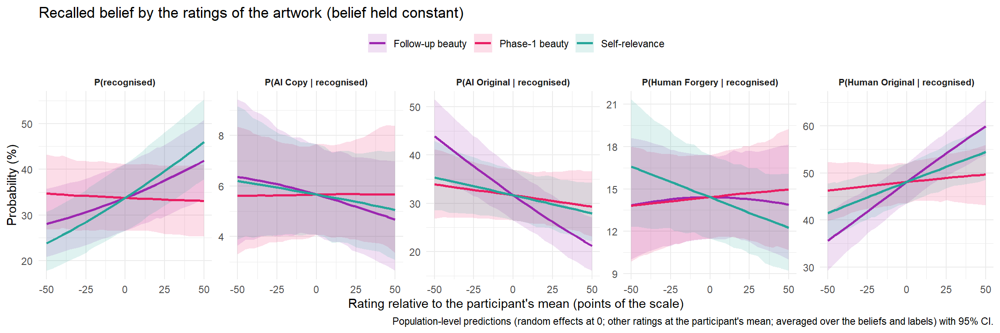{width=1152}
:::
:::


::: {.cell}

```{.r .cell-code}
make_memory_summary(estimates$MemoryBeliefAppraisal)
```

::: {.cell-output-display}

::: {.callout-tip title="Summary of credible effects (generated from the tables above)"}

**Memory of Beliefs, controlling the appraisal.** Each row of the model is the probability of one answer. The differences below are between Belief levels *within* the same answer, in percentage points, as posterior medians with 95% CI; `pd` is the probability of direction. An effect is called credible when the CI excludes 0. Contrasts *across* answers are in the full table above.

- **Human Original**: Human Original - AI Original 7.41 pp [5.51, 9.29]; Human Original - AI Copy 6.03 pp [4.21, 7.87]; Human Forgery - AI Original 4.74 pp [2.25, 7.37]; Human Forgery - AI Copy 3.39 pp [0.88, 5.94]; Human Original - Human Forgery 2.66 pp [0.36, 4.88]. The other 1 pair(s) are not credible.
- **Human Forgery**: Human Forgery - AI Original 2.76 pp [0.96, 4.51]. The other 5 pair(s) are not credible.
- **AI Original**: Human Original - AI Original -7.09 pp [-9.01, -5.23]; Human Forgery - AI Original -5.96 pp [-8.38, -3.61]; Human Original - AI Copy -3.70 pp [-5.40, -2.01]; AI Original - AI Copy 3.41 pp [1.25, 5.48]; Human Forgery - AI Copy -2.55 pp [-4.80, -0.33]. The other 1 pair(s) are not credible.
- **AI Copy**: Human Original - AI Original -2.24 pp [-3.37, -1.11]; Human Original - AI Copy -1.69 pp [-2.74, -0.72]. The other 4 pair(s) are not credible.
- **Not recognized**: no credible difference between any pair of Belief levels.

:::

:::
:::


### Memory of the Condition by Belief, controlling the appraisal


::: {.cell}

```{.r .cell-code}
estimates$MemoryConditionAppraisal$means |>
  mutate(group = make_group(Response)) |>
  ggplot(aes(x = Belief, y = Median, color = Response)) +
  geom_line(aes(group = group), position = position_dodge(width = 0.1), linewidth = 1, show.legend = FALSE) +
  geom_pointrange(aes(group = group, ymin = CI_low, ymax = CI_high), position = position_dodge(width = 0.1), key_glyph = "point") +
  scale_y_continuous(label = scales::percent, limits = c(0, 1), expand = c(0, 0)) +
  scale_color_manual(values = cols) +
  guides(color = guide_legend(override.aes = list(size = 3))) +
  labs(y = "Proportion of answers (averaged over the label shown; ratings observed)", color = "Recalled label",
       x = "Own belief in Phase 2", title = "Memory of the Condition by Belief, controlling the appraisal") +
  theme_minimal()
```

::: {.cell-output-display}
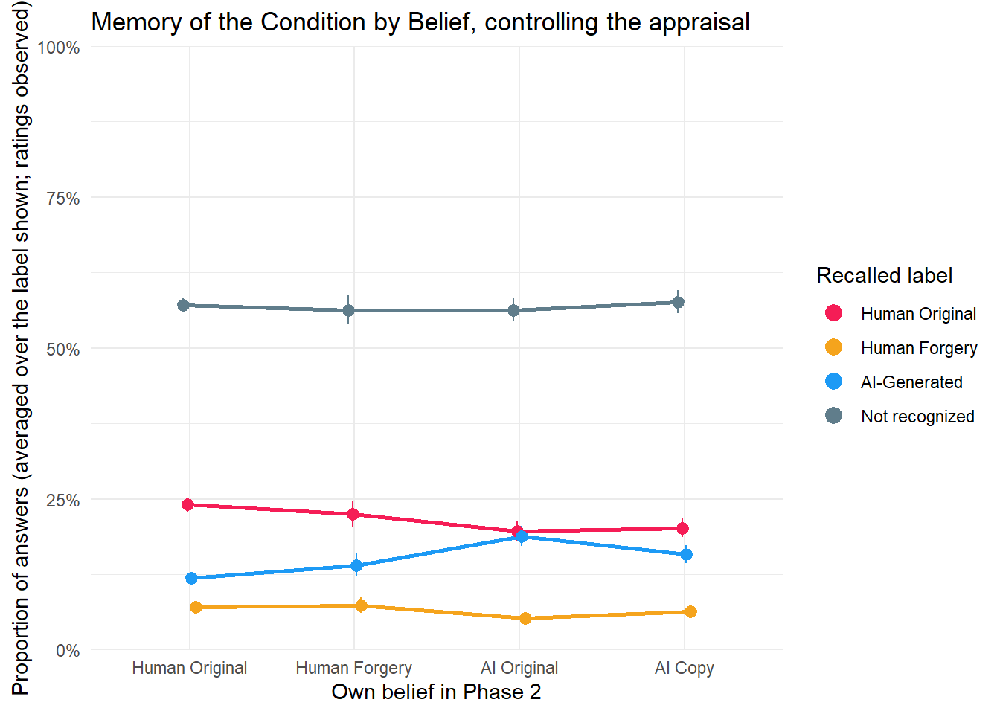{width=672}
:::
:::


::: {.cell}

```{.r .cell-code}
make_memory_tables(estimates$MemoryConditionAppraisal)
```

::: {.cell-output-display}

```{=html}
<div id="lcfsekdfmk" style="padding-left:0px;padding-right:0px;padding-top:10px;padding-bottom:10px;overflow-x:auto;overflow-y:auto;width:auto;height:auto;">
<style>#lcfsekdfmk table {
  font-family: system-ui, 'Segoe UI', Roboto, Helvetica, Arial, sans-serif, 'Apple Color Emoji', 'Segoe UI Emoji', 'Segoe UI Symbol', 'Noto Color Emoji';
  -webkit-font-smoothing: antialiased;
  -moz-osx-font-smoothing: grayscale;
}

#lcfsekdfmk thead, #lcfsekdfmk tbody, #lcfsekdfmk tfoot, #lcfsekdfmk tr, #lcfsekdfmk td, #lcfsekdfmk th {
  border-style: none;
}

#lcfsekdfmk p {
  margin: 0;
  padding: 0;
}

#lcfsekdfmk .gt_table {
  display: table;
  border-collapse: collapse;
  line-height: normal;
  margin-left: auto;
  margin-right: auto;
  color: #333333;
  font-size: 13px;
  font-weight: normal;
  font-style: normal;
  background-color: #FFFFFF;
  width: auto;
  border-top-style: solid;
  border-top-width: 3px;
  border-top-color: #D5D5D5;
  border-right-style: solid;
  border-right-width: 3px;
  border-right-color: #D5D5D5;
  border-bottom-style: solid;
  border-bottom-width: 3px;
  border-bottom-color: #D5D5D5;
  border-left-style: solid;
  border-left-width: 3px;
  border-left-color: #D5D5D5;
}

#lcfsekdfmk .gt_caption {
  padding-top: 4px;
  padding-bottom: 4px;
}

#lcfsekdfmk .gt_title {
  color: #333333;
  font-size: 125%;
  font-weight: initial;
  padding-top: 4px;
  padding-bottom: 4px;
  padding-left: 5px;
  padding-right: 5px;
  border-bottom-color: #FFFFFF;
  border-bottom-width: 0;
}

#lcfsekdfmk .gt_subtitle {
  color: #333333;
  font-size: 85%;
  font-weight: initial;
  padding-top: 3px;
  padding-bottom: 5px;
  padding-left: 5px;
  padding-right: 5px;
  border-top-color: #FFFFFF;
  border-top-width: 0;
}

#lcfsekdfmk .gt_heading {
  background-color: #FFFFFF;
  text-align: left;
  border-bottom-color: #FFFFFF;
  border-left-style: none;
  border-left-width: 1px;
  border-left-color: #D3D3D3;
  border-right-style: none;
  border-right-width: 1px;
  border-right-color: #D3D3D3;
}

#lcfsekdfmk .gt_bottom_border {
  border-bottom-style: solid;
  border-bottom-width: 2px;
  border-bottom-color: #D5D5D5;
}

#lcfsekdfmk .gt_col_headings {
  border-top-style: solid;
  border-top-width: 2px;
  border-top-color: #D5D5D5;
  border-bottom-style: solid;
  border-bottom-width: 2px;
  border-bottom-color: #D5D5D5;
  border-left-style: none;
  border-left-width: 1px;
  border-left-color: #D3D3D3;
  border-right-style: none;
  border-right-width: 1px;
  border-right-color: #D3D3D3;
}

#lcfsekdfmk .gt_col_heading {
  color: #FFFFFF;
  background-color: #000000;
  font-size: 100%;
  font-weight: normal;
  text-transform: inherit;
  border-left-style: none;
  border-left-width: 1px;
  border-left-color: #D3D3D3;
  border-right-style: none;
  border-right-width: 1px;
  border-right-color: #D3D3D3;
  vertical-align: bottom;
  padding-top: 5px;
  padding-bottom: 6px;
  padding-left: 5px;
  padding-right: 5px;
  overflow-x: hidden;
}

#lcfsekdfmk .gt_column_spanner_outer {
  color: #FFFFFF;
  background-color: #000000;
  font-size: 100%;
  font-weight: normal;
  text-transform: inherit;
  padding-top: 0;
  padding-bottom: 0;
  padding-left: 4px;
  padding-right: 4px;
}

#lcfsekdfmk .gt_column_spanner_outer:first-child {
  padding-left: 0;
}

#lcfsekdfmk .gt_column_spanner_outer:last-child {
  padding-right: 0;
}

#lcfsekdfmk .gt_column_spanner {
  border-bottom-style: solid;
  border-bottom-width: 2px;
  border-bottom-color: #D5D5D5;
  vertical-align: bottom;
  padding-top: 5px;
  padding-bottom: 5px;
  overflow-x: hidden;
  display: inline-block;
  width: 100%;
}

#lcfsekdfmk .gt_spanner_row {
  border-bottom-style: hidden;
}

#lcfsekdfmk .gt_group_heading {
  padding-top: 8px;
  padding-bottom: 8px;
  padding-left: 5px;
  padding-right: 5px;
  color: #333333;
  background-color: #FFFFFF;
  font-size: 100%;
  font-weight: initial;
  text-transform: inherit;
  border-top-style: solid;
  border-top-width: 2px;
  border-top-color: #D5D5D5;
  border-bottom-style: solid;
  border-bottom-width: 2px;
  border-bottom-color: #D5D5D5;
  border-left-style: none;
  border-left-width: 1px;
  border-left-color: #D3D3D3;
  border-right-style: none;
  border-right-width: 1px;
  border-right-color: #D3D3D3;
  vertical-align: middle;
  text-align: left;
}

#lcfsekdfmk .gt_empty_group_heading {
  padding: 0.5px;
  color: #333333;
  background-color: #FFFFFF;
  font-size: 100%;
  font-weight: initial;
  border-top-style: solid;
  border-top-width: 2px;
  border-top-color: #D5D5D5;
  border-bottom-style: solid;
  border-bottom-width: 2px;
  border-bottom-color: #D5D5D5;
  vertical-align: middle;
}

#lcfsekdfmk .gt_from_md > :first-child {
  margin-top: 0;
}

#lcfsekdfmk .gt_from_md > :last-child {
  margin-bottom: 0;
}

#lcfsekdfmk .gt_row {
  padding-top: 8px;
  padding-bottom: 8px;
  padding-left: 5px;
  padding-right: 5px;
  margin: 10px;
  border-top-style: solid;
  border-top-width: 1px;
  border-top-color: #D5D5D5;
  border-left-style: solid;
  border-left-width: 1px;
  border-left-color: #D5D5D5;
  border-right-style: solid;
  border-right-width: 1px;
  border-right-color: #D5D5D5;
  vertical-align: middle;
  overflow-x: hidden;
}

#lcfsekdfmk .gt_stub {
  color: #333333;
  background-color: #FFFFFF;
  font-size: 100%;
  font-weight: initial;
  text-transform: inherit;
  border-right-style: solid;
  border-right-width: 2px;
  border-right-color: #5F5F5F;
  padding-left: 5px;
  padding-right: 5px;
}

#lcfsekdfmk .gt_stub_row_group {
  color: #333333;
  background-color: #FFFFFF;
  font-size: 100%;
  font-weight: initial;
  text-transform: inherit;
  border-right-style: solid;
  border-right-width: 2px;
  border-right-color: #D3D3D3;
  padding-left: 5px;
  padding-right: 5px;
  vertical-align: top;
}

#lcfsekdfmk .gt_row_group_first td {
  border-top-width: 2px;
}

#lcfsekdfmk .gt_row_group_first th {
  border-top-width: 2px;
}

#lcfsekdfmk .gt_summary_row {
  color: #333333;
  background-color: #D5D5D5;
  text-transform: inherit;
  padding-top: 8px;
  padding-bottom: 8px;
  padding-left: 5px;
  padding-right: 5px;
}

#lcfsekdfmk .gt_first_summary_row {
  border-top-style: solid;
  border-top-color: #D5D5D5;
}

#lcfsekdfmk .gt_first_summary_row.thick {
  border-top-width: 2px;
}

#lcfsekdfmk .gt_last_summary_row {
  padding-top: 8px;
  padding-bottom: 8px;
  padding-left: 5px;
  padding-right: 5px;
  border-bottom-style: solid;
  border-bottom-width: 2px;
  border-bottom-color: #D5D5D5;
}

#lcfsekdfmk .gt_grand_summary_row {
  color: #FFFFFF;
  background-color: #929292;
  text-transform: inherit;
  padding-top: 8px;
  padding-bottom: 8px;
  padding-left: 5px;
  padding-right: 5px;
}

#lcfsekdfmk .gt_first_grand_summary_row {
  padding-top: 8px;
  padding-bottom: 8px;
  padding-left: 5px;
  padding-right: 5px;
  border-top-style: double;
  border-top-width: 6px;
  border-top-color: #D5D5D5;
}

#lcfsekdfmk .gt_last_grand_summary_row_top {
  padding-top: 8px;
  padding-bottom: 8px;
  padding-left: 5px;
  padding-right: 5px;
  border-bottom-style: double;
  border-bottom-width: 6px;
  border-bottom-color: #D5D5D5;
}

#lcfsekdfmk .gt_striped {
  background-color: #F4F4F4;
}

#lcfsekdfmk .gt_table_body {
  border-top-style: solid;
  border-top-width: 2px;
  border-top-color: #D5D5D5;
  border-bottom-style: solid;
  border-bottom-width: 2px;
  border-bottom-color: #D5D5D5;
}

#lcfsekdfmk .gt_footnotes {
  color: #333333;
  background-color: #FFFFFF;
  border-bottom-style: none;
  border-bottom-width: 2px;
  border-bottom-color: #D3D3D3;
  border-left-style: none;
  border-left-width: 2px;
  border-left-color: #D3D3D3;
  border-right-style: none;
  border-right-width: 2px;
  border-right-color: #D3D3D3;
}

#lcfsekdfmk .gt_footnote {
  margin: 0px;
  font-size: 90%;
  padding-top: 4px;
  padding-bottom: 4px;
  padding-left: 5px;
  padding-right: 5px;
}

#lcfsekdfmk .gt_sourcenotes {
  color: #333333;
  background-color: #FFFFFF;
  border-bottom-style: none;
  border-bottom-width: 2px;
  border-bottom-color: #D3D3D3;
  border-left-style: none;
  border-left-width: 2px;
  border-left-color: #D3D3D3;
  border-right-style: none;
  border-right-width: 2px;
  border-right-color: #D3D3D3;
}

#lcfsekdfmk .gt_sourcenote {
  font-size: 90%;
  padding-top: 4px;
  padding-bottom: 4px;
  padding-left: 5px;
  padding-right: 5px;
}

#lcfsekdfmk .gt_left {
  text-align: left;
}

#lcfsekdfmk .gt_center {
  text-align: center;
}

#lcfsekdfmk .gt_right {
  text-align: right;
  font-variant-numeric: tabular-nums;
}

#lcfsekdfmk .gt_font_normal {
  font-weight: normal;
}

#lcfsekdfmk .gt_font_bold {
  font-weight: bold;
}

#lcfsekdfmk .gt_font_italic {
  font-style: italic;
}

#lcfsekdfmk .gt_super {
  font-size: 65%;
}

#lcfsekdfmk .gt_footnote_marks {
  font-size: 75%;
  vertical-align: 0.4em;
  position: initial;
}

#lcfsekdfmk .gt_asterisk {
  font-size: 100%;
  vertical-align: 0;
}

#lcfsekdfmk .gt_indent_1 {
  text-indent: 5px;
}

#lcfsekdfmk .gt_indent_2 {
  text-indent: 10px;
}

#lcfsekdfmk .gt_indent_3 {
  text-indent: 15px;
}

#lcfsekdfmk .gt_indent_4 {
  text-indent: 20px;
}

#lcfsekdfmk .gt_indent_5 {
  text-indent: 25px;
}

#lcfsekdfmk .katex-display {
  display: inline-flex !important;
  margin-bottom: 0.75em !important;
}

#lcfsekdfmk div.Reactable > div.rt-table > div.rt-thead > div.rt-tr.rt-tr-group-header > div.rt-th-group:after {
  height: 0px !important;
}
</style>
<table class="gt_table" data-quarto-disable-processing="false" data-quarto-bootstrap="false">
  <thead>
    <tr class="gt_heading">
      <td colspan="10" class="gt_heading gt_title gt_font_normal gt_bottom_border" style>Memory of the Condition by Belief, controlling the appraisal: convergence</td>
    </tr>
    
    <tr class="gt_col_headings">
      <th class="gt_col_heading gt_columns_bottom_border gt_left" rowspan="1" colspan="1" scope="col" id="Model">Model</th>
      <th class="gt_col_heading gt_columns_bottom_border gt_left" rowspan="1" colspan="1" scope="col" id="Family">Family</th>
      <th class="gt_col_heading gt_columns_bottom_border gt_right" rowspan="1" colspan="1" scope="col" id="N_obs">N_obs</th>
      <th class="gt_col_heading gt_columns_bottom_border gt_right" rowspan="1" colspan="1" scope="col" id="N_participants">N_participants</th>
      <th class="gt_col_heading gt_columns_bottom_border gt_right" rowspan="1" colspan="1" scope="col" id="Chains">Chains</th>
      <th class="gt_col_heading gt_columns_bottom_border gt_right" rowspan="1" colspan="1" scope="col" id="Draws">Draws</th>
      <th class="gt_col_heading gt_columns_bottom_border gt_right" rowspan="1" colspan="1" scope="col" id="Max_Rhat">Max_Rhat</th>
      <th class="gt_col_heading gt_columns_bottom_border gt_right" rowspan="1" colspan="1" scope="col" id="Min_ESS_ratio">Min_ESS_ratio</th>
      <th class="gt_col_heading gt_columns_bottom_border gt_right" rowspan="1" colspan="1" scope="col" id="Divergent_pct">Divergent_pct</th>
      <th class="gt_col_heading gt_columns_bottom_border gt_left" rowspan="1" colspan="1" scope="col" id="Criterion">Criterion</th>
    </tr>
  </thead>
  <tbody class="gt_table_body">
    <tr><td headers="Model" class="gt_row gt_left">MemoryConditionAppraisal</td>
<td headers="Family" class="gt_row gt_left">Categorical</td>
<td headers="N_obs" class="gt_row gt_right">10416</td>
<td headers="N_participants" class="gt_row gt_right">217</td>
<td headers="Chains" class="gt_row gt_right">8</td>
<td headers="Draws" class="gt_row gt_right">4000</td>
<td headers="Max_Rhat" class="gt_row gt_right">1.016</td>
<td headers="Min_ESS_ratio" class="gt_row gt_right">0.122</td>
<td headers="Divergent_pct" class="gt_row gt_right">0</td>
<td headers="Criterion" class="gt_row gt_left">loo</td></tr>
  </tbody>
  
</table>
</div>
```


::: {.callout-note collapse="true" title="Memory of the Condition by Belief, controlling the appraisal: convergence (Markdown table, for text readers)"}

|Model                    |Family      | N_obs| N_participants| Chains| Draws| Max_Rhat| Min_ESS_ratio| Divergent_pct|Criterion |
|:------------------------|:-----------|-----:|--------------:|------:|-----:|--------:|-------------:|-------------:|:---------|
|MemoryConditionAppraisal |Categorical | 10416|            217|      8|  4000|    1.016|         0.122|             0|loo       |

:::

```{=html}
<div id="xspcronqgr" style="padding-left:0px;padding-right:0px;padding-top:10px;padding-bottom:10px;overflow-x:auto;overflow-y:auto;width:auto;height:auto;">
<style>#xspcronqgr table {
  font-family: system-ui, 'Segoe UI', Roboto, Helvetica, Arial, sans-serif, 'Apple Color Emoji', 'Segoe UI Emoji', 'Segoe UI Symbol', 'Noto Color Emoji';
  -webkit-font-smoothing: antialiased;
  -moz-osx-font-smoothing: grayscale;
}

#xspcronqgr thead, #xspcronqgr tbody, #xspcronqgr tfoot, #xspcronqgr tr, #xspcronqgr td, #xspcronqgr th {
  border-style: none;
}

#xspcronqgr p {
  margin: 0;
  padding: 0;
}

#xspcronqgr .gt_table {
  display: table;
  border-collapse: collapse;
  line-height: normal;
  margin-left: auto;
  margin-right: auto;
  color: #333333;
  font-size: 13px;
  font-weight: normal;
  font-style: normal;
  background-color: #FFFFFF;
  width: auto;
  border-top-style: solid;
  border-top-width: 3px;
  border-top-color: #D5D5D5;
  border-right-style: solid;
  border-right-width: 3px;
  border-right-color: #D5D5D5;
  border-bottom-style: solid;
  border-bottom-width: 3px;
  border-bottom-color: #D5D5D5;
  border-left-style: solid;
  border-left-width: 3px;
  border-left-color: #D5D5D5;
}

#xspcronqgr .gt_caption {
  padding-top: 4px;
  padding-bottom: 4px;
}

#xspcronqgr .gt_title {
  color: #333333;
  font-size: 125%;
  font-weight: initial;
  padding-top: 4px;
  padding-bottom: 4px;
  padding-left: 5px;
  padding-right: 5px;
  border-bottom-color: #FFFFFF;
  border-bottom-width: 0;
}

#xspcronqgr .gt_subtitle {
  color: #333333;
  font-size: 85%;
  font-weight: initial;
  padding-top: 3px;
  padding-bottom: 5px;
  padding-left: 5px;
  padding-right: 5px;
  border-top-color: #FFFFFF;
  border-top-width: 0;
}

#xspcronqgr .gt_heading {
  background-color: #FFFFFF;
  text-align: left;
  border-bottom-color: #FFFFFF;
  border-left-style: none;
  border-left-width: 1px;
  border-left-color: #D3D3D3;
  border-right-style: none;
  border-right-width: 1px;
  border-right-color: #D3D3D3;
}

#xspcronqgr .gt_bottom_border {
  border-bottom-style: solid;
  border-bottom-width: 2px;
  border-bottom-color: #D5D5D5;
}

#xspcronqgr .gt_col_headings {
  border-top-style: solid;
  border-top-width: 2px;
  border-top-color: #D5D5D5;
  border-bottom-style: solid;
  border-bottom-width: 2px;
  border-bottom-color: #D5D5D5;
  border-left-style: none;
  border-left-width: 1px;
  border-left-color: #D3D3D3;
  border-right-style: none;
  border-right-width: 1px;
  border-right-color: #D3D3D3;
}

#xspcronqgr .gt_col_heading {
  color: #FFFFFF;
  background-color: #000000;
  font-size: 100%;
  font-weight: normal;
  text-transform: inherit;
  border-left-style: none;
  border-left-width: 1px;
  border-left-color: #D3D3D3;
  border-right-style: none;
  border-right-width: 1px;
  border-right-color: #D3D3D3;
  vertical-align: bottom;
  padding-top: 5px;
  padding-bottom: 6px;
  padding-left: 5px;
  padding-right: 5px;
  overflow-x: hidden;
}

#xspcronqgr .gt_column_spanner_outer {
  color: #FFFFFF;
  background-color: #000000;
  font-size: 100%;
  font-weight: normal;
  text-transform: inherit;
  padding-top: 0;
  padding-bottom: 0;
  padding-left: 4px;
  padding-right: 4px;
}

#xspcronqgr .gt_column_spanner_outer:first-child {
  padding-left: 0;
}

#xspcronqgr .gt_column_spanner_outer:last-child {
  padding-right: 0;
}

#xspcronqgr .gt_column_spanner {
  border-bottom-style: solid;
  border-bottom-width: 2px;
  border-bottom-color: #D5D5D5;
  vertical-align: bottom;
  padding-top: 5px;
  padding-bottom: 5px;
  overflow-x: hidden;
  display: inline-block;
  width: 100%;
}

#xspcronqgr .gt_spanner_row {
  border-bottom-style: hidden;
}

#xspcronqgr .gt_group_heading {
  padding-top: 8px;
  padding-bottom: 8px;
  padding-left: 5px;
  padding-right: 5px;
  color: #333333;
  background-color: #FFFFFF;
  font-size: 100%;
  font-weight: initial;
  text-transform: inherit;
  border-top-style: solid;
  border-top-width: 2px;
  border-top-color: #D5D5D5;
  border-bottom-style: solid;
  border-bottom-width: 2px;
  border-bottom-color: #D5D5D5;
  border-left-style: none;
  border-left-width: 1px;
  border-left-color: #D3D3D3;
  border-right-style: none;
  border-right-width: 1px;
  border-right-color: #D3D3D3;
  vertical-align: middle;
  text-align: left;
}

#xspcronqgr .gt_empty_group_heading {
  padding: 0.5px;
  color: #333333;
  background-color: #FFFFFF;
  font-size: 100%;
  font-weight: initial;
  border-top-style: solid;
  border-top-width: 2px;
  border-top-color: #D5D5D5;
  border-bottom-style: solid;
  border-bottom-width: 2px;
  border-bottom-color: #D5D5D5;
  vertical-align: middle;
}

#xspcronqgr .gt_from_md > :first-child {
  margin-top: 0;
}

#xspcronqgr .gt_from_md > :last-child {
  margin-bottom: 0;
}

#xspcronqgr .gt_row {
  padding-top: 8px;
  padding-bottom: 8px;
  padding-left: 5px;
  padding-right: 5px;
  margin: 10px;
  border-top-style: solid;
  border-top-width: 1px;
  border-top-color: #D5D5D5;
  border-left-style: solid;
  border-left-width: 1px;
  border-left-color: #D5D5D5;
  border-right-style: solid;
  border-right-width: 1px;
  border-right-color: #D5D5D5;
  vertical-align: middle;
  overflow-x: hidden;
}

#xspcronqgr .gt_stub {
  color: #333333;
  background-color: #FFFFFF;
  font-size: 100%;
  font-weight: initial;
  text-transform: inherit;
  border-right-style: solid;
  border-right-width: 2px;
  border-right-color: #5F5F5F;
  padding-left: 5px;
  padding-right: 5px;
}

#xspcronqgr .gt_stub_row_group {
  color: #333333;
  background-color: #FFFFFF;
  font-size: 100%;
  font-weight: initial;
  text-transform: inherit;
  border-right-style: solid;
  border-right-width: 2px;
  border-right-color: #D3D3D3;
  padding-left: 5px;
  padding-right: 5px;
  vertical-align: top;
}

#xspcronqgr .gt_row_group_first td {
  border-top-width: 2px;
}

#xspcronqgr .gt_row_group_first th {
  border-top-width: 2px;
}

#xspcronqgr .gt_summary_row {
  color: #333333;
  background-color: #D5D5D5;
  text-transform: inherit;
  padding-top: 8px;
  padding-bottom: 8px;
  padding-left: 5px;
  padding-right: 5px;
}

#xspcronqgr .gt_first_summary_row {
  border-top-style: solid;
  border-top-color: #D5D5D5;
}

#xspcronqgr .gt_first_summary_row.thick {
  border-top-width: 2px;
}

#xspcronqgr .gt_last_summary_row {
  padding-top: 8px;
  padding-bottom: 8px;
  padding-left: 5px;
  padding-right: 5px;
  border-bottom-style: solid;
  border-bottom-width: 2px;
  border-bottom-color: #D5D5D5;
}

#xspcronqgr .gt_grand_summary_row {
  color: #FFFFFF;
  background-color: #929292;
  text-transform: inherit;
  padding-top: 8px;
  padding-bottom: 8px;
  padding-left: 5px;
  padding-right: 5px;
}

#xspcronqgr .gt_first_grand_summary_row {
  padding-top: 8px;
  padding-bottom: 8px;
  padding-left: 5px;
  padding-right: 5px;
  border-top-style: double;
  border-top-width: 6px;
  border-top-color: #D5D5D5;
}

#xspcronqgr .gt_last_grand_summary_row_top {
  padding-top: 8px;
  padding-bottom: 8px;
  padding-left: 5px;
  padding-right: 5px;
  border-bottom-style: double;
  border-bottom-width: 6px;
  border-bottom-color: #D5D5D5;
}

#xspcronqgr .gt_striped {
  background-color: #F4F4F4;
}

#xspcronqgr .gt_table_body {
  border-top-style: solid;
  border-top-width: 2px;
  border-top-color: #D5D5D5;
  border-bottom-style: solid;
  border-bottom-width: 2px;
  border-bottom-color: #D5D5D5;
}

#xspcronqgr .gt_footnotes {
  color: #333333;
  background-color: #FFFFFF;
  border-bottom-style: none;
  border-bottom-width: 2px;
  border-bottom-color: #D3D3D3;
  border-left-style: none;
  border-left-width: 2px;
  border-left-color: #D3D3D3;
  border-right-style: none;
  border-right-width: 2px;
  border-right-color: #D3D3D3;
}

#xspcronqgr .gt_footnote {
  margin: 0px;
  font-size: 90%;
  padding-top: 4px;
  padding-bottom: 4px;
  padding-left: 5px;
  padding-right: 5px;
}

#xspcronqgr .gt_sourcenotes {
  color: #333333;
  background-color: #FFFFFF;
  border-bottom-style: none;
  border-bottom-width: 2px;
  border-bottom-color: #D3D3D3;
  border-left-style: none;
  border-left-width: 2px;
  border-left-color: #D3D3D3;
  border-right-style: none;
  border-right-width: 2px;
  border-right-color: #D3D3D3;
}

#xspcronqgr .gt_sourcenote {
  font-size: 90%;
  padding-top: 4px;
  padding-bottom: 4px;
  padding-left: 5px;
  padding-right: 5px;
}

#xspcronqgr .gt_left {
  text-align: left;
}

#xspcronqgr .gt_center {
  text-align: center;
}

#xspcronqgr .gt_right {
  text-align: right;
  font-variant-numeric: tabular-nums;
}

#xspcronqgr .gt_font_normal {
  font-weight: normal;
}

#xspcronqgr .gt_font_bold {
  font-weight: bold;
}

#xspcronqgr .gt_font_italic {
  font-style: italic;
}

#xspcronqgr .gt_super {
  font-size: 65%;
}

#xspcronqgr .gt_footnote_marks {
  font-size: 75%;
  vertical-align: 0.4em;
  position: initial;
}

#xspcronqgr .gt_asterisk {
  font-size: 100%;
  vertical-align: 0;
}

#xspcronqgr .gt_indent_1 {
  text-indent: 5px;
}

#xspcronqgr .gt_indent_2 {
  text-indent: 10px;
}

#xspcronqgr .gt_indent_3 {
  text-indent: 15px;
}

#xspcronqgr .gt_indent_4 {
  text-indent: 20px;
}

#xspcronqgr .gt_indent_5 {
  text-indent: 25px;
}

#xspcronqgr .katex-display {
  display: inline-flex !important;
  margin-bottom: 0.75em !important;
}

#xspcronqgr div.Reactable > div.rt-table > div.rt-thead > div.rt-tr.rt-tr-group-header > div.rt-th-group:after {
  height: 0px !important;
}
</style>
<table class="gt_table" data-quarto-disable-processing="false" data-quarto-bootstrap="false">
  <thead>
    <tr class="gt_heading">
      <td colspan="5" class="gt_heading gt_title gt_font_normal gt_bottom_border" style>Memory of the Condition by Belief, controlling the appraisal: probability of each answer per Belief (marginal means)</td>
    </tr>
    
    <tr class="gt_col_headings">
      <th class="gt_col_heading gt_columns_bottom_border gt_center" rowspan="1" colspan="1" scope="col" id="Belief">Belief</th>
      <th class="gt_col_heading gt_columns_bottom_border gt_center" rowspan="1" colspan="1" scope="col" id="Response">Response</th>
      <th class="gt_col_heading gt_columns_bottom_border gt_right" rowspan="1" colspan="1" scope="col" id="Median">Median</th>
      <th class="gt_col_heading gt_columns_bottom_border gt_right" rowspan="1" colspan="1" scope="col" id="CI_low">CI_low</th>
      <th class="gt_col_heading gt_columns_bottom_border gt_right" rowspan="1" colspan="1" scope="col" id="CI_high">CI_high</th>
    </tr>
  </thead>
  <tbody class="gt_table_body">
    <tr><td headers="Belief" class="gt_row gt_center">Human Original</td>
<td headers="Response" class="gt_row gt_center">Human Original</td>
<td headers="Median" class="gt_row gt_right">0.24</td>
<td headers="CI_low" class="gt_row gt_right">0.23</td>
<td headers="CI_high" class="gt_row gt_right">0.25</td></tr>
    <tr><td headers="Belief" class="gt_row gt_center gt_striped">Human Forgery</td>
<td headers="Response" class="gt_row gt_center gt_striped">Human Original</td>
<td headers="Median" class="gt_row gt_right gt_striped">0.22</td>
<td headers="CI_low" class="gt_row gt_right gt_striped">0.20</td>
<td headers="CI_high" class="gt_row gt_right gt_striped">0.25</td></tr>
    <tr><td headers="Belief" class="gt_row gt_center">AI Original</td>
<td headers="Response" class="gt_row gt_center">Human Original</td>
<td headers="Median" class="gt_row gt_right">0.20</td>
<td headers="CI_low" class="gt_row gt_right">0.18</td>
<td headers="CI_high" class="gt_row gt_right">0.21</td></tr>
    <tr><td headers="Belief" class="gt_row gt_center gt_striped">AI Copy</td>
<td headers="Response" class="gt_row gt_center gt_striped">Human Original</td>
<td headers="Median" class="gt_row gt_right gt_striped">0.20</td>
<td headers="CI_low" class="gt_row gt_right gt_striped">0.19</td>
<td headers="CI_high" class="gt_row gt_right gt_striped">0.22</td></tr>
    <tr><td headers="Belief" class="gt_row gt_center">Human Original</td>
<td headers="Response" class="gt_row gt_center">Human Forgery</td>
<td headers="Median" class="gt_row gt_right">0.07</td>
<td headers="CI_low" class="gt_row gt_right">0.06</td>
<td headers="CI_high" class="gt_row gt_right">0.08</td></tr>
    <tr><td headers="Belief" class="gt_row gt_center gt_striped">Human Forgery</td>
<td headers="Response" class="gt_row gt_center gt_striped">Human Forgery</td>
<td headers="Median" class="gt_row gt_right gt_striped">0.07</td>
<td headers="CI_low" class="gt_row gt_right gt_striped">0.06</td>
<td headers="CI_high" class="gt_row gt_right gt_striped">0.09</td></tr>
    <tr><td headers="Belief" class="gt_row gt_center">AI Original</td>
<td headers="Response" class="gt_row gt_center">Human Forgery</td>
<td headers="Median" class="gt_row gt_right">0.05</td>
<td headers="CI_low" class="gt_row gt_right">0.04</td>
<td headers="CI_high" class="gt_row gt_right">0.06</td></tr>
    <tr><td headers="Belief" class="gt_row gt_center gt_striped">AI Copy</td>
<td headers="Response" class="gt_row gt_center gt_striped">Human Forgery</td>
<td headers="Median" class="gt_row gt_right gt_striped">0.06</td>
<td headers="CI_low" class="gt_row gt_right gt_striped">0.05</td>
<td headers="CI_high" class="gt_row gt_right gt_striped">0.07</td></tr>
    <tr><td headers="Belief" class="gt_row gt_center">Human Original</td>
<td headers="Response" class="gt_row gt_center">AI-Generated</td>
<td headers="Median" class="gt_row gt_right">0.12</td>
<td headers="CI_low" class="gt_row gt_right">0.11</td>
<td headers="CI_high" class="gt_row gt_right">0.13</td></tr>
    <tr><td headers="Belief" class="gt_row gt_center gt_striped">Human Forgery</td>
<td headers="Response" class="gt_row gt_center gt_striped">AI-Generated</td>
<td headers="Median" class="gt_row gt_right gt_striped">0.14</td>
<td headers="CI_low" class="gt_row gt_right gt_striped">0.12</td>
<td headers="CI_high" class="gt_row gt_right gt_striped">0.16</td></tr>
    <tr><td headers="Belief" class="gt_row gt_center">AI Original</td>
<td headers="Response" class="gt_row gt_center">AI-Generated</td>
<td headers="Median" class="gt_row gt_right">0.19</td>
<td headers="CI_low" class="gt_row gt_right">0.17</td>
<td headers="CI_high" class="gt_row gt_right">0.21</td></tr>
    <tr><td headers="Belief" class="gt_row gt_center gt_striped">AI Copy</td>
<td headers="Response" class="gt_row gt_center gt_striped">AI-Generated</td>
<td headers="Median" class="gt_row gt_right gt_striped">0.16</td>
<td headers="CI_low" class="gt_row gt_right gt_striped">0.14</td>
<td headers="CI_high" class="gt_row gt_right gt_striped">0.17</td></tr>
    <tr><td headers="Belief" class="gt_row gt_center">Human Original</td>
<td headers="Response" class="gt_row gt_center">Not recognized</td>
<td headers="Median" class="gt_row gt_right">0.57</td>
<td headers="CI_low" class="gt_row gt_right">0.56</td>
<td headers="CI_high" class="gt_row gt_right">0.58</td></tr>
    <tr><td headers="Belief" class="gt_row gt_center gt_striped">Human Forgery</td>
<td headers="Response" class="gt_row gt_center gt_striped">Not recognized</td>
<td headers="Median" class="gt_row gt_right gt_striped">0.56</td>
<td headers="CI_low" class="gt_row gt_right gt_striped">0.54</td>
<td headers="CI_high" class="gt_row gt_right gt_striped">0.59</td></tr>
    <tr><td headers="Belief" class="gt_row gt_center">AI Original</td>
<td headers="Response" class="gt_row gt_center">Not recognized</td>
<td headers="Median" class="gt_row gt_right">0.56</td>
<td headers="CI_low" class="gt_row gt_right">0.54</td>
<td headers="CI_high" class="gt_row gt_right">0.58</td></tr>
    <tr><td headers="Belief" class="gt_row gt_center gt_striped">AI Copy</td>
<td headers="Response" class="gt_row gt_center gt_striped">Not recognized</td>
<td headers="Median" class="gt_row gt_right gt_striped">0.58</td>
<td headers="CI_low" class="gt_row gt_right gt_striped">0.56</td>
<td headers="CI_high" class="gt_row gt_right gt_striped">0.59</td></tr>
  </tbody>
  
</table>
</div>
```


::: {.callout-note collapse="true" title="Memory of the Condition by Belief, controlling the appraisal: probability of each answer per Belief (marginal means) (Markdown table, for text readers)"}

|Belief         |Response       |Median |CI_low |CI_high |
|:--------------|:--------------|:------|:------|:-------|
|Human Original |Human Original |0.24   |0.23   |0.25    |
|Human Forgery  |Human Original |0.22   |0.20   |0.25    |
|AI Original    |Human Original |0.20   |0.18   |0.21    |
|AI Copy        |Human Original |0.20   |0.19   |0.22    |
|Human Original |Human Forgery  |0.07   |0.06   |0.08    |
|Human Forgery  |Human Forgery  |0.07   |0.06   |0.09    |
|AI Original    |Human Forgery  |0.05   |0.04   |0.06    |
|AI Copy        |Human Forgery  |0.06   |0.05   |0.07    |
|Human Original |AI-Generated   |0.12   |0.11   |0.13    |
|Human Forgery  |AI-Generated   |0.14   |0.12   |0.16    |
|AI Original    |AI-Generated   |0.19   |0.17   |0.21    |
|AI Copy        |AI-Generated   |0.16   |0.14   |0.17    |
|Human Original |Not recognized |0.57   |0.56   |0.58    |
|Human Forgery  |Not recognized |0.56   |0.54   |0.59    |
|AI Original    |Not recognized |0.56   |0.54   |0.58    |
|AI Copy        |Not recognized |0.58   |0.56   |0.59    |

:::

::: {.callout-note collapse="true" title="Memory of the Condition by Belief, controlling the appraisal: all 120 contrasts (Markdown table, for text readers)"}

|Level1         |Response1      |Level2         |Response2      |Median |CI_low |CI_high |pd   |Effect   |
|:--------------|:--------------|:--------------|:--------------|:------|:------|:-------|:----|:--------|
|Human Original |Human Original |Human Forgery  |Human Original |0.02   |-0.01  |0.04    |0.90 |n.s.     |
|Human Original |Human Original |AI Original    |Human Original |0.04   |0.02   |0.06    |1.00 |Positive |
|Human Original |Human Original |AI Copy        |Human Original |0.04   |0.02   |0.06    |1.00 |Positive |
|Human Original |Human Original |Human Original |Human Forgery  |0.17   |0.15   |0.18    |1.00 |Positive |
|Human Original |Human Original |Human Forgery  |Human Forgery  |0.17   |0.15   |0.18    |1.00 |Positive |
|Human Original |Human Original |AI Original    |Human Forgery  |0.19   |0.17   |0.20    |1.00 |Positive |
|Human Original |Human Original |AI Copy        |Human Forgery  |0.18   |0.16   |0.19    |1.00 |Positive |
|Human Original |Human Original |Human Original |AI-Generated   |0.12   |0.10   |0.14    |1.00 |Positive |
|Human Original |Human Original |Human Forgery  |AI-Generated   |0.10   |0.08   |0.12    |1.00 |Positive |
|Human Original |Human Original |AI Original    |AI-Generated   |0.05   |0.03   |0.07    |1.00 |Positive |
|Human Original |Human Original |AI Copy        |AI-Generated   |0.08   |0.06   |0.10    |1.00 |Positive |
|Human Original |Human Original |Human Original |Not recognized |-0.33  |-0.35  |-0.31   |1.00 |Negative |
|Human Original |Human Original |Human Forgery  |Not recognized |-0.32  |-0.35  |-0.30   |1.00 |Negative |
|Human Original |Human Original |AI Original    |Not recognized |-0.32  |-0.35  |-0.30   |1.00 |Negative |
|Human Original |Human Original |AI Copy        |Not recognized |-0.34  |-0.36  |-0.31   |1.00 |Negative |
|Human Forgery  |Human Original |AI Original    |Human Original |0.03   |0.00   |0.06    |0.98 |Positive |
|Human Forgery  |Human Original |AI Copy        |Human Original |0.02   |0.00   |0.05    |0.95 |n.s.     |
|Human Forgery  |Human Original |Human Original |Human Forgery  |0.15   |0.13   |0.18    |1.00 |Positive |
|Human Forgery  |Human Original |Human Forgery  |Human Forgery  |0.15   |0.12   |0.18    |1.00 |Positive |
|Human Forgery  |Human Original |AI Original    |Human Forgery  |0.17   |0.15   |0.20    |1.00 |Positive |
|Human Forgery  |Human Original |AI Copy        |Human Forgery  |0.16   |0.14   |0.18    |1.00 |Positive |
|Human Forgery  |Human Original |Human Original |AI-Generated   |0.11   |0.08   |0.13    |1.00 |Positive |
|Human Forgery  |Human Original |Human Forgery  |AI-Generated   |0.08   |0.05   |0.12    |1.00 |Positive |
|Human Forgery  |Human Original |AI Original    |AI-Generated   |0.04   |0.01   |0.06    |1.00 |Positive |
|Human Forgery  |Human Original |AI Copy        |AI-Generated   |0.07   |0.04   |0.09    |1.00 |Positive |
|Human Forgery  |Human Original |Human Original |Not recognized |-0.35  |-0.37  |-0.32   |1.00 |Negative |
|Human Forgery  |Human Original |Human Forgery  |Not recognized |-0.34  |-0.38  |-0.30   |1.00 |Negative |
|Human Forgery  |Human Original |AI Original    |Not recognized |-0.34  |-0.37  |-0.31   |1.00 |Negative |
|Human Forgery  |Human Original |AI Copy        |Not recognized |-0.35  |-0.38  |-0.32   |1.00 |Negative |
|AI Original    |Human Original |AI Copy        |Human Original |-0.01  |-0.03  |0.02    |0.68 |n.s.     |
|AI Original    |Human Original |Human Original |Human Forgery  |0.13   |0.11   |0.14    |1.00 |Positive |
|AI Original    |Human Original |Human Forgery  |Human Forgery  |0.12   |0.10   |0.14    |1.00 |Positive |
|AI Original    |Human Original |AI Original    |Human Forgery  |0.14   |0.12   |0.16    |1.00 |Positive |
|AI Original    |Human Original |AI Copy        |Human Forgery  |0.13   |0.11   |0.15    |1.00 |Positive |
|AI Original    |Human Original |Human Original |AI-Generated   |0.08   |0.06   |0.10    |1.00 |Positive |
|AI Original    |Human Original |Human Forgery  |AI-Generated   |0.06   |0.03   |0.08    |1.00 |Positive |
|AI Original    |Human Original |AI Original    |AI-Generated   |0.01   |-0.02  |0.03    |0.71 |n.s.     |
|AI Original    |Human Original |AI Copy        |AI-Generated   |0.04   |0.02   |0.06    |1.00 |Positive |
|AI Original    |Human Original |Human Original |Not recognized |-0.37  |-0.40  |-0.35   |1.00 |Negative |
|AI Original    |Human Original |Human Forgery  |Not recognized |-0.37  |-0.40  |-0.34   |1.00 |Negative |
|AI Original    |Human Original |AI Original    |Not recognized |-0.37  |-0.40  |-0.34   |1.00 |Negative |
|AI Original    |Human Original |AI Copy        |Not recognized |-0.38  |-0.41  |-0.36   |1.00 |Negative |
|AI Copy        |Human Original |Human Original |Human Forgery  |0.13   |0.11   |0.15    |1.00 |Positive |
|AI Copy        |Human Original |Human Forgery  |Human Forgery  |0.13   |0.11   |0.15    |1.00 |Positive |
|AI Copy        |Human Original |AI Original    |Human Forgery  |0.15   |0.13   |0.17    |1.00 |Positive |
|AI Copy        |Human Original |AI Copy        |Human Forgery  |0.14   |0.12   |0.16    |1.00 |Positive |
|AI Copy        |Human Original |Human Original |AI-Generated   |0.08   |0.06   |0.10    |1.00 |Positive |
|AI Copy        |Human Original |Human Forgery  |AI-Generated   |0.06   |0.04   |0.09    |1.00 |Positive |
|AI Copy        |Human Original |AI Original    |AI-Generated   |0.01   |-0.01  |0.04    |0.86 |n.s.     |
|AI Copy        |Human Original |AI Copy        |AI-Generated   |0.04   |0.02   |0.07    |1.00 |Positive |
|AI Copy        |Human Original |Human Original |Not recognized |-0.37  |-0.39  |-0.35   |1.00 |Negative |
|AI Copy        |Human Original |Human Forgery  |Not recognized |-0.36  |-0.39  |-0.33   |1.00 |Negative |
|AI Copy        |Human Original |AI Original    |Not recognized |-0.36  |-0.39  |-0.34   |1.00 |Negative |
|AI Copy        |Human Original |AI Copy        |Not recognized |-0.37  |-0.40  |-0.34   |1.00 |Negative |
|Human Original |Human Forgery  |Human Forgery  |Human Forgery  |0.00   |-0.02  |0.01    |0.63 |n.s.     |
|Human Original |Human Forgery  |AI Original    |Human Forgery  |0.02   |0.01   |0.03    |1.00 |Positive |
|Human Original |Human Forgery  |AI Copy        |Human Forgery  |0.01   |-0.01  |0.02    |0.86 |n.s.     |
|Human Original |Human Forgery  |Human Original |AI-Generated   |-0.05  |-0.06  |-0.04   |1.00 |Negative |
|Human Original |Human Forgery  |Human Forgery  |AI-Generated   |-0.07  |-0.09  |-0.05   |1.00 |Negative |
|Human Original |Human Forgery  |AI Original    |AI-Generated   |-0.12  |-0.14  |-0.10   |1.00 |Negative |
|Human Original |Human Forgery  |AI Copy        |AI-Generated   |-0.09  |-0.10  |-0.07   |1.00 |Negative |
|Human Original |Human Forgery  |Human Original |Not recognized |-0.50  |-0.52  |-0.48   |1.00 |Negative |
|Human Original |Human Forgery  |Human Forgery  |Not recognized |-0.49  |-0.52  |-0.47   |1.00 |Negative |
|Human Original |Human Forgery  |AI Original    |Not recognized |-0.49  |-0.51  |-0.47   |1.00 |Negative |
|Human Original |Human Forgery  |AI Copy        |Not recognized |-0.51  |-0.53  |-0.49   |1.00 |Negative |
|Human Forgery  |Human Forgery  |AI Original    |Human Forgery  |0.02   |0.00   |0.04    |0.99 |Positive |
|Human Forgery  |Human Forgery  |AI Copy        |Human Forgery  |0.01   |-0.01  |0.03    |0.87 |n.s.     |
|Human Forgery  |Human Forgery  |Human Original |AI-Generated   |-0.05  |-0.06  |-0.03   |1.00 |Negative |
|Human Forgery  |Human Forgery  |Human Forgery  |AI-Generated   |-0.07  |-0.09  |-0.04   |1.00 |Negative |
|Human Forgery  |Human Forgery  |AI Original    |AI-Generated   |-0.12  |-0.14  |-0.09   |1.00 |Negative |
|Human Forgery  |Human Forgery  |AI Copy        |AI-Generated   |-0.09  |-0.10  |-0.07   |1.00 |Negative |
|Human Forgery  |Human Forgery  |Human Original |Not recognized |-0.50  |-0.52  |-0.48   |1.00 |Negative |
|Human Forgery  |Human Forgery  |Human Forgery  |Not recognized |-0.49  |-0.52  |-0.46   |1.00 |Negative |
|Human Forgery  |Human Forgery  |AI Original    |Not recognized |-0.49  |-0.51  |-0.47   |1.00 |Negative |
|Human Forgery  |Human Forgery  |AI Copy        |Not recognized |-0.50  |-0.53  |-0.48   |1.00 |Negative |
|AI Original    |Human Forgery  |AI Copy        |Human Forgery  |-0.01  |-0.03  |0.00    |0.94 |n.s.     |
|AI Original    |Human Forgery  |Human Original |AI-Generated   |-0.07  |-0.08  |-0.05   |1.00 |Negative |
|AI Original    |Human Forgery  |Human Forgery  |AI-Generated   |-0.09  |-0.11  |-0.07   |1.00 |Negative |
|AI Original    |Human Forgery  |AI Original    |AI-Generated   |-0.14  |-0.16  |-0.12   |1.00 |Negative |
|AI Original    |Human Forgery  |AI Copy        |AI-Generated   |-0.11  |-0.12  |-0.09   |1.00 |Negative |
|AI Original    |Human Forgery  |Human Original |Not recognized |-0.52  |-0.53  |-0.50   |1.00 |Negative |
|AI Original    |Human Forgery  |Human Forgery  |Not recognized |-0.51  |-0.54  |-0.48   |1.00 |Negative |
|AI Original    |Human Forgery  |AI Original    |Not recognized |-0.51  |-0.54  |-0.49   |1.00 |Negative |
|AI Original    |Human Forgery  |AI Copy        |Not recognized |-0.52  |-0.55  |-0.50   |1.00 |Negative |
|AI Copy        |Human Forgery  |Human Original |AI-Generated   |-0.06  |-0.07  |-0.04   |1.00 |Negative |
|AI Copy        |Human Forgery  |Human Forgery  |AI-Generated   |-0.08  |-0.10  |-0.06   |1.00 |Negative |
|AI Copy        |Human Forgery  |AI Original    |AI-Generated   |-0.12  |-0.14  |-0.11   |1.00 |Negative |
|AI Copy        |Human Forgery  |AI Copy        |AI-Generated   |-0.09  |-0.11  |-0.08   |1.00 |Negative |
|AI Copy        |Human Forgery  |Human Original |Not recognized |-0.51  |-0.52  |-0.49   |1.00 |Negative |
|AI Copy        |Human Forgery  |Human Forgery  |Not recognized |-0.50  |-0.53  |-0.47   |1.00 |Negative |
|AI Copy        |Human Forgery  |AI Original    |Not recognized |-0.50  |-0.52  |-0.48   |1.00 |Negative |
|AI Copy        |Human Forgery  |AI Copy        |Not recognized |-0.51  |-0.54  |-0.49   |1.00 |Negative |
|Human Original |AI-Generated   |Human Forgery  |AI-Generated   |-0.02  |-0.04  |0.00    |0.98 |Negative |
|Human Original |AI-Generated   |AI Original    |AI-Generated   |-0.07  |-0.09  |-0.05   |1.00 |Negative |
|Human Original |AI-Generated   |AI Copy        |AI-Generated   |-0.04  |-0.06  |-0.02   |1.00 |Negative |
|Human Original |AI-Generated   |Human Original |Not recognized |-0.45  |-0.47  |-0.43   |1.00 |Negative |
|Human Original |AI-Generated   |Human Forgery  |Not recognized |-0.44  |-0.47  |-0.42   |1.00 |Negative |
|Human Original |AI-Generated   |AI Original    |Not recognized |-0.44  |-0.47  |-0.42   |1.00 |Negative |
|Human Original |AI-Generated   |AI Copy        |Not recognized |-0.46  |-0.48  |-0.44   |1.00 |Negative |
|Human Forgery  |AI-Generated   |AI Original    |AI-Generated   |-0.05  |-0.07  |-0.02   |1.00 |Negative |
|Human Forgery  |AI-Generated   |AI Copy        |AI-Generated   |-0.02  |-0.04  |0.01    |0.93 |n.s.     |
|Human Forgery  |AI-Generated   |Human Original |Not recognized |-0.43  |-0.45  |-0.41   |1.00 |Negative |
|Human Forgery  |AI-Generated   |Human Forgery  |Not recognized |-0.42  |-0.46  |-0.39   |1.00 |Negative |
|Human Forgery  |AI-Generated   |AI Original    |Not recognized |-0.42  |-0.45  |-0.40   |1.00 |Negative |
|Human Forgery  |AI-Generated   |AI Copy        |Not recognized |-0.44  |-0.46  |-0.41   |1.00 |Negative |
|AI Original    |AI-Generated   |AI Copy        |AI-Generated   |0.03   |0.01   |0.05    |1.00 |Positive |
|AI Original    |AI-Generated   |Human Original |Not recognized |-0.38  |-0.40  |-0.36   |1.00 |Negative |
|AI Original    |AI-Generated   |Human Forgery  |Not recognized |-0.37  |-0.40  |-0.35   |1.00 |Negative |
|AI Original    |AI-Generated   |AI Original    |Not recognized |-0.37  |-0.41  |-0.34   |1.00 |Negative |
|AI Original    |AI-Generated   |AI Copy        |Not recognized |-0.39  |-0.41  |-0.36   |1.00 |Negative |
|AI Copy        |AI-Generated   |Human Original |Not recognized |-0.41  |-0.43  |-0.39   |1.00 |Negative |
|AI Copy        |AI-Generated   |Human Forgery  |Not recognized |-0.40  |-0.43  |-0.38   |1.00 |Negative |
|AI Copy        |AI-Generated   |AI Original    |Not recognized |-0.40  |-0.43  |-0.38   |1.00 |Negative |
|AI Copy        |AI-Generated   |AI Copy        |Not recognized |-0.42  |-0.45  |-0.39   |1.00 |Negative |
|Human Original |Not recognized |Human Forgery  |Not recognized |0.01   |-0.02  |0.04    |0.72 |n.s.     |
|Human Original |Not recognized |AI Original    |Not recognized |0.01   |-0.02  |0.03    |0.74 |n.s.     |
|Human Original |Not recognized |AI Copy        |Not recognized |-0.01  |-0.03  |0.02    |0.69 |n.s.     |
|Human Forgery  |Not recognized |AI Original    |Not recognized |0.00   |-0.03  |0.03    |0.50 |n.s.     |
|Human Forgery  |Not recognized |AI Copy        |Not recognized |-0.01  |-0.04  |0.02    |0.81 |n.s.     |
|AI Original    |Not recognized |AI Copy        |Not recognized |-0.01  |-0.04  |0.01    |0.83 |n.s.     |

:::
:::
:::


```{.r .cell-code}
label_cells <- tribble(
  ~Level1, ~Level2, ~Response,
  "AI Original", "Human Original", "AI-Generated",
  "AI Original", "Human Original", "Human Original",
  "Human Forgery", "Human Original", "Human Forgery",
  "AI Original", "Human Original", "Not recognized"
)
make_asis(make_tables(
  compare_models(label_cells, estimates$MemoryConditionAppraisal, estimates$MemoryConditionBelief),
  c("Answer", "Contrast", "Without", "Effect_without", "With", "Effect_with"),
  "Memory of the Condition by Belief: the same-answer Belief contrasts (percentage points, label shown held constant) without and with the three ratings in the model"))
```

```{=html}
<div id="pzwyeulwuc" style="padding-left:0px;padding-right:0px;padding-top:10px;padding-bottom:10px;overflow-x:auto;overflow-y:auto;width:auto;height:auto;">
<style>#pzwyeulwuc table {
  font-family: system-ui, 'Segoe UI', Roboto, Helvetica, Arial, sans-serif, 'Apple Color Emoji', 'Segoe UI Emoji', 'Segoe UI Symbol', 'Noto Color Emoji';
  -webkit-font-smoothing: antialiased;
  -moz-osx-font-smoothing: grayscale;
}

#pzwyeulwuc thead, #pzwyeulwuc tbody, #pzwyeulwuc tfoot, #pzwyeulwuc tr, #pzwyeulwuc td, #pzwyeulwuc th {
  border-style: none;
}

#pzwyeulwuc p {
  margin: 0;
  padding: 0;
}

#pzwyeulwuc .gt_table {
  display: table;
  border-collapse: collapse;
  line-height: normal;
  margin-left: auto;
  margin-right: auto;
  color: #333333;
  font-size: 13px;
  font-weight: normal;
  font-style: normal;
  background-color: #FFFFFF;
  width: auto;
  border-top-style: solid;
  border-top-width: 3px;
  border-top-color: #D5D5D5;
  border-right-style: solid;
  border-right-width: 3px;
  border-right-color: #D5D5D5;
  border-bottom-style: solid;
  border-bottom-width: 3px;
  border-bottom-color: #D5D5D5;
  border-left-style: solid;
  border-left-width: 3px;
  border-left-color: #D5D5D5;
}

#pzwyeulwuc .gt_caption {
  padding-top: 4px;
  padding-bottom: 4px;
}

#pzwyeulwuc .gt_title {
  color: #333333;
  font-size: 125%;
  font-weight: initial;
  padding-top: 4px;
  padding-bottom: 4px;
  padding-left: 5px;
  padding-right: 5px;
  border-bottom-color: #FFFFFF;
  border-bottom-width: 0;
}

#pzwyeulwuc .gt_subtitle {
  color: #333333;
  font-size: 85%;
  font-weight: initial;
  padding-top: 3px;
  padding-bottom: 5px;
  padding-left: 5px;
  padding-right: 5px;
  border-top-color: #FFFFFF;
  border-top-width: 0;
}

#pzwyeulwuc .gt_heading {
  background-color: #FFFFFF;
  text-align: left;
  border-bottom-color: #FFFFFF;
  border-left-style: none;
  border-left-width: 1px;
  border-left-color: #D3D3D3;
  border-right-style: none;
  border-right-width: 1px;
  border-right-color: #D3D3D3;
}

#pzwyeulwuc .gt_bottom_border {
  border-bottom-style: solid;
  border-bottom-width: 2px;
  border-bottom-color: #D5D5D5;
}

#pzwyeulwuc .gt_col_headings {
  border-top-style: solid;
  border-top-width: 2px;
  border-top-color: #D5D5D5;
  border-bottom-style: solid;
  border-bottom-width: 2px;
  border-bottom-color: #D5D5D5;
  border-left-style: none;
  border-left-width: 1px;
  border-left-color: #D3D3D3;
  border-right-style: none;
  border-right-width: 1px;
  border-right-color: #D3D3D3;
}

#pzwyeulwuc .gt_col_heading {
  color: #FFFFFF;
  background-color: #000000;
  font-size: 100%;
  font-weight: normal;
  text-transform: inherit;
  border-left-style: none;
  border-left-width: 1px;
  border-left-color: #D3D3D3;
  border-right-style: none;
  border-right-width: 1px;
  border-right-color: #D3D3D3;
  vertical-align: bottom;
  padding-top: 5px;
  padding-bottom: 6px;
  padding-left: 5px;
  padding-right: 5px;
  overflow-x: hidden;
}

#pzwyeulwuc .gt_column_spanner_outer {
  color: #FFFFFF;
  background-color: #000000;
  font-size: 100%;
  font-weight: normal;
  text-transform: inherit;
  padding-top: 0;
  padding-bottom: 0;
  padding-left: 4px;
  padding-right: 4px;
}

#pzwyeulwuc .gt_column_spanner_outer:first-child {
  padding-left: 0;
}

#pzwyeulwuc .gt_column_spanner_outer:last-child {
  padding-right: 0;
}

#pzwyeulwuc .gt_column_spanner {
  border-bottom-style: solid;
  border-bottom-width: 2px;
  border-bottom-color: #D5D5D5;
  vertical-align: bottom;
  padding-top: 5px;
  padding-bottom: 5px;
  overflow-x: hidden;
  display: inline-block;
  width: 100%;
}

#pzwyeulwuc .gt_spanner_row {
  border-bottom-style: hidden;
}

#pzwyeulwuc .gt_group_heading {
  padding-top: 8px;
  padding-bottom: 8px;
  padding-left: 5px;
  padding-right: 5px;
  color: #333333;
  background-color: #FFFFFF;
  font-size: 100%;
  font-weight: initial;
  text-transform: inherit;
  border-top-style: solid;
  border-top-width: 2px;
  border-top-color: #D5D5D5;
  border-bottom-style: solid;
  border-bottom-width: 2px;
  border-bottom-color: #D5D5D5;
  border-left-style: none;
  border-left-width: 1px;
  border-left-color: #D3D3D3;
  border-right-style: none;
  border-right-width: 1px;
  border-right-color: #D3D3D3;
  vertical-align: middle;
  text-align: left;
}

#pzwyeulwuc .gt_empty_group_heading {
  padding: 0.5px;
  color: #333333;
  background-color: #FFFFFF;
  font-size: 100%;
  font-weight: initial;
  border-top-style: solid;
  border-top-width: 2px;
  border-top-color: #D5D5D5;
  border-bottom-style: solid;
  border-bottom-width: 2px;
  border-bottom-color: #D5D5D5;
  vertical-align: middle;
}

#pzwyeulwuc .gt_from_md > :first-child {
  margin-top: 0;
}

#pzwyeulwuc .gt_from_md > :last-child {
  margin-bottom: 0;
}

#pzwyeulwuc .gt_row {
  padding-top: 8px;
  padding-bottom: 8px;
  padding-left: 5px;
  padding-right: 5px;
  margin: 10px;
  border-top-style: solid;
  border-top-width: 1px;
  border-top-color: #D5D5D5;
  border-left-style: solid;
  border-left-width: 1px;
  border-left-color: #D5D5D5;
  border-right-style: solid;
  border-right-width: 1px;
  border-right-color: #D5D5D5;
  vertical-align: middle;
  overflow-x: hidden;
}

#pzwyeulwuc .gt_stub {
  color: #333333;
  background-color: #FFFFFF;
  font-size: 100%;
  font-weight: initial;
  text-transform: inherit;
  border-right-style: solid;
  border-right-width: 2px;
  border-right-color: #5F5F5F;
  padding-left: 5px;
  padding-right: 5px;
}

#pzwyeulwuc .gt_stub_row_group {
  color: #333333;
  background-color: #FFFFFF;
  font-size: 100%;
  font-weight: initial;
  text-transform: inherit;
  border-right-style: solid;
  border-right-width: 2px;
  border-right-color: #D3D3D3;
  padding-left: 5px;
  padding-right: 5px;
  vertical-align: top;
}

#pzwyeulwuc .gt_row_group_first td {
  border-top-width: 2px;
}

#pzwyeulwuc .gt_row_group_first th {
  border-top-width: 2px;
}

#pzwyeulwuc .gt_summary_row {
  color: #333333;
  background-color: #D5D5D5;
  text-transform: inherit;
  padding-top: 8px;
  padding-bottom: 8px;
  padding-left: 5px;
  padding-right: 5px;
}

#pzwyeulwuc .gt_first_summary_row {
  border-top-style: solid;
  border-top-color: #D5D5D5;
}

#pzwyeulwuc .gt_first_summary_row.thick {
  border-top-width: 2px;
}

#pzwyeulwuc .gt_last_summary_row {
  padding-top: 8px;
  padding-bottom: 8px;
  padding-left: 5px;
  padding-right: 5px;
  border-bottom-style: solid;
  border-bottom-width: 2px;
  border-bottom-color: #D5D5D5;
}

#pzwyeulwuc .gt_grand_summary_row {
  color: #FFFFFF;
  background-color: #929292;
  text-transform: inherit;
  padding-top: 8px;
  padding-bottom: 8px;
  padding-left: 5px;
  padding-right: 5px;
}

#pzwyeulwuc .gt_first_grand_summary_row {
  padding-top: 8px;
  padding-bottom: 8px;
  padding-left: 5px;
  padding-right: 5px;
  border-top-style: double;
  border-top-width: 6px;
  border-top-color: #D5D5D5;
}

#pzwyeulwuc .gt_last_grand_summary_row_top {
  padding-top: 8px;
  padding-bottom: 8px;
  padding-left: 5px;
  padding-right: 5px;
  border-bottom-style: double;
  border-bottom-width: 6px;
  border-bottom-color: #D5D5D5;
}

#pzwyeulwuc .gt_striped {
  background-color: #F4F4F4;
}

#pzwyeulwuc .gt_table_body {
  border-top-style: solid;
  border-top-width: 2px;
  border-top-color: #D5D5D5;
  border-bottom-style: solid;
  border-bottom-width: 2px;
  border-bottom-color: #D5D5D5;
}

#pzwyeulwuc .gt_footnotes {
  color: #333333;
  background-color: #FFFFFF;
  border-bottom-style: none;
  border-bottom-width: 2px;
  border-bottom-color: #D3D3D3;
  border-left-style: none;
  border-left-width: 2px;
  border-left-color: #D3D3D3;
  border-right-style: none;
  border-right-width: 2px;
  border-right-color: #D3D3D3;
}

#pzwyeulwuc .gt_footnote {
  margin: 0px;
  font-size: 90%;
  padding-top: 4px;
  padding-bottom: 4px;
  padding-left: 5px;
  padding-right: 5px;
}

#pzwyeulwuc .gt_sourcenotes {
  color: #333333;
  background-color: #FFFFFF;
  border-bottom-style: none;
  border-bottom-width: 2px;
  border-bottom-color: #D3D3D3;
  border-left-style: none;
  border-left-width: 2px;
  border-left-color: #D3D3D3;
  border-right-style: none;
  border-right-width: 2px;
  border-right-color: #D3D3D3;
}

#pzwyeulwuc .gt_sourcenote {
  font-size: 90%;
  padding-top: 4px;
  padding-bottom: 4px;
  padding-left: 5px;
  padding-right: 5px;
}

#pzwyeulwuc .gt_left {
  text-align: left;
}

#pzwyeulwuc .gt_center {
  text-align: center;
}

#pzwyeulwuc .gt_right {
  text-align: right;
  font-variant-numeric: tabular-nums;
}

#pzwyeulwuc .gt_font_normal {
  font-weight: normal;
}

#pzwyeulwuc .gt_font_bold {
  font-weight: bold;
}

#pzwyeulwuc .gt_font_italic {
  font-style: italic;
}

#pzwyeulwuc .gt_super {
  font-size: 65%;
}

#pzwyeulwuc .gt_footnote_marks {
  font-size: 75%;
  vertical-align: 0.4em;
  position: initial;
}

#pzwyeulwuc .gt_asterisk {
  font-size: 100%;
  vertical-align: 0;
}

#pzwyeulwuc .gt_indent_1 {
  text-indent: 5px;
}

#pzwyeulwuc .gt_indent_2 {
  text-indent: 10px;
}

#pzwyeulwuc .gt_indent_3 {
  text-indent: 15px;
}

#pzwyeulwuc .gt_indent_4 {
  text-indent: 20px;
}

#pzwyeulwuc .gt_indent_5 {
  text-indent: 25px;
}

#pzwyeulwuc .katex-display {
  display: inline-flex !important;
  margin-bottom: 0.75em !important;
}

#pzwyeulwuc div.Reactable > div.rt-table > div.rt-thead > div.rt-tr.rt-tr-group-header > div.rt-th-group:after {
  height: 0px !important;
}
</style>
<table class="gt_table" data-quarto-disable-processing="false" data-quarto-bootstrap="false">
  <thead>
    <tr class="gt_heading">
      <td colspan="5" class="gt_heading gt_title gt_font_normal gt_bottom_border" style>Memory of the Condition by Belief: the same-answer Belief contrasts (percentage points, label shown held constant) without and with the three ratings in the model</td>
    </tr>
    
    <tr class="gt_col_headings">
      <th class="gt_col_heading gt_columns_bottom_border gt_left" rowspan="1" colspan="1" scope="col" id="Answer">Answer</th>
      <th class="gt_col_heading gt_columns_bottom_border gt_left" rowspan="1" colspan="1" scope="col" id="Without">Without</th>
      <th class="gt_col_heading gt_columns_bottom_border gt_left" rowspan="1" colspan="1" scope="col" id="Effect_without">Effect_without</th>
      <th class="gt_col_heading gt_columns_bottom_border gt_left" rowspan="1" colspan="1" scope="col" id="With">With</th>
      <th class="gt_col_heading gt_columns_bottom_border gt_left" rowspan="1" colspan="1" scope="col" id="Effect_with">Effect_with</th>
    </tr>
  </thead>
  <tbody class="gt_table_body">
    <tr class="gt_group_heading_row">
      <th colspan="5" class="gt_group_heading" scope="colgroup" id="AI Original - Human Original">AI Original - Human Original</th>
    </tr>
    <tr class="gt_row_group_first"><td headers="AI Original - Human Original  Answer" class="gt_row gt_left">AI-Generated</td>
<td headers="AI Original - Human Original  Without" class="gt_row gt_left">6.95 [5.01, 8.93]</td>
<td headers="AI Original - Human Original  Effect_without" class="gt_row gt_left">Positive</td>
<td headers="AI Original - Human Original  With" class="gt_row gt_left">6.96 [5.01, 8.92]</td>
<td headers="AI Original - Human Original  Effect_with" class="gt_row gt_left">Positive</td></tr>
    <tr><td headers="AI Original - Human Original  Answer" class="gt_row gt_left gt_striped">Human Original</td>
<td headers="AI Original - Human Original  Without" class="gt_row gt_left gt_striped">-5.49 [-7.60, -3.41]</td>
<td headers="AI Original - Human Original  Effect_without" class="gt_row gt_left gt_striped">Negative</td>
<td headers="AI Original - Human Original  With" class="gt_row gt_left gt_striped">-4.37 [-6.50, -2.29]</td>
<td headers="AI Original - Human Original  Effect_with" class="gt_row gt_left gt_striped">Negative</td></tr>
    <tr><td headers="AI Original - Human Original  Answer" class="gt_row gt_left">Not recognized</td>
<td headers="AI Original - Human Original  Without" class="gt_row gt_left">0.42 [-2.06, 2.78]</td>
<td headers="AI Original - Human Original  Effect_without" class="gt_row gt_left">n.s.</td>
<td headers="AI Original - Human Original  With" class="gt_row gt_left">-0.78 [-3.17, 1.60]</td>
<td headers="AI Original - Human Original  Effect_with" class="gt_row gt_left">n.s.</td></tr>
    <tr class="gt_group_heading_row">
      <th colspan="5" class="gt_group_heading" scope="colgroup" id="Human Forgery - Human Original">Human Forgery - Human Original</th>
    </tr>
    <tr class="gt_row_group_first"><td headers="Human Forgery - Human Original  Answer" class="gt_row gt_left gt_striped">Human Forgery</td>
<td headers="Human Forgery - Human Original  Without" class="gt_row gt_left gt_striped">0.20 [-1.29, 1.71]</td>
<td headers="Human Forgery - Human Original  Effect_without" class="gt_row gt_left gt_striped">n.s.</td>
<td headers="Human Forgery - Human Original  With" class="gt_row gt_left gt_striped">0.22 [-1.18, 1.82]</td>
<td headers="Human Forgery - Human Original  Effect_with" class="gt_row gt_left gt_striped">n.s.</td></tr>
  </tbody>
  
</table>
</div>
```


::: {.callout-note collapse="true" title="Memory of the Condition by Belief: the same-answer Belief contrasts (percentage points, label shown held constant) without and with the three ratings in the model (Markdown table, for text readers)"}

|Answer         |Contrast                       |Without              |Effect_without |With                 |Effect_with |
|:--------------|:------------------------------|:--------------------|:--------------|:--------------------|:-----------|
|AI-Generated   |AI Original - Human Original   |6.95 [5.01, 8.93]    |Positive       |6.96 [5.01, 8.92]    |Positive    |
|Human Original |AI Original - Human Original   |-5.49 [-7.60, -3.41] |Negative       |-4.37 [-6.50, -2.29] |Negative    |
|Human Forgery  |Human Forgery - Human Original |0.20 [-1.29, 1.71]   |n.s.           |0.22 [-1.18, 1.82]   |n.s.        |
|Not recognized |AI Original - Human Original   |0.42 [-2.06, 2.78]   |n.s.           |-0.78 [-3.17, 1.60]  |n.s.        |

:::


```{.r .cell-code}
rating_tables(estimates$MemoryConditionAppraisal, "Memory of the Condition by Belief, controlling the appraisal")
```

```{=html}
<div id="fsqbngmidm" style="padding-left:0px;padding-right:0px;padding-top:10px;padding-bottom:10px;overflow-x:auto;overflow-y:auto;width:auto;height:auto;">
<style>#fsqbngmidm table {
  font-family: system-ui, 'Segoe UI', Roboto, Helvetica, Arial, sans-serif, 'Apple Color Emoji', 'Segoe UI Emoji', 'Segoe UI Symbol', 'Noto Color Emoji';
  -webkit-font-smoothing: antialiased;
  -moz-osx-font-smoothing: grayscale;
}

#fsqbngmidm thead, #fsqbngmidm tbody, #fsqbngmidm tfoot, #fsqbngmidm tr, #fsqbngmidm td, #fsqbngmidm th {
  border-style: none;
}

#fsqbngmidm p {
  margin: 0;
  padding: 0;
}

#fsqbngmidm .gt_table {
  display: table;
  border-collapse: collapse;
  line-height: normal;
  margin-left: auto;
  margin-right: auto;
  color: #333333;
  font-size: 13px;
  font-weight: normal;
  font-style: normal;
  background-color: #FFFFFF;
  width: auto;
  border-top-style: solid;
  border-top-width: 3px;
  border-top-color: #D5D5D5;
  border-right-style: solid;
  border-right-width: 3px;
  border-right-color: #D5D5D5;
  border-bottom-style: solid;
  border-bottom-width: 3px;
  border-bottom-color: #D5D5D5;
  border-left-style: solid;
  border-left-width: 3px;
  border-left-color: #D5D5D5;
}

#fsqbngmidm .gt_caption {
  padding-top: 4px;
  padding-bottom: 4px;
}

#fsqbngmidm .gt_title {
  color: #333333;
  font-size: 125%;
  font-weight: initial;
  padding-top: 4px;
  padding-bottom: 4px;
  padding-left: 5px;
  padding-right: 5px;
  border-bottom-color: #FFFFFF;
  border-bottom-width: 0;
}

#fsqbngmidm .gt_subtitle {
  color: #333333;
  font-size: 85%;
  font-weight: initial;
  padding-top: 3px;
  padding-bottom: 5px;
  padding-left: 5px;
  padding-right: 5px;
  border-top-color: #FFFFFF;
  border-top-width: 0;
}

#fsqbngmidm .gt_heading {
  background-color: #FFFFFF;
  text-align: left;
  border-bottom-color: #FFFFFF;
  border-left-style: none;
  border-left-width: 1px;
  border-left-color: #D3D3D3;
  border-right-style: none;
  border-right-width: 1px;
  border-right-color: #D3D3D3;
}

#fsqbngmidm .gt_bottom_border {
  border-bottom-style: solid;
  border-bottom-width: 2px;
  border-bottom-color: #D5D5D5;
}

#fsqbngmidm .gt_col_headings {
  border-top-style: solid;
  border-top-width: 2px;
  border-top-color: #D5D5D5;
  border-bottom-style: solid;
  border-bottom-width: 2px;
  border-bottom-color: #D5D5D5;
  border-left-style: none;
  border-left-width: 1px;
  border-left-color: #D3D3D3;
  border-right-style: none;
  border-right-width: 1px;
  border-right-color: #D3D3D3;
}

#fsqbngmidm .gt_col_heading {
  color: #FFFFFF;
  background-color: #000000;
  font-size: 100%;
  font-weight: normal;
  text-transform: inherit;
  border-left-style: none;
  border-left-width: 1px;
  border-left-color: #D3D3D3;
  border-right-style: none;
  border-right-width: 1px;
  border-right-color: #D3D3D3;
  vertical-align: bottom;
  padding-top: 5px;
  padding-bottom: 6px;
  padding-left: 5px;
  padding-right: 5px;
  overflow-x: hidden;
}

#fsqbngmidm .gt_column_spanner_outer {
  color: #FFFFFF;
  background-color: #000000;
  font-size: 100%;
  font-weight: normal;
  text-transform: inherit;
  padding-top: 0;
  padding-bottom: 0;
  padding-left: 4px;
  padding-right: 4px;
}

#fsqbngmidm .gt_column_spanner_outer:first-child {
  padding-left: 0;
}

#fsqbngmidm .gt_column_spanner_outer:last-child {
  padding-right: 0;
}

#fsqbngmidm .gt_column_spanner {
  border-bottom-style: solid;
  border-bottom-width: 2px;
  border-bottom-color: #D5D5D5;
  vertical-align: bottom;
  padding-top: 5px;
  padding-bottom: 5px;
  overflow-x: hidden;
  display: inline-block;
  width: 100%;
}

#fsqbngmidm .gt_spanner_row {
  border-bottom-style: hidden;
}

#fsqbngmidm .gt_group_heading {
  padding-top: 8px;
  padding-bottom: 8px;
  padding-left: 5px;
  padding-right: 5px;
  color: #333333;
  background-color: #FFFFFF;
  font-size: 100%;
  font-weight: initial;
  text-transform: inherit;
  border-top-style: solid;
  border-top-width: 2px;
  border-top-color: #D5D5D5;
  border-bottom-style: solid;
  border-bottom-width: 2px;
  border-bottom-color: #D5D5D5;
  border-left-style: none;
  border-left-width: 1px;
  border-left-color: #D3D3D3;
  border-right-style: none;
  border-right-width: 1px;
  border-right-color: #D3D3D3;
  vertical-align: middle;
  text-align: left;
}

#fsqbngmidm .gt_empty_group_heading {
  padding: 0.5px;
  color: #333333;
  background-color: #FFFFFF;
  font-size: 100%;
  font-weight: initial;
  border-top-style: solid;
  border-top-width: 2px;
  border-top-color: #D5D5D5;
  border-bottom-style: solid;
  border-bottom-width: 2px;
  border-bottom-color: #D5D5D5;
  vertical-align: middle;
}

#fsqbngmidm .gt_from_md > :first-child {
  margin-top: 0;
}

#fsqbngmidm .gt_from_md > :last-child {
  margin-bottom: 0;
}

#fsqbngmidm .gt_row {
  padding-top: 8px;
  padding-bottom: 8px;
  padding-left: 5px;
  padding-right: 5px;
  margin: 10px;
  border-top-style: solid;
  border-top-width: 1px;
  border-top-color: #D5D5D5;
  border-left-style: solid;
  border-left-width: 1px;
  border-left-color: #D5D5D5;
  border-right-style: solid;
  border-right-width: 1px;
  border-right-color: #D5D5D5;
  vertical-align: middle;
  overflow-x: hidden;
}

#fsqbngmidm .gt_stub {
  color: #333333;
  background-color: #FFFFFF;
  font-size: 100%;
  font-weight: initial;
  text-transform: inherit;
  border-right-style: solid;
  border-right-width: 2px;
  border-right-color: #5F5F5F;
  padding-left: 5px;
  padding-right: 5px;
}

#fsqbngmidm .gt_stub_row_group {
  color: #333333;
  background-color: #FFFFFF;
  font-size: 100%;
  font-weight: initial;
  text-transform: inherit;
  border-right-style: solid;
  border-right-width: 2px;
  border-right-color: #D3D3D3;
  padding-left: 5px;
  padding-right: 5px;
  vertical-align: top;
}

#fsqbngmidm .gt_row_group_first td {
  border-top-width: 2px;
}

#fsqbngmidm .gt_row_group_first th {
  border-top-width: 2px;
}

#fsqbngmidm .gt_summary_row {
  color: #333333;
  background-color: #D5D5D5;
  text-transform: inherit;
  padding-top: 8px;
  padding-bottom: 8px;
  padding-left: 5px;
  padding-right: 5px;
}

#fsqbngmidm .gt_first_summary_row {
  border-top-style: solid;
  border-top-color: #D5D5D5;
}

#fsqbngmidm .gt_first_summary_row.thick {
  border-top-width: 2px;
}

#fsqbngmidm .gt_last_summary_row {
  padding-top: 8px;
  padding-bottom: 8px;
  padding-left: 5px;
  padding-right: 5px;
  border-bottom-style: solid;
  border-bottom-width: 2px;
  border-bottom-color: #D5D5D5;
}

#fsqbngmidm .gt_grand_summary_row {
  color: #FFFFFF;
  background-color: #929292;
  text-transform: inherit;
  padding-top: 8px;
  padding-bottom: 8px;
  padding-left: 5px;
  padding-right: 5px;
}

#fsqbngmidm .gt_first_grand_summary_row {
  padding-top: 8px;
  padding-bottom: 8px;
  padding-left: 5px;
  padding-right: 5px;
  border-top-style: double;
  border-top-width: 6px;
  border-top-color: #D5D5D5;
}

#fsqbngmidm .gt_last_grand_summary_row_top {
  padding-top: 8px;
  padding-bottom: 8px;
  padding-left: 5px;
  padding-right: 5px;
  border-bottom-style: double;
  border-bottom-width: 6px;
  border-bottom-color: #D5D5D5;
}

#fsqbngmidm .gt_striped {
  background-color: #F4F4F4;
}

#fsqbngmidm .gt_table_body {
  border-top-style: solid;
  border-top-width: 2px;
  border-top-color: #D5D5D5;
  border-bottom-style: solid;
  border-bottom-width: 2px;
  border-bottom-color: #D5D5D5;
}

#fsqbngmidm .gt_footnotes {
  color: #333333;
  background-color: #FFFFFF;
  border-bottom-style: none;
  border-bottom-width: 2px;
  border-bottom-color: #D3D3D3;
  border-left-style: none;
  border-left-width: 2px;
  border-left-color: #D3D3D3;
  border-right-style: none;
  border-right-width: 2px;
  border-right-color: #D3D3D3;
}

#fsqbngmidm .gt_footnote {
  margin: 0px;
  font-size: 90%;
  padding-top: 4px;
  padding-bottom: 4px;
  padding-left: 5px;
  padding-right: 5px;
}

#fsqbngmidm .gt_sourcenotes {
  color: #333333;
  background-color: #FFFFFF;
  border-bottom-style: none;
  border-bottom-width: 2px;
  border-bottom-color: #D3D3D3;
  border-left-style: none;
  border-left-width: 2px;
  border-left-color: #D3D3D3;
  border-right-style: none;
  border-right-width: 2px;
  border-right-color: #D3D3D3;
}

#fsqbngmidm .gt_sourcenote {
  font-size: 90%;
  padding-top: 4px;
  padding-bottom: 4px;
  padding-left: 5px;
  padding-right: 5px;
}

#fsqbngmidm .gt_left {
  text-align: left;
}

#fsqbngmidm .gt_center {
  text-align: center;
}

#fsqbngmidm .gt_right {
  text-align: right;
  font-variant-numeric: tabular-nums;
}

#fsqbngmidm .gt_font_normal {
  font-weight: normal;
}

#fsqbngmidm .gt_font_bold {
  font-weight: bold;
}

#fsqbngmidm .gt_font_italic {
  font-style: italic;
}

#fsqbngmidm .gt_super {
  font-size: 65%;
}

#fsqbngmidm .gt_footnote_marks {
  font-size: 75%;
  vertical-align: 0.4em;
  position: initial;
}

#fsqbngmidm .gt_asterisk {
  font-size: 100%;
  vertical-align: 0;
}

#fsqbngmidm .gt_indent_1 {
  text-indent: 5px;
}

#fsqbngmidm .gt_indent_2 {
  text-indent: 10px;
}

#fsqbngmidm .gt_indent_3 {
  text-indent: 15px;
}

#fsqbngmidm .gt_indent_4 {
  text-indent: 20px;
}

#fsqbngmidm .gt_indent_5 {
  text-indent: 25px;
}

#fsqbngmidm .katex-display {
  display: inline-flex !important;
  margin-bottom: 0.75em !important;
}

#fsqbngmidm div.Reactable > div.rt-table > div.rt-thead > div.rt-tr.rt-tr-group-header > div.rt-th-group:after {
  height: 0px !important;
}
</style>
<table class="gt_table" data-quarto-disable-processing="false" data-quarto-bootstrap="false">
  <thead>
    <tr class="gt_heading">
      <td colspan="6" class="gt_heading gt_title gt_font_normal gt_bottom_border" style>Memory of the Condition by Belief, controlling the appraisal: fixed effects of the ratings (log-odds of each answer vs. the reference answer, per full range of the rating; belief and label held constant)</td>
    </tr>
    
    <tr class="gt_col_headings">
      <th class="gt_col_heading gt_columns_bottom_border gt_left" rowspan="1" colspan="1" scope="col" id="Answer">Answer</th>
      <th class="gt_col_heading gt_columns_bottom_border gt_left" rowspan="1" colspan="1" scope="col" id="Term">Term</th>
      <th class="gt_col_heading gt_columns_bottom_border gt_left" rowspan="1" colspan="1" scope="col" id="Diff">Diff</th>
      <th class="gt_col_heading gt_columns_bottom_border gt_left" rowspan="1" colspan="1" scope="col" id="CI">CI</th>
      <th class="gt_col_heading gt_columns_bottom_border gt_right" rowspan="1" colspan="1" scope="col" id="pd_fmt">pd_fmt</th>
      <th class="gt_col_heading gt_columns_bottom_border gt_left" rowspan="1" colspan="1" scope="col" id="Effect">Effect</th>
    </tr>
  </thead>
  <tbody class="gt_table_body">
    <tr><td headers="Answer" class="gt_row gt_left" style="color: #9E9E9E;">HumanForgery</td>
<td headers="Term" class="gt_row gt_left" style="color: #9E9E9E;">Phase-1 beauty</td>
<td headers="Diff" class="gt_row gt_left" style="color: #9E9E9E;">-0.04</td>
<td headers="CI" class="gt_row gt_left" style="color: #9E9E9E;">[-0.58, 0.54]</td>
<td headers="pd_fmt" class="gt_row gt_right" style="color: #9E9E9E;">54.80%</td>
<td headers="Effect" class="gt_row gt_left" style="color: #9E9E9E;">n.s.</td></tr>
    <tr><td headers="Answer" class="gt_row gt_left gt_striped" style="color: #9E9E9E;">HumanForgery</td>
<td headers="Term" class="gt_row gt_left gt_striped" style="color: #9E9E9E;">Follow-up beauty</td>
<td headers="Diff" class="gt_row gt_left gt_striped" style="color: #9E9E9E;">-0.23</td>
<td headers="CI" class="gt_row gt_left gt_striped" style="color: #9E9E9E;">[-0.80, 0.37]</td>
<td headers="pd_fmt" class="gt_row gt_right gt_striped" style="color: #9E9E9E;">78.47%</td>
<td headers="Effect" class="gt_row gt_left gt_striped" style="color: #9E9E9E;">n.s.</td></tr>
    <tr><td headers="Answer" class="gt_row gt_left" style="color: #9E9E9E;">HumanForgery</td>
<td headers="Term" class="gt_row gt_left" style="color: #9E9E9E;">Self-relevance</td>
<td headers="Diff" class="gt_row gt_left" style="color: #9E9E9E;">-0.36</td>
<td headers="CI" class="gt_row gt_left" style="color: #9E9E9E;">[-0.82, 0.14]</td>
<td headers="pd_fmt" class="gt_row gt_right" style="color: #9E9E9E;">92.62%</td>
<td headers="Effect" class="gt_row gt_left" style="color: #9E9E9E;">n.s.</td></tr>
    <tr><td headers="Answer" class="gt_row gt_left gt_striped" style="background-color: #FFEBEE;">AIGenerated</td>
<td headers="Term" class="gt_row gt_left gt_striped" style="background-color: #FFEBEE;">Phase-1 beauty</td>
<td headers="Diff" class="gt_row gt_left gt_striped" style="background-color: #FFEBEE;">-0.47</td>
<td headers="CI" class="gt_row gt_left gt_striped" style="background-color: #FFEBEE;">[-0.91, -0.06]</td>
<td headers="pd_fmt" class="gt_row gt_right gt_striped" style="background-color: #FFEBEE;">98.70%</td>
<td headers="Effect" class="gt_row gt_left gt_striped" style="background-color: #FFEBEE;">Negative</td></tr>
    <tr><td headers="Answer" class="gt_row gt_left" style="color: #9E9E9E;">AIGenerated</td>
<td headers="Term" class="gt_row gt_left" style="color: #9E9E9E;">Follow-up beauty</td>
<td headers="Diff" class="gt_row gt_left" style="color: #9E9E9E;">-7.54e-03</td>
<td headers="CI" class="gt_row gt_left" style="color: #9E9E9E;">[-0.46, 0.41]</td>
<td headers="pd_fmt" class="gt_row gt_right" style="color: #9E9E9E;">51.68%</td>
<td headers="Effect" class="gt_row gt_left" style="color: #9E9E9E;">n.s.</td></tr>
    <tr><td headers="Answer" class="gt_row gt_left gt_striped" style="background-color: #FFEBEE;">AIGenerated</td>
<td headers="Term" class="gt_row gt_left gt_striped" style="background-color: #FFEBEE;">Self-relevance</td>
<td headers="Diff" class="gt_row gt_left gt_striped" style="background-color: #FFEBEE;">-0.47</td>
<td headers="CI" class="gt_row gt_left gt_striped" style="background-color: #FFEBEE;">[-0.84, -0.12]</td>
<td headers="pd_fmt" class="gt_row gt_right gt_striped" style="background-color: #FFEBEE;">99.50%</td>
<td headers="Effect" class="gt_row gt_left gt_striped" style="background-color: #FFEBEE;">Negative</td></tr>
    <tr><td headers="Answer" class="gt_row gt_left" style="color: #9E9E9E;">Notrecognized</td>
<td headers="Term" class="gt_row gt_left" style="color: #9E9E9E;">Phase-1 beauty</td>
<td headers="Diff" class="gt_row gt_left" style="color: #9E9E9E;">-0.07</td>
<td headers="CI" class="gt_row gt_left" style="color: #9E9E9E;">[-0.43, 0.25]</td>
<td headers="pd_fmt" class="gt_row gt_right" style="color: #9E9E9E;">65.85%</td>
<td headers="Effect" class="gt_row gt_left" style="color: #9E9E9E;">n.s.</td></tr>
    <tr><td headers="Answer" class="gt_row gt_left gt_striped" style="background-color: #FFEBEE;">Notrecognized</td>
<td headers="Term" class="gt_row gt_left gt_striped" style="background-color: #FFEBEE;">Follow-up beauty</td>
<td headers="Diff" class="gt_row gt_left gt_striped" style="background-color: #FFEBEE;">-0.59</td>
<td headers="CI" class="gt_row gt_left gt_striped" style="background-color: #FFEBEE;">[-0.94, -0.22]</td>
<td headers="pd_fmt" class="gt_row gt_right gt_striped" style="background-color: #FFEBEE;">99.92%</td>
<td headers="Effect" class="gt_row gt_left gt_striped" style="background-color: #FFEBEE;">Negative</td></tr>
    <tr><td headers="Answer" class="gt_row gt_left" style="background-color: #FFEBEE;">Notrecognized</td>
<td headers="Term" class="gt_row gt_left" style="background-color: #FFEBEE;">Self-relevance</td>
<td headers="Diff" class="gt_row gt_left" style="background-color: #FFEBEE;">-1.21</td>
<td headers="CI" class="gt_row gt_left" style="background-color: #FFEBEE;">[-1.50, -0.89]</td>
<td headers="pd_fmt" class="gt_row gt_right" style="background-color: #FFEBEE;">100%</td>
<td headers="Effect" class="gt_row gt_left" style="background-color: #FFEBEE;">Negative</td></tr>
  </tbody>
  
</table>
</div>
```


::: {.callout-note collapse="true" title="Memory of the Condition by Belief, controlling the appraisal: fixed effects of the ratings (log-odds of each answer vs. the reference answer, per full range of the rating; belief and label held constant) (Markdown table, for text readers)"}

|Answer        |Term             |Diff      |CI             |pd_fmt |Effect   |
|:-------------|:----------------|:---------|:--------------|:------|:--------|
|HumanForgery  |Phase-1 beauty   |-0.04     |[-0.58, 0.54]  |54.80% |n.s.     |
|HumanForgery  |Follow-up beauty |-0.23     |[-0.80, 0.37]  |78.47% |n.s.     |
|HumanForgery  |Self-relevance   |-0.36     |[-0.82, 0.14]  |92.62% |n.s.     |
|AIGenerated   |Phase-1 beauty   |-0.47     |[-0.91, -0.06] |98.70% |Negative |
|AIGenerated   |Follow-up beauty |-7.54e-03 |[-0.46, 0.41]  |51.68% |n.s.     |
|AIGenerated   |Self-relevance   |-0.47     |[-0.84, -0.12] |99.50% |Negative |
|Notrecognized |Phase-1 beauty   |-0.07     |[-0.43, 0.25]  |65.85% |n.s.     |
|Notrecognized |Follow-up beauty |-0.59     |[-0.94, -0.22] |99.92% |Negative |
|Notrecognized |Self-relevance   |-1.21     |[-1.50, -0.89] |100%   |Negative |

:::

```{=html}
<div id="bfgzseycgs" style="padding-left:0px;padding-right:0px;padding-top:10px;padding-bottom:10px;overflow-x:auto;overflow-y:auto;width:auto;height:auto;">
<style>#bfgzseycgs table {
  font-family: system-ui, 'Segoe UI', Roboto, Helvetica, Arial, sans-serif, 'Apple Color Emoji', 'Segoe UI Emoji', 'Segoe UI Symbol', 'Noto Color Emoji';
  -webkit-font-smoothing: antialiased;
  -moz-osx-font-smoothing: grayscale;
}

#bfgzseycgs thead, #bfgzseycgs tbody, #bfgzseycgs tfoot, #bfgzseycgs tr, #bfgzseycgs td, #bfgzseycgs th {
  border-style: none;
}

#bfgzseycgs p {
  margin: 0;
  padding: 0;
}

#bfgzseycgs .gt_table {
  display: table;
  border-collapse: collapse;
  line-height: normal;
  margin-left: auto;
  margin-right: auto;
  color: #333333;
  font-size: 13px;
  font-weight: normal;
  font-style: normal;
  background-color: #FFFFFF;
  width: auto;
  border-top-style: solid;
  border-top-width: 3px;
  border-top-color: #D5D5D5;
  border-right-style: solid;
  border-right-width: 3px;
  border-right-color: #D5D5D5;
  border-bottom-style: solid;
  border-bottom-width: 3px;
  border-bottom-color: #D5D5D5;
  border-left-style: solid;
  border-left-width: 3px;
  border-left-color: #D5D5D5;
}

#bfgzseycgs .gt_caption {
  padding-top: 4px;
  padding-bottom: 4px;
}

#bfgzseycgs .gt_title {
  color: #333333;
  font-size: 125%;
  font-weight: initial;
  padding-top: 4px;
  padding-bottom: 4px;
  padding-left: 5px;
  padding-right: 5px;
  border-bottom-color: #FFFFFF;
  border-bottom-width: 0;
}

#bfgzseycgs .gt_subtitle {
  color: #333333;
  font-size: 85%;
  font-weight: initial;
  padding-top: 3px;
  padding-bottom: 5px;
  padding-left: 5px;
  padding-right: 5px;
  border-top-color: #FFFFFF;
  border-top-width: 0;
}

#bfgzseycgs .gt_heading {
  background-color: #FFFFFF;
  text-align: left;
  border-bottom-color: #FFFFFF;
  border-left-style: none;
  border-left-width: 1px;
  border-left-color: #D3D3D3;
  border-right-style: none;
  border-right-width: 1px;
  border-right-color: #D3D3D3;
}

#bfgzseycgs .gt_bottom_border {
  border-bottom-style: solid;
  border-bottom-width: 2px;
  border-bottom-color: #D5D5D5;
}

#bfgzseycgs .gt_col_headings {
  border-top-style: solid;
  border-top-width: 2px;
  border-top-color: #D5D5D5;
  border-bottom-style: solid;
  border-bottom-width: 2px;
  border-bottom-color: #D5D5D5;
  border-left-style: none;
  border-left-width: 1px;
  border-left-color: #D3D3D3;
  border-right-style: none;
  border-right-width: 1px;
  border-right-color: #D3D3D3;
}

#bfgzseycgs .gt_col_heading {
  color: #FFFFFF;
  background-color: #000000;
  font-size: 100%;
  font-weight: normal;
  text-transform: inherit;
  border-left-style: none;
  border-left-width: 1px;
  border-left-color: #D3D3D3;
  border-right-style: none;
  border-right-width: 1px;
  border-right-color: #D3D3D3;
  vertical-align: bottom;
  padding-top: 5px;
  padding-bottom: 6px;
  padding-left: 5px;
  padding-right: 5px;
  overflow-x: hidden;
}

#bfgzseycgs .gt_column_spanner_outer {
  color: #FFFFFF;
  background-color: #000000;
  font-size: 100%;
  font-weight: normal;
  text-transform: inherit;
  padding-top: 0;
  padding-bottom: 0;
  padding-left: 4px;
  padding-right: 4px;
}

#bfgzseycgs .gt_column_spanner_outer:first-child {
  padding-left: 0;
}

#bfgzseycgs .gt_column_spanner_outer:last-child {
  padding-right: 0;
}

#bfgzseycgs .gt_column_spanner {
  border-bottom-style: solid;
  border-bottom-width: 2px;
  border-bottom-color: #D5D5D5;
  vertical-align: bottom;
  padding-top: 5px;
  padding-bottom: 5px;
  overflow-x: hidden;
  display: inline-block;
  width: 100%;
}

#bfgzseycgs .gt_spanner_row {
  border-bottom-style: hidden;
}

#bfgzseycgs .gt_group_heading {
  padding-top: 8px;
  padding-bottom: 8px;
  padding-left: 5px;
  padding-right: 5px;
  color: #333333;
  background-color: #FFFFFF;
  font-size: 100%;
  font-weight: initial;
  text-transform: inherit;
  border-top-style: solid;
  border-top-width: 2px;
  border-top-color: #D5D5D5;
  border-bottom-style: solid;
  border-bottom-width: 2px;
  border-bottom-color: #D5D5D5;
  border-left-style: none;
  border-left-width: 1px;
  border-left-color: #D3D3D3;
  border-right-style: none;
  border-right-width: 1px;
  border-right-color: #D3D3D3;
  vertical-align: middle;
  text-align: left;
}

#bfgzseycgs .gt_empty_group_heading {
  padding: 0.5px;
  color: #333333;
  background-color: #FFFFFF;
  font-size: 100%;
  font-weight: initial;
  border-top-style: solid;
  border-top-width: 2px;
  border-top-color: #D5D5D5;
  border-bottom-style: solid;
  border-bottom-width: 2px;
  border-bottom-color: #D5D5D5;
  vertical-align: middle;
}

#bfgzseycgs .gt_from_md > :first-child {
  margin-top: 0;
}

#bfgzseycgs .gt_from_md > :last-child {
  margin-bottom: 0;
}

#bfgzseycgs .gt_row {
  padding-top: 8px;
  padding-bottom: 8px;
  padding-left: 5px;
  padding-right: 5px;
  margin: 10px;
  border-top-style: solid;
  border-top-width: 1px;
  border-top-color: #D5D5D5;
  border-left-style: solid;
  border-left-width: 1px;
  border-left-color: #D5D5D5;
  border-right-style: solid;
  border-right-width: 1px;
  border-right-color: #D5D5D5;
  vertical-align: middle;
  overflow-x: hidden;
}

#bfgzseycgs .gt_stub {
  color: #333333;
  background-color: #FFFFFF;
  font-size: 100%;
  font-weight: initial;
  text-transform: inherit;
  border-right-style: solid;
  border-right-width: 2px;
  border-right-color: #5F5F5F;
  padding-left: 5px;
  padding-right: 5px;
}

#bfgzseycgs .gt_stub_row_group {
  color: #333333;
  background-color: #FFFFFF;
  font-size: 100%;
  font-weight: initial;
  text-transform: inherit;
  border-right-style: solid;
  border-right-width: 2px;
  border-right-color: #D3D3D3;
  padding-left: 5px;
  padding-right: 5px;
  vertical-align: top;
}

#bfgzseycgs .gt_row_group_first td {
  border-top-width: 2px;
}

#bfgzseycgs .gt_row_group_first th {
  border-top-width: 2px;
}

#bfgzseycgs .gt_summary_row {
  color: #333333;
  background-color: #D5D5D5;
  text-transform: inherit;
  padding-top: 8px;
  padding-bottom: 8px;
  padding-left: 5px;
  padding-right: 5px;
}

#bfgzseycgs .gt_first_summary_row {
  border-top-style: solid;
  border-top-color: #D5D5D5;
}

#bfgzseycgs .gt_first_summary_row.thick {
  border-top-width: 2px;
}

#bfgzseycgs .gt_last_summary_row {
  padding-top: 8px;
  padding-bottom: 8px;
  padding-left: 5px;
  padding-right: 5px;
  border-bottom-style: solid;
  border-bottom-width: 2px;
  border-bottom-color: #D5D5D5;
}

#bfgzseycgs .gt_grand_summary_row {
  color: #FFFFFF;
  background-color: #929292;
  text-transform: inherit;
  padding-top: 8px;
  padding-bottom: 8px;
  padding-left: 5px;
  padding-right: 5px;
}

#bfgzseycgs .gt_first_grand_summary_row {
  padding-top: 8px;
  padding-bottom: 8px;
  padding-left: 5px;
  padding-right: 5px;
  border-top-style: double;
  border-top-width: 6px;
  border-top-color: #D5D5D5;
}

#bfgzseycgs .gt_last_grand_summary_row_top {
  padding-top: 8px;
  padding-bottom: 8px;
  padding-left: 5px;
  padding-right: 5px;
  border-bottom-style: double;
  border-bottom-width: 6px;
  border-bottom-color: #D5D5D5;
}

#bfgzseycgs .gt_striped {
  background-color: #F4F4F4;
}

#bfgzseycgs .gt_table_body {
  border-top-style: solid;
  border-top-width: 2px;
  border-top-color: #D5D5D5;
  border-bottom-style: solid;
  border-bottom-width: 2px;
  border-bottom-color: #D5D5D5;
}

#bfgzseycgs .gt_footnotes {
  color: #333333;
  background-color: #FFFFFF;
  border-bottom-style: none;
  border-bottom-width: 2px;
  border-bottom-color: #D3D3D3;
  border-left-style: none;
  border-left-width: 2px;
  border-left-color: #D3D3D3;
  border-right-style: none;
  border-right-width: 2px;
  border-right-color: #D3D3D3;
}

#bfgzseycgs .gt_footnote {
  margin: 0px;
  font-size: 90%;
  padding-top: 4px;
  padding-bottom: 4px;
  padding-left: 5px;
  padding-right: 5px;
}

#bfgzseycgs .gt_sourcenotes {
  color: #333333;
  background-color: #FFFFFF;
  border-bottom-style: none;
  border-bottom-width: 2px;
  border-bottom-color: #D3D3D3;
  border-left-style: none;
  border-left-width: 2px;
  border-left-color: #D3D3D3;
  border-right-style: none;
  border-right-width: 2px;
  border-right-color: #D3D3D3;
}

#bfgzseycgs .gt_sourcenote {
  font-size: 90%;
  padding-top: 4px;
  padding-bottom: 4px;
  padding-left: 5px;
  padding-right: 5px;
}

#bfgzseycgs .gt_left {
  text-align: left;
}

#bfgzseycgs .gt_center {
  text-align: center;
}

#bfgzseycgs .gt_right {
  text-align: right;
  font-variant-numeric: tabular-nums;
}

#bfgzseycgs .gt_font_normal {
  font-weight: normal;
}

#bfgzseycgs .gt_font_bold {
  font-weight: bold;
}

#bfgzseycgs .gt_font_italic {
  font-style: italic;
}

#bfgzseycgs .gt_super {
  font-size: 65%;
}

#bfgzseycgs .gt_footnote_marks {
  font-size: 75%;
  vertical-align: 0.4em;
  position: initial;
}

#bfgzseycgs .gt_asterisk {
  font-size: 100%;
  vertical-align: 0;
}

#bfgzseycgs .gt_indent_1 {
  text-indent: 5px;
}

#bfgzseycgs .gt_indent_2 {
  text-indent: 10px;
}

#bfgzseycgs .gt_indent_3 {
  text-indent: 15px;
}

#bfgzseycgs .gt_indent_4 {
  text-indent: 20px;
}

#bfgzseycgs .gt_indent_5 {
  text-indent: 25px;
}

#bfgzseycgs .katex-display {
  display: inline-flex !important;
  margin-bottom: 0.75em !important;
}

#bfgzseycgs div.Reactable > div.rt-table > div.rt-thead > div.rt-tr.rt-tr-group-header > div.rt-th-group:after {
  height: 0px !important;
}
</style>
<table class="gt_table" data-quarto-disable-processing="false" data-quarto-bootstrap="false">
  <thead>
    <tr class="gt_heading">
      <td colspan="7" class="gt_heading gt_title gt_font_normal gt_bottom_border" style>Memory of the Condition by Belief, controlling the appraisal: P(recognised) and P(answer | recognised) at -2 / +2 SD of the rating minus at the participant's mean (other ratings at the mean, averaged over the beliefs and labels), percentage points</td>
    </tr>
    
    <tr class="gt_col_headings">
      <th class="gt_col_heading gt_columns_bottom_border gt_left" rowspan="1" colspan="1" scope="col" id="Outcome">Outcome</th>
      <th class="gt_col_heading gt_columns_bottom_border gt_left" rowspan="1" colspan="1" scope="col" id="Predictor">Predictor</th>
      <th class="gt_col_heading gt_columns_bottom_border gt_left" rowspan="1" colspan="1" scope="col" id="At">At</th>
      <th class="gt_col_heading gt_columns_bottom_border gt_right" rowspan="1" colspan="1" scope="col" id="Diff">Diff</th>
      <th class="gt_col_heading gt_columns_bottom_border gt_left" rowspan="1" colspan="1" scope="col" id="CI">CI</th>
      <th class="gt_col_heading gt_columns_bottom_border gt_right" rowspan="1" colspan="1" scope="col" id="pd_fmt">pd_fmt</th>
      <th class="gt_col_heading gt_columns_bottom_border gt_left" rowspan="1" colspan="1" scope="col" id="Effect">Effect</th>
    </tr>
  </thead>
  <tbody class="gt_table_body">
    <tr><td headers="Outcome" class="gt_row gt_left" style="color: #9E9E9E;">P(recognised)</td>
<td headers="Predictor" class="gt_row gt_left" style="color: #9E9E9E;">Phase-1 beauty</td>
<td headers="At" class="gt_row gt_left" style="color: #9E9E9E;">-2 SD</td>
<td headers="Diff" class="gt_row gt_right" style="color: #9E9E9E;">1.04</td>
<td headers="CI" class="gt_row gt_left" style="color: #9E9E9E;">[-1.87, 3.85]</td>
<td headers="pd_fmt" class="gt_row gt_right" style="color: #9E9E9E;">76.40%</td>
<td headers="Effect" class="gt_row gt_left" style="color: #9E9E9E;">n.s.</td></tr>
    <tr><td headers="Outcome" class="gt_row gt_left gt_striped" style="color: #9E9E9E;">P(recognised)</td>
<td headers="Predictor" class="gt_row gt_left gt_striped" style="color: #9E9E9E;">Phase-1 beauty</td>
<td headers="At" class="gt_row gt_left gt_striped" style="color: #9E9E9E;">+2 SD</td>
<td headers="Diff" class="gt_row gt_right gt_striped" style="color: #9E9E9E;">-0.75</td>
<td headers="CI" class="gt_row gt_left gt_striped" style="color: #9E9E9E;">[-3.47, 2.10]</td>
<td headers="pd_fmt" class="gt_row gt_right gt_striped" style="color: #9E9E9E;">71.25%</td>
<td headers="Effect" class="gt_row gt_left gt_striped" style="color: #9E9E9E;">n.s.</td></tr>
    <tr><td headers="Outcome" class="gt_row gt_left" style="background-color: #FFEBEE;">P(recognised)</td>
<td headers="Predictor" class="gt_row gt_left" style="background-color: #FFEBEE;">Follow-up beauty</td>
<td headers="At" class="gt_row gt_left" style="background-color: #FFEBEE;">-2 SD</td>
<td headers="Diff" class="gt_row gt_right" style="background-color: #FFEBEE;">-5.47</td>
<td headers="CI" class="gt_row gt_left" style="background-color: #FFEBEE;">[-8.37, -2.56]</td>
<td headers="pd_fmt" class="gt_row gt_right" style="background-color: #FFEBEE;">100%</td>
<td headers="Effect" class="gt_row gt_left" style="background-color: #FFEBEE;">Negative</td></tr>
    <tr><td headers="Outcome" class="gt_row gt_left gt_striped" style="background-color: #E8F5E9;">P(recognised)</td>
<td headers="Predictor" class="gt_row gt_left gt_striped" style="background-color: #E8F5E9;">Follow-up beauty</td>
<td headers="At" class="gt_row gt_left gt_striped" style="background-color: #E8F5E9;">+2 SD</td>
<td headers="Diff" class="gt_row gt_right gt_striped" style="background-color: #E8F5E9;">5.98</td>
<td headers="CI" class="gt_row gt_left gt_striped" style="background-color: #E8F5E9;">[2.67, 9.21]</td>
<td headers="pd_fmt" class="gt_row gt_right gt_striped" style="background-color: #E8F5E9;">100%</td>
<td headers="Effect" class="gt_row gt_left gt_striped" style="background-color: #E8F5E9;">Positive</td></tr>
    <tr><td headers="Outcome" class="gt_row gt_left" style="background-color: #FFEBEE;">P(recognised)</td>
<td headers="Predictor" class="gt_row gt_left" style="background-color: #FFEBEE;">Self-relevance</td>
<td headers="At" class="gt_row gt_left" style="background-color: #FFEBEE;">-2 SD</td>
<td headers="Diff" class="gt_row gt_right" style="background-color: #FFEBEE;">-9.57</td>
<td headers="CI" class="gt_row gt_left" style="background-color: #FFEBEE;">[-12.14, -7.00]</td>
<td headers="pd_fmt" class="gt_row gt_right" style="background-color: #FFEBEE;">100%</td>
<td headers="Effect" class="gt_row gt_left" style="background-color: #FFEBEE;">Negative</td></tr>
    <tr><td headers="Outcome" class="gt_row gt_left gt_striped" style="background-color: #E8F5E9;">P(recognised)</td>
<td headers="Predictor" class="gt_row gt_left gt_striped" style="background-color: #E8F5E9;">Self-relevance</td>
<td headers="At" class="gt_row gt_left gt_striped" style="background-color: #E8F5E9;">+2 SD</td>
<td headers="Diff" class="gt_row gt_right gt_striped" style="background-color: #E8F5E9;">11.17</td>
<td headers="CI" class="gt_row gt_left gt_striped" style="background-color: #E8F5E9;">[8.23, 14.35]</td>
<td headers="pd_fmt" class="gt_row gt_right gt_striped" style="background-color: #E8F5E9;">100%</td>
<td headers="Effect" class="gt_row gt_left gt_striped" style="background-color: #E8F5E9;">Positive</td></tr>
    <tr><td headers="Outcome" class="gt_row gt_left" style="background-color: #FFEBEE;">P(Human Original | recognised)</td>
<td headers="Predictor" class="gt_row gt_left" style="background-color: #FFEBEE;">Phase-1 beauty</td>
<td headers="At" class="gt_row gt_left" style="background-color: #FFEBEE;">-2 SD</td>
<td headers="Diff" class="gt_row gt_right" style="background-color: #FFEBEE;">-3.98</td>
<td headers="CI" class="gt_row gt_left" style="background-color: #FFEBEE;">[-8.25, -0.17]</td>
<td headers="pd_fmt" class="gt_row gt_right" style="background-color: #FFEBEE;">97.40%</td>
<td headers="Effect" class="gt_row gt_left" style="background-color: #FFEBEE;">Negative</td></tr>
    <tr><td headers="Outcome" class="gt_row gt_left gt_striped" style="background-color: #E8F5E9;">P(Human Original | recognised)</td>
<td headers="Predictor" class="gt_row gt_left gt_striped" style="background-color: #E8F5E9;">Phase-1 beauty</td>
<td headers="At" class="gt_row gt_left gt_striped" style="background-color: #E8F5E9;">+2 SD</td>
<td headers="Diff" class="gt_row gt_right gt_striped" style="background-color: #E8F5E9;">3.69</td>
<td headers="CI" class="gt_row gt_left gt_striped" style="background-color: #E8F5E9;">[0.11, 7.83]</td>
<td headers="pd_fmt" class="gt_row gt_right gt_striped" style="background-color: #E8F5E9;">96.85%</td>
<td headers="Effect" class="gt_row gt_left gt_striped" style="background-color: #E8F5E9;">Positive</td></tr>
    <tr><td headers="Outcome" class="gt_row gt_left" style="color: #9E9E9E;">P(Human Original | recognised)</td>
<td headers="Predictor" class="gt_row gt_left" style="color: #9E9E9E;">Follow-up beauty</td>
<td headers="At" class="gt_row gt_left" style="color: #9E9E9E;">-2 SD</td>
<td headers="Diff" class="gt_row gt_right" style="color: #9E9E9E;">-0.72</td>
<td headers="CI" class="gt_row gt_left" style="color: #9E9E9E;">[-5.01, 3.71]</td>
<td headers="pd_fmt" class="gt_row gt_right" style="color: #9E9E9E;">62.02%</td>
<td headers="Effect" class="gt_row gt_left" style="color: #9E9E9E;">n.s.</td></tr>
    <tr><td headers="Outcome" class="gt_row gt_left gt_striped" style="color: #9E9E9E;">P(Human Original | recognised)</td>
<td headers="Predictor" class="gt_row gt_left gt_striped" style="color: #9E9E9E;">Follow-up beauty</td>
<td headers="At" class="gt_row gt_left gt_striped" style="color: #9E9E9E;">+2 SD</td>
<td headers="Diff" class="gt_row gt_right gt_striped" style="color: #9E9E9E;">0.60</td>
<td headers="CI" class="gt_row gt_left gt_striped" style="color: #9E9E9E;">[-3.72, 4.91]</td>
<td headers="pd_fmt" class="gt_row gt_right gt_striped" style="color: #9E9E9E;">59.98%</td>
<td headers="Effect" class="gt_row gt_left gt_striped" style="color: #9E9E9E;">n.s.</td></tr>
    <tr><td headers="Outcome" class="gt_row gt_left" style="background-color: #FFEBEE;">P(Human Original | recognised)</td>
<td headers="Predictor" class="gt_row gt_left" style="background-color: #FFEBEE;">Self-relevance</td>
<td headers="At" class="gt_row gt_left" style="background-color: #FFEBEE;">-2 SD</td>
<td headers="Diff" class="gt_row gt_right" style="background-color: #FFEBEE;">-5.00</td>
<td headers="CI" class="gt_row gt_left" style="background-color: #FFEBEE;">[-8.73, -1.39]</td>
<td headers="pd_fmt" class="gt_row gt_right" style="background-color: #FFEBEE;">99.72%</td>
<td headers="Effect" class="gt_row gt_left" style="background-color: #FFEBEE;">Negative</td></tr>
    <tr><td headers="Outcome" class="gt_row gt_left gt_striped" style="background-color: #E8F5E9;">P(Human Original | recognised)</td>
<td headers="Predictor" class="gt_row gt_left gt_striped" style="background-color: #E8F5E9;">Self-relevance</td>
<td headers="At" class="gt_row gt_left gt_striped" style="background-color: #E8F5E9;">+2 SD</td>
<td headers="Diff" class="gt_row gt_right gt_striped" style="background-color: #E8F5E9;">4.82</td>
<td headers="CI" class="gt_row gt_left gt_striped" style="background-color: #E8F5E9;">[1.41, 8.32]</td>
<td headers="pd_fmt" class="gt_row gt_right gt_striped" style="background-color: #E8F5E9;">99.67%</td>
<td headers="Effect" class="gt_row gt_left gt_striped" style="background-color: #E8F5E9;">Positive</td></tr>
    <tr><td headers="Outcome" class="gt_row gt_left" style="color: #9E9E9E;">P(Human Forgery | recognised)</td>
<td headers="Predictor" class="gt_row gt_left" style="color: #9E9E9E;">Phase-1 beauty</td>
<td headers="At" class="gt_row gt_left" style="color: #9E9E9E;">-2 SD</td>
<td headers="Diff" class="gt_row gt_right" style="color: #9E9E9E;">-0.53</td>
<td headers="CI" class="gt_row gt_left" style="color: #9E9E9E;">[-2.30, 1.46]</td>
<td headers="pd_fmt" class="gt_row gt_right" style="color: #9E9E9E;">70.85%</td>
<td headers="Effect" class="gt_row gt_left" style="color: #9E9E9E;">n.s.</td></tr>
    <tr><td headers="Outcome" class="gt_row gt_left gt_striped" style="color: #9E9E9E;">P(Human Forgery | recognised)</td>
<td headers="Predictor" class="gt_row gt_left gt_striped" style="color: #9E9E9E;">Phase-1 beauty</td>
<td headers="At" class="gt_row gt_left gt_striped" style="color: #9E9E9E;">+2 SD</td>
<td headers="Diff" class="gt_row gt_right gt_striped" style="color: #9E9E9E;">0.46</td>
<td headers="CI" class="gt_row gt_left gt_striped" style="color: #9E9E9E;">[-1.48, 2.64]</td>
<td headers="pd_fmt" class="gt_row gt_right gt_striped" style="color: #9E9E9E;">68.00%</td>
<td headers="Effect" class="gt_row gt_left gt_striped" style="color: #9E9E9E;">n.s.</td></tr>
    <tr><td headers="Outcome" class="gt_row gt_left" style="color: #9E9E9E;">P(Human Forgery | recognised)</td>
<td headers="Predictor" class="gt_row gt_left" style="color: #9E9E9E;">Follow-up beauty</td>
<td headers="At" class="gt_row gt_left" style="color: #9E9E9E;">-2 SD</td>
<td headers="Diff" class="gt_row gt_right" style="color: #9E9E9E;">0.89</td>
<td headers="CI" class="gt_row gt_left" style="color: #9E9E9E;">[-1.32, 3.39]</td>
<td headers="pd_fmt" class="gt_row gt_right" style="color: #9E9E9E;">78.80%</td>
<td headers="Effect" class="gt_row gt_left" style="color: #9E9E9E;">n.s.</td></tr>
    <tr><td headers="Outcome" class="gt_row gt_left gt_striped" style="color: #9E9E9E;">P(Human Forgery | recognised)</td>
<td headers="Predictor" class="gt_row gt_left gt_striped" style="color: #9E9E9E;">Follow-up beauty</td>
<td headers="At" class="gt_row gt_left gt_striped" style="color: #9E9E9E;">+2 SD</td>
<td headers="Diff" class="gt_row gt_right gt_striped" style="color: #9E9E9E;">-0.84</td>
<td headers="CI" class="gt_row gt_left gt_striped" style="color: #9E9E9E;">[-2.90, 1.13]</td>
<td headers="pd_fmt" class="gt_row gt_right gt_striped" style="color: #9E9E9E;">79.30%</td>
<td headers="Effect" class="gt_row gt_left gt_striped" style="color: #9E9E9E;">n.s.</td></tr>
    <tr><td headers="Outcome" class="gt_row gt_left" style="color: #9E9E9E;">P(Human Forgery | recognised)</td>
<td headers="Predictor" class="gt_row gt_left" style="color: #9E9E9E;">Self-relevance</td>
<td headers="At" class="gt_row gt_left" style="color: #9E9E9E;">-2 SD</td>
<td headers="Diff" class="gt_row gt_right" style="color: #9E9E9E;">0.64</td>
<td headers="CI" class="gt_row gt_left" style="color: #9E9E9E;">[-1.06, 2.75]</td>
<td headers="pd_fmt" class="gt_row gt_right" style="color: #9E9E9E;">76.40%</td>
<td headers="Effect" class="gt_row gt_left" style="color: #9E9E9E;">n.s.</td></tr>
    <tr><td headers="Outcome" class="gt_row gt_left gt_striped" style="color: #9E9E9E;">P(Human Forgery | recognised)</td>
<td headers="Predictor" class="gt_row gt_left gt_striped" style="color: #9E9E9E;">Self-relevance</td>
<td headers="At" class="gt_row gt_left gt_striped" style="color: #9E9E9E;">+2 SD</td>
<td headers="Diff" class="gt_row gt_right gt_striped" style="color: #9E9E9E;">-0.71</td>
<td headers="CI" class="gt_row gt_left gt_striped" style="color: #9E9E9E;">[-2.38, 0.94]</td>
<td headers="pd_fmt" class="gt_row gt_right gt_striped" style="color: #9E9E9E;">80.05%</td>
<td headers="Effect" class="gt_row gt_left gt_striped" style="color: #9E9E9E;">n.s.</td></tr>
    <tr><td headers="Outcome" class="gt_row gt_left" style="background-color: #E8F5E9;">P(AI-Generated | recognised)</td>
<td headers="Predictor" class="gt_row gt_left" style="background-color: #E8F5E9;">Phase-1 beauty</td>
<td headers="At" class="gt_row gt_left" style="background-color: #E8F5E9;">-2 SD</td>
<td headers="Diff" class="gt_row gt_right" style="background-color: #E8F5E9;">4.43</td>
<td headers="CI" class="gt_row gt_left" style="background-color: #E8F5E9;">[0.44, 8.44]</td>
<td headers="pd_fmt" class="gt_row gt_right" style="background-color: #E8F5E9;">98.83%</td>
<td headers="Effect" class="gt_row gt_left" style="background-color: #E8F5E9;">Positive</td></tr>
    <tr><td headers="Outcome" class="gt_row gt_left gt_striped" style="background-color: #FFEBEE;">P(AI-Generated | recognised)</td>
<td headers="Predictor" class="gt_row gt_left gt_striped" style="background-color: #FFEBEE;">Phase-1 beauty</td>
<td headers="At" class="gt_row gt_left gt_striped" style="background-color: #FFEBEE;">+2 SD</td>
<td headers="Diff" class="gt_row gt_right gt_striped" style="background-color: #FFEBEE;">-4.20</td>
<td headers="CI" class="gt_row gt_left gt_striped" style="background-color: #FFEBEE;">[-7.80, -0.66]</td>
<td headers="pd_fmt" class="gt_row gt_right gt_striped" style="background-color: #FFEBEE;">98.88%</td>
<td headers="Effect" class="gt_row gt_left gt_striped" style="background-color: #FFEBEE;">Negative</td></tr>
    <tr><td headers="Outcome" class="gt_row gt_left" style="color: #9E9E9E;">P(AI-Generated | recognised)</td>
<td headers="Predictor" class="gt_row gt_left" style="color: #9E9E9E;">Follow-up beauty</td>
<td headers="At" class="gt_row gt_left" style="color: #9E9E9E;">-2 SD</td>
<td headers="Diff" class="gt_row gt_right" style="color: #9E9E9E;">-0.28</td>
<td headers="CI" class="gt_row gt_left" style="color: #9E9E9E;">[-4.49, 3.80]</td>
<td headers="pd_fmt" class="gt_row gt_right" style="color: #9E9E9E;">55.83%</td>
<td headers="Effect" class="gt_row gt_left" style="color: #9E9E9E;">n.s.</td></tr>
    <tr><td headers="Outcome" class="gt_row gt_left gt_striped" style="color: #9E9E9E;">P(AI-Generated | recognised)</td>
<td headers="Predictor" class="gt_row gt_left gt_striped" style="color: #9E9E9E;">Follow-up beauty</td>
<td headers="At" class="gt_row gt_left gt_striped" style="color: #9E9E9E;">+2 SD</td>
<td headers="Diff" class="gt_row gt_right gt_striped" style="color: #9E9E9E;">0.21</td>
<td headers="CI" class="gt_row gt_left gt_striped" style="color: #9E9E9E;">[-4.08, 4.25]</td>
<td headers="pd_fmt" class="gt_row gt_right gt_striped" style="color: #9E9E9E;">54.12%</td>
<td headers="Effect" class="gt_row gt_left gt_striped" style="color: #9E9E9E;">n.s.</td></tr>
    <tr><td headers="Outcome" class="gt_row gt_left" style="background-color: #E8F5E9;">P(AI-Generated | recognised)</td>
<td headers="Predictor" class="gt_row gt_left" style="background-color: #E8F5E9;">Self-relevance</td>
<td headers="At" class="gt_row gt_left" style="background-color: #E8F5E9;">-2 SD</td>
<td headers="Diff" class="gt_row gt_right" style="background-color: #E8F5E9;">4.33</td>
<td headers="CI" class="gt_row gt_left" style="background-color: #E8F5E9;">[0.50, 7.84]</td>
<td headers="pd_fmt" class="gt_row gt_right" style="background-color: #E8F5E9;">99.02%</td>
<td headers="Effect" class="gt_row gt_left" style="background-color: #E8F5E9;">Positive</td></tr>
    <tr><td headers="Outcome" class="gt_row gt_left gt_striped" style="background-color: #FFEBEE;">P(AI-Generated | recognised)</td>
<td headers="Predictor" class="gt_row gt_left gt_striped" style="background-color: #FFEBEE;">Self-relevance</td>
<td headers="At" class="gt_row gt_left gt_striped" style="background-color: #FFEBEE;">+2 SD</td>
<td headers="Diff" class="gt_row gt_right gt_striped" style="background-color: #FFEBEE;">-4.15</td>
<td headers="CI" class="gt_row gt_left gt_striped" style="background-color: #FFEBEE;">[-7.40, -0.86]</td>
<td headers="pd_fmt" class="gt_row gt_right gt_striped" style="background-color: #FFEBEE;">99.17%</td>
<td headers="Effect" class="gt_row gt_left gt_striped" style="background-color: #FFEBEE;">Negative</td></tr>
  </tbody>
  
</table>
</div>
```


::: {.callout-note collapse="true" title="Memory of the Condition by Belief, controlling the appraisal: P(recognised) and P(answer | recognised) at -2 / +2 SD of the rating minus at the participant's mean (other ratings at the mean, averaged over the beliefs and labels), percentage points (Markdown table, for text readers)"}

|Outcome                             |Predictor        |At    |Diff  |CI              |pd_fmt |Effect   |
|:-----------------------------------|:----------------|:-----|:-----|:---------------|:------|:--------|
|P(recognised)                       |Phase-1 beauty   |-2 SD |1.04  |[-1.87, 3.85]   |76.40% |n.s.     |
|P(recognised)                       |Phase-1 beauty   |+2 SD |-0.75 |[-3.47, 2.10]   |71.25% |n.s.     |
|P(recognised)                       |Follow-up beauty |-2 SD |-5.47 |[-8.37, -2.56]  |100%   |Negative |
|P(recognised)                       |Follow-up beauty |+2 SD |5.98  |[2.67, 9.21]    |100%   |Positive |
|P(recognised)                       |Self-relevance   |-2 SD |-9.57 |[-12.14, -7.00] |100%   |Negative |
|P(recognised)                       |Self-relevance   |+2 SD |11.17 |[8.23, 14.35]   |100%   |Positive |
|P(Human Original &#124; recognised) |Phase-1 beauty   |-2 SD |-3.98 |[-8.25, -0.17]  |97.40% |Negative |
|P(Human Original &#124; recognised) |Phase-1 beauty   |+2 SD |3.69  |[0.11, 7.83]    |96.85% |Positive |
|P(Human Original &#124; recognised) |Follow-up beauty |-2 SD |-0.72 |[-5.01, 3.71]   |62.02% |n.s.     |
|P(Human Original &#124; recognised) |Follow-up beauty |+2 SD |0.60  |[-3.72, 4.91]   |59.98% |n.s.     |
|P(Human Original &#124; recognised) |Self-relevance   |-2 SD |-5.00 |[-8.73, -1.39]  |99.72% |Negative |
|P(Human Original &#124; recognised) |Self-relevance   |+2 SD |4.82  |[1.41, 8.32]    |99.67% |Positive |
|P(Human Forgery &#124; recognised)  |Phase-1 beauty   |-2 SD |-0.53 |[-2.30, 1.46]   |70.85% |n.s.     |
|P(Human Forgery &#124; recognised)  |Phase-1 beauty   |+2 SD |0.46  |[-1.48, 2.64]   |68.00% |n.s.     |
|P(Human Forgery &#124; recognised)  |Follow-up beauty |-2 SD |0.89  |[-1.32, 3.39]   |78.80% |n.s.     |
|P(Human Forgery &#124; recognised)  |Follow-up beauty |+2 SD |-0.84 |[-2.90, 1.13]   |79.30% |n.s.     |
|P(Human Forgery &#124; recognised)  |Self-relevance   |-2 SD |0.64  |[-1.06, 2.75]   |76.40% |n.s.     |
|P(Human Forgery &#124; recognised)  |Self-relevance   |+2 SD |-0.71 |[-2.38, 0.94]   |80.05% |n.s.     |
|P(AI-Generated &#124; recognised)   |Phase-1 beauty   |-2 SD |4.43  |[0.44, 8.44]    |98.83% |Positive |
|P(AI-Generated &#124; recognised)   |Phase-1 beauty   |+2 SD |-4.20 |[-7.80, -0.66]  |98.88% |Negative |
|P(AI-Generated &#124; recognised)   |Follow-up beauty |-2 SD |-0.28 |[-4.49, 3.80]   |55.83% |n.s.     |
|P(AI-Generated &#124; recognised)   |Follow-up beauty |+2 SD |0.21  |[-4.08, 4.25]   |54.12% |n.s.     |
|P(AI-Generated &#124; recognised)   |Self-relevance   |-2 SD |4.33  |[0.50, 7.84]    |99.02% |Positive |
|P(AI-Generated &#124; recognised)   |Self-relevance   |+2 SD |-4.15 |[-7.40, -0.86]  |99.17% |Negative |

:::


::: {.cell}

```{.r .cell-code}
plot_rating_curves(estimates$MemoryConditionAppraisal, "Recalled label by the ratings of the artwork (label shown and belief held constant)")
```

::: {.cell-output-display}
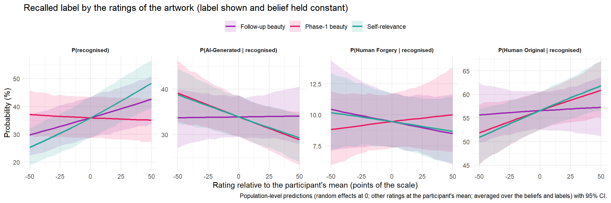{width=1152}
:::
:::


::: {.cell}

```{.r .cell-code}
make_memory_summary(estimates$MemoryConditionAppraisal)
```

::: {.cell-output-display}

::: {.callout-tip title="Summary of credible effects (generated from the tables above)"}

**Memory of the Condition by Belief, controlling the appraisal.** Each row of the model is the probability of one answer. The differences below are between Belief levels *within* the same answer, in percentage points, as posterior medians with 95% CI; `pd` is the probability of direction. An effect is called credible when the CI excludes 0. Contrasts *across* answers are in the full table above.

- **Human Original**: Human Original - AI Original 4.37 pp [2.29, 6.50]; Human Original - AI Copy 3.83 pp [1.80, 5.78]; Human Forgery - AI Original 2.79 pp [0.08, 5.59]. The other 3 pair(s) are not credible.
- **Human Forgery**: Human Forgery - AI Original 2.05 pp [0.45, 3.70]; Human Original - AI Original 1.81 pp [0.55, 3.04]. The other 4 pair(s) are not credible.
- **AI-Generated**: Human Original - AI Original -6.96 pp [-8.92, -5.01]; Human Forgery - AI Original -4.83 pp [-7.43, -2.41]; Human Original - AI Copy -3.95 pp [-5.75, -2.10]; AI Original - AI Copy 3.01 pp [0.77, 5.27]; Human Original - Human Forgery -2.10 pp [-4.27, -0.09]. The other 1 pair(s) are not credible.
- **Not recognized**: no credible difference between any pair of Belief levels.

:::

:::
:::


```{.r .cell-code}
# Generated reading of the two comparisons
reading <- function(cells, with, without) {
  vapply(seq_len(nrow(cells)), function(i) {
    a <- cell_contrast(without, cells$Level1[i], cells$Level2[i], cells$Response[i])
    b <- cell_contrast(with, cells$Level1[i], cells$Level2[i], cells$Response[i])
    sprintf("%s (%s - %s): %s -> %s pp, %s", cells$Response[i], cells$Level1[i], cells$Level2[i],
            insight::format_value(100 * a$Median), insight::format_value(100 * b$Median),
            ifelse(sign(b$CI_low) != sign(b$CI_high), "not credible with the ratings", "still credible"))
  }, character(1))
}
make_asis("", '::: {.callout-tip title="Memory or re-inference? (generated)"}', "",
          "**Recalled belief** (Belief contrasts without -> with the three ratings):", "",
          paste0("- ", reading(belief_cells, estimates$MemoryBeliefAppraisal, estimates$MemoryBelief)), "",
          "**Recalled label** (label shown held constant):", "",
          paste0("- ", reading(label_cells, estimates$MemoryConditionAppraisal, estimates$MemoryConditionBelief)), "",
          "A Belief contrast that keeps its size with the ratings in the model is not explained by the current impression of the work (follow-up beauty, self-relevance) nor by the Phase-1 appraisal that produced the belief; one that shrinks to zero was re-inference. The rating tables say which impression the answers follow: the current one (follow-up beauty, self-relevance) or the Phase-1 one.",
          "", ":::", "")
```


::: {.callout-tip title="Memory or re-inference? (generated)"}

**Recalled belief** (Belief contrasts without -> with the three ratings):

- AI Original (AI Original - Human Original): 6.47 -> 7.09 pp, still credible
- AI Original (AI Original - Human Forgery): 5.54 -> 5.96 pp, still credible
- Human Original (AI Original - Human Original): -8.02 -> -7.41 pp, still credible
- Human Original (Human Original - Human Forgery): 3.16 -> 2.66 pp, still credible
- Human Forgery (Human Forgery - Human Original): 1.23 -> 1.34 pp, not credible with the ratings
- AI Copy (AI Copy - AI Original): -0.44 -> -0.53 pp, not credible with the ratings

**Recalled label** (label shown held constant):

- AI-Generated (AI Original - Human Original): 6.95 -> 6.96 pp, still credible
- Human Original (AI Original - Human Original): -5.49 -> -4.37 pp, still credible
- Human Forgery (Human Forgery - Human Original): 0.20 -> 0.22 pp, not credible with the ratings
- Not recognized (AI Original - Human Original): 0.42 -> -0.78 pp, not credible with the ratings

A Belief contrast that keeps its size with the ratings in the model is not explained by the current impression of the work (follow-up beauty, self-relevance) nor by the Phase-1 appraisal that produced the belief; one that shrinks to zero was re-inference. The rating tables say which impression the answers follow: the current one (follow-up beauty, self-relevance) or the Phase-1 one.

:::

## Memory by Phase-1 Appraisal

Hypothesis 1 of the follow-up preregistration (`memory/ethics/preregistration.md`,
after Lee et al., 2023; Salgues et al., 2024): artworks that received
**extreme** aesthetic ratings in Phase 1, positive *or* negative, are better
recognised than those rated neutrally -- a U-shaped relation that a linear
predictor cannot show. The Phase-1 ratings were given ~47 days before the
memory test and exist for old items only, so they speak to what was encoded;
the follow-up ratings (self-relevance, follow-up beauty) were given in the
same trial as the recognition judgment and raise false alarms as much as
hits (`6_selfrelevance.qmd`, section C).

### Observed


::: {.cell}

```{.r .cell-code}
old <- df |>
  filter(Type == "Old", !is.na(Beauty), !is.na(Valence)) |>
  mutate(Beauty_w = Beauty - mean(Beauty), Valence_w = Valence - mean(Valence), .by = "Participant")
hit_bins <- bind_rows(
  mutate(old, Rating = "Beauty", Scale = "Absolute (% of the scale)",
         Bin = cut(100 * Beauty, c(-1, 0, 15, 30, 45, 55, 70, 85, 99.99, 100))),
  mutate(old, Rating = "Valence", Scale = "Absolute (% of the scale)",
         Bin = cut(100 * Valence, c(-1, 1, 20, 40, 60, 80, 99, 100))),
  mutate(old, Rating = "Beauty", Scale = "Relative to the participant's mean (points)",
         Bin = cut(100 * Beauty_w, c(-100, -50, -35, -20, -10, 0, 10, 20, 35, 100))),
  mutate(old, Rating = "Valence", Scale = "Relative to the participant's mean (points)",
         Bin = cut(100 * Valence_w, c(-100, -50, -33, -17, 0, 17, 33, 50, 100)))
) |>
  summarise(x = mean(100 * ifelse(str_starts(Scale, "Absolute"), ifelse(Rating == "Beauty", Beauty, Valence),
                                  ifelse(Rating == "Beauty", Beauty_w, Valence_w))),
            p = mean(Recognition == "Yes"), n = n(), .by = c(Rating, Scale, Bin)) |>
  mutate(SE = sqrt(p * (1 - p) / n))

ggplot(hit_bins, aes(x = x, y = 100 * p, color = Rating)) +
  geom_hline(yintercept = 100 * mean(old$Recognition == "Yes"), linetype = "dotted", color = "grey60") +
  geom_line(alpha = 0.6) +
  geom_pointrange(aes(ymin = 100 * (p - 1.96 * SE), ymax = 100 * (p + 1.96 * SE), size = n)) +
  facet_wrap(~Scale, scales = "free_x") +
  scale_size(range = c(0.1, 0.7), guide = "none") +
  scale_color_manual(values = c(Beauty = "#E91E63", Valence = "#FF9800")) +
  labs(x = "Phase-1 rating", y = "Recognised at follow-up (%)", color = NULL,
       caption = "Old items; observed hit rates per bin with 95% CI (not model-based). Dotted line: overall hit rate. Point size: number of trials.") +
  theme_minimal() +
  theme(legend.position = "top", strip.text = element_text(face = "bold"))
```

::: {.cell-output-display}
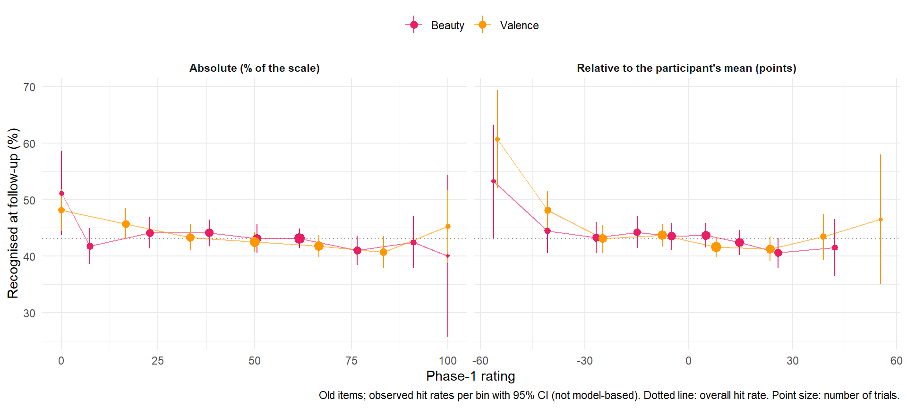{width=960}
:::
:::


### Model

**MemoryAppraisal** (`server/models.R`): the recalled label, with "Not
recognized" carrying recognition as in the models above, on the label shown
and on Phase-1 beauty and valence, each centred within participant and
entered with a quadratic term (old items only; participant intercepts and
linear slopes, item intercepts). Beauty and valence correlate strongly
within participant, so the **unique** curves move one rating with the other
held at the participant's mean, and the **joint** curves move it with the
other following along their within-person regression (how the two usually
co-vary). "Extremity" is the average of the -2 SD and +2 SD predictions
minus the prediction at the mean (> 0: both extremes above the mean, a U);
"Asymmetry" is +2 SD minus -2 SD.


```{.r .cell-code}
appraisal_ready <- file.exists("models/estimates/MemoryAppraisal.rds")
if (!appraisal_ready) {
  make_asis("", '::: {.callout-warning title="Estimates not available yet"}',
            "`MemoryAppraisal`: in `analysis/server`, `./hpc combine MemoryAppraisal` (check 4,000 draws), `./hpc extract MemoryAppraisal`, then `./hpc pull 'estimates/MemoryAppraisal.rds'`.",
            ":::", "")
} else {
  est_app <- read_estimates("MemoryAppraisal")$MemoryAppraisal
  app <- memory_grid_effects(est_app)
  fixed <- est_app$fixed |>
    filter(str_detect(Parameter, "Beauty|Valence")) |>
    mutate(Answer = str_match(Parameter, "^b_mu([^_]+)_")[, 2],
           Term = str_remove(Parameter, "^b_mu[^_]+_"),
           Effect = ifelse(sign(CI_low) != sign(CI_high), "n.s.", ifelse(Median < 0, "Negative", "Positive")),
           Diff = insight::format_value(Median),
           CI = sprintf("[%s, %s]", insight::format_value(CI_low), insight::format_value(CI_high)),
           pd_fmt = insight::format_pd(pd, name = NULL))
  eff <- app$effects |>
    mutate(Effect_label = Effect,
           Effect = ifelse(sign(CI_low) != sign(CI_high), "n.s.", ifelse(Median < 0, "Negative", "Positive")),
           Diff = insight::format_value(Median),
           CI = sprintf("[%s, %s]", insight::format_value(CI_low), insight::format_value(CI_high)),
           pd_fmt = insight::format_pd(pd, name = NULL),
           Contrast = paste(Outcome, "-", Type, "path"))
  make_asis(
    make_tables(est_app$diag, c("Model", "Family", "N_obs", "N_participants", "Chains", "Draws", "Max_Rhat", "Min_ESS_ratio", "Divergent_pct"),
                "Convergence of MemoryAppraisal"),
    make_tables(fixed, c("Answer", "Term", "Diff", "CI", "pd_fmt", "Effect"),
                "MemoryAppraisal: fixed effects of the ratings (log-odds of each answer vs. 'Human Original'; ratings on 0-1)"),
    make_tables(filter(eff, Outcome == "P(recognised)"), c("Contrast", "Predictor", "Effect_label", "Diff", "CI", "pd_fmt", "Effect"),
                "MemoryAppraisal: P(recognised) at -2 / -1 / +1 / +2 SD of the rating minus at the participant's mean, in percentage points"),
    make_tables(filter(eff, Outcome != "P(recognised)", Effect_label %in% c("-2 SD", "+2 SD", "Extremity", "Asymmetry")),
                c("Contrast", "Predictor", "Effect_label", "Diff", "CI", "pd_fmt", "Effect"),
                "MemoryAppraisal: recalled label among recognised artworks, at the extremes of the rating minus at the mean, in percentage points")
  )
}
```

```{=html}
<div id="owcxavbfyp" style="padding-left:0px;padding-right:0px;padding-top:10px;padding-bottom:10px;overflow-x:auto;overflow-y:auto;width:auto;height:auto;">
<style>#owcxavbfyp table {
  font-family: system-ui, 'Segoe UI', Roboto, Helvetica, Arial, sans-serif, 'Apple Color Emoji', 'Segoe UI Emoji', 'Segoe UI Symbol', 'Noto Color Emoji';
  -webkit-font-smoothing: antialiased;
  -moz-osx-font-smoothing: grayscale;
}

#owcxavbfyp thead, #owcxavbfyp tbody, #owcxavbfyp tfoot, #owcxavbfyp tr, #owcxavbfyp td, #owcxavbfyp th {
  border-style: none;
}

#owcxavbfyp p {
  margin: 0;
  padding: 0;
}

#owcxavbfyp .gt_table {
  display: table;
  border-collapse: collapse;
  line-height: normal;
  margin-left: auto;
  margin-right: auto;
  color: #333333;
  font-size: 13px;
  font-weight: normal;
  font-style: normal;
  background-color: #FFFFFF;
  width: auto;
  border-top-style: solid;
  border-top-width: 3px;
  border-top-color: #D5D5D5;
  border-right-style: solid;
  border-right-width: 3px;
  border-right-color: #D5D5D5;
  border-bottom-style: solid;
  border-bottom-width: 3px;
  border-bottom-color: #D5D5D5;
  border-left-style: solid;
  border-left-width: 3px;
  border-left-color: #D5D5D5;
}

#owcxavbfyp .gt_caption {
  padding-top: 4px;
  padding-bottom: 4px;
}

#owcxavbfyp .gt_title {
  color: #333333;
  font-size: 125%;
  font-weight: initial;
  padding-top: 4px;
  padding-bottom: 4px;
  padding-left: 5px;
  padding-right: 5px;
  border-bottom-color: #FFFFFF;
  border-bottom-width: 0;
}

#owcxavbfyp .gt_subtitle {
  color: #333333;
  font-size: 85%;
  font-weight: initial;
  padding-top: 3px;
  padding-bottom: 5px;
  padding-left: 5px;
  padding-right: 5px;
  border-top-color: #FFFFFF;
  border-top-width: 0;
}

#owcxavbfyp .gt_heading {
  background-color: #FFFFFF;
  text-align: left;
  border-bottom-color: #FFFFFF;
  border-left-style: none;
  border-left-width: 1px;
  border-left-color: #D3D3D3;
  border-right-style: none;
  border-right-width: 1px;
  border-right-color: #D3D3D3;
}

#owcxavbfyp .gt_bottom_border {
  border-bottom-style: solid;
  border-bottom-width: 2px;
  border-bottom-color: #D5D5D5;
}

#owcxavbfyp .gt_col_headings {
  border-top-style: solid;
  border-top-width: 2px;
  border-top-color: #D5D5D5;
  border-bottom-style: solid;
  border-bottom-width: 2px;
  border-bottom-color: #D5D5D5;
  border-left-style: none;
  border-left-width: 1px;
  border-left-color: #D3D3D3;
  border-right-style: none;
  border-right-width: 1px;
  border-right-color: #D3D3D3;
}

#owcxavbfyp .gt_col_heading {
  color: #FFFFFF;
  background-color: #000000;
  font-size: 100%;
  font-weight: normal;
  text-transform: inherit;
  border-left-style: none;
  border-left-width: 1px;
  border-left-color: #D3D3D3;
  border-right-style: none;
  border-right-width: 1px;
  border-right-color: #D3D3D3;
  vertical-align: bottom;
  padding-top: 5px;
  padding-bottom: 6px;
  padding-left: 5px;
  padding-right: 5px;
  overflow-x: hidden;
}

#owcxavbfyp .gt_column_spanner_outer {
  color: #FFFFFF;
  background-color: #000000;
  font-size: 100%;
  font-weight: normal;
  text-transform: inherit;
  padding-top: 0;
  padding-bottom: 0;
  padding-left: 4px;
  padding-right: 4px;
}

#owcxavbfyp .gt_column_spanner_outer:first-child {
  padding-left: 0;
}

#owcxavbfyp .gt_column_spanner_outer:last-child {
  padding-right: 0;
}

#owcxavbfyp .gt_column_spanner {
  border-bottom-style: solid;
  border-bottom-width: 2px;
  border-bottom-color: #D5D5D5;
  vertical-align: bottom;
  padding-top: 5px;
  padding-bottom: 5px;
  overflow-x: hidden;
  display: inline-block;
  width: 100%;
}

#owcxavbfyp .gt_spanner_row {
  border-bottom-style: hidden;
}

#owcxavbfyp .gt_group_heading {
  padding-top: 8px;
  padding-bottom: 8px;
  padding-left: 5px;
  padding-right: 5px;
  color: #333333;
  background-color: #FFFFFF;
  font-size: 100%;
  font-weight: initial;
  text-transform: inherit;
  border-top-style: solid;
  border-top-width: 2px;
  border-top-color: #D5D5D5;
  border-bottom-style: solid;
  border-bottom-width: 2px;
  border-bottom-color: #D5D5D5;
  border-left-style: none;
  border-left-width: 1px;
  border-left-color: #D3D3D3;
  border-right-style: none;
  border-right-width: 1px;
  border-right-color: #D3D3D3;
  vertical-align: middle;
  text-align: left;
}

#owcxavbfyp .gt_empty_group_heading {
  padding: 0.5px;
  color: #333333;
  background-color: #FFFFFF;
  font-size: 100%;
  font-weight: initial;
  border-top-style: solid;
  border-top-width: 2px;
  border-top-color: #D5D5D5;
  border-bottom-style: solid;
  border-bottom-width: 2px;
  border-bottom-color: #D5D5D5;
  vertical-align: middle;
}

#owcxavbfyp .gt_from_md > :first-child {
  margin-top: 0;
}

#owcxavbfyp .gt_from_md > :last-child {
  margin-bottom: 0;
}

#owcxavbfyp .gt_row {
  padding-top: 8px;
  padding-bottom: 8px;
  padding-left: 5px;
  padding-right: 5px;
  margin: 10px;
  border-top-style: solid;
  border-top-width: 1px;
  border-top-color: #D5D5D5;
  border-left-style: solid;
  border-left-width: 1px;
  border-left-color: #D5D5D5;
  border-right-style: solid;
  border-right-width: 1px;
  border-right-color: #D5D5D5;
  vertical-align: middle;
  overflow-x: hidden;
}

#owcxavbfyp .gt_stub {
  color: #333333;
  background-color: #FFFFFF;
  font-size: 100%;
  font-weight: initial;
  text-transform: inherit;
  border-right-style: solid;
  border-right-width: 2px;
  border-right-color: #5F5F5F;
  padding-left: 5px;
  padding-right: 5px;
}

#owcxavbfyp .gt_stub_row_group {
  color: #333333;
  background-color: #FFFFFF;
  font-size: 100%;
  font-weight: initial;
  text-transform: inherit;
  border-right-style: solid;
  border-right-width: 2px;
  border-right-color: #D3D3D3;
  padding-left: 5px;
  padding-right: 5px;
  vertical-align: top;
}

#owcxavbfyp .gt_row_group_first td {
  border-top-width: 2px;
}

#owcxavbfyp .gt_row_group_first th {
  border-top-width: 2px;
}

#owcxavbfyp .gt_summary_row {
  color: #333333;
  background-color: #D5D5D5;
  text-transform: inherit;
  padding-top: 8px;
  padding-bottom: 8px;
  padding-left: 5px;
  padding-right: 5px;
}

#owcxavbfyp .gt_first_summary_row {
  border-top-style: solid;
  border-top-color: #D5D5D5;
}

#owcxavbfyp .gt_first_summary_row.thick {
  border-top-width: 2px;
}

#owcxavbfyp .gt_last_summary_row {
  padding-top: 8px;
  padding-bottom: 8px;
  padding-left: 5px;
  padding-right: 5px;
  border-bottom-style: solid;
  border-bottom-width: 2px;
  border-bottom-color: #D5D5D5;
}

#owcxavbfyp .gt_grand_summary_row {
  color: #FFFFFF;
  background-color: #929292;
  text-transform: inherit;
  padding-top: 8px;
  padding-bottom: 8px;
  padding-left: 5px;
  padding-right: 5px;
}

#owcxavbfyp .gt_first_grand_summary_row {
  padding-top: 8px;
  padding-bottom: 8px;
  padding-left: 5px;
  padding-right: 5px;
  border-top-style: double;
  border-top-width: 6px;
  border-top-color: #D5D5D5;
}

#owcxavbfyp .gt_last_grand_summary_row_top {
  padding-top: 8px;
  padding-bottom: 8px;
  padding-left: 5px;
  padding-right: 5px;
  border-bottom-style: double;
  border-bottom-width: 6px;
  border-bottom-color: #D5D5D5;
}

#owcxavbfyp .gt_striped {
  background-color: #F4F4F4;
}

#owcxavbfyp .gt_table_body {
  border-top-style: solid;
  border-top-width: 2px;
  border-top-color: #D5D5D5;
  border-bottom-style: solid;
  border-bottom-width: 2px;
  border-bottom-color: #D5D5D5;
}

#owcxavbfyp .gt_footnotes {
  color: #333333;
  background-color: #FFFFFF;
  border-bottom-style: none;
  border-bottom-width: 2px;
  border-bottom-color: #D3D3D3;
  border-left-style: none;
  border-left-width: 2px;
  border-left-color: #D3D3D3;
  border-right-style: none;
  border-right-width: 2px;
  border-right-color: #D3D3D3;
}

#owcxavbfyp .gt_footnote {
  margin: 0px;
  font-size: 90%;
  padding-top: 4px;
  padding-bottom: 4px;
  padding-left: 5px;
  padding-right: 5px;
}

#owcxavbfyp .gt_sourcenotes {
  color: #333333;
  background-color: #FFFFFF;
  border-bottom-style: none;
  border-bottom-width: 2px;
  border-bottom-color: #D3D3D3;
  border-left-style: none;
  border-left-width: 2px;
  border-left-color: #D3D3D3;
  border-right-style: none;
  border-right-width: 2px;
  border-right-color: #D3D3D3;
}

#owcxavbfyp .gt_sourcenote {
  font-size: 90%;
  padding-top: 4px;
  padding-bottom: 4px;
  padding-left: 5px;
  padding-right: 5px;
}

#owcxavbfyp .gt_left {
  text-align: left;
}

#owcxavbfyp .gt_center {
  text-align: center;
}

#owcxavbfyp .gt_right {
  text-align: right;
  font-variant-numeric: tabular-nums;
}

#owcxavbfyp .gt_font_normal {
  font-weight: normal;
}

#owcxavbfyp .gt_font_bold {
  font-weight: bold;
}

#owcxavbfyp .gt_font_italic {
  font-style: italic;
}

#owcxavbfyp .gt_super {
  font-size: 65%;
}

#owcxavbfyp .gt_footnote_marks {
  font-size: 75%;
  vertical-align: 0.4em;
  position: initial;
}

#owcxavbfyp .gt_asterisk {
  font-size: 100%;
  vertical-align: 0;
}

#owcxavbfyp .gt_indent_1 {
  text-indent: 5px;
}

#owcxavbfyp .gt_indent_2 {
  text-indent: 10px;
}

#owcxavbfyp .gt_indent_3 {
  text-indent: 15px;
}

#owcxavbfyp .gt_indent_4 {
  text-indent: 20px;
}

#owcxavbfyp .gt_indent_5 {
  text-indent: 25px;
}

#owcxavbfyp .katex-display {
  display: inline-flex !important;
  margin-bottom: 0.75em !important;
}

#owcxavbfyp div.Reactable > div.rt-table > div.rt-thead > div.rt-tr.rt-tr-group-header > div.rt-th-group:after {
  height: 0px !important;
}
</style>
<table class="gt_table" data-quarto-disable-processing="false" data-quarto-bootstrap="false">
  <thead>
    <tr class="gt_heading">
      <td colspan="9" class="gt_heading gt_title gt_font_normal gt_bottom_border" style>Convergence of MemoryAppraisal</td>
    </tr>
    
    <tr class="gt_col_headings">
      <th class="gt_col_heading gt_columns_bottom_border gt_left" rowspan="1" colspan="1" scope="col" id="Model">Model</th>
      <th class="gt_col_heading gt_columns_bottom_border gt_left" rowspan="1" colspan="1" scope="col" id="Family">Family</th>
      <th class="gt_col_heading gt_columns_bottom_border gt_right" rowspan="1" colspan="1" scope="col" id="N_obs">N_obs</th>
      <th class="gt_col_heading gt_columns_bottom_border gt_right" rowspan="1" colspan="1" scope="col" id="N_participants">N_participants</th>
      <th class="gt_col_heading gt_columns_bottom_border gt_right" rowspan="1" colspan="1" scope="col" id="Chains">Chains</th>
      <th class="gt_col_heading gt_columns_bottom_border gt_right" rowspan="1" colspan="1" scope="col" id="Draws">Draws</th>
      <th class="gt_col_heading gt_columns_bottom_border gt_right" rowspan="1" colspan="1" scope="col" id="Max_Rhat">Max_Rhat</th>
      <th class="gt_col_heading gt_columns_bottom_border gt_right" rowspan="1" colspan="1" scope="col" id="Min_ESS_ratio">Min_ESS_ratio</th>
      <th class="gt_col_heading gt_columns_bottom_border gt_right" rowspan="1" colspan="1" scope="col" id="Divergent_pct">Divergent_pct</th>
    </tr>
  </thead>
  <tbody class="gt_table_body">
    <tr><td headers="Model" class="gt_row gt_left">MemoryAppraisal</td>
<td headers="Family" class="gt_row gt_left">Categorical</td>
<td headers="N_obs" class="gt_row gt_right">10560</td>
<td headers="N_participants" class="gt_row gt_right">220</td>
<td headers="Chains" class="gt_row gt_right">8</td>
<td headers="Draws" class="gt_row gt_right">4000</td>
<td headers="Max_Rhat" class="gt_row gt_right">1.018</td>
<td headers="Min_ESS_ratio" class="gt_row gt_right">0.136</td>
<td headers="Divergent_pct" class="gt_row gt_right">0</td></tr>
  </tbody>
  
</table>
</div>
```


::: {.callout-note collapse="true" title="Convergence of MemoryAppraisal (Markdown table, for text readers)"}

|Model           |Family      | N_obs| N_participants| Chains| Draws| Max_Rhat| Min_ESS_ratio| Divergent_pct|
|:---------------|:-----------|-----:|--------------:|------:|-----:|--------:|-------------:|-------------:|
|MemoryAppraisal |Categorical | 10560|            220|      8|  4000|    1.018|         0.136|             0|

:::

```{=html}
<div id="plyfgwuakf" style="padding-left:0px;padding-right:0px;padding-top:10px;padding-bottom:10px;overflow-x:auto;overflow-y:auto;width:auto;height:auto;">
<style>#plyfgwuakf table {
  font-family: system-ui, 'Segoe UI', Roboto, Helvetica, Arial, sans-serif, 'Apple Color Emoji', 'Segoe UI Emoji', 'Segoe UI Symbol', 'Noto Color Emoji';
  -webkit-font-smoothing: antialiased;
  -moz-osx-font-smoothing: grayscale;
}

#plyfgwuakf thead, #plyfgwuakf tbody, #plyfgwuakf tfoot, #plyfgwuakf tr, #plyfgwuakf td, #plyfgwuakf th {
  border-style: none;
}

#plyfgwuakf p {
  margin: 0;
  padding: 0;
}

#plyfgwuakf .gt_table {
  display: table;
  border-collapse: collapse;
  line-height: normal;
  margin-left: auto;
  margin-right: auto;
  color: #333333;
  font-size: 13px;
  font-weight: normal;
  font-style: normal;
  background-color: #FFFFFF;
  width: auto;
  border-top-style: solid;
  border-top-width: 3px;
  border-top-color: #D5D5D5;
  border-right-style: solid;
  border-right-width: 3px;
  border-right-color: #D5D5D5;
  border-bottom-style: solid;
  border-bottom-width: 3px;
  border-bottom-color: #D5D5D5;
  border-left-style: solid;
  border-left-width: 3px;
  border-left-color: #D5D5D5;
}

#plyfgwuakf .gt_caption {
  padding-top: 4px;
  padding-bottom: 4px;
}

#plyfgwuakf .gt_title {
  color: #333333;
  font-size: 125%;
  font-weight: initial;
  padding-top: 4px;
  padding-bottom: 4px;
  padding-left: 5px;
  padding-right: 5px;
  border-bottom-color: #FFFFFF;
  border-bottom-width: 0;
}

#plyfgwuakf .gt_subtitle {
  color: #333333;
  font-size: 85%;
  font-weight: initial;
  padding-top: 3px;
  padding-bottom: 5px;
  padding-left: 5px;
  padding-right: 5px;
  border-top-color: #FFFFFF;
  border-top-width: 0;
}

#plyfgwuakf .gt_heading {
  background-color: #FFFFFF;
  text-align: left;
  border-bottom-color: #FFFFFF;
  border-left-style: none;
  border-left-width: 1px;
  border-left-color: #D3D3D3;
  border-right-style: none;
  border-right-width: 1px;
  border-right-color: #D3D3D3;
}

#plyfgwuakf .gt_bottom_border {
  border-bottom-style: solid;
  border-bottom-width: 2px;
  border-bottom-color: #D5D5D5;
}

#plyfgwuakf .gt_col_headings {
  border-top-style: solid;
  border-top-width: 2px;
  border-top-color: #D5D5D5;
  border-bottom-style: solid;
  border-bottom-width: 2px;
  border-bottom-color: #D5D5D5;
  border-left-style: none;
  border-left-width: 1px;
  border-left-color: #D3D3D3;
  border-right-style: none;
  border-right-width: 1px;
  border-right-color: #D3D3D3;
}

#plyfgwuakf .gt_col_heading {
  color: #FFFFFF;
  background-color: #000000;
  font-size: 100%;
  font-weight: normal;
  text-transform: inherit;
  border-left-style: none;
  border-left-width: 1px;
  border-left-color: #D3D3D3;
  border-right-style: none;
  border-right-width: 1px;
  border-right-color: #D3D3D3;
  vertical-align: bottom;
  padding-top: 5px;
  padding-bottom: 6px;
  padding-left: 5px;
  padding-right: 5px;
  overflow-x: hidden;
}

#plyfgwuakf .gt_column_spanner_outer {
  color: #FFFFFF;
  background-color: #000000;
  font-size: 100%;
  font-weight: normal;
  text-transform: inherit;
  padding-top: 0;
  padding-bottom: 0;
  padding-left: 4px;
  padding-right: 4px;
}

#plyfgwuakf .gt_column_spanner_outer:first-child {
  padding-left: 0;
}

#plyfgwuakf .gt_column_spanner_outer:last-child {
  padding-right: 0;
}

#plyfgwuakf .gt_column_spanner {
  border-bottom-style: solid;
  border-bottom-width: 2px;
  border-bottom-color: #D5D5D5;
  vertical-align: bottom;
  padding-top: 5px;
  padding-bottom: 5px;
  overflow-x: hidden;
  display: inline-block;
  width: 100%;
}

#plyfgwuakf .gt_spanner_row {
  border-bottom-style: hidden;
}

#plyfgwuakf .gt_group_heading {
  padding-top: 8px;
  padding-bottom: 8px;
  padding-left: 5px;
  padding-right: 5px;
  color: #333333;
  background-color: #FFFFFF;
  font-size: 100%;
  font-weight: initial;
  text-transform: inherit;
  border-top-style: solid;
  border-top-width: 2px;
  border-top-color: #D5D5D5;
  border-bottom-style: solid;
  border-bottom-width: 2px;
  border-bottom-color: #D5D5D5;
  border-left-style: none;
  border-left-width: 1px;
  border-left-color: #D3D3D3;
  border-right-style: none;
  border-right-width: 1px;
  border-right-color: #D3D3D3;
  vertical-align: middle;
  text-align: left;
}

#plyfgwuakf .gt_empty_group_heading {
  padding: 0.5px;
  color: #333333;
  background-color: #FFFFFF;
  font-size: 100%;
  font-weight: initial;
  border-top-style: solid;
  border-top-width: 2px;
  border-top-color: #D5D5D5;
  border-bottom-style: solid;
  border-bottom-width: 2px;
  border-bottom-color: #D5D5D5;
  vertical-align: middle;
}

#plyfgwuakf .gt_from_md > :first-child {
  margin-top: 0;
}

#plyfgwuakf .gt_from_md > :last-child {
  margin-bottom: 0;
}

#plyfgwuakf .gt_row {
  padding-top: 8px;
  padding-bottom: 8px;
  padding-left: 5px;
  padding-right: 5px;
  margin: 10px;
  border-top-style: solid;
  border-top-width: 1px;
  border-top-color: #D5D5D5;
  border-left-style: solid;
  border-left-width: 1px;
  border-left-color: #D5D5D5;
  border-right-style: solid;
  border-right-width: 1px;
  border-right-color: #D5D5D5;
  vertical-align: middle;
  overflow-x: hidden;
}

#plyfgwuakf .gt_stub {
  color: #333333;
  background-color: #FFFFFF;
  font-size: 100%;
  font-weight: initial;
  text-transform: inherit;
  border-right-style: solid;
  border-right-width: 2px;
  border-right-color: #5F5F5F;
  padding-left: 5px;
  padding-right: 5px;
}

#plyfgwuakf .gt_stub_row_group {
  color: #333333;
  background-color: #FFFFFF;
  font-size: 100%;
  font-weight: initial;
  text-transform: inherit;
  border-right-style: solid;
  border-right-width: 2px;
  border-right-color: #D3D3D3;
  padding-left: 5px;
  padding-right: 5px;
  vertical-align: top;
}

#plyfgwuakf .gt_row_group_first td {
  border-top-width: 2px;
}

#plyfgwuakf .gt_row_group_first th {
  border-top-width: 2px;
}

#plyfgwuakf .gt_summary_row {
  color: #333333;
  background-color: #D5D5D5;
  text-transform: inherit;
  padding-top: 8px;
  padding-bottom: 8px;
  padding-left: 5px;
  padding-right: 5px;
}

#plyfgwuakf .gt_first_summary_row {
  border-top-style: solid;
  border-top-color: #D5D5D5;
}

#plyfgwuakf .gt_first_summary_row.thick {
  border-top-width: 2px;
}

#plyfgwuakf .gt_last_summary_row {
  padding-top: 8px;
  padding-bottom: 8px;
  padding-left: 5px;
  padding-right: 5px;
  border-bottom-style: solid;
  border-bottom-width: 2px;
  border-bottom-color: #D5D5D5;
}

#plyfgwuakf .gt_grand_summary_row {
  color: #FFFFFF;
  background-color: #929292;
  text-transform: inherit;
  padding-top: 8px;
  padding-bottom: 8px;
  padding-left: 5px;
  padding-right: 5px;
}

#plyfgwuakf .gt_first_grand_summary_row {
  padding-top: 8px;
  padding-bottom: 8px;
  padding-left: 5px;
  padding-right: 5px;
  border-top-style: double;
  border-top-width: 6px;
  border-top-color: #D5D5D5;
}

#plyfgwuakf .gt_last_grand_summary_row_top {
  padding-top: 8px;
  padding-bottom: 8px;
  padding-left: 5px;
  padding-right: 5px;
  border-bottom-style: double;
  border-bottom-width: 6px;
  border-bottom-color: #D5D5D5;
}

#plyfgwuakf .gt_striped {
  background-color: #F4F4F4;
}

#plyfgwuakf .gt_table_body {
  border-top-style: solid;
  border-top-width: 2px;
  border-top-color: #D5D5D5;
  border-bottom-style: solid;
  border-bottom-width: 2px;
  border-bottom-color: #D5D5D5;
}

#plyfgwuakf .gt_footnotes {
  color: #333333;
  background-color: #FFFFFF;
  border-bottom-style: none;
  border-bottom-width: 2px;
  border-bottom-color: #D3D3D3;
  border-left-style: none;
  border-left-width: 2px;
  border-left-color: #D3D3D3;
  border-right-style: none;
  border-right-width: 2px;
  border-right-color: #D3D3D3;
}

#plyfgwuakf .gt_footnote {
  margin: 0px;
  font-size: 90%;
  padding-top: 4px;
  padding-bottom: 4px;
  padding-left: 5px;
  padding-right: 5px;
}

#plyfgwuakf .gt_sourcenotes {
  color: #333333;
  background-color: #FFFFFF;
  border-bottom-style: none;
  border-bottom-width: 2px;
  border-bottom-color: #D3D3D3;
  border-left-style: none;
  border-left-width: 2px;
  border-left-color: #D3D3D3;
  border-right-style: none;
  border-right-width: 2px;
  border-right-color: #D3D3D3;
}

#plyfgwuakf .gt_sourcenote {
  font-size: 90%;
  padding-top: 4px;
  padding-bottom: 4px;
  padding-left: 5px;
  padding-right: 5px;
}

#plyfgwuakf .gt_left {
  text-align: left;
}

#plyfgwuakf .gt_center {
  text-align: center;
}

#plyfgwuakf .gt_right {
  text-align: right;
  font-variant-numeric: tabular-nums;
}

#plyfgwuakf .gt_font_normal {
  font-weight: normal;
}

#plyfgwuakf .gt_font_bold {
  font-weight: bold;
}

#plyfgwuakf .gt_font_italic {
  font-style: italic;
}

#plyfgwuakf .gt_super {
  font-size: 65%;
}

#plyfgwuakf .gt_footnote_marks {
  font-size: 75%;
  vertical-align: 0.4em;
  position: initial;
}

#plyfgwuakf .gt_asterisk {
  font-size: 100%;
  vertical-align: 0;
}

#plyfgwuakf .gt_indent_1 {
  text-indent: 5px;
}

#plyfgwuakf .gt_indent_2 {
  text-indent: 10px;
}

#plyfgwuakf .gt_indent_3 {
  text-indent: 15px;
}

#plyfgwuakf .gt_indent_4 {
  text-indent: 20px;
}

#plyfgwuakf .gt_indent_5 {
  text-indent: 25px;
}

#plyfgwuakf .katex-display {
  display: inline-flex !important;
  margin-bottom: 0.75em !important;
}

#plyfgwuakf div.Reactable > div.rt-table > div.rt-thead > div.rt-tr.rt-tr-group-header > div.rt-th-group:after {
  height: 0px !important;
}
</style>
<table class="gt_table" data-quarto-disable-processing="false" data-quarto-bootstrap="false">
  <thead>
    <tr class="gt_heading">
      <td colspan="6" class="gt_heading gt_title gt_font_normal gt_bottom_border" style>MemoryAppraisal: fixed effects of the ratings (log-odds of each answer vs. 'Human Original'; ratings on 0-1)</td>
    </tr>
    
    <tr class="gt_col_headings">
      <th class="gt_col_heading gt_columns_bottom_border gt_left" rowspan="1" colspan="1" scope="col" id="Answer">Answer</th>
      <th class="gt_col_heading gt_columns_bottom_border gt_left" rowspan="1" colspan="1" scope="col" id="Term">Term</th>
      <th class="gt_col_heading gt_columns_bottom_border gt_right" rowspan="1" colspan="1" scope="col" id="Diff">Diff</th>
      <th class="gt_col_heading gt_columns_bottom_border gt_left" rowspan="1" colspan="1" scope="col" id="CI">CI</th>
      <th class="gt_col_heading gt_columns_bottom_border gt_right" rowspan="1" colspan="1" scope="col" id="pd_fmt">pd_fmt</th>
      <th class="gt_col_heading gt_columns_bottom_border gt_left" rowspan="1" colspan="1" scope="col" id="Effect">Effect</th>
    </tr>
  </thead>
  <tbody class="gt_table_body">
    <tr><td headers="Answer" class="gt_row gt_left" style="color: #9E9E9E;">HumanForgery</td>
<td headers="Term" class="gt_row gt_left" style="color: #9E9E9E;">Beauty_w</td>
<td headers="Diff" class="gt_row gt_right" style="color: #9E9E9E;">-0.65</td>
<td headers="CI" class="gt_row gt_left" style="color: #9E9E9E;">[-1.41, 0.17]</td>
<td headers="pd_fmt" class="gt_row gt_right" style="color: #9E9E9E;">94.67%</td>
<td headers="Effect" class="gt_row gt_left" style="color: #9E9E9E;">n.s.</td></tr>
    <tr><td headers="Answer" class="gt_row gt_left gt_striped" style="color: #9E9E9E;">HumanForgery</td>
<td headers="Term" class="gt_row gt_left gt_striped" style="color: #9E9E9E;">IBeauty_wE2</td>
<td headers="Diff" class="gt_row gt_right gt_striped" style="color: #9E9E9E;">-0.81</td>
<td headers="CI" class="gt_row gt_left gt_striped" style="color: #9E9E9E;">[-2.65, 0.96]</td>
<td headers="pd_fmt" class="gt_row gt_right gt_striped" style="color: #9E9E9E;">80.70%</td>
<td headers="Effect" class="gt_row gt_left gt_striped" style="color: #9E9E9E;">n.s.</td></tr>
    <tr><td headers="Answer" class="gt_row gt_left" style="color: #9E9E9E;">HumanForgery</td>
<td headers="Term" class="gt_row gt_left" style="color: #9E9E9E;">Valence_w</td>
<td headers="Diff" class="gt_row gt_right" style="color: #9E9E9E;">0.63</td>
<td headers="CI" class="gt_row gt_left" style="color: #9E9E9E;">[-0.09, 1.36]</td>
<td headers="pd_fmt" class="gt_row gt_right" style="color: #9E9E9E;">96.23%</td>
<td headers="Effect" class="gt_row gt_left" style="color: #9E9E9E;">n.s.</td></tr>
    <tr><td headers="Answer" class="gt_row gt_left gt_striped" style="color: #9E9E9E;">HumanForgery</td>
<td headers="Term" class="gt_row gt_left gt_striped" style="color: #9E9E9E;">IValence_wE2</td>
<td headers="Diff" class="gt_row gt_right gt_striped" style="color: #9E9E9E;">-0.42</td>
<td headers="CI" class="gt_row gt_left gt_striped" style="color: #9E9E9E;">[-1.96, 1.20]</td>
<td headers="pd_fmt" class="gt_row gt_right gt_striped" style="color: #9E9E9E;">70.43%</td>
<td headers="Effect" class="gt_row gt_left gt_striped" style="color: #9E9E9E;">n.s.</td></tr>
    <tr><td headers="Answer" class="gt_row gt_left" style="color: #9E9E9E;">AIGenerated</td>
<td headers="Term" class="gt_row gt_left" style="color: #9E9E9E;">Beauty_w</td>
<td headers="Diff" class="gt_row gt_right" style="color: #9E9E9E;">-0.51</td>
<td headers="CI" class="gt_row gt_left" style="color: #9E9E9E;">[-1.09, 8.29e-03]</td>
<td headers="pd_fmt" class="gt_row gt_right" style="color: #9E9E9E;">96.50%</td>
<td headers="Effect" class="gt_row gt_left" style="color: #9E9E9E;">n.s.</td></tr>
    <tr><td headers="Answer" class="gt_row gt_left gt_striped" style="color: #9E9E9E;">AIGenerated</td>
<td headers="Term" class="gt_row gt_left gt_striped" style="color: #9E9E9E;">IBeauty_wE2</td>
<td headers="Diff" class="gt_row gt_right gt_striped" style="color: #9E9E9E;">0.12</td>
<td headers="CI" class="gt_row gt_left gt_striped" style="color: #9E9E9E;">[-1.27, 1.53]</td>
<td headers="pd_fmt" class="gt_row gt_right gt_striped" style="color: #9E9E9E;">56.97%</td>
<td headers="Effect" class="gt_row gt_left gt_striped" style="color: #9E9E9E;">n.s.</td></tr>
    <tr><td headers="Answer" class="gt_row gt_left" style="color: #9E9E9E;">AIGenerated</td>
<td headers="Term" class="gt_row gt_left" style="color: #9E9E9E;">Valence_w</td>
<td headers="Diff" class="gt_row gt_right" style="color: #9E9E9E;">-0.27</td>
<td headers="CI" class="gt_row gt_left" style="color: #9E9E9E;">[-0.75, 0.28]</td>
<td headers="pd_fmt" class="gt_row gt_right" style="color: #9E9E9E;">85.72%</td>
<td headers="Effect" class="gt_row gt_left" style="color: #9E9E9E;">n.s.</td></tr>
    <tr><td headers="Answer" class="gt_row gt_left gt_striped" style="color: #9E9E9E;">AIGenerated</td>
<td headers="Term" class="gt_row gt_left gt_striped" style="color: #9E9E9E;">IValence_wE2</td>
<td headers="Diff" class="gt_row gt_right gt_striped" style="color: #9E9E9E;">-0.24</td>
<td headers="CI" class="gt_row gt_left gt_striped" style="color: #9E9E9E;">[-1.58, 1.01]</td>
<td headers="pd_fmt" class="gt_row gt_right gt_striped" style="color: #9E9E9E;">64.80%</td>
<td headers="Effect" class="gt_row gt_left gt_striped" style="color: #9E9E9E;">n.s.</td></tr>
    <tr><td headers="Answer" class="gt_row gt_left" style="background-color: #FFEBEE;">Notrecognized</td>
<td headers="Term" class="gt_row gt_left" style="background-color: #FFEBEE;">Beauty_w</td>
<td headers="Diff" class="gt_row gt_right" style="background-color: #FFEBEE;">-0.78</td>
<td headers="CI" class="gt_row gt_left" style="background-color: #FFEBEE;">[-1.21, -0.36]</td>
<td headers="pd_fmt" class="gt_row gt_right" style="background-color: #FFEBEE;">100%</td>
<td headers="Effect" class="gt_row gt_left" style="background-color: #FFEBEE;">Negative</td></tr>
    <tr><td headers="Answer" class="gt_row gt_left gt_striped" style="color: #9E9E9E;">Notrecognized</td>
<td headers="Term" class="gt_row gt_left gt_striped" style="color: #9E9E9E;">IBeauty_wE2</td>
<td headers="Diff" class="gt_row gt_right gt_striped" style="color: #9E9E9E;">-0.85</td>
<td headers="CI" class="gt_row gt_left gt_striped" style="color: #9E9E9E;">[-2.07, 0.27]</td>
<td headers="pd_fmt" class="gt_row gt_right gt_striped" style="color: #9E9E9E;">92.70%</td>
<td headers="Effect" class="gt_row gt_left gt_striped" style="color: #9E9E9E;">n.s.</td></tr>
    <tr><td headers="Answer" class="gt_row gt_left" style="color: #9E9E9E;">Notrecognized</td>
<td headers="Term" class="gt_row gt_left" style="color: #9E9E9E;">Valence_w</td>
<td headers="Diff" class="gt_row gt_right" style="color: #9E9E9E;">-0.09</td>
<td headers="CI" class="gt_row gt_left" style="color: #9E9E9E;">[-0.49, 0.33]</td>
<td headers="pd_fmt" class="gt_row gt_right" style="color: #9E9E9E;">66.67%</td>
<td headers="Effect" class="gt_row gt_left" style="color: #9E9E9E;">n.s.</td></tr>
    <tr><td headers="Answer" class="gt_row gt_left gt_striped" style="color: #9E9E9E;">Notrecognized</td>
<td headers="Term" class="gt_row gt_left gt_striped" style="color: #9E9E9E;">IValence_wE2</td>
<td headers="Diff" class="gt_row gt_right gt_striped" style="color: #9E9E9E;">-0.90</td>
<td headers="CI" class="gt_row gt_left gt_striped" style="color: #9E9E9E;">[-1.91, 0.18]</td>
<td headers="pd_fmt" class="gt_row gt_right gt_striped" style="color: #9E9E9E;">95.17%</td>
<td headers="Effect" class="gt_row gt_left gt_striped" style="color: #9E9E9E;">n.s.</td></tr>
  </tbody>
  
</table>
</div>
```


::: {.callout-note collapse="true" title="MemoryAppraisal: fixed effects of the ratings (log-odds of each answer vs. 'Human Original'; ratings on 0-1) (Markdown table, for text readers)"}

|Answer        |Term         |Diff  |CI                |pd_fmt |Effect   |
|:-------------|:------------|:-----|:-----------------|:------|:--------|
|HumanForgery  |Beauty_w     |-0.65 |[-1.41, 0.17]     |94.67% |n.s.     |
|HumanForgery  |IBeauty_wE2  |-0.81 |[-2.65, 0.96]     |80.70% |n.s.     |
|HumanForgery  |Valence_w    |0.63  |[-0.09, 1.36]     |96.23% |n.s.     |
|HumanForgery  |IValence_wE2 |-0.42 |[-1.96, 1.20]     |70.43% |n.s.     |
|AIGenerated   |Beauty_w     |-0.51 |[-1.09, 8.29e-03] |96.50% |n.s.     |
|AIGenerated   |IBeauty_wE2  |0.12  |[-1.27, 1.53]     |56.97% |n.s.     |
|AIGenerated   |Valence_w    |-0.27 |[-0.75, 0.28]     |85.72% |n.s.     |
|AIGenerated   |IValence_wE2 |-0.24 |[-1.58, 1.01]     |64.80% |n.s.     |
|Notrecognized |Beauty_w     |-0.78 |[-1.21, -0.36]    |100%   |Negative |
|Notrecognized |IBeauty_wE2  |-0.85 |[-2.07, 0.27]     |92.70% |n.s.     |
|Notrecognized |Valence_w    |-0.09 |[-0.49, 0.33]     |66.67% |n.s.     |
|Notrecognized |IValence_wE2 |-0.90 |[-1.91, 0.18]     |95.17% |n.s.     |

:::

```{=html}
<div id="qgsqnkphkn" style="padding-left:0px;padding-right:0px;padding-top:10px;padding-bottom:10px;overflow-x:auto;overflow-y:auto;width:auto;height:auto;">
<style>#qgsqnkphkn table {
  font-family: system-ui, 'Segoe UI', Roboto, Helvetica, Arial, sans-serif, 'Apple Color Emoji', 'Segoe UI Emoji', 'Segoe UI Symbol', 'Noto Color Emoji';
  -webkit-font-smoothing: antialiased;
  -moz-osx-font-smoothing: grayscale;
}

#qgsqnkphkn thead, #qgsqnkphkn tbody, #qgsqnkphkn tfoot, #qgsqnkphkn tr, #qgsqnkphkn td, #qgsqnkphkn th {
  border-style: none;
}

#qgsqnkphkn p {
  margin: 0;
  padding: 0;
}

#qgsqnkphkn .gt_table {
  display: table;
  border-collapse: collapse;
  line-height: normal;
  margin-left: auto;
  margin-right: auto;
  color: #333333;
  font-size: 13px;
  font-weight: normal;
  font-style: normal;
  background-color: #FFFFFF;
  width: auto;
  border-top-style: solid;
  border-top-width: 3px;
  border-top-color: #D5D5D5;
  border-right-style: solid;
  border-right-width: 3px;
  border-right-color: #D5D5D5;
  border-bottom-style: solid;
  border-bottom-width: 3px;
  border-bottom-color: #D5D5D5;
  border-left-style: solid;
  border-left-width: 3px;
  border-left-color: #D5D5D5;
}

#qgsqnkphkn .gt_caption {
  padding-top: 4px;
  padding-bottom: 4px;
}

#qgsqnkphkn .gt_title {
  color: #333333;
  font-size: 125%;
  font-weight: initial;
  padding-top: 4px;
  padding-bottom: 4px;
  padding-left: 5px;
  padding-right: 5px;
  border-bottom-color: #FFFFFF;
  border-bottom-width: 0;
}

#qgsqnkphkn .gt_subtitle {
  color: #333333;
  font-size: 85%;
  font-weight: initial;
  padding-top: 3px;
  padding-bottom: 5px;
  padding-left: 5px;
  padding-right: 5px;
  border-top-color: #FFFFFF;
  border-top-width: 0;
}

#qgsqnkphkn .gt_heading {
  background-color: #FFFFFF;
  text-align: left;
  border-bottom-color: #FFFFFF;
  border-left-style: none;
  border-left-width: 1px;
  border-left-color: #D3D3D3;
  border-right-style: none;
  border-right-width: 1px;
  border-right-color: #D3D3D3;
}

#qgsqnkphkn .gt_bottom_border {
  border-bottom-style: solid;
  border-bottom-width: 2px;
  border-bottom-color: #D5D5D5;
}

#qgsqnkphkn .gt_col_headings {
  border-top-style: solid;
  border-top-width: 2px;
  border-top-color: #D5D5D5;
  border-bottom-style: solid;
  border-bottom-width: 2px;
  border-bottom-color: #D5D5D5;
  border-left-style: none;
  border-left-width: 1px;
  border-left-color: #D3D3D3;
  border-right-style: none;
  border-right-width: 1px;
  border-right-color: #D3D3D3;
}

#qgsqnkphkn .gt_col_heading {
  color: #FFFFFF;
  background-color: #000000;
  font-size: 100%;
  font-weight: normal;
  text-transform: inherit;
  border-left-style: none;
  border-left-width: 1px;
  border-left-color: #D3D3D3;
  border-right-style: none;
  border-right-width: 1px;
  border-right-color: #D3D3D3;
  vertical-align: bottom;
  padding-top: 5px;
  padding-bottom: 6px;
  padding-left: 5px;
  padding-right: 5px;
  overflow-x: hidden;
}

#qgsqnkphkn .gt_column_spanner_outer {
  color: #FFFFFF;
  background-color: #000000;
  font-size: 100%;
  font-weight: normal;
  text-transform: inherit;
  padding-top: 0;
  padding-bottom: 0;
  padding-left: 4px;
  padding-right: 4px;
}

#qgsqnkphkn .gt_column_spanner_outer:first-child {
  padding-left: 0;
}

#qgsqnkphkn .gt_column_spanner_outer:last-child {
  padding-right: 0;
}

#qgsqnkphkn .gt_column_spanner {
  border-bottom-style: solid;
  border-bottom-width: 2px;
  border-bottom-color: #D5D5D5;
  vertical-align: bottom;
  padding-top: 5px;
  padding-bottom: 5px;
  overflow-x: hidden;
  display: inline-block;
  width: 100%;
}

#qgsqnkphkn .gt_spanner_row {
  border-bottom-style: hidden;
}

#qgsqnkphkn .gt_group_heading {
  padding-top: 8px;
  padding-bottom: 8px;
  padding-left: 5px;
  padding-right: 5px;
  color: #333333;
  background-color: #FFFFFF;
  font-size: 100%;
  font-weight: initial;
  text-transform: inherit;
  border-top-style: solid;
  border-top-width: 2px;
  border-top-color: #D5D5D5;
  border-bottom-style: solid;
  border-bottom-width: 2px;
  border-bottom-color: #D5D5D5;
  border-left-style: none;
  border-left-width: 1px;
  border-left-color: #D3D3D3;
  border-right-style: none;
  border-right-width: 1px;
  border-right-color: #D3D3D3;
  vertical-align: middle;
  text-align: left;
}

#qgsqnkphkn .gt_empty_group_heading {
  padding: 0.5px;
  color: #333333;
  background-color: #FFFFFF;
  font-size: 100%;
  font-weight: initial;
  border-top-style: solid;
  border-top-width: 2px;
  border-top-color: #D5D5D5;
  border-bottom-style: solid;
  border-bottom-width: 2px;
  border-bottom-color: #D5D5D5;
  vertical-align: middle;
}

#qgsqnkphkn .gt_from_md > :first-child {
  margin-top: 0;
}

#qgsqnkphkn .gt_from_md > :last-child {
  margin-bottom: 0;
}

#qgsqnkphkn .gt_row {
  padding-top: 8px;
  padding-bottom: 8px;
  padding-left: 5px;
  padding-right: 5px;
  margin: 10px;
  border-top-style: solid;
  border-top-width: 1px;
  border-top-color: #D5D5D5;
  border-left-style: solid;
  border-left-width: 1px;
  border-left-color: #D5D5D5;
  border-right-style: solid;
  border-right-width: 1px;
  border-right-color: #D5D5D5;
  vertical-align: middle;
  overflow-x: hidden;
}

#qgsqnkphkn .gt_stub {
  color: #333333;
  background-color: #FFFFFF;
  font-size: 100%;
  font-weight: initial;
  text-transform: inherit;
  border-right-style: solid;
  border-right-width: 2px;
  border-right-color: #5F5F5F;
  padding-left: 5px;
  padding-right: 5px;
}

#qgsqnkphkn .gt_stub_row_group {
  color: #333333;
  background-color: #FFFFFF;
  font-size: 100%;
  font-weight: initial;
  text-transform: inherit;
  border-right-style: solid;
  border-right-width: 2px;
  border-right-color: #D3D3D3;
  padding-left: 5px;
  padding-right: 5px;
  vertical-align: top;
}

#qgsqnkphkn .gt_row_group_first td {
  border-top-width: 2px;
}

#qgsqnkphkn .gt_row_group_first th {
  border-top-width: 2px;
}

#qgsqnkphkn .gt_summary_row {
  color: #333333;
  background-color: #D5D5D5;
  text-transform: inherit;
  padding-top: 8px;
  padding-bottom: 8px;
  padding-left: 5px;
  padding-right: 5px;
}

#qgsqnkphkn .gt_first_summary_row {
  border-top-style: solid;
  border-top-color: #D5D5D5;
}

#qgsqnkphkn .gt_first_summary_row.thick {
  border-top-width: 2px;
}

#qgsqnkphkn .gt_last_summary_row {
  padding-top: 8px;
  padding-bottom: 8px;
  padding-left: 5px;
  padding-right: 5px;
  border-bottom-style: solid;
  border-bottom-width: 2px;
  border-bottom-color: #D5D5D5;
}

#qgsqnkphkn .gt_grand_summary_row {
  color: #FFFFFF;
  background-color: #929292;
  text-transform: inherit;
  padding-top: 8px;
  padding-bottom: 8px;
  padding-left: 5px;
  padding-right: 5px;
}

#qgsqnkphkn .gt_first_grand_summary_row {
  padding-top: 8px;
  padding-bottom: 8px;
  padding-left: 5px;
  padding-right: 5px;
  border-top-style: double;
  border-top-width: 6px;
  border-top-color: #D5D5D5;
}

#qgsqnkphkn .gt_last_grand_summary_row_top {
  padding-top: 8px;
  padding-bottom: 8px;
  padding-left: 5px;
  padding-right: 5px;
  border-bottom-style: double;
  border-bottom-width: 6px;
  border-bottom-color: #D5D5D5;
}

#qgsqnkphkn .gt_striped {
  background-color: #F4F4F4;
}

#qgsqnkphkn .gt_table_body {
  border-top-style: solid;
  border-top-width: 2px;
  border-top-color: #D5D5D5;
  border-bottom-style: solid;
  border-bottom-width: 2px;
  border-bottom-color: #D5D5D5;
}

#qgsqnkphkn .gt_footnotes {
  color: #333333;
  background-color: #FFFFFF;
  border-bottom-style: none;
  border-bottom-width: 2px;
  border-bottom-color: #D3D3D3;
  border-left-style: none;
  border-left-width: 2px;
  border-left-color: #D3D3D3;
  border-right-style: none;
  border-right-width: 2px;
  border-right-color: #D3D3D3;
}

#qgsqnkphkn .gt_footnote {
  margin: 0px;
  font-size: 90%;
  padding-top: 4px;
  padding-bottom: 4px;
  padding-left: 5px;
  padding-right: 5px;
}

#qgsqnkphkn .gt_sourcenotes {
  color: #333333;
  background-color: #FFFFFF;
  border-bottom-style: none;
  border-bottom-width: 2px;
  border-bottom-color: #D3D3D3;
  border-left-style: none;
  border-left-width: 2px;
  border-left-color: #D3D3D3;
  border-right-style: none;
  border-right-width: 2px;
  border-right-color: #D3D3D3;
}

#qgsqnkphkn .gt_sourcenote {
  font-size: 90%;
  padding-top: 4px;
  padding-bottom: 4px;
  padding-left: 5px;
  padding-right: 5px;
}

#qgsqnkphkn .gt_left {
  text-align: left;
}

#qgsqnkphkn .gt_center {
  text-align: center;
}

#qgsqnkphkn .gt_right {
  text-align: right;
  font-variant-numeric: tabular-nums;
}

#qgsqnkphkn .gt_font_normal {
  font-weight: normal;
}

#qgsqnkphkn .gt_font_bold {
  font-weight: bold;
}

#qgsqnkphkn .gt_font_italic {
  font-style: italic;
}

#qgsqnkphkn .gt_super {
  font-size: 65%;
}

#qgsqnkphkn .gt_footnote_marks {
  font-size: 75%;
  vertical-align: 0.4em;
  position: initial;
}

#qgsqnkphkn .gt_asterisk {
  font-size: 100%;
  vertical-align: 0;
}

#qgsqnkphkn .gt_indent_1 {
  text-indent: 5px;
}

#qgsqnkphkn .gt_indent_2 {
  text-indent: 10px;
}

#qgsqnkphkn .gt_indent_3 {
  text-indent: 15px;
}

#qgsqnkphkn .gt_indent_4 {
  text-indent: 20px;
}

#qgsqnkphkn .gt_indent_5 {
  text-indent: 25px;
}

#qgsqnkphkn .katex-display {
  display: inline-flex !important;
  margin-bottom: 0.75em !important;
}

#qgsqnkphkn div.Reactable > div.rt-table > div.rt-thead > div.rt-tr.rt-tr-group-header > div.rt-th-group:after {
  height: 0px !important;
}
</style>
<table class="gt_table" data-quarto-disable-processing="false" data-quarto-bootstrap="false">
  <thead>
    <tr class="gt_heading">
      <td colspan="6" class="gt_heading gt_title gt_font_normal gt_bottom_border" style>MemoryAppraisal: P(recognised) at -2 / -1 / +1 / +2 SD of the rating minus at the participant's mean, in percentage points</td>
    </tr>
    
    <tr class="gt_col_headings">
      <th class="gt_col_heading gt_columns_bottom_border gt_left" rowspan="1" colspan="1" scope="col" id="Predictor">Predictor</th>
      <th class="gt_col_heading gt_columns_bottom_border gt_left" rowspan="1" colspan="1" scope="col" id="Effect_label">Effect_label</th>
      <th class="gt_col_heading gt_columns_bottom_border gt_right" rowspan="1" colspan="1" scope="col" id="Diff">Diff</th>
      <th class="gt_col_heading gt_columns_bottom_border gt_left" rowspan="1" colspan="1" scope="col" id="CI">CI</th>
      <th class="gt_col_heading gt_columns_bottom_border gt_right" rowspan="1" colspan="1" scope="col" id="pd_fmt">pd_fmt</th>
      <th class="gt_col_heading gt_columns_bottom_border gt_left" rowspan="1" colspan="1" scope="col" id="Effect">Effect</th>
    </tr>
  </thead>
  <tbody class="gt_table_body">
    <tr class="gt_group_heading_row">
      <th colspan="6" class="gt_group_heading" scope="colgroup" id="P(recognised) - joint path">P(recognised) - joint path</th>
    </tr>
    <tr class="gt_row_group_first"><td headers="P(recognised) - joint path  Predictor" class="gt_row gt_left" style="color: #9E9E9E;">Beauty_w</td>
<td headers="P(recognised) - joint path  Effect_label" class="gt_row gt_left" style="color: #9E9E9E;">-2 SD</td>
<td headers="P(recognised) - joint path  Diff" class="gt_row gt_right" style="color: #9E9E9E;">-0.02</td>
<td headers="P(recognised) - joint path  CI" class="gt_row gt_left" style="color: #9E9E9E;">[-4.05, 4.19]</td>
<td headers="P(recognised) - joint path  pd_fmt" class="gt_row gt_right" style="color: #9E9E9E;">50.40%</td>
<td headers="P(recognised) - joint path  Effect" class="gt_row gt_left" style="color: #9E9E9E;">n.s.</td></tr>
    <tr><td headers="P(recognised) - joint path  Predictor" class="gt_row gt_left gt_striped" style="color: #9E9E9E;">Beauty_w</td>
<td headers="P(recognised) - joint path  Effect_label" class="gt_row gt_left gt_striped" style="color: #9E9E9E;">-1 SD</td>
<td headers="P(recognised) - joint path  Diff" class="gt_row gt_right gt_striped" style="color: #9E9E9E;">-1.42</td>
<td headers="P(recognised) - joint path  CI" class="gt_row gt_left gt_striped" style="color: #9E9E9E;">[-3.01, 0.06]</td>
<td headers="P(recognised) - joint path  pd_fmt" class="gt_row gt_right gt_striped" style="color: #9E9E9E;">96.47%</td>
<td headers="P(recognised) - joint path  Effect" class="gt_row gt_left gt_striped" style="color: #9E9E9E;">n.s.</td></tr>
    <tr><td headers="P(recognised) - joint path  Predictor" class="gt_row gt_left" style="background-color: #E8F5E9;">Beauty_w</td>
<td headers="P(recognised) - joint path  Effect_label" class="gt_row gt_left" style="background-color: #E8F5E9;">+1 SD</td>
<td headers="P(recognised) - joint path  Diff" class="gt_row gt_right" style="background-color: #E8F5E9;">4.34</td>
<td headers="P(recognised) - joint path  CI" class="gt_row gt_left" style="background-color: #E8F5E9;">[2.55, 6.16]</td>
<td headers="P(recognised) - joint path  pd_fmt" class="gt_row gt_right" style="background-color: #E8F5E9;">100%</td>
<td headers="P(recognised) - joint path  Effect" class="gt_row gt_left" style="background-color: #E8F5E9;">Positive</td></tr>
    <tr><td headers="P(recognised) - joint path  Predictor" class="gt_row gt_left gt_striped" style="background-color: #E8F5E9;">Beauty_w</td>
<td headers="P(recognised) - joint path  Effect_label" class="gt_row gt_left gt_striped" style="background-color: #E8F5E9;">+2 SD</td>
<td headers="P(recognised) - joint path  Diff" class="gt_row gt_right gt_striped" style="background-color: #E8F5E9;">11.98</td>
<td headers="P(recognised) - joint path  CI" class="gt_row gt_left gt_striped" style="background-color: #E8F5E9;">[6.89, 17.28]</td>
<td headers="P(recognised) - joint path  pd_fmt" class="gt_row gt_right gt_striped" style="background-color: #E8F5E9;">100%</td>
<td headers="P(recognised) - joint path  Effect" class="gt_row gt_left gt_striped" style="background-color: #E8F5E9;">Positive</td></tr>
    <tr><td headers="P(recognised) - joint path  Predictor" class="gt_row gt_left" style="background-color: #E8F5E9;">Beauty_w</td>
<td headers="P(recognised) - joint path  Effect_label" class="gt_row gt_left" style="background-color: #E8F5E9;">Extremity</td>
<td headers="P(recognised) - joint path  Diff" class="gt_row gt_right" style="background-color: #E8F5E9;">6.01</td>
<td headers="P(recognised) - joint path  CI" class="gt_row gt_left" style="background-color: #E8F5E9;">[2.25, 9.68]</td>
<td headers="P(recognised) - joint path  pd_fmt" class="gt_row gt_right" style="background-color: #E8F5E9;">99.92%</td>
<td headers="P(recognised) - joint path  Effect" class="gt_row gt_left" style="background-color: #E8F5E9;">Positive</td></tr>
    <tr><td headers="P(recognised) - joint path  Predictor" class="gt_row gt_left gt_striped" style="background-color: #E8F5E9;">Beauty_w</td>
<td headers="P(recognised) - joint path  Effect_label" class="gt_row gt_left gt_striped" style="background-color: #E8F5E9;">Asymmetry</td>
<td headers="P(recognised) - joint path  Diff" class="gt_row gt_right gt_striped" style="background-color: #E8F5E9;">11.93</td>
<td headers="P(recognised) - joint path  CI" class="gt_row gt_left gt_striped" style="background-color: #E8F5E9;">[6.06, 17.89]</td>
<td headers="P(recognised) - joint path  pd_fmt" class="gt_row gt_right gt_striped" style="background-color: #E8F5E9;">100%</td>
<td headers="P(recognised) - joint path  Effect" class="gt_row gt_left gt_striped" style="background-color: #E8F5E9;">Positive</td></tr>
    <tr><td headers="P(recognised) - joint path  Predictor" class="gt_row gt_left" style="color: #9E9E9E;">Valence_w</td>
<td headers="P(recognised) - joint path  Effect_label" class="gt_row gt_left" style="color: #9E9E9E;">-2 SD</td>
<td headers="P(recognised) - joint path  Diff" class="gt_row gt_right" style="color: #9E9E9E;">1.06</td>
<td headers="P(recognised) - joint path  CI" class="gt_row gt_left" style="color: #9E9E9E;">[-2.97, 5.94]</td>
<td headers="P(recognised) - joint path  pd_fmt" class="gt_row gt_right" style="color: #9E9E9E;">68.38%</td>
<td headers="P(recognised) - joint path  Effect" class="gt_row gt_left" style="color: #9E9E9E;">n.s.</td></tr>
    <tr><td headers="P(recognised) - joint path  Predictor" class="gt_row gt_left gt_striped" style="color: #9E9E9E;">Valence_w</td>
<td headers="P(recognised) - joint path  Effect_label" class="gt_row gt_left gt_striped" style="color: #9E9E9E;">-1 SD</td>
<td headers="P(recognised) - joint path  Diff" class="gt_row gt_right gt_striped" style="color: #9E9E9E;">-0.89</td>
<td headers="P(recognised) - joint path  CI" class="gt_row gt_left gt_striped" style="color: #9E9E9E;">[-2.55, 0.70]</td>
<td headers="P(recognised) - joint path  pd_fmt" class="gt_row gt_right gt_striped" style="color: #9E9E9E;">86.17%</td>
<td headers="P(recognised) - joint path  Effect" class="gt_row gt_left gt_striped" style="color: #9E9E9E;">n.s.</td></tr>
    <tr><td headers="P(recognised) - joint path  Predictor" class="gt_row gt_left" style="background-color: #E8F5E9;">Valence_w</td>
<td headers="P(recognised) - joint path  Effect_label" class="gt_row gt_left" style="background-color: #E8F5E9;">+1 SD</td>
<td headers="P(recognised) - joint path  Diff" class="gt_row gt_right" style="background-color: #E8F5E9;">3.84</td>
<td headers="P(recognised) - joint path  CI" class="gt_row gt_left" style="background-color: #E8F5E9;">[2.02, 5.66]</td>
<td headers="P(recognised) - joint path  pd_fmt" class="gt_row gt_right" style="background-color: #E8F5E9;">100%</td>
<td headers="P(recognised) - joint path  Effect" class="gt_row gt_left" style="background-color: #E8F5E9;">Positive</td></tr>
    <tr><td headers="P(recognised) - joint path  Predictor" class="gt_row gt_left gt_striped" style="background-color: #E8F5E9;">Valence_w</td>
<td headers="P(recognised) - joint path  Effect_label" class="gt_row gt_left gt_striped" style="background-color: #E8F5E9;">+2 SD</td>
<td headers="P(recognised) - joint path  Diff" class="gt_row gt_right gt_striped" style="background-color: #E8F5E9;">11.05</td>
<td headers="P(recognised) - joint path  CI" class="gt_row gt_left gt_striped" style="background-color: #E8F5E9;">[5.77, 16.18]</td>
<td headers="P(recognised) - joint path  pd_fmt" class="gt_row gt_right gt_striped" style="background-color: #E8F5E9;">100%</td>
<td headers="P(recognised) - joint path  Effect" class="gt_row gt_left gt_striped" style="background-color: #E8F5E9;">Positive</td></tr>
    <tr><td headers="P(recognised) - joint path  Predictor" class="gt_row gt_left" style="background-color: #E8F5E9;">Valence_w</td>
<td headers="P(recognised) - joint path  Effect_label" class="gt_row gt_left" style="background-color: #E8F5E9;">Extremity</td>
<td headers="P(recognised) - joint path  Diff" class="gt_row gt_right" style="background-color: #E8F5E9;">6.04</td>
<td headers="P(recognised) - joint path  CI" class="gt_row gt_left" style="background-color: #E8F5E9;">[2.49, 10.11]</td>
<td headers="P(recognised) - joint path  pd_fmt" class="gt_row gt_right" style="background-color: #E8F5E9;">99.90%</td>
<td headers="P(recognised) - joint path  Effect" class="gt_row gt_left" style="background-color: #E8F5E9;">Positive</td></tr>
    <tr><td headers="P(recognised) - joint path  Predictor" class="gt_row gt_left gt_striped" style="background-color: #E8F5E9;">Valence_w</td>
<td headers="P(recognised) - joint path  Effect_label" class="gt_row gt_left gt_striped" style="background-color: #E8F5E9;">Asymmetry</td>
<td headers="P(recognised) - joint path  Diff" class="gt_row gt_right gt_striped" style="background-color: #E8F5E9;">9.81</td>
<td headers="P(recognised) - joint path  CI" class="gt_row gt_left gt_striped" style="background-color: #E8F5E9;">[3.75, 15.92]</td>
<td headers="P(recognised) - joint path  pd_fmt" class="gt_row gt_right gt_striped" style="background-color: #E8F5E9;">99.92%</td>
<td headers="P(recognised) - joint path  Effect" class="gt_row gt_left gt_striped" style="background-color: #E8F5E9;">Positive</td></tr>
    <tr class="gt_group_heading_row">
      <th colspan="6" class="gt_group_heading" scope="colgroup" id="P(recognised) - unique path">P(recognised) - unique path</th>
    </tr>
    <tr class="gt_row_group_first"><td headers="P(recognised) - unique path  Predictor" class="gt_row gt_left" style="color: #9E9E9E;">Beauty_w</td>
<td headers="P(recognised) - unique path  Effect_label" class="gt_row gt_left" style="color: #9E9E9E;">-2 SD</td>
<td headers="P(recognised) - unique path  Diff" class="gt_row gt_right" style="color: #9E9E9E;">-1.65</td>
<td headers="P(recognised) - unique path  CI" class="gt_row gt_left" style="color: #9E9E9E;">[-6.09, 3.36]</td>
<td headers="P(recognised) - unique path  pd_fmt" class="gt_row gt_right" style="color: #9E9E9E;">75.50%</td>
<td headers="P(recognised) - unique path  Effect" class="gt_row gt_left" style="color: #9E9E9E;">n.s.</td></tr>
    <tr><td headers="P(recognised) - unique path  Predictor" class="gt_row gt_left gt_striped" style="color: #9E9E9E;">Beauty_w</td>
<td headers="P(recognised) - unique path  Effect_label" class="gt_row gt_left gt_striped" style="color: #9E9E9E;">-1 SD</td>
<td headers="P(recognised) - unique path  Diff" class="gt_row gt_right gt_striped" style="color: #9E9E9E;">-1.68</td>
<td headers="P(recognised) - unique path  CI" class="gt_row gt_left gt_striped" style="color: #9E9E9E;">[-3.37, 0.25]</td>
<td headers="P(recognised) - unique path  pd_fmt" class="gt_row gt_right gt_striped" style="color: #9E9E9E;">96.03%</td>
<td headers="P(recognised) - unique path  Effect" class="gt_row gt_left gt_striped" style="color: #9E9E9E;">n.s.</td></tr>
    <tr><td headers="P(recognised) - unique path  Predictor" class="gt_row gt_left" style="background-color: #E8F5E9;">Beauty_w</td>
<td headers="P(recognised) - unique path  Effect_label" class="gt_row gt_left" style="background-color: #E8F5E9;">+1 SD</td>
<td headers="P(recognised) - unique path  Diff" class="gt_row gt_right" style="background-color: #E8F5E9;">3.50</td>
<td headers="P(recognised) - unique path  CI" class="gt_row gt_left" style="background-color: #E8F5E9;">[0.97, 5.80]</td>
<td headers="P(recognised) - unique path  pd_fmt" class="gt_row gt_right" style="background-color: #E8F5E9;">99.80%</td>
<td headers="P(recognised) - unique path  Effect" class="gt_row gt_left" style="background-color: #E8F5E9;">Positive</td></tr>
    <tr><td headers="P(recognised) - unique path  Predictor" class="gt_row gt_left gt_striped" style="background-color: #E8F5E9;">Beauty_w</td>
<td headers="P(recognised) - unique path  Effect_label" class="gt_row gt_left gt_striped" style="background-color: #E8F5E9;">+2 SD</td>
<td headers="P(recognised) - unique path  Diff" class="gt_row gt_right gt_striped" style="background-color: #E8F5E9;">9.11</td>
<td headers="P(recognised) - unique path  CI" class="gt_row gt_left gt_striped" style="background-color: #E8F5E9;">[2.52, 15.75]</td>
<td headers="P(recognised) - unique path  pd_fmt" class="gt_row gt_right gt_striped" style="background-color: #E8F5E9;">99.67%</td>
<td headers="P(recognised) - unique path  Effect" class="gt_row gt_left gt_striped" style="background-color: #E8F5E9;">Positive</td></tr>
    <tr><td headers="P(recognised) - unique path  Predictor" class="gt_row gt_left" style="color: #9E9E9E;">Beauty_w</td>
<td headers="P(recognised) - unique path  Effect_label" class="gt_row gt_left" style="color: #9E9E9E;">Extremity</td>
<td headers="P(recognised) - unique path  Diff" class="gt_row gt_right" style="color: #9E9E9E;">3.74</td>
<td headers="P(recognised) - unique path  CI" class="gt_row gt_left" style="color: #9E9E9E;">[-0.66, 7.95]</td>
<td headers="P(recognised) - unique path  pd_fmt" class="gt_row gt_right" style="color: #9E9E9E;">96.05%</td>
<td headers="P(recognised) - unique path  Effect" class="gt_row gt_left" style="color: #9E9E9E;">n.s.</td></tr>
    <tr><td headers="P(recognised) - unique path  Predictor" class="gt_row gt_left gt_striped" style="background-color: #E8F5E9;">Beauty_w</td>
<td headers="P(recognised) - unique path  Effect_label" class="gt_row gt_left gt_striped" style="background-color: #E8F5E9;">Asymmetry</td>
<td headers="P(recognised) - unique path  Diff" class="gt_row gt_right gt_striped" style="background-color: #E8F5E9;">10.72</td>
<td headers="P(recognised) - unique path  CI" class="gt_row gt_left gt_striped" style="background-color: #E8F5E9;">[3.19, 18.28]</td>
<td headers="P(recognised) - unique path  pd_fmt" class="gt_row gt_right gt_striped" style="background-color: #E8F5E9;">99.72%</td>
<td headers="P(recognised) - unique path  Effect" class="gt_row gt_left gt_striped" style="background-color: #E8F5E9;">Positive</td></tr>
    <tr><td headers="P(recognised) - unique path  Predictor" class="gt_row gt_left" style="color: #9E9E9E;">Valence_w</td>
<td headers="P(recognised) - unique path  Effect_label" class="gt_row gt_left" style="color: #9E9E9E;">-2 SD</td>
<td headers="P(recognised) - unique path  Diff" class="gt_row gt_right" style="color: #9E9E9E;">3.02</td>
<td headers="P(recognised) - unique path  CI" class="gt_row gt_left" style="color: #9E9E9E;">[-2.40, 8.29]</td>
<td headers="P(recognised) - unique path  pd_fmt" class="gt_row gt_right" style="color: #9E9E9E;">87.10%</td>
<td headers="P(recognised) - unique path  Effect" class="gt_row gt_left" style="color: #9E9E9E;">n.s.</td></tr>
    <tr><td headers="P(recognised) - unique path  Predictor" class="gt_row gt_left gt_striped" style="color: #9E9E9E;">Valence_w</td>
<td headers="P(recognised) - unique path  Effect_label" class="gt_row gt_left gt_striped" style="color: #9E9E9E;">-1 SD</td>
<td headers="P(recognised) - unique path  Diff" class="gt_row gt_right gt_striped" style="color: #9E9E9E;">0.54</td>
<td headers="P(recognised) - unique path  CI" class="gt_row gt_left gt_striped" style="color: #9E9E9E;">[-1.36, 2.65]</td>
<td headers="P(recognised) - unique path  pd_fmt" class="gt_row gt_right gt_striped" style="color: #9E9E9E;">71.23%</td>
<td headers="P(recognised) - unique path  Effect" class="gt_row gt_left gt_striped" style="color: #9E9E9E;">n.s.</td></tr>
    <tr><td headers="P(recognised) - unique path  Predictor" class="gt_row gt_left" style="color: #9E9E9E;">Valence_w</td>
<td headers="P(recognised) - unique path  Effect_label" class="gt_row gt_left" style="color: #9E9E9E;">+1 SD</td>
<td headers="P(recognised) - unique path  Diff" class="gt_row gt_right" style="color: #9E9E9E;">1.28</td>
<td headers="P(recognised) - unique path  CI" class="gt_row gt_left" style="color: #9E9E9E;">[-0.93, 3.84]</td>
<td headers="P(recognised) - unique path  pd_fmt" class="gt_row gt_right" style="color: #9E9E9E;">85.85%</td>
<td headers="P(recognised) - unique path  Effect" class="gt_row gt_left" style="color: #9E9E9E;">n.s.</td></tr>
    <tr><td headers="P(recognised) - unique path  Predictor" class="gt_row gt_left gt_striped" style="color: #9E9E9E;">Valence_w</td>
<td headers="P(recognised) - unique path  Effect_label" class="gt_row gt_left gt_striped" style="color: #9E9E9E;">+2 SD</td>
<td headers="P(recognised) - unique path  Diff" class="gt_row gt_right gt_striped" style="color: #9E9E9E;">4.64</td>
<td headers="P(recognised) - unique path  CI" class="gt_row gt_left gt_striped" style="color: #9E9E9E;">[-1.74, 11.54]</td>
<td headers="P(recognised) - unique path  pd_fmt" class="gt_row gt_right gt_striped" style="color: #9E9E9E;">92.17%</td>
<td headers="P(recognised) - unique path  Effect" class="gt_row gt_left gt_striped" style="color: #9E9E9E;">n.s.</td></tr>
    <tr><td headers="P(recognised) - unique path  Predictor" class="gt_row gt_left" style="color: #9E9E9E;">Valence_w</td>
<td headers="P(recognised) - unique path  Effect_label" class="gt_row gt_left" style="color: #9E9E9E;">Extremity</td>
<td headers="P(recognised) - unique path  Diff" class="gt_row gt_right" style="color: #9E9E9E;">3.88</td>
<td headers="P(recognised) - unique path  CI" class="gt_row gt_left" style="color: #9E9E9E;">[-0.74, 8.26]</td>
<td headers="P(recognised) - unique path  pd_fmt" class="gt_row gt_right" style="color: #9E9E9E;">96.10%</td>
<td headers="P(recognised) - unique path  Effect" class="gt_row gt_left" style="color: #9E9E9E;">n.s.</td></tr>
    <tr><td headers="P(recognised) - unique path  Predictor" class="gt_row gt_left gt_striped" style="color: #9E9E9E;">Valence_w</td>
<td headers="P(recognised) - unique path  Effect_label" class="gt_row gt_left gt_striped" style="color: #9E9E9E;">Asymmetry</td>
<td headers="P(recognised) - unique path  Diff" class="gt_row gt_right gt_striped" style="color: #9E9E9E;">1.60</td>
<td headers="P(recognised) - unique path  CI" class="gt_row gt_left gt_striped" style="color: #9E9E9E;">[-6.72, 8.99]</td>
<td headers="P(recognised) - unique path  pd_fmt" class="gt_row gt_right gt_striped" style="color: #9E9E9E;">65.28%</td>
<td headers="P(recognised) - unique path  Effect" class="gt_row gt_left gt_striped" style="color: #9E9E9E;">n.s.</td></tr>
  </tbody>
  
</table>
</div>
```


::: {.callout-note collapse="true" title="MemoryAppraisal: P(recognised) at -2 / -1 / +1 / +2 SD of the rating minus at the participant's mean, in percentage points (Markdown table, for text readers)"}

|Contrast                    |Predictor |Effect_label |Diff  |CI             |pd_fmt |Effect   |
|:---------------------------|:---------|:------------|:-----|:--------------|:------|:--------|
|P(recognised) - joint path  |Beauty_w  |-2 SD        |-0.02 |[-4.05, 4.19]  |50.40% |n.s.     |
|P(recognised) - joint path  |Beauty_w  |-1 SD        |-1.42 |[-3.01, 0.06]  |96.47% |n.s.     |
|P(recognised) - joint path  |Beauty_w  |+1 SD        |4.34  |[2.55, 6.16]   |100%   |Positive |
|P(recognised) - joint path  |Beauty_w  |+2 SD        |11.98 |[6.89, 17.28]  |100%   |Positive |
|P(recognised) - joint path  |Beauty_w  |Extremity    |6.01  |[2.25, 9.68]   |99.92% |Positive |
|P(recognised) - joint path  |Beauty_w  |Asymmetry    |11.93 |[6.06, 17.89]  |100%   |Positive |
|P(recognised) - joint path  |Valence_w |-2 SD        |1.06  |[-2.97, 5.94]  |68.38% |n.s.     |
|P(recognised) - joint path  |Valence_w |-1 SD        |-0.89 |[-2.55, 0.70]  |86.17% |n.s.     |
|P(recognised) - joint path  |Valence_w |+1 SD        |3.84  |[2.02, 5.66]   |100%   |Positive |
|P(recognised) - joint path  |Valence_w |+2 SD        |11.05 |[5.77, 16.18]  |100%   |Positive |
|P(recognised) - joint path  |Valence_w |Extremity    |6.04  |[2.49, 10.11]  |99.90% |Positive |
|P(recognised) - joint path  |Valence_w |Asymmetry    |9.81  |[3.75, 15.92]  |99.92% |Positive |
|P(recognised) - unique path |Beauty_w  |-2 SD        |-1.65 |[-6.09, 3.36]  |75.50% |n.s.     |
|P(recognised) - unique path |Beauty_w  |-1 SD        |-1.68 |[-3.37, 0.25]  |96.03% |n.s.     |
|P(recognised) - unique path |Beauty_w  |+1 SD        |3.50  |[0.97, 5.80]   |99.80% |Positive |
|P(recognised) - unique path |Beauty_w  |+2 SD        |9.11  |[2.52, 15.75]  |99.67% |Positive |
|P(recognised) - unique path |Beauty_w  |Extremity    |3.74  |[-0.66, 7.95]  |96.05% |n.s.     |
|P(recognised) - unique path |Beauty_w  |Asymmetry    |10.72 |[3.19, 18.28]  |99.72% |Positive |
|P(recognised) - unique path |Valence_w |-2 SD        |3.02  |[-2.40, 8.29]  |87.10% |n.s.     |
|P(recognised) - unique path |Valence_w |-1 SD        |0.54  |[-1.36, 2.65]  |71.23% |n.s.     |
|P(recognised) - unique path |Valence_w |+1 SD        |1.28  |[-0.93, 3.84]  |85.85% |n.s.     |
|P(recognised) - unique path |Valence_w |+2 SD        |4.64  |[-1.74, 11.54] |92.17% |n.s.     |
|P(recognised) - unique path |Valence_w |Extremity    |3.88  |[-0.74, 8.26]  |96.10% |n.s.     |
|P(recognised) - unique path |Valence_w |Asymmetry    |1.60  |[-6.72, 8.99]  |65.28% |n.s.     |

:::

```{=html}
<div id="xrylzhfigk" style="padding-left:0px;padding-right:0px;padding-top:10px;padding-bottom:10px;overflow-x:auto;overflow-y:auto;width:auto;height:auto;">
<style>#xrylzhfigk table {
  font-family: system-ui, 'Segoe UI', Roboto, Helvetica, Arial, sans-serif, 'Apple Color Emoji', 'Segoe UI Emoji', 'Segoe UI Symbol', 'Noto Color Emoji';
  -webkit-font-smoothing: antialiased;
  -moz-osx-font-smoothing: grayscale;
}

#xrylzhfigk thead, #xrylzhfigk tbody, #xrylzhfigk tfoot, #xrylzhfigk tr, #xrylzhfigk td, #xrylzhfigk th {
  border-style: none;
}

#xrylzhfigk p {
  margin: 0;
  padding: 0;
}

#xrylzhfigk .gt_table {
  display: table;
  border-collapse: collapse;
  line-height: normal;
  margin-left: auto;
  margin-right: auto;
  color: #333333;
  font-size: 13px;
  font-weight: normal;
  font-style: normal;
  background-color: #FFFFFF;
  width: auto;
  border-top-style: solid;
  border-top-width: 3px;
  border-top-color: #D5D5D5;
  border-right-style: solid;
  border-right-width: 3px;
  border-right-color: #D5D5D5;
  border-bottom-style: solid;
  border-bottom-width: 3px;
  border-bottom-color: #D5D5D5;
  border-left-style: solid;
  border-left-width: 3px;
  border-left-color: #D5D5D5;
}

#xrylzhfigk .gt_caption {
  padding-top: 4px;
  padding-bottom: 4px;
}

#xrylzhfigk .gt_title {
  color: #333333;
  font-size: 125%;
  font-weight: initial;
  padding-top: 4px;
  padding-bottom: 4px;
  padding-left: 5px;
  padding-right: 5px;
  border-bottom-color: #FFFFFF;
  border-bottom-width: 0;
}

#xrylzhfigk .gt_subtitle {
  color: #333333;
  font-size: 85%;
  font-weight: initial;
  padding-top: 3px;
  padding-bottom: 5px;
  padding-left: 5px;
  padding-right: 5px;
  border-top-color: #FFFFFF;
  border-top-width: 0;
}

#xrylzhfigk .gt_heading {
  background-color: #FFFFFF;
  text-align: left;
  border-bottom-color: #FFFFFF;
  border-left-style: none;
  border-left-width: 1px;
  border-left-color: #D3D3D3;
  border-right-style: none;
  border-right-width: 1px;
  border-right-color: #D3D3D3;
}

#xrylzhfigk .gt_bottom_border {
  border-bottom-style: solid;
  border-bottom-width: 2px;
  border-bottom-color: #D5D5D5;
}

#xrylzhfigk .gt_col_headings {
  border-top-style: solid;
  border-top-width: 2px;
  border-top-color: #D5D5D5;
  border-bottom-style: solid;
  border-bottom-width: 2px;
  border-bottom-color: #D5D5D5;
  border-left-style: none;
  border-left-width: 1px;
  border-left-color: #D3D3D3;
  border-right-style: none;
  border-right-width: 1px;
  border-right-color: #D3D3D3;
}

#xrylzhfigk .gt_col_heading {
  color: #FFFFFF;
  background-color: #000000;
  font-size: 100%;
  font-weight: normal;
  text-transform: inherit;
  border-left-style: none;
  border-left-width: 1px;
  border-left-color: #D3D3D3;
  border-right-style: none;
  border-right-width: 1px;
  border-right-color: #D3D3D3;
  vertical-align: bottom;
  padding-top: 5px;
  padding-bottom: 6px;
  padding-left: 5px;
  padding-right: 5px;
  overflow-x: hidden;
}

#xrylzhfigk .gt_column_spanner_outer {
  color: #FFFFFF;
  background-color: #000000;
  font-size: 100%;
  font-weight: normal;
  text-transform: inherit;
  padding-top: 0;
  padding-bottom: 0;
  padding-left: 4px;
  padding-right: 4px;
}

#xrylzhfigk .gt_column_spanner_outer:first-child {
  padding-left: 0;
}

#xrylzhfigk .gt_column_spanner_outer:last-child {
  padding-right: 0;
}

#xrylzhfigk .gt_column_spanner {
  border-bottom-style: solid;
  border-bottom-width: 2px;
  border-bottom-color: #D5D5D5;
  vertical-align: bottom;
  padding-top: 5px;
  padding-bottom: 5px;
  overflow-x: hidden;
  display: inline-block;
  width: 100%;
}

#xrylzhfigk .gt_spanner_row {
  border-bottom-style: hidden;
}

#xrylzhfigk .gt_group_heading {
  padding-top: 8px;
  padding-bottom: 8px;
  padding-left: 5px;
  padding-right: 5px;
  color: #333333;
  background-color: #FFFFFF;
  font-size: 100%;
  font-weight: initial;
  text-transform: inherit;
  border-top-style: solid;
  border-top-width: 2px;
  border-top-color: #D5D5D5;
  border-bottom-style: solid;
  border-bottom-width: 2px;
  border-bottom-color: #D5D5D5;
  border-left-style: none;
  border-left-width: 1px;
  border-left-color: #D3D3D3;
  border-right-style: none;
  border-right-width: 1px;
  border-right-color: #D3D3D3;
  vertical-align: middle;
  text-align: left;
}

#xrylzhfigk .gt_empty_group_heading {
  padding: 0.5px;
  color: #333333;
  background-color: #FFFFFF;
  font-size: 100%;
  font-weight: initial;
  border-top-style: solid;
  border-top-width: 2px;
  border-top-color: #D5D5D5;
  border-bottom-style: solid;
  border-bottom-width: 2px;
  border-bottom-color: #D5D5D5;
  vertical-align: middle;
}

#xrylzhfigk .gt_from_md > :first-child {
  margin-top: 0;
}

#xrylzhfigk .gt_from_md > :last-child {
  margin-bottom: 0;
}

#xrylzhfigk .gt_row {
  padding-top: 8px;
  padding-bottom: 8px;
  padding-left: 5px;
  padding-right: 5px;
  margin: 10px;
  border-top-style: solid;
  border-top-width: 1px;
  border-top-color: #D5D5D5;
  border-left-style: solid;
  border-left-width: 1px;
  border-left-color: #D5D5D5;
  border-right-style: solid;
  border-right-width: 1px;
  border-right-color: #D5D5D5;
  vertical-align: middle;
  overflow-x: hidden;
}

#xrylzhfigk .gt_stub {
  color: #333333;
  background-color: #FFFFFF;
  font-size: 100%;
  font-weight: initial;
  text-transform: inherit;
  border-right-style: solid;
  border-right-width: 2px;
  border-right-color: #5F5F5F;
  padding-left: 5px;
  padding-right: 5px;
}

#xrylzhfigk .gt_stub_row_group {
  color: #333333;
  background-color: #FFFFFF;
  font-size: 100%;
  font-weight: initial;
  text-transform: inherit;
  border-right-style: solid;
  border-right-width: 2px;
  border-right-color: #D3D3D3;
  padding-left: 5px;
  padding-right: 5px;
  vertical-align: top;
}

#xrylzhfigk .gt_row_group_first td {
  border-top-width: 2px;
}

#xrylzhfigk .gt_row_group_first th {
  border-top-width: 2px;
}

#xrylzhfigk .gt_summary_row {
  color: #333333;
  background-color: #D5D5D5;
  text-transform: inherit;
  padding-top: 8px;
  padding-bottom: 8px;
  padding-left: 5px;
  padding-right: 5px;
}

#xrylzhfigk .gt_first_summary_row {
  border-top-style: solid;
  border-top-color: #D5D5D5;
}

#xrylzhfigk .gt_first_summary_row.thick {
  border-top-width: 2px;
}

#xrylzhfigk .gt_last_summary_row {
  padding-top: 8px;
  padding-bottom: 8px;
  padding-left: 5px;
  padding-right: 5px;
  border-bottom-style: solid;
  border-bottom-width: 2px;
  border-bottom-color: #D5D5D5;
}

#xrylzhfigk .gt_grand_summary_row {
  color: #FFFFFF;
  background-color: #929292;
  text-transform: inherit;
  padding-top: 8px;
  padding-bottom: 8px;
  padding-left: 5px;
  padding-right: 5px;
}

#xrylzhfigk .gt_first_grand_summary_row {
  padding-top: 8px;
  padding-bottom: 8px;
  padding-left: 5px;
  padding-right: 5px;
  border-top-style: double;
  border-top-width: 6px;
  border-top-color: #D5D5D5;
}

#xrylzhfigk .gt_last_grand_summary_row_top {
  padding-top: 8px;
  padding-bottom: 8px;
  padding-left: 5px;
  padding-right: 5px;
  border-bottom-style: double;
  border-bottom-width: 6px;
  border-bottom-color: #D5D5D5;
}

#xrylzhfigk .gt_striped {
  background-color: #F4F4F4;
}

#xrylzhfigk .gt_table_body {
  border-top-style: solid;
  border-top-width: 2px;
  border-top-color: #D5D5D5;
  border-bottom-style: solid;
  border-bottom-width: 2px;
  border-bottom-color: #D5D5D5;
}

#xrylzhfigk .gt_footnotes {
  color: #333333;
  background-color: #FFFFFF;
  border-bottom-style: none;
  border-bottom-width: 2px;
  border-bottom-color: #D3D3D3;
  border-left-style: none;
  border-left-width: 2px;
  border-left-color: #D3D3D3;
  border-right-style: none;
  border-right-width: 2px;
  border-right-color: #D3D3D3;
}

#xrylzhfigk .gt_footnote {
  margin: 0px;
  font-size: 90%;
  padding-top: 4px;
  padding-bottom: 4px;
  padding-left: 5px;
  padding-right: 5px;
}

#xrylzhfigk .gt_sourcenotes {
  color: #333333;
  background-color: #FFFFFF;
  border-bottom-style: none;
  border-bottom-width: 2px;
  border-bottom-color: #D3D3D3;
  border-left-style: none;
  border-left-width: 2px;
  border-left-color: #D3D3D3;
  border-right-style: none;
  border-right-width: 2px;
  border-right-color: #D3D3D3;
}

#xrylzhfigk .gt_sourcenote {
  font-size: 90%;
  padding-top: 4px;
  padding-bottom: 4px;
  padding-left: 5px;
  padding-right: 5px;
}

#xrylzhfigk .gt_left {
  text-align: left;
}

#xrylzhfigk .gt_center {
  text-align: center;
}

#xrylzhfigk .gt_right {
  text-align: right;
  font-variant-numeric: tabular-nums;
}

#xrylzhfigk .gt_font_normal {
  font-weight: normal;
}

#xrylzhfigk .gt_font_bold {
  font-weight: bold;
}

#xrylzhfigk .gt_font_italic {
  font-style: italic;
}

#xrylzhfigk .gt_super {
  font-size: 65%;
}

#xrylzhfigk .gt_footnote_marks {
  font-size: 75%;
  vertical-align: 0.4em;
  position: initial;
}

#xrylzhfigk .gt_asterisk {
  font-size: 100%;
  vertical-align: 0;
}

#xrylzhfigk .gt_indent_1 {
  text-indent: 5px;
}

#xrylzhfigk .gt_indent_2 {
  text-indent: 10px;
}

#xrylzhfigk .gt_indent_3 {
  text-indent: 15px;
}

#xrylzhfigk .gt_indent_4 {
  text-indent: 20px;
}

#xrylzhfigk .gt_indent_5 {
  text-indent: 25px;
}

#xrylzhfigk .katex-display {
  display: inline-flex !important;
  margin-bottom: 0.75em !important;
}

#xrylzhfigk div.Reactable > div.rt-table > div.rt-thead > div.rt-tr.rt-tr-group-header > div.rt-th-group:after {
  height: 0px !important;
}
</style>
<table class="gt_table" data-quarto-disable-processing="false" data-quarto-bootstrap="false">
  <thead>
    <tr class="gt_heading">
      <td colspan="6" class="gt_heading gt_title gt_font_normal gt_bottom_border" style>MemoryAppraisal: recalled label among recognised artworks, at the extremes of the rating minus at the mean, in percentage points</td>
    </tr>
    
    <tr class="gt_col_headings">
      <th class="gt_col_heading gt_columns_bottom_border gt_left" rowspan="1" colspan="1" scope="col" id="Predictor">Predictor</th>
      <th class="gt_col_heading gt_columns_bottom_border gt_left" rowspan="1" colspan="1" scope="col" id="Effect_label">Effect_label</th>
      <th class="gt_col_heading gt_columns_bottom_border gt_right" rowspan="1" colspan="1" scope="col" id="Diff">Diff</th>
      <th class="gt_col_heading gt_columns_bottom_border gt_left" rowspan="1" colspan="1" scope="col" id="CI">CI</th>
      <th class="gt_col_heading gt_columns_bottom_border gt_right" rowspan="1" colspan="1" scope="col" id="pd_fmt">pd_fmt</th>
      <th class="gt_col_heading gt_columns_bottom_border gt_left" rowspan="1" colspan="1" scope="col" id="Effect">Effect</th>
    </tr>
  </thead>
  <tbody class="gt_table_body">
    <tr class="gt_group_heading_row">
      <th colspan="6" class="gt_group_heading" scope="colgroup" id="P(Human Original | recognised) - joint path">P(Human Original | recognised) - joint path</th>
    </tr>
    <tr class="gt_row_group_first"><td headers="P(Human Original | recognised) - joint path  Predictor" class="gt_row gt_left" style="color: #9E9E9E;">Beauty_w</td>
<td headers="P(Human Original | recognised) - joint path  Effect_label" class="gt_row gt_left" style="color: #9E9E9E;">-2 SD</td>
<td headers="P(Human Original | recognised) - joint path  Diff" class="gt_row gt_right" style="color: #9E9E9E;">-5.17</td>
<td headers="P(Human Original | recognised) - joint path  CI" class="gt_row gt_left" style="color: #9E9E9E;">[-10.74, 0.14]</td>
<td headers="P(Human Original | recognised) - joint path  pd_fmt" class="gt_row gt_right" style="color: #9E9E9E;">96.95%</td>
<td headers="P(Human Original | recognised) - joint path  Effect" class="gt_row gt_left" style="color: #9E9E9E;">n.s.</td></tr>
    <tr><td headers="P(Human Original | recognised) - joint path  Predictor" class="gt_row gt_left gt_striped" style="background-color: #E8F5E9;">Beauty_w</td>
<td headers="P(Human Original | recognised) - joint path  Effect_label" class="gt_row gt_left gt_striped" style="background-color: #E8F5E9;">+2 SD</td>
<td headers="P(Human Original | recognised) - joint path  Diff" class="gt_row gt_right gt_striped" style="background-color: #E8F5E9;">6.99</td>
<td headers="P(Human Original | recognised) - joint path  CI" class="gt_row gt_left gt_striped" style="background-color: #E8F5E9;">[1.02, 12.84]</td>
<td headers="P(Human Original | recognised) - joint path  pd_fmt" class="gt_row gt_right gt_striped" style="background-color: #E8F5E9;">98.80%</td>
<td headers="P(Human Original | recognised) - joint path  Effect" class="gt_row gt_left gt_striped" style="background-color: #E8F5E9;">Positive</td></tr>
    <tr><td headers="P(Human Original | recognised) - joint path  Predictor" class="gt_row gt_left" style="color: #9E9E9E;">Beauty_w</td>
<td headers="P(Human Original | recognised) - joint path  Effect_label" class="gt_row gt_left" style="color: #9E9E9E;">Extremity</td>
<td headers="P(Human Original | recognised) - joint path  Diff" class="gt_row gt_right" style="color: #9E9E9E;">0.89</td>
<td headers="P(Human Original | recognised) - joint path  CI" class="gt_row gt_left" style="color: #9E9E9E;">[-3.57, 5.40]</td>
<td headers="P(Human Original | recognised) - joint path  pd_fmt" class="gt_row gt_right" style="color: #9E9E9E;">64.95%</td>
<td headers="P(Human Original | recognised) - joint path  Effect" class="gt_row gt_left" style="color: #9E9E9E;">n.s.</td></tr>
    <tr><td headers="P(Human Original | recognised) - joint path  Predictor" class="gt_row gt_left gt_striped" style="background-color: #E8F5E9;">Beauty_w</td>
<td headers="P(Human Original | recognised) - joint path  Effect_label" class="gt_row gt_left gt_striped" style="background-color: #E8F5E9;">Asymmetry</td>
<td headers="P(Human Original | recognised) - joint path  Diff" class="gt_row gt_right gt_striped" style="background-color: #E8F5E9;">12.26</td>
<td headers="P(Human Original | recognised) - joint path  CI" class="gt_row gt_left gt_striped" style="background-color: #E8F5E9;">[4.86, 19.00]</td>
<td headers="P(Human Original | recognised) - joint path  pd_fmt" class="gt_row gt_right gt_striped" style="background-color: #E8F5E9;">99.98%</td>
<td headers="P(Human Original | recognised) - joint path  Effect" class="gt_row gt_left gt_striped" style="background-color: #E8F5E9;">Positive</td></tr>
    <tr><td headers="P(Human Original | recognised) - joint path  Predictor" class="gt_row gt_left" style="color: #9E9E9E;">Valence_w</td>
<td headers="P(Human Original | recognised) - joint path  Effect_label" class="gt_row gt_left" style="color: #9E9E9E;">-2 SD</td>
<td headers="P(Human Original | recognised) - joint path  Diff" class="gt_row gt_right" style="color: #9E9E9E;">-3.78</td>
<td headers="P(Human Original | recognised) - joint path  CI" class="gt_row gt_left" style="color: #9E9E9E;">[-9.51, 1.89]</td>
<td headers="P(Human Original | recognised) - joint path  pd_fmt" class="gt_row gt_right" style="color: #9E9E9E;">89.85%</td>
<td headers="P(Human Original | recognised) - joint path  Effect" class="gt_row gt_left" style="color: #9E9E9E;">n.s.</td></tr>
    <tr><td headers="P(Human Original | recognised) - joint path  Predictor" class="gt_row gt_left gt_striped" style="background-color: #E8F5E9;">Valence_w</td>
<td headers="P(Human Original | recognised) - joint path  Effect_label" class="gt_row gt_left gt_striped" style="background-color: #E8F5E9;">+2 SD</td>
<td headers="P(Human Original | recognised) - joint path  Diff" class="gt_row gt_right gt_striped" style="background-color: #E8F5E9;">6.18</td>
<td headers="P(Human Original | recognised) - joint path  CI" class="gt_row gt_left gt_striped" style="background-color: #E8F5E9;">[0.40, 12.42]</td>
<td headers="P(Human Original | recognised) - joint path  pd_fmt" class="gt_row gt_right gt_striped" style="background-color: #E8F5E9;">97.72%</td>
<td headers="P(Human Original | recognised) - joint path  Effect" class="gt_row gt_left gt_striped" style="background-color: #E8F5E9;">Positive</td></tr>
    <tr><td headers="P(Human Original | recognised) - joint path  Predictor" class="gt_row gt_left" style="color: #9E9E9E;">Valence_w</td>
<td headers="P(Human Original | recognised) - joint path  Effect_label" class="gt_row gt_left" style="color: #9E9E9E;">Extremity</td>
<td headers="P(Human Original | recognised) - joint path  Diff" class="gt_row gt_right" style="color: #9E9E9E;">1.21</td>
<td headers="P(Human Original | recognised) - joint path  CI" class="gt_row gt_left" style="color: #9E9E9E;">[-3.51, 5.92]</td>
<td headers="P(Human Original | recognised) - joint path  pd_fmt" class="gt_row gt_right" style="color: #9E9E9E;">68.88%</td>
<td headers="P(Human Original | recognised) - joint path  Effect" class="gt_row gt_left" style="color: #9E9E9E;">n.s.</td></tr>
    <tr><td headers="P(Human Original | recognised) - joint path  Predictor" class="gt_row gt_left gt_striped" style="background-color: #E8F5E9;">Valence_w</td>
<td headers="P(Human Original | recognised) - joint path  Effect_label" class="gt_row gt_left gt_striped" style="background-color: #E8F5E9;">Asymmetry</td>
<td headers="P(Human Original | recognised) - joint path  Diff" class="gt_row gt_right gt_striped" style="background-color: #E8F5E9;">9.88</td>
<td headers="P(Human Original | recognised) - joint path  CI" class="gt_row gt_left gt_striped" style="background-color: #E8F5E9;">[2.37, 16.76]</td>
<td headers="P(Human Original | recognised) - joint path  pd_fmt" class="gt_row gt_right gt_striped" style="background-color: #E8F5E9;">99.67%</td>
<td headers="P(Human Original | recognised) - joint path  Effect" class="gt_row gt_left gt_striped" style="background-color: #E8F5E9;">Positive</td></tr>
    <tr class="gt_group_heading_row">
      <th colspan="6" class="gt_group_heading" scope="colgroup" id="P(Human Original | recognised) - unique path">P(Human Original | recognised) - unique path</th>
    </tr>
    <tr class="gt_row_group_first"><td headers="P(Human Original | recognised) - unique path  Predictor" class="gt_row gt_left" style="color: #9E9E9E;">Beauty_w</td>
<td headers="P(Human Original | recognised) - unique path  Effect_label" class="gt_row gt_left" style="color: #9E9E9E;">-2 SD</td>
<td headers="P(Human Original | recognised) - unique path  Diff" class="gt_row gt_right" style="color: #9E9E9E;">-5.37</td>
<td headers="P(Human Original | recognised) - unique path  CI" class="gt_row gt_left" style="color: #9E9E9E;">[-11.77, 1.47]</td>
<td headers="P(Human Original | recognised) - unique path  pd_fmt" class="gt_row gt_right" style="color: #9E9E9E;">94.83%</td>
<td headers="P(Human Original | recognised) - unique path  Effect" class="gt_row gt_left" style="color: #9E9E9E;">n.s.</td></tr>
    <tr><td headers="P(Human Original | recognised) - unique path  Predictor" class="gt_row gt_left gt_striped" style="color: #9E9E9E;">Beauty_w</td>
<td headers="P(Human Original | recognised) - unique path  Effect_label" class="gt_row gt_left gt_striped" style="color: #9E9E9E;">+2 SD</td>
<td headers="P(Human Original | recognised) - unique path  Diff" class="gt_row gt_right gt_striped" style="color: #9E9E9E;">5.76</td>
<td headers="P(Human Original | recognised) - unique path  CI" class="gt_row gt_left gt_striped" style="color: #9E9E9E;">[-2.26, 13.36]</td>
<td headers="P(Human Original | recognised) - unique path  pd_fmt" class="gt_row gt_right gt_striped" style="color: #9E9E9E;">91.40%</td>
<td headers="P(Human Original | recognised) - unique path  Effect" class="gt_row gt_left gt_striped" style="color: #9E9E9E;">n.s.</td></tr>
    <tr><td headers="P(Human Original | recognised) - unique path  Predictor" class="gt_row gt_left" style="color: #9E9E9E;">Beauty_w</td>
<td headers="P(Human Original | recognised) - unique path  Effect_label" class="gt_row gt_left" style="color: #9E9E9E;">Extremity</td>
<td headers="P(Human Original | recognised) - unique path  Diff" class="gt_row gt_right" style="color: #9E9E9E;">0.17</td>
<td headers="P(Human Original | recognised) - unique path  CI" class="gt_row gt_left" style="color: #9E9E9E;">[-4.93, 5.55]</td>
<td headers="P(Human Original | recognised) - unique path  pd_fmt" class="gt_row gt_right" style="color: #9E9E9E;">52.58%</td>
<td headers="P(Human Original | recognised) - unique path  Effect" class="gt_row gt_left" style="color: #9E9E9E;">n.s.</td></tr>
    <tr><td headers="P(Human Original | recognised) - unique path  Predictor" class="gt_row gt_left gt_striped" style="background-color: #E8F5E9;">Beauty_w</td>
<td headers="P(Human Original | recognised) - unique path  Effect_label" class="gt_row gt_left gt_striped" style="background-color: #E8F5E9;">Asymmetry</td>
<td headers="P(Human Original | recognised) - unique path  Diff" class="gt_row gt_right gt_striped" style="background-color: #E8F5E9;">11.00</td>
<td headers="P(Human Original | recognised) - unique path  CI" class="gt_row gt_left gt_striped" style="background-color: #E8F5E9;">[1.18, 20.76]</td>
<td headers="P(Human Original | recognised) - unique path  pd_fmt" class="gt_row gt_right gt_striped" style="background-color: #E8F5E9;">98.38%</td>
<td headers="P(Human Original | recognised) - unique path  Effect" class="gt_row gt_left gt_striped" style="background-color: #E8F5E9;">Positive</td></tr>
    <tr><td headers="P(Human Original | recognised) - unique path  Predictor" class="gt_row gt_left" style="color: #9E9E9E;">Valence_w</td>
<td headers="P(Human Original | recognised) - unique path  Effect_label" class="gt_row gt_left" style="color: #9E9E9E;">-2 SD</td>
<td headers="P(Human Original | recognised) - unique path  Diff" class="gt_row gt_right" style="color: #9E9E9E;">0.46</td>
<td headers="P(Human Original | recognised) - unique path  CI" class="gt_row gt_left" style="color: #9E9E9E;">[-6.77, 7.10]</td>
<td headers="P(Human Original | recognised) - unique path  pd_fmt" class="gt_row gt_right" style="color: #9E9E9E;">55.30%</td>
<td headers="P(Human Original | recognised) - unique path  Effect" class="gt_row gt_left" style="color: #9E9E9E;">n.s.</td></tr>
    <tr><td headers="P(Human Original | recognised) - unique path  Predictor" class="gt_row gt_left gt_striped" style="color: #9E9E9E;">Valence_w</td>
<td headers="P(Human Original | recognised) - unique path  Effect_label" class="gt_row gt_left gt_striped" style="color: #9E9E9E;">+2 SD</td>
<td headers="P(Human Original | recognised) - unique path  Diff" class="gt_row gt_right gt_striped" style="color: #9E9E9E;">1.31</td>
<td headers="P(Human Original | recognised) - unique path  CI" class="gt_row gt_left gt_striped" style="color: #9E9E9E;">[-6.40, 9.20]</td>
<td headers="P(Human Original | recognised) - unique path  pd_fmt" class="gt_row gt_right gt_striped" style="color: #9E9E9E;">62.20%</td>
<td headers="P(Human Original | recognised) - unique path  Effect" class="gt_row gt_left gt_striped" style="color: #9E9E9E;">n.s.</td></tr>
    <tr><td headers="P(Human Original | recognised) - unique path  Predictor" class="gt_row gt_left" style="color: #9E9E9E;">Valence_w</td>
<td headers="P(Human Original | recognised) - unique path  Effect_label" class="gt_row gt_left" style="color: #9E9E9E;">Extremity</td>
<td headers="P(Human Original | recognised) - unique path  Diff" class="gt_row gt_right" style="color: #9E9E9E;">0.91</td>
<td headers="P(Human Original | recognised) - unique path  CI" class="gt_row gt_left" style="color: #9E9E9E;">[-4.35, 6.61]</td>
<td headers="P(Human Original | recognised) - unique path  pd_fmt" class="gt_row gt_right" style="color: #9E9E9E;">62.00%</td>
<td headers="P(Human Original | recognised) - unique path  Effect" class="gt_row gt_left" style="color: #9E9E9E;">n.s.</td></tr>
    <tr><td headers="P(Human Original | recognised) - unique path  Predictor" class="gt_row gt_left gt_striped" style="color: #9E9E9E;">Valence_w</td>
<td headers="P(Human Original | recognised) - unique path  Effect_label" class="gt_row gt_left gt_striped" style="color: #9E9E9E;">Asymmetry</td>
<td headers="P(Human Original | recognised) - unique path  Diff" class="gt_row gt_right gt_striped" style="color: #9E9E9E;">0.99</td>
<td headers="P(Human Original | recognised) - unique path  CI" class="gt_row gt_left gt_striped" style="color: #9E9E9E;">[-9.39, 10.91]</td>
<td headers="P(Human Original | recognised) - unique path  pd_fmt" class="gt_row gt_right gt_striped" style="color: #9E9E9E;">57.65%</td>
<td headers="P(Human Original | recognised) - unique path  Effect" class="gt_row gt_left gt_striped" style="color: #9E9E9E;">n.s.</td></tr>
    <tr class="gt_group_heading_row">
      <th colspan="6" class="gt_group_heading" scope="colgroup" id="P(Human Forgery | recognised) - joint path">P(Human Forgery | recognised) - joint path</th>
    </tr>
    <tr class="gt_row_group_first"><td headers="P(Human Forgery | recognised) - joint path  Predictor" class="gt_row gt_left" style="color: #9E9E9E;">Beauty_w</td>
<td headers="P(Human Forgery | recognised) - joint path  Effect_label" class="gt_row gt_left" style="color: #9E9E9E;">-2 SD</td>
<td headers="P(Human Forgery | recognised) - joint path  Diff" class="gt_row gt_right" style="color: #9E9E9E;">-2.20</td>
<td headers="P(Human Forgery | recognised) - joint path  CI" class="gt_row gt_left" style="color: #9E9E9E;">[-4.97, 0.43]</td>
<td headers="P(Human Forgery | recognised) - joint path  pd_fmt" class="gt_row gt_right" style="color: #9E9E9E;">93.83%</td>
<td headers="P(Human Forgery | recognised) - joint path  Effect" class="gt_row gt_left" style="color: #9E9E9E;">n.s.</td></tr>
    <tr><td headers="P(Human Forgery | recognised) - joint path  Predictor" class="gt_row gt_left gt_striped" style="color: #9E9E9E;">Beauty_w</td>
<td headers="P(Human Forgery | recognised) - joint path  Effect_label" class="gt_row gt_left gt_striped" style="color: #9E9E9E;">+2 SD</td>
<td headers="P(Human Forgery | recognised) - joint path  Diff" class="gt_row gt_right gt_striped" style="color: #9E9E9E;">-1.26</td>
<td headers="P(Human Forgery | recognised) - joint path  CI" class="gt_row gt_left gt_striped" style="color: #9E9E9E;">[-4.46, 2.45]</td>
<td headers="P(Human Forgery | recognised) - joint path  pd_fmt" class="gt_row gt_right gt_striped" style="color: #9E9E9E;">74.67%</td>
<td headers="P(Human Forgery | recognised) - joint path  Effect" class="gt_row gt_left gt_striped" style="color: #9E9E9E;">n.s.</td></tr>
    <tr><td headers="P(Human Forgery | recognised) - joint path  Predictor" class="gt_row gt_left" style="color: #9E9E9E;">Beauty_w</td>
<td headers="P(Human Forgery | recognised) - joint path  Effect_label" class="gt_row gt_left" style="color: #9E9E9E;">Extremity</td>
<td headers="P(Human Forgery | recognised) - joint path  Diff" class="gt_row gt_right" style="color: #9E9E9E;">-1.69</td>
<td headers="P(Human Forgery | recognised) - joint path  CI" class="gt_row gt_left" style="color: #9E9E9E;">[-4.03, 0.74]</td>
<td headers="P(Human Forgery | recognised) - joint path  pd_fmt" class="gt_row gt_right" style="color: #9E9E9E;">91.33%</td>
<td headers="P(Human Forgery | recognised) - joint path  Effect" class="gt_row gt_left" style="color: #9E9E9E;">n.s.</td></tr>
    <tr><td headers="P(Human Forgery | recognised) - joint path  Predictor" class="gt_row gt_left gt_striped" style="color: #9E9E9E;">Beauty_w</td>
<td headers="P(Human Forgery | recognised) - joint path  Effect_label" class="gt_row gt_left gt_striped" style="color: #9E9E9E;">Asymmetry</td>
<td headers="P(Human Forgery | recognised) - joint path  Diff" class="gt_row gt_right gt_striped" style="color: #9E9E9E;">0.94</td>
<td headers="P(Human Forgery | recognised) - joint path  CI" class="gt_row gt_left gt_striped" style="color: #9E9E9E;">[-2.94, 5.09]</td>
<td headers="P(Human Forgery | recognised) - joint path  pd_fmt" class="gt_row gt_right gt_striped" style="color: #9E9E9E;">67.92%</td>
<td headers="P(Human Forgery | recognised) - joint path  Effect" class="gt_row gt_left gt_striped" style="color: #9E9E9E;">n.s.</td></tr>
    <tr><td headers="P(Human Forgery | recognised) - joint path  Predictor" class="gt_row gt_left" style="background-color: #FFEBEE;">Valence_w</td>
<td headers="P(Human Forgery | recognised) - joint path  Effect_label" class="gt_row gt_left" style="background-color: #FFEBEE;">-2 SD</td>
<td headers="P(Human Forgery | recognised) - joint path  Diff" class="gt_row gt_right" style="background-color: #FFEBEE;">-2.84</td>
<td headers="P(Human Forgery | recognised) - joint path  CI" class="gt_row gt_left" style="background-color: #FFEBEE;">[-5.42, -0.05]</td>
<td headers="P(Human Forgery | recognised) - joint path  pd_fmt" class="gt_row gt_right" style="background-color: #FFEBEE;">97.75%</td>
<td headers="P(Human Forgery | recognised) - joint path  Effect" class="gt_row gt_left" style="background-color: #FFEBEE;">Negative</td></tr>
    <tr><td headers="P(Human Forgery | recognised) - joint path  Predictor" class="gt_row gt_left gt_striped" style="color: #9E9E9E;">Valence_w</td>
<td headers="P(Human Forgery | recognised) - joint path  Effect_label" class="gt_row gt_left gt_striped" style="color: #9E9E9E;">+2 SD</td>
<td headers="P(Human Forgery | recognised) - joint path  Diff" class="gt_row gt_right gt_striped" style="color: #9E9E9E;">0.17</td>
<td headers="P(Human Forgery | recognised) - joint path  CI" class="gt_row gt_left gt_striped" style="color: #9E9E9E;">[-3.16, 4.13]</td>
<td headers="P(Human Forgery | recognised) - joint path  pd_fmt" class="gt_row gt_right gt_striped" style="color: #9E9E9E;">53.65%</td>
<td headers="P(Human Forgery | recognised) - joint path  Effect" class="gt_row gt_left gt_striped" style="color: #9E9E9E;">n.s.</td></tr>
    <tr><td headers="P(Human Forgery | recognised) - joint path  Predictor" class="gt_row gt_left" style="color: #9E9E9E;">Valence_w</td>
<td headers="P(Human Forgery | recognised) - joint path  Effect_label" class="gt_row gt_left" style="color: #9E9E9E;">Extremity</td>
<td headers="P(Human Forgery | recognised) - joint path  Diff" class="gt_row gt_right" style="color: #9E9E9E;">-1.29</td>
<td headers="P(Human Forgery | recognised) - joint path  CI" class="gt_row gt_left" style="color: #9E9E9E;">[-3.73, 1.15]</td>
<td headers="P(Human Forgery | recognised) - joint path  pd_fmt" class="gt_row gt_right" style="color: #9E9E9E;">85.50%</td>
<td headers="P(Human Forgery | recognised) - joint path  Effect" class="gt_row gt_left" style="color: #9E9E9E;">n.s.</td></tr>
    <tr><td headers="P(Human Forgery | recognised) - joint path  Predictor" class="gt_row gt_left gt_striped" style="color: #9E9E9E;">Valence_w</td>
<td headers="P(Human Forgery | recognised) - joint path  Effect_label" class="gt_row gt_left gt_striped" style="color: #9E9E9E;">Asymmetry</td>
<td headers="P(Human Forgery | recognised) - joint path  Diff" class="gt_row gt_right gt_striped" style="color: #9E9E9E;">2.89</td>
<td headers="P(Human Forgery | recognised) - joint path  CI" class="gt_row gt_left gt_striped" style="color: #9E9E9E;">[-1.21, 7.16]</td>
<td headers="P(Human Forgery | recognised) - joint path  pd_fmt" class="gt_row gt_right gt_striped" style="color: #9E9E9E;">92.70%</td>
<td headers="P(Human Forgery | recognised) - joint path  Effect" class="gt_row gt_left gt_striped" style="color: #9E9E9E;">n.s.</td></tr>
    <tr class="gt_group_heading_row">
      <th colspan="6" class="gt_group_heading" scope="colgroup" id="P(Human Forgery | recognised) - unique path">P(Human Forgery | recognised) - unique path</th>
    </tr>
    <tr class="gt_row_group_first"><td headers="P(Human Forgery | recognised) - unique path  Predictor" class="gt_row gt_left" style="color: #9E9E9E;">Beauty_w</td>
<td headers="P(Human Forgery | recognised) - unique path  Effect_label" class="gt_row gt_left" style="color: #9E9E9E;">-2 SD</td>
<td headers="P(Human Forgery | recognised) - unique path  Diff" class="gt_row gt_right" style="color: #9E9E9E;">0.36</td>
<td headers="P(Human Forgery | recognised) - unique path  CI" class="gt_row gt_left" style="color: #9E9E9E;">[-3.08, 4.55]</td>
<td headers="P(Human Forgery | recognised) - unique path  pd_fmt" class="gt_row gt_right" style="color: #9E9E9E;">57.65%</td>
<td headers="P(Human Forgery | recognised) - unique path  Effect" class="gt_row gt_left" style="color: #9E9E9E;">n.s.</td></tr>
    <tr><td headers="P(Human Forgery | recognised) - unique path  Predictor" class="gt_row gt_left gt_striped" style="color: #9E9E9E;">Beauty_w</td>
<td headers="P(Human Forgery | recognised) - unique path  Effect_label" class="gt_row gt_left gt_striped" style="color: #9E9E9E;">+2 SD</td>
<td headers="P(Human Forgery | recognised) - unique path  Diff" class="gt_row gt_right gt_striped" style="color: #9E9E9E;">-2.89</td>
<td headers="P(Human Forgery | recognised) - unique path  CI" class="gt_row gt_left gt_striped" style="color: #9E9E9E;">[-6.55, 0.83]</td>
<td headers="P(Human Forgery | recognised) - unique path  pd_fmt" class="gt_row gt_right gt_striped" style="color: #9E9E9E;">92.73%</td>
<td headers="P(Human Forgery | recognised) - unique path  Effect" class="gt_row gt_left gt_striped" style="color: #9E9E9E;">n.s.</td></tr>
    <tr><td headers="P(Human Forgery | recognised) - unique path  Predictor" class="gt_row gt_left" style="color: #9E9E9E;">Beauty_w</td>
<td headers="P(Human Forgery | recognised) - unique path  Effect_label" class="gt_row gt_left" style="color: #9E9E9E;">Extremity</td>
<td headers="P(Human Forgery | recognised) - unique path  Diff" class="gt_row gt_right" style="color: #9E9E9E;">-1.19</td>
<td headers="P(Human Forgery | recognised) - unique path  CI" class="gt_row gt_left" style="color: #9E9E9E;">[-3.86, 1.47]</td>
<td headers="P(Human Forgery | recognised) - unique path  pd_fmt" class="gt_row gt_right" style="color: #9E9E9E;">80.53%</td>
<td headers="P(Human Forgery | recognised) - unique path  Effect" class="gt_row gt_left" style="color: #9E9E9E;">n.s.</td></tr>
    <tr><td headers="P(Human Forgery | recognised) - unique path  Predictor" class="gt_row gt_left gt_striped" style="color: #9E9E9E;">Beauty_w</td>
<td headers="P(Human Forgery | recognised) - unique path  Effect_label" class="gt_row gt_left gt_striped" style="color: #9E9E9E;">Asymmetry</td>
<td headers="P(Human Forgery | recognised) - unique path  Diff" class="gt_row gt_right gt_striped" style="color: #9E9E9E;">-3.23</td>
<td headers="P(Human Forgery | recognised) - unique path  CI" class="gt_row gt_left gt_striped" style="color: #9E9E9E;">[-8.82, 2.08]</td>
<td headers="P(Human Forgery | recognised) - unique path  pd_fmt" class="gt_row gt_right gt_striped" style="color: #9E9E9E;">88.48%</td>
<td headers="P(Human Forgery | recognised) - unique path  Effect" class="gt_row gt_left gt_striped" style="color: #9E9E9E;">n.s.</td></tr>
    <tr><td headers="P(Human Forgery | recognised) - unique path  Predictor" class="gt_row gt_left" style="background-color: #FFEBEE;">Valence_w</td>
<td headers="P(Human Forgery | recognised) - unique path  Effect_label" class="gt_row gt_left" style="background-color: #FFEBEE;">-2 SD</td>
<td headers="P(Human Forgery | recognised) - unique path  Diff" class="gt_row gt_right" style="background-color: #FFEBEE;">-3.23</td>
<td headers="P(Human Forgery | recognised) - unique path  CI" class="gt_row gt_left" style="background-color: #FFEBEE;">[-6.22, -0.18]</td>
<td headers="P(Human Forgery | recognised) - unique path  pd_fmt" class="gt_row gt_right" style="background-color: #FFEBEE;">97.28%</td>
<td headers="P(Human Forgery | recognised) - unique path  Effect" class="gt_row gt_left" style="background-color: #FFEBEE;">Negative</td></tr>
    <tr><td headers="P(Human Forgery | recognised) - unique path  Predictor" class="gt_row gt_left gt_striped" style="color: #9E9E9E;">Valence_w</td>
<td headers="P(Human Forgery | recognised) - unique path  Effect_label" class="gt_row gt_left gt_striped" style="color: #9E9E9E;">+2 SD</td>
<td headers="P(Human Forgery | recognised) - unique path  Diff" class="gt_row gt_right gt_striped" style="color: #9E9E9E;">2.76</td>
<td headers="P(Human Forgery | recognised) - unique path  CI" class="gt_row gt_left gt_striped" style="color: #9E9E9E;">[-2.12, 8.56]</td>
<td headers="P(Human Forgery | recognised) - unique path  pd_fmt" class="gt_row gt_right gt_striped" style="color: #9E9E9E;">86.48%</td>
<td headers="P(Human Forgery | recognised) - unique path  Effect" class="gt_row gt_left gt_striped" style="color: #9E9E9E;">n.s.</td></tr>
    <tr><td headers="P(Human Forgery | recognised) - unique path  Predictor" class="gt_row gt_left" style="color: #9E9E9E;">Valence_w</td>
<td headers="P(Human Forgery | recognised) - unique path  Effect_label" class="gt_row gt_left" style="color: #9E9E9E;">Extremity</td>
<td headers="P(Human Forgery | recognised) - unique path  Diff" class="gt_row gt_right" style="color: #9E9E9E;">-0.16</td>
<td headers="P(Human Forgery | recognised) - unique path  CI" class="gt_row gt_left" style="color: #9E9E9E;">[-3.06, 3.15]</td>
<td headers="P(Human Forgery | recognised) - unique path  pd_fmt" class="gt_row gt_right" style="color: #9E9E9E;">54.12%</td>
<td headers="P(Human Forgery | recognised) - unique path  Effect" class="gt_row gt_left" style="color: #9E9E9E;">n.s.</td></tr>
    <tr><td headers="P(Human Forgery | recognised) - unique path  Predictor" class="gt_row gt_left gt_striped" style="color: #9E9E9E;">Valence_w</td>
<td headers="P(Human Forgery | recognised) - unique path  Effect_label" class="gt_row gt_left gt_striped" style="color: #9E9E9E;">Asymmetry</td>
<td headers="P(Human Forgery | recognised) - unique path  Diff" class="gt_row gt_right gt_striped" style="color: #9E9E9E;">5.87</td>
<td headers="P(Human Forgery | recognised) - unique path  CI" class="gt_row gt_left gt_striped" style="color: #9E9E9E;">[-0.23, 12.35]</td>
<td headers="P(Human Forgery | recognised) - unique path  pd_fmt" class="gt_row gt_right gt_striped" style="color: #9E9E9E;">98.02%</td>
<td headers="P(Human Forgery | recognised) - unique path  Effect" class="gt_row gt_left gt_striped" style="color: #9E9E9E;">n.s.</td></tr>
    <tr class="gt_group_heading_row">
      <th colspan="6" class="gt_group_heading" scope="colgroup" id="P(AI-Generated | recognised) - joint path">P(AI-Generated | recognised) - joint path</th>
    </tr>
    <tr class="gt_row_group_first"><td headers="P(AI-Generated | recognised) - joint path  Predictor" class="gt_row gt_left" style="background-color: #E8F5E9;">Beauty_w</td>
<td headers="P(AI-Generated | recognised) - joint path  Effect_label" class="gt_row gt_left" style="background-color: #E8F5E9;">-2 SD</td>
<td headers="P(AI-Generated | recognised) - joint path  Diff" class="gt_row gt_right" style="background-color: #E8F5E9;">7.36</td>
<td headers="P(AI-Generated | recognised) - joint path  CI" class="gt_row gt_left" style="background-color: #E8F5E9;">[1.79, 12.71]</td>
<td headers="P(AI-Generated | recognised) - joint path  pd_fmt" class="gt_row gt_right" style="background-color: #E8F5E9;">99.58%</td>
<td headers="P(AI-Generated | recognised) - joint path  Effect" class="gt_row gt_left" style="background-color: #E8F5E9;">Positive</td></tr>
    <tr><td headers="P(AI-Generated | recognised) - joint path  Predictor" class="gt_row gt_left gt_striped" style="background-color: #FFEBEE;">Beauty_w</td>
<td headers="P(AI-Generated | recognised) - joint path  Effect_label" class="gt_row gt_left gt_striped" style="background-color: #FFEBEE;">+2 SD</td>
<td headers="P(AI-Generated | recognised) - joint path  Diff" class="gt_row gt_right gt_striped" style="background-color: #FFEBEE;">-5.88</td>
<td headers="P(AI-Generated | recognised) - joint path  CI" class="gt_row gt_left gt_striped" style="background-color: #FFEBEE;">[-11.44, -0.26]</td>
<td headers="P(AI-Generated | recognised) - joint path  pd_fmt" class="gt_row gt_right gt_striped" style="background-color: #FFEBEE;">97.58%</td>
<td headers="P(AI-Generated | recognised) - joint path  Effect" class="gt_row gt_left gt_striped" style="background-color: #FFEBEE;">Negative</td></tr>
    <tr><td headers="P(AI-Generated | recognised) - joint path  Predictor" class="gt_row gt_left" style="color: #9E9E9E;">Beauty_w</td>
<td headers="P(AI-Generated | recognised) - joint path  Effect_label" class="gt_row gt_left" style="color: #9E9E9E;">Extremity</td>
<td headers="P(AI-Generated | recognised) - joint path  Diff" class="gt_row gt_right" style="color: #9E9E9E;">0.76</td>
<td headers="P(AI-Generated | recognised) - joint path  CI" class="gt_row gt_left" style="color: #9E9E9E;">[-3.73, 4.91]</td>
<td headers="P(AI-Generated | recognised) - joint path  pd_fmt" class="gt_row gt_right" style="color: #9E9E9E;">62.92%</td>
<td headers="P(AI-Generated | recognised) - joint path  Effect" class="gt_row gt_left" style="color: #9E9E9E;">n.s.</td></tr>
    <tr><td headers="P(AI-Generated | recognised) - joint path  Predictor" class="gt_row gt_left gt_striped" style="background-color: #FFEBEE;">Beauty_w</td>
<td headers="P(AI-Generated | recognised) - joint path  Effect_label" class="gt_row gt_left gt_striped" style="background-color: #FFEBEE;">Asymmetry</td>
<td headers="P(AI-Generated | recognised) - joint path  Diff" class="gt_row gt_right gt_striped" style="background-color: #FFEBEE;">-13.30</td>
<td headers="P(AI-Generated | recognised) - joint path  CI" class="gt_row gt_left gt_striped" style="background-color: #FFEBEE;">[-20.76, -6.50]</td>
<td headers="P(AI-Generated | recognised) - joint path  pd_fmt" class="gt_row gt_right gt_striped" style="background-color: #FFEBEE;">99.98%</td>
<td headers="P(AI-Generated | recognised) - joint path  Effect" class="gt_row gt_left gt_striped" style="background-color: #FFEBEE;">Negative</td></tr>
    <tr><td headers="P(AI-Generated | recognised) - joint path  Predictor" class="gt_row gt_left" style="background-color: #E8F5E9;">Valence_w</td>
<td headers="P(AI-Generated | recognised) - joint path  Effect_label" class="gt_row gt_left" style="background-color: #E8F5E9;">-2 SD</td>
<td headers="P(AI-Generated | recognised) - joint path  Diff" class="gt_row gt_right" style="background-color: #E8F5E9;">6.47</td>
<td headers="P(AI-Generated | recognised) - joint path  CI" class="gt_row gt_left" style="background-color: #E8F5E9;">[1.02, 12.74]</td>
<td headers="P(AI-Generated | recognised) - joint path  pd_fmt" class="gt_row gt_right" style="background-color: #E8F5E9;">98.58%</td>
<td headers="P(AI-Generated | recognised) - joint path  Effect" class="gt_row gt_left" style="background-color: #E8F5E9;">Positive</td></tr>
    <tr><td headers="P(AI-Generated | recognised) - joint path  Predictor" class="gt_row gt_left gt_striped" style="background-color: #FFEBEE;">Valence_w</td>
<td headers="P(AI-Generated | recognised) - joint path  Effect_label" class="gt_row gt_left gt_striped" style="background-color: #FFEBEE;">+2 SD</td>
<td headers="P(AI-Generated | recognised) - joint path  Diff" class="gt_row gt_right gt_striped" style="background-color: #FFEBEE;">-6.43</td>
<td headers="P(AI-Generated | recognised) - joint path  CI" class="gt_row gt_left gt_striped" style="background-color: #FFEBEE;">[-12.19, -0.74]</td>
<td headers="P(AI-Generated | recognised) - joint path  pd_fmt" class="gt_row gt_right gt_striped" style="background-color: #FFEBEE;">98.40%</td>
<td headers="P(AI-Generated | recognised) - joint path  Effect" class="gt_row gt_left gt_striped" style="background-color: #FFEBEE;">Negative</td></tr>
    <tr><td headers="P(AI-Generated | recognised) - joint path  Predictor" class="gt_row gt_left" style="color: #9E9E9E;">Valence_w</td>
<td headers="P(AI-Generated | recognised) - joint path  Effect_label" class="gt_row gt_left" style="color: #9E9E9E;">Extremity</td>
<td headers="P(AI-Generated | recognised) - joint path  Diff" class="gt_row gt_right" style="color: #9E9E9E;">0.10</td>
<td headers="P(AI-Generated | recognised) - joint path  CI" class="gt_row gt_left" style="color: #9E9E9E;">[-4.65, 4.62]</td>
<td headers="P(AI-Generated | recognised) - joint path  pd_fmt" class="gt_row gt_right" style="color: #9E9E9E;">51.58%</td>
<td headers="P(AI-Generated | recognised) - joint path  Effect" class="gt_row gt_left" style="color: #9E9E9E;">n.s.</td></tr>
    <tr><td headers="P(AI-Generated | recognised) - joint path  Predictor" class="gt_row gt_left gt_striped" style="background-color: #FFEBEE;">Valence_w</td>
<td headers="P(AI-Generated | recognised) - joint path  Effect_label" class="gt_row gt_left gt_striped" style="background-color: #FFEBEE;">Asymmetry</td>
<td headers="P(AI-Generated | recognised) - joint path  Diff" class="gt_row gt_right gt_striped" style="background-color: #FFEBEE;">-12.88</td>
<td headers="P(AI-Generated | recognised) - joint path  CI" class="gt_row gt_left gt_striped" style="background-color: #FFEBEE;">[-20.15, -5.92]</td>
<td headers="P(AI-Generated | recognised) - joint path  pd_fmt" class="gt_row gt_right gt_striped" style="background-color: #FFEBEE;">100%</td>
<td headers="P(AI-Generated | recognised) - joint path  Effect" class="gt_row gt_left gt_striped" style="background-color: #FFEBEE;">Negative</td></tr>
    <tr class="gt_group_heading_row">
      <th colspan="6" class="gt_group_heading" scope="colgroup" id="P(AI-Generated | recognised) - unique path">P(AI-Generated | recognised) - unique path</th>
    </tr>
    <tr class="gt_row_group_first"><td headers="P(AI-Generated | recognised) - unique path  Predictor" class="gt_row gt_left" style="color: #9E9E9E;">Beauty_w</td>
<td headers="P(AI-Generated | recognised) - unique path  Effect_label" class="gt_row gt_left" style="color: #9E9E9E;">-2 SD</td>
<td headers="P(AI-Generated | recognised) - unique path  Diff" class="gt_row gt_right" style="color: #9E9E9E;">4.80</td>
<td headers="P(AI-Generated | recognised) - unique path  CI" class="gt_row gt_left" style="color: #9E9E9E;">[-1.43, 11.53]</td>
<td headers="P(AI-Generated | recognised) - unique path  pd_fmt" class="gt_row gt_right" style="color: #9E9E9E;">93.27%</td>
<td headers="P(AI-Generated | recognised) - unique path  Effect" class="gt_row gt_left" style="color: #9E9E9E;">n.s.</td></tr>
    <tr><td headers="P(AI-Generated | recognised) - unique path  Predictor" class="gt_row gt_left gt_striped" style="color: #9E9E9E;">Beauty_w</td>
<td headers="P(AI-Generated | recognised) - unique path  Effect_label" class="gt_row gt_left gt_striped" style="color: #9E9E9E;">+2 SD</td>
<td headers="P(AI-Generated | recognised) - unique path  Diff" class="gt_row gt_right gt_striped" style="color: #9E9E9E;">-3.03</td>
<td headers="P(AI-Generated | recognised) - unique path  CI" class="gt_row gt_left gt_striped" style="color: #9E9E9E;">[-10.57, 4.56]</td>
<td headers="P(AI-Generated | recognised) - unique path  pd_fmt" class="gt_row gt_right gt_striped" style="color: #9E9E9E;">76.65%</td>
<td headers="P(AI-Generated | recognised) - unique path  Effect" class="gt_row gt_left gt_striped" style="color: #9E9E9E;">n.s.</td></tr>
    <tr><td headers="P(AI-Generated | recognised) - unique path  Predictor" class="gt_row gt_left" style="color: #9E9E9E;">Beauty_w</td>
<td headers="P(AI-Generated | recognised) - unique path  Effect_label" class="gt_row gt_left" style="color: #9E9E9E;">Extremity</td>
<td headers="P(AI-Generated | recognised) - unique path  Diff" class="gt_row gt_right" style="color: #9E9E9E;">0.90</td>
<td headers="P(AI-Generated | recognised) - unique path  CI" class="gt_row gt_left" style="color: #9E9E9E;">[-4.22, 6.15]</td>
<td headers="P(AI-Generated | recognised) - unique path  pd_fmt" class="gt_row gt_right" style="color: #9E9E9E;">64.08%</td>
<td headers="P(AI-Generated | recognised) - unique path  Effect" class="gt_row gt_left" style="color: #9E9E9E;">n.s.</td></tr>
    <tr><td headers="P(AI-Generated | recognised) - unique path  Predictor" class="gt_row gt_left gt_striped" style="color: #9E9E9E;">Beauty_w</td>
<td headers="P(AI-Generated | recognised) - unique path  Effect_label" class="gt_row gt_left gt_striped" style="color: #9E9E9E;">Asymmetry</td>
<td headers="P(AI-Generated | recognised) - unique path  Diff" class="gt_row gt_right gt_striped" style="color: #9E9E9E;">-7.84</td>
<td headers="P(AI-Generated | recognised) - unique path  CI" class="gt_row gt_left gt_striped" style="color: #9E9E9E;">[-17.07, 2.09]</td>
<td headers="P(AI-Generated | recognised) - unique path  pd_fmt" class="gt_row gt_right gt_striped" style="color: #9E9E9E;">93.80%</td>
<td headers="P(AI-Generated | recognised) - unique path  Effect" class="gt_row gt_left gt_striped" style="color: #9E9E9E;">n.s.</td></tr>
    <tr><td headers="P(AI-Generated | recognised) - unique path  Predictor" class="gt_row gt_left" style="color: #9E9E9E;">Valence_w</td>
<td headers="P(AI-Generated | recognised) - unique path  Effect_label" class="gt_row gt_left" style="color: #9E9E9E;">-2 SD</td>
<td headers="P(AI-Generated | recognised) - unique path  Diff" class="gt_row gt_right" style="color: #9E9E9E;">2.72</td>
<td headers="P(AI-Generated | recognised) - unique path  CI" class="gt_row gt_left" style="color: #9E9E9E;">[-4.46, 9.41]</td>
<td headers="P(AI-Generated | recognised) - unique path  pd_fmt" class="gt_row gt_right" style="color: #9E9E9E;">77.78%</td>
<td headers="P(AI-Generated | recognised) - unique path  Effect" class="gt_row gt_left" style="color: #9E9E9E;">n.s.</td></tr>
    <tr><td headers="P(AI-Generated | recognised) - unique path  Predictor" class="gt_row gt_left gt_striped" style="color: #9E9E9E;">Valence_w</td>
<td headers="P(AI-Generated | recognised) - unique path  Effect_label" class="gt_row gt_left gt_striped" style="color: #9E9E9E;">+2 SD</td>
<td headers="P(AI-Generated | recognised) - unique path  Diff" class="gt_row gt_right gt_striped" style="color: #9E9E9E;">-4.45</td>
<td headers="P(AI-Generated | recognised) - unique path  CI" class="gt_row gt_left gt_striped" style="color: #9E9E9E;">[-11.61, 3.29]</td>
<td headers="P(AI-Generated | recognised) - unique path  pd_fmt" class="gt_row gt_right gt_striped" style="color: #9E9E9E;">87.22%</td>
<td headers="P(AI-Generated | recognised) - unique path  Effect" class="gt_row gt_left gt_striped" style="color: #9E9E9E;">n.s.</td></tr>
    <tr><td headers="P(AI-Generated | recognised) - unique path  Predictor" class="gt_row gt_left" style="color: #9E9E9E;">Valence_w</td>
<td headers="P(AI-Generated | recognised) - unique path  Effect_label" class="gt_row gt_left" style="color: #9E9E9E;">Extremity</td>
<td headers="P(AI-Generated | recognised) - unique path  Diff" class="gt_row gt_right" style="color: #9E9E9E;">-0.77</td>
<td headers="P(AI-Generated | recognised) - unique path  CI" class="gt_row gt_left" style="color: #9E9E9E;">[-6.36, 4.47]</td>
<td headers="P(AI-Generated | recognised) - unique path  pd_fmt" class="gt_row gt_right" style="color: #9E9E9E;">61.82%</td>
<td headers="P(AI-Generated | recognised) - unique path  Effect" class="gt_row gt_left" style="color: #9E9E9E;">n.s.</td></tr>
    <tr><td headers="P(AI-Generated | recognised) - unique path  Predictor" class="gt_row gt_left gt_striped" style="color: #9E9E9E;">Valence_w</td>
<td headers="P(AI-Generated | recognised) - unique path  Effect_label" class="gt_row gt_left gt_striped" style="color: #9E9E9E;">Asymmetry</td>
<td headers="P(AI-Generated | recognised) - unique path  Diff" class="gt_row gt_right gt_striped" style="color: #9E9E9E;">-7.09</td>
<td headers="P(AI-Generated | recognised) - unique path  CI" class="gt_row gt_left gt_striped" style="color: #9E9E9E;">[-16.63, 2.18]</td>
<td headers="P(AI-Generated | recognised) - unique path  pd_fmt" class="gt_row gt_right gt_striped" style="color: #9E9E9E;">92.80%</td>
<td headers="P(AI-Generated | recognised) - unique path  Effect" class="gt_row gt_left gt_striped" style="color: #9E9E9E;">n.s.</td></tr>
  </tbody>
  
</table>
</div>
```


::: {.callout-note collapse="true" title="MemoryAppraisal: recalled label among recognised artworks, at the extremes of the rating minus at the mean, in percentage points (Markdown table, for text readers)"}

|Contrast                                          |Predictor |Effect_label |Diff   |CI              |pd_fmt |Effect   |
|:-------------------------------------------------|:---------|:------------|:------|:---------------|:------|:--------|
|P(Human Original &#124; recognised) - joint path  |Beauty_w  |-2 SD        |-5.17  |[-10.74, 0.14]  |96.95% |n.s.     |
|P(Human Original &#124; recognised) - joint path  |Beauty_w  |+2 SD        |6.99   |[1.02, 12.84]   |98.80% |Positive |
|P(Human Original &#124; recognised) - joint path  |Beauty_w  |Extremity    |0.89   |[-3.57, 5.40]   |64.95% |n.s.     |
|P(Human Original &#124; recognised) - joint path  |Beauty_w  |Asymmetry    |12.26  |[4.86, 19.00]   |99.98% |Positive |
|P(Human Original &#124; recognised) - joint path  |Valence_w |-2 SD        |-3.78  |[-9.51, 1.89]   |89.85% |n.s.     |
|P(Human Original &#124; recognised) - joint path  |Valence_w |+2 SD        |6.18   |[0.40, 12.42]   |97.72% |Positive |
|P(Human Original &#124; recognised) - joint path  |Valence_w |Extremity    |1.21   |[-3.51, 5.92]   |68.88% |n.s.     |
|P(Human Original &#124; recognised) - joint path  |Valence_w |Asymmetry    |9.88   |[2.37, 16.76]   |99.67% |Positive |
|P(Human Original &#124; recognised) - unique path |Beauty_w  |-2 SD        |-5.37  |[-11.77, 1.47]  |94.83% |n.s.     |
|P(Human Original &#124; recognised) - unique path |Beauty_w  |+2 SD        |5.76   |[-2.26, 13.36]  |91.40% |n.s.     |
|P(Human Original &#124; recognised) - unique path |Beauty_w  |Extremity    |0.17   |[-4.93, 5.55]   |52.58% |n.s.     |
|P(Human Original &#124; recognised) - unique path |Beauty_w  |Asymmetry    |11.00  |[1.18, 20.76]   |98.38% |Positive |
|P(Human Original &#124; recognised) - unique path |Valence_w |-2 SD        |0.46   |[-6.77, 7.10]   |55.30% |n.s.     |
|P(Human Original &#124; recognised) - unique path |Valence_w |+2 SD        |1.31   |[-6.40, 9.20]   |62.20% |n.s.     |
|P(Human Original &#124; recognised) - unique path |Valence_w |Extremity    |0.91   |[-4.35, 6.61]   |62.00% |n.s.     |
|P(Human Original &#124; recognised) - unique path |Valence_w |Asymmetry    |0.99   |[-9.39, 10.91]  |57.65% |n.s.     |
|P(Human Forgery &#124; recognised) - joint path   |Beauty_w  |-2 SD        |-2.20  |[-4.97, 0.43]   |93.83% |n.s.     |
|P(Human Forgery &#124; recognised) - joint path   |Beauty_w  |+2 SD        |-1.26  |[-4.46, 2.45]   |74.67% |n.s.     |
|P(Human Forgery &#124; recognised) - joint path   |Beauty_w  |Extremity    |-1.69  |[-4.03, 0.74]   |91.33% |n.s.     |
|P(Human Forgery &#124; recognised) - joint path   |Beauty_w  |Asymmetry    |0.94   |[-2.94, 5.09]   |67.92% |n.s.     |
|P(Human Forgery &#124; recognised) - joint path   |Valence_w |-2 SD        |-2.84  |[-5.42, -0.05]  |97.75% |Negative |
|P(Human Forgery &#124; recognised) - joint path   |Valence_w |+2 SD        |0.17   |[-3.16, 4.13]   |53.65% |n.s.     |
|P(Human Forgery &#124; recognised) - joint path   |Valence_w |Extremity    |-1.29  |[-3.73, 1.15]   |85.50% |n.s.     |
|P(Human Forgery &#124; recognised) - joint path   |Valence_w |Asymmetry    |2.89   |[-1.21, 7.16]   |92.70% |n.s.     |
|P(Human Forgery &#124; recognised) - unique path  |Beauty_w  |-2 SD        |0.36   |[-3.08, 4.55]   |57.65% |n.s.     |
|P(Human Forgery &#124; recognised) - unique path  |Beauty_w  |+2 SD        |-2.89  |[-6.55, 0.83]   |92.73% |n.s.     |
|P(Human Forgery &#124; recognised) - unique path  |Beauty_w  |Extremity    |-1.19  |[-3.86, 1.47]   |80.53% |n.s.     |
|P(Human Forgery &#124; recognised) - unique path  |Beauty_w  |Asymmetry    |-3.23  |[-8.82, 2.08]   |88.48% |n.s.     |
|P(Human Forgery &#124; recognised) - unique path  |Valence_w |-2 SD        |-3.23  |[-6.22, -0.18]  |97.28% |Negative |
|P(Human Forgery &#124; recognised) - unique path  |Valence_w |+2 SD        |2.76   |[-2.12, 8.56]   |86.48% |n.s.     |
|P(Human Forgery &#124; recognised) - unique path  |Valence_w |Extremity    |-0.16  |[-3.06, 3.15]   |54.12% |n.s.     |
|P(Human Forgery &#124; recognised) - unique path  |Valence_w |Asymmetry    |5.87   |[-0.23, 12.35]  |98.02% |n.s.     |
|P(AI-Generated &#124; recognised) - joint path    |Beauty_w  |-2 SD        |7.36   |[1.79, 12.71]   |99.58% |Positive |
|P(AI-Generated &#124; recognised) - joint path    |Beauty_w  |+2 SD        |-5.88  |[-11.44, -0.26] |97.58% |Negative |
|P(AI-Generated &#124; recognised) - joint path    |Beauty_w  |Extremity    |0.76   |[-3.73, 4.91]   |62.92% |n.s.     |
|P(AI-Generated &#124; recognised) - joint path    |Beauty_w  |Asymmetry    |-13.30 |[-20.76, -6.50] |99.98% |Negative |
|P(AI-Generated &#124; recognised) - joint path    |Valence_w |-2 SD        |6.47   |[1.02, 12.74]   |98.58% |Positive |
|P(AI-Generated &#124; recognised) - joint path    |Valence_w |+2 SD        |-6.43  |[-12.19, -0.74] |98.40% |Negative |
|P(AI-Generated &#124; recognised) - joint path    |Valence_w |Extremity    |0.10   |[-4.65, 4.62]   |51.58% |n.s.     |
|P(AI-Generated &#124; recognised) - joint path    |Valence_w |Asymmetry    |-12.88 |[-20.15, -5.92] |100%   |Negative |
|P(AI-Generated &#124; recognised) - unique path   |Beauty_w  |-2 SD        |4.80   |[-1.43, 11.53]  |93.27% |n.s.     |
|P(AI-Generated &#124; recognised) - unique path   |Beauty_w  |+2 SD        |-3.03  |[-10.57, 4.56]  |76.65% |n.s.     |
|P(AI-Generated &#124; recognised) - unique path   |Beauty_w  |Extremity    |0.90   |[-4.22, 6.15]   |64.08% |n.s.     |
|P(AI-Generated &#124; recognised) - unique path   |Beauty_w  |Asymmetry    |-7.84  |[-17.07, 2.09]  |93.80% |n.s.     |
|P(AI-Generated &#124; recognised) - unique path   |Valence_w |-2 SD        |2.72   |[-4.46, 9.41]   |77.78% |n.s.     |
|P(AI-Generated &#124; recognised) - unique path   |Valence_w |+2 SD        |-4.45  |[-11.61, 3.29]  |87.22% |n.s.     |
|P(AI-Generated &#124; recognised) - unique path   |Valence_w |Extremity    |-0.77  |[-6.36, 4.47]   |61.82% |n.s.     |
|P(AI-Generated &#124; recognised) - unique path   |Valence_w |Asymmetry    |-7.09  |[-16.63, 2.18]  |92.80% |n.s.     |

:::


::: {.cell}

```{.r .cell-code}
app$curves |>
  filter(abs(x) <= 0.5) |>
  mutate(Predictor = recode(Predictor, Beauty_w = "Phase-1 beauty", Valence_w = "Phase-1 valence"),
         Type = recode(Type, unique = "Unique (other rating at its mean)", joint = "Joint (other rating follows)")) |>
  ggplot(aes(x = 100 * x, y = Median, color = Predictor, fill = Predictor)) +
  geom_ribbon(aes(ymin = CI_low, ymax = CI_high), alpha = 0.15, color = NA) +
  geom_line(linewidth = 1) +
  facet_grid(fct_relevel(Outcome, "P(recognised)") ~ Type, scales = "free_y") +
  scale_color_manual(values = c("Phase-1 beauty" = "#E91E63", "Phase-1 valence" = "#FF9800")) +
  scale_fill_manual(values = c("Phase-1 beauty" = "#E91E63", "Phase-1 valence" = "#FF9800")) +
  labs(x = "Phase-1 rating relative to the participant's mean (points of the scale)", y = "Probability (%)",
       color = NULL, fill = NULL,
       caption = "Population-level predictions (random effects at 0, averaged over the labels shown) with 95% CI.") +
  theme_minimal() +
  theme(legend.position = "top", strip.text = element_text(face = "bold", size = 8))
```

::: {.cell-output-display}
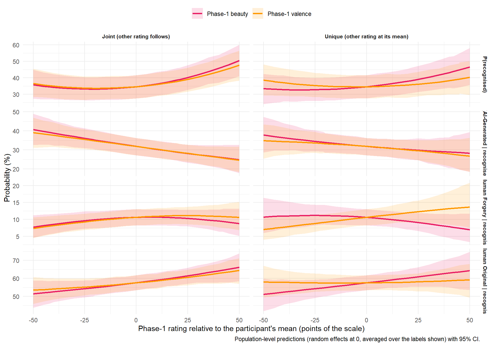{width=960}
:::
:::


::: {.cell}

```{.r .cell-code}
write.csv(app$effects, "../data/results_memory_appraisal.csv", row.names = FALSE)
```
:::


The observed bins and the model disagree at the negative end, and the
reason is the artworks themselves: across items, the works that people rated
as uglier and more negative (relative to their own average) were the more
memorable ones, as were those of higher normative arousal (item-level
correlations below). The raw bins mix this item memorability with the effect
of a person's own appraisal; the model's item intercepts separate them.
Within items, rating a work as more beautiful or more positive than one's
average goes with better recognition, increasingly so at the top of the
range, while rating it as much less beautiful than average does not help:
the extremity effect of the preregistration holds on the positive side only,
the same asymmetric (convex) pattern as self-relevance and authenticity
against beauty (`6_selfrelevance.qmd`, `5_realitydeterminants.qmd`,
"Exploratory checks"). The Phase-1 appraisal also shaped the recalled label,
with the label actually shown held constant: among recognised works, those
rated as less beautiful (and less positive) than average were more often
remembered as "AI-Generated", and those rated as more beautiful more often as
"Original" -- the "beautiful = human" cue of Phase 2 at work in memory, in
line with the reconstruction of the label from one's own belief (Memory of
the Condition by Belief).


::: {.cell}

```{.r .cell-code}
items_mem <- old |>
  summarise(Hit = mean(Recognition == "Yes"), Beauty_w = mean(Beauty_w), Valence_w = mean(Valence_w),
            Arousal = first(Norms_Arousal), .by = "Item")
knitr::kable(data.frame(
  With = c("Mean relative beauty", "Mean relative valence", "Normative arousal (VAPS)"),
  r = sprintf("%.2f", c(cor(items_mem$Hit, items_mem$Beauty_w), cor(items_mem$Hit, items_mem$Valence_w), cor(items_mem$Hit, items_mem$Arousal)))
), format = "pipe", caption = "Item-level correlations of the hit rate (48 old items)")
```

::: {.cell-output-display}


Table: Item-level correlations of the hit rate (48 old items)

|With                     |r     |
|:------------------------|:-----|
|Mean relative beauty     |-0.29 |
|Mean relative valence    |-0.34 |
|Normative arousal (VAPS) |0.30  |


:::
:::


## Durability: Follow-up Beauty by Recognition and by the Phase-2 Belief

On average the label no longer affects follow-up beauty (`3_models.qmd`,
Beauty2: AI-Generated - Human Original -0.9% [-2.0, 0.1]). Two models ask
whether that null hides something (`server/models.R`, 2026-09-25):

- **Beauty2Recognition**: `Beauty2 ~ Condition * Recognition` (CHOCO, old
  items). Does a residual label effect survive among the artworks the
  participant still recognises? The recognition answer follows the beauty
  rating in the same trial, so it stands for the item's memory status.
- **Beauty2Reality**: `Beauty2 ~ Condition * Reality_w + Beauty_w` (CHOCO,
  the 217 participants with Phase-2 and follow-up data). Does the
  syntheticness belief the label induced in Phase 2 carry into follow-up
  beauty, beyond the Phase-1 beauty of the same work? The label moved
  `Reality` in Phase 2, so `mediation_effects()` (as in
  `5_realitydeterminants.qmd`) splits the label effect on follow-up beauty
  into a direct part and a part carried by the belief.


```{.r .cell-code}
durability_ready <- all(file.exists(file.path("models/estimates", c("Beauty2Recognition.rds", "Beauty2Reality.rds"))))
if (!durability_ready) {
  make_asis("", '::: {.callout-warning title="Estimates not available yet"}',
            "`Beauty2Recognition` / `Beauty2Reality`: in `analysis/server`, `./hpc combine <model>` (check 4,000 draws), `./hpc extract <model>`, then `./hpc pull 'estimates/<model>.rds'`.",
            ":::", "")
}
```


```{.r .cell-code}
est_rec <- read_estimates("Beauty2Recognition")$Beauty2Recognition
est_rea <- read_estimates("Beauty2Reality")$Beauty2Reality
par_names <- c(response = "Mean response", mu = "P(beautiful side)", confright = "Confidence, beautiful side", confleft = "Confidence, ugly side")
# Beauty2Recognition: label contrasts within each recognition answer, and the
# recognition contrast, in % of the slider / percentage points of a dpar
rec_within <- prep_contrasts(est_rec$contrasts_emo, "Beauty2") |>
  filter(Parameter %in% names(par_names)) |>
  mutate(Parameter = par_names[as.character(Parameter)]) |>
  arrange(Recognition, Contrast, Parameter)
rec_between <- prep_contrasts(est_rec$contrasts_extra, "Beauty2") |>
  filter(Parameter %in% names(par_names)) |>
  mutate(Parameter = par_names[as.character(Parameter)])
means_rec <- est_rec$means_by |> mutate(across(c(Estimate, CI_low, CI_high), \(x) insight::format_value(100 * x)))
# Beauty2Reality: mediation through the Phase-2 belief, the belief slope per
# label, the Phase-1 beauty slope
med <- mediation_effects(est_rea)
med_mu <- mediation_effects(est_rea, par = "mu")
slopes <- bind_rows(mutate(grid_slopes(est_rea), What = "Phase-2 syntheticness (per +10%)"),
                    mutate(covariate_slopes(est_rea, "Beauty_w"), What = "Phase-1 beauty (per +10%)")) |> fmt_eff()
make_asis(
  make_tables(bind_rows(est_rec$diag, est_rea$diag), c("Model", "Family", "N_obs", "N_participants", "Chains", "Draws", "Max_Rhat", "Min_ESS_ratio", "Divergent_pct"),
              "Convergence of the durability models"),
  make_tables(means_rec, c("Condition", "Recognition", "Estimate", "CI_low", "CI_high"),
              "Beauty2Recognition: follow-up beauty (% of the slider) per label and recognition answer"),
  make_tables(rec_within, c("Recognition", "Contrast", "Parameter", "Diff", "CI", "pd_fmt", "Effect"),
              "Beauty2Recognition: label contrasts within artworks judged 'seen before' (Yes) and not (No), % of the slider / percentage points"),
  make_tables(rec_between, c("Contrast", "Parameter", "Diff", "CI", "pd_fmt", "Effect"),
              "Beauty2Recognition: recognised minus unrecognised artworks (averaged over the labels)"),
  make_tables(fmt_eff(rename(med$effects, Path = Effect)), c("Contrast", "Path", "Diff", "CI", "pd_fmt", "Effect"),
              "Beauty2Reality: label effect on follow-up beauty at the participant's mean Phase-1 beauty (% of the slider), split into the part carried by the Phase-2 syntheticness belief (Indirect) and the rest (Direct); 'Mediator (a)' = label effect on the belief (% of its slider, these participants)"),
  make_tables(fmt_eff(rename(med_mu$effects, Path = Effect)), c("Contrast", "Path", "Diff", "CI", "pd_fmt", "Effect"),
              "Beauty2Reality: the same on P(beautiful side) (percentage points)"),
  make_tables(slopes, c("What", "Level", "Diff", "CI", "pd_fmt", "Effect"),
              "Beauty2Reality: slopes of follow-up beauty (% of the slider) on the Phase-2 belief per label (and their differences), and on Phase-1 beauty")
)
```

```{=html}
<div id="kyhzlledad" style="padding-left:0px;padding-right:0px;padding-top:10px;padding-bottom:10px;overflow-x:auto;overflow-y:auto;width:auto;height:auto;">
<style>#kyhzlledad table {
  font-family: system-ui, 'Segoe UI', Roboto, Helvetica, Arial, sans-serif, 'Apple Color Emoji', 'Segoe UI Emoji', 'Segoe UI Symbol', 'Noto Color Emoji';
  -webkit-font-smoothing: antialiased;
  -moz-osx-font-smoothing: grayscale;
}

#kyhzlledad thead, #kyhzlledad tbody, #kyhzlledad tfoot, #kyhzlledad tr, #kyhzlledad td, #kyhzlledad th {
  border-style: none;
}

#kyhzlledad p {
  margin: 0;
  padding: 0;
}

#kyhzlledad .gt_table {
  display: table;
  border-collapse: collapse;
  line-height: normal;
  margin-left: auto;
  margin-right: auto;
  color: #333333;
  font-size: 13px;
  font-weight: normal;
  font-style: normal;
  background-color: #FFFFFF;
  width: auto;
  border-top-style: solid;
  border-top-width: 3px;
  border-top-color: #D5D5D5;
  border-right-style: solid;
  border-right-width: 3px;
  border-right-color: #D5D5D5;
  border-bottom-style: solid;
  border-bottom-width: 3px;
  border-bottom-color: #D5D5D5;
  border-left-style: solid;
  border-left-width: 3px;
  border-left-color: #D5D5D5;
}

#kyhzlledad .gt_caption {
  padding-top: 4px;
  padding-bottom: 4px;
}

#kyhzlledad .gt_title {
  color: #333333;
  font-size: 125%;
  font-weight: initial;
  padding-top: 4px;
  padding-bottom: 4px;
  padding-left: 5px;
  padding-right: 5px;
  border-bottom-color: #FFFFFF;
  border-bottom-width: 0;
}

#kyhzlledad .gt_subtitle {
  color: #333333;
  font-size: 85%;
  font-weight: initial;
  padding-top: 3px;
  padding-bottom: 5px;
  padding-left: 5px;
  padding-right: 5px;
  border-top-color: #FFFFFF;
  border-top-width: 0;
}

#kyhzlledad .gt_heading {
  background-color: #FFFFFF;
  text-align: left;
  border-bottom-color: #FFFFFF;
  border-left-style: none;
  border-left-width: 1px;
  border-left-color: #D3D3D3;
  border-right-style: none;
  border-right-width: 1px;
  border-right-color: #D3D3D3;
}

#kyhzlledad .gt_bottom_border {
  border-bottom-style: solid;
  border-bottom-width: 2px;
  border-bottom-color: #D5D5D5;
}

#kyhzlledad .gt_col_headings {
  border-top-style: solid;
  border-top-width: 2px;
  border-top-color: #D5D5D5;
  border-bottom-style: solid;
  border-bottom-width: 2px;
  border-bottom-color: #D5D5D5;
  border-left-style: none;
  border-left-width: 1px;
  border-left-color: #D3D3D3;
  border-right-style: none;
  border-right-width: 1px;
  border-right-color: #D3D3D3;
}

#kyhzlledad .gt_col_heading {
  color: #FFFFFF;
  background-color: #000000;
  font-size: 100%;
  font-weight: normal;
  text-transform: inherit;
  border-left-style: none;
  border-left-width: 1px;
  border-left-color: #D3D3D3;
  border-right-style: none;
  border-right-width: 1px;
  border-right-color: #D3D3D3;
  vertical-align: bottom;
  padding-top: 5px;
  padding-bottom: 6px;
  padding-left: 5px;
  padding-right: 5px;
  overflow-x: hidden;
}

#kyhzlledad .gt_column_spanner_outer {
  color: #FFFFFF;
  background-color: #000000;
  font-size: 100%;
  font-weight: normal;
  text-transform: inherit;
  padding-top: 0;
  padding-bottom: 0;
  padding-left: 4px;
  padding-right: 4px;
}

#kyhzlledad .gt_column_spanner_outer:first-child {
  padding-left: 0;
}

#kyhzlledad .gt_column_spanner_outer:last-child {
  padding-right: 0;
}

#kyhzlledad .gt_column_spanner {
  border-bottom-style: solid;
  border-bottom-width: 2px;
  border-bottom-color: #D5D5D5;
  vertical-align: bottom;
  padding-top: 5px;
  padding-bottom: 5px;
  overflow-x: hidden;
  display: inline-block;
  width: 100%;
}

#kyhzlledad .gt_spanner_row {
  border-bottom-style: hidden;
}

#kyhzlledad .gt_group_heading {
  padding-top: 8px;
  padding-bottom: 8px;
  padding-left: 5px;
  padding-right: 5px;
  color: #333333;
  background-color: #FFFFFF;
  font-size: 100%;
  font-weight: initial;
  text-transform: inherit;
  border-top-style: solid;
  border-top-width: 2px;
  border-top-color: #D5D5D5;
  border-bottom-style: solid;
  border-bottom-width: 2px;
  border-bottom-color: #D5D5D5;
  border-left-style: none;
  border-left-width: 1px;
  border-left-color: #D3D3D3;
  border-right-style: none;
  border-right-width: 1px;
  border-right-color: #D3D3D3;
  vertical-align: middle;
  text-align: left;
}

#kyhzlledad .gt_empty_group_heading {
  padding: 0.5px;
  color: #333333;
  background-color: #FFFFFF;
  font-size: 100%;
  font-weight: initial;
  border-top-style: solid;
  border-top-width: 2px;
  border-top-color: #D5D5D5;
  border-bottom-style: solid;
  border-bottom-width: 2px;
  border-bottom-color: #D5D5D5;
  vertical-align: middle;
}

#kyhzlledad .gt_from_md > :first-child {
  margin-top: 0;
}

#kyhzlledad .gt_from_md > :last-child {
  margin-bottom: 0;
}

#kyhzlledad .gt_row {
  padding-top: 8px;
  padding-bottom: 8px;
  padding-left: 5px;
  padding-right: 5px;
  margin: 10px;
  border-top-style: solid;
  border-top-width: 1px;
  border-top-color: #D5D5D5;
  border-left-style: solid;
  border-left-width: 1px;
  border-left-color: #D5D5D5;
  border-right-style: solid;
  border-right-width: 1px;
  border-right-color: #D5D5D5;
  vertical-align: middle;
  overflow-x: hidden;
}

#kyhzlledad .gt_stub {
  color: #333333;
  background-color: #FFFFFF;
  font-size: 100%;
  font-weight: initial;
  text-transform: inherit;
  border-right-style: solid;
  border-right-width: 2px;
  border-right-color: #5F5F5F;
  padding-left: 5px;
  padding-right: 5px;
}

#kyhzlledad .gt_stub_row_group {
  color: #333333;
  background-color: #FFFFFF;
  font-size: 100%;
  font-weight: initial;
  text-transform: inherit;
  border-right-style: solid;
  border-right-width: 2px;
  border-right-color: #D3D3D3;
  padding-left: 5px;
  padding-right: 5px;
  vertical-align: top;
}

#kyhzlledad .gt_row_group_first td {
  border-top-width: 2px;
}

#kyhzlledad .gt_row_group_first th {
  border-top-width: 2px;
}

#kyhzlledad .gt_summary_row {
  color: #333333;
  background-color: #D5D5D5;
  text-transform: inherit;
  padding-top: 8px;
  padding-bottom: 8px;
  padding-left: 5px;
  padding-right: 5px;
}

#kyhzlledad .gt_first_summary_row {
  border-top-style: solid;
  border-top-color: #D5D5D5;
}

#kyhzlledad .gt_first_summary_row.thick {
  border-top-width: 2px;
}

#kyhzlledad .gt_last_summary_row {
  padding-top: 8px;
  padding-bottom: 8px;
  padding-left: 5px;
  padding-right: 5px;
  border-bottom-style: solid;
  border-bottom-width: 2px;
  border-bottom-color: #D5D5D5;
}

#kyhzlledad .gt_grand_summary_row {
  color: #FFFFFF;
  background-color: #929292;
  text-transform: inherit;
  padding-top: 8px;
  padding-bottom: 8px;
  padding-left: 5px;
  padding-right: 5px;
}

#kyhzlledad .gt_first_grand_summary_row {
  padding-top: 8px;
  padding-bottom: 8px;
  padding-left: 5px;
  padding-right: 5px;
  border-top-style: double;
  border-top-width: 6px;
  border-top-color: #D5D5D5;
}

#kyhzlledad .gt_last_grand_summary_row_top {
  padding-top: 8px;
  padding-bottom: 8px;
  padding-left: 5px;
  padding-right: 5px;
  border-bottom-style: double;
  border-bottom-width: 6px;
  border-bottom-color: #D5D5D5;
}

#kyhzlledad .gt_striped {
  background-color: #F4F4F4;
}

#kyhzlledad .gt_table_body {
  border-top-style: solid;
  border-top-width: 2px;
  border-top-color: #D5D5D5;
  border-bottom-style: solid;
  border-bottom-width: 2px;
  border-bottom-color: #D5D5D5;
}

#kyhzlledad .gt_footnotes {
  color: #333333;
  background-color: #FFFFFF;
  border-bottom-style: none;
  border-bottom-width: 2px;
  border-bottom-color: #D3D3D3;
  border-left-style: none;
  border-left-width: 2px;
  border-left-color: #D3D3D3;
  border-right-style: none;
  border-right-width: 2px;
  border-right-color: #D3D3D3;
}

#kyhzlledad .gt_footnote {
  margin: 0px;
  font-size: 90%;
  padding-top: 4px;
  padding-bottom: 4px;
  padding-left: 5px;
  padding-right: 5px;
}

#kyhzlledad .gt_sourcenotes {
  color: #333333;
  background-color: #FFFFFF;
  border-bottom-style: none;
  border-bottom-width: 2px;
  border-bottom-color: #D3D3D3;
  border-left-style: none;
  border-left-width: 2px;
  border-left-color: #D3D3D3;
  border-right-style: none;
  border-right-width: 2px;
  border-right-color: #D3D3D3;
}

#kyhzlledad .gt_sourcenote {
  font-size: 90%;
  padding-top: 4px;
  padding-bottom: 4px;
  padding-left: 5px;
  padding-right: 5px;
}

#kyhzlledad .gt_left {
  text-align: left;
}

#kyhzlledad .gt_center {
  text-align: center;
}

#kyhzlledad .gt_right {
  text-align: right;
  font-variant-numeric: tabular-nums;
}

#kyhzlledad .gt_font_normal {
  font-weight: normal;
}

#kyhzlledad .gt_font_bold {
  font-weight: bold;
}

#kyhzlledad .gt_font_italic {
  font-style: italic;
}

#kyhzlledad .gt_super {
  font-size: 65%;
}

#kyhzlledad .gt_footnote_marks {
  font-size: 75%;
  vertical-align: 0.4em;
  position: initial;
}

#kyhzlledad .gt_asterisk {
  font-size: 100%;
  vertical-align: 0;
}

#kyhzlledad .gt_indent_1 {
  text-indent: 5px;
}

#kyhzlledad .gt_indent_2 {
  text-indent: 10px;
}

#kyhzlledad .gt_indent_3 {
  text-indent: 15px;
}

#kyhzlledad .gt_indent_4 {
  text-indent: 20px;
}

#kyhzlledad .gt_indent_5 {
  text-indent: 25px;
}

#kyhzlledad .katex-display {
  display: inline-flex !important;
  margin-bottom: 0.75em !important;
}

#kyhzlledad div.Reactable > div.rt-table > div.rt-thead > div.rt-tr.rt-tr-group-header > div.rt-th-group:after {
  height: 0px !important;
}
</style>
<table class="gt_table" data-quarto-disable-processing="false" data-quarto-bootstrap="false">
  <thead>
    <tr class="gt_heading">
      <td colspan="9" class="gt_heading gt_title gt_font_normal gt_bottom_border" style>Convergence of the durability models</td>
    </tr>
    
    <tr class="gt_col_headings">
      <th class="gt_col_heading gt_columns_bottom_border gt_left" rowspan="1" colspan="1" scope="col" id="Model">Model</th>
      <th class="gt_col_heading gt_columns_bottom_border gt_left" rowspan="1" colspan="1" scope="col" id="Family">Family</th>
      <th class="gt_col_heading gt_columns_bottom_border gt_right" rowspan="1" colspan="1" scope="col" id="N_obs">N_obs</th>
      <th class="gt_col_heading gt_columns_bottom_border gt_right" rowspan="1" colspan="1" scope="col" id="N_participants">N_participants</th>
      <th class="gt_col_heading gt_columns_bottom_border gt_right" rowspan="1" colspan="1" scope="col" id="Chains">Chains</th>
      <th class="gt_col_heading gt_columns_bottom_border gt_right" rowspan="1" colspan="1" scope="col" id="Draws">Draws</th>
      <th class="gt_col_heading gt_columns_bottom_border gt_right" rowspan="1" colspan="1" scope="col" id="Max_Rhat">Max_Rhat</th>
      <th class="gt_col_heading gt_columns_bottom_border gt_right" rowspan="1" colspan="1" scope="col" id="Min_ESS_ratio">Min_ESS_ratio</th>
      <th class="gt_col_heading gt_columns_bottom_border gt_right" rowspan="1" colspan="1" scope="col" id="Divergent_pct">Divergent_pct</th>
    </tr>
  </thead>
  <tbody class="gt_table_body">
    <tr><td headers="Model" class="gt_row gt_left">Beauty2Recognition</td>
<td headers="Family" class="gt_row gt_left">CHOCO</td>
<td headers="N_obs" class="gt_row gt_right">10560</td>
<td headers="N_participants" class="gt_row gt_right">220</td>
<td headers="Chains" class="gt_row gt_right">8</td>
<td headers="Draws" class="gt_row gt_right">4000</td>
<td headers="Max_Rhat" class="gt_row gt_right">1.039</td>
<td headers="Min_ESS_ratio" class="gt_row gt_right">0.048</td>
<td headers="Divergent_pct" class="gt_row gt_right">0</td></tr>
    <tr><td headers="Model" class="gt_row gt_left gt_striped">Beauty2Reality</td>
<td headers="Family" class="gt_row gt_left gt_striped">CHOCO</td>
<td headers="N_obs" class="gt_row gt_right gt_striped">10416</td>
<td headers="N_participants" class="gt_row gt_right gt_striped">217</td>
<td headers="Chains" class="gt_row gt_right gt_striped">8</td>
<td headers="Draws" class="gt_row gt_right gt_striped">4000</td>
<td headers="Max_Rhat" class="gt_row gt_right gt_striped">1.061</td>
<td headers="Min_ESS_ratio" class="gt_row gt_right gt_striped">0.026</td>
<td headers="Divergent_pct" class="gt_row gt_right gt_striped">0</td></tr>
  </tbody>
  
</table>
</div>
```


::: {.callout-note collapse="true" title="Convergence of the durability models (Markdown table, for text readers)"}

|Model              |Family | N_obs| N_participants| Chains| Draws| Max_Rhat| Min_ESS_ratio| Divergent_pct|
|:------------------|:------|-----:|--------------:|------:|-----:|--------:|-------------:|-------------:|
|Beauty2Recognition |CHOCO  | 10560|            220|      8|  4000|    1.039|         0.048|             0|
|Beauty2Reality     |CHOCO  | 10416|            217|      8|  4000|    1.061|         0.026|             0|

:::

```{=html}
<div id="jvfarhhzfb" style="padding-left:0px;padding-right:0px;padding-top:10px;padding-bottom:10px;overflow-x:auto;overflow-y:auto;width:auto;height:auto;">
<style>#jvfarhhzfb table {
  font-family: system-ui, 'Segoe UI', Roboto, Helvetica, Arial, sans-serif, 'Apple Color Emoji', 'Segoe UI Emoji', 'Segoe UI Symbol', 'Noto Color Emoji';
  -webkit-font-smoothing: antialiased;
  -moz-osx-font-smoothing: grayscale;
}

#jvfarhhzfb thead, #jvfarhhzfb tbody, #jvfarhhzfb tfoot, #jvfarhhzfb tr, #jvfarhhzfb td, #jvfarhhzfb th {
  border-style: none;
}

#jvfarhhzfb p {
  margin: 0;
  padding: 0;
}

#jvfarhhzfb .gt_table {
  display: table;
  border-collapse: collapse;
  line-height: normal;
  margin-left: auto;
  margin-right: auto;
  color: #333333;
  font-size: 13px;
  font-weight: normal;
  font-style: normal;
  background-color: #FFFFFF;
  width: auto;
  border-top-style: solid;
  border-top-width: 3px;
  border-top-color: #D5D5D5;
  border-right-style: solid;
  border-right-width: 3px;
  border-right-color: #D5D5D5;
  border-bottom-style: solid;
  border-bottom-width: 3px;
  border-bottom-color: #D5D5D5;
  border-left-style: solid;
  border-left-width: 3px;
  border-left-color: #D5D5D5;
}

#jvfarhhzfb .gt_caption {
  padding-top: 4px;
  padding-bottom: 4px;
}

#jvfarhhzfb .gt_title {
  color: #333333;
  font-size: 125%;
  font-weight: initial;
  padding-top: 4px;
  padding-bottom: 4px;
  padding-left: 5px;
  padding-right: 5px;
  border-bottom-color: #FFFFFF;
  border-bottom-width: 0;
}

#jvfarhhzfb .gt_subtitle {
  color: #333333;
  font-size: 85%;
  font-weight: initial;
  padding-top: 3px;
  padding-bottom: 5px;
  padding-left: 5px;
  padding-right: 5px;
  border-top-color: #FFFFFF;
  border-top-width: 0;
}

#jvfarhhzfb .gt_heading {
  background-color: #FFFFFF;
  text-align: left;
  border-bottom-color: #FFFFFF;
  border-left-style: none;
  border-left-width: 1px;
  border-left-color: #D3D3D3;
  border-right-style: none;
  border-right-width: 1px;
  border-right-color: #D3D3D3;
}

#jvfarhhzfb .gt_bottom_border {
  border-bottom-style: solid;
  border-bottom-width: 2px;
  border-bottom-color: #D5D5D5;
}

#jvfarhhzfb .gt_col_headings {
  border-top-style: solid;
  border-top-width: 2px;
  border-top-color: #D5D5D5;
  border-bottom-style: solid;
  border-bottom-width: 2px;
  border-bottom-color: #D5D5D5;
  border-left-style: none;
  border-left-width: 1px;
  border-left-color: #D3D3D3;
  border-right-style: none;
  border-right-width: 1px;
  border-right-color: #D3D3D3;
}

#jvfarhhzfb .gt_col_heading {
  color: #FFFFFF;
  background-color: #000000;
  font-size: 100%;
  font-weight: normal;
  text-transform: inherit;
  border-left-style: none;
  border-left-width: 1px;
  border-left-color: #D3D3D3;
  border-right-style: none;
  border-right-width: 1px;
  border-right-color: #D3D3D3;
  vertical-align: bottom;
  padding-top: 5px;
  padding-bottom: 6px;
  padding-left: 5px;
  padding-right: 5px;
  overflow-x: hidden;
}

#jvfarhhzfb .gt_column_spanner_outer {
  color: #FFFFFF;
  background-color: #000000;
  font-size: 100%;
  font-weight: normal;
  text-transform: inherit;
  padding-top: 0;
  padding-bottom: 0;
  padding-left: 4px;
  padding-right: 4px;
}

#jvfarhhzfb .gt_column_spanner_outer:first-child {
  padding-left: 0;
}

#jvfarhhzfb .gt_column_spanner_outer:last-child {
  padding-right: 0;
}

#jvfarhhzfb .gt_column_spanner {
  border-bottom-style: solid;
  border-bottom-width: 2px;
  border-bottom-color: #D5D5D5;
  vertical-align: bottom;
  padding-top: 5px;
  padding-bottom: 5px;
  overflow-x: hidden;
  display: inline-block;
  width: 100%;
}

#jvfarhhzfb .gt_spanner_row {
  border-bottom-style: hidden;
}

#jvfarhhzfb .gt_group_heading {
  padding-top: 8px;
  padding-bottom: 8px;
  padding-left: 5px;
  padding-right: 5px;
  color: #333333;
  background-color: #FFFFFF;
  font-size: 100%;
  font-weight: initial;
  text-transform: inherit;
  border-top-style: solid;
  border-top-width: 2px;
  border-top-color: #D5D5D5;
  border-bottom-style: solid;
  border-bottom-width: 2px;
  border-bottom-color: #D5D5D5;
  border-left-style: none;
  border-left-width: 1px;
  border-left-color: #D3D3D3;
  border-right-style: none;
  border-right-width: 1px;
  border-right-color: #D3D3D3;
  vertical-align: middle;
  text-align: left;
}

#jvfarhhzfb .gt_empty_group_heading {
  padding: 0.5px;
  color: #333333;
  background-color: #FFFFFF;
  font-size: 100%;
  font-weight: initial;
  border-top-style: solid;
  border-top-width: 2px;
  border-top-color: #D5D5D5;
  border-bottom-style: solid;
  border-bottom-width: 2px;
  border-bottom-color: #D5D5D5;
  vertical-align: middle;
}

#jvfarhhzfb .gt_from_md > :first-child {
  margin-top: 0;
}

#jvfarhhzfb .gt_from_md > :last-child {
  margin-bottom: 0;
}

#jvfarhhzfb .gt_row {
  padding-top: 8px;
  padding-bottom: 8px;
  padding-left: 5px;
  padding-right: 5px;
  margin: 10px;
  border-top-style: solid;
  border-top-width: 1px;
  border-top-color: #D5D5D5;
  border-left-style: solid;
  border-left-width: 1px;
  border-left-color: #D5D5D5;
  border-right-style: solid;
  border-right-width: 1px;
  border-right-color: #D5D5D5;
  vertical-align: middle;
  overflow-x: hidden;
}

#jvfarhhzfb .gt_stub {
  color: #333333;
  background-color: #FFFFFF;
  font-size: 100%;
  font-weight: initial;
  text-transform: inherit;
  border-right-style: solid;
  border-right-width: 2px;
  border-right-color: #5F5F5F;
  padding-left: 5px;
  padding-right: 5px;
}

#jvfarhhzfb .gt_stub_row_group {
  color: #333333;
  background-color: #FFFFFF;
  font-size: 100%;
  font-weight: initial;
  text-transform: inherit;
  border-right-style: solid;
  border-right-width: 2px;
  border-right-color: #D3D3D3;
  padding-left: 5px;
  padding-right: 5px;
  vertical-align: top;
}

#jvfarhhzfb .gt_row_group_first td {
  border-top-width: 2px;
}

#jvfarhhzfb .gt_row_group_first th {
  border-top-width: 2px;
}

#jvfarhhzfb .gt_summary_row {
  color: #333333;
  background-color: #D5D5D5;
  text-transform: inherit;
  padding-top: 8px;
  padding-bottom: 8px;
  padding-left: 5px;
  padding-right: 5px;
}

#jvfarhhzfb .gt_first_summary_row {
  border-top-style: solid;
  border-top-color: #D5D5D5;
}

#jvfarhhzfb .gt_first_summary_row.thick {
  border-top-width: 2px;
}

#jvfarhhzfb .gt_last_summary_row {
  padding-top: 8px;
  padding-bottom: 8px;
  padding-left: 5px;
  padding-right: 5px;
  border-bottom-style: solid;
  border-bottom-width: 2px;
  border-bottom-color: #D5D5D5;
}

#jvfarhhzfb .gt_grand_summary_row {
  color: #FFFFFF;
  background-color: #929292;
  text-transform: inherit;
  padding-top: 8px;
  padding-bottom: 8px;
  padding-left: 5px;
  padding-right: 5px;
}

#jvfarhhzfb .gt_first_grand_summary_row {
  padding-top: 8px;
  padding-bottom: 8px;
  padding-left: 5px;
  padding-right: 5px;
  border-top-style: double;
  border-top-width: 6px;
  border-top-color: #D5D5D5;
}

#jvfarhhzfb .gt_last_grand_summary_row_top {
  padding-top: 8px;
  padding-bottom: 8px;
  padding-left: 5px;
  padding-right: 5px;
  border-bottom-style: double;
  border-bottom-width: 6px;
  border-bottom-color: #D5D5D5;
}

#jvfarhhzfb .gt_striped {
  background-color: #F4F4F4;
}

#jvfarhhzfb .gt_table_body {
  border-top-style: solid;
  border-top-width: 2px;
  border-top-color: #D5D5D5;
  border-bottom-style: solid;
  border-bottom-width: 2px;
  border-bottom-color: #D5D5D5;
}

#jvfarhhzfb .gt_footnotes {
  color: #333333;
  background-color: #FFFFFF;
  border-bottom-style: none;
  border-bottom-width: 2px;
  border-bottom-color: #D3D3D3;
  border-left-style: none;
  border-left-width: 2px;
  border-left-color: #D3D3D3;
  border-right-style: none;
  border-right-width: 2px;
  border-right-color: #D3D3D3;
}

#jvfarhhzfb .gt_footnote {
  margin: 0px;
  font-size: 90%;
  padding-top: 4px;
  padding-bottom: 4px;
  padding-left: 5px;
  padding-right: 5px;
}

#jvfarhhzfb .gt_sourcenotes {
  color: #333333;
  background-color: #FFFFFF;
  border-bottom-style: none;
  border-bottom-width: 2px;
  border-bottom-color: #D3D3D3;
  border-left-style: none;
  border-left-width: 2px;
  border-left-color: #D3D3D3;
  border-right-style: none;
  border-right-width: 2px;
  border-right-color: #D3D3D3;
}

#jvfarhhzfb .gt_sourcenote {
  font-size: 90%;
  padding-top: 4px;
  padding-bottom: 4px;
  padding-left: 5px;
  padding-right: 5px;
}

#jvfarhhzfb .gt_left {
  text-align: left;
}

#jvfarhhzfb .gt_center {
  text-align: center;
}

#jvfarhhzfb .gt_right {
  text-align: right;
  font-variant-numeric: tabular-nums;
}

#jvfarhhzfb .gt_font_normal {
  font-weight: normal;
}

#jvfarhhzfb .gt_font_bold {
  font-weight: bold;
}

#jvfarhhzfb .gt_font_italic {
  font-style: italic;
}

#jvfarhhzfb .gt_super {
  font-size: 65%;
}

#jvfarhhzfb .gt_footnote_marks {
  font-size: 75%;
  vertical-align: 0.4em;
  position: initial;
}

#jvfarhhzfb .gt_asterisk {
  font-size: 100%;
  vertical-align: 0;
}

#jvfarhhzfb .gt_indent_1 {
  text-indent: 5px;
}

#jvfarhhzfb .gt_indent_2 {
  text-indent: 10px;
}

#jvfarhhzfb .gt_indent_3 {
  text-indent: 15px;
}

#jvfarhhzfb .gt_indent_4 {
  text-indent: 20px;
}

#jvfarhhzfb .gt_indent_5 {
  text-indent: 25px;
}

#jvfarhhzfb .katex-display {
  display: inline-flex !important;
  margin-bottom: 0.75em !important;
}

#jvfarhhzfb div.Reactable > div.rt-table > div.rt-thead > div.rt-tr.rt-tr-group-header > div.rt-th-group:after {
  height: 0px !important;
}
</style>
<table class="gt_table" data-quarto-disable-processing="false" data-quarto-bootstrap="false">
  <thead>
    <tr class="gt_heading">
      <td colspan="5" class="gt_heading gt_title gt_font_normal gt_bottom_border" style>Beauty2Recognition: follow-up beauty (% of the slider) per label and recognition answer</td>
    </tr>
    
    <tr class="gt_col_headings">
      <th class="gt_col_heading gt_columns_bottom_border gt_center" rowspan="1" colspan="1" scope="col" id="Condition">Condition</th>
      <th class="gt_col_heading gt_columns_bottom_border gt_center" rowspan="1" colspan="1" scope="col" id="Recognition">Recognition</th>
      <th class="gt_col_heading gt_columns_bottom_border gt_right" rowspan="1" colspan="1" scope="col" id="Estimate">Estimate</th>
      <th class="gt_col_heading gt_columns_bottom_border gt_right" rowspan="1" colspan="1" scope="col" id="CI_low">CI_low</th>
      <th class="gt_col_heading gt_columns_bottom_border gt_right" rowspan="1" colspan="1" scope="col" id="CI_high">CI_high</th>
    </tr>
  </thead>
  <tbody class="gt_table_body">
    <tr><td headers="Condition" class="gt_row gt_center">Human Original</td>
<td headers="Recognition" class="gt_row gt_center">No</td>
<td headers="Estimate" class="gt_row gt_right">49.33</td>
<td headers="CI_low" class="gt_row gt_right">45.16</td>
<td headers="CI_high" class="gt_row gt_right">53.36</td></tr>
    <tr><td headers="Condition" class="gt_row gt_center gt_striped">Human Forgery</td>
<td headers="Recognition" class="gt_row gt_center gt_striped">No</td>
<td headers="Estimate" class="gt_row gt_right gt_striped">49.30</td>
<td headers="CI_low" class="gt_row gt_right gt_striped">45.01</td>
<td headers="CI_high" class="gt_row gt_right gt_striped">53.26</td></tr>
    <tr><td headers="Condition" class="gt_row gt_center">AI-Generated</td>
<td headers="Recognition" class="gt_row gt_center">No</td>
<td headers="Estimate" class="gt_row gt_right">48.55</td>
<td headers="CI_low" class="gt_row gt_right">44.06</td>
<td headers="CI_high" class="gt_row gt_right">52.62</td></tr>
    <tr><td headers="Condition" class="gt_row gt_center gt_striped">Human Original</td>
<td headers="Recognition" class="gt_row gt_center gt_striped">Yes</td>
<td headers="Estimate" class="gt_row gt_right gt_striped">55.32</td>
<td headers="CI_low" class="gt_row gt_right gt_striped">50.28</td>
<td headers="CI_high" class="gt_row gt_right gt_striped">59.42</td></tr>
    <tr><td headers="Condition" class="gt_row gt_center">Human Forgery</td>
<td headers="Recognition" class="gt_row gt_center">Yes</td>
<td headers="Estimate" class="gt_row gt_right">55.00</td>
<td headers="CI_low" class="gt_row gt_right">50.01</td>
<td headers="CI_high" class="gt_row gt_right">59.14</td></tr>
    <tr><td headers="Condition" class="gt_row gt_center gt_striped">AI-Generated</td>
<td headers="Recognition" class="gt_row gt_center gt_striped">Yes</td>
<td headers="Estimate" class="gt_row gt_right gt_striped">53.74</td>
<td headers="CI_low" class="gt_row gt_right gt_striped">48.53</td>
<td headers="CI_high" class="gt_row gt_right gt_striped">58.19</td></tr>
  </tbody>
  
</table>
</div>
```


::: {.callout-note collapse="true" title="Beauty2Recognition: follow-up beauty (% of the slider) per label and recognition answer (Markdown table, for text readers)"}

|Condition      |Recognition |Estimate |CI_low |CI_high |
|:--------------|:-----------|:--------|:------|:-------|
|Human Original |No          |49.33    |45.16  |53.36   |
|Human Forgery  |No          |49.30    |45.01  |53.26   |
|AI-Generated   |No          |48.55    |44.06  |52.62   |
|Human Original |Yes         |55.32    |50.28  |59.42   |
|Human Forgery  |Yes         |55.00    |50.01  |59.14   |
|AI-Generated   |Yes         |53.74    |48.53  |58.19   |

:::

```{=html}
<div id="dascsugwlb" style="padding-left:0px;padding-right:0px;padding-top:10px;padding-bottom:10px;overflow-x:auto;overflow-y:auto;width:auto;height:auto;">
<style>#dascsugwlb table {
  font-family: system-ui, 'Segoe UI', Roboto, Helvetica, Arial, sans-serif, 'Apple Color Emoji', 'Segoe UI Emoji', 'Segoe UI Symbol', 'Noto Color Emoji';
  -webkit-font-smoothing: antialiased;
  -moz-osx-font-smoothing: grayscale;
}

#dascsugwlb thead, #dascsugwlb tbody, #dascsugwlb tfoot, #dascsugwlb tr, #dascsugwlb td, #dascsugwlb th {
  border-style: none;
}

#dascsugwlb p {
  margin: 0;
  padding: 0;
}

#dascsugwlb .gt_table {
  display: table;
  border-collapse: collapse;
  line-height: normal;
  margin-left: auto;
  margin-right: auto;
  color: #333333;
  font-size: 13px;
  font-weight: normal;
  font-style: normal;
  background-color: #FFFFFF;
  width: auto;
  border-top-style: solid;
  border-top-width: 3px;
  border-top-color: #D5D5D5;
  border-right-style: solid;
  border-right-width: 3px;
  border-right-color: #D5D5D5;
  border-bottom-style: solid;
  border-bottom-width: 3px;
  border-bottom-color: #D5D5D5;
  border-left-style: solid;
  border-left-width: 3px;
  border-left-color: #D5D5D5;
}

#dascsugwlb .gt_caption {
  padding-top: 4px;
  padding-bottom: 4px;
}

#dascsugwlb .gt_title {
  color: #333333;
  font-size: 125%;
  font-weight: initial;
  padding-top: 4px;
  padding-bottom: 4px;
  padding-left: 5px;
  padding-right: 5px;
  border-bottom-color: #FFFFFF;
  border-bottom-width: 0;
}

#dascsugwlb .gt_subtitle {
  color: #333333;
  font-size: 85%;
  font-weight: initial;
  padding-top: 3px;
  padding-bottom: 5px;
  padding-left: 5px;
  padding-right: 5px;
  border-top-color: #FFFFFF;
  border-top-width: 0;
}

#dascsugwlb .gt_heading {
  background-color: #FFFFFF;
  text-align: left;
  border-bottom-color: #FFFFFF;
  border-left-style: none;
  border-left-width: 1px;
  border-left-color: #D3D3D3;
  border-right-style: none;
  border-right-width: 1px;
  border-right-color: #D3D3D3;
}

#dascsugwlb .gt_bottom_border {
  border-bottom-style: solid;
  border-bottom-width: 2px;
  border-bottom-color: #D5D5D5;
}

#dascsugwlb .gt_col_headings {
  border-top-style: solid;
  border-top-width: 2px;
  border-top-color: #D5D5D5;
  border-bottom-style: solid;
  border-bottom-width: 2px;
  border-bottom-color: #D5D5D5;
  border-left-style: none;
  border-left-width: 1px;
  border-left-color: #D3D3D3;
  border-right-style: none;
  border-right-width: 1px;
  border-right-color: #D3D3D3;
}

#dascsugwlb .gt_col_heading {
  color: #FFFFFF;
  background-color: #000000;
  font-size: 100%;
  font-weight: normal;
  text-transform: inherit;
  border-left-style: none;
  border-left-width: 1px;
  border-left-color: #D3D3D3;
  border-right-style: none;
  border-right-width: 1px;
  border-right-color: #D3D3D3;
  vertical-align: bottom;
  padding-top: 5px;
  padding-bottom: 6px;
  padding-left: 5px;
  padding-right: 5px;
  overflow-x: hidden;
}

#dascsugwlb .gt_column_spanner_outer {
  color: #FFFFFF;
  background-color: #000000;
  font-size: 100%;
  font-weight: normal;
  text-transform: inherit;
  padding-top: 0;
  padding-bottom: 0;
  padding-left: 4px;
  padding-right: 4px;
}

#dascsugwlb .gt_column_spanner_outer:first-child {
  padding-left: 0;
}

#dascsugwlb .gt_column_spanner_outer:last-child {
  padding-right: 0;
}

#dascsugwlb .gt_column_spanner {
  border-bottom-style: solid;
  border-bottom-width: 2px;
  border-bottom-color: #D5D5D5;
  vertical-align: bottom;
  padding-top: 5px;
  padding-bottom: 5px;
  overflow-x: hidden;
  display: inline-block;
  width: 100%;
}

#dascsugwlb .gt_spanner_row {
  border-bottom-style: hidden;
}

#dascsugwlb .gt_group_heading {
  padding-top: 8px;
  padding-bottom: 8px;
  padding-left: 5px;
  padding-right: 5px;
  color: #333333;
  background-color: #FFFFFF;
  font-size: 100%;
  font-weight: initial;
  text-transform: inherit;
  border-top-style: solid;
  border-top-width: 2px;
  border-top-color: #D5D5D5;
  border-bottom-style: solid;
  border-bottom-width: 2px;
  border-bottom-color: #D5D5D5;
  border-left-style: none;
  border-left-width: 1px;
  border-left-color: #D3D3D3;
  border-right-style: none;
  border-right-width: 1px;
  border-right-color: #D3D3D3;
  vertical-align: middle;
  text-align: left;
}

#dascsugwlb .gt_empty_group_heading {
  padding: 0.5px;
  color: #333333;
  background-color: #FFFFFF;
  font-size: 100%;
  font-weight: initial;
  border-top-style: solid;
  border-top-width: 2px;
  border-top-color: #D5D5D5;
  border-bottom-style: solid;
  border-bottom-width: 2px;
  border-bottom-color: #D5D5D5;
  vertical-align: middle;
}

#dascsugwlb .gt_from_md > :first-child {
  margin-top: 0;
}

#dascsugwlb .gt_from_md > :last-child {
  margin-bottom: 0;
}

#dascsugwlb .gt_row {
  padding-top: 8px;
  padding-bottom: 8px;
  padding-left: 5px;
  padding-right: 5px;
  margin: 10px;
  border-top-style: solid;
  border-top-width: 1px;
  border-top-color: #D5D5D5;
  border-left-style: solid;
  border-left-width: 1px;
  border-left-color: #D5D5D5;
  border-right-style: solid;
  border-right-width: 1px;
  border-right-color: #D5D5D5;
  vertical-align: middle;
  overflow-x: hidden;
}

#dascsugwlb .gt_stub {
  color: #333333;
  background-color: #FFFFFF;
  font-size: 100%;
  font-weight: initial;
  text-transform: inherit;
  border-right-style: solid;
  border-right-width: 2px;
  border-right-color: #5F5F5F;
  padding-left: 5px;
  padding-right: 5px;
}

#dascsugwlb .gt_stub_row_group {
  color: #333333;
  background-color: #FFFFFF;
  font-size: 100%;
  font-weight: initial;
  text-transform: inherit;
  border-right-style: solid;
  border-right-width: 2px;
  border-right-color: #D3D3D3;
  padding-left: 5px;
  padding-right: 5px;
  vertical-align: top;
}

#dascsugwlb .gt_row_group_first td {
  border-top-width: 2px;
}

#dascsugwlb .gt_row_group_first th {
  border-top-width: 2px;
}

#dascsugwlb .gt_summary_row {
  color: #333333;
  background-color: #D5D5D5;
  text-transform: inherit;
  padding-top: 8px;
  padding-bottom: 8px;
  padding-left: 5px;
  padding-right: 5px;
}

#dascsugwlb .gt_first_summary_row {
  border-top-style: solid;
  border-top-color: #D5D5D5;
}

#dascsugwlb .gt_first_summary_row.thick {
  border-top-width: 2px;
}

#dascsugwlb .gt_last_summary_row {
  padding-top: 8px;
  padding-bottom: 8px;
  padding-left: 5px;
  padding-right: 5px;
  border-bottom-style: solid;
  border-bottom-width: 2px;
  border-bottom-color: #D5D5D5;
}

#dascsugwlb .gt_grand_summary_row {
  color: #FFFFFF;
  background-color: #929292;
  text-transform: inherit;
  padding-top: 8px;
  padding-bottom: 8px;
  padding-left: 5px;
  padding-right: 5px;
}

#dascsugwlb .gt_first_grand_summary_row {
  padding-top: 8px;
  padding-bottom: 8px;
  padding-left: 5px;
  padding-right: 5px;
  border-top-style: double;
  border-top-width: 6px;
  border-top-color: #D5D5D5;
}

#dascsugwlb .gt_last_grand_summary_row_top {
  padding-top: 8px;
  padding-bottom: 8px;
  padding-left: 5px;
  padding-right: 5px;
  border-bottom-style: double;
  border-bottom-width: 6px;
  border-bottom-color: #D5D5D5;
}

#dascsugwlb .gt_striped {
  background-color: #F4F4F4;
}

#dascsugwlb .gt_table_body {
  border-top-style: solid;
  border-top-width: 2px;
  border-top-color: #D5D5D5;
  border-bottom-style: solid;
  border-bottom-width: 2px;
  border-bottom-color: #D5D5D5;
}

#dascsugwlb .gt_footnotes {
  color: #333333;
  background-color: #FFFFFF;
  border-bottom-style: none;
  border-bottom-width: 2px;
  border-bottom-color: #D3D3D3;
  border-left-style: none;
  border-left-width: 2px;
  border-left-color: #D3D3D3;
  border-right-style: none;
  border-right-width: 2px;
  border-right-color: #D3D3D3;
}

#dascsugwlb .gt_footnote {
  margin: 0px;
  font-size: 90%;
  padding-top: 4px;
  padding-bottom: 4px;
  padding-left: 5px;
  padding-right: 5px;
}

#dascsugwlb .gt_sourcenotes {
  color: #333333;
  background-color: #FFFFFF;
  border-bottom-style: none;
  border-bottom-width: 2px;
  border-bottom-color: #D3D3D3;
  border-left-style: none;
  border-left-width: 2px;
  border-left-color: #D3D3D3;
  border-right-style: none;
  border-right-width: 2px;
  border-right-color: #D3D3D3;
}

#dascsugwlb .gt_sourcenote {
  font-size: 90%;
  padding-top: 4px;
  padding-bottom: 4px;
  padding-left: 5px;
  padding-right: 5px;
}

#dascsugwlb .gt_left {
  text-align: left;
}

#dascsugwlb .gt_center {
  text-align: center;
}

#dascsugwlb .gt_right {
  text-align: right;
  font-variant-numeric: tabular-nums;
}

#dascsugwlb .gt_font_normal {
  font-weight: normal;
}

#dascsugwlb .gt_font_bold {
  font-weight: bold;
}

#dascsugwlb .gt_font_italic {
  font-style: italic;
}

#dascsugwlb .gt_super {
  font-size: 65%;
}

#dascsugwlb .gt_footnote_marks {
  font-size: 75%;
  vertical-align: 0.4em;
  position: initial;
}

#dascsugwlb .gt_asterisk {
  font-size: 100%;
  vertical-align: 0;
}

#dascsugwlb .gt_indent_1 {
  text-indent: 5px;
}

#dascsugwlb .gt_indent_2 {
  text-indent: 10px;
}

#dascsugwlb .gt_indent_3 {
  text-indent: 15px;
}

#dascsugwlb .gt_indent_4 {
  text-indent: 20px;
}

#dascsugwlb .gt_indent_5 {
  text-indent: 25px;
}

#dascsugwlb .katex-display {
  display: inline-flex !important;
  margin-bottom: 0.75em !important;
}

#dascsugwlb div.Reactable > div.rt-table > div.rt-thead > div.rt-tr.rt-tr-group-header > div.rt-th-group:after {
  height: 0px !important;
}
</style>
<table class="gt_table" data-quarto-disable-processing="false" data-quarto-bootstrap="false">
  <thead>
    <tr class="gt_heading">
      <td colspan="6" class="gt_heading gt_title gt_font_normal gt_bottom_border" style>Beauty2Recognition: label contrasts within artworks judged 'seen before' (Yes) and not (No), % of the slider / percentage points</td>
    </tr>
    
    <tr class="gt_col_headings">
      <th class="gt_col_heading gt_columns_bottom_border gt_center" rowspan="1" colspan="1" scope="col" id="Recognition">Recognition</th>
      <th class="gt_col_heading gt_columns_bottom_border gt_left" rowspan="1" colspan="1" scope="col" id="Parameter">Parameter</th>
      <th class="gt_col_heading gt_columns_bottom_border gt_right" rowspan="1" colspan="1" scope="col" id="Diff">Diff</th>
      <th class="gt_col_heading gt_columns_bottom_border gt_left" rowspan="1" colspan="1" scope="col" id="CI">CI</th>
      <th class="gt_col_heading gt_columns_bottom_border gt_right" rowspan="1" colspan="1" scope="col" id="pd_fmt">pd_fmt</th>
      <th class="gt_col_heading gt_columns_bottom_border gt_left" rowspan="1" colspan="1" scope="col" id="Effect">Effect</th>
    </tr>
  </thead>
  <tbody class="gt_table_body">
    <tr class="gt_group_heading_row">
      <th colspan="6" class="gt_group_heading" scope="colgroup" id="AI-Generated - Human Original">AI-Generated - Human Original</th>
    </tr>
    <tr class="gt_row_group_first"><td headers="AI-Generated - Human Original  Recognition" class="gt_row gt_center" style="color: #9E9E9E;">No</td>
<td headers="AI-Generated - Human Original  Parameter" class="gt_row gt_left" style="color: #9E9E9E;">Confidence, beautiful side</td>
<td headers="AI-Generated - Human Original  Diff" class="gt_row gt_right" style="color: #9E9E9E;">-0.67</td>
<td headers="AI-Generated - Human Original  CI" class="gt_row gt_left" style="color: #9E9E9E;">[-2.21, 0.90]</td>
<td headers="AI-Generated - Human Original  pd_fmt" class="gt_row gt_right" style="color: #9E9E9E;">79.42%</td>
<td headers="AI-Generated - Human Original  Effect" class="gt_row gt_left" style="color: #9E9E9E;">n.s.</td></tr>
    <tr><td headers="AI-Generated - Human Original  Recognition" class="gt_row gt_center gt_striped" style="color: #9E9E9E;">No</td>
<td headers="AI-Generated - Human Original  Parameter" class="gt_row gt_left gt_striped" style="color: #9E9E9E;">Confidence, ugly side</td>
<td headers="AI-Generated - Human Original  Diff" class="gt_row gt_right gt_striped" style="color: #9E9E9E;">0.95</td>
<td headers="AI-Generated - Human Original  CI" class="gt_row gt_left gt_striped" style="color: #9E9E9E;">[-1.12, 3.21]</td>
<td headers="AI-Generated - Human Original  pd_fmt" class="gt_row gt_right gt_striped" style="color: #9E9E9E;">80.12%</td>
<td headers="AI-Generated - Human Original  Effect" class="gt_row gt_left gt_striped" style="color: #9E9E9E;">n.s.</td></tr>
    <tr><td headers="AI-Generated - Human Original  Recognition" class="gt_row gt_center" style="color: #9E9E9E;">No</td>
<td headers="AI-Generated - Human Original  Parameter" class="gt_row gt_left" style="color: #9E9E9E;">Mean response</td>
<td headers="AI-Generated - Human Original  Diff" class="gt_row gt_right" style="color: #9E9E9E;">-0.80</td>
<td headers="AI-Generated - Human Original  CI" class="gt_row gt_left" style="color: #9E9E9E;">[-2.40, 0.82]</td>
<td headers="AI-Generated - Human Original  pd_fmt" class="gt_row gt_right" style="color: #9E9E9E;">83.30%</td>
<td headers="AI-Generated - Human Original  Effect" class="gt_row gt_left" style="color: #9E9E9E;">n.s.</td></tr>
    <tr><td headers="AI-Generated - Human Original  Recognition" class="gt_row gt_center gt_striped" style="color: #9E9E9E;">No</td>
<td headers="AI-Generated - Human Original  Parameter" class="gt_row gt_left gt_striped" style="color: #9E9E9E;">P(beautiful side)</td>
<td headers="AI-Generated - Human Original  Diff" class="gt_row gt_right gt_striped" style="color: #9E9E9E;">-1.19</td>
<td headers="AI-Generated - Human Original  CI" class="gt_row gt_left gt_striped" style="color: #9E9E9E;">[-5.37, 2.90]</td>
<td headers="AI-Generated - Human Original  pd_fmt" class="gt_row gt_right gt_striped" style="color: #9E9E9E;">71.33%</td>
<td headers="AI-Generated - Human Original  Effect" class="gt_row gt_left gt_striped" style="color: #9E9E9E;">n.s.</td></tr>
    <tr><td headers="AI-Generated - Human Original  Recognition" class="gt_row gt_center" style="color: #9E9E9E;">Yes</td>
<td headers="AI-Generated - Human Original  Parameter" class="gt_row gt_left" style="color: #9E9E9E;">Confidence, beautiful side</td>
<td headers="AI-Generated - Human Original  Diff" class="gt_row gt_right" style="color: #9E9E9E;">-0.12</td>
<td headers="AI-Generated - Human Original  CI" class="gt_row gt_left" style="color: #9E9E9E;">[-1.93, 1.67]</td>
<td headers="AI-Generated - Human Original  pd_fmt" class="gt_row gt_right" style="color: #9E9E9E;">55.25%</td>
<td headers="AI-Generated - Human Original  Effect" class="gt_row gt_left" style="color: #9E9E9E;">n.s.</td></tr>
    <tr><td headers="AI-Generated - Human Original  Recognition" class="gt_row gt_center gt_striped" style="color: #9E9E9E;">Yes</td>
<td headers="AI-Generated - Human Original  Parameter" class="gt_row gt_left gt_striped" style="color: #9E9E9E;">Confidence, ugly side</td>
<td headers="AI-Generated - Human Original  Diff" class="gt_row gt_right gt_striped" style="color: #9E9E9E;">-1.16</td>
<td headers="AI-Generated - Human Original  CI" class="gt_row gt_left gt_striped" style="color: #9E9E9E;">[-3.82, 1.43]</td>
<td headers="AI-Generated - Human Original  pd_fmt" class="gt_row gt_right gt_striped" style="color: #9E9E9E;">80.97%</td>
<td headers="AI-Generated - Human Original  Effect" class="gt_row gt_left gt_striped" style="color: #9E9E9E;">n.s.</td></tr>
    <tr><td headers="AI-Generated - Human Original  Recognition" class="gt_row gt_center" style="color: #9E9E9E;">Yes</td>
<td headers="AI-Generated - Human Original  Parameter" class="gt_row gt_left" style="color: #9E9E9E;">Mean response</td>
<td headers="AI-Generated - Human Original  Diff" class="gt_row gt_right" style="color: #9E9E9E;">-1.51</td>
<td headers="AI-Generated - Human Original  CI" class="gt_row gt_left" style="color: #9E9E9E;">[-3.34, 0.23]</td>
<td headers="AI-Generated - Human Original  pd_fmt" class="gt_row gt_right" style="color: #9E9E9E;">95.67%</td>
<td headers="AI-Generated - Human Original  Effect" class="gt_row gt_left" style="color: #9E9E9E;">n.s.</td></tr>
    <tr><td headers="AI-Generated - Human Original  Recognition" class="gt_row gt_center gt_striped" style="background-color: #FFEBEE;">Yes</td>
<td headers="AI-Generated - Human Original  Parameter" class="gt_row gt_left gt_striped" style="background-color: #FFEBEE;">P(beautiful side)</td>
<td headers="AI-Generated - Human Original  Diff" class="gt_row gt_right gt_striped" style="background-color: #FFEBEE;">-4.56</td>
<td headers="AI-Generated - Human Original  CI" class="gt_row gt_left gt_striped" style="background-color: #FFEBEE;">[-9.14, -0.34]</td>
<td headers="AI-Generated - Human Original  pd_fmt" class="gt_row gt_right gt_striped" style="background-color: #FFEBEE;">98.32%</td>
<td headers="AI-Generated - Human Original  Effect" class="gt_row gt_left gt_striped" style="background-color: #FFEBEE;">Negative</td></tr>
    <tr class="gt_group_heading_row">
      <th colspan="6" class="gt_group_heading" scope="colgroup" id="Human Forgery - Human Original">Human Forgery - Human Original</th>
    </tr>
    <tr class="gt_row_group_first"><td headers="Human Forgery - Human Original  Recognition" class="gt_row gt_center" style="color: #9E9E9E;">No</td>
<td headers="Human Forgery - Human Original  Parameter" class="gt_row gt_left" style="color: #9E9E9E;">Confidence, beautiful side</td>
<td headers="Human Forgery - Human Original  Diff" class="gt_row gt_right" style="color: #9E9E9E;">-0.69</td>
<td headers="Human Forgery - Human Original  CI" class="gt_row gt_left" style="color: #9E9E9E;">[-2.22, 0.90]</td>
<td headers="Human Forgery - Human Original  pd_fmt" class="gt_row gt_right" style="color: #9E9E9E;">79.65%</td>
<td headers="Human Forgery - Human Original  Effect" class="gt_row gt_left" style="color: #9E9E9E;">n.s.</td></tr>
    <tr><td headers="Human Forgery - Human Original  Recognition" class="gt_row gt_center gt_striped" style="color: #9E9E9E;">No</td>
<td headers="Human Forgery - Human Original  Parameter" class="gt_row gt_left gt_striped" style="color: #9E9E9E;">Confidence, ugly side</td>
<td headers="Human Forgery - Human Original  Diff" class="gt_row gt_right gt_striped" style="color: #9E9E9E;">0.84</td>
<td headers="Human Forgery - Human Original  CI" class="gt_row gt_left gt_striped" style="color: #9E9E9E;">[-1.33, 2.97]</td>
<td headers="Human Forgery - Human Original  pd_fmt" class="gt_row gt_right gt_striped" style="color: #9E9E9E;">78.15%</td>
<td headers="Human Forgery - Human Original  Effect" class="gt_row gt_left gt_striped" style="color: #9E9E9E;">n.s.</td></tr>
    <tr><td headers="Human Forgery - Human Original  Recognition" class="gt_row gt_center" style="color: #9E9E9E;">No</td>
<td headers="Human Forgery - Human Original  Parameter" class="gt_row gt_left" style="color: #9E9E9E;">Mean response</td>
<td headers="Human Forgery - Human Original  Diff" class="gt_row gt_right" style="color: #9E9E9E;">-0.02</td>
<td headers="Human Forgery - Human Original  CI" class="gt_row gt_left" style="color: #9E9E9E;">[-1.67, 1.66]</td>
<td headers="Human Forgery - Human Original  pd_fmt" class="gt_row gt_right" style="color: #9E9E9E;">50.92%</td>
<td headers="Human Forgery - Human Original  Effect" class="gt_row gt_left" style="color: #9E9E9E;">n.s.</td></tr>
    <tr><td headers="Human Forgery - Human Original  Recognition" class="gt_row gt_center gt_striped" style="color: #9E9E9E;">No</td>
<td headers="Human Forgery - Human Original  Parameter" class="gt_row gt_left gt_striped" style="color: #9E9E9E;">P(beautiful side)</td>
<td headers="Human Forgery - Human Original  Diff" class="gt_row gt_right gt_striped" style="color: #9E9E9E;">0.96</td>
<td headers="Human Forgery - Human Original  CI" class="gt_row gt_left gt_striped" style="color: #9E9E9E;">[-3.48, 5.19]</td>
<td headers="Human Forgery - Human Original  pd_fmt" class="gt_row gt_right gt_striped" style="color: #9E9E9E;">65.97%</td>
<td headers="Human Forgery - Human Original  Effect" class="gt_row gt_left gt_striped" style="color: #9E9E9E;">n.s.</td></tr>
    <tr><td headers="Human Forgery - Human Original  Recognition" class="gt_row gt_center" style="color: #9E9E9E;">Yes</td>
<td headers="Human Forgery - Human Original  Parameter" class="gt_row gt_left" style="color: #9E9E9E;">Confidence, beautiful side</td>
<td headers="Human Forgery - Human Original  Diff" class="gt_row gt_right" style="color: #9E9E9E;">-0.13</td>
<td headers="Human Forgery - Human Original  CI" class="gt_row gt_left" style="color: #9E9E9E;">[-1.90, 1.66]</td>
<td headers="Human Forgery - Human Original  pd_fmt" class="gt_row gt_right" style="color: #9E9E9E;">55.97%</td>
<td headers="Human Forgery - Human Original  Effect" class="gt_row gt_left" style="color: #9E9E9E;">n.s.</td></tr>
    <tr><td headers="Human Forgery - Human Original  Recognition" class="gt_row gt_center gt_striped" style="color: #9E9E9E;">Yes</td>
<td headers="Human Forgery - Human Original  Parameter" class="gt_row gt_left gt_striped" style="color: #9E9E9E;">Confidence, ugly side</td>
<td headers="Human Forgery - Human Original  Diff" class="gt_row gt_right gt_striped" style="color: #9E9E9E;">-1.99</td>
<td headers="Human Forgery - Human Original  CI" class="gt_row gt_left gt_striped" style="color: #9E9E9E;">[-4.63, 0.60]</td>
<td headers="Human Forgery - Human Original  pd_fmt" class="gt_row gt_right gt_striped" style="color: #9E9E9E;">93.90%</td>
<td headers="Human Forgery - Human Original  Effect" class="gt_row gt_left gt_striped" style="color: #9E9E9E;">n.s.</td></tr>
    <tr><td headers="Human Forgery - Human Original  Recognition" class="gt_row gt_center" style="color: #9E9E9E;">Yes</td>
<td headers="Human Forgery - Human Original  Parameter" class="gt_row gt_left" style="color: #9E9E9E;">Mean response</td>
<td headers="Human Forgery - Human Original  Diff" class="gt_row gt_right" style="color: #9E9E9E;">-0.31</td>
<td headers="Human Forgery - Human Original  CI" class="gt_row gt_left" style="color: #9E9E9E;">[-2.15, 1.54]</td>
<td headers="Human Forgery - Human Original  pd_fmt" class="gt_row gt_right" style="color: #9E9E9E;">63.28%</td>
<td headers="Human Forgery - Human Original  Effect" class="gt_row gt_left" style="color: #9E9E9E;">n.s.</td></tr>
    <tr><td headers="Human Forgery - Human Original  Recognition" class="gt_row gt_center gt_striped" style="color: #9E9E9E;">Yes</td>
<td headers="Human Forgery - Human Original  Parameter" class="gt_row gt_left gt_striped" style="color: #9E9E9E;">P(beautiful side)</td>
<td headers="Human Forgery - Human Original  Diff" class="gt_row gt_right gt_striped" style="color: #9E9E9E;">-1.58</td>
<td headers="Human Forgery - Human Original  CI" class="gt_row gt_left gt_striped" style="color: #9E9E9E;">[-6.21, 2.98]</td>
<td headers="Human Forgery - Human Original  pd_fmt" class="gt_row gt_right gt_striped" style="color: #9E9E9E;">74.95%</td>
<td headers="Human Forgery - Human Original  Effect" class="gt_row gt_left gt_striped" style="color: #9E9E9E;">n.s.</td></tr>
    <tr class="gt_group_heading_row">
      <th colspan="6" class="gt_group_heading" scope="colgroup" id="AI-Generated - Human Forgery">AI-Generated - Human Forgery</th>
    </tr>
    <tr class="gt_row_group_first"><td headers="AI-Generated - Human Forgery  Recognition" class="gt_row gt_center" style="color: #9E9E9E;">No</td>
<td headers="AI-Generated - Human Forgery  Parameter" class="gt_row gt_left" style="color: #9E9E9E;">Confidence, beautiful side</td>
<td headers="AI-Generated - Human Forgery  Diff" class="gt_row gt_right" style="color: #9E9E9E;">0.00</td>
<td headers="AI-Generated - Human Forgery  CI" class="gt_row gt_left" style="color: #9E9E9E;">[-1.62, 1.66]</td>
<td headers="AI-Generated - Human Forgery  pd_fmt" class="gt_row gt_right" style="color: #9E9E9E;">50.00%</td>
<td headers="AI-Generated - Human Forgery  Effect" class="gt_row gt_left" style="color: #9E9E9E;">n.s.</td></tr>
    <tr><td headers="AI-Generated - Human Forgery  Recognition" class="gt_row gt_center gt_striped" style="color: #9E9E9E;">No</td>
<td headers="AI-Generated - Human Forgery  Parameter" class="gt_row gt_left gt_striped" style="color: #9E9E9E;">Confidence, ugly side</td>
<td headers="AI-Generated - Human Forgery  Diff" class="gt_row gt_right gt_striped" style="color: #9E9E9E;">0.10</td>
<td headers="AI-Generated - Human Forgery  CI" class="gt_row gt_left gt_striped" style="color: #9E9E9E;">[-2.06, 2.31]</td>
<td headers="AI-Generated - Human Forgery  pd_fmt" class="gt_row gt_right gt_striped" style="color: #9E9E9E;">53.30%</td>
<td headers="AI-Generated - Human Forgery  Effect" class="gt_row gt_left gt_striped" style="color: #9E9E9E;">n.s.</td></tr>
    <tr><td headers="AI-Generated - Human Forgery  Recognition" class="gt_row gt_center" style="color: #9E9E9E;">No</td>
<td headers="AI-Generated - Human Forgery  Parameter" class="gt_row gt_left" style="color: #9E9E9E;">Mean response</td>
<td headers="AI-Generated - Human Forgery  Diff" class="gt_row gt_right" style="color: #9E9E9E;">-0.82</td>
<td headers="AI-Generated - Human Forgery  CI" class="gt_row gt_left" style="color: #9E9E9E;">[-2.50, 0.94]</td>
<td headers="AI-Generated - Human Forgery  pd_fmt" class="gt_row gt_right" style="color: #9E9E9E;">81.65%</td>
<td headers="AI-Generated - Human Forgery  Effect" class="gt_row gt_left" style="color: #9E9E9E;">n.s.</td></tr>
    <tr><td headers="AI-Generated - Human Forgery  Recognition" class="gt_row gt_center gt_striped" style="color: #9E9E9E;">No</td>
<td headers="AI-Generated - Human Forgery  Parameter" class="gt_row gt_left gt_striped" style="color: #9E9E9E;">P(beautiful side)</td>
<td headers="AI-Generated - Human Forgery  Diff" class="gt_row gt_right gt_striped" style="color: #9E9E9E;">-2.15</td>
<td headers="AI-Generated - Human Forgery  CI" class="gt_row gt_left gt_striped" style="color: #9E9E9E;">[-6.50, 2.35]</td>
<td headers="AI-Generated - Human Forgery  pd_fmt" class="gt_row gt_right gt_striped" style="color: #9E9E9E;">82.40%</td>
<td headers="AI-Generated - Human Forgery  Effect" class="gt_row gt_left gt_striped" style="color: #9E9E9E;">n.s.</td></tr>
    <tr><td headers="AI-Generated - Human Forgery  Recognition" class="gt_row gt_center" style="color: #9E9E9E;">Yes</td>
<td headers="AI-Generated - Human Forgery  Parameter" class="gt_row gt_left" style="color: #9E9E9E;">Confidence, beautiful side</td>
<td headers="AI-Generated - Human Forgery  Diff" class="gt_row gt_right" style="color: #9E9E9E;">0.00</td>
<td headers="AI-Generated - Human Forgery  CI" class="gt_row gt_left" style="color: #9E9E9E;">[-1.91, 1.90]</td>
<td headers="AI-Generated - Human Forgery  pd_fmt" class="gt_row gt_right" style="color: #9E9E9E;">50.12%</td>
<td headers="AI-Generated - Human Forgery  Effect" class="gt_row gt_left" style="color: #9E9E9E;">n.s.</td></tr>
    <tr><td headers="AI-Generated - Human Forgery  Recognition" class="gt_row gt_center gt_striped" style="color: #9E9E9E;">Yes</td>
<td headers="AI-Generated - Human Forgery  Parameter" class="gt_row gt_left gt_striped" style="color: #9E9E9E;">Confidence, ugly side</td>
<td headers="AI-Generated - Human Forgery  Diff" class="gt_row gt_right gt_striped" style="color: #9E9E9E;">0.79</td>
<td headers="AI-Generated - Human Forgery  CI" class="gt_row gt_left gt_striped" style="color: #9E9E9E;">[-1.90, 3.49]</td>
<td headers="AI-Generated - Human Forgery  pd_fmt" class="gt_row gt_right gt_striped" style="color: #9E9E9E;">72.32%</td>
<td headers="AI-Generated - Human Forgery  Effect" class="gt_row gt_left gt_striped" style="color: #9E9E9E;">n.s.</td></tr>
    <tr><td headers="AI-Generated - Human Forgery  Recognition" class="gt_row gt_center" style="color: #9E9E9E;">Yes</td>
<td headers="AI-Generated - Human Forgery  Parameter" class="gt_row gt_left" style="color: #9E9E9E;">Mean response</td>
<td headers="AI-Generated - Human Forgery  Diff" class="gt_row gt_right" style="color: #9E9E9E;">-1.19</td>
<td headers="AI-Generated - Human Forgery  CI" class="gt_row gt_left" style="color: #9E9E9E;">[-3.17, 0.69]</td>
<td headers="AI-Generated - Human Forgery  pd_fmt" class="gt_row gt_right" style="color: #9E9E9E;">90.12%</td>
<td headers="AI-Generated - Human Forgery  Effect" class="gt_row gt_left" style="color: #9E9E9E;">n.s.</td></tr>
    <tr><td headers="AI-Generated - Human Forgery  Recognition" class="gt_row gt_center gt_striped" style="color: #9E9E9E;">Yes</td>
<td headers="AI-Generated - Human Forgery  Parameter" class="gt_row gt_left gt_striped" style="color: #9E9E9E;">P(beautiful side)</td>
<td headers="AI-Generated - Human Forgery  Diff" class="gt_row gt_right gt_striped" style="color: #9E9E9E;">-2.99</td>
<td headers="AI-Generated - Human Forgery  CI" class="gt_row gt_left gt_striped" style="color: #9E9E9E;">[-7.91, 1.59]</td>
<td headers="AI-Generated - Human Forgery  pd_fmt" class="gt_row gt_right gt_striped" style="color: #9E9E9E;">89.62%</td>
<td headers="AI-Generated - Human Forgery  Effect" class="gt_row gt_left gt_striped" style="color: #9E9E9E;">n.s.</td></tr>
  </tbody>
  
</table>
</div>
```


::: {.callout-note collapse="true" title="Beauty2Recognition: label contrasts within artworks judged 'seen before' (Yes) and not (No), % of the slider / percentage points (Markdown table, for text readers)"}

|Recognition |Contrast                       |Parameter                  |Diff  |CI             |pd_fmt |Effect   |
|:-----------|:------------------------------|:--------------------------|:-----|:--------------|:------|:--------|
|No          |AI-Generated - Human Original  |Confidence, beautiful side |-0.67 |[-2.21, 0.90]  |79.42% |n.s.     |
|No          |AI-Generated - Human Original  |Confidence, ugly side      |0.95  |[-1.12, 3.21]  |80.12% |n.s.     |
|No          |AI-Generated - Human Original  |Mean response              |-0.80 |[-2.40, 0.82]  |83.30% |n.s.     |
|No          |AI-Generated - Human Original  |P(beautiful side)          |-1.19 |[-5.37, 2.90]  |71.33% |n.s.     |
|No          |Human Forgery - Human Original |Confidence, beautiful side |-0.69 |[-2.22, 0.90]  |79.65% |n.s.     |
|No          |Human Forgery - Human Original |Confidence, ugly side      |0.84  |[-1.33, 2.97]  |78.15% |n.s.     |
|No          |Human Forgery - Human Original |Mean response              |-0.02 |[-1.67, 1.66]  |50.92% |n.s.     |
|No          |Human Forgery - Human Original |P(beautiful side)          |0.96  |[-3.48, 5.19]  |65.97% |n.s.     |
|No          |AI-Generated - Human Forgery   |Confidence, beautiful side |0.00  |[-1.62, 1.66]  |50.00% |n.s.     |
|No          |AI-Generated - Human Forgery   |Confidence, ugly side      |0.10  |[-2.06, 2.31]  |53.30% |n.s.     |
|No          |AI-Generated - Human Forgery   |Mean response              |-0.82 |[-2.50, 0.94]  |81.65% |n.s.     |
|No          |AI-Generated - Human Forgery   |P(beautiful side)          |-2.15 |[-6.50, 2.35]  |82.40% |n.s.     |
|Yes         |AI-Generated - Human Original  |Confidence, beautiful side |-0.12 |[-1.93, 1.67]  |55.25% |n.s.     |
|Yes         |AI-Generated - Human Original  |Confidence, ugly side      |-1.16 |[-3.82, 1.43]  |80.97% |n.s.     |
|Yes         |AI-Generated - Human Original  |Mean response              |-1.51 |[-3.34, 0.23]  |95.67% |n.s.     |
|Yes         |AI-Generated - Human Original  |P(beautiful side)          |-4.56 |[-9.14, -0.34] |98.32% |Negative |
|Yes         |Human Forgery - Human Original |Confidence, beautiful side |-0.13 |[-1.90, 1.66]  |55.97% |n.s.     |
|Yes         |Human Forgery - Human Original |Confidence, ugly side      |-1.99 |[-4.63, 0.60]  |93.90% |n.s.     |
|Yes         |Human Forgery - Human Original |Mean response              |-0.31 |[-2.15, 1.54]  |63.28% |n.s.     |
|Yes         |Human Forgery - Human Original |P(beautiful side)          |-1.58 |[-6.21, 2.98]  |74.95% |n.s.     |
|Yes         |AI-Generated - Human Forgery   |Confidence, beautiful side |0.00  |[-1.91, 1.90]  |50.12% |n.s.     |
|Yes         |AI-Generated - Human Forgery   |Confidence, ugly side      |0.79  |[-1.90, 3.49]  |72.32% |n.s.     |
|Yes         |AI-Generated - Human Forgery   |Mean response              |-1.19 |[-3.17, 0.69]  |90.12% |n.s.     |
|Yes         |AI-Generated - Human Forgery   |P(beautiful side)          |-2.99 |[-7.91, 1.59]  |89.62% |n.s.     |

:::

```{=html}
<div id="ggcayozvjt" style="padding-left:0px;padding-right:0px;padding-top:10px;padding-bottom:10px;overflow-x:auto;overflow-y:auto;width:auto;height:auto;">
<style>#ggcayozvjt table {
  font-family: system-ui, 'Segoe UI', Roboto, Helvetica, Arial, sans-serif, 'Apple Color Emoji', 'Segoe UI Emoji', 'Segoe UI Symbol', 'Noto Color Emoji';
  -webkit-font-smoothing: antialiased;
  -moz-osx-font-smoothing: grayscale;
}

#ggcayozvjt thead, #ggcayozvjt tbody, #ggcayozvjt tfoot, #ggcayozvjt tr, #ggcayozvjt td, #ggcayozvjt th {
  border-style: none;
}

#ggcayozvjt p {
  margin: 0;
  padding: 0;
}

#ggcayozvjt .gt_table {
  display: table;
  border-collapse: collapse;
  line-height: normal;
  margin-left: auto;
  margin-right: auto;
  color: #333333;
  font-size: 13px;
  font-weight: normal;
  font-style: normal;
  background-color: #FFFFFF;
  width: auto;
  border-top-style: solid;
  border-top-width: 3px;
  border-top-color: #D5D5D5;
  border-right-style: solid;
  border-right-width: 3px;
  border-right-color: #D5D5D5;
  border-bottom-style: solid;
  border-bottom-width: 3px;
  border-bottom-color: #D5D5D5;
  border-left-style: solid;
  border-left-width: 3px;
  border-left-color: #D5D5D5;
}

#ggcayozvjt .gt_caption {
  padding-top: 4px;
  padding-bottom: 4px;
}

#ggcayozvjt .gt_title {
  color: #333333;
  font-size: 125%;
  font-weight: initial;
  padding-top: 4px;
  padding-bottom: 4px;
  padding-left: 5px;
  padding-right: 5px;
  border-bottom-color: #FFFFFF;
  border-bottom-width: 0;
}

#ggcayozvjt .gt_subtitle {
  color: #333333;
  font-size: 85%;
  font-weight: initial;
  padding-top: 3px;
  padding-bottom: 5px;
  padding-left: 5px;
  padding-right: 5px;
  border-top-color: #FFFFFF;
  border-top-width: 0;
}

#ggcayozvjt .gt_heading {
  background-color: #FFFFFF;
  text-align: left;
  border-bottom-color: #FFFFFF;
  border-left-style: none;
  border-left-width: 1px;
  border-left-color: #D3D3D3;
  border-right-style: none;
  border-right-width: 1px;
  border-right-color: #D3D3D3;
}

#ggcayozvjt .gt_bottom_border {
  border-bottom-style: solid;
  border-bottom-width: 2px;
  border-bottom-color: #D5D5D5;
}

#ggcayozvjt .gt_col_headings {
  border-top-style: solid;
  border-top-width: 2px;
  border-top-color: #D5D5D5;
  border-bottom-style: solid;
  border-bottom-width: 2px;
  border-bottom-color: #D5D5D5;
  border-left-style: none;
  border-left-width: 1px;
  border-left-color: #D3D3D3;
  border-right-style: none;
  border-right-width: 1px;
  border-right-color: #D3D3D3;
}

#ggcayozvjt .gt_col_heading {
  color: #FFFFFF;
  background-color: #000000;
  font-size: 100%;
  font-weight: normal;
  text-transform: inherit;
  border-left-style: none;
  border-left-width: 1px;
  border-left-color: #D3D3D3;
  border-right-style: none;
  border-right-width: 1px;
  border-right-color: #D3D3D3;
  vertical-align: bottom;
  padding-top: 5px;
  padding-bottom: 6px;
  padding-left: 5px;
  padding-right: 5px;
  overflow-x: hidden;
}

#ggcayozvjt .gt_column_spanner_outer {
  color: #FFFFFF;
  background-color: #000000;
  font-size: 100%;
  font-weight: normal;
  text-transform: inherit;
  padding-top: 0;
  padding-bottom: 0;
  padding-left: 4px;
  padding-right: 4px;
}

#ggcayozvjt .gt_column_spanner_outer:first-child {
  padding-left: 0;
}

#ggcayozvjt .gt_column_spanner_outer:last-child {
  padding-right: 0;
}

#ggcayozvjt .gt_column_spanner {
  border-bottom-style: solid;
  border-bottom-width: 2px;
  border-bottom-color: #D5D5D5;
  vertical-align: bottom;
  padding-top: 5px;
  padding-bottom: 5px;
  overflow-x: hidden;
  display: inline-block;
  width: 100%;
}

#ggcayozvjt .gt_spanner_row {
  border-bottom-style: hidden;
}

#ggcayozvjt .gt_group_heading {
  padding-top: 8px;
  padding-bottom: 8px;
  padding-left: 5px;
  padding-right: 5px;
  color: #333333;
  background-color: #FFFFFF;
  font-size: 100%;
  font-weight: initial;
  text-transform: inherit;
  border-top-style: solid;
  border-top-width: 2px;
  border-top-color: #D5D5D5;
  border-bottom-style: solid;
  border-bottom-width: 2px;
  border-bottom-color: #D5D5D5;
  border-left-style: none;
  border-left-width: 1px;
  border-left-color: #D3D3D3;
  border-right-style: none;
  border-right-width: 1px;
  border-right-color: #D3D3D3;
  vertical-align: middle;
  text-align: left;
}

#ggcayozvjt .gt_empty_group_heading {
  padding: 0.5px;
  color: #333333;
  background-color: #FFFFFF;
  font-size: 100%;
  font-weight: initial;
  border-top-style: solid;
  border-top-width: 2px;
  border-top-color: #D5D5D5;
  border-bottom-style: solid;
  border-bottom-width: 2px;
  border-bottom-color: #D5D5D5;
  vertical-align: middle;
}

#ggcayozvjt .gt_from_md > :first-child {
  margin-top: 0;
}

#ggcayozvjt .gt_from_md > :last-child {
  margin-bottom: 0;
}

#ggcayozvjt .gt_row {
  padding-top: 8px;
  padding-bottom: 8px;
  padding-left: 5px;
  padding-right: 5px;
  margin: 10px;
  border-top-style: solid;
  border-top-width: 1px;
  border-top-color: #D5D5D5;
  border-left-style: solid;
  border-left-width: 1px;
  border-left-color: #D5D5D5;
  border-right-style: solid;
  border-right-width: 1px;
  border-right-color: #D5D5D5;
  vertical-align: middle;
  overflow-x: hidden;
}

#ggcayozvjt .gt_stub {
  color: #333333;
  background-color: #FFFFFF;
  font-size: 100%;
  font-weight: initial;
  text-transform: inherit;
  border-right-style: solid;
  border-right-width: 2px;
  border-right-color: #5F5F5F;
  padding-left: 5px;
  padding-right: 5px;
}

#ggcayozvjt .gt_stub_row_group {
  color: #333333;
  background-color: #FFFFFF;
  font-size: 100%;
  font-weight: initial;
  text-transform: inherit;
  border-right-style: solid;
  border-right-width: 2px;
  border-right-color: #D3D3D3;
  padding-left: 5px;
  padding-right: 5px;
  vertical-align: top;
}

#ggcayozvjt .gt_row_group_first td {
  border-top-width: 2px;
}

#ggcayozvjt .gt_row_group_first th {
  border-top-width: 2px;
}

#ggcayozvjt .gt_summary_row {
  color: #333333;
  background-color: #D5D5D5;
  text-transform: inherit;
  padding-top: 8px;
  padding-bottom: 8px;
  padding-left: 5px;
  padding-right: 5px;
}

#ggcayozvjt .gt_first_summary_row {
  border-top-style: solid;
  border-top-color: #D5D5D5;
}

#ggcayozvjt .gt_first_summary_row.thick {
  border-top-width: 2px;
}

#ggcayozvjt .gt_last_summary_row {
  padding-top: 8px;
  padding-bottom: 8px;
  padding-left: 5px;
  padding-right: 5px;
  border-bottom-style: solid;
  border-bottom-width: 2px;
  border-bottom-color: #D5D5D5;
}

#ggcayozvjt .gt_grand_summary_row {
  color: #FFFFFF;
  background-color: #929292;
  text-transform: inherit;
  padding-top: 8px;
  padding-bottom: 8px;
  padding-left: 5px;
  padding-right: 5px;
}

#ggcayozvjt .gt_first_grand_summary_row {
  padding-top: 8px;
  padding-bottom: 8px;
  padding-left: 5px;
  padding-right: 5px;
  border-top-style: double;
  border-top-width: 6px;
  border-top-color: #D5D5D5;
}

#ggcayozvjt .gt_last_grand_summary_row_top {
  padding-top: 8px;
  padding-bottom: 8px;
  padding-left: 5px;
  padding-right: 5px;
  border-bottom-style: double;
  border-bottom-width: 6px;
  border-bottom-color: #D5D5D5;
}

#ggcayozvjt .gt_striped {
  background-color: #F4F4F4;
}

#ggcayozvjt .gt_table_body {
  border-top-style: solid;
  border-top-width: 2px;
  border-top-color: #D5D5D5;
  border-bottom-style: solid;
  border-bottom-width: 2px;
  border-bottom-color: #D5D5D5;
}

#ggcayozvjt .gt_footnotes {
  color: #333333;
  background-color: #FFFFFF;
  border-bottom-style: none;
  border-bottom-width: 2px;
  border-bottom-color: #D3D3D3;
  border-left-style: none;
  border-left-width: 2px;
  border-left-color: #D3D3D3;
  border-right-style: none;
  border-right-width: 2px;
  border-right-color: #D3D3D3;
}

#ggcayozvjt .gt_footnote {
  margin: 0px;
  font-size: 90%;
  padding-top: 4px;
  padding-bottom: 4px;
  padding-left: 5px;
  padding-right: 5px;
}

#ggcayozvjt .gt_sourcenotes {
  color: #333333;
  background-color: #FFFFFF;
  border-bottom-style: none;
  border-bottom-width: 2px;
  border-bottom-color: #D3D3D3;
  border-left-style: none;
  border-left-width: 2px;
  border-left-color: #D3D3D3;
  border-right-style: none;
  border-right-width: 2px;
  border-right-color: #D3D3D3;
}

#ggcayozvjt .gt_sourcenote {
  font-size: 90%;
  padding-top: 4px;
  padding-bottom: 4px;
  padding-left: 5px;
  padding-right: 5px;
}

#ggcayozvjt .gt_left {
  text-align: left;
}

#ggcayozvjt .gt_center {
  text-align: center;
}

#ggcayozvjt .gt_right {
  text-align: right;
  font-variant-numeric: tabular-nums;
}

#ggcayozvjt .gt_font_normal {
  font-weight: normal;
}

#ggcayozvjt .gt_font_bold {
  font-weight: bold;
}

#ggcayozvjt .gt_font_italic {
  font-style: italic;
}

#ggcayozvjt .gt_super {
  font-size: 65%;
}

#ggcayozvjt .gt_footnote_marks {
  font-size: 75%;
  vertical-align: 0.4em;
  position: initial;
}

#ggcayozvjt .gt_asterisk {
  font-size: 100%;
  vertical-align: 0;
}

#ggcayozvjt .gt_indent_1 {
  text-indent: 5px;
}

#ggcayozvjt .gt_indent_2 {
  text-indent: 10px;
}

#ggcayozvjt .gt_indent_3 {
  text-indent: 15px;
}

#ggcayozvjt .gt_indent_4 {
  text-indent: 20px;
}

#ggcayozvjt .gt_indent_5 {
  text-indent: 25px;
}

#ggcayozvjt .katex-display {
  display: inline-flex !important;
  margin-bottom: 0.75em !important;
}

#ggcayozvjt div.Reactable > div.rt-table > div.rt-thead > div.rt-tr.rt-tr-group-header > div.rt-th-group:after {
  height: 0px !important;
}
</style>
<table class="gt_table" data-quarto-disable-processing="false" data-quarto-bootstrap="false">
  <thead>
    <tr class="gt_heading">
      <td colspan="5" class="gt_heading gt_title gt_font_normal gt_bottom_border" style>Beauty2Recognition: recognised minus unrecognised artworks (averaged over the labels)</td>
    </tr>
    
    <tr class="gt_col_headings">
      <th class="gt_col_heading gt_columns_bottom_border gt_left" rowspan="1" colspan="1" scope="col" id="Parameter">Parameter</th>
      <th class="gt_col_heading gt_columns_bottom_border gt_right" rowspan="1" colspan="1" scope="col" id="Diff">Diff</th>
      <th class="gt_col_heading gt_columns_bottom_border gt_left" rowspan="1" colspan="1" scope="col" id="CI">CI</th>
      <th class="gt_col_heading gt_columns_bottom_border gt_right" rowspan="1" colspan="1" scope="col" id="pd_fmt">pd_fmt</th>
      <th class="gt_col_heading gt_columns_bottom_border gt_left" rowspan="1" colspan="1" scope="col" id="Effect">Effect</th>
    </tr>
  </thead>
  <tbody class="gt_table_body">
    <tr class="gt_group_heading_row">
      <th colspan="5" class="gt_group_heading" scope="colgroup" id="Yes - No">Yes - No</th>
    </tr>
    <tr class="gt_row_group_first"><td headers="Yes - No  Parameter" class="gt_row gt_left" style="background-color: #E8F5E9;">Mean response</td>
<td headers="Yes - No  Diff" class="gt_row gt_right" style="background-color: #E8F5E9;">5.55</td>
<td headers="Yes - No  CI" class="gt_row gt_left" style="background-color: #E8F5E9;">[3.89, 7.25]</td>
<td headers="Yes - No  pd_fmt" class="gt_row gt_right" style="background-color: #E8F5E9;">100%</td>
<td headers="Yes - No  Effect" class="gt_row gt_left" style="background-color: #E8F5E9;">Positive</td></tr>
    <tr><td headers="Yes - No  Parameter" class="gt_row gt_left gt_striped" style="background-color: #E8F5E9;">P(beautiful side)</td>
<td headers="Yes - No  Diff" class="gt_row gt_right gt_striped" style="background-color: #E8F5E9;">12.86</td>
<td headers="Yes - No  CI" class="gt_row gt_left gt_striped" style="background-color: #E8F5E9;">[8.64, 17.10]</td>
<td headers="Yes - No  pd_fmt" class="gt_row gt_right gt_striped" style="background-color: #E8F5E9;">100%</td>
<td headers="Yes - No  Effect" class="gt_row gt_left gt_striped" style="background-color: #E8F5E9;">Positive</td></tr>
    <tr><td headers="Yes - No  Parameter" class="gt_row gt_left" style="background-color: #E8F5E9;">Confidence, beautiful side</td>
<td headers="Yes - No  Diff" class="gt_row gt_right" style="background-color: #E8F5E9;">2.08</td>
<td headers="Yes - No  CI" class="gt_row gt_left" style="background-color: #E8F5E9;">[0.91, 3.21]</td>
<td headers="Yes - No  pd_fmt" class="gt_row gt_right" style="background-color: #E8F5E9;">100%</td>
<td headers="Yes - No  Effect" class="gt_row gt_left" style="background-color: #E8F5E9;">Positive</td></tr>
    <tr><td headers="Yes - No  Parameter" class="gt_row gt_left gt_striped" style="color: #9E9E9E;">Confidence, ugly side</td>
<td headers="Yes - No  Diff" class="gt_row gt_right gt_striped" style="color: #9E9E9E;">-1.49</td>
<td headers="Yes - No  CI" class="gt_row gt_left gt_striped" style="color: #9E9E9E;">[-3.42, 0.40]</td>
<td headers="Yes - No  pd_fmt" class="gt_row gt_right gt_striped" style="color: #9E9E9E;">94.73%</td>
<td headers="Yes - No  Effect" class="gt_row gt_left gt_striped" style="color: #9E9E9E;">n.s.</td></tr>
  </tbody>
  
</table>
</div>
```


::: {.callout-note collapse="true" title="Beauty2Recognition: recognised minus unrecognised artworks (averaged over the labels) (Markdown table, for text readers)"}

|Contrast |Parameter                  |Diff  |CI            |pd_fmt |Effect   |
|:--------|:--------------------------|:-----|:-------------|:------|:--------|
|Yes - No |Mean response              |5.55  |[3.89, 7.25]  |100%   |Positive |
|Yes - No |P(beautiful side)          |12.86 |[8.64, 17.10] |100%   |Positive |
|Yes - No |Confidence, beautiful side |2.08  |[0.91, 3.21]  |100%   |Positive |
|Yes - No |Confidence, ugly side      |-1.49 |[-3.42, 0.40] |94.73% |n.s.     |

:::

```{=html}
<div id="toajbcuipw" style="padding-left:0px;padding-right:0px;padding-top:10px;padding-bottom:10px;overflow-x:auto;overflow-y:auto;width:auto;height:auto;">
<style>#toajbcuipw table {
  font-family: system-ui, 'Segoe UI', Roboto, Helvetica, Arial, sans-serif, 'Apple Color Emoji', 'Segoe UI Emoji', 'Segoe UI Symbol', 'Noto Color Emoji';
  -webkit-font-smoothing: antialiased;
  -moz-osx-font-smoothing: grayscale;
}

#toajbcuipw thead, #toajbcuipw tbody, #toajbcuipw tfoot, #toajbcuipw tr, #toajbcuipw td, #toajbcuipw th {
  border-style: none;
}

#toajbcuipw p {
  margin: 0;
  padding: 0;
}

#toajbcuipw .gt_table {
  display: table;
  border-collapse: collapse;
  line-height: normal;
  margin-left: auto;
  margin-right: auto;
  color: #333333;
  font-size: 13px;
  font-weight: normal;
  font-style: normal;
  background-color: #FFFFFF;
  width: auto;
  border-top-style: solid;
  border-top-width: 3px;
  border-top-color: #D5D5D5;
  border-right-style: solid;
  border-right-width: 3px;
  border-right-color: #D5D5D5;
  border-bottom-style: solid;
  border-bottom-width: 3px;
  border-bottom-color: #D5D5D5;
  border-left-style: solid;
  border-left-width: 3px;
  border-left-color: #D5D5D5;
}

#toajbcuipw .gt_caption {
  padding-top: 4px;
  padding-bottom: 4px;
}

#toajbcuipw .gt_title {
  color: #333333;
  font-size: 125%;
  font-weight: initial;
  padding-top: 4px;
  padding-bottom: 4px;
  padding-left: 5px;
  padding-right: 5px;
  border-bottom-color: #FFFFFF;
  border-bottom-width: 0;
}

#toajbcuipw .gt_subtitle {
  color: #333333;
  font-size: 85%;
  font-weight: initial;
  padding-top: 3px;
  padding-bottom: 5px;
  padding-left: 5px;
  padding-right: 5px;
  border-top-color: #FFFFFF;
  border-top-width: 0;
}

#toajbcuipw .gt_heading {
  background-color: #FFFFFF;
  text-align: left;
  border-bottom-color: #FFFFFF;
  border-left-style: none;
  border-left-width: 1px;
  border-left-color: #D3D3D3;
  border-right-style: none;
  border-right-width: 1px;
  border-right-color: #D3D3D3;
}

#toajbcuipw .gt_bottom_border {
  border-bottom-style: solid;
  border-bottom-width: 2px;
  border-bottom-color: #D5D5D5;
}

#toajbcuipw .gt_col_headings {
  border-top-style: solid;
  border-top-width: 2px;
  border-top-color: #D5D5D5;
  border-bottom-style: solid;
  border-bottom-width: 2px;
  border-bottom-color: #D5D5D5;
  border-left-style: none;
  border-left-width: 1px;
  border-left-color: #D3D3D3;
  border-right-style: none;
  border-right-width: 1px;
  border-right-color: #D3D3D3;
}

#toajbcuipw .gt_col_heading {
  color: #FFFFFF;
  background-color: #000000;
  font-size: 100%;
  font-weight: normal;
  text-transform: inherit;
  border-left-style: none;
  border-left-width: 1px;
  border-left-color: #D3D3D3;
  border-right-style: none;
  border-right-width: 1px;
  border-right-color: #D3D3D3;
  vertical-align: bottom;
  padding-top: 5px;
  padding-bottom: 6px;
  padding-left: 5px;
  padding-right: 5px;
  overflow-x: hidden;
}

#toajbcuipw .gt_column_spanner_outer {
  color: #FFFFFF;
  background-color: #000000;
  font-size: 100%;
  font-weight: normal;
  text-transform: inherit;
  padding-top: 0;
  padding-bottom: 0;
  padding-left: 4px;
  padding-right: 4px;
}

#toajbcuipw .gt_column_spanner_outer:first-child {
  padding-left: 0;
}

#toajbcuipw .gt_column_spanner_outer:last-child {
  padding-right: 0;
}

#toajbcuipw .gt_column_spanner {
  border-bottom-style: solid;
  border-bottom-width: 2px;
  border-bottom-color: #D5D5D5;
  vertical-align: bottom;
  padding-top: 5px;
  padding-bottom: 5px;
  overflow-x: hidden;
  display: inline-block;
  width: 100%;
}

#toajbcuipw .gt_spanner_row {
  border-bottom-style: hidden;
}

#toajbcuipw .gt_group_heading {
  padding-top: 8px;
  padding-bottom: 8px;
  padding-left: 5px;
  padding-right: 5px;
  color: #333333;
  background-color: #FFFFFF;
  font-size: 100%;
  font-weight: initial;
  text-transform: inherit;
  border-top-style: solid;
  border-top-width: 2px;
  border-top-color: #D5D5D5;
  border-bottom-style: solid;
  border-bottom-width: 2px;
  border-bottom-color: #D5D5D5;
  border-left-style: none;
  border-left-width: 1px;
  border-left-color: #D3D3D3;
  border-right-style: none;
  border-right-width: 1px;
  border-right-color: #D3D3D3;
  vertical-align: middle;
  text-align: left;
}

#toajbcuipw .gt_empty_group_heading {
  padding: 0.5px;
  color: #333333;
  background-color: #FFFFFF;
  font-size: 100%;
  font-weight: initial;
  border-top-style: solid;
  border-top-width: 2px;
  border-top-color: #D5D5D5;
  border-bottom-style: solid;
  border-bottom-width: 2px;
  border-bottom-color: #D5D5D5;
  vertical-align: middle;
}

#toajbcuipw .gt_from_md > :first-child {
  margin-top: 0;
}

#toajbcuipw .gt_from_md > :last-child {
  margin-bottom: 0;
}

#toajbcuipw .gt_row {
  padding-top: 8px;
  padding-bottom: 8px;
  padding-left: 5px;
  padding-right: 5px;
  margin: 10px;
  border-top-style: solid;
  border-top-width: 1px;
  border-top-color: #D5D5D5;
  border-left-style: solid;
  border-left-width: 1px;
  border-left-color: #D5D5D5;
  border-right-style: solid;
  border-right-width: 1px;
  border-right-color: #D5D5D5;
  vertical-align: middle;
  overflow-x: hidden;
}

#toajbcuipw .gt_stub {
  color: #333333;
  background-color: #FFFFFF;
  font-size: 100%;
  font-weight: initial;
  text-transform: inherit;
  border-right-style: solid;
  border-right-width: 2px;
  border-right-color: #5F5F5F;
  padding-left: 5px;
  padding-right: 5px;
}

#toajbcuipw .gt_stub_row_group {
  color: #333333;
  background-color: #FFFFFF;
  font-size: 100%;
  font-weight: initial;
  text-transform: inherit;
  border-right-style: solid;
  border-right-width: 2px;
  border-right-color: #D3D3D3;
  padding-left: 5px;
  padding-right: 5px;
  vertical-align: top;
}

#toajbcuipw .gt_row_group_first td {
  border-top-width: 2px;
}

#toajbcuipw .gt_row_group_first th {
  border-top-width: 2px;
}

#toajbcuipw .gt_summary_row {
  color: #333333;
  background-color: #D5D5D5;
  text-transform: inherit;
  padding-top: 8px;
  padding-bottom: 8px;
  padding-left: 5px;
  padding-right: 5px;
}

#toajbcuipw .gt_first_summary_row {
  border-top-style: solid;
  border-top-color: #D5D5D5;
}

#toajbcuipw .gt_first_summary_row.thick {
  border-top-width: 2px;
}

#toajbcuipw .gt_last_summary_row {
  padding-top: 8px;
  padding-bottom: 8px;
  padding-left: 5px;
  padding-right: 5px;
  border-bottom-style: solid;
  border-bottom-width: 2px;
  border-bottom-color: #D5D5D5;
}

#toajbcuipw .gt_grand_summary_row {
  color: #FFFFFF;
  background-color: #929292;
  text-transform: inherit;
  padding-top: 8px;
  padding-bottom: 8px;
  padding-left: 5px;
  padding-right: 5px;
}

#toajbcuipw .gt_first_grand_summary_row {
  padding-top: 8px;
  padding-bottom: 8px;
  padding-left: 5px;
  padding-right: 5px;
  border-top-style: double;
  border-top-width: 6px;
  border-top-color: #D5D5D5;
}

#toajbcuipw .gt_last_grand_summary_row_top {
  padding-top: 8px;
  padding-bottom: 8px;
  padding-left: 5px;
  padding-right: 5px;
  border-bottom-style: double;
  border-bottom-width: 6px;
  border-bottom-color: #D5D5D5;
}

#toajbcuipw .gt_striped {
  background-color: #F4F4F4;
}

#toajbcuipw .gt_table_body {
  border-top-style: solid;
  border-top-width: 2px;
  border-top-color: #D5D5D5;
  border-bottom-style: solid;
  border-bottom-width: 2px;
  border-bottom-color: #D5D5D5;
}

#toajbcuipw .gt_footnotes {
  color: #333333;
  background-color: #FFFFFF;
  border-bottom-style: none;
  border-bottom-width: 2px;
  border-bottom-color: #D3D3D3;
  border-left-style: none;
  border-left-width: 2px;
  border-left-color: #D3D3D3;
  border-right-style: none;
  border-right-width: 2px;
  border-right-color: #D3D3D3;
}

#toajbcuipw .gt_footnote {
  margin: 0px;
  font-size: 90%;
  padding-top: 4px;
  padding-bottom: 4px;
  padding-left: 5px;
  padding-right: 5px;
}

#toajbcuipw .gt_sourcenotes {
  color: #333333;
  background-color: #FFFFFF;
  border-bottom-style: none;
  border-bottom-width: 2px;
  border-bottom-color: #D3D3D3;
  border-left-style: none;
  border-left-width: 2px;
  border-left-color: #D3D3D3;
  border-right-style: none;
  border-right-width: 2px;
  border-right-color: #D3D3D3;
}

#toajbcuipw .gt_sourcenote {
  font-size: 90%;
  padding-top: 4px;
  padding-bottom: 4px;
  padding-left: 5px;
  padding-right: 5px;
}

#toajbcuipw .gt_left {
  text-align: left;
}

#toajbcuipw .gt_center {
  text-align: center;
}

#toajbcuipw .gt_right {
  text-align: right;
  font-variant-numeric: tabular-nums;
}

#toajbcuipw .gt_font_normal {
  font-weight: normal;
}

#toajbcuipw .gt_font_bold {
  font-weight: bold;
}

#toajbcuipw .gt_font_italic {
  font-style: italic;
}

#toajbcuipw .gt_super {
  font-size: 65%;
}

#toajbcuipw .gt_footnote_marks {
  font-size: 75%;
  vertical-align: 0.4em;
  position: initial;
}

#toajbcuipw .gt_asterisk {
  font-size: 100%;
  vertical-align: 0;
}

#toajbcuipw .gt_indent_1 {
  text-indent: 5px;
}

#toajbcuipw .gt_indent_2 {
  text-indent: 10px;
}

#toajbcuipw .gt_indent_3 {
  text-indent: 15px;
}

#toajbcuipw .gt_indent_4 {
  text-indent: 20px;
}

#toajbcuipw .gt_indent_5 {
  text-indent: 25px;
}

#toajbcuipw .katex-display {
  display: inline-flex !important;
  margin-bottom: 0.75em !important;
}

#toajbcuipw div.Reactable > div.rt-table > div.rt-thead > div.rt-tr.rt-tr-group-header > div.rt-th-group:after {
  height: 0px !important;
}
</style>
<table class="gt_table" data-quarto-disable-processing="false" data-quarto-bootstrap="false">
  <thead>
    <tr class="gt_heading">
      <td colspan="5" class="gt_heading gt_title gt_font_normal gt_bottom_border" style>Beauty2Reality: label effect on follow-up beauty at the participant's mean Phase-1 beauty (% of the slider), split into the part carried by the Phase-2 syntheticness belief (Indirect) and the rest (Direct); 'Mediator (a)' = label effect on the belief (% of its slider, these participants)</td>
    </tr>
    
    <tr class="gt_col_headings">
      <th class="gt_col_heading gt_columns_bottom_border gt_left" rowspan="1" colspan="1" scope="col" id="Path">Path</th>
      <th class="gt_col_heading gt_columns_bottom_border gt_right" rowspan="1" colspan="1" scope="col" id="Diff">Diff</th>
      <th class="gt_col_heading gt_columns_bottom_border gt_left" rowspan="1" colspan="1" scope="col" id="CI">CI</th>
      <th class="gt_col_heading gt_columns_bottom_border gt_right" rowspan="1" colspan="1" scope="col" id="pd_fmt">pd_fmt</th>
      <th class="gt_col_heading gt_columns_bottom_border gt_left" rowspan="1" colspan="1" scope="col" id="Effect">Effect</th>
    </tr>
  </thead>
  <tbody class="gt_table_body">
    <tr class="gt_group_heading_row">
      <th colspan="5" class="gt_group_heading" scope="colgroup" id="AI-Generated - Human Original">AI-Generated - Human Original</th>
    </tr>
    <tr class="gt_row_group_first"><td headers="AI-Generated - Human Original  Path" class="gt_row gt_left" style="background-color: #FFEBEE;">Mediator (a)</td>
<td headers="AI-Generated - Human Original  Diff" class="gt_row gt_right" style="background-color: #FFEBEE;">-4.45</td>
<td headers="AI-Generated - Human Original  CI" class="gt_row gt_left" style="background-color: #FFEBEE;">[-6.08, -2.88]</td>
<td headers="AI-Generated - Human Original  pd_fmt" class="gt_row gt_right" style="background-color: #FFEBEE;">100%</td>
<td headers="AI-Generated - Human Original  Effect" class="gt_row gt_left" style="background-color: #FFEBEE;">Negative</td></tr>
    <tr><td headers="AI-Generated - Human Original  Path" class="gt_row gt_left gt_striped" style="background-color: #E8F5E9;">Total</td>
<td headers="AI-Generated - Human Original  Diff" class="gt_row gt_right gt_striped" style="background-color: #E8F5E9;">1.68</td>
<td headers="AI-Generated - Human Original  CI" class="gt_row gt_left gt_striped" style="background-color: #E8F5E9;">[0.35, 2.94]</td>
<td headers="AI-Generated - Human Original  pd_fmt" class="gt_row gt_right gt_striped" style="background-color: #E8F5E9;">99.65%</td>
<td headers="AI-Generated - Human Original  Effect" class="gt_row gt_left gt_striped" style="background-color: #E8F5E9;">Positive</td></tr>
    <tr><td headers="AI-Generated - Human Original  Path" class="gt_row gt_left" style="background-color: #E8F5E9;">Direct</td>
<td headers="AI-Generated - Human Original  Diff" class="gt_row gt_right" style="background-color: #E8F5E9;">1.95</td>
<td headers="AI-Generated - Human Original  CI" class="gt_row gt_left" style="background-color: #E8F5E9;">[0.64, 3.21]</td>
<td headers="AI-Generated - Human Original  pd_fmt" class="gt_row gt_right" style="background-color: #E8F5E9;">99.88%</td>
<td headers="AI-Generated - Human Original  Effect" class="gt_row gt_left" style="background-color: #E8F5E9;">Positive</td></tr>
    <tr><td headers="AI-Generated - Human Original  Path" class="gt_row gt_left gt_striped" style="background-color: #FFEBEE;">Indirect</td>
<td headers="AI-Generated - Human Original  Diff" class="gt_row gt_right gt_striped" style="background-color: #FFEBEE;">-0.26</td>
<td headers="AI-Generated - Human Original  CI" class="gt_row gt_left gt_striped" style="background-color: #FFEBEE;">[-0.44, -0.10]</td>
<td headers="AI-Generated - Human Original  pd_fmt" class="gt_row gt_right gt_striped" style="background-color: #FFEBEE;">100%</td>
<td headers="AI-Generated - Human Original  Effect" class="gt_row gt_left gt_striped" style="background-color: #FFEBEE;">Negative</td></tr>
    <tr><td headers="AI-Generated - Human Original  Path" class="gt_row gt_left" style="background-color: #FFEBEE;">Proportion mediated</td>
<td headers="AI-Generated - Human Original  Diff" class="gt_row gt_right" style="background-color: #FFEBEE;">-15.39</td>
<td headers="AI-Generated - Human Original  CI" class="gt_row gt_left" style="background-color: #FFEBEE;">[-47.01, -2.95]</td>
<td headers="AI-Generated - Human Original  pd_fmt" class="gt_row gt_right" style="background-color: #FFEBEE;">99.65%</td>
<td headers="AI-Generated - Human Original  Effect" class="gt_row gt_left" style="background-color: #FFEBEE;">Negative</td></tr>
    <tr class="gt_group_heading_row">
      <th colspan="5" class="gt_group_heading" scope="colgroup" id="Human Forgery - Human Original">Human Forgery - Human Original</th>
    </tr>
    <tr class="gt_row_group_first"><td headers="Human Forgery - Human Original  Path" class="gt_row gt_left gt_striped" style="color: #9E9E9E;">Mediator (a)</td>
<td headers="Human Forgery - Human Original  Diff" class="gt_row gt_right gt_striped" style="color: #9E9E9E;">-1.22</td>
<td headers="Human Forgery - Human Original  CI" class="gt_row gt_left gt_striped" style="color: #9E9E9E;">[-2.70, 0.41]</td>
<td headers="Human Forgery - Human Original  pd_fmt" class="gt_row gt_right gt_striped" style="color: #9E9E9E;">93.12%</td>
<td headers="Human Forgery - Human Original  Effect" class="gt_row gt_left gt_striped" style="color: #9E9E9E;">n.s.</td></tr>
    <tr><td headers="Human Forgery - Human Original  Path" class="gt_row gt_left" style="color: #9E9E9E;">Total</td>
<td headers="Human Forgery - Human Original  Diff" class="gt_row gt_right" style="color: #9E9E9E;">1.15</td>
<td headers="Human Forgery - Human Original  CI" class="gt_row gt_left" style="color: #9E9E9E;">[-0.19, 2.50]</td>
<td headers="Human Forgery - Human Original  pd_fmt" class="gt_row gt_right" style="color: #9E9E9E;">95.58%</td>
<td headers="Human Forgery - Human Original  Effect" class="gt_row gt_left" style="color: #9E9E9E;">n.s.</td></tr>
    <tr><td headers="Human Forgery - Human Original  Path" class="gt_row gt_left gt_striped" style="color: #9E9E9E;">Direct</td>
<td headers="Human Forgery - Human Original  Diff" class="gt_row gt_right gt_striped" style="color: #9E9E9E;">1.24</td>
<td headers="Human Forgery - Human Original  CI" class="gt_row gt_left gt_striped" style="color: #9E9E9E;">[-0.06, 2.59]</td>
<td headers="Human Forgery - Human Original  pd_fmt" class="gt_row gt_right gt_striped" style="color: #9E9E9E;">97.02%</td>
<td headers="Human Forgery - Human Original  Effect" class="gt_row gt_left gt_striped" style="color: #9E9E9E;">n.s.</td></tr>
    <tr><td headers="Human Forgery - Human Original  Path" class="gt_row gt_left" style="color: #9E9E9E;">Indirect</td>
<td headers="Human Forgery - Human Original  Diff" class="gt_row gt_right" style="color: #9E9E9E;">-0.08</td>
<td headers="Human Forgery - Human Original  CI" class="gt_row gt_left" style="color: #9E9E9E;">[-0.21, 0.03]</td>
<td headers="Human Forgery - Human Original  pd_fmt" class="gt_row gt_right" style="color: #9E9E9E;">93.12%</td>
<td headers="Human Forgery - Human Original  Effect" class="gt_row gt_left" style="color: #9E9E9E;">n.s.</td></tr>
    <tr><td headers="Human Forgery - Human Original  Path" class="gt_row gt_left gt_striped" style="color: #9E9E9E;">Proportion mediated</td>
<td headers="Human Forgery - Human Original  Diff" class="gt_row gt_right gt_striped" style="color: #9E9E9E;">-6.45</td>
<td headers="Human Forgery - Human Original  CI" class="gt_row gt_left gt_striped" style="color: #9E9E9E;">[-70.46, 27.86]</td>
<td headers="Human Forgery - Human Original  pd_fmt" class="gt_row gt_right gt_striped" style="color: #9E9E9E;">88.90%</td>
<td headers="Human Forgery - Human Original  Effect" class="gt_row gt_left gt_striped" style="color: #9E9E9E;">n.s.</td></tr>
    <tr class="gt_group_heading_row">
      <th colspan="5" class="gt_group_heading" scope="colgroup" id="AI-Generated - Human Forgery">AI-Generated - Human Forgery</th>
    </tr>
    <tr class="gt_row_group_first"><td headers="AI-Generated - Human Forgery  Path" class="gt_row gt_left" style="background-color: #FFEBEE;">Mediator (a)</td>
<td headers="AI-Generated - Human Forgery  Diff" class="gt_row gt_right" style="background-color: #FFEBEE;">-3.25</td>
<td headers="AI-Generated - Human Forgery  CI" class="gt_row gt_left" style="background-color: #FFEBEE;">[-4.88, -1.63]</td>
<td headers="AI-Generated - Human Forgery  pd_fmt" class="gt_row gt_right" style="background-color: #FFEBEE;">100%</td>
<td headers="AI-Generated - Human Forgery  Effect" class="gt_row gt_left" style="background-color: #FFEBEE;">Negative</td></tr>
    <tr><td headers="AI-Generated - Human Forgery  Path" class="gt_row gt_left gt_striped" style="color: #9E9E9E;">Total</td>
<td headers="AI-Generated - Human Forgery  Diff" class="gt_row gt_right gt_striped" style="color: #9E9E9E;">0.52</td>
<td headers="AI-Generated - Human Forgery  CI" class="gt_row gt_left gt_striped" style="color: #9E9E9E;">[-0.87, 1.84]</td>
<td headers="AI-Generated - Human Forgery  pd_fmt" class="gt_row gt_right gt_striped" style="color: #9E9E9E;">77.88%</td>
<td headers="AI-Generated - Human Forgery  Effect" class="gt_row gt_left gt_striped" style="color: #9E9E9E;">n.s.</td></tr>
    <tr><td headers="AI-Generated - Human Forgery  Path" class="gt_row gt_left" style="color: #9E9E9E;">Direct</td>
<td headers="AI-Generated - Human Forgery  Diff" class="gt_row gt_right" style="color: #9E9E9E;">0.71</td>
<td headers="AI-Generated - Human Forgery  CI" class="gt_row gt_left" style="color: #9E9E9E;">[-0.68, 2.02]</td>
<td headers="AI-Generated - Human Forgery  pd_fmt" class="gt_row gt_right" style="color: #9E9E9E;">85.05%</td>
<td headers="AI-Generated - Human Forgery  Effect" class="gt_row gt_left" style="color: #9E9E9E;">n.s.</td></tr>
    <tr><td headers="AI-Generated - Human Forgery  Path" class="gt_row gt_left gt_striped" style="background-color: #FFEBEE;">Indirect</td>
<td headers="AI-Generated - Human Forgery  Diff" class="gt_row gt_right gt_striped" style="background-color: #FFEBEE;">-0.19</td>
<td headers="AI-Generated - Human Forgery  CI" class="gt_row gt_left gt_striped" style="background-color: #FFEBEE;">[-0.34, -0.07]</td>
<td headers="AI-Generated - Human Forgery  pd_fmt" class="gt_row gt_right gt_striped" style="background-color: #FFEBEE;">100%</td>
<td headers="AI-Generated - Human Forgery  Effect" class="gt_row gt_left gt_striped" style="background-color: #FFEBEE;">Negative</td></tr>
    <tr><td headers="AI-Generated - Human Forgery  Path" class="gt_row gt_left" style="color: #9E9E9E;">Proportion mediated</td>
<td headers="AI-Generated - Human Forgery  Diff" class="gt_row gt_right" style="color: #9E9E9E;">-19.47</td>
<td headers="AI-Generated - Human Forgery  CI" class="gt_row gt_left" style="color: #9E9E9E;">[-301.83, 279.68]</td>
<td headers="AI-Generated - Human Forgery  pd_fmt" class="gt_row gt_right" style="color: #9E9E9E;">77.88%</td>
<td headers="AI-Generated - Human Forgery  Effect" class="gt_row gt_left" style="color: #9E9E9E;">n.s.</td></tr>
  </tbody>
  
</table>
</div>
```


::: {.callout-note collapse="true" title="Beauty2Reality: label effect on follow-up beauty at the participant's mean Phase-1 beauty (% of the slider), split into the part carried by the Phase-2 syntheticness belief (Indirect) and the rest (Direct); 'Mediator (a)' = label effect on the belief (% of its slider, these participants) (Markdown table, for text readers)"}

|Contrast                       |Path                |Diff   |CI                |pd_fmt |Effect   |
|:------------------------------|:-------------------|:------|:-----------------|:------|:--------|
|AI-Generated - Human Original  |Mediator (a)        |-4.45  |[-6.08, -2.88]    |100%   |Negative |
|AI-Generated - Human Original  |Total               |1.68   |[0.35, 2.94]      |99.65% |Positive |
|AI-Generated - Human Original  |Direct              |1.95   |[0.64, 3.21]      |99.88% |Positive |
|AI-Generated - Human Original  |Indirect            |-0.26  |[-0.44, -0.10]    |100%   |Negative |
|AI-Generated - Human Original  |Proportion mediated |-15.39 |[-47.01, -2.95]   |99.65% |Negative |
|Human Forgery - Human Original |Mediator (a)        |-1.22  |[-2.70, 0.41]     |93.12% |n.s.     |
|Human Forgery - Human Original |Total               |1.15   |[-0.19, 2.50]     |95.58% |n.s.     |
|Human Forgery - Human Original |Direct              |1.24   |[-0.06, 2.59]     |97.02% |n.s.     |
|Human Forgery - Human Original |Indirect            |-0.08  |[-0.21, 0.03]     |93.12% |n.s.     |
|Human Forgery - Human Original |Proportion mediated |-6.45  |[-70.46, 27.86]   |88.90% |n.s.     |
|AI-Generated - Human Forgery   |Mediator (a)        |-3.25  |[-4.88, -1.63]    |100%   |Negative |
|AI-Generated - Human Forgery   |Total               |0.52   |[-0.87, 1.84]     |77.88% |n.s.     |
|AI-Generated - Human Forgery   |Direct              |0.71   |[-0.68, 2.02]     |85.05% |n.s.     |
|AI-Generated - Human Forgery   |Indirect            |-0.19  |[-0.34, -0.07]    |100%   |Negative |
|AI-Generated - Human Forgery   |Proportion mediated |-19.47 |[-301.83, 279.68] |77.88% |n.s.     |

:::

```{=html}
<div id="xmlhampeex" style="padding-left:0px;padding-right:0px;padding-top:10px;padding-bottom:10px;overflow-x:auto;overflow-y:auto;width:auto;height:auto;">
<style>#xmlhampeex table {
  font-family: system-ui, 'Segoe UI', Roboto, Helvetica, Arial, sans-serif, 'Apple Color Emoji', 'Segoe UI Emoji', 'Segoe UI Symbol', 'Noto Color Emoji';
  -webkit-font-smoothing: antialiased;
  -moz-osx-font-smoothing: grayscale;
}

#xmlhampeex thead, #xmlhampeex tbody, #xmlhampeex tfoot, #xmlhampeex tr, #xmlhampeex td, #xmlhampeex th {
  border-style: none;
}

#xmlhampeex p {
  margin: 0;
  padding: 0;
}

#xmlhampeex .gt_table {
  display: table;
  border-collapse: collapse;
  line-height: normal;
  margin-left: auto;
  margin-right: auto;
  color: #333333;
  font-size: 13px;
  font-weight: normal;
  font-style: normal;
  background-color: #FFFFFF;
  width: auto;
  border-top-style: solid;
  border-top-width: 3px;
  border-top-color: #D5D5D5;
  border-right-style: solid;
  border-right-width: 3px;
  border-right-color: #D5D5D5;
  border-bottom-style: solid;
  border-bottom-width: 3px;
  border-bottom-color: #D5D5D5;
  border-left-style: solid;
  border-left-width: 3px;
  border-left-color: #D5D5D5;
}

#xmlhampeex .gt_caption {
  padding-top: 4px;
  padding-bottom: 4px;
}

#xmlhampeex .gt_title {
  color: #333333;
  font-size: 125%;
  font-weight: initial;
  padding-top: 4px;
  padding-bottom: 4px;
  padding-left: 5px;
  padding-right: 5px;
  border-bottom-color: #FFFFFF;
  border-bottom-width: 0;
}

#xmlhampeex .gt_subtitle {
  color: #333333;
  font-size: 85%;
  font-weight: initial;
  padding-top: 3px;
  padding-bottom: 5px;
  padding-left: 5px;
  padding-right: 5px;
  border-top-color: #FFFFFF;
  border-top-width: 0;
}

#xmlhampeex .gt_heading {
  background-color: #FFFFFF;
  text-align: left;
  border-bottom-color: #FFFFFF;
  border-left-style: none;
  border-left-width: 1px;
  border-left-color: #D3D3D3;
  border-right-style: none;
  border-right-width: 1px;
  border-right-color: #D3D3D3;
}

#xmlhampeex .gt_bottom_border {
  border-bottom-style: solid;
  border-bottom-width: 2px;
  border-bottom-color: #D5D5D5;
}

#xmlhampeex .gt_col_headings {
  border-top-style: solid;
  border-top-width: 2px;
  border-top-color: #D5D5D5;
  border-bottom-style: solid;
  border-bottom-width: 2px;
  border-bottom-color: #D5D5D5;
  border-left-style: none;
  border-left-width: 1px;
  border-left-color: #D3D3D3;
  border-right-style: none;
  border-right-width: 1px;
  border-right-color: #D3D3D3;
}

#xmlhampeex .gt_col_heading {
  color: #FFFFFF;
  background-color: #000000;
  font-size: 100%;
  font-weight: normal;
  text-transform: inherit;
  border-left-style: none;
  border-left-width: 1px;
  border-left-color: #D3D3D3;
  border-right-style: none;
  border-right-width: 1px;
  border-right-color: #D3D3D3;
  vertical-align: bottom;
  padding-top: 5px;
  padding-bottom: 6px;
  padding-left: 5px;
  padding-right: 5px;
  overflow-x: hidden;
}

#xmlhampeex .gt_column_spanner_outer {
  color: #FFFFFF;
  background-color: #000000;
  font-size: 100%;
  font-weight: normal;
  text-transform: inherit;
  padding-top: 0;
  padding-bottom: 0;
  padding-left: 4px;
  padding-right: 4px;
}

#xmlhampeex .gt_column_spanner_outer:first-child {
  padding-left: 0;
}

#xmlhampeex .gt_column_spanner_outer:last-child {
  padding-right: 0;
}

#xmlhampeex .gt_column_spanner {
  border-bottom-style: solid;
  border-bottom-width: 2px;
  border-bottom-color: #D5D5D5;
  vertical-align: bottom;
  padding-top: 5px;
  padding-bottom: 5px;
  overflow-x: hidden;
  display: inline-block;
  width: 100%;
}

#xmlhampeex .gt_spanner_row {
  border-bottom-style: hidden;
}

#xmlhampeex .gt_group_heading {
  padding-top: 8px;
  padding-bottom: 8px;
  padding-left: 5px;
  padding-right: 5px;
  color: #333333;
  background-color: #FFFFFF;
  font-size: 100%;
  font-weight: initial;
  text-transform: inherit;
  border-top-style: solid;
  border-top-width: 2px;
  border-top-color: #D5D5D5;
  border-bottom-style: solid;
  border-bottom-width: 2px;
  border-bottom-color: #D5D5D5;
  border-left-style: none;
  border-left-width: 1px;
  border-left-color: #D3D3D3;
  border-right-style: none;
  border-right-width: 1px;
  border-right-color: #D3D3D3;
  vertical-align: middle;
  text-align: left;
}

#xmlhampeex .gt_empty_group_heading {
  padding: 0.5px;
  color: #333333;
  background-color: #FFFFFF;
  font-size: 100%;
  font-weight: initial;
  border-top-style: solid;
  border-top-width: 2px;
  border-top-color: #D5D5D5;
  border-bottom-style: solid;
  border-bottom-width: 2px;
  border-bottom-color: #D5D5D5;
  vertical-align: middle;
}

#xmlhampeex .gt_from_md > :first-child {
  margin-top: 0;
}

#xmlhampeex .gt_from_md > :last-child {
  margin-bottom: 0;
}

#xmlhampeex .gt_row {
  padding-top: 8px;
  padding-bottom: 8px;
  padding-left: 5px;
  padding-right: 5px;
  margin: 10px;
  border-top-style: solid;
  border-top-width: 1px;
  border-top-color: #D5D5D5;
  border-left-style: solid;
  border-left-width: 1px;
  border-left-color: #D5D5D5;
  border-right-style: solid;
  border-right-width: 1px;
  border-right-color: #D5D5D5;
  vertical-align: middle;
  overflow-x: hidden;
}

#xmlhampeex .gt_stub {
  color: #333333;
  background-color: #FFFFFF;
  font-size: 100%;
  font-weight: initial;
  text-transform: inherit;
  border-right-style: solid;
  border-right-width: 2px;
  border-right-color: #5F5F5F;
  padding-left: 5px;
  padding-right: 5px;
}

#xmlhampeex .gt_stub_row_group {
  color: #333333;
  background-color: #FFFFFF;
  font-size: 100%;
  font-weight: initial;
  text-transform: inherit;
  border-right-style: solid;
  border-right-width: 2px;
  border-right-color: #D3D3D3;
  padding-left: 5px;
  padding-right: 5px;
  vertical-align: top;
}

#xmlhampeex .gt_row_group_first td {
  border-top-width: 2px;
}

#xmlhampeex .gt_row_group_first th {
  border-top-width: 2px;
}

#xmlhampeex .gt_summary_row {
  color: #333333;
  background-color: #D5D5D5;
  text-transform: inherit;
  padding-top: 8px;
  padding-bottom: 8px;
  padding-left: 5px;
  padding-right: 5px;
}

#xmlhampeex .gt_first_summary_row {
  border-top-style: solid;
  border-top-color: #D5D5D5;
}

#xmlhampeex .gt_first_summary_row.thick {
  border-top-width: 2px;
}

#xmlhampeex .gt_last_summary_row {
  padding-top: 8px;
  padding-bottom: 8px;
  padding-left: 5px;
  padding-right: 5px;
  border-bottom-style: solid;
  border-bottom-width: 2px;
  border-bottom-color: #D5D5D5;
}

#xmlhampeex .gt_grand_summary_row {
  color: #FFFFFF;
  background-color: #929292;
  text-transform: inherit;
  padding-top: 8px;
  padding-bottom: 8px;
  padding-left: 5px;
  padding-right: 5px;
}

#xmlhampeex .gt_first_grand_summary_row {
  padding-top: 8px;
  padding-bottom: 8px;
  padding-left: 5px;
  padding-right: 5px;
  border-top-style: double;
  border-top-width: 6px;
  border-top-color: #D5D5D5;
}

#xmlhampeex .gt_last_grand_summary_row_top {
  padding-top: 8px;
  padding-bottom: 8px;
  padding-left: 5px;
  padding-right: 5px;
  border-bottom-style: double;
  border-bottom-width: 6px;
  border-bottom-color: #D5D5D5;
}

#xmlhampeex .gt_striped {
  background-color: #F4F4F4;
}

#xmlhampeex .gt_table_body {
  border-top-style: solid;
  border-top-width: 2px;
  border-top-color: #D5D5D5;
  border-bottom-style: solid;
  border-bottom-width: 2px;
  border-bottom-color: #D5D5D5;
}

#xmlhampeex .gt_footnotes {
  color: #333333;
  background-color: #FFFFFF;
  border-bottom-style: none;
  border-bottom-width: 2px;
  border-bottom-color: #D3D3D3;
  border-left-style: none;
  border-left-width: 2px;
  border-left-color: #D3D3D3;
  border-right-style: none;
  border-right-width: 2px;
  border-right-color: #D3D3D3;
}

#xmlhampeex .gt_footnote {
  margin: 0px;
  font-size: 90%;
  padding-top: 4px;
  padding-bottom: 4px;
  padding-left: 5px;
  padding-right: 5px;
}

#xmlhampeex .gt_sourcenotes {
  color: #333333;
  background-color: #FFFFFF;
  border-bottom-style: none;
  border-bottom-width: 2px;
  border-bottom-color: #D3D3D3;
  border-left-style: none;
  border-left-width: 2px;
  border-left-color: #D3D3D3;
  border-right-style: none;
  border-right-width: 2px;
  border-right-color: #D3D3D3;
}

#xmlhampeex .gt_sourcenote {
  font-size: 90%;
  padding-top: 4px;
  padding-bottom: 4px;
  padding-left: 5px;
  padding-right: 5px;
}

#xmlhampeex .gt_left {
  text-align: left;
}

#xmlhampeex .gt_center {
  text-align: center;
}

#xmlhampeex .gt_right {
  text-align: right;
  font-variant-numeric: tabular-nums;
}

#xmlhampeex .gt_font_normal {
  font-weight: normal;
}

#xmlhampeex .gt_font_bold {
  font-weight: bold;
}

#xmlhampeex .gt_font_italic {
  font-style: italic;
}

#xmlhampeex .gt_super {
  font-size: 65%;
}

#xmlhampeex .gt_footnote_marks {
  font-size: 75%;
  vertical-align: 0.4em;
  position: initial;
}

#xmlhampeex .gt_asterisk {
  font-size: 100%;
  vertical-align: 0;
}

#xmlhampeex .gt_indent_1 {
  text-indent: 5px;
}

#xmlhampeex .gt_indent_2 {
  text-indent: 10px;
}

#xmlhampeex .gt_indent_3 {
  text-indent: 15px;
}

#xmlhampeex .gt_indent_4 {
  text-indent: 20px;
}

#xmlhampeex .gt_indent_5 {
  text-indent: 25px;
}

#xmlhampeex .katex-display {
  display: inline-flex !important;
  margin-bottom: 0.75em !important;
}

#xmlhampeex div.Reactable > div.rt-table > div.rt-thead > div.rt-tr.rt-tr-group-header > div.rt-th-group:after {
  height: 0px !important;
}
</style>
<table class="gt_table" data-quarto-disable-processing="false" data-quarto-bootstrap="false">
  <thead>
    <tr class="gt_heading">
      <td colspan="5" class="gt_heading gt_title gt_font_normal gt_bottom_border" style>Beauty2Reality: the same on P(beautiful side) (percentage points)</td>
    </tr>
    
    <tr class="gt_col_headings">
      <th class="gt_col_heading gt_columns_bottom_border gt_left" rowspan="1" colspan="1" scope="col" id="Path">Path</th>
      <th class="gt_col_heading gt_columns_bottom_border gt_right" rowspan="1" colspan="1" scope="col" id="Diff">Diff</th>
      <th class="gt_col_heading gt_columns_bottom_border gt_left" rowspan="1" colspan="1" scope="col" id="CI">CI</th>
      <th class="gt_col_heading gt_columns_bottom_border gt_right" rowspan="1" colspan="1" scope="col" id="pd_fmt">pd_fmt</th>
      <th class="gt_col_heading gt_columns_bottom_border gt_left" rowspan="1" colspan="1" scope="col" id="Effect">Effect</th>
    </tr>
  </thead>
  <tbody class="gt_table_body">
    <tr class="gt_group_heading_row">
      <th colspan="5" class="gt_group_heading" scope="colgroup" id="AI-Generated - Human Original">AI-Generated - Human Original</th>
    </tr>
    <tr class="gt_row_group_first"><td headers="AI-Generated - Human Original  Path" class="gt_row gt_left" style="background-color: #FFEBEE;">Mediator (a)</td>
<td headers="AI-Generated - Human Original  Diff" class="gt_row gt_right" style="background-color: #FFEBEE;">-4.45</td>
<td headers="AI-Generated - Human Original  CI" class="gt_row gt_left" style="background-color: #FFEBEE;">[-6.08, -2.88]</td>
<td headers="AI-Generated - Human Original  pd_fmt" class="gt_row gt_right" style="background-color: #FFEBEE;">100%</td>
<td headers="AI-Generated - Human Original  Effect" class="gt_row gt_left" style="background-color: #FFEBEE;">Negative</td></tr>
    <tr><td headers="AI-Generated - Human Original  Path" class="gt_row gt_left gt_striped" style="color: #9E9E9E;">Total</td>
<td headers="AI-Generated - Human Original  Diff" class="gt_row gt_right gt_striped" style="color: #9E9E9E;">3.18</td>
<td headers="AI-Generated - Human Original  CI" class="gt_row gt_left gt_striped" style="color: #9E9E9E;">[-0.16, 6.85]</td>
<td headers="AI-Generated - Human Original  pd_fmt" class="gt_row gt_right gt_striped" style="color: #9E9E9E;">96.35%</td>
<td headers="AI-Generated - Human Original  Effect" class="gt_row gt_left gt_striped" style="color: #9E9E9E;">n.s.</td></tr>
    <tr><td headers="AI-Generated - Human Original  Path" class="gt_row gt_left" style="background-color: #E8F5E9;">Direct</td>
<td headers="AI-Generated - Human Original  Diff" class="gt_row gt_right" style="background-color: #E8F5E9;">3.74</td>
<td headers="AI-Generated - Human Original  CI" class="gt_row gt_left" style="background-color: #E8F5E9;">[0.48, 7.46]</td>
<td headers="AI-Generated - Human Original  pd_fmt" class="gt_row gt_right" style="background-color: #E8F5E9;">98.20%</td>
<td headers="AI-Generated - Human Original  Effect" class="gt_row gt_left" style="background-color: #E8F5E9;">Positive</td></tr>
    <tr><td headers="AI-Generated - Human Original  Path" class="gt_row gt_left gt_striped" style="background-color: #FFEBEE;">Indirect</td>
<td headers="AI-Generated - Human Original  Diff" class="gt_row gt_right gt_striped" style="background-color: #FFEBEE;">-0.53</td>
<td headers="AI-Generated - Human Original  CI" class="gt_row gt_left gt_striped" style="background-color: #FFEBEE;">[-0.98, -0.13]</td>
<td headers="AI-Generated - Human Original  pd_fmt" class="gt_row gt_right gt_striped" style="background-color: #FFEBEE;">99.78%</td>
<td headers="AI-Generated - Human Original  Effect" class="gt_row gt_left gt_striped" style="background-color: #FFEBEE;">Negative</td></tr>
    <tr><td headers="AI-Generated - Human Original  Path" class="gt_row gt_left" style="color: #9E9E9E;">Proportion mediated</td>
<td headers="AI-Generated - Human Original  Diff" class="gt_row gt_right" style="color: #9E9E9E;">-16.03</td>
<td headers="AI-Generated - Human Original  CI" class="gt_row gt_left" style="color: #9E9E9E;">[-153.89, 49.17]</td>
<td headers="AI-Generated - Human Original  pd_fmt" class="gt_row gt_right" style="color: #9E9E9E;">96.12%</td>
<td headers="AI-Generated - Human Original  Effect" class="gt_row gt_left" style="color: #9E9E9E;">n.s.</td></tr>
    <tr class="gt_group_heading_row">
      <th colspan="5" class="gt_group_heading" scope="colgroup" id="Human Forgery - Human Original">Human Forgery - Human Original</th>
    </tr>
    <tr class="gt_row_group_first"><td headers="Human Forgery - Human Original  Path" class="gt_row gt_left gt_striped" style="color: #9E9E9E;">Mediator (a)</td>
<td headers="Human Forgery - Human Original  Diff" class="gt_row gt_right gt_striped" style="color: #9E9E9E;">-1.22</td>
<td headers="Human Forgery - Human Original  CI" class="gt_row gt_left gt_striped" style="color: #9E9E9E;">[-2.70, 0.41]</td>
<td headers="Human Forgery - Human Original  pd_fmt" class="gt_row gt_right gt_striped" style="color: #9E9E9E;">93.12%</td>
<td headers="Human Forgery - Human Original  Effect" class="gt_row gt_left gt_striped" style="color: #9E9E9E;">n.s.</td></tr>
    <tr><td headers="Human Forgery - Human Original  Path" class="gt_row gt_left" style="color: #9E9E9E;">Total</td>
<td headers="Human Forgery - Human Original  Diff" class="gt_row gt_right" style="color: #9E9E9E;">2.37</td>
<td headers="Human Forgery - Human Original  CI" class="gt_row gt_left" style="color: #9E9E9E;">[-1.41, 6.00]</td>
<td headers="Human Forgery - Human Original  pd_fmt" class="gt_row gt_right" style="color: #9E9E9E;">90.00%</td>
<td headers="Human Forgery - Human Original  Effect" class="gt_row gt_left" style="color: #9E9E9E;">n.s.</td></tr>
    <tr><td headers="Human Forgery - Human Original  Path" class="gt_row gt_left gt_striped" style="color: #9E9E9E;">Direct</td>
<td headers="Human Forgery - Human Original  Diff" class="gt_row gt_right gt_striped" style="color: #9E9E9E;">2.60</td>
<td headers="Human Forgery - Human Original  CI" class="gt_row gt_left gt_striped" style="color: #9E9E9E;">[-0.91, 6.44]</td>
<td headers="Human Forgery - Human Original  pd_fmt" class="gt_row gt_right gt_striped" style="color: #9E9E9E;">91.77%</td>
<td headers="Human Forgery - Human Original  Effect" class="gt_row gt_left gt_striped" style="color: #9E9E9E;">n.s.</td></tr>
    <tr><td headers="Human Forgery - Human Original  Path" class="gt_row gt_left" style="color: #9E9E9E;">Indirect</td>
<td headers="Human Forgery - Human Original  Diff" class="gt_row gt_right" style="color: #9E9E9E;">-0.20</td>
<td headers="Human Forgery - Human Original  CI" class="gt_row gt_left" style="color: #9E9E9E;">[-0.54, 0.07]</td>
<td headers="Human Forgery - Human Original  pd_fmt" class="gt_row gt_right" style="color: #9E9E9E;">93.12%</td>
<td headers="Human Forgery - Human Original  Effect" class="gt_row gt_left" style="color: #9E9E9E;">n.s.</td></tr>
    <tr><td headers="Human Forgery - Human Original  Path" class="gt_row gt_left gt_striped" style="color: #9E9E9E;">Proportion mediated</td>
<td headers="Human Forgery - Human Original  Diff" class="gt_row gt_right gt_striped" style="color: #9E9E9E;">-6.78</td>
<td headers="Human Forgery - Human Original  CI" class="gt_row gt_left gt_striped" style="color: #9E9E9E;">[-82.28, 75.55]</td>
<td headers="Human Forgery - Human Original  pd_fmt" class="gt_row gt_right gt_striped" style="color: #9E9E9E;">83.97%</td>
<td headers="Human Forgery - Human Original  Effect" class="gt_row gt_left gt_striped" style="color: #9E9E9E;">n.s.</td></tr>
    <tr class="gt_group_heading_row">
      <th colspan="5" class="gt_group_heading" scope="colgroup" id="AI-Generated - Human Forgery">AI-Generated - Human Forgery</th>
    </tr>
    <tr class="gt_row_group_first"><td headers="AI-Generated - Human Forgery  Path" class="gt_row gt_left" style="background-color: #FFEBEE;">Mediator (a)</td>
<td headers="AI-Generated - Human Forgery  Diff" class="gt_row gt_right" style="background-color: #FFEBEE;">-3.25</td>
<td headers="AI-Generated - Human Forgery  CI" class="gt_row gt_left" style="background-color: #FFEBEE;">[-4.88, -1.63]</td>
<td headers="AI-Generated - Human Forgery  pd_fmt" class="gt_row gt_right" style="background-color: #FFEBEE;">100%</td>
<td headers="AI-Generated - Human Forgery  Effect" class="gt_row gt_left" style="background-color: #FFEBEE;">Negative</td></tr>
    <tr><td headers="AI-Generated - Human Forgery  Path" class="gt_row gt_left gt_striped" style="color: #9E9E9E;">Total</td>
<td headers="AI-Generated - Human Forgery  Diff" class="gt_row gt_right gt_striped" style="color: #9E9E9E;">0.79</td>
<td headers="AI-Generated - Human Forgery  CI" class="gt_row gt_left gt_striped" style="color: #9E9E9E;">[-2.79, 4.66]</td>
<td headers="AI-Generated - Human Forgery  pd_fmt" class="gt_row gt_right gt_striped" style="color: #9E9E9E;">66.53%</td>
<td headers="AI-Generated - Human Forgery  Effect" class="gt_row gt_left gt_striped" style="color: #9E9E9E;">n.s.</td></tr>
    <tr><td headers="AI-Generated - Human Forgery  Path" class="gt_row gt_left" style="color: #9E9E9E;">Direct</td>
<td headers="AI-Generated - Human Forgery  Diff" class="gt_row gt_right" style="color: #9E9E9E;">1.18</td>
<td headers="AI-Generated - Human Forgery  CI" class="gt_row gt_left" style="color: #9E9E9E;">[-2.45, 4.98]</td>
<td headers="AI-Generated - Human Forgery  pd_fmt" class="gt_row gt_right" style="color: #9E9E9E;">74.20%</td>
<td headers="AI-Generated - Human Forgery  Effect" class="gt_row gt_left" style="color: #9E9E9E;">n.s.</td></tr>
    <tr><td headers="AI-Generated - Human Forgery  Path" class="gt_row gt_left gt_striped" style="background-color: #FFEBEE;">Indirect</td>
<td headers="AI-Generated - Human Forgery  Diff" class="gt_row gt_right gt_striped" style="background-color: #FFEBEE;">-0.38</td>
<td headers="AI-Generated - Human Forgery  CI" class="gt_row gt_left gt_striped" style="background-color: #FFEBEE;">[-0.75, -0.07]</td>
<td headers="AI-Generated - Human Forgery  pd_fmt" class="gt_row gt_right gt_striped" style="background-color: #FFEBEE;">99.78%</td>
<td headers="AI-Generated - Human Forgery  Effect" class="gt_row gt_left gt_striped" style="background-color: #FFEBEE;">Negative</td></tr>
    <tr><td headers="AI-Generated - Human Forgery  Path" class="gt_row gt_left" style="color: #9E9E9E;">Proportion mediated</td>
<td headers="AI-Generated - Human Forgery  Diff" class="gt_row gt_right" style="color: #9E9E9E;">-12.75</td>
<td headers="AI-Generated - Human Forgery  CI" class="gt_row gt_left" style="color: #9E9E9E;">[-291.56, 365.92]</td>
<td headers="AI-Generated - Human Forgery  pd_fmt" class="gt_row gt_right" style="color: #9E9E9E;">66.35%</td>
<td headers="AI-Generated - Human Forgery  Effect" class="gt_row gt_left" style="color: #9E9E9E;">n.s.</td></tr>
  </tbody>
  
</table>
</div>
```


::: {.callout-note collapse="true" title="Beauty2Reality: the same on P(beautiful side) (percentage points) (Markdown table, for text readers)"}

|Contrast                       |Path                |Diff   |CI                |pd_fmt |Effect   |
|:------------------------------|:-------------------|:------|:-----------------|:------|:--------|
|AI-Generated - Human Original  |Mediator (a)        |-4.45  |[-6.08, -2.88]    |100%   |Negative |
|AI-Generated - Human Original  |Total               |3.18   |[-0.16, 6.85]     |96.35% |n.s.     |
|AI-Generated - Human Original  |Direct              |3.74   |[0.48, 7.46]      |98.20% |Positive |
|AI-Generated - Human Original  |Indirect            |-0.53  |[-0.98, -0.13]    |99.78% |Negative |
|AI-Generated - Human Original  |Proportion mediated |-16.03 |[-153.89, 49.17]  |96.12% |n.s.     |
|Human Forgery - Human Original |Mediator (a)        |-1.22  |[-2.70, 0.41]     |93.12% |n.s.     |
|Human Forgery - Human Original |Total               |2.37   |[-1.41, 6.00]     |90.00% |n.s.     |
|Human Forgery - Human Original |Direct              |2.60   |[-0.91, 6.44]     |91.77% |n.s.     |
|Human Forgery - Human Original |Indirect            |-0.20  |[-0.54, 0.07]     |93.12% |n.s.     |
|Human Forgery - Human Original |Proportion mediated |-6.78  |[-82.28, 75.55]   |83.97% |n.s.     |
|AI-Generated - Human Forgery   |Mediator (a)        |-3.25  |[-4.88, -1.63]    |100%   |Negative |
|AI-Generated - Human Forgery   |Total               |0.79   |[-2.79, 4.66]     |66.53% |n.s.     |
|AI-Generated - Human Forgery   |Direct              |1.18   |[-2.45, 4.98]     |74.20% |n.s.     |
|AI-Generated - Human Forgery   |Indirect            |-0.38  |[-0.75, -0.07]    |99.78% |Negative |
|AI-Generated - Human Forgery   |Proportion mediated |-12.75 |[-291.56, 365.92] |66.35% |n.s.     |

:::

```{=html}
<div id="hbqmswjlwt" style="padding-left:0px;padding-right:0px;padding-top:10px;padding-bottom:10px;overflow-x:auto;overflow-y:auto;width:auto;height:auto;">
<style>#hbqmswjlwt table {
  font-family: system-ui, 'Segoe UI', Roboto, Helvetica, Arial, sans-serif, 'Apple Color Emoji', 'Segoe UI Emoji', 'Segoe UI Symbol', 'Noto Color Emoji';
  -webkit-font-smoothing: antialiased;
  -moz-osx-font-smoothing: grayscale;
}

#hbqmswjlwt thead, #hbqmswjlwt tbody, #hbqmswjlwt tfoot, #hbqmswjlwt tr, #hbqmswjlwt td, #hbqmswjlwt th {
  border-style: none;
}

#hbqmswjlwt p {
  margin: 0;
  padding: 0;
}

#hbqmswjlwt .gt_table {
  display: table;
  border-collapse: collapse;
  line-height: normal;
  margin-left: auto;
  margin-right: auto;
  color: #333333;
  font-size: 13px;
  font-weight: normal;
  font-style: normal;
  background-color: #FFFFFF;
  width: auto;
  border-top-style: solid;
  border-top-width: 3px;
  border-top-color: #D5D5D5;
  border-right-style: solid;
  border-right-width: 3px;
  border-right-color: #D5D5D5;
  border-bottom-style: solid;
  border-bottom-width: 3px;
  border-bottom-color: #D5D5D5;
  border-left-style: solid;
  border-left-width: 3px;
  border-left-color: #D5D5D5;
}

#hbqmswjlwt .gt_caption {
  padding-top: 4px;
  padding-bottom: 4px;
}

#hbqmswjlwt .gt_title {
  color: #333333;
  font-size: 125%;
  font-weight: initial;
  padding-top: 4px;
  padding-bottom: 4px;
  padding-left: 5px;
  padding-right: 5px;
  border-bottom-color: #FFFFFF;
  border-bottom-width: 0;
}

#hbqmswjlwt .gt_subtitle {
  color: #333333;
  font-size: 85%;
  font-weight: initial;
  padding-top: 3px;
  padding-bottom: 5px;
  padding-left: 5px;
  padding-right: 5px;
  border-top-color: #FFFFFF;
  border-top-width: 0;
}

#hbqmswjlwt .gt_heading {
  background-color: #FFFFFF;
  text-align: left;
  border-bottom-color: #FFFFFF;
  border-left-style: none;
  border-left-width: 1px;
  border-left-color: #D3D3D3;
  border-right-style: none;
  border-right-width: 1px;
  border-right-color: #D3D3D3;
}

#hbqmswjlwt .gt_bottom_border {
  border-bottom-style: solid;
  border-bottom-width: 2px;
  border-bottom-color: #D5D5D5;
}

#hbqmswjlwt .gt_col_headings {
  border-top-style: solid;
  border-top-width: 2px;
  border-top-color: #D5D5D5;
  border-bottom-style: solid;
  border-bottom-width: 2px;
  border-bottom-color: #D5D5D5;
  border-left-style: none;
  border-left-width: 1px;
  border-left-color: #D3D3D3;
  border-right-style: none;
  border-right-width: 1px;
  border-right-color: #D3D3D3;
}

#hbqmswjlwt .gt_col_heading {
  color: #FFFFFF;
  background-color: #000000;
  font-size: 100%;
  font-weight: normal;
  text-transform: inherit;
  border-left-style: none;
  border-left-width: 1px;
  border-left-color: #D3D3D3;
  border-right-style: none;
  border-right-width: 1px;
  border-right-color: #D3D3D3;
  vertical-align: bottom;
  padding-top: 5px;
  padding-bottom: 6px;
  padding-left: 5px;
  padding-right: 5px;
  overflow-x: hidden;
}

#hbqmswjlwt .gt_column_spanner_outer {
  color: #FFFFFF;
  background-color: #000000;
  font-size: 100%;
  font-weight: normal;
  text-transform: inherit;
  padding-top: 0;
  padding-bottom: 0;
  padding-left: 4px;
  padding-right: 4px;
}

#hbqmswjlwt .gt_column_spanner_outer:first-child {
  padding-left: 0;
}

#hbqmswjlwt .gt_column_spanner_outer:last-child {
  padding-right: 0;
}

#hbqmswjlwt .gt_column_spanner {
  border-bottom-style: solid;
  border-bottom-width: 2px;
  border-bottom-color: #D5D5D5;
  vertical-align: bottom;
  padding-top: 5px;
  padding-bottom: 5px;
  overflow-x: hidden;
  display: inline-block;
  width: 100%;
}

#hbqmswjlwt .gt_spanner_row {
  border-bottom-style: hidden;
}

#hbqmswjlwt .gt_group_heading {
  padding-top: 8px;
  padding-bottom: 8px;
  padding-left: 5px;
  padding-right: 5px;
  color: #333333;
  background-color: #FFFFFF;
  font-size: 100%;
  font-weight: initial;
  text-transform: inherit;
  border-top-style: solid;
  border-top-width: 2px;
  border-top-color: #D5D5D5;
  border-bottom-style: solid;
  border-bottom-width: 2px;
  border-bottom-color: #D5D5D5;
  border-left-style: none;
  border-left-width: 1px;
  border-left-color: #D3D3D3;
  border-right-style: none;
  border-right-width: 1px;
  border-right-color: #D3D3D3;
  vertical-align: middle;
  text-align: left;
}

#hbqmswjlwt .gt_empty_group_heading {
  padding: 0.5px;
  color: #333333;
  background-color: #FFFFFF;
  font-size: 100%;
  font-weight: initial;
  border-top-style: solid;
  border-top-width: 2px;
  border-top-color: #D5D5D5;
  border-bottom-style: solid;
  border-bottom-width: 2px;
  border-bottom-color: #D5D5D5;
  vertical-align: middle;
}

#hbqmswjlwt .gt_from_md > :first-child {
  margin-top: 0;
}

#hbqmswjlwt .gt_from_md > :last-child {
  margin-bottom: 0;
}

#hbqmswjlwt .gt_row {
  padding-top: 8px;
  padding-bottom: 8px;
  padding-left: 5px;
  padding-right: 5px;
  margin: 10px;
  border-top-style: solid;
  border-top-width: 1px;
  border-top-color: #D5D5D5;
  border-left-style: solid;
  border-left-width: 1px;
  border-left-color: #D5D5D5;
  border-right-style: solid;
  border-right-width: 1px;
  border-right-color: #D5D5D5;
  vertical-align: middle;
  overflow-x: hidden;
}

#hbqmswjlwt .gt_stub {
  color: #333333;
  background-color: #FFFFFF;
  font-size: 100%;
  font-weight: initial;
  text-transform: inherit;
  border-right-style: solid;
  border-right-width: 2px;
  border-right-color: #5F5F5F;
  padding-left: 5px;
  padding-right: 5px;
}

#hbqmswjlwt .gt_stub_row_group {
  color: #333333;
  background-color: #FFFFFF;
  font-size: 100%;
  font-weight: initial;
  text-transform: inherit;
  border-right-style: solid;
  border-right-width: 2px;
  border-right-color: #D3D3D3;
  padding-left: 5px;
  padding-right: 5px;
  vertical-align: top;
}

#hbqmswjlwt .gt_row_group_first td {
  border-top-width: 2px;
}

#hbqmswjlwt .gt_row_group_first th {
  border-top-width: 2px;
}

#hbqmswjlwt .gt_summary_row {
  color: #333333;
  background-color: #D5D5D5;
  text-transform: inherit;
  padding-top: 8px;
  padding-bottom: 8px;
  padding-left: 5px;
  padding-right: 5px;
}

#hbqmswjlwt .gt_first_summary_row {
  border-top-style: solid;
  border-top-color: #D5D5D5;
}

#hbqmswjlwt .gt_first_summary_row.thick {
  border-top-width: 2px;
}

#hbqmswjlwt .gt_last_summary_row {
  padding-top: 8px;
  padding-bottom: 8px;
  padding-left: 5px;
  padding-right: 5px;
  border-bottom-style: solid;
  border-bottom-width: 2px;
  border-bottom-color: #D5D5D5;
}

#hbqmswjlwt .gt_grand_summary_row {
  color: #FFFFFF;
  background-color: #929292;
  text-transform: inherit;
  padding-top: 8px;
  padding-bottom: 8px;
  padding-left: 5px;
  padding-right: 5px;
}

#hbqmswjlwt .gt_first_grand_summary_row {
  padding-top: 8px;
  padding-bottom: 8px;
  padding-left: 5px;
  padding-right: 5px;
  border-top-style: double;
  border-top-width: 6px;
  border-top-color: #D5D5D5;
}

#hbqmswjlwt .gt_last_grand_summary_row_top {
  padding-top: 8px;
  padding-bottom: 8px;
  padding-left: 5px;
  padding-right: 5px;
  border-bottom-style: double;
  border-bottom-width: 6px;
  border-bottom-color: #D5D5D5;
}

#hbqmswjlwt .gt_striped {
  background-color: #F4F4F4;
}

#hbqmswjlwt .gt_table_body {
  border-top-style: solid;
  border-top-width: 2px;
  border-top-color: #D5D5D5;
  border-bottom-style: solid;
  border-bottom-width: 2px;
  border-bottom-color: #D5D5D5;
}

#hbqmswjlwt .gt_footnotes {
  color: #333333;
  background-color: #FFFFFF;
  border-bottom-style: none;
  border-bottom-width: 2px;
  border-bottom-color: #D3D3D3;
  border-left-style: none;
  border-left-width: 2px;
  border-left-color: #D3D3D3;
  border-right-style: none;
  border-right-width: 2px;
  border-right-color: #D3D3D3;
}

#hbqmswjlwt .gt_footnote {
  margin: 0px;
  font-size: 90%;
  padding-top: 4px;
  padding-bottom: 4px;
  padding-left: 5px;
  padding-right: 5px;
}

#hbqmswjlwt .gt_sourcenotes {
  color: #333333;
  background-color: #FFFFFF;
  border-bottom-style: none;
  border-bottom-width: 2px;
  border-bottom-color: #D3D3D3;
  border-left-style: none;
  border-left-width: 2px;
  border-left-color: #D3D3D3;
  border-right-style: none;
  border-right-width: 2px;
  border-right-color: #D3D3D3;
}

#hbqmswjlwt .gt_sourcenote {
  font-size: 90%;
  padding-top: 4px;
  padding-bottom: 4px;
  padding-left: 5px;
  padding-right: 5px;
}

#hbqmswjlwt .gt_left {
  text-align: left;
}

#hbqmswjlwt .gt_center {
  text-align: center;
}

#hbqmswjlwt .gt_right {
  text-align: right;
  font-variant-numeric: tabular-nums;
}

#hbqmswjlwt .gt_font_normal {
  font-weight: normal;
}

#hbqmswjlwt .gt_font_bold {
  font-weight: bold;
}

#hbqmswjlwt .gt_font_italic {
  font-style: italic;
}

#hbqmswjlwt .gt_super {
  font-size: 65%;
}

#hbqmswjlwt .gt_footnote_marks {
  font-size: 75%;
  vertical-align: 0.4em;
  position: initial;
}

#hbqmswjlwt .gt_asterisk {
  font-size: 100%;
  vertical-align: 0;
}

#hbqmswjlwt .gt_indent_1 {
  text-indent: 5px;
}

#hbqmswjlwt .gt_indent_2 {
  text-indent: 10px;
}

#hbqmswjlwt .gt_indent_3 {
  text-indent: 15px;
}

#hbqmswjlwt .gt_indent_4 {
  text-indent: 20px;
}

#hbqmswjlwt .gt_indent_5 {
  text-indent: 25px;
}

#hbqmswjlwt .katex-display {
  display: inline-flex !important;
  margin-bottom: 0.75em !important;
}

#hbqmswjlwt div.Reactable > div.rt-table > div.rt-thead > div.rt-tr.rt-tr-group-header > div.rt-th-group:after {
  height: 0px !important;
}
</style>
<table class="gt_table" data-quarto-disable-processing="false" data-quarto-bootstrap="false">
  <thead>
    <tr class="gt_heading">
      <td colspan="6" class="gt_heading gt_title gt_font_normal gt_bottom_border" style>Beauty2Reality: slopes of follow-up beauty (% of the slider) on the Phase-2 belief per label (and their differences), and on Phase-1 beauty</td>
    </tr>
    
    <tr class="gt_col_headings">
      <th class="gt_col_heading gt_columns_bottom_border gt_left" rowspan="1" colspan="1" scope="col" id="What">What</th>
      <th class="gt_col_heading gt_columns_bottom_border gt_left" rowspan="1" colspan="1" scope="col" id="Level">Level</th>
      <th class="gt_col_heading gt_columns_bottom_border gt_right" rowspan="1" colspan="1" scope="col" id="Diff">Diff</th>
      <th class="gt_col_heading gt_columns_bottom_border gt_left" rowspan="1" colspan="1" scope="col" id="CI">CI</th>
      <th class="gt_col_heading gt_columns_bottom_border gt_right" rowspan="1" colspan="1" scope="col" id="pd_fmt">pd_fmt</th>
      <th class="gt_col_heading gt_columns_bottom_border gt_left" rowspan="1" colspan="1" scope="col" id="Effect">Effect</th>
    </tr>
  </thead>
  <tbody class="gt_table_body">
    <tr><td headers="What" class="gt_row gt_left" style="background-color: #E8F5E9;">Phase-2 syntheticness (per +10%)</td>
<td headers="Level" class="gt_row gt_left" style="background-color: #E8F5E9;">Human Original</td>
<td headers="Diff" class="gt_row gt_right" style="background-color: #E8F5E9;">0.91</td>
<td headers="CI" class="gt_row gt_left" style="background-color: #E8F5E9;">[0.61, 1.23]</td>
<td headers="pd_fmt" class="gt_row gt_right" style="background-color: #E8F5E9;">100%</td>
<td headers="Effect" class="gt_row gt_left" style="background-color: #E8F5E9;">Positive</td></tr>
    <tr><td headers="What" class="gt_row gt_left gt_striped" style="background-color: #E8F5E9;">Phase-2 syntheticness (per +10%)</td>
<td headers="Level" class="gt_row gt_left gt_striped" style="background-color: #E8F5E9;">Human Forgery</td>
<td headers="Diff" class="gt_row gt_right gt_striped" style="background-color: #E8F5E9;">0.70</td>
<td headers="CI" class="gt_row gt_left gt_striped" style="background-color: #E8F5E9;">[0.39, 1.03]</td>
<td headers="pd_fmt" class="gt_row gt_right gt_striped" style="background-color: #E8F5E9;">100%</td>
<td headers="Effect" class="gt_row gt_left gt_striped" style="background-color: #E8F5E9;">Positive</td></tr>
    <tr><td headers="What" class="gt_row gt_left" style="background-color: #E8F5E9;">Phase-2 syntheticness (per +10%)</td>
<td headers="Level" class="gt_row gt_left" style="background-color: #E8F5E9;">AI-Generated</td>
<td headers="Diff" class="gt_row gt_right" style="background-color: #E8F5E9;">0.60</td>
<td headers="CI" class="gt_row gt_left" style="background-color: #E8F5E9;">[0.30, 0.91]</td>
<td headers="pd_fmt" class="gt_row gt_right" style="background-color: #E8F5E9;">100%</td>
<td headers="Effect" class="gt_row gt_left" style="background-color: #E8F5E9;">Positive</td></tr>
    <tr><td headers="What" class="gt_row gt_left gt_striped" style="color: #9E9E9E;">Phase-2 syntheticness (per +10%)</td>
<td headers="Level" class="gt_row gt_left gt_striped" style="color: #9E9E9E;">Human Forgery - Human Original</td>
<td headers="Diff" class="gt_row gt_right gt_striped" style="color: #9E9E9E;">-0.22</td>
<td headers="CI" class="gt_row gt_left gt_striped" style="color: #9E9E9E;">[-0.62, 0.17]</td>
<td headers="pd_fmt" class="gt_row gt_right gt_striped" style="color: #9E9E9E;">85.75%</td>
<td headers="Effect" class="gt_row gt_left gt_striped" style="color: #9E9E9E;">n.s.</td></tr>
    <tr><td headers="What" class="gt_row gt_left" style="color: #9E9E9E;">Phase-2 syntheticness (per +10%)</td>
<td headers="Level" class="gt_row gt_left" style="color: #9E9E9E;">AI-Generated - Human Original</td>
<td headers="Diff" class="gt_row gt_right" style="color: #9E9E9E;">-0.32</td>
<td headers="CI" class="gt_row gt_left" style="color: #9E9E9E;">[-0.71, 0.04]</td>
<td headers="pd_fmt" class="gt_row gt_right" style="color: #9E9E9E;">94.95%</td>
<td headers="Effect" class="gt_row gt_left" style="color: #9E9E9E;">n.s.</td></tr>
    <tr><td headers="What" class="gt_row gt_left gt_striped" style="color: #9E9E9E;">Phase-2 syntheticness (per +10%)</td>
<td headers="Level" class="gt_row gt_left gt_striped" style="color: #9E9E9E;">AI-Generated - Human Forgery</td>
<td headers="Diff" class="gt_row gt_right gt_striped" style="color: #9E9E9E;">-0.11</td>
<td headers="CI" class="gt_row gt_left gt_striped" style="color: #9E9E9E;">[-0.53, 0.28]</td>
<td headers="pd_fmt" class="gt_row gt_right gt_striped" style="color: #9E9E9E;">70.12%</td>
<td headers="Effect" class="gt_row gt_left gt_striped" style="color: #9E9E9E;">n.s.</td></tr>
    <tr><td headers="What" class="gt_row gt_left" style="background-color: #E8F5E9;">Phase-1 beauty (per +10%)</td>
<td headers="Level" class="gt_row gt_left" style="background-color: #E8F5E9;">Human Original</td>
<td headers="Diff" class="gt_row gt_right" style="background-color: #E8F5E9;">6.12</td>
<td headers="CI" class="gt_row gt_left" style="background-color: #E8F5E9;">[5.52, 6.73]</td>
<td headers="pd_fmt" class="gt_row gt_right" style="background-color: #E8F5E9;">100%</td>
<td headers="Effect" class="gt_row gt_left" style="background-color: #E8F5E9;">Positive</td></tr>
    <tr><td headers="What" class="gt_row gt_left gt_striped" style="background-color: #E8F5E9;">Phase-1 beauty (per +10%)</td>
<td headers="Level" class="gt_row gt_left gt_striped" style="background-color: #E8F5E9;">Human Forgery</td>
<td headers="Diff" class="gt_row gt_right gt_striped" style="background-color: #E8F5E9;">6.07</td>
<td headers="CI" class="gt_row gt_left gt_striped" style="background-color: #E8F5E9;">[5.47, 6.74]</td>
<td headers="pd_fmt" class="gt_row gt_right gt_striped" style="background-color: #E8F5E9;">100%</td>
<td headers="Effect" class="gt_row gt_left gt_striped" style="background-color: #E8F5E9;">Positive</td></tr>
    <tr><td headers="What" class="gt_row gt_left" style="background-color: #E8F5E9;">Phase-1 beauty (per +10%)</td>
<td headers="Level" class="gt_row gt_left" style="background-color: #E8F5E9;">AI-Generated</td>
<td headers="Diff" class="gt_row gt_right" style="background-color: #E8F5E9;">6.06</td>
<td headers="CI" class="gt_row gt_left" style="background-color: #E8F5E9;">[5.44, 6.71]</td>
<td headers="pd_fmt" class="gt_row gt_right" style="background-color: #E8F5E9;">100%</td>
<td headers="Effect" class="gt_row gt_left" style="background-color: #E8F5E9;">Positive</td></tr>
  </tbody>
  
</table>
</div>
```


::: {.callout-note collapse="true" title="Beauty2Reality: slopes of follow-up beauty (% of the slider) on the Phase-2 belief per label (and their differences), and on Phase-1 beauty (Markdown table, for text readers)"}

|What                             |Level                          |Diff  |CI            |pd_fmt |Effect   |
|:--------------------------------|:------------------------------|:-----|:-------------|:------|:--------|
|Phase-2 syntheticness (per +10%) |Human Original                 |0.91  |[0.61, 1.23]  |100%   |Positive |
|Phase-2 syntheticness (per +10%) |Human Forgery                  |0.70  |[0.39, 1.03]  |100%   |Positive |
|Phase-2 syntheticness (per +10%) |AI-Generated                   |0.60  |[0.30, 0.91]  |100%   |Positive |
|Phase-2 syntheticness (per +10%) |Human Forgery - Human Original |-0.22 |[-0.62, 0.17] |85.75% |n.s.     |
|Phase-2 syntheticness (per +10%) |AI-Generated - Human Original  |-0.32 |[-0.71, 0.04] |94.95% |n.s.     |
|Phase-2 syntheticness (per +10%) |AI-Generated - Human Forgery   |-0.11 |[-0.53, 0.28] |70.12% |n.s.     |
|Phase-1 beauty (per +10%)        |Human Original                 |6.12  |[5.52, 6.73]  |100%   |Positive |
|Phase-1 beauty (per +10%)        |Human Forgery                  |6.07  |[5.47, 6.74]  |100%   |Positive |
|Phase-1 beauty (per +10%)        |AI-Generated                   |6.06  |[5.44, 6.71]  |100%   |Positive |

:::


::: {.cell}

```{.r .cell-code}
p1 <- est_rec$means_by |>
  ggplot(aes(x = Recognition, y = 100 * Estimate, color = Condition)) +
  geom_pointrange(aes(ymin = 100 * CI_low, ymax = 100 * CI_high), position = position_dodge(width = 0.4)) +
  scale_color_manual(values = cols) +
  labs(x = "Recognised at follow-up", y = "Follow-up beauty (%)", title = "By recognition") +
  theme_minimal() + theme(legend.position = "top")
g <- est_rea$grid
P <- est_rea$grid_draws
curve <- bind_rows(lapply(seq_len(nrow(g)), function(i) {
  ci <- bayestestR::hdi(P[, i], ci = 0.95)
  data.frame(g[i, ], Median = 100 * median(P[, i]), CI_low = 100 * ci$CI_low, CI_high = 100 * ci$CI_high)
})) |> filter(abs(Reality_w) <= 0.5)
p2 <- ggplot(curve, aes(x = 100 * Reality_w, y = Median, color = Condition, fill = Condition)) +
  geom_ribbon(aes(ymin = CI_low, ymax = CI_high), alpha = 0.15, color = NA) +
  geom_line(linewidth = 1) +
  scale_color_manual(values = cols) + scale_fill_manual(values = cols) +
  labs(x = "Phase-2 syntheticness relative to the participant's mean (points; higher = more human)", y = "Follow-up beauty (%)",
       title = "By the Phase-2 belief (Phase-1 beauty at the participant's mean)") +
  theme_minimal() + theme(legend.position = "top")
p1 + p2 + plot_layout(widths = c(1, 2))
```

::: {.cell-output-display}
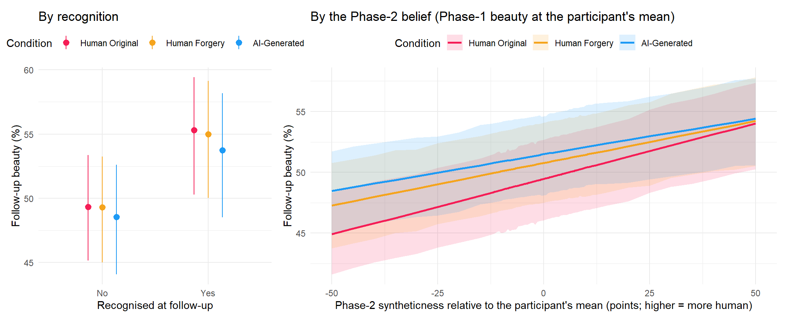{width=1056}
:::
:::


Reading the tables. **Beauty2Recognition**: recognised artworks are rated
more beautiful than unrecognised ones under every label (the familiarity /
liking link also seen in `MemorySR`), and the label contrasts are null
among unrecognised artworks; among recognised ones the mean response shows
no credible AI penalty either, but the probability of choosing the
"beautiful" side does drop for AI-labelled works -- a small residual trace
in the categorical choice, on the works the participant still remembers.
**Beauty2Reality**: the syntheticness belief formed in Phase 2 predicts
follow-up beauty beyond the Phase-1 beauty of the same work, under every
label (the "believed human = beautiful later" slope), and through it the
AI label carries a small negative indirect effect. The "Total" and "Direct"
rows are *not* total label effects: they hold Phase-1 beauty at the
participant's mean, and the label had lowered that rating by ~7%, so an
AI-labelled work with the same Phase-1 rating as an Original is an
intrinsically more appealing work, which rebounds at follow-up (the
positive "direct" term is this conditioning on a label-affected covariate,
not a lasting benefit of the label). The unconditional label effect on
follow-up beauty is the `Beauty2` model's (`3_models.qmd`).


::: {.cell}

```{.r .cell-code}
write.csv(bind_rows(
  mutate(rec_within, Model = "Beauty2Recognition", Table = "Label contrast within recognition", Contrast = as.character(Contrast)) |>
    select(Model, Table, Recognition, Contrast, Parameter, Median = Difference_pct, CI_low = CI_low_pct, CI_high = CI_high_pct, pd, Effect),
  mutate(rec_between, Model = "Beauty2Recognition", Table = "Recognition contrast", Contrast = as.character(Contrast)) |>
    select(Model, Table, Contrast, Parameter, Median = Difference_pct, CI_low = CI_low_pct, CI_high = CI_high_pct, pd, Effect),
  mutate(med$effects, Model = "Beauty2Reality", Table = "Mediation (response)", Parameter = "response") |>
    rename(Effect_type = Effect) |> select(Model, Table, Contrast, Parameter, Effect_type, Median, CI_low, CI_high, pd),
  mutate(med_mu$effects, Model = "Beauty2Reality", Table = "Mediation (mu)", Parameter = "mu") |>
    rename(Effect_type = Effect) |> select(Model, Table, Contrast, Parameter, Effect_type, Median, CI_low, CI_high, pd),
  mutate(slopes, Model = "Beauty2Reality", Table = What, Contrast = Level, Parameter = "response") |>
    select(Model, Table, Contrast, Parameter, Median, CI_low, CI_high, pd, Effect)
), "../data/results_memory_durability.csv", row.names = FALSE)
```
:::


## Manuscript figure

`figures/figure_memory.png`, the figure of the manuscript's "Persistence and
Memory" section (Figure 4 since 2026-10-18, when it replaced the
self-relevance figure of `6_selfrelevance.qmd`; this composite since
2026-10-19, the user's choice after a five-panel figure, four-axis alluvials,
Sankey, chord and transition-graph mockups; restyled the same day). Top: an
alluvial of the recognized old artworks with a Phase-2 belief (observed counts,
`data_memory_task.csv`), the belief in the middle and the two follow-up
answers on either side (a hub: 12 + 16 ribbons, where the chain belief ->
recalled label -> recalled belief needs 48 in its second segment), flows
coloured by the belief and boxes by their own category, so that a flow
arriving in a box of its own colour is a consistent answer: the recalled label
is reconstructed from the belief (left), the belief is remembered (right).
Numbers at each end of a flow give its share of the box it touches (next to
the belief: the % of that belief's artworks given that answer, as in the
matrix columns; next to the answer: the % of that answer coming from that
belief); the belief column (boxes and header) is framed in black as the
starting point, with arrows from the frame to the two answers. On
either side, the same data as confusion matrices, own belief in columns
(columns sum to 100%) and the answer in rows, in the order of the adjacent
alluvial axis; colour bars repeat the category colours; outlined: the answer
consistent with the belief, AI Original and AI Copy both mapping onto the
AI-Generated label. The label shown is left out, as it predicted neither answer
(MemoryCondition above). Bottom, model-based: beauty by label in Phase 1 and
at follow-up (`Beauty` / `Beauty2` means of `3_models.qmd`), recognition by
Phase-1 beauty (MemoryAppraisal, joint curve), the recalled label by Phase-1
beauty (MemoryAppraisal; the two beauty panels side by side) and "seen before"
by follow-up self-relevance for old vs new artworks (MemorySR of
`6_selfrelevance.qmd`, follow-up beauty at the participant's mean, the three
old labels averaged per draw). No panel letters: the manuscript refers to the
panels by position.


::: {.cell}

```{.r .cell-code}
library(ggalluvial)
base <- 12
labels3 <- c("Human Original", "Human Forgery", "AI-Generated")
lv_belief <- c("Human Original", "Human Forgery", "AI Original", "AI Copy")
ink <- "#37474F" # single-series curves
fig_theme <- theme_minimal(base_size = base) +
  theme(plot.title = element_text(face = "bold", size = base), plot.title.position = "plot",
        axis.title = element_text(size = base - 1, color = "grey20"), axis.text = element_text(color = "grey30"))

# ---- Top: alluvial of the recognized artworks, own belief in the middle ----
# Recognized old artworks with a Phase-2 belief: the label recalled for them
# (left), the participant's own Phase-2 belief (middle) and the belief recalled
# for them (right); flows coloured by the belief, boxes by their own category
# (a flow ending in a box of its colour = a consistent answer). The label shown
# is left out (it predicted none of the follow-up answers). Hub rather than
# chain layout: a chain (belief -> recalled label -> recalled belief) needs 48
# ribbons in its second segment, the hub 12 + 16.
recognized <- filter(df, Type == "Old", Belief != "None", Recognition == "Yes")
cat(nrow(recognized), "recognized artworks from", n_distinct(recognized$Participant), "participants\n")
```

::: {.cell-output .cell-output-stdout}

```
4497 recognized artworks from 214 participants
```


:::

```{.r .cell-code}
paths <- recognized |>
  count(Recalled = factor(AnswerCondition, labels3), Belief = factor(Belief, lv_belief),
        RecalledBelief = factor(AnswerBelief, lv_belief))
axis_labels <- c(Recalled = "Recalled label\n(follow-up)", Belief = "Own belief\n(Phase 2)", RecalledBelief = "Recalled belief\n(follow-up)")
lodes <- to_lodes_form(paths, axes = c("Recalled", "Belief", "RecalledBelief"), id = "id", diffuse = Belief) |>
  mutate(x = factor(axis_labels[as.character(x)], axis_labels))
w <- 0.42 # box and flow width (wide enough for the labels)
p_allu <- ggplot(lodes, aes(x = x, y = n, stratum = stratum, alluvium = id)) +
  geom_flow(aes(fill = Belief), aes.bind = "flows", alpha = 0.65, width = w) +
  geom_stratum(aes(fill = after_stat(stratum)), width = w, color = "white", linewidth = 0.8) +
  geom_text(stat = "stratum",
            aes(label = paste0(str_replace(after_stat(stratum), "^Human ", "Human\n"), "\n", round(100 * after_stat(prop)), "%")),
            size = 3.3, lineheight = 0.88, color = "grey10") +
  scale_fill_manual(values = cols, guide = "none") +
  scale_x_discrete(expand = c(0.1, 0.1), position = "top") +
  scale_y_continuous(expand = c(0.01, 0.01)) +
  coord_cartesian(ylim = c(0, sum(paths$n)), clip = "off") + # the arrows above the panel must not extend it
  labs(x = NULL, y = NULL, title = "Paths of the recognized artworks") +
  fig_theme +
  theme(axis.text.y = element_blank(), panel.grid = element_blank(),
        axis.text.x.top = element_text(size = base, face = "bold", color = "grey10", lineheight = 0.95))

# Percentages on the flows, read from the drawn flows (one row per flow end): each
# number is the flow's share of the box it touches, i.e. next to the own-belief box
# the % of the artworks of that belief going to each answer (the matrix columns),
# next to the answer box the % of that answer coming from each belief. Labels are
# spread apart within their box when the flows are too thin to hold them.
spread <- function(y, lo, hi, d) {
  o <- order(y); ys <- y[o]; k <- length(ys)
  if (hi - lo < k * d) {
    ys <- (lo + hi) / 2 + (seq_len(k) - (k + 1) / 2) * d
  } else {
    ys <- pmin(pmax(ys, lo + d / 2), hi - d / 2)
    for (i in seq_len(k)[-1]) ys[i] <- max(ys[i], ys[i - 1] + d)
    if (ys[k] > hi - d / 2) {
      ys[k] <- hi - d / 2
      for (i in rev(seq_len(k - 1))) ys[i] <- min(ys[i], ys[i + 1] - d)
    }
  }
  y[o] <- ys
  y
}
N <- sum(paths$n)
d_lab <- 0.019 * N # height of a flow label, in artworks
pad <- 0.015
frame_pad <- 0.025 # gap between the own-belief boxes and the frame around them
ends <- layer_data(p_allu, 1) |> transmute(group, x, stratum = as.character(stratum), ymin, ymax)
boxes <- layer_data(p_allu, 2) |> transmute(x, stratum = as.character(stratum), lo = ymin, hi = ymax)
flows <- inner_join(filter(ends, x == 2) |> rename(belief = stratum),
                    filter(ends, x != 2) |> select(group, x_ans = x, answer = stratum, a_min = ymin, a_max = ymax),
                    by = "group") |>
  mutate(size = ymax - ymin, side = ifelse(x_ans == 1, "left", "right")) |>
  mutate(p_start = 100 * size / sum(size), .by = c(side, belief)) |>
  mutate(p_end = 100 * size / sum(size), .by = c(side, answer))
lab_start <- flows |>
  left_join(filter(boxes, x == 2) |> select(belief = stratum, lo, hi), by = "belief") |>
  mutate(y = spread((ymin + ymax) / 2, lo[1], hi[1], d_lab), .by = c(side, belief)) |>
  mutate(xpos = ifelse(side == "left", 2 - w / 2 - frame_pad - pad, 2 + w / 2 + frame_pad + pad), # outside the frame
         hjust = ifelse(side == "left", 1, 0), p = p_start)
lab_end <- flows |>
  left_join(boxes |> select(x_ans = x, answer = stratum, lo, hi), by = c("x_ans", "answer")) |>
  mutate(y = spread((a_min + a_max) / 2, lo[1], hi[1], d_lab), .by = c(side, answer)) |>
  mutate(xpos = ifelse(side == "left", 1 + w / 2 + pad, 3 - w / 2 - pad), hjust = ifelse(side == "left", 0, 1), p = p_end)
# The own-belief column (boxes and header) framed as the starting point, with arrows
# from the frame to the two answers at the height of the headers (above the panel;
# tuned for the 13.5 x 9.5 in figure)
y_head <- N * 1.085
x_frame <- c(2 - w / 2 - frame_pad, 2 + w / 2 + frame_pad)
p_allu <- p_allu +
  geom_text(data = bind_rows(lab_start, lab_end), aes(x = xpos, y = y, label = sprintf("%.0f%%", p), hjust = hjust),
            inherit.aes = FALSE, size = 2, color = "white", fontface = "bold") +
  annotate("rect", xmin = x_frame[1], xmax = x_frame[2], ymin = -0.015 * N, ymax = 1.14 * N,
           fill = NA, color = "black", linewidth = 0.9) +
  annotate("segment", x = x_frame, xend = c(1.31, 2.69), y = y_head, yend = y_head,
           arrow = arrow(length = unit(2.2, "mm"), type = "closed"), linewidth = 0.6, color = "grey25")

# ---- Confusion matrices on either side of the alluvial: the same data, own
# belief in columns (colour bars on top: the flow colours; columns sum to 100%)
# and the answer in rows, in the order of the adjacent alluvial axis (colour
# bars on the outer side: the box colours); outlined cells: the answer
# consistent with the belief (AI Original and AI Copy -> AI-Generated)
consistent <- c("Human Original" = "Human Original", "Human Forgery" = "Human Forgery", "AI Original" = "AI-Generated", "AI Copy" = "AI-Generated")
matrix_pal <- scales::seq_gradient_pal("#F3F5F6", "#455A64", "Lab")
heat <- function(d, title, ylab, side = "left") {
  nr <- nlevels(d$Answer)
  bar_x <- if (side == "left") c(0.36, 0.44) else c(4.56, 4.64)
  ggplot(d, aes(x = Held, y = fct_rev(Answer))) +
    geom_tile(aes(fill = p), color = "white", linewidth = 1.6) +
    geom_tile(data = filter(d, Correct), fill = NA, color = "grey10", linewidth = 0.7, width = 0.94, height = 0.94) +
    geom_text(aes(label = sprintf("%.0f%%", p), fontface = ifelse(Correct, "bold", "plain"),
                  color = ifelse(farver::decode_colour(matrix_pal(p / 65), to = "lab")[, "l"] < 55, "white", "grey15")), size = 3.6) +
    annotate("rect", xmin = 1:4 - 0.46, xmax = 1:4 + 0.46, ymin = nr + 0.58, ymax = nr + 0.7, fill = cols[lv_belief]) +
    annotate("rect", xmin = bar_x[1], xmax = bar_x[2], ymin = nr:1 - 0.46, ymax = nr:1 + 0.46, fill = cols[levels(d$Answer)]) +
    scale_color_identity() +
    scale_fill_gradientn(colours = matrix_pal(seq(0, 1, length.out = 20)), limits = c(0, 65), guide = "none") +
    scale_x_discrete(position = "top", labels = \(x) str_replace(x, " ", "\n"),
                     expand = if (side == "left") expansion(add = c(0.66, 0.52)) else expansion(add = c(0.52, 0.66))) +
    scale_y_discrete(position = side, labels = \(x) str_replace(x, " ", "\n"), expand = expansion(add = c(0.52, 0.74))) +
    labs(x = "Own belief (Phase 2)", y = ylab, title = title) +
    fig_theme +
    theme(panel.grid = element_blank(), axis.text = element_text(color = "grey20"),
          axis.title.x.top = element_text(margin = margin(b = 4)))
}
dat_m1 <- recognized |>
  count(Held = factor(Belief, lv_belief), Answer = factor(AnswerCondition, labels3)) |>
  mutate(p = 100 * n / sum(n), Correct = consistent[as.character(Held)] == as.character(Answer), .by = Held)
dat_m2 <- recognized |>
  count(Held = factor(Belief, lv_belief), Answer = factor(AnswerBelief, lv_belief)) |>
  mutate(p = 100 * n / sum(n), Correct = as.character(Held) == as.character(Answer), .by = Held)
p_m1 <- heat(dat_m1, "Recalled label by own belief", "Recalled label (follow-up)", "left")
p_m2 <- heat(dat_m2, "Recalled belief by own belief", "Recalled belief (follow-up)", "right")

# ---- Bottom: model-based panels ----
legend3 <- list(scale_color_manual(values = cols, name = "Label", breaks = labels3),
                guides(color = guide_legend(override.aes = list(size = 3.5, linewidth = 1))))
signed <- \(x) ifelse(x > 0, paste0("+", x), as.character(x))
curve_theme <- fig_theme + theme(legend.position = "bottom", legend.title = element_text(size = base - 1),
                                 panel.grid.minor = element_blank(), plot.margin = margin(16, 10, 6, 10))
xlab_beauty <- "Phase 1 beauty\n(points above or below own mean)"

# Beauty under each label in Phase 1 and at follow-up (marginal means of the Beauty / Beauty2 models, 3_models.qmd)
est_beauty <- read_estimates(c("Beauty", "Beauty2"))
dat_a <- bind_rows(mutate(est_beauty$Beauty$means, Session = "Phase 1\n(label shown)"),
                   mutate(est_beauty$Beauty2$means, Session = "Follow-up\n(label corrected)")) |>
  mutate(Session = fct_inorder(Session), Condition = factor(Condition, labels3))
p_a <- ggplot(dat_a, aes(x = Session, y = 100 * Estimate, color = Condition, group = Condition)) +
  geom_line(position = position_dodge(width = 0.25), linewidth = 0.9, show.legend = FALSE) +
  geom_pointrange(aes(ymin = 100 * CI_low, ymax = 100 * CI_high), position = position_dodge(width = 0.25),
                  linewidth = 0.8, size = 0.6, key_glyph = "point") +
  legend3 +
  scale_x_discrete(expand = expansion(add = 0.45)) +
  scale_y_continuous(breaks = seq(44, 58, by = 2)) +
  labs(x = NULL, y = "Beauty (% of the scale)", title = "Beauty by label") +
  curve_theme + theme(panel.grid.major.x = element_blank())

# Recognition by Phase-1 beauty (MemoryAppraisal, joint curve: valence follows beauty)
dat_b <- app$curves |> filter(Type == "joint", Predictor == "Beauty_w", Outcome == "P(recognised)", abs(x) <= 0.5)
p_b <- ggplot(dat_b, aes(x = 100 * x, y = Median)) +
  geom_ribbon(aes(ymin = CI_low, ymax = CI_high), alpha = 0.15, fill = ink) +
  geom_line(linewidth = 1.1, color = ink) +
  scale_x_continuous(labels = signed) +
  labs(x = xlab_beauty, y = "Recognized at follow-up (%)", title = "Recognition by Phase 1 beauty") +
  curve_theme

# "Seen before" by follow-up self-relevance, old (hits, averaged over the three labels) vs new artworks (false alarms):
# MemorySR, the other rating (follow-up beauty) at the participant's mean
est_sr <- read_estimates("MemorySR")$MemorySR
g_sr <- est_sr$grid |> mutate(row = row_number()) |> filter(Type == "unique", Predictor == "SR_w", abs(x) <= 0.5)
rec_draws <- 1 - est_sr$draws[, g_sr$row, "Not recognized"]
dat_c <- bind_rows(lapply(unique(g_sr$x), function(xx) {
  old <- rowMeans(rec_draws[, g_sr$x == xx & g_sr$Level != "New Items", drop = FALSE])
  new <- rec_draws[, g_sr$x == xx & g_sr$Level == "New Items"]
  bind_rows(lapply(list(`Old artworks (hits)` = old, `New artworks (false alarms)` = new), function(v) {
    ci <- bayestestR::hdi(v, ci = 0.95)
    data.frame(Median = 100 * median(v), CI_low = 100 * ci$CI_low, CI_high = 100 * ci$CI_high)
  }), .id = "Type") |> mutate(x = xx)
})) |> mutate(Type = fct_inorder(Type))
# direct labels below each band, right-aligned
dat_c_lab <- data.frame(Type = factor(levels(dat_c$Type), levels(dat_c$Type)), x = 50, y = c(27, 13),
                        label = c("Old artworks\n(hits)", "New artworks\n(false alarms)"))
p_c <- ggplot(dat_c, aes(x = 100 * x, y = Median, color = Type, fill = Type)) +
  geom_ribbon(aes(ymin = CI_low, ymax = CI_high), alpha = 0.18, color = NA, show.legend = FALSE) +
  geom_line(linewidth = 1.1, show.legend = FALSE) +
  geom_text(data = dat_c_lab, aes(x = x, y = y, label = label), hjust = 1, size = 3.3, lineheight = 0.9,
            fontface = "bold", show.legend = FALSE) +
  scale_color_manual(values = c(ink, "#90A4AE"), guide = "none", aesthetics = c("color", "fill")) +
  scale_x_continuous(labels = signed) +
  labs(x = "Self-relevance at follow-up\n(points above or below own mean)", y = "Judged as seen before (%)", title = "Familiarity by self-relevance") +
  curve_theme

# Recalled label by Phase-1 beauty among recognized artworks (MemoryAppraisal, joint curves)
dat_d <- app$curves |>
  filter(Type == "joint", Predictor == "Beauty_w", Outcome != "P(recognised)", abs(x) <= 0.5) |>
  mutate(Answer = factor(str_match(Outcome, "P[(](.*) [|] recognised[)]")[, 2], labels3))
p_d <- ggplot(dat_d, aes(x = 100 * x, y = Median, color = Answer, fill = Answer)) +
  geom_ribbon(aes(ymin = CI_low, ymax = CI_high), alpha = 0.15, color = NA, show.legend = FALSE) +
  geom_line(linewidth = 1.1, show.legend = FALSE) + # same colours and names as the legend of "Beauty by label"
  scale_color_manual(values = cols, guide = "none") + scale_fill_manual(values = cols, guide = "none") +
  scale_x_continuous(labels = signed) +
  labs(x = xlab_beauty, y = "Recalled label (% of recognized)", title = "Recalled label by Phase 1 beauty") +
  curve_theme

# Rows wrapped separately, so that the bottom panels do not align with the wide matrix labels above them
top <- p_m1 + p_allu + p_m2 + plot_layout(widths = c(1.15, 2.3, 1.15))
bottom <- p_a + p_b + p_d + p_c + # the two Phase-1 beauty panels side by side, self-relevance last
  plot_layout(nrow = 1, widths = c(0.95, 1, 1, 1), guides = "collect") &
  theme(legend.position = "bottom")
figure_memory <- wrap_elements(full = top) / wrap_elements(full = bottom) + plot_layout(heights = c(1.25, 1))
ggsave("figures/figure_memory.png", figure_memory, width = 13.5, height = 9.5, dpi = 300, bg = "white")
figure_memory
```

::: {.cell-output-display}
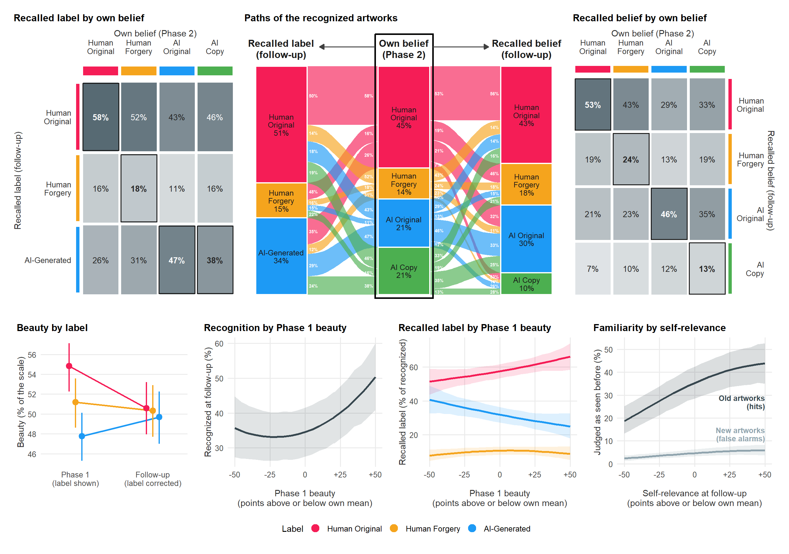{#fig-figure-memory width=1296}
:::
:::


## Summary

- `data/results_memory_contrasts.csv`: every contrast (level × answer pair), probability scale, with `pd` and `Credible`.
- `data/results_memory_means.csv`: probability of each answer per level.
- `data/results_memory_durability.csv`: the Beauty2Recognition / Beauty2Reality tables (label contrasts within recognition, recognition contrast, mediation through the Phase-2 belief, slopes).


::: {.cell}

```{.r .cell-code}
results_memory_contrasts <- bind_rows(lapply(unname(estimates), function(e) {
  d <- as.data.frame(e$contrasts)
  d$Model <- e$outcome
  d$Predictor <- e$by
  d$Credible <- sign(d$CI_low) == sign(d$CI_high)
  d[c("Model", "Predictor", "Level1", "Response1", "Level2", "Response2",
      "Median", "CI_low", "CI_high", "pd", "Credible")]
})) |>
  arrange(Model, Response1, Response2, Level1, Level2)
write.csv(results_memory_contrasts, "../data/results_memory_contrasts.csv", row.names = FALSE)

results_memory_means <- bind_rows(lapply(unname(estimates), function(e) {
  d <- as.data.frame(e$means)
  data.frame(Model = e$outcome, Predictor = e$by, Level = as.character(d[[e$by]]),
             Response = as.character(d$Response), Median = d$Median,
             CI_low = d$CI_low, CI_high = d$CI_high)
})) |>
  arrange(Model, Level, Response)
write.csv(results_memory_means, "../data/results_memory_means.csv", row.names = FALSE)

make_tables(bind_rows(lapply(unname(estimates), `[[`, "diag")),
            c("Model", "Family", "N_obs", "N_participants", "Chains", "Draws",
              "Max_Rhat", "Min_ESS_ratio", "Divergent_pct", "Criterion"),
            "Convergence of the memory models")
```

::: {.cell-output-display}

```{=html}
<div id="nzljvseutt" style="padding-left:0px;padding-right:0px;padding-top:10px;padding-bottom:10px;overflow-x:auto;overflow-y:auto;width:auto;height:auto;">
<style>#nzljvseutt table {
  font-family: system-ui, 'Segoe UI', Roboto, Helvetica, Arial, sans-serif, 'Apple Color Emoji', 'Segoe UI Emoji', 'Segoe UI Symbol', 'Noto Color Emoji';
  -webkit-font-smoothing: antialiased;
  -moz-osx-font-smoothing: grayscale;
}

#nzljvseutt thead, #nzljvseutt tbody, #nzljvseutt tfoot, #nzljvseutt tr, #nzljvseutt td, #nzljvseutt th {
  border-style: none;
}

#nzljvseutt p {
  margin: 0;
  padding: 0;
}

#nzljvseutt .gt_table {
  display: table;
  border-collapse: collapse;
  line-height: normal;
  margin-left: auto;
  margin-right: auto;
  color: #333333;
  font-size: 13px;
  font-weight: normal;
  font-style: normal;
  background-color: #FFFFFF;
  width: auto;
  border-top-style: solid;
  border-top-width: 3px;
  border-top-color: #D5D5D5;
  border-right-style: solid;
  border-right-width: 3px;
  border-right-color: #D5D5D5;
  border-bottom-style: solid;
  border-bottom-width: 3px;
  border-bottom-color: #D5D5D5;
  border-left-style: solid;
  border-left-width: 3px;
  border-left-color: #D5D5D5;
}

#nzljvseutt .gt_caption {
  padding-top: 4px;
  padding-bottom: 4px;
}

#nzljvseutt .gt_title {
  color: #333333;
  font-size: 125%;
  font-weight: initial;
  padding-top: 4px;
  padding-bottom: 4px;
  padding-left: 5px;
  padding-right: 5px;
  border-bottom-color: #FFFFFF;
  border-bottom-width: 0;
}

#nzljvseutt .gt_subtitle {
  color: #333333;
  font-size: 85%;
  font-weight: initial;
  padding-top: 3px;
  padding-bottom: 5px;
  padding-left: 5px;
  padding-right: 5px;
  border-top-color: #FFFFFF;
  border-top-width: 0;
}

#nzljvseutt .gt_heading {
  background-color: #FFFFFF;
  text-align: left;
  border-bottom-color: #FFFFFF;
  border-left-style: none;
  border-left-width: 1px;
  border-left-color: #D3D3D3;
  border-right-style: none;
  border-right-width: 1px;
  border-right-color: #D3D3D3;
}

#nzljvseutt .gt_bottom_border {
  border-bottom-style: solid;
  border-bottom-width: 2px;
  border-bottom-color: #D5D5D5;
}

#nzljvseutt .gt_col_headings {
  border-top-style: solid;
  border-top-width: 2px;
  border-top-color: #D5D5D5;
  border-bottom-style: solid;
  border-bottom-width: 2px;
  border-bottom-color: #D5D5D5;
  border-left-style: none;
  border-left-width: 1px;
  border-left-color: #D3D3D3;
  border-right-style: none;
  border-right-width: 1px;
  border-right-color: #D3D3D3;
}

#nzljvseutt .gt_col_heading {
  color: #FFFFFF;
  background-color: #000000;
  font-size: 100%;
  font-weight: normal;
  text-transform: inherit;
  border-left-style: none;
  border-left-width: 1px;
  border-left-color: #D3D3D3;
  border-right-style: none;
  border-right-width: 1px;
  border-right-color: #D3D3D3;
  vertical-align: bottom;
  padding-top: 5px;
  padding-bottom: 6px;
  padding-left: 5px;
  padding-right: 5px;
  overflow-x: hidden;
}

#nzljvseutt .gt_column_spanner_outer {
  color: #FFFFFF;
  background-color: #000000;
  font-size: 100%;
  font-weight: normal;
  text-transform: inherit;
  padding-top: 0;
  padding-bottom: 0;
  padding-left: 4px;
  padding-right: 4px;
}

#nzljvseutt .gt_column_spanner_outer:first-child {
  padding-left: 0;
}

#nzljvseutt .gt_column_spanner_outer:last-child {
  padding-right: 0;
}

#nzljvseutt .gt_column_spanner {
  border-bottom-style: solid;
  border-bottom-width: 2px;
  border-bottom-color: #D5D5D5;
  vertical-align: bottom;
  padding-top: 5px;
  padding-bottom: 5px;
  overflow-x: hidden;
  display: inline-block;
  width: 100%;
}

#nzljvseutt .gt_spanner_row {
  border-bottom-style: hidden;
}

#nzljvseutt .gt_group_heading {
  padding-top: 8px;
  padding-bottom: 8px;
  padding-left: 5px;
  padding-right: 5px;
  color: #333333;
  background-color: #FFFFFF;
  font-size: 100%;
  font-weight: initial;
  text-transform: inherit;
  border-top-style: solid;
  border-top-width: 2px;
  border-top-color: #D5D5D5;
  border-bottom-style: solid;
  border-bottom-width: 2px;
  border-bottom-color: #D5D5D5;
  border-left-style: none;
  border-left-width: 1px;
  border-left-color: #D3D3D3;
  border-right-style: none;
  border-right-width: 1px;
  border-right-color: #D3D3D3;
  vertical-align: middle;
  text-align: left;
}

#nzljvseutt .gt_empty_group_heading {
  padding: 0.5px;
  color: #333333;
  background-color: #FFFFFF;
  font-size: 100%;
  font-weight: initial;
  border-top-style: solid;
  border-top-width: 2px;
  border-top-color: #D5D5D5;
  border-bottom-style: solid;
  border-bottom-width: 2px;
  border-bottom-color: #D5D5D5;
  vertical-align: middle;
}

#nzljvseutt .gt_from_md > :first-child {
  margin-top: 0;
}

#nzljvseutt .gt_from_md > :last-child {
  margin-bottom: 0;
}

#nzljvseutt .gt_row {
  padding-top: 8px;
  padding-bottom: 8px;
  padding-left: 5px;
  padding-right: 5px;
  margin: 10px;
  border-top-style: solid;
  border-top-width: 1px;
  border-top-color: #D5D5D5;
  border-left-style: solid;
  border-left-width: 1px;
  border-left-color: #D5D5D5;
  border-right-style: solid;
  border-right-width: 1px;
  border-right-color: #D5D5D5;
  vertical-align: middle;
  overflow-x: hidden;
}

#nzljvseutt .gt_stub {
  color: #333333;
  background-color: #FFFFFF;
  font-size: 100%;
  font-weight: initial;
  text-transform: inherit;
  border-right-style: solid;
  border-right-width: 2px;
  border-right-color: #5F5F5F;
  padding-left: 5px;
  padding-right: 5px;
}

#nzljvseutt .gt_stub_row_group {
  color: #333333;
  background-color: #FFFFFF;
  font-size: 100%;
  font-weight: initial;
  text-transform: inherit;
  border-right-style: solid;
  border-right-width: 2px;
  border-right-color: #D3D3D3;
  padding-left: 5px;
  padding-right: 5px;
  vertical-align: top;
}

#nzljvseutt .gt_row_group_first td {
  border-top-width: 2px;
}

#nzljvseutt .gt_row_group_first th {
  border-top-width: 2px;
}

#nzljvseutt .gt_summary_row {
  color: #333333;
  background-color: #D5D5D5;
  text-transform: inherit;
  padding-top: 8px;
  padding-bottom: 8px;
  padding-left: 5px;
  padding-right: 5px;
}

#nzljvseutt .gt_first_summary_row {
  border-top-style: solid;
  border-top-color: #D5D5D5;
}

#nzljvseutt .gt_first_summary_row.thick {
  border-top-width: 2px;
}

#nzljvseutt .gt_last_summary_row {
  padding-top: 8px;
  padding-bottom: 8px;
  padding-left: 5px;
  padding-right: 5px;
  border-bottom-style: solid;
  border-bottom-width: 2px;
  border-bottom-color: #D5D5D5;
}

#nzljvseutt .gt_grand_summary_row {
  color: #FFFFFF;
  background-color: #929292;
  text-transform: inherit;
  padding-top: 8px;
  padding-bottom: 8px;
  padding-left: 5px;
  padding-right: 5px;
}

#nzljvseutt .gt_first_grand_summary_row {
  padding-top: 8px;
  padding-bottom: 8px;
  padding-left: 5px;
  padding-right: 5px;
  border-top-style: double;
  border-top-width: 6px;
  border-top-color: #D5D5D5;
}

#nzljvseutt .gt_last_grand_summary_row_top {
  padding-top: 8px;
  padding-bottom: 8px;
  padding-left: 5px;
  padding-right: 5px;
  border-bottom-style: double;
  border-bottom-width: 6px;
  border-bottom-color: #D5D5D5;
}

#nzljvseutt .gt_striped {
  background-color: #F4F4F4;
}

#nzljvseutt .gt_table_body {
  border-top-style: solid;
  border-top-width: 2px;
  border-top-color: #D5D5D5;
  border-bottom-style: solid;
  border-bottom-width: 2px;
  border-bottom-color: #D5D5D5;
}

#nzljvseutt .gt_footnotes {
  color: #333333;
  background-color: #FFFFFF;
  border-bottom-style: none;
  border-bottom-width: 2px;
  border-bottom-color: #D3D3D3;
  border-left-style: none;
  border-left-width: 2px;
  border-left-color: #D3D3D3;
  border-right-style: none;
  border-right-width: 2px;
  border-right-color: #D3D3D3;
}

#nzljvseutt .gt_footnote {
  margin: 0px;
  font-size: 90%;
  padding-top: 4px;
  padding-bottom: 4px;
  padding-left: 5px;
  padding-right: 5px;
}

#nzljvseutt .gt_sourcenotes {
  color: #333333;
  background-color: #FFFFFF;
  border-bottom-style: none;
  border-bottom-width: 2px;
  border-bottom-color: #D3D3D3;
  border-left-style: none;
  border-left-width: 2px;
  border-left-color: #D3D3D3;
  border-right-style: none;
  border-right-width: 2px;
  border-right-color: #D3D3D3;
}

#nzljvseutt .gt_sourcenote {
  font-size: 90%;
  padding-top: 4px;
  padding-bottom: 4px;
  padding-left: 5px;
  padding-right: 5px;
}

#nzljvseutt .gt_left {
  text-align: left;
}

#nzljvseutt .gt_center {
  text-align: center;
}

#nzljvseutt .gt_right {
  text-align: right;
  font-variant-numeric: tabular-nums;
}

#nzljvseutt .gt_font_normal {
  font-weight: normal;
}

#nzljvseutt .gt_font_bold {
  font-weight: bold;
}

#nzljvseutt .gt_font_italic {
  font-style: italic;
}

#nzljvseutt .gt_super {
  font-size: 65%;
}

#nzljvseutt .gt_footnote_marks {
  font-size: 75%;
  vertical-align: 0.4em;
  position: initial;
}

#nzljvseutt .gt_asterisk {
  font-size: 100%;
  vertical-align: 0;
}

#nzljvseutt .gt_indent_1 {
  text-indent: 5px;
}

#nzljvseutt .gt_indent_2 {
  text-indent: 10px;
}

#nzljvseutt .gt_indent_3 {
  text-indent: 15px;
}

#nzljvseutt .gt_indent_4 {
  text-indent: 20px;
}

#nzljvseutt .gt_indent_5 {
  text-indent: 25px;
}

#nzljvseutt .katex-display {
  display: inline-flex !important;
  margin-bottom: 0.75em !important;
}

#nzljvseutt div.Reactable > div.rt-table > div.rt-thead > div.rt-tr.rt-tr-group-header > div.rt-th-group:after {
  height: 0px !important;
}
</style>
<table class="gt_table" data-quarto-disable-processing="false" data-quarto-bootstrap="false">
  <thead>
    <tr class="gt_heading">
      <td colspan="10" class="gt_heading gt_title gt_font_normal gt_bottom_border" style>Convergence of the memory models</td>
    </tr>
    
    <tr class="gt_col_headings">
      <th class="gt_col_heading gt_columns_bottom_border gt_left" rowspan="1" colspan="1" scope="col" id="Model">Model</th>
      <th class="gt_col_heading gt_columns_bottom_border gt_left" rowspan="1" colspan="1" scope="col" id="Family">Family</th>
      <th class="gt_col_heading gt_columns_bottom_border gt_right" rowspan="1" colspan="1" scope="col" id="N_obs">N_obs</th>
      <th class="gt_col_heading gt_columns_bottom_border gt_right" rowspan="1" colspan="1" scope="col" id="N_participants">N_participants</th>
      <th class="gt_col_heading gt_columns_bottom_border gt_right" rowspan="1" colspan="1" scope="col" id="Chains">Chains</th>
      <th class="gt_col_heading gt_columns_bottom_border gt_right" rowspan="1" colspan="1" scope="col" id="Draws">Draws</th>
      <th class="gt_col_heading gt_columns_bottom_border gt_right" rowspan="1" colspan="1" scope="col" id="Max_Rhat">Max_Rhat</th>
      <th class="gt_col_heading gt_columns_bottom_border gt_right" rowspan="1" colspan="1" scope="col" id="Min_ESS_ratio">Min_ESS_ratio</th>
      <th class="gt_col_heading gt_columns_bottom_border gt_right" rowspan="1" colspan="1" scope="col" id="Divergent_pct">Divergent_pct</th>
      <th class="gt_col_heading gt_columns_bottom_border gt_left" rowspan="1" colspan="1" scope="col" id="Criterion">Criterion</th>
    </tr>
  </thead>
  <tbody class="gt_table_body">
    <tr><td headers="Model" class="gt_row gt_left">MemoryCondition</td>
<td headers="Family" class="gt_row gt_left">Categorical</td>
<td headers="N_obs" class="gt_row gt_right">21120</td>
<td headers="N_participants" class="gt_row gt_right">220</td>
<td headers="Chains" class="gt_row gt_right">8</td>
<td headers="Draws" class="gt_row gt_right">4000</td>
<td headers="Max_Rhat" class="gt_row gt_right">1.131</td>
<td headers="Min_ESS_ratio" class="gt_row gt_right">0.011</td>
<td headers="Divergent_pct" class="gt_row gt_right">1.45</td>
<td headers="Criterion" class="gt_row gt_left">loo</td></tr>
    <tr><td headers="Model" class="gt_row gt_left gt_striped">MemoryBelief</td>
<td headers="Family" class="gt_row gt_left gt_striped">Categorical</td>
<td headers="N_obs" class="gt_row gt_right gt_striped">21120</td>
<td headers="N_participants" class="gt_row gt_right gt_striped">220</td>
<td headers="Chains" class="gt_row gt_right gt_striped">8</td>
<td headers="Draws" class="gt_row gt_right gt_striped">4000</td>
<td headers="Max_Rhat" class="gt_row gt_right gt_striped">1.043</td>
<td headers="Min_ESS_ratio" class="gt_row gt_right gt_striped">0.035</td>
<td headers="Divergent_pct" class="gt_row gt_right gt_striped">0.00</td>
<td headers="Criterion" class="gt_row gt_left gt_striped">loo</td></tr>
    <tr><td headers="Model" class="gt_row gt_left">MemoryConditionBelief</td>
<td headers="Family" class="gt_row gt_left">Categorical</td>
<td headers="N_obs" class="gt_row gt_right">10416</td>
<td headers="N_participants" class="gt_row gt_right">217</td>
<td headers="Chains" class="gt_row gt_right">8</td>
<td headers="Draws" class="gt_row gt_right">4000</td>
<td headers="Max_Rhat" class="gt_row gt_right">1.031</td>
<td headers="Min_ESS_ratio" class="gt_row gt_right">0.078</td>
<td headers="Divergent_pct" class="gt_row gt_right">0.00</td>
<td headers="Criterion" class="gt_row gt_left">loo</td></tr>
    <tr><td headers="Model" class="gt_row gt_left gt_striped">MemoryBeliefAppraisal</td>
<td headers="Family" class="gt_row gt_left gt_striped">Categorical</td>
<td headers="N_obs" class="gt_row gt_right gt_striped">10416</td>
<td headers="N_participants" class="gt_row gt_right gt_striped">217</td>
<td headers="Chains" class="gt_row gt_right gt_striped">8</td>
<td headers="Draws" class="gt_row gt_right gt_striped">4000</td>
<td headers="Max_Rhat" class="gt_row gt_right gt_striped">1.013</td>
<td headers="Min_ESS_ratio" class="gt_row gt_right gt_striped">0.125</td>
<td headers="Divergent_pct" class="gt_row gt_right gt_striped">0.00</td>
<td headers="Criterion" class="gt_row gt_left gt_striped">loo</td></tr>
    <tr><td headers="Model" class="gt_row gt_left">MemoryConditionAppraisal</td>
<td headers="Family" class="gt_row gt_left">Categorical</td>
<td headers="N_obs" class="gt_row gt_right">10416</td>
<td headers="N_participants" class="gt_row gt_right">217</td>
<td headers="Chains" class="gt_row gt_right">8</td>
<td headers="Draws" class="gt_row gt_right">4000</td>
<td headers="Max_Rhat" class="gt_row gt_right">1.016</td>
<td headers="Min_ESS_ratio" class="gt_row gt_right">0.122</td>
<td headers="Divergent_pct" class="gt_row gt_right">0.00</td>
<td headers="Criterion" class="gt_row gt_left">loo</td></tr>
  </tbody>
  
</table>
</div>
```


::: {.callout-note collapse="true" title="Convergence of the memory models (Markdown table, for text readers)"}

|Model                    |Family      | N_obs| N_participants| Chains| Draws| Max_Rhat| Min_ESS_ratio| Divergent_pct|Criterion |
|:------------------------|:-----------|-----:|--------------:|------:|-----:|--------:|-------------:|-------------:|:---------|
|MemoryCondition          |Categorical | 21120|            220|      8|  4000|    1.131|         0.011|          1.45|loo       |
|MemoryBelief             |Categorical | 21120|            220|      8|  4000|    1.043|         0.035|          0.00|loo       |
|MemoryConditionBelief    |Categorical | 10416|            217|      8|  4000|    1.031|         0.078|          0.00|loo       |
|MemoryBeliefAppraisal    |Categorical | 10416|            217|      8|  4000|    1.013|         0.125|          0.00|loo       |
|MemoryConditionAppraisal |Categorical | 10416|            217|      8|  4000|    1.016|         0.122|          0.00|loo       |

:::

:::
:::


::: {.cell}

```{.r .cell-code}
credible <- results_memory_contrasts |>
  filter(Credible, Response1 == Response2) |>
  mutate(Answer = Response1,
         Contrast = paste(Level1, "-", Level2),
         Diff_pp = insight::format_value(100 * Median),
         CI = sprintf("[%s, %s]", insight::format_value(100 * CI_low), insight::format_value(100 * CI_high)),
         pd_fmt = insight::format_pd(pd, name = NULL),
         Effect = ifelse(Median < 0, "Negative", "Positive")) |>
  arrange(Model, Answer, desc(abs(Median))) |>
  select(Model, Answer, Contrast, Diff_pp, CI, pd_fmt, Effect)

make_tables(credible, names(credible),
            "Credible differences in the probability of each answer between levels, in percentage points")
```

::: {.cell-output-display}

```{=html}
<div id="qbzaiylenz" style="padding-left:0px;padding-right:0px;padding-top:10px;padding-bottom:10px;overflow-x:auto;overflow-y:auto;width:auto;height:auto;">
<style>#qbzaiylenz table {
  font-family: system-ui, 'Segoe UI', Roboto, Helvetica, Arial, sans-serif, 'Apple Color Emoji', 'Segoe UI Emoji', 'Segoe UI Symbol', 'Noto Color Emoji';
  -webkit-font-smoothing: antialiased;
  -moz-osx-font-smoothing: grayscale;
}

#qbzaiylenz thead, #qbzaiylenz tbody, #qbzaiylenz tfoot, #qbzaiylenz tr, #qbzaiylenz td, #qbzaiylenz th {
  border-style: none;
}

#qbzaiylenz p {
  margin: 0;
  padding: 0;
}

#qbzaiylenz .gt_table {
  display: table;
  border-collapse: collapse;
  line-height: normal;
  margin-left: auto;
  margin-right: auto;
  color: #333333;
  font-size: 13px;
  font-weight: normal;
  font-style: normal;
  background-color: #FFFFFF;
  width: auto;
  border-top-style: solid;
  border-top-width: 3px;
  border-top-color: #D5D5D5;
  border-right-style: solid;
  border-right-width: 3px;
  border-right-color: #D5D5D5;
  border-bottom-style: solid;
  border-bottom-width: 3px;
  border-bottom-color: #D5D5D5;
  border-left-style: solid;
  border-left-width: 3px;
  border-left-color: #D5D5D5;
}

#qbzaiylenz .gt_caption {
  padding-top: 4px;
  padding-bottom: 4px;
}

#qbzaiylenz .gt_title {
  color: #333333;
  font-size: 125%;
  font-weight: initial;
  padding-top: 4px;
  padding-bottom: 4px;
  padding-left: 5px;
  padding-right: 5px;
  border-bottom-color: #FFFFFF;
  border-bottom-width: 0;
}

#qbzaiylenz .gt_subtitle {
  color: #333333;
  font-size: 85%;
  font-weight: initial;
  padding-top: 3px;
  padding-bottom: 5px;
  padding-left: 5px;
  padding-right: 5px;
  border-top-color: #FFFFFF;
  border-top-width: 0;
}

#qbzaiylenz .gt_heading {
  background-color: #FFFFFF;
  text-align: left;
  border-bottom-color: #FFFFFF;
  border-left-style: none;
  border-left-width: 1px;
  border-left-color: #D3D3D3;
  border-right-style: none;
  border-right-width: 1px;
  border-right-color: #D3D3D3;
}

#qbzaiylenz .gt_bottom_border {
  border-bottom-style: solid;
  border-bottom-width: 2px;
  border-bottom-color: #D5D5D5;
}

#qbzaiylenz .gt_col_headings {
  border-top-style: solid;
  border-top-width: 2px;
  border-top-color: #D5D5D5;
  border-bottom-style: solid;
  border-bottom-width: 2px;
  border-bottom-color: #D5D5D5;
  border-left-style: none;
  border-left-width: 1px;
  border-left-color: #D3D3D3;
  border-right-style: none;
  border-right-width: 1px;
  border-right-color: #D3D3D3;
}

#qbzaiylenz .gt_col_heading {
  color: #FFFFFF;
  background-color: #000000;
  font-size: 100%;
  font-weight: normal;
  text-transform: inherit;
  border-left-style: none;
  border-left-width: 1px;
  border-left-color: #D3D3D3;
  border-right-style: none;
  border-right-width: 1px;
  border-right-color: #D3D3D3;
  vertical-align: bottom;
  padding-top: 5px;
  padding-bottom: 6px;
  padding-left: 5px;
  padding-right: 5px;
  overflow-x: hidden;
}

#qbzaiylenz .gt_column_spanner_outer {
  color: #FFFFFF;
  background-color: #000000;
  font-size: 100%;
  font-weight: normal;
  text-transform: inherit;
  padding-top: 0;
  padding-bottom: 0;
  padding-left: 4px;
  padding-right: 4px;
}

#qbzaiylenz .gt_column_spanner_outer:first-child {
  padding-left: 0;
}

#qbzaiylenz .gt_column_spanner_outer:last-child {
  padding-right: 0;
}

#qbzaiylenz .gt_column_spanner {
  border-bottom-style: solid;
  border-bottom-width: 2px;
  border-bottom-color: #D5D5D5;
  vertical-align: bottom;
  padding-top: 5px;
  padding-bottom: 5px;
  overflow-x: hidden;
  display: inline-block;
  width: 100%;
}

#qbzaiylenz .gt_spanner_row {
  border-bottom-style: hidden;
}

#qbzaiylenz .gt_group_heading {
  padding-top: 8px;
  padding-bottom: 8px;
  padding-left: 5px;
  padding-right: 5px;
  color: #333333;
  background-color: #FFFFFF;
  font-size: 100%;
  font-weight: initial;
  text-transform: inherit;
  border-top-style: solid;
  border-top-width: 2px;
  border-top-color: #D5D5D5;
  border-bottom-style: solid;
  border-bottom-width: 2px;
  border-bottom-color: #D5D5D5;
  border-left-style: none;
  border-left-width: 1px;
  border-left-color: #D3D3D3;
  border-right-style: none;
  border-right-width: 1px;
  border-right-color: #D3D3D3;
  vertical-align: middle;
  text-align: left;
}

#qbzaiylenz .gt_empty_group_heading {
  padding: 0.5px;
  color: #333333;
  background-color: #FFFFFF;
  font-size: 100%;
  font-weight: initial;
  border-top-style: solid;
  border-top-width: 2px;
  border-top-color: #D5D5D5;
  border-bottom-style: solid;
  border-bottom-width: 2px;
  border-bottom-color: #D5D5D5;
  vertical-align: middle;
}

#qbzaiylenz .gt_from_md > :first-child {
  margin-top: 0;
}

#qbzaiylenz .gt_from_md > :last-child {
  margin-bottom: 0;
}

#qbzaiylenz .gt_row {
  padding-top: 8px;
  padding-bottom: 8px;
  padding-left: 5px;
  padding-right: 5px;
  margin: 10px;
  border-top-style: solid;
  border-top-width: 1px;
  border-top-color: #D5D5D5;
  border-left-style: solid;
  border-left-width: 1px;
  border-left-color: #D5D5D5;
  border-right-style: solid;
  border-right-width: 1px;
  border-right-color: #D5D5D5;
  vertical-align: middle;
  overflow-x: hidden;
}

#qbzaiylenz .gt_stub {
  color: #333333;
  background-color: #FFFFFF;
  font-size: 100%;
  font-weight: initial;
  text-transform: inherit;
  border-right-style: solid;
  border-right-width: 2px;
  border-right-color: #5F5F5F;
  padding-left: 5px;
  padding-right: 5px;
}

#qbzaiylenz .gt_stub_row_group {
  color: #333333;
  background-color: #FFFFFF;
  font-size: 100%;
  font-weight: initial;
  text-transform: inherit;
  border-right-style: solid;
  border-right-width: 2px;
  border-right-color: #D3D3D3;
  padding-left: 5px;
  padding-right: 5px;
  vertical-align: top;
}

#qbzaiylenz .gt_row_group_first td {
  border-top-width: 2px;
}

#qbzaiylenz .gt_row_group_first th {
  border-top-width: 2px;
}

#qbzaiylenz .gt_summary_row {
  color: #333333;
  background-color: #D5D5D5;
  text-transform: inherit;
  padding-top: 8px;
  padding-bottom: 8px;
  padding-left: 5px;
  padding-right: 5px;
}

#qbzaiylenz .gt_first_summary_row {
  border-top-style: solid;
  border-top-color: #D5D5D5;
}

#qbzaiylenz .gt_first_summary_row.thick {
  border-top-width: 2px;
}

#qbzaiylenz .gt_last_summary_row {
  padding-top: 8px;
  padding-bottom: 8px;
  padding-left: 5px;
  padding-right: 5px;
  border-bottom-style: solid;
  border-bottom-width: 2px;
  border-bottom-color: #D5D5D5;
}

#qbzaiylenz .gt_grand_summary_row {
  color: #FFFFFF;
  background-color: #929292;
  text-transform: inherit;
  padding-top: 8px;
  padding-bottom: 8px;
  padding-left: 5px;
  padding-right: 5px;
}

#qbzaiylenz .gt_first_grand_summary_row {
  padding-top: 8px;
  padding-bottom: 8px;
  padding-left: 5px;
  padding-right: 5px;
  border-top-style: double;
  border-top-width: 6px;
  border-top-color: #D5D5D5;
}

#qbzaiylenz .gt_last_grand_summary_row_top {
  padding-top: 8px;
  padding-bottom: 8px;
  padding-left: 5px;
  padding-right: 5px;
  border-bottom-style: double;
  border-bottom-width: 6px;
  border-bottom-color: #D5D5D5;
}

#qbzaiylenz .gt_striped {
  background-color: #F4F4F4;
}

#qbzaiylenz .gt_table_body {
  border-top-style: solid;
  border-top-width: 2px;
  border-top-color: #D5D5D5;
  border-bottom-style: solid;
  border-bottom-width: 2px;
  border-bottom-color: #D5D5D5;
}

#qbzaiylenz .gt_footnotes {
  color: #333333;
  background-color: #FFFFFF;
  border-bottom-style: none;
  border-bottom-width: 2px;
  border-bottom-color: #D3D3D3;
  border-left-style: none;
  border-left-width: 2px;
  border-left-color: #D3D3D3;
  border-right-style: none;
  border-right-width: 2px;
  border-right-color: #D3D3D3;
}

#qbzaiylenz .gt_footnote {
  margin: 0px;
  font-size: 90%;
  padding-top: 4px;
  padding-bottom: 4px;
  padding-left: 5px;
  padding-right: 5px;
}

#qbzaiylenz .gt_sourcenotes {
  color: #333333;
  background-color: #FFFFFF;
  border-bottom-style: none;
  border-bottom-width: 2px;
  border-bottom-color: #D3D3D3;
  border-left-style: none;
  border-left-width: 2px;
  border-left-color: #D3D3D3;
  border-right-style: none;
  border-right-width: 2px;
  border-right-color: #D3D3D3;
}

#qbzaiylenz .gt_sourcenote {
  font-size: 90%;
  padding-top: 4px;
  padding-bottom: 4px;
  padding-left: 5px;
  padding-right: 5px;
}

#qbzaiylenz .gt_left {
  text-align: left;
}

#qbzaiylenz .gt_center {
  text-align: center;
}

#qbzaiylenz .gt_right {
  text-align: right;
  font-variant-numeric: tabular-nums;
}

#qbzaiylenz .gt_font_normal {
  font-weight: normal;
}

#qbzaiylenz .gt_font_bold {
  font-weight: bold;
}

#qbzaiylenz .gt_font_italic {
  font-style: italic;
}

#qbzaiylenz .gt_super {
  font-size: 65%;
}

#qbzaiylenz .gt_footnote_marks {
  font-size: 75%;
  vertical-align: 0.4em;
  position: initial;
}

#qbzaiylenz .gt_asterisk {
  font-size: 100%;
  vertical-align: 0;
}

#qbzaiylenz .gt_indent_1 {
  text-indent: 5px;
}

#qbzaiylenz .gt_indent_2 {
  text-indent: 10px;
}

#qbzaiylenz .gt_indent_3 {
  text-indent: 15px;
}

#qbzaiylenz .gt_indent_4 {
  text-indent: 20px;
}

#qbzaiylenz .gt_indent_5 {
  text-indent: 25px;
}

#qbzaiylenz .katex-display {
  display: inline-flex !important;
  margin-bottom: 0.75em !important;
}

#qbzaiylenz div.Reactable > div.rt-table > div.rt-thead > div.rt-tr.rt-tr-group-header > div.rt-th-group:after {
  height: 0px !important;
}
</style>
<table class="gt_table" data-quarto-disable-processing="false" data-quarto-bootstrap="false">
  <thead>
    <tr class="gt_heading">
      <td colspan="6" class="gt_heading gt_title gt_font_normal gt_bottom_border" style>Credible differences in the probability of each answer between levels, in percentage points</td>
    </tr>
    
    <tr class="gt_col_headings">
      <th class="gt_col_heading gt_columns_bottom_border gt_left" rowspan="1" colspan="1" scope="col" id="Model">Model</th>
      <th class="gt_col_heading gt_columns_bottom_border gt_left" rowspan="1" colspan="1" scope="col" id="Answer">Answer</th>
      <th class="gt_col_heading gt_columns_bottom_border gt_right" rowspan="1" colspan="1" scope="col" id="Diff_pp">Diff_pp</th>
      <th class="gt_col_heading gt_columns_bottom_border gt_left" rowspan="1" colspan="1" scope="col" id="CI">CI</th>
      <th class="gt_col_heading gt_columns_bottom_border gt_right" rowspan="1" colspan="1" scope="col" id="pd_fmt">pd_fmt</th>
      <th class="gt_col_heading gt_columns_bottom_border gt_left" rowspan="1" colspan="1" scope="col" id="Effect">Effect</th>
    </tr>
  </thead>
  <tbody class="gt_table_body">
    <tr class="gt_group_heading_row">
      <th colspan="6" class="gt_group_heading" scope="colgroup" id="None - AI Original">None - AI Original</th>
    </tr>
    <tr class="gt_row_group_first"><td headers="None - AI Original  Model" class="gt_row gt_left" style="background-color: #FFEBEE;">MemoryBelief</td>
<td headers="None - AI Original  Answer" class="gt_row gt_left" style="background-color: #FFEBEE;">AI Copy</td>
<td headers="None - AI Original  Diff_pp" class="gt_row gt_right" style="background-color: #FFEBEE;">-3.84</td>
<td headers="None - AI Original  CI" class="gt_row gt_left" style="background-color: #FFEBEE;">[-5.06, -2.75]</td>
<td headers="None - AI Original  pd_fmt" class="gt_row gt_right" style="background-color: #FFEBEE;">100%</td>
<td headers="None - AI Original  Effect" class="gt_row gt_left" style="background-color: #FFEBEE;">Negative</td></tr>
    <tr><td headers="None - AI Original  Model" class="gt_row gt_left gt_striped" style="background-color: #FFEBEE;">MemoryBelief</td>
<td headers="None - AI Original  Answer" class="gt_row gt_left gt_striped" style="background-color: #FFEBEE;">AI Original</td>
<td headers="None - AI Original  Diff_pp" class="gt_row gt_right gt_striped" style="background-color: #FFEBEE;">-11.99</td>
<td headers="None - AI Original  CI" class="gt_row gt_left gt_striped" style="background-color: #FFEBEE;">[-15.04, -9.22]</td>
<td headers="None - AI Original  pd_fmt" class="gt_row gt_right gt_striped" style="background-color: #FFEBEE;">100%</td>
<td headers="None - AI Original  Effect" class="gt_row gt_left gt_striped" style="background-color: #FFEBEE;">Negative</td></tr>
    <tr><td headers="None - AI Original  Model" class="gt_row gt_left" style="background-color: #FFEBEE;">MemoryBelief</td>
<td headers="None - AI Original  Answer" class="gt_row gt_left" style="background-color: #FFEBEE;">Human Forgery</td>
<td headers="None - AI Original  Diff_pp" class="gt_row gt_right" style="background-color: #FFEBEE;">-3.19</td>
<td headers="None - AI Original  CI" class="gt_row gt_left" style="background-color: #FFEBEE;">[-4.70, -1.85]</td>
<td headers="None - AI Original  pd_fmt" class="gt_row gt_right" style="background-color: #FFEBEE;">100%</td>
<td headers="None - AI Original  Effect" class="gt_row gt_left" style="background-color: #FFEBEE;">Negative</td></tr>
    <tr><td headers="None - AI Original  Model" class="gt_row gt_left gt_striped" style="background-color: #FFEBEE;">MemoryBelief</td>
<td headers="None - AI Original  Answer" class="gt_row gt_left gt_striped" style="background-color: #FFEBEE;">Human Original</td>
<td headers="None - AI Original  Diff_pp" class="gt_row gt_right gt_striped" style="background-color: #FFEBEE;">-6.01</td>
<td headers="None - AI Original  CI" class="gt_row gt_left gt_striped" style="background-color: #FFEBEE;">[-8.33, -3.77]</td>
<td headers="None - AI Original  pd_fmt" class="gt_row gt_right gt_striped" style="background-color: #FFEBEE;">100%</td>
<td headers="None - AI Original  Effect" class="gt_row gt_left gt_striped" style="background-color: #FFEBEE;">Negative</td></tr>
    <tr><td headers="None - AI Original  Model" class="gt_row gt_left" style="background-color: #E8F5E9;">MemoryBelief</td>
<td headers="None - AI Original  Answer" class="gt_row gt_left" style="background-color: #E8F5E9;">Not recognized</td>
<td headers="None - AI Original  Diff_pp" class="gt_row gt_right" style="background-color: #E8F5E9;">25.14</td>
<td headers="None - AI Original  CI" class="gt_row gt_left" style="background-color: #E8F5E9;">[19.75, 30.08]</td>
<td headers="None - AI Original  pd_fmt" class="gt_row gt_right" style="background-color: #E8F5E9;">100%</td>
<td headers="None - AI Original  Effect" class="gt_row gt_left" style="background-color: #E8F5E9;">Positive</td></tr>
    <tr class="gt_group_heading_row">
      <th colspan="6" class="gt_group_heading" scope="colgroup" id="None - AI Copy">None - AI Copy</th>
    </tr>
    <tr class="gt_row_group_first"><td headers="None - AI Copy  Model" class="gt_row gt_left gt_striped" style="background-color: #FFEBEE;">MemoryBelief</td>
<td headers="None - AI Copy  Answer" class="gt_row gt_left gt_striped" style="background-color: #FFEBEE;">AI Copy</td>
<td headers="None - AI Copy  Diff_pp" class="gt_row gt_right gt_striped" style="background-color: #FFEBEE;">-3.40</td>
<td headers="None - AI Copy  CI" class="gt_row gt_left gt_striped" style="background-color: #FFEBEE;">[-4.55, -2.41]</td>
<td headers="None - AI Copy  pd_fmt" class="gt_row gt_right gt_striped" style="background-color: #FFEBEE;">100%</td>
<td headers="None - AI Copy  Effect" class="gt_row gt_left gt_striped" style="background-color: #FFEBEE;">Negative</td></tr>
    <tr><td headers="None - AI Copy  Model" class="gt_row gt_left" style="background-color: #FFEBEE;">MemoryBelief</td>
<td headers="None - AI Copy  Answer" class="gt_row gt_left" style="background-color: #FFEBEE;">AI Original</td>
<td headers="None - AI Copy  Diff_pp" class="gt_row gt_right" style="background-color: #FFEBEE;">-8.99</td>
<td headers="None - AI Copy  CI" class="gt_row gt_left" style="background-color: #FFEBEE;">[-11.64, -6.56]</td>
<td headers="None - AI Copy  pd_fmt" class="gt_row gt_right" style="background-color: #FFEBEE;">100%</td>
<td headers="None - AI Copy  Effect" class="gt_row gt_left" style="background-color: #FFEBEE;">Negative</td></tr>
    <tr><td headers="None - AI Copy  Model" class="gt_row gt_left gt_striped" style="background-color: #FFEBEE;">MemoryBelief</td>
<td headers="None - AI Copy  Answer" class="gt_row gt_left gt_striped" style="background-color: #FFEBEE;">Human Forgery</td>
<td headers="None - AI Copy  Diff_pp" class="gt_row gt_right gt_striped" style="background-color: #FFEBEE;">-4.60</td>
<td headers="None - AI Copy  CI" class="gt_row gt_left gt_striped" style="background-color: #FFEBEE;">[-6.14, -3.14]</td>
<td headers="None - AI Copy  pd_fmt" class="gt_row gt_right gt_striped" style="background-color: #FFEBEE;">100%</td>
<td headers="None - AI Copy  Effect" class="gt_row gt_left gt_striped" style="background-color: #FFEBEE;">Negative</td></tr>
    <tr><td headers="None - AI Copy  Model" class="gt_row gt_left" style="background-color: #FFEBEE;">MemoryBelief</td>
<td headers="None - AI Copy  Answer" class="gt_row gt_left" style="background-color: #FFEBEE;">Human Original</td>
<td headers="None - AI Copy  Diff_pp" class="gt_row gt_right" style="background-color: #FFEBEE;">-7.12</td>
<td headers="None - AI Copy  CI" class="gt_row gt_left" style="background-color: #FFEBEE;">[-9.51, -4.80]</td>
<td headers="None - AI Copy  pd_fmt" class="gt_row gt_right" style="background-color: #FFEBEE;">100%</td>
<td headers="None - AI Copy  Effect" class="gt_row gt_left" style="background-color: #FFEBEE;">Negative</td></tr>
    <tr><td headers="None - AI Copy  Model" class="gt_row gt_left gt_striped" style="background-color: #E8F5E9;">MemoryBelief</td>
<td headers="None - AI Copy  Answer" class="gt_row gt_left gt_striped" style="background-color: #E8F5E9;">Not recognized</td>
<td headers="None - AI Copy  Diff_pp" class="gt_row gt_right gt_striped" style="background-color: #E8F5E9;">24.20</td>
<td headers="None - AI Copy  CI" class="gt_row gt_left gt_striped" style="background-color: #E8F5E9;">[19.18, 29.17]</td>
<td headers="None - AI Copy  pd_fmt" class="gt_row gt_right gt_striped" style="background-color: #E8F5E9;">100%</td>
<td headers="None - AI Copy  Effect" class="gt_row gt_left gt_striped" style="background-color: #E8F5E9;">Positive</td></tr>
    <tr class="gt_group_heading_row">
      <th colspan="6" class="gt_group_heading" scope="colgroup" id="None - Human Forgery">None - Human Forgery</th>
    </tr>
    <tr class="gt_row_group_first"><td headers="None - Human Forgery  Model" class="gt_row gt_left" style="background-color: #FFEBEE;">MemoryBelief</td>
<td headers="None - Human Forgery  Answer" class="gt_row gt_left" style="background-color: #FFEBEE;">AI Copy</td>
<td headers="None - Human Forgery  Diff_pp" class="gt_row gt_right" style="background-color: #FFEBEE;">-2.80</td>
<td headers="None - Human Forgery  CI" class="gt_row gt_left" style="background-color: #FFEBEE;">[-4.21, -1.70]</td>
<td headers="None - Human Forgery  pd_fmt" class="gt_row gt_right" style="background-color: #FFEBEE;">100%</td>
<td headers="None - Human Forgery  Effect" class="gt_row gt_left" style="background-color: #FFEBEE;">Negative</td></tr>
    <tr><td headers="None - Human Forgery  Model" class="gt_row gt_left gt_striped" style="background-color: #FFEBEE;">MemoryBelief</td>
<td headers="None - Human Forgery  Answer" class="gt_row gt_left gt_striped" style="background-color: #FFEBEE;">AI Original</td>
<td headers="None - Human Forgery  Diff_pp" class="gt_row gt_right gt_striped" style="background-color: #FFEBEE;">-6.44</td>
<td headers="None - Human Forgery  CI" class="gt_row gt_left gt_striped" style="background-color: #FFEBEE;">[-9.10, -4.07]</td>
<td headers="None - Human Forgery  pd_fmt" class="gt_row gt_right gt_striped" style="background-color: #FFEBEE;">100%</td>
<td headers="None - Human Forgery  Effect" class="gt_row gt_left gt_striped" style="background-color: #FFEBEE;">Negative</td></tr>
    <tr><td headers="None - Human Forgery  Model" class="gt_row gt_left" style="background-color: #FFEBEE;">MemoryBelief</td>
<td headers="None - Human Forgery  Answer" class="gt_row gt_left" style="background-color: #FFEBEE;">Human Forgery</td>
<td headers="None - Human Forgery  Diff_pp" class="gt_row gt_right" style="background-color: #FFEBEE;">-5.78</td>
<td headers="None - Human Forgery  CI" class="gt_row gt_left" style="background-color: #FFEBEE;">[-7.60, -4.08]</td>
<td headers="None - Human Forgery  pd_fmt" class="gt_row gt_right" style="background-color: #FFEBEE;">100%</td>
<td headers="None - Human Forgery  Effect" class="gt_row gt_left" style="background-color: #FFEBEE;">Negative</td></tr>
    <tr><td headers="None - Human Forgery  Model" class="gt_row gt_left gt_striped" style="background-color: #FFEBEE;">MemoryBelief</td>
<td headers="None - Human Forgery  Answer" class="gt_row gt_left gt_striped" style="background-color: #FFEBEE;">Human Original</td>
<td headers="None - Human Forgery  Diff_pp" class="gt_row gt_right gt_striped" style="background-color: #FFEBEE;">-10.94</td>
<td headers="None - Human Forgery  CI" class="gt_row gt_left gt_striped" style="background-color: #FFEBEE;">[-13.75, -8.15]</td>
<td headers="None - Human Forgery  pd_fmt" class="gt_row gt_right gt_striped" style="background-color: #FFEBEE;">100%</td>
<td headers="None - Human Forgery  Effect" class="gt_row gt_left gt_striped" style="background-color: #FFEBEE;">Negative</td></tr>
    <tr><td headers="None - Human Forgery  Model" class="gt_row gt_left" style="background-color: #E8F5E9;">MemoryBelief</td>
<td headers="None - Human Forgery  Answer" class="gt_row gt_left" style="background-color: #E8F5E9;">Not recognized</td>
<td headers="None - Human Forgery  Diff_pp" class="gt_row gt_right" style="background-color: #E8F5E9;">26.05</td>
<td headers="None - Human Forgery  CI" class="gt_row gt_left" style="background-color: #E8F5E9;">[20.71, 31.17]</td>
<td headers="None - Human Forgery  pd_fmt" class="gt_row gt_right" style="background-color: #E8F5E9;">100%</td>
<td headers="None - Human Forgery  Effect" class="gt_row gt_left" style="background-color: #E8F5E9;">Positive</td></tr>
    <tr class="gt_group_heading_row">
      <th colspan="6" class="gt_group_heading" scope="colgroup" id="AI Original - Human Original">AI Original - Human Original</th>
    </tr>
    <tr class="gt_row_group_first"><td headers="AI Original - Human Original  Model" class="gt_row gt_left gt_striped" style="background-color: #E8F5E9;">MemoryBelief</td>
<td headers="AI Original - Human Original  Answer" class="gt_row gt_left gt_striped" style="background-color: #E8F5E9;">AI Copy</td>
<td headers="AI Original - Human Original  Diff_pp" class="gt_row gt_right gt_striped" style="background-color: #E8F5E9;">2.05</td>
<td headers="AI Original - Human Original  CI" class="gt_row gt_left gt_striped" style="background-color: #E8F5E9;">[1.03, 3.16]</td>
<td headers="AI Original - Human Original  pd_fmt" class="gt_row gt_right gt_striped" style="background-color: #E8F5E9;">100%</td>
<td headers="AI Original - Human Original  Effect" class="gt_row gt_left gt_striped" style="background-color: #E8F5E9;">Positive</td></tr>
    <tr><td headers="AI Original - Human Original  Model" class="gt_row gt_left" style="background-color: #E8F5E9;">MemoryBelief</td>
<td headers="AI Original - Human Original  Answer" class="gt_row gt_left" style="background-color: #E8F5E9;">AI Original</td>
<td headers="AI Original - Human Original  Diff_pp" class="gt_row gt_right" style="background-color: #E8F5E9;">6.47</td>
<td headers="AI Original - Human Original  CI" class="gt_row gt_left" style="background-color: #E8F5E9;">[4.65, 8.52]</td>
<td headers="AI Original - Human Original  pd_fmt" class="gt_row gt_right" style="background-color: #E8F5E9;">100%</td>
<td headers="AI Original - Human Original  Effect" class="gt_row gt_left" style="background-color: #E8F5E9;">Positive</td></tr>
    <tr><td headers="AI Original - Human Original  Model" class="gt_row gt_left gt_striped" style="background-color: #FFEBEE;">MemoryBelief</td>
<td headers="AI Original - Human Original  Answer" class="gt_row gt_left gt_striped" style="background-color: #FFEBEE;">Human Forgery</td>
<td headers="AI Original - Human Original  Diff_pp" class="gt_row gt_right gt_striped" style="background-color: #FFEBEE;">-1.37</td>
<td headers="AI Original - Human Original  CI" class="gt_row gt_left gt_striped" style="background-color: #FFEBEE;">[-2.58, -0.05]</td>
<td headers="AI Original - Human Original  pd_fmt" class="gt_row gt_right gt_striped" style="background-color: #FFEBEE;">97.80%</td>
<td headers="AI Original - Human Original  Effect" class="gt_row gt_left gt_striped" style="background-color: #FFEBEE;">Negative</td></tr>
    <tr><td headers="AI Original - Human Original  Model" class="gt_row gt_left" style="background-color: #FFEBEE;">MemoryBelief</td>
<td headers="AI Original - Human Original  Answer" class="gt_row gt_left" style="background-color: #FFEBEE;">Human Original</td>
<td headers="AI Original - Human Original  Diff_pp" class="gt_row gt_right" style="background-color: #FFEBEE;">-8.02</td>
<td headers="AI Original - Human Original  CI" class="gt_row gt_left" style="background-color: #FFEBEE;">[-9.95, -6.15]</td>
<td headers="AI Original - Human Original  pd_fmt" class="gt_row gt_right" style="background-color: #FFEBEE;">100%</td>
<td headers="AI Original - Human Original  Effect" class="gt_row gt_left" style="background-color: #FFEBEE;">Negative</td></tr>
    <tr class="gt_group_heading_row">
      <th colspan="6" class="gt_group_heading" scope="colgroup" id="None - Human Original">None - Human Original</th>
    </tr>
    <tr class="gt_row_group_first"><td headers="None - Human Original  Model" class="gt_row gt_left gt_striped" style="background-color: #FFEBEE;">MemoryBelief</td>
<td headers="None - Human Original  Answer" class="gt_row gt_left gt_striped" style="background-color: #FFEBEE;">AI Copy</td>
<td headers="None - Human Original  Diff_pp" class="gt_row gt_right gt_striped" style="background-color: #FFEBEE;">-1.79</td>
<td headers="None - Human Original  CI" class="gt_row gt_left gt_striped" style="background-color: #FFEBEE;">[-2.51, -1.12]</td>
<td headers="None - Human Original  pd_fmt" class="gt_row gt_right gt_striped" style="background-color: #FFEBEE;">100%</td>
<td headers="None - Human Original  Effect" class="gt_row gt_left gt_striped" style="background-color: #FFEBEE;">Negative</td></tr>
    <tr><td headers="None - Human Original  Model" class="gt_row gt_left" style="background-color: #FFEBEE;">MemoryBelief</td>
<td headers="None - Human Original  Answer" class="gt_row gt_left" style="background-color: #FFEBEE;">AI Original</td>
<td headers="None - Human Original  Diff_pp" class="gt_row gt_right" style="background-color: #FFEBEE;">-5.52</td>
<td headers="None - Human Original  CI" class="gt_row gt_left" style="background-color: #FFEBEE;">[-7.56, -3.57]</td>
<td headers="None - Human Original  pd_fmt" class="gt_row gt_right" style="background-color: #FFEBEE;">100%</td>
<td headers="None - Human Original  Effect" class="gt_row gt_left" style="background-color: #FFEBEE;">Negative</td></tr>
    <tr><td headers="None - Human Original  Model" class="gt_row gt_left gt_striped" style="background-color: #FFEBEE;">MemoryBelief</td>
<td headers="None - Human Original  Answer" class="gt_row gt_left gt_striped" style="background-color: #FFEBEE;">Human Forgery</td>
<td headers="None - Human Original  Diff_pp" class="gt_row gt_right gt_striped" style="background-color: #FFEBEE;">-4.55</td>
<td headers="None - Human Original  CI" class="gt_row gt_left gt_striped" style="background-color: #FFEBEE;">[-5.78, -3.34]</td>
<td headers="None - Human Original  pd_fmt" class="gt_row gt_right gt_striped" style="background-color: #FFEBEE;">100%</td>
<td headers="None - Human Original  Effect" class="gt_row gt_left gt_striped" style="background-color: #FFEBEE;">Negative</td></tr>
    <tr><td headers="None - Human Original  Model" class="gt_row gt_left" style="background-color: #FFEBEE;">MemoryBelief</td>
<td headers="None - Human Original  Answer" class="gt_row gt_left" style="background-color: #FFEBEE;">Human Original</td>
<td headers="None - Human Original  Diff_pp" class="gt_row gt_right" style="background-color: #FFEBEE;">-14.08</td>
<td headers="None - Human Original  CI" class="gt_row gt_left" style="background-color: #FFEBEE;">[-16.68, -11.39]</td>
<td headers="None - Human Original  pd_fmt" class="gt_row gt_right" style="background-color: #FFEBEE;">100%</td>
<td headers="None - Human Original  Effect" class="gt_row gt_left" style="background-color: #FFEBEE;">Negative</td></tr>
    <tr><td headers="None - Human Original  Model" class="gt_row gt_left gt_striped" style="background-color: #E8F5E9;">MemoryBelief</td>
<td headers="None - Human Original  Answer" class="gt_row gt_left gt_striped" style="background-color: #E8F5E9;">Not recognized</td>
<td headers="None - Human Original  Diff_pp" class="gt_row gt_right gt_striped" style="background-color: #E8F5E9;">25.98</td>
<td headers="None - Human Original  CI" class="gt_row gt_left gt_striped" style="background-color: #E8F5E9;">[20.93, 30.73]</td>
<td headers="None - Human Original  pd_fmt" class="gt_row gt_right gt_striped" style="background-color: #E8F5E9;">100%</td>
<td headers="None - Human Original  Effect" class="gt_row gt_left gt_striped" style="background-color: #E8F5E9;">Positive</td></tr>
    <tr class="gt_group_heading_row">
      <th colspan="6" class="gt_group_heading" scope="colgroup" id="AI Copy - Human Original">AI Copy - Human Original</th>
    </tr>
    <tr class="gt_row_group_first"><td headers="AI Copy - Human Original  Model" class="gt_row gt_left" style="background-color: #E8F5E9;">MemoryBelief</td>
<td headers="AI Copy - Human Original  Answer" class="gt_row gt_left" style="background-color: #E8F5E9;">AI Copy</td>
<td headers="AI Copy - Human Original  Diff_pp" class="gt_row gt_right" style="background-color: #E8F5E9;">1.60</td>
<td headers="AI Copy - Human Original  CI" class="gt_row gt_left" style="background-color: #E8F5E9;">[0.68, 2.66]</td>
<td headers="AI Copy - Human Original  pd_fmt" class="gt_row gt_right" style="background-color: #E8F5E9;">100%</td>
<td headers="AI Copy - Human Original  Effect" class="gt_row gt_left" style="background-color: #E8F5E9;">Positive</td></tr>
    <tr><td headers="AI Copy - Human Original  Model" class="gt_row gt_left gt_striped" style="background-color: #E8F5E9;">MemoryBelief</td>
<td headers="AI Copy - Human Original  Answer" class="gt_row gt_left gt_striped" style="background-color: #E8F5E9;">AI Original</td>
<td headers="AI Copy - Human Original  Diff_pp" class="gt_row gt_right gt_striped" style="background-color: #E8F5E9;">3.49</td>
<td headers="AI Copy - Human Original  CI" class="gt_row gt_left gt_striped" style="background-color: #E8F5E9;">[1.87, 5.19]</td>
<td headers="AI Copy - Human Original  pd_fmt" class="gt_row gt_right gt_striped" style="background-color: #E8F5E9;">100%</td>
<td headers="AI Copy - Human Original  Effect" class="gt_row gt_left gt_striped" style="background-color: #E8F5E9;">Positive</td></tr>
    <tr><td headers="AI Copy - Human Original  Model" class="gt_row gt_left" style="background-color: #FFEBEE;">MemoryBelief</td>
<td headers="AI Copy - Human Original  Answer" class="gt_row gt_left" style="background-color: #FFEBEE;">Human Original</td>
<td headers="AI Copy - Human Original  Diff_pp" class="gt_row gt_right" style="background-color: #FFEBEE;">-6.90</td>
<td headers="AI Copy - Human Original  CI" class="gt_row gt_left" style="background-color: #FFEBEE;">[-8.79, -5.09]</td>
<td headers="AI Copy - Human Original  pd_fmt" class="gt_row gt_right" style="background-color: #FFEBEE;">100%</td>
<td headers="AI Copy - Human Original  Effect" class="gt_row gt_left" style="background-color: #FFEBEE;">Negative</td></tr>
    <tr class="gt_group_heading_row">
      <th colspan="6" class="gt_group_heading" scope="colgroup" id="AI Original - Human Forgery">AI Original - Human Forgery</th>
    </tr>
    <tr class="gt_row_group_first"><td headers="AI Original - Human Forgery  Model" class="gt_row gt_left gt_striped" style="background-color: #E8F5E9;">MemoryBelief</td>
<td headers="AI Original - Human Forgery  Answer" class="gt_row gt_left gt_striped" style="background-color: #E8F5E9;">AI Original</td>
<td headers="AI Original - Human Forgery  Diff_pp" class="gt_row gt_right gt_striped" style="background-color: #E8F5E9;">5.54</td>
<td headers="AI Original - Human Forgery  CI" class="gt_row gt_left gt_striped" style="background-color: #E8F5E9;">[3.27, 7.87]</td>
<td headers="AI Original - Human Forgery  pd_fmt" class="gt_row gt_right gt_striped" style="background-color: #E8F5E9;">100%</td>
<td headers="AI Original - Human Forgery  Effect" class="gt_row gt_left gt_striped" style="background-color: #E8F5E9;">Positive</td></tr>
    <tr><td headers="AI Original - Human Forgery  Model" class="gt_row gt_left" style="background-color: #FFEBEE;">MemoryBelief</td>
<td headers="AI Original - Human Forgery  Answer" class="gt_row gt_left" style="background-color: #FFEBEE;">Human Forgery</td>
<td headers="AI Original - Human Forgery  Diff_pp" class="gt_row gt_right" style="background-color: #FFEBEE;">-2.56</td>
<td headers="AI Original - Human Forgery  CI" class="gt_row gt_left" style="background-color: #FFEBEE;">[-4.32, -0.89]</td>
<td headers="AI Original - Human Forgery  pd_fmt" class="gt_row gt_right" style="background-color: #FFEBEE;">99.92%</td>
<td headers="AI Original - Human Forgery  Effect" class="gt_row gt_left" style="background-color: #FFEBEE;">Negative</td></tr>
    <tr><td headers="AI Original - Human Forgery  Model" class="gt_row gt_left gt_striped" style="background-color: #FFEBEE;">MemoryBelief</td>
<td headers="AI Original - Human Forgery  Answer" class="gt_row gt_left gt_striped" style="background-color: #FFEBEE;">Human Original</td>
<td headers="AI Original - Human Forgery  Diff_pp" class="gt_row gt_right gt_striped" style="background-color: #FFEBEE;">-4.89</td>
<td headers="AI Original - Human Forgery  CI" class="gt_row gt_left gt_striped" style="background-color: #FFEBEE;">[-7.27, -2.61]</td>
<td headers="AI Original - Human Forgery  pd_fmt" class="gt_row gt_right gt_striped" style="background-color: #FFEBEE;">100%</td>
<td headers="AI Original - Human Forgery  Effect" class="gt_row gt_left gt_striped" style="background-color: #FFEBEE;">Negative</td></tr>
    <tr class="gt_group_heading_row">
      <th colspan="6" class="gt_group_heading" scope="colgroup" id="AI Copy - AI Original">AI Copy - AI Original</th>
    </tr>
    <tr class="gt_row_group_first"><td headers="AI Copy - AI Original  Model" class="gt_row gt_left" style="background-color: #FFEBEE;">MemoryBelief</td>
<td headers="AI Copy - AI Original  Answer" class="gt_row gt_left" style="background-color: #FFEBEE;">AI Original</td>
<td headers="AI Copy - AI Original  Diff_pp" class="gt_row gt_right" style="background-color: #FFEBEE;">-2.97</td>
<td headers="AI Copy - AI Original  CI" class="gt_row gt_left" style="background-color: #FFEBEE;">[-5.19, -0.88]</td>
<td headers="AI Copy - AI Original  pd_fmt" class="gt_row gt_right" style="background-color: #FFEBEE;">99.83%</td>
<td headers="AI Copy - AI Original  Effect" class="gt_row gt_left" style="background-color: #FFEBEE;">Negative</td></tr>
    <tr class="gt_group_heading_row">
      <th colspan="6" class="gt_group_heading" scope="colgroup" id="AI Copy - Human Forgery">AI Copy - Human Forgery</th>
    </tr>
    <tr class="gt_row_group_first"><td headers="AI Copy - Human Forgery  Model" class="gt_row gt_left gt_striped" style="background-color: #E8F5E9;">MemoryBelief</td>
<td headers="AI Copy - Human Forgery  Answer" class="gt_row gt_left gt_striped" style="background-color: #E8F5E9;">AI Original</td>
<td headers="AI Copy - Human Forgery  Diff_pp" class="gt_row gt_right gt_striped" style="background-color: #E8F5E9;">2.54</td>
<td headers="AI Copy - Human Forgery  CI" class="gt_row gt_left gt_striped" style="background-color: #E8F5E9;">[0.41, 4.63]</td>
<td headers="AI Copy - Human Forgery  pd_fmt" class="gt_row gt_right gt_striped" style="background-color: #E8F5E9;">99.02%</td>
<td headers="AI Copy - Human Forgery  Effect" class="gt_row gt_left gt_striped" style="background-color: #E8F5E9;">Positive</td></tr>
    <tr><td headers="AI Copy - Human Forgery  Model" class="gt_row gt_left" style="background-color: #FFEBEE;">MemoryBelief</td>
<td headers="AI Copy - Human Forgery  Answer" class="gt_row gt_left" style="background-color: #FFEBEE;">Human Original</td>
<td headers="AI Copy - Human Forgery  Diff_pp" class="gt_row gt_right" style="background-color: #FFEBEE;">-3.77</td>
<td headers="AI Copy - Human Forgery  CI" class="gt_row gt_left" style="background-color: #FFEBEE;">[-6.17, -1.46]</td>
<td headers="AI Copy - Human Forgery  pd_fmt" class="gt_row gt_right" style="background-color: #FFEBEE;">99.95%</td>
<td headers="AI Copy - Human Forgery  Effect" class="gt_row gt_left" style="background-color: #FFEBEE;">Negative</td></tr>
    <tr class="gt_group_heading_row">
      <th colspan="6" class="gt_group_heading" scope="colgroup" id="Human Forgery - Human Original">Human Forgery - Human Original</th>
    </tr>
    <tr class="gt_row_group_first"><td headers="Human Forgery - Human Original  Model" class="gt_row gt_left gt_striped" style="background-color: #FFEBEE;">MemoryBelief</td>
<td headers="Human Forgery - Human Original  Answer" class="gt_row gt_left gt_striped" style="background-color: #FFEBEE;">Human Original</td>
<td headers="Human Forgery - Human Original  Diff_pp" class="gt_row gt_right gt_striped" style="background-color: #FFEBEE;">-3.16</td>
<td headers="Human Forgery - Human Original  CI" class="gt_row gt_left gt_striped" style="background-color: #FFEBEE;">[-5.27, -0.98]</td>
<td headers="Human Forgery - Human Original  pd_fmt" class="gt_row gt_right gt_striped" style="background-color: #FFEBEE;">99.62%</td>
<td headers="Human Forgery - Human Original  Effect" class="gt_row gt_left gt_striped" style="background-color: #FFEBEE;">Negative</td></tr>
    <tr class="gt_group_heading_row">
      <th colspan="6" class="gt_group_heading" scope="colgroup" id="Human Original - AI Original">Human Original - AI Original</th>
    </tr>
    <tr class="gt_row_group_first"><td headers="Human Original - AI Original  Model" class="gt_row gt_left" style="background-color: #FFEBEE;">MemoryBeliefAppraisal</td>
<td headers="Human Original - AI Original  Answer" class="gt_row gt_left" style="background-color: #FFEBEE;">AI Copy</td>
<td headers="Human Original - AI Original  Diff_pp" class="gt_row gt_right" style="background-color: #FFEBEE;">-2.24</td>
<td headers="Human Original - AI Original  CI" class="gt_row gt_left" style="background-color: #FFEBEE;">[-3.37, -1.11]</td>
<td headers="Human Original - AI Original  pd_fmt" class="gt_row gt_right" style="background-color: #FFEBEE;">100%</td>
<td headers="Human Original - AI Original  Effect" class="gt_row gt_left" style="background-color: #FFEBEE;">Negative</td></tr>
    <tr><td headers="Human Original - AI Original  Model" class="gt_row gt_left gt_striped" style="background-color: #FFEBEE;">MemoryBeliefAppraisal</td>
<td headers="Human Original - AI Original  Answer" class="gt_row gt_left gt_striped" style="background-color: #FFEBEE;">AI Original</td>
<td headers="Human Original - AI Original  Diff_pp" class="gt_row gt_right gt_striped" style="background-color: #FFEBEE;">-7.09</td>
<td headers="Human Original - AI Original  CI" class="gt_row gt_left gt_striped" style="background-color: #FFEBEE;">[-9.01, -5.23]</td>
<td headers="Human Original - AI Original  pd_fmt" class="gt_row gt_right gt_striped" style="background-color: #FFEBEE;">100%</td>
<td headers="Human Original - AI Original  Effect" class="gt_row gt_left gt_striped" style="background-color: #FFEBEE;">Negative</td></tr>
    <tr><td headers="Human Original - AI Original  Model" class="gt_row gt_left" style="background-color: #E8F5E9;">MemoryBeliefAppraisal</td>
<td headers="Human Original - AI Original  Answer" class="gt_row gt_left" style="background-color: #E8F5E9;">Human Original</td>
<td headers="Human Original - AI Original  Diff_pp" class="gt_row gt_right" style="background-color: #E8F5E9;">7.41</td>
<td headers="Human Original - AI Original  CI" class="gt_row gt_left" style="background-color: #E8F5E9;">[5.51, 9.29]</td>
<td headers="Human Original - AI Original  pd_fmt" class="gt_row gt_right" style="background-color: #E8F5E9;">100%</td>
<td headers="Human Original - AI Original  Effect" class="gt_row gt_left" style="background-color: #E8F5E9;">Positive</td></tr>
    <tr><td headers="Human Original - AI Original  Model" class="gt_row gt_left gt_striped" style="background-color: #FFEBEE;">MemoryConditionAppraisal</td>
<td headers="Human Original - AI Original  Answer" class="gt_row gt_left gt_striped" style="background-color: #FFEBEE;">AI-Generated</td>
<td headers="Human Original - AI Original  Diff_pp" class="gt_row gt_right gt_striped" style="background-color: #FFEBEE;">-6.96</td>
<td headers="Human Original - AI Original  CI" class="gt_row gt_left gt_striped" style="background-color: #FFEBEE;">[-8.92, -5.01]</td>
<td headers="Human Original - AI Original  pd_fmt" class="gt_row gt_right gt_striped" style="background-color: #FFEBEE;">100%</td>
<td headers="Human Original - AI Original  Effect" class="gt_row gt_left gt_striped" style="background-color: #FFEBEE;">Negative</td></tr>
    <tr><td headers="Human Original - AI Original  Model" class="gt_row gt_left" style="background-color: #E8F5E9;">MemoryConditionAppraisal</td>
<td headers="Human Original - AI Original  Answer" class="gt_row gt_left" style="background-color: #E8F5E9;">Human Forgery</td>
<td headers="Human Original - AI Original  Diff_pp" class="gt_row gt_right" style="background-color: #E8F5E9;">1.81</td>
<td headers="Human Original - AI Original  CI" class="gt_row gt_left" style="background-color: #E8F5E9;">[0.55, 3.04]</td>
<td headers="Human Original - AI Original  pd_fmt" class="gt_row gt_right" style="background-color: #E8F5E9;">99.67%</td>
<td headers="Human Original - AI Original  Effect" class="gt_row gt_left" style="background-color: #E8F5E9;">Positive</td></tr>
    <tr><td headers="Human Original - AI Original  Model" class="gt_row gt_left gt_striped" style="background-color: #E8F5E9;">MemoryConditionAppraisal</td>
<td headers="Human Original - AI Original  Answer" class="gt_row gt_left gt_striped" style="background-color: #E8F5E9;">Human Original</td>
<td headers="Human Original - AI Original  Diff_pp" class="gt_row gt_right gt_striped" style="background-color: #E8F5E9;">4.37</td>
<td headers="Human Original - AI Original  CI" class="gt_row gt_left gt_striped" style="background-color: #E8F5E9;">[2.29, 6.50]</td>
<td headers="Human Original - AI Original  pd_fmt" class="gt_row gt_right gt_striped" style="background-color: #E8F5E9;">100%</td>
<td headers="Human Original - AI Original  Effect" class="gt_row gt_left gt_striped" style="background-color: #E8F5E9;">Positive</td></tr>
    <tr><td headers="Human Original - AI Original  Model" class="gt_row gt_left" style="background-color: #FFEBEE;">MemoryConditionBelief</td>
<td headers="Human Original - AI Original  Answer" class="gt_row gt_left" style="background-color: #FFEBEE;">AI-Generated</td>
<td headers="Human Original - AI Original  Diff_pp" class="gt_row gt_right" style="background-color: #FFEBEE;">-6.95</td>
<td headers="Human Original - AI Original  CI" class="gt_row gt_left" style="background-color: #FFEBEE;">[-8.93, -5.01]</td>
<td headers="Human Original - AI Original  pd_fmt" class="gt_row gt_right" style="background-color: #FFEBEE;">100%</td>
<td headers="Human Original - AI Original  Effect" class="gt_row gt_left" style="background-color: #FFEBEE;">Negative</td></tr>
    <tr><td headers="Human Original - AI Original  Model" class="gt_row gt_left gt_striped" style="background-color: #E8F5E9;">MemoryConditionBelief</td>
<td headers="Human Original - AI Original  Answer" class="gt_row gt_left gt_striped" style="background-color: #E8F5E9;">Human Forgery</td>
<td headers="Human Original - AI Original  Diff_pp" class="gt_row gt_right gt_striped" style="background-color: #E8F5E9;">1.86</td>
<td headers="Human Original - AI Original  CI" class="gt_row gt_left gt_striped" style="background-color: #E8F5E9;">[0.61, 3.05]</td>
<td headers="Human Original - AI Original  pd_fmt" class="gt_row gt_right gt_striped" style="background-color: #E8F5E9;">99.88%</td>
<td headers="Human Original - AI Original  Effect" class="gt_row gt_left gt_striped" style="background-color: #E8F5E9;">Positive</td></tr>
    <tr><td headers="Human Original - AI Original  Model" class="gt_row gt_left" style="background-color: #E8F5E9;">MemoryConditionBelief</td>
<td headers="Human Original - AI Original  Answer" class="gt_row gt_left" style="background-color: #E8F5E9;">Human Original</td>
<td headers="Human Original - AI Original  Diff_pp" class="gt_row gt_right" style="background-color: #E8F5E9;">5.49</td>
<td headers="Human Original - AI Original  CI" class="gt_row gt_left" style="background-color: #E8F5E9;">[3.41, 7.60]</td>
<td headers="Human Original - AI Original  pd_fmt" class="gt_row gt_right" style="background-color: #E8F5E9;">100%</td>
<td headers="Human Original - AI Original  Effect" class="gt_row gt_left" style="background-color: #E8F5E9;">Positive</td></tr>
    <tr class="gt_group_heading_row">
      <th colspan="6" class="gt_group_heading" scope="colgroup" id="Human Original - AI Copy">Human Original - AI Copy</th>
    </tr>
    <tr class="gt_row_group_first"><td headers="Human Original - AI Copy  Model" class="gt_row gt_left gt_striped" style="background-color: #FFEBEE;">MemoryBeliefAppraisal</td>
<td headers="Human Original - AI Copy  Answer" class="gt_row gt_left gt_striped" style="background-color: #FFEBEE;">AI Copy</td>
<td headers="Human Original - AI Copy  Diff_pp" class="gt_row gt_right gt_striped" style="background-color: #FFEBEE;">-1.69</td>
<td headers="Human Original - AI Copy  CI" class="gt_row gt_left gt_striped" style="background-color: #FFEBEE;">[-2.74, -0.72]</td>
<td headers="Human Original - AI Copy  pd_fmt" class="gt_row gt_right gt_striped" style="background-color: #FFEBEE;">100%</td>
<td headers="Human Original - AI Copy  Effect" class="gt_row gt_left gt_striped" style="background-color: #FFEBEE;">Negative</td></tr>
    <tr><td headers="Human Original - AI Copy  Model" class="gt_row gt_left" style="background-color: #FFEBEE;">MemoryBeliefAppraisal</td>
<td headers="Human Original - AI Copy  Answer" class="gt_row gt_left" style="background-color: #FFEBEE;">AI Original</td>
<td headers="Human Original - AI Copy  Diff_pp" class="gt_row gt_right" style="background-color: #FFEBEE;">-3.70</td>
<td headers="Human Original - AI Copy  CI" class="gt_row gt_left" style="background-color: #FFEBEE;">[-5.40, -2.01]</td>
<td headers="Human Original - AI Copy  pd_fmt" class="gt_row gt_right" style="background-color: #FFEBEE;">100%</td>
<td headers="Human Original - AI Copy  Effect" class="gt_row gt_left" style="background-color: #FFEBEE;">Negative</td></tr>
    <tr><td headers="Human Original - AI Copy  Model" class="gt_row gt_left gt_striped" style="background-color: #E8F5E9;">MemoryBeliefAppraisal</td>
<td headers="Human Original - AI Copy  Answer" class="gt_row gt_left gt_striped" style="background-color: #E8F5E9;">Human Original</td>
<td headers="Human Original - AI Copy  Diff_pp" class="gt_row gt_right gt_striped" style="background-color: #E8F5E9;">6.03</td>
<td headers="Human Original - AI Copy  CI" class="gt_row gt_left gt_striped" style="background-color: #E8F5E9;">[4.21, 7.87]</td>
<td headers="Human Original - AI Copy  pd_fmt" class="gt_row gt_right gt_striped" style="background-color: #E8F5E9;">100%</td>
<td headers="Human Original - AI Copy  Effect" class="gt_row gt_left gt_striped" style="background-color: #E8F5E9;">Positive</td></tr>
    <tr><td headers="Human Original - AI Copy  Model" class="gt_row gt_left" style="background-color: #FFEBEE;">MemoryConditionAppraisal</td>
<td headers="Human Original - AI Copy  Answer" class="gt_row gt_left" style="background-color: #FFEBEE;">AI-Generated</td>
<td headers="Human Original - AI Copy  Diff_pp" class="gt_row gt_right" style="background-color: #FFEBEE;">-3.95</td>
<td headers="Human Original - AI Copy  CI" class="gt_row gt_left" style="background-color: #FFEBEE;">[-5.75, -2.10]</td>
<td headers="Human Original - AI Copy  pd_fmt" class="gt_row gt_right" style="background-color: #FFEBEE;">100%</td>
<td headers="Human Original - AI Copy  Effect" class="gt_row gt_left" style="background-color: #FFEBEE;">Negative</td></tr>
    <tr><td headers="Human Original - AI Copy  Model" class="gt_row gt_left gt_striped" style="background-color: #E8F5E9;">MemoryConditionAppraisal</td>
<td headers="Human Original - AI Copy  Answer" class="gt_row gt_left gt_striped" style="background-color: #E8F5E9;">Human Original</td>
<td headers="Human Original - AI Copy  Diff_pp" class="gt_row gt_right gt_striped" style="background-color: #E8F5E9;">3.83</td>
<td headers="Human Original - AI Copy  CI" class="gt_row gt_left gt_striped" style="background-color: #E8F5E9;">[1.80, 5.78]</td>
<td headers="Human Original - AI Copy  pd_fmt" class="gt_row gt_right gt_striped" style="background-color: #E8F5E9;">99.98%</td>
<td headers="Human Original - AI Copy  Effect" class="gt_row gt_left gt_striped" style="background-color: #E8F5E9;">Positive</td></tr>
    <tr><td headers="Human Original - AI Copy  Model" class="gt_row gt_left" style="background-color: #FFEBEE;">MemoryConditionBelief</td>
<td headers="Human Original - AI Copy  Answer" class="gt_row gt_left" style="background-color: #FFEBEE;">AI-Generated</td>
<td headers="Human Original - AI Copy  Diff_pp" class="gt_row gt_right" style="background-color: #FFEBEE;">-3.95</td>
<td headers="Human Original - AI Copy  CI" class="gt_row gt_left" style="background-color: #FFEBEE;">[-5.75, -2.18]</td>
<td headers="Human Original - AI Copy  pd_fmt" class="gt_row gt_right" style="background-color: #FFEBEE;">100%</td>
<td headers="Human Original - AI Copy  Effect" class="gt_row gt_left" style="background-color: #FFEBEE;">Negative</td></tr>
    <tr><td headers="Human Original - AI Copy  Model" class="gt_row gt_left gt_striped" style="background-color: #E8F5E9;">MemoryConditionBelief</td>
<td headers="Human Original - AI Copy  Answer" class="gt_row gt_left gt_striped" style="background-color: #E8F5E9;">Human Original</td>
<td headers="Human Original - AI Copy  Diff_pp" class="gt_row gt_right gt_striped" style="background-color: #E8F5E9;">5.00</td>
<td headers="Human Original - AI Copy  CI" class="gt_row gt_left gt_striped" style="background-color: #E8F5E9;">[2.92, 7.07]</td>
<td headers="Human Original - AI Copy  pd_fmt" class="gt_row gt_right gt_striped" style="background-color: #E8F5E9;">100%</td>
<td headers="Human Original - AI Copy  Effect" class="gt_row gt_left gt_striped" style="background-color: #E8F5E9;">Positive</td></tr>
    <tr class="gt_group_heading_row">
      <th colspan="6" class="gt_group_heading" scope="colgroup" id="Human Forgery - AI Original">Human Forgery - AI Original</th>
    </tr>
    <tr class="gt_row_group_first"><td headers="Human Forgery - AI Original  Model" class="gt_row gt_left" style="background-color: #FFEBEE;">MemoryBeliefAppraisal</td>
<td headers="Human Forgery - AI Original  Answer" class="gt_row gt_left" style="background-color: #FFEBEE;">AI Original</td>
<td headers="Human Forgery - AI Original  Diff_pp" class="gt_row gt_right" style="background-color: #FFEBEE;">-5.96</td>
<td headers="Human Forgery - AI Original  CI" class="gt_row gt_left" style="background-color: #FFEBEE;">[-8.38, -3.61]</td>
<td headers="Human Forgery - AI Original  pd_fmt" class="gt_row gt_right" style="background-color: #FFEBEE;">100%</td>
<td headers="Human Forgery - AI Original  Effect" class="gt_row gt_left" style="background-color: #FFEBEE;">Negative</td></tr>
    <tr><td headers="Human Forgery - AI Original  Model" class="gt_row gt_left gt_striped" style="background-color: #E8F5E9;">MemoryBeliefAppraisal</td>
<td headers="Human Forgery - AI Original  Answer" class="gt_row gt_left gt_striped" style="background-color: #E8F5E9;">Human Forgery</td>
<td headers="Human Forgery - AI Original  Diff_pp" class="gt_row gt_right gt_striped" style="background-color: #E8F5E9;">2.76</td>
<td headers="Human Forgery - AI Original  CI" class="gt_row gt_left gt_striped" style="background-color: #E8F5E9;">[0.96, 4.51]</td>
<td headers="Human Forgery - AI Original  pd_fmt" class="gt_row gt_right gt_striped" style="background-color: #E8F5E9;">99.80%</td>
<td headers="Human Forgery - AI Original  Effect" class="gt_row gt_left gt_striped" style="background-color: #E8F5E9;">Positive</td></tr>
    <tr><td headers="Human Forgery - AI Original  Model" class="gt_row gt_left" style="background-color: #E8F5E9;">MemoryBeliefAppraisal</td>
<td headers="Human Forgery - AI Original  Answer" class="gt_row gt_left" style="background-color: #E8F5E9;">Human Original</td>
<td headers="Human Forgery - AI Original  Diff_pp" class="gt_row gt_right" style="background-color: #E8F5E9;">4.74</td>
<td headers="Human Forgery - AI Original  CI" class="gt_row gt_left" style="background-color: #E8F5E9;">[2.25, 7.37]</td>
<td headers="Human Forgery - AI Original  pd_fmt" class="gt_row gt_right" style="background-color: #E8F5E9;">99.98%</td>
<td headers="Human Forgery - AI Original  Effect" class="gt_row gt_left" style="background-color: #E8F5E9;">Positive</td></tr>
    <tr><td headers="Human Forgery - AI Original  Model" class="gt_row gt_left gt_striped" style="background-color: #FFEBEE;">MemoryConditionAppraisal</td>
<td headers="Human Forgery - AI Original  Answer" class="gt_row gt_left gt_striped" style="background-color: #FFEBEE;">AI-Generated</td>
<td headers="Human Forgery - AI Original  Diff_pp" class="gt_row gt_right gt_striped" style="background-color: #FFEBEE;">-4.83</td>
<td headers="Human Forgery - AI Original  CI" class="gt_row gt_left gt_striped" style="background-color: #FFEBEE;">[-7.43, -2.41]</td>
<td headers="Human Forgery - AI Original  pd_fmt" class="gt_row gt_right gt_striped" style="background-color: #FFEBEE;">100%</td>
<td headers="Human Forgery - AI Original  Effect" class="gt_row gt_left gt_striped" style="background-color: #FFEBEE;">Negative</td></tr>
    <tr><td headers="Human Forgery - AI Original  Model" class="gt_row gt_left" style="background-color: #E8F5E9;">MemoryConditionAppraisal</td>
<td headers="Human Forgery - AI Original  Answer" class="gt_row gt_left" style="background-color: #E8F5E9;">Human Forgery</td>
<td headers="Human Forgery - AI Original  Diff_pp" class="gt_row gt_right" style="background-color: #E8F5E9;">2.05</td>
<td headers="Human Forgery - AI Original  CI" class="gt_row gt_left" style="background-color: #E8F5E9;">[0.45, 3.70]</td>
<td headers="Human Forgery - AI Original  pd_fmt" class="gt_row gt_right" style="background-color: #E8F5E9;">99.28%</td>
<td headers="Human Forgery - AI Original  Effect" class="gt_row gt_left" style="background-color: #E8F5E9;">Positive</td></tr>
    <tr><td headers="Human Forgery - AI Original  Model" class="gt_row gt_left gt_striped" style="background-color: #E8F5E9;">MemoryConditionAppraisal</td>
<td headers="Human Forgery - AI Original  Answer" class="gt_row gt_left gt_striped" style="background-color: #E8F5E9;">Human Original</td>
<td headers="Human Forgery - AI Original  Diff_pp" class="gt_row gt_right gt_striped" style="background-color: #E8F5E9;">2.79</td>
<td headers="Human Forgery - AI Original  CI" class="gt_row gt_left gt_striped" style="background-color: #E8F5E9;">[0.08, 5.59]</td>
<td headers="Human Forgery - AI Original  pd_fmt" class="gt_row gt_right gt_striped" style="background-color: #E8F5E9;">97.62%</td>
<td headers="Human Forgery - AI Original  Effect" class="gt_row gt_left gt_striped" style="background-color: #E8F5E9;">Positive</td></tr>
    <tr><td headers="Human Forgery - AI Original  Model" class="gt_row gt_left" style="background-color: #FFEBEE;">MemoryConditionBelief</td>
<td headers="Human Forgery - AI Original  Answer" class="gt_row gt_left" style="background-color: #FFEBEE;">AI-Generated</td>
<td headers="Human Forgery - AI Original  Diff_pp" class="gt_row gt_right" style="background-color: #FFEBEE;">-4.87</td>
<td headers="Human Forgery - AI Original  CI" class="gt_row gt_left" style="background-color: #FFEBEE;">[-7.30, -2.32]</td>
<td headers="Human Forgery - AI Original  pd_fmt" class="gt_row gt_right" style="background-color: #FFEBEE;">100%</td>
<td headers="Human Forgery - AI Original  Effect" class="gt_row gt_left" style="background-color: #FFEBEE;">Negative</td></tr>
    <tr><td headers="Human Forgery - AI Original  Model" class="gt_row gt_left gt_striped" style="background-color: #E8F5E9;">MemoryConditionBelief</td>
<td headers="Human Forgery - AI Original  Answer" class="gt_row gt_left gt_striped" style="background-color: #E8F5E9;">Human Forgery</td>
<td headers="Human Forgery - AI Original  Diff_pp" class="gt_row gt_right gt_striped" style="background-color: #E8F5E9;">2.03</td>
<td headers="Human Forgery - AI Original  CI" class="gt_row gt_left gt_striped" style="background-color: #E8F5E9;">[0.42, 3.75]</td>
<td headers="Human Forgery - AI Original  pd_fmt" class="gt_row gt_right gt_striped" style="background-color: #E8F5E9;">99.38%</td>
<td headers="Human Forgery - AI Original  Effect" class="gt_row gt_left gt_striped" style="background-color: #E8F5E9;">Positive</td></tr>
    <tr><td headers="Human Forgery - AI Original  Model" class="gt_row gt_left" style="background-color: #E8F5E9;">MemoryConditionBelief</td>
<td headers="Human Forgery - AI Original  Answer" class="gt_row gt_left" style="background-color: #E8F5E9;">Human Original</td>
<td headers="Human Forgery - AI Original  Diff_pp" class="gt_row gt_right" style="background-color: #E8F5E9;">3.37</td>
<td headers="Human Forgery - AI Original  CI" class="gt_row gt_left" style="background-color: #E8F5E9;">[0.73, 6.07]</td>
<td headers="Human Forgery - AI Original  pd_fmt" class="gt_row gt_right" style="background-color: #E8F5E9;">99.40%</td>
<td headers="Human Forgery - AI Original  Effect" class="gt_row gt_left" style="background-color: #E8F5E9;">Positive</td></tr>
    <tr class="gt_group_heading_row">
      <th colspan="6" class="gt_group_heading" scope="colgroup" id="AI Original - AI Copy">AI Original - AI Copy</th>
    </tr>
    <tr class="gt_row_group_first"><td headers="AI Original - AI Copy  Model" class="gt_row gt_left gt_striped" style="background-color: #E8F5E9;">MemoryBeliefAppraisal</td>
<td headers="AI Original - AI Copy  Answer" class="gt_row gt_left gt_striped" style="background-color: #E8F5E9;">AI Original</td>
<td headers="AI Original - AI Copy  Diff_pp" class="gt_row gt_right gt_striped" style="background-color: #E8F5E9;">3.41</td>
<td headers="AI Original - AI Copy  CI" class="gt_row gt_left gt_striped" style="background-color: #E8F5E9;">[1.25, 5.48]</td>
<td headers="AI Original - AI Copy  pd_fmt" class="gt_row gt_right gt_striped" style="background-color: #E8F5E9;">99.75%</td>
<td headers="AI Original - AI Copy  Effect" class="gt_row gt_left gt_striped" style="background-color: #E8F5E9;">Positive</td></tr>
    <tr><td headers="AI Original - AI Copy  Model" class="gt_row gt_left" style="background-color: #E8F5E9;">MemoryConditionAppraisal</td>
<td headers="AI Original - AI Copy  Answer" class="gt_row gt_left" style="background-color: #E8F5E9;">AI-Generated</td>
<td headers="AI Original - AI Copy  Diff_pp" class="gt_row gt_right" style="background-color: #E8F5E9;">3.01</td>
<td headers="AI Original - AI Copy  CI" class="gt_row gt_left" style="background-color: #E8F5E9;">[0.77, 5.27]</td>
<td headers="AI Original - AI Copy  pd_fmt" class="gt_row gt_right" style="background-color: #E8F5E9;">99.62%</td>
<td headers="AI Original - AI Copy  Effect" class="gt_row gt_left" style="background-color: #E8F5E9;">Positive</td></tr>
    <tr><td headers="AI Original - AI Copy  Model" class="gt_row gt_left gt_striped" style="background-color: #E8F5E9;">MemoryConditionBelief</td>
<td headers="AI Original - AI Copy  Answer" class="gt_row gt_left gt_striped" style="background-color: #E8F5E9;">AI-Generated</td>
<td headers="AI Original - AI Copy  Diff_pp" class="gt_row gt_right gt_striped" style="background-color: #E8F5E9;">2.97</td>
<td headers="AI Original - AI Copy  CI" class="gt_row gt_left gt_striped" style="background-color: #E8F5E9;">[0.77, 5.29]</td>
<td headers="AI Original - AI Copy  pd_fmt" class="gt_row gt_right gt_striped" style="background-color: #E8F5E9;">99.62%</td>
<td headers="AI Original - AI Copy  Effect" class="gt_row gt_left gt_striped" style="background-color: #E8F5E9;">Positive</td></tr>
    <tr class="gt_group_heading_row">
      <th colspan="6" class="gt_group_heading" scope="colgroup" id="Human Forgery - AI Copy">Human Forgery - AI Copy</th>
    </tr>
    <tr class="gt_row_group_first"><td headers="Human Forgery - AI Copy  Model" class="gt_row gt_left" style="background-color: #FFEBEE;">MemoryBeliefAppraisal</td>
<td headers="Human Forgery - AI Copy  Answer" class="gt_row gt_left" style="background-color: #FFEBEE;">AI Original</td>
<td headers="Human Forgery - AI Copy  Diff_pp" class="gt_row gt_right" style="background-color: #FFEBEE;">-2.55</td>
<td headers="Human Forgery - AI Copy  CI" class="gt_row gt_left" style="background-color: #FFEBEE;">[-4.80, -0.33]</td>
<td headers="Human Forgery - AI Copy  pd_fmt" class="gt_row gt_right" style="background-color: #FFEBEE;">98.75%</td>
<td headers="Human Forgery - AI Copy  Effect" class="gt_row gt_left" style="background-color: #FFEBEE;">Negative</td></tr>
    <tr><td headers="Human Forgery - AI Copy  Model" class="gt_row gt_left gt_striped" style="background-color: #E8F5E9;">MemoryBeliefAppraisal</td>
<td headers="Human Forgery - AI Copy  Answer" class="gt_row gt_left gt_striped" style="background-color: #E8F5E9;">Human Original</td>
<td headers="Human Forgery - AI Copy  Diff_pp" class="gt_row gt_right gt_striped" style="background-color: #E8F5E9;">3.39</td>
<td headers="Human Forgery - AI Copy  CI" class="gt_row gt_left gt_striped" style="background-color: #E8F5E9;">[0.88, 5.94]</td>
<td headers="Human Forgery - AI Copy  pd_fmt" class="gt_row gt_right gt_striped" style="background-color: #E8F5E9;">99.70%</td>
<td headers="Human Forgery - AI Copy  Effect" class="gt_row gt_left gt_striped" style="background-color: #E8F5E9;">Positive</td></tr>
    <tr><td headers="Human Forgery - AI Copy  Model" class="gt_row gt_left" style="background-color: #E8F5E9;">MemoryConditionBelief</td>
<td headers="Human Forgery - AI Copy  Answer" class="gt_row gt_left" style="background-color: #E8F5E9;">Human Original</td>
<td headers="Human Forgery - AI Copy  Diff_pp" class="gt_row gt_right" style="background-color: #E8F5E9;">2.89</td>
<td headers="Human Forgery - AI Copy  CI" class="gt_row gt_left" style="background-color: #E8F5E9;">[0.27, 5.58]</td>
<td headers="Human Forgery - AI Copy  pd_fmt" class="gt_row gt_right" style="background-color: #E8F5E9;">98.52%</td>
<td headers="Human Forgery - AI Copy  Effect" class="gt_row gt_left" style="background-color: #E8F5E9;">Positive</td></tr>
    <tr class="gt_group_heading_row">
      <th colspan="6" class="gt_group_heading" scope="colgroup" id="Human Original - Human Forgery">Human Original - Human Forgery</th>
    </tr>
    <tr class="gt_row_group_first"><td headers="Human Original - Human Forgery  Model" class="gt_row gt_left gt_striped" style="background-color: #E8F5E9;">MemoryBeliefAppraisal</td>
<td headers="Human Original - Human Forgery  Answer" class="gt_row gt_left gt_striped" style="background-color: #E8F5E9;">Human Original</td>
<td headers="Human Original - Human Forgery  Diff_pp" class="gt_row gt_right gt_striped" style="background-color: #E8F5E9;">2.66</td>
<td headers="Human Original - Human Forgery  CI" class="gt_row gt_left gt_striped" style="background-color: #E8F5E9;">[0.36, 4.88]</td>
<td headers="Human Original - Human Forgery  pd_fmt" class="gt_row gt_right gt_striped" style="background-color: #E8F5E9;">98.78%</td>
<td headers="Human Original - Human Forgery  Effect" class="gt_row gt_left gt_striped" style="background-color: #E8F5E9;">Positive</td></tr>
    <tr><td headers="Human Original - Human Forgery  Model" class="gt_row gt_left" style="background-color: #FFEBEE;">MemoryConditionAppraisal</td>
<td headers="Human Original - Human Forgery  Answer" class="gt_row gt_left" style="background-color: #FFEBEE;">AI-Generated</td>
<td headers="Human Original - Human Forgery  Diff_pp" class="gt_row gt_right" style="background-color: #FFEBEE;">-2.10</td>
<td headers="Human Original - Human Forgery  CI" class="gt_row gt_left" style="background-color: #FFEBEE;">[-4.27, -0.09]</td>
<td headers="Human Original - Human Forgery  pd_fmt" class="gt_row gt_right" style="background-color: #FFEBEE;">97.95%</td>
<td headers="Human Original - Human Forgery  Effect" class="gt_row gt_left" style="background-color: #FFEBEE;">Negative</td></tr>
    <tr><td headers="Human Original - Human Forgery  Model" class="gt_row gt_left gt_striped" style="background-color: #FFEBEE;">MemoryConditionBelief</td>
<td headers="Human Original - Human Forgery  Answer" class="gt_row gt_left gt_striped" style="background-color: #FFEBEE;">AI-Generated</td>
<td headers="Human Original - Human Forgery  Diff_pp" class="gt_row gt_right gt_striped" style="background-color: #FFEBEE;">-2.09</td>
<td headers="Human Original - Human Forgery  CI" class="gt_row gt_left gt_striped" style="background-color: #FFEBEE;">[-4.22, -0.05]</td>
<td headers="Human Original - Human Forgery  pd_fmt" class="gt_row gt_right gt_striped" style="background-color: #FFEBEE;">97.78%</td>
<td headers="Human Original - Human Forgery  Effect" class="gt_row gt_left gt_striped" style="background-color: #FFEBEE;">Negative</td></tr>
    <tr class="gt_group_heading_row">
      <th colspan="6" class="gt_group_heading" scope="colgroup" id="New Items - Human Original">New Items - Human Original</th>
    </tr>
    <tr class="gt_row_group_first"><td headers="New Items - Human Original  Model" class="gt_row gt_left" style="background-color: #FFEBEE;">MemoryCondition</td>
<td headers="New Items - Human Original  Answer" class="gt_row gt_left" style="background-color: #FFEBEE;">AI-Generated</td>
<td headers="New Items - Human Original  Diff_pp" class="gt_row gt_right" style="background-color: #FFEBEE;">-11.15</td>
<td headers="New Items - Human Original  CI" class="gt_row gt_left" style="background-color: #FFEBEE;">[-13.44, -8.84]</td>
<td headers="New Items - Human Original  pd_fmt" class="gt_row gt_right" style="background-color: #FFEBEE;">100%</td>
<td headers="New Items - Human Original  Effect" class="gt_row gt_left" style="background-color: #FFEBEE;">Negative</td></tr>
    <tr><td headers="New Items - Human Original  Model" class="gt_row gt_left gt_striped" style="background-color: #FFEBEE;">MemoryCondition</td>
<td headers="New Items - Human Original  Answer" class="gt_row gt_left gt_striped" style="background-color: #FFEBEE;">Human Forgery</td>
<td headers="New Items - Human Original  Diff_pp" class="gt_row gt_right gt_striped" style="background-color: #FFEBEE;">-4.65</td>
<td headers="New Items - Human Original  CI" class="gt_row gt_left gt_striped" style="background-color: #FFEBEE;">[-5.70, -3.68]</td>
<td headers="New Items - Human Original  pd_fmt" class="gt_row gt_right gt_striped" style="background-color: #FFEBEE;">100%</td>
<td headers="New Items - Human Original  Effect" class="gt_row gt_left gt_striped" style="background-color: #FFEBEE;">Negative</td></tr>
    <tr><td headers="New Items - Human Original  Model" class="gt_row gt_left" style="background-color: #FFEBEE;">MemoryCondition</td>
<td headers="New Items - Human Original  Answer" class="gt_row gt_left" style="background-color: #FFEBEE;">Human Original</td>
<td headers="New Items - Human Original  Diff_pp" class="gt_row gt_right" style="background-color: #FFEBEE;">-16.66</td>
<td headers="New Items - Human Original  CI" class="gt_row gt_left" style="background-color: #FFEBEE;">[-19.31, -14.11]</td>
<td headers="New Items - Human Original  pd_fmt" class="gt_row gt_right" style="background-color: #FFEBEE;">100%</td>
<td headers="New Items - Human Original  Effect" class="gt_row gt_left" style="background-color: #FFEBEE;">Negative</td></tr>
    <tr><td headers="New Items - Human Original  Model" class="gt_row gt_left gt_striped" style="background-color: #E8F5E9;">MemoryCondition</td>
<td headers="New Items - Human Original  Answer" class="gt_row gt_left gt_striped" style="background-color: #E8F5E9;">Not recognized</td>
<td headers="New Items - Human Original  Diff_pp" class="gt_row gt_right gt_striped" style="background-color: #E8F5E9;">32.50</td>
<td headers="New Items - Human Original  CI" class="gt_row gt_left gt_striped" style="background-color: #E8F5E9;">[28.02, 36.86]</td>
<td headers="New Items - Human Original  pd_fmt" class="gt_row gt_right gt_striped" style="background-color: #E8F5E9;">100%</td>
<td headers="New Items - Human Original  Effect" class="gt_row gt_left gt_striped" style="background-color: #E8F5E9;">Positive</td></tr>
    <tr class="gt_group_heading_row">
      <th colspan="6" class="gt_group_heading" scope="colgroup" id="New Items - AI-Generated">New Items - AI-Generated</th>
    </tr>
    <tr class="gt_row_group_first"><td headers="New Items - AI-Generated  Model" class="gt_row gt_left" style="background-color: #FFEBEE;">MemoryCondition</td>
<td headers="New Items - AI-Generated  Answer" class="gt_row gt_left" style="background-color: #FFEBEE;">AI-Generated</td>
<td headers="New Items - AI-Generated  Diff_pp" class="gt_row gt_right" style="background-color: #FFEBEE;">-10.92</td>
<td headers="New Items - AI-Generated  CI" class="gt_row gt_left" style="background-color: #FFEBEE;">[-13.25, -8.70]</td>
<td headers="New Items - AI-Generated  pd_fmt" class="gt_row gt_right" style="background-color: #FFEBEE;">100%</td>
<td headers="New Items - AI-Generated  Effect" class="gt_row gt_left" style="background-color: #FFEBEE;">Negative</td></tr>
    <tr><td headers="New Items - AI-Generated  Model" class="gt_row gt_left gt_striped" style="background-color: #FFEBEE;">MemoryCondition</td>
<td headers="New Items - AI-Generated  Answer" class="gt_row gt_left gt_striped" style="background-color: #FFEBEE;">Human Forgery</td>
<td headers="New Items - AI-Generated  Diff_pp" class="gt_row gt_right gt_striped" style="background-color: #FFEBEE;">-4.84</td>
<td headers="New Items - AI-Generated  CI" class="gt_row gt_left gt_striped" style="background-color: #FFEBEE;">[-5.94, -3.83]</td>
<td headers="New Items - AI-Generated  pd_fmt" class="gt_row gt_right gt_striped" style="background-color: #FFEBEE;">100%</td>
<td headers="New Items - AI-Generated  Effect" class="gt_row gt_left gt_striped" style="background-color: #FFEBEE;">Negative</td></tr>
    <tr><td headers="New Items - AI-Generated  Model" class="gt_row gt_left" style="background-color: #FFEBEE;">MemoryCondition</td>
<td headers="New Items - AI-Generated  Answer" class="gt_row gt_left" style="background-color: #FFEBEE;">Human Original</td>
<td headers="New Items - AI-Generated  Diff_pp" class="gt_row gt_right" style="background-color: #FFEBEE;">-15.38</td>
<td headers="New Items - AI-Generated  CI" class="gt_row gt_left" style="background-color: #FFEBEE;">[-18.06, -12.84]</td>
<td headers="New Items - AI-Generated  pd_fmt" class="gt_row gt_right" style="background-color: #FFEBEE;">100%</td>
<td headers="New Items - AI-Generated  Effect" class="gt_row gt_left" style="background-color: #FFEBEE;">Negative</td></tr>
    <tr><td headers="New Items - AI-Generated  Model" class="gt_row gt_left gt_striped" style="background-color: #E8F5E9;">MemoryCondition</td>
<td headers="New Items - AI-Generated  Answer" class="gt_row gt_left gt_striped" style="background-color: #E8F5E9;">Not recognized</td>
<td headers="New Items - AI-Generated  Diff_pp" class="gt_row gt_right gt_striped" style="background-color: #E8F5E9;">31.22</td>
<td headers="New Items - AI-Generated  CI" class="gt_row gt_left gt_striped" style="background-color: #E8F5E9;">[26.65, 35.59]</td>
<td headers="New Items - AI-Generated  pd_fmt" class="gt_row gt_right gt_striped" style="background-color: #E8F5E9;">100%</td>
<td headers="New Items - AI-Generated  Effect" class="gt_row gt_left gt_striped" style="background-color: #E8F5E9;">Positive</td></tr>
    <tr class="gt_group_heading_row">
      <th colspan="6" class="gt_group_heading" scope="colgroup" id="New Items - Human Forgery">New Items - Human Forgery</th>
    </tr>
    <tr class="gt_row_group_first"><td headers="New Items - Human Forgery  Model" class="gt_row gt_left" style="background-color: #FFEBEE;">MemoryCondition</td>
<td headers="New Items - Human Forgery  Answer" class="gt_row gt_left" style="background-color: #FFEBEE;">AI-Generated</td>
<td headers="New Items - Human Forgery  Diff_pp" class="gt_row gt_right" style="background-color: #FFEBEE;">-10.30</td>
<td headers="New Items - Human Forgery  CI" class="gt_row gt_left" style="background-color: #FFEBEE;">[-12.51, -8.11]</td>
<td headers="New Items - Human Forgery  pd_fmt" class="gt_row gt_right" style="background-color: #FFEBEE;">100%</td>
<td headers="New Items - Human Forgery  Effect" class="gt_row gt_left" style="background-color: #FFEBEE;">Negative</td></tr>
    <tr><td headers="New Items - Human Forgery  Model" class="gt_row gt_left gt_striped" style="background-color: #FFEBEE;">MemoryCondition</td>
<td headers="New Items - Human Forgery  Answer" class="gt_row gt_left gt_striped" style="background-color: #FFEBEE;">Human Forgery</td>
<td headers="New Items - Human Forgery  Diff_pp" class="gt_row gt_right gt_striped" style="background-color: #FFEBEE;">-5.02</td>
<td headers="New Items - Human Forgery  CI" class="gt_row gt_left gt_striped" style="background-color: #FFEBEE;">[-6.12, -3.98]</td>
<td headers="New Items - Human Forgery  pd_fmt" class="gt_row gt_right gt_striped" style="background-color: #FFEBEE;">100%</td>
<td headers="New Items - Human Forgery  Effect" class="gt_row gt_left gt_striped" style="background-color: #FFEBEE;">Negative</td></tr>
    <tr><td headers="New Items - Human Forgery  Model" class="gt_row gt_left" style="background-color: #FFEBEE;">MemoryCondition</td>
<td headers="New Items - Human Forgery  Answer" class="gt_row gt_left" style="background-color: #FFEBEE;">Human Original</td>
<td headers="New Items - Human Forgery  Diff_pp" class="gt_row gt_right" style="background-color: #FFEBEE;">-15.85</td>
<td headers="New Items - Human Forgery  CI" class="gt_row gt_left" style="background-color: #FFEBEE;">[-18.46, -13.29]</td>
<td headers="New Items - Human Forgery  pd_fmt" class="gt_row gt_right" style="background-color: #FFEBEE;">100%</td>
<td headers="New Items - Human Forgery  Effect" class="gt_row gt_left" style="background-color: #FFEBEE;">Negative</td></tr>
    <tr><td headers="New Items - Human Forgery  Model" class="gt_row gt_left gt_striped" style="background-color: #E8F5E9;">MemoryCondition</td>
<td headers="New Items - Human Forgery  Answer" class="gt_row gt_left gt_striped" style="background-color: #E8F5E9;">Not recognized</td>
<td headers="New Items - Human Forgery  Diff_pp" class="gt_row gt_right gt_striped" style="background-color: #E8F5E9;">31.22</td>
<td headers="New Items - Human Forgery  CI" class="gt_row gt_left gt_striped" style="background-color: #E8F5E9;">[26.71, 35.51]</td>
<td headers="New Items - Human Forgery  pd_fmt" class="gt_row gt_right gt_striped" style="background-color: #E8F5E9;">100%</td>
<td headers="New Items - Human Forgery  Effect" class="gt_row gt_left gt_striped" style="background-color: #E8F5E9;">Positive</td></tr>
  </tbody>
  
</table>
</div>
```


::: {.callout-note collapse="true" title="Credible differences in the probability of each answer between levels, in percentage points (Markdown table, for text readers)"}

|Model                    |Answer         |Contrast                       |Diff_pp |CI               |pd_fmt |Effect   |
|:------------------------|:--------------|:------------------------------|:-------|:----------------|:------|:--------|
|MemoryBelief             |AI Copy        |None - AI Original             |-3.84   |[-5.06, -2.75]   |100%   |Negative |
|MemoryBelief             |AI Copy        |None - AI Copy                 |-3.40   |[-4.55, -2.41]   |100%   |Negative |
|MemoryBelief             |AI Copy        |None - Human Forgery           |-2.80   |[-4.21, -1.70]   |100%   |Negative |
|MemoryBelief             |AI Copy        |AI Original - Human Original   |2.05    |[1.03, 3.16]     |100%   |Positive |
|MemoryBelief             |AI Copy        |None - Human Original          |-1.79   |[-2.51, -1.12]   |100%   |Negative |
|MemoryBelief             |AI Copy        |AI Copy - Human Original       |1.60    |[0.68, 2.66]     |100%   |Positive |
|MemoryBelief             |AI Original    |None - AI Original             |-11.99  |[-15.04, -9.22]  |100%   |Negative |
|MemoryBelief             |AI Original    |None - AI Copy                 |-8.99   |[-11.64, -6.56]  |100%   |Negative |
|MemoryBelief             |AI Original    |AI Original - Human Original   |6.47    |[4.65, 8.52]     |100%   |Positive |
|MemoryBelief             |AI Original    |None - Human Forgery           |-6.44   |[-9.10, -4.07]   |100%   |Negative |
|MemoryBelief             |AI Original    |AI Original - Human Forgery    |5.54    |[3.27, 7.87]     |100%   |Positive |
|MemoryBelief             |AI Original    |None - Human Original          |-5.52   |[-7.56, -3.57]   |100%   |Negative |
|MemoryBelief             |AI Original    |AI Copy - Human Original       |3.49    |[1.87, 5.19]     |100%   |Positive |
|MemoryBelief             |AI Original    |AI Copy - AI Original          |-2.97   |[-5.19, -0.88]   |99.83% |Negative |
|MemoryBelief             |AI Original    |AI Copy - Human Forgery        |2.54    |[0.41, 4.63]     |99.02% |Positive |
|MemoryBelief             |Human Forgery  |None - Human Forgery           |-5.78   |[-7.60, -4.08]   |100%   |Negative |
|MemoryBelief             |Human Forgery  |None - AI Copy                 |-4.60   |[-6.14, -3.14]   |100%   |Negative |
|MemoryBelief             |Human Forgery  |None - Human Original          |-4.55   |[-5.78, -3.34]   |100%   |Negative |
|MemoryBelief             |Human Forgery  |None - AI Original             |-3.19   |[-4.70, -1.85]   |100%   |Negative |
|MemoryBelief             |Human Forgery  |AI Original - Human Forgery    |-2.56   |[-4.32, -0.89]   |99.92% |Negative |
|MemoryBelief             |Human Forgery  |AI Original - Human Original   |-1.37   |[-2.58, -0.05]   |97.80% |Negative |
|MemoryBelief             |Human Original |None - Human Original          |-14.08  |[-16.68, -11.39] |100%   |Negative |
|MemoryBelief             |Human Original |None - Human Forgery           |-10.94  |[-13.75, -8.15]  |100%   |Negative |
|MemoryBelief             |Human Original |AI Original - Human Original   |-8.02   |[-9.95, -6.15]   |100%   |Negative |
|MemoryBelief             |Human Original |None - AI Copy                 |-7.12   |[-9.51, -4.80]   |100%   |Negative |
|MemoryBelief             |Human Original |AI Copy - Human Original       |-6.90   |[-8.79, -5.09]   |100%   |Negative |
|MemoryBelief             |Human Original |None - AI Original             |-6.01   |[-8.33, -3.77]   |100%   |Negative |
|MemoryBelief             |Human Original |AI Original - Human Forgery    |-4.89   |[-7.27, -2.61]   |100%   |Negative |
|MemoryBelief             |Human Original |AI Copy - Human Forgery        |-3.77   |[-6.17, -1.46]   |99.95% |Negative |
|MemoryBelief             |Human Original |Human Forgery - Human Original |-3.16   |[-5.27, -0.98]   |99.62% |Negative |
|MemoryBelief             |Not recognized |None - Human Forgery           |26.05   |[20.71, 31.17]   |100%   |Positive |
|MemoryBelief             |Not recognized |None - Human Original          |25.98   |[20.93, 30.73]   |100%   |Positive |
|MemoryBelief             |Not recognized |None - AI Original             |25.14   |[19.75, 30.08]   |100%   |Positive |
|MemoryBelief             |Not recognized |None - AI Copy                 |24.20   |[19.18, 29.17]   |100%   |Positive |
|MemoryBeliefAppraisal    |AI Copy        |Human Original - AI Original   |-2.24   |[-3.37, -1.11]   |100%   |Negative |
|MemoryBeliefAppraisal    |AI Copy        |Human Original - AI Copy       |-1.69   |[-2.74, -0.72]   |100%   |Negative |
|MemoryBeliefAppraisal    |AI Original    |Human Original - AI Original   |-7.09   |[-9.01, -5.23]   |100%   |Negative |
|MemoryBeliefAppraisal    |AI Original    |Human Forgery - AI Original    |-5.96   |[-8.38, -3.61]   |100%   |Negative |
|MemoryBeliefAppraisal    |AI Original    |Human Original - AI Copy       |-3.70   |[-5.40, -2.01]   |100%   |Negative |
|MemoryBeliefAppraisal    |AI Original    |AI Original - AI Copy          |3.41    |[1.25, 5.48]     |99.75% |Positive |
|MemoryBeliefAppraisal    |AI Original    |Human Forgery - AI Copy        |-2.55   |[-4.80, -0.33]   |98.75% |Negative |
|MemoryBeliefAppraisal    |Human Forgery  |Human Forgery - AI Original    |2.76    |[0.96, 4.51]     |99.80% |Positive |
|MemoryBeliefAppraisal    |Human Original |Human Original - AI Original   |7.41    |[5.51, 9.29]     |100%   |Positive |
|MemoryBeliefAppraisal    |Human Original |Human Original - AI Copy       |6.03    |[4.21, 7.87]     |100%   |Positive |
|MemoryBeliefAppraisal    |Human Original |Human Forgery - AI Original    |4.74    |[2.25, 7.37]     |99.98% |Positive |
|MemoryBeliefAppraisal    |Human Original |Human Forgery - AI Copy        |3.39    |[0.88, 5.94]     |99.70% |Positive |
|MemoryBeliefAppraisal    |Human Original |Human Original - Human Forgery |2.66    |[0.36, 4.88]     |98.78% |Positive |
|MemoryCondition          |AI-Generated   |New Items - Human Original     |-11.15  |[-13.44, -8.84]  |100%   |Negative |
|MemoryCondition          |AI-Generated   |New Items - AI-Generated       |-10.92  |[-13.25, -8.70]  |100%   |Negative |
|MemoryCondition          |AI-Generated   |New Items - Human Forgery      |-10.30  |[-12.51, -8.11]  |100%   |Negative |
|MemoryCondition          |Human Forgery  |New Items - Human Forgery      |-5.02   |[-6.12, -3.98]   |100%   |Negative |
|MemoryCondition          |Human Forgery  |New Items - AI-Generated       |-4.84   |[-5.94, -3.83]   |100%   |Negative |
|MemoryCondition          |Human Forgery  |New Items - Human Original     |-4.65   |[-5.70, -3.68]   |100%   |Negative |
|MemoryCondition          |Human Original |New Items - Human Original     |-16.66  |[-19.31, -14.11] |100%   |Negative |
|MemoryCondition          |Human Original |New Items - Human Forgery      |-15.85  |[-18.46, -13.29] |100%   |Negative |
|MemoryCondition          |Human Original |New Items - AI-Generated       |-15.38  |[-18.06, -12.84] |100%   |Negative |
|MemoryCondition          |Not recognized |New Items - Human Original     |32.50   |[28.02, 36.86]   |100%   |Positive |
|MemoryCondition          |Not recognized |New Items - Human Forgery      |31.22   |[26.71, 35.51]   |100%   |Positive |
|MemoryCondition          |Not recognized |New Items - AI-Generated       |31.22   |[26.65, 35.59]   |100%   |Positive |
|MemoryConditionAppraisal |AI-Generated   |Human Original - AI Original   |-6.96   |[-8.92, -5.01]   |100%   |Negative |
|MemoryConditionAppraisal |AI-Generated   |Human Forgery - AI Original    |-4.83   |[-7.43, -2.41]   |100%   |Negative |
|MemoryConditionAppraisal |AI-Generated   |Human Original - AI Copy       |-3.95   |[-5.75, -2.10]   |100%   |Negative |
|MemoryConditionAppraisal |AI-Generated   |AI Original - AI Copy          |3.01    |[0.77, 5.27]     |99.62% |Positive |
|MemoryConditionAppraisal |AI-Generated   |Human Original - Human Forgery |-2.10   |[-4.27, -0.09]   |97.95% |Negative |
|MemoryConditionAppraisal |Human Forgery  |Human Forgery - AI Original    |2.05    |[0.45, 3.70]     |99.28% |Positive |
|MemoryConditionAppraisal |Human Forgery  |Human Original - AI Original   |1.81    |[0.55, 3.04]     |99.67% |Positive |
|MemoryConditionAppraisal |Human Original |Human Original - AI Original   |4.37    |[2.29, 6.50]     |100%   |Positive |
|MemoryConditionAppraisal |Human Original |Human Original - AI Copy       |3.83    |[1.80, 5.78]     |99.98% |Positive |
|MemoryConditionAppraisal |Human Original |Human Forgery - AI Original    |2.79    |[0.08, 5.59]     |97.62% |Positive |
|MemoryConditionBelief    |AI-Generated   |Human Original - AI Original   |-6.95   |[-8.93, -5.01]   |100%   |Negative |
|MemoryConditionBelief    |AI-Generated   |Human Forgery - AI Original    |-4.87   |[-7.30, -2.32]   |100%   |Negative |
|MemoryConditionBelief    |AI-Generated   |Human Original - AI Copy       |-3.95   |[-5.75, -2.18]   |100%   |Negative |
|MemoryConditionBelief    |AI-Generated   |AI Original - AI Copy          |2.97    |[0.77, 5.29]     |99.62% |Positive |
|MemoryConditionBelief    |AI-Generated   |Human Original - Human Forgery |-2.09   |[-4.22, -0.05]   |97.78% |Negative |
|MemoryConditionBelief    |Human Forgery  |Human Forgery - AI Original    |2.03    |[0.42, 3.75]     |99.38% |Positive |
|MemoryConditionBelief    |Human Forgery  |Human Original - AI Original   |1.86    |[0.61, 3.05]     |99.88% |Positive |
|MemoryConditionBelief    |Human Original |Human Original - AI Original   |5.49    |[3.41, 7.60]     |100%   |Positive |
|MemoryConditionBelief    |Human Original |Human Original - AI Copy       |5.00    |[2.92, 7.07]     |100%   |Positive |
|MemoryConditionBelief    |Human Original |Human Forgery - AI Original    |3.37    |[0.73, 6.07]     |99.40% |Positive |
|MemoryConditionBelief    |Human Original |Human Forgery - AI Copy        |2.89    |[0.27, 5.58]     |98.52% |Positive |

:::

:::
:::

