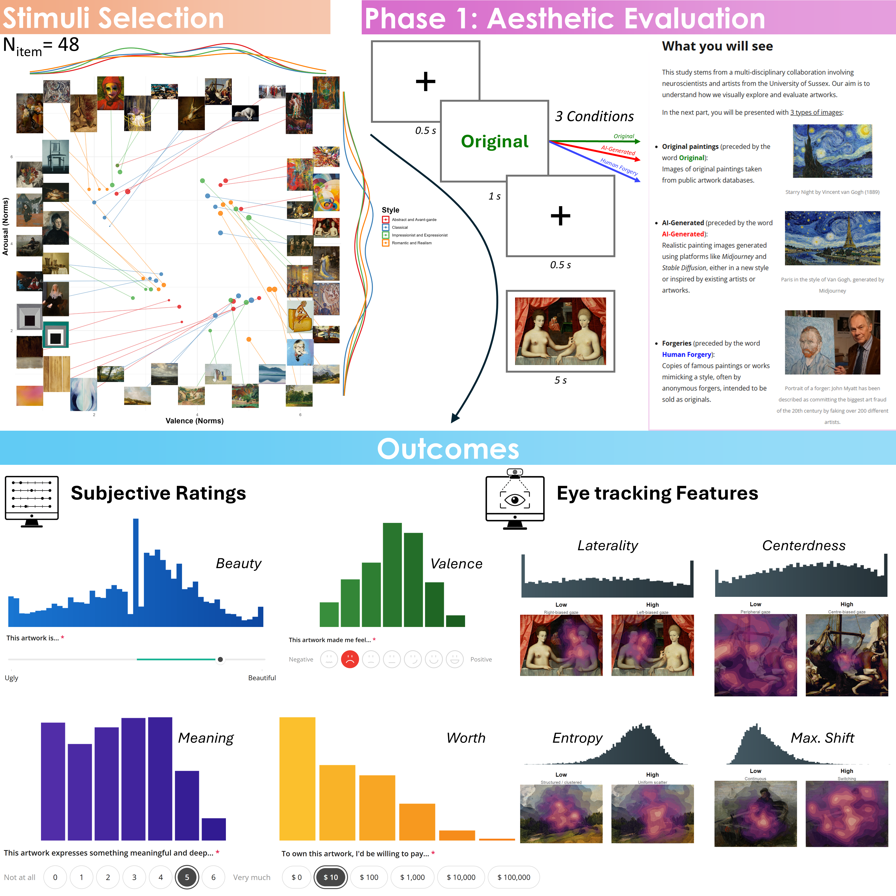
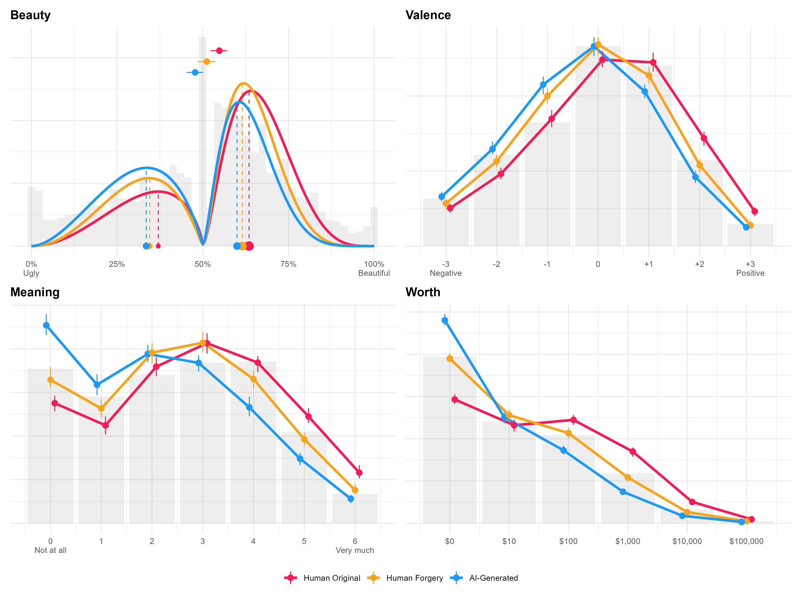
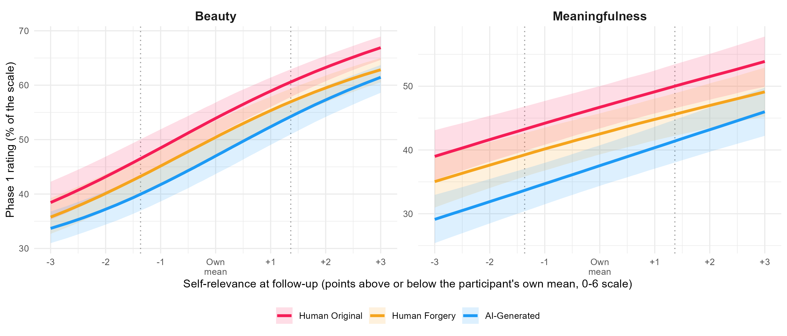
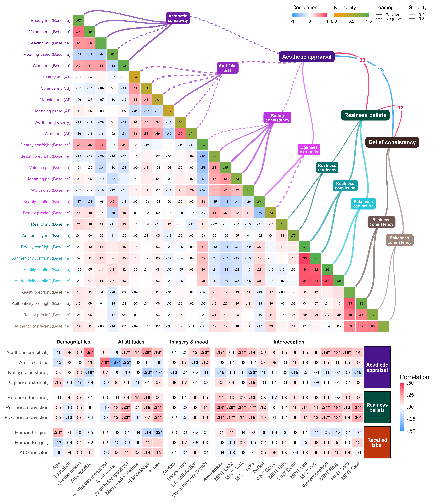

<!-- Title ideas: 

- Framing the Fake: The Differential Effect of Forgery vs. AI Labels on Aesthetic Experience
- Art-ificial Beauty: ...
- The Ghost in the Canvas: ...
- Disentangling Aspects of Reality Beliefs in Aesthetic Experience: Syntheticness and Authenticity
- Framing the Fake: Disentangling Aspects of Reality Beliefs in their role in Aesthetic Experience via the Differential Effect of Forgery vs. AI Labels.
- Syntheticness vs. Authenticity: Disentangling Aspects of Reality Beliefs in their role in Aesthetic Experience
- Syntheticness vs. Authenticity: Disentangling the Role of Reality Beliefs in Aesthetic Experience
- Framing the Fake: How Aesthetic Experience is Shaped by the Differential Effect of Forgery vs. AI Labels
- Not All Fakes Are Equally Ugly: Disentangling Syntheticness and Authenticity as Distinct Reality Beliefs Modulating Aesthetic Experience
- Framing the Fake: AI and Forgery Labels Shape Distinct Aspects of Reality Beliefs During Aesthetic Experience
- Not All Fakes Are Equally Ugly: Disentangling the role of Syntheticness and Authenticity Beliefs in Aesthetic Experience (title until 2026-10-15)
- The Anti-AI Bias in Aesthetic Judgment: Originality, Affect, and Self-Relevance as Cognitive Mechanisms (Marco Sperduti's proposal, 2026-10-15: the title should name AI explicitly and stress the cognitive mechanisms behind the bias) -->

# Introduction

In October 2018, Christie's auctioned Portrait of Edmond de Belamy, an image produced by the French collective Obvious using a generative adversarial network, for over $400,000. Four years later, an image created with Midjourney by Jason Michael Allen won first prize in a digital art competition at the Colorado State Fair, triggering a public controversy about the legitimacy of algorithmically produced art. These two episodes crystallize a societal tension about the use of AI in the artistic domain: artificial intelligence (AI) is now able to produce images that enter markets, competitions, and museums on apparently equal footing with human productions, yet the same public that grants AI this economic and cultural legitimacy tends to devalue its output as soon as its algorithmic origin is revealed.
A growing body of empirical work has documented this negative bias against art attributed to AI across a wide range of materials and paradigms. The effect has been reported for visual art [@chiarella2022; @gangadharbatla2022; @ragot2020; @bellaiche2023; @didio2023; @didio2026], for poetry and creative writing [@didio2026; @porter2024; @raj2023], for music [@shank2022; @ansani2025ai], and, with important cultural nuances, in cross-national comparisons of explicit and implicit attitudes [@wu2020investigating]. @raj2023 offer perhaps the most systematic demonstration of the phenomenon's robustness: across sixteen preregistered experiments and more than 27,000 participants, disclosing that a piece of creative writing had been produced by AI systematically lowered evaluations of its quality, creativity, and enjoyability, an "AI disclosure penalty" that resisted a wide array of moderation strategies, including collaborative human–AI framing and the humanization of the AI agent. A recent meta-analysis by De Rooij [-@deroij2025], focused specifically on visual art, confirms that this devaluation is not an isolated laboratory curiosity: the effect is broad, generalizes across studies, and is moderated by factors such as participants' age, artistic style, the true source of the image, and the presentation context, but is consistently larger for judgments that require attributing meaning, intention, or depth to the artwork than for judgments of low-level sensory qualities.

This last observation already points toward the central puzzle that motivates the present work. If the bias were rooted in genuine perceptual differences between human and AI-generated images, it should scale with people's ability to actually tell the two apart. Empirically, the opposite pattern is observed. In blind evaluation conditions, without any information about authorship, observers are typically unable to discriminate AI-generated from human-made images above chance level [@gangadharbatla2022; @ragot2020]. Zhou and Kawabata [-@zhou2023] directly tested this dissociation using a free-viewing and categorization paradigm: participants were at chance level when categorizing AI-generated representational paintings as AI- or human-made, yet their gaze behavior differed between the paintings they categorized as human-made and those they categorized as AI-made, that is, according to believed rather than actual authorship. @porter2024 report an analogous pattern for poetry: AI-generated poems were indistinguishable from human-written ones under blind evaluation, and in some conditions were even rated more favorably, before being devalued once their artificial origin was disclosed. The bias, in other words, does not track the observer's actual capacity to detect an algorithmic signature in the stimulus. It tracks belief.

This dissociation between perceptual indistinguishability and post-disclosure devaluation suggests that the anti-AI bias is better understood as a high-level, cognitive phenomenon than as a perceptual one. Direct evidence for this claim comes from studies that manipulate processing mode while holding the stimulus constant. @chiarella2022, testing visitors in an actual art exhibition, manipulated the attribution of authorship of two identical abstract paintings and found that the aesthetic devaluation of the "AI" painting emerged only in explicit comparative judgment; concurrent psychophysiological measures of affective engagement (electrodermal activity, heart rate) showed no corresponding modulation, suggesting that early, implicit affective responses to the image were left largely intact. @wang2026 manipulated authorship labels on images that were in fact all AI-generated and orthogonally manipulated whether participants evaluated them under time pressure and cognitive load (favoring automatic, stimulus-driven processing) or under conditions that encouraged reflective, meaning-oriented engagement. The AI label reduced appreciation in both conditions, but the effect was roughly four times larger under controlled, reflective processing. Similarly, work by @bara2025 on implicit and explicit measures of moral and aesthetic judgment toward AI art suggests that the bias operates mainly at an explicit, deliberate, context-sensitive level rather than as an automatic affective association. Converging evidence at the neural level comes from Zhang et al. (2025), who found that paintings labeled as human-made evoked greater activation of the right angular gyrus (a region implicated in semantic integration and episodic memory) than the same paintings labeled as AI-generated. Taken together, these findings converge on a single conclusion: the anti-AI bias is not primarily due to low-level perceptual stages of analysis, but a consequence of what the label "AI" does to the higher-order cognitive processes through which an observer constructs meaning, intention, and value around an aesthetic object.

This conclusion invites us to return to general cognitive models of aesthetic experience to ask where, exactly, in the chain of processing the label intervenes. In the influential model proposed by @leder2004model and updated by @leder2014ten, aesthetic experience unfolds through a sequence of stages: perceptual analysis, implicit memory integration, explicit classification, cognitive mastering, and a continuous affective evaluation process, all contributing to a final evaluation process resulting in two outputs, an aesthetic judgment and an aesthetic emotion. Two stages in this model are natural candidates for where an authorship label could exert its effect: explicit classification, where formal features of the artwork are related to prior knowledge and expectations, and cognitive mastering, where the observer interprets the work in light of personal experience, biography, and expectations about the artist's intention. If information about AI authorship is integrated at these stages, it should selectively depress judgments that depend on inferred intentionality, meaning, and personal connection, while leaving more perceptually driven components of the aesthetic response comparatively untouched—precisely the pattern documented above. On the basis of this framework, and of the literature reviewed so far, at least three candidate mechanisms emerge as plausible drivers of the anti-AI bias: attributed originality and authenticity, the affective properties of the stimulus itself, and the personal relevance of the artwork to the observer. Each of these mechanisms motivates a specific methodological choice in the present study.

## Attributed originality and authenticity

The first candidate mechanism concerns the value historically attached to originals over copies. @newman2012, in an influential series of experiments, showed that people value original artworks over perceptually indistinguishable duplicates because of a principle of positive contagion: the original is believed to carry the physical and symbolic trace of the artist's body and intention, a trace that a reproduction cannot carry. A neuroimaging study by @huang2011 offers striking physiological support for this idea: when the same Rembrandt portraits were labeled as "copy" rather than "authentic", regardless of whether the picture was in fact genuine or false, viewing evoked stronger activation in frontopolar cortex and right precuneus, and the correlation between these regions and occipital visual areas increased. This was consistent with participants' reports of actively engaging effortful, hypothesis-testing processes to look for evidence supporting the assigned label. This shows that a mere verbal assignment of authenticity status is sufficient to reorganize the brain's engagement with an image, independently of its physical properties. At the same time, a meta-analysis by @specker2023 on the related "genuineness effect" - the presumed superiority of experiencing a physical original over a reproduction - found that the effect largely disappears once the confound between genuineness and museum-versus-laboratory context is properly controlled. The authors nevertheless caution that it is too early to conclude that the effect is absent, given the methodological limitations of the included studies, and suggest that a genuineness effect may emerge for more affective aspects of the aesthetic experience, which these studies have largely neglected. This body of work is important for the present study because it suggests that authenticity-related devaluation is not an all-or-nothing effect of "real versus fake", but is graded by what, specifically, the label communicates about the causal and intentional history of the object. Consistent with this graded view, @raj2023 show that the relation between AI disclosure and evaluative devaluation is itself mediated by shifts in perceived authenticity, further underscoring that the anti-AI bias and authenticity-related devaluation share a common underlying mechanism rather than being independent phenomena.

This distinction has a direct methodological consequence. Much of the AI-art literature has manipulated only a human-versus-AI authorship contrast [@gangadharbatla2022; @chamberlain2018; @bellaiche2023; @ragot2020; @grassini2024], which conflates two logically separable properties: not being an authentic original, and not being a human product at all. A painting attributed to a human copyist is also not the artist's original, yet it retains a human intentional history; a painting attributed to AI lacks both. Comparing only "human original" against "AI" therefore cannot determine whether devaluation reflects a generic non-originality penalty or a penalty specific to non-human authorship. To disentangle these components, the present study manipulates the presumed authorship of a set of artworks that were, in every case, actually created by human artists, assigning each piece one of three possible labels: human original, human copy, or AI-generated. This copy condition, directly inspired by the authentic-versus-copy manipulation of @newman2012 and @huang2011, makes it possible to isolate a bias that is specific to the AI label from a more general non-originality penalty, and thereby to test directly whether the anti-AI bias reduces to an authenticity problem or constitutes something more specific to algorithmic authorship.

Separating these two properties also raises the question of how each label is translated into beliefs about the artwork, and of what else informs these beliefs. If the forgery and AI labels communicate different things about an object's causal and intentional history, each should shift the belief dimension it semantically implies - authenticity (copy vs. original) for the forgery label, syntheticness (AI vs. human) for the AI label - rather than a single, undifferentiated sense of "fakeness". Beliefs about provenance, however, need not follow the label alone. @raj2023 showed that perceived authenticity mediates the effect of AI disclosure on evaluations, but the reverse route, from appraisal to belief, is also plausible: because observers cannot reliably tell AI-generated from human-made images by inspection [@gangadharbatla2022; @ragot2020], their judgments of origin must rest on indirect cues, and their own appraisal of the work is an obvious candidate. If AI images are expected to be less beautiful or less meaningful, a work that is experienced as such may be taken as more likely to be AI-generated or a copy. A label that depresses appraisal could then shift beliefs about origin not only directly, but also through the less favourable appraisal it induces, and appraisal could inform beliefs about origin even when no label is present. We therefore preregistered the prediction that more favourable appraisals (beauty, the extremity of valence, and meaningfulness) would predict judging an artwork as human-made and as original, and participants rated each artwork on the two dimensions of syntheticness and authenticity in a second phase of the experiment, after the aesthetic judgments. Decomposing the effects of the labels on these beliefs into direct and appraisal-mediated components goes beyond the preregistered analyses.

## Affective response in aesthetic evaluation: valence, arousal, and their interoceptive grounding

The second candidate mechanism concerns the affective response that an artwork elicits. Emotional processes occupy a central place in every stage-based model of aesthetic experience [@leder2004model; @leder2014ten], and the emotions elicited by an artwork are increasingly treated as integral to, and predictive of, its aesthetic appreciation [@menninghaus2019]. Both the valence and the intensity of this response contribute. In our own group's related work, @salgues2024 showed that retrospective ratings of both the valence and the intensity of the emotional reaction to a painting tracked judgments of beauty, indicating that affective response is not merely a byproduct of aesthetic judgment but one of its structuring inputs. At the physiological level, @cabbai2023 found that skin conductance responses, a classical index of emotional arousal, directly and positively predicted both liking and being-moved ratings for visual artworks, independently of art type.

If affective response is one of the inputs of aesthetic judgment, an authorship label could lower appreciation by dampening the emotional response to the artwork. The evidence for such a dampening is, so far, limited and mixed. In a meta-analysis of the anti-AI bias in visual art, @deroij2025 found only small effects on outcomes reflecting the emotional and valuation components of aesthetic experience, compared with moderate effects on outcomes reflecting knowledge and meaning. @chiarella2022 recorded electrodermal activity and heart rate, following the classical proposal that arousal is better indexed by skin conductance and valence by cardiac measures, but, as noted above, neither was modulated by the authorship label, even though explicit aesthetic judgments were. Self-reported affect appears similarly resistant: @zhou2023 found that subjective evaluations, including ratings of emotional valence and arousal, did not differ between the paintings that participants categorized as human- or AI-made, and @demmer2023 found that participants almost always reported emotions in response to abstract artworks, irrespective of whether they had been told that the works were made by a human or by a computer. Together, these findings suggest that the label leaves the early, bodily components of the affective response largely intact, but they leave open whether it alters how this response is appraised, the level at which aesthetic judgments are made.

A mechanism through which such a dampening could occur is suggested by research on fictional reappraisal, the implicit down-regulation of emotion that occurs when a stimulus is believed to be fictional rather than real. Emotional videos labelled as fictional elicited a weaker subjective emotional experience than the same videos labelled as real, although electrodermal arousal was unaffected [@sperduti2016], and negative pictures labelled as fictional were appraised as less intense and less negative, and elicited smaller skin conductance responses and late positive potentials [@makowski2019]. An AI label conveys part of the same message: the image does not stem from a real person's experience and intention, and is in that sense not "real". If it is processed as a cue of unreality, it could trigger a similar down-regulation, attenuating the emotional response to AI-labelled works and, through it, their appreciation. Notably, this down-regulation was itself modulated by self-relevance: the personal memories evoked by a scene counteracted the effect of the fiction label [@sperduti2016], and the phenomenal and physiological changes depended in part on the self-relevance of the stimuli [@makowski2019], a link that anticipates the third candidate mechanism discussed below.

<!-- PREREG (osf.io/xbrhe) H1.1 predicted an *attenuated* valence (distance from the scale centre) for AI-Generated images, which is the dampening motivated here. Tested (ValenceExtremity) and not reported: the labels shifted valence downwards rather than towards neutral (negative works were not rated less extremely), which argues against a fictional-reappraisal-like dampening; see the PREREG comment at the start of the Phase-1 Results. -->

A growing body of work suggests that this affective dimension of aesthetic experience could be grounded, at least in part, in the perception of one's own bodily state - that is, in interoception. @cabbai2023 found that participants' interoceptive accuracy (assessed via a heartbeat-counting task) and interoceptive sensibility (assessed via self-report) selectively modulated emotional-intensity ratings for visual artworks, particularly in response to representational art. Using a very different kind of stimulus, @washizu2025 mapped the bodily sensations that accompany the aesthetic evaluation of everyday photographs and found that higher beauty ratings were specifically associated with chest-centered bodily sensations, that beauty tracked high-valence emotion categories, and that self-reported interoceptive awareness, while not directly related to beauty ratings, was nonetheless related to the overall intensity of reported bodily sensations. In the domain of immersive, participatory art, @kuhnapfel2023role similarly found that visitors' bodily experience of an installation clustered into interpretable dimensions (including disturbance-related and interoceptive sensations such as heartbeat and breathing) that predicted artistic experience. The interoceptive cluster was specifically linked to interest. Together, these findings indicate that the affective response an artwork elicits is partly constituted by, or at least reliably co-occurs with, the observer's felt bodily state, and that stable individual differences in how people attend to and report on that bodily state can possibly modulate aesthetic experience.

Because affective response appears to be a driver of aesthetic appreciation, it is essential to control for it directly when comparing labeled conditions, otherwise, apparent "authorship effects" could in fact be confounded with pre-existing differences in the emotional profile of the stimuli themselves. For this reason, in the present study, we select stimuli drawn from a standardized set of paintings with normative subjective ratings, so as to sample systematically across the affective space defined by valence and arousal. This design choice allows us to enter normative valence and arousal ratings directly as predictors alongside the manipulated authorship label, and to ask whether affective properties modulate the anti-AI bias.

The evidence that emotional responses to art are partly embodied and interoceptively grounded also motivates a further, exploratory component of the present design. If, as @cabbai2023 and @washizu2025 suggest, individual differences in interoceptive sensibility shape how strongly bodily and affective signals feed into aesthetic evaluation, then such differences could plausibly also shape sensitivity to the anti-AI bias itself. On one hand, individuals who are more attuned to their own bodily and affective reactions might rely more heavily on this immediate, embodied signal when judging an artwork, and correspondingly less on the more abstract, belief-based inference triggered by an authorship label. This would predict a weaker label effect for participants high in interoceptive sensibility. On the other hand, insofar as interoceptive sensibility indexes a more general responsiveness to internally generated meaning, it could instead amplify the evaluative gap between conditions that succeed versus fail at engaging this internal resonance. Although the existing literature does not adjudicate between these possibilities, and no study to date has examined interoceptive sensibility in the specific context of authorship-based bias, we preregistered the second, namely that higher interoceptive sensibility would increase the difference between AI-labelled and other artworks. We include a brief, validated self-report measure of interoceptive sensibility to test it, and treat its relationship with aesthetic judgment more generally as exploratory. A second preregistered dispositional moderator concerned the vividness of visual imagery. Imagery and perception draw on overlapping sensory representations and are not always kept apart: people with more vivid imagery are generally more likely to report perceiving a stimulus [@dijkstra2021] and to mistake imagined content for reality [@dijkstra2023], and imagery vividness is associated, albeit weakly, with phenomenological control, the capacity to generate experiences that match imaginative suggestions [@cabbai2024]. If the authorship label acts as a prime that shapes how an artwork is experienced, its effect could be larger in people with more vivid imagery, and we preregistered that more vivid imagery would increase the difference between AI-labelled and other artworks.

## Self-relevance as a candidate mechanism of resonance

The third candidate mechanism is self-relevance: the degree to which an artwork connects to the observer's own autobiographical memories, identity, interests, and lived experience. The centrality of this dimension in aesthetic experience is well established independently of any question about AI. @vessel2012 earlier neuroimaging work had already shown that the most intensely moving aesthetic experiences recruit the brain's default mode network, a system associated with autobiographical memory and self-referential thoughts [@martinelli2013]. Building on this tradition, @lee2023 exploited the self-reference effect in memory - the well-established finding that information encoded with reference to the self is subsequently better remembered than information encoded semantically or with reference to another person - as an implicit, objective index of aesthetic engagement: paintings that received extreme aesthetic judgments were remembered as well as paintings that had been explicitly encoded in a self-referential judgment task, suggesting that aesthetic judgment and self-referential processing draw on shared cognitive resources. @salgues2024 refined this result across two studies and showed that the mnemonic advantage conferred by aesthetic judgment is closely tied to both self-relevance and explicit emotional judgment, proposing that the perception of self-relevance may act as a switch that jointly triggers emotional engagement and memory integration, ultimately shaping the aesthetic judgment itself. @smith2025 provide complementary evidence that the spontaneous recollection of autobiographical memories during art viewing directly increases aesthetic appreciation, while @durkin2023, drawing on the art-historical concept of the "Beholder's Share", show that abstract artworks elicit greater interindividual variability in both verbal interpretation and default-mode network activity, but not in visual areas, than figurative artworks - evidence that the subjectivity of aesthetic experience is grounded in how observers mobilize internal, autobiographically structured representations rather than in low-level perceptual processes.

Most directly relevant to the present study is the work of @vessel2023, who showed that self-relevance predicts aesthetic appreciation not only for real artworks but also for synthetic images generated through neural style transfer, provided that these images are built around content that is autobiographically meaningful to the individual viewer: personalized synthetic artworks, constructed from photographs tied to each participant's own memories, places, and identity, were rated as aesthetically appealing as genuine human artworks, and considerably more so than synthetic images personalized for someone else. This result is important because it demonstrates that an algorithmically generated image can produce a full-quality aesthetic experience when its content, rather than its authorship, is calibrated to the observer's autobiography. It raises the natural question, central to the present study, of whether self-relevance can similarly attenuate or eliminate the anti-AI bias. This is why, in the follow-up session of our design, we directly measure participants' self-relevance judgments for each artwork, in order to test whether the label effect is moderated by, or interacts with, the degree to which an artwork resonates personally with the observer, and whether very high levels of self-relevance are associated with an attenuation of the gap between human- and AI-labeled artworks.

## Does the bias persist? The question of durability over time

A question that has received comparatively little empirical attention concerns what happens to the anti-AI bias once the (misleading) information about authorship is no longer present, and whether any residual effect can be detected after a substantial delay. Several independent lines of reasoning motivate treating this as a central, if exploratory, research question in the present study. First, models of belief-based valuation such as Newman and Bloom's [-@newman2012] contagion account describe the value attached to an object as resulting from an inferred causal-intentional history rather than from its directly observable properties; there is no a priori guarantee that correcting a factual belief about that history ("this was actually made by a human") fully erases the representation that had been built around the original, false belief, particularly once the specific source of that belief has been forgotten. Second, the neuroimaging results of @huang2011 show that an authenticity label engages active, effortful hypothesis-testing and evidence-seeking processes rather than a passive updating of a simple prior; such elaborated, self-generated inferential processes are, in general, more resistant to correction than passively acquired beliefs, since forgetting the original source of a belief does not automatically remove the belief itself - a pattern well documented in the broader literature on source memory and belief perseverance [**TODO: add some ref?**], and one that maps naturally onto our design, in which participants' explicit memory for the original labels can be assessed independently of their evaluative judgments. Finally, from an applied standpoint, understanding whether an initial "AI" framing produces a durable evaluative trace, even once corrected, has direct implications for how disclosure and correction policies around AI-generated content should be designed and evaluated - an issue that is likely to grow only more pressing as generative systems become more capable and more widely used to produce cultural content.

For these reasons, our design incorporates a follow-up session in which participants who took part in the initial labeling study were invited back, after a substantial delay, to re-evaluate the same artworks - now correctly informed that all of them were, in fact, human productions. This follow-up session allows us to ask, exploratorily, two related questions: whether the evaluative difference induced by the original label persists once the correct information has been provided, and whether any such persistence is related to, or independent of, participants' explicit memory for the label that had originally been assigned to each artwork.

## The present study

Building on this theoretical and empirical background, the present study addresses five research questions. First, is the anti-AI bias reducible to a general authenticity or non-originality penalty, or does it reflect something specific to the attribution of algorithmic authorship, once a human-copy condition is included alongside human-original and AI conditions; and is each label encoded along the belief dimension it semantically implies, syntheticness for the AI label and authenticity for the forgery label? Second, to what extent do the affective properties of the artwork - its normative valence and arousal - account for aesthetic judgments independently of the attributed authorship label, and do they moderate its effect? Third, does the appraisal of an artwork inform beliefs about its origin, even in the absence of any label, and are the effects of the labels on these beliefs direct, or carried by the less favourable appraisal that the labels induce? Fourth, is the anti-AI bias moderated by the personal relevance of the artwork to the observer, such that high self-relevance narrows or eliminates the gap between human- and AI-labeled artworks? And fifth, does any label-induced bias in aesthetic judgment persist once participants are informed, after a delay, that all artworks were in fact of human origin, and how does this persistence relate to participants' explicit memory for the original labels and for their own beliefs? Finally, we examine how participants differ in their sensitivity to the labels, and test the preregistered predictions that positive attitudes toward AI would reduce, and higher interoceptive sensibility and more vivid visual imagery would increase, the difference between AI-labelled and other artworks. Addressing these questions jointly allows us to move beyond a simple documentation of the anti-AI bias toward an account of the specific cognitive mechanisms that structure it, and toward an initial empirical characterization of its persistence over time.


# Methods

## Participants

Participants were recruited via Prolific (n = 360). Following our preregistered criteria, 36 participants (11.1%) who failed at least half of the label catch trials were excluded, leaving a final sample of 324 participants (169 women, 153 men, 2 other; age M = 42.1, SD = 12.9, range 20–82), mostly residing in the United Kingdom (74%) and the United States (21%). Data from participants who failed the attention check embedded in a given questionnaire were discarded for that questionnaire only (MINT and VVIQ: n = 23; BAIT: n = 25). Syntheticness and authenticity ratings were additionally discarded for 7 participants who rated every image identically or whose response pattern was characteristic of a misunderstanding of the instructions. A subset of 220 participants completed the follow-up memory task, on average 47 days later (SD = 4.4, range 36–58). The study was approved by the University of Sussex ethics committee [APPLICATION NUMBER TODO].

## Procedure

```{r}
#| warning: false
#| label: fig-1
#| apa-twocolumn: true  # A Figure Spanning Two Columns When in Journal Mode
#| out-width: "100%"
#| fig-cap: "TODO."



```

The experiment was implemented with  *JsPsych* [@de2015jspsych] and all materials, including its code, the items, instructions and exact procedure, is available in open-access at https://github.com/RealityBending/FakeArt, where the experiment can also be tested live.

### Aesthetic Judgment (Phase 1)


Participants were first introduced to a cover story framing the experiment as a collaboration between neuroscientists and artists investigating how people visually explore and evaluate artworks (a framing that also justified the use of webcam-based eye-tracking, see below). They were told they would view three categories of images: Original Human paintings (sourced from public art databases), AI-Generated images (produced using generative platforms such as Midjourney and Stable Diffusion, either in a new style or inspired by existing artists or artworks^[This intentionally equivocal description, that leaves open whether AI images were generated with the goal of being new or artist-inspired, was carefully considered and included to preempt the risk that a participant recognizing a genuine painting presented as AI-generated would undermine belief in the whole manipulation.]), and Human Forgeries (copies or stylistic imitations of existing artworks, historically produced by Humans with intent to deceive). Critically, only the participants' *beliefs* were manipulated - all stimuli were, in reality, genuine human-made artworks.

Stimuli from the Vienna Art Picture System [VAPS, @fekete2023vienna] were first grouped into four broad stylistic categories (Abstract and Avant-garde; Impressionist and Expressionist; Romantic and Realism; and Classical). To minimize the influence of prior exposure, only paintings with low familiarity (familiarity ratings below the sample median) were retained. Within each style, the remaining paintings were stratified into four quadrants defined by the upper and lower tertiles of normative arousal and valence, and the three paintings farthest from the style's median arousal/valence were selected from each quadrant. This procedure yielded a final set of 48 paintings - 12 per style, evenly split across the four arousal-valence quadrants (Positive - High Intensity; Positive - Low Intensity; Negative - High Intensity; Negative - Low Intensity). This *emotion category* was entered in the statistical models to test whether the label effects depended on the affective properties of the artworks.

During the first phase of the experiment, participants viewed the 48 artworks (see @fig-1), each preceded by a randomly presented label indicating its purported type ("Original", "Human Forgery" or "AI-Generated"). Following the presentation of each artwork (5 s), participants reported their aesthetic experience across four dimensions encompassing cognitive appraisal, emotional response, semantic processing, and valuation [@leder2004model; @leder2014ten; @kirk2009modulation]: *beauty* (aesthetic quality, composition, and execution), emotional *valence* (the intensity of positive or negative feelings evoked), *meaningfulness* (conceptual richness, symbolism, and profundity), and monetary *worth* (maximum willingness to pay). 
To mitigate common method bias [@podsakoff2003common] and minimize construct overlap, each dimension was assessed with a bespoke scale: an analog slider (Ugly - Beautiful), a 7-point pictorial scale (Negative - Positive), a 7-point numerical scale from 0 (Not at all) to 6 (Very much), and a 6-point discrete logarithmic monetary scale offering choices from \$0 to \$100,000^[The selection, description, wording and presentation of these measures were refined through extensive pilot testing and expert feedback.].
To ensure sustained engagement with the contextual cues, random catch trials were interleaved throughout the block, prompting participants to recall the immediately preceding label.

At the end of Phase 1, participants completed a brief manipulation check questionnaire, framed as a feedback opportunity. Checklist items probed their overall impressions of the relative aesthetic quality of AI-generated versus human-made images, the perceived convincingness of the forged artworks, and the degree to which they trusted the labels (e.g., whether labels seemed mismatched, reversed, or whether they suspected that all images in fact belonged to a single category). Participants who selected believing that every artwork was either genuine or AI-generated were additionally asked to rate their confidence in that belief, which was used as a manipulation distrust proxy. This questionnaire was implemented to help identify suspicious or disengaged participants.

### Questionnaires

Between the two phases of the artwork judgment task, participants completed four questionnaires. The *Beliefs about Artificial Images Technology* scale (BAIT) was originally developed in @makowski2025too to assess expectations regarding the realism of computer-generated content and iteratively extended across subsequent studies. The version administered here (BAIT-14) comprised 14 items spanning two components: beliefs about the realism of AI-generated images, videos, text, and artworks (e.g., "Current AI algorithms can generate very realistic images", "AI-generated art can sometimes surpass human creativity and artistic value"); and general attitudes toward AI, adapted from four items of the General Attitudes towards Artificial Intelligence Scale [GAAIS, @schepman2020initial] capturing perceived danger, worry, excitement, and societal benefit. The questionnaire additionally included two items assessing self-rated AI knowledge and frequency of AI tool use, and one attention check item.

The *Multimodal Interoception Questionnaire* [MINT; **REF UNDER REVIEW**] is a 33-item self-report measure of interoceptive sensibility spanning eleven bodily domains, including cardiac, respiratory, gastric, dermal, urogenital, sexual, and olfactory sensations, as well as satiety and excretory awareness. Each domain was scored as the average of three items (e.g., "I can notice even very subtle changes in the way my heart beats"). One additional item served as an attention check.

Participants also completed the *Vividness of Visual Imagery Questionnaire* [VVIQ, @marks1973visual], a 16-item measure of the subjective vividness of voluntary visual imagery. Participants were asked to visualize four scenarios in turn (a familiar person, a rising sun, a familiar shop front, and a countryside scene) and, for each of four component images within a scenario, rated the vividness of the resulting mental image.

Finally, participants completed the four-item *Patient Health Questionnaire* [PHQ-4, @kroenke2009ultra; refined version: @makowski2025measuring], a brief screening measure of anxiety and depressive symptoms. Participants additionally rated their global life satisfaction on a single item ["All things considered, how satisfied are you with your life as a whole?", @cheung2014assessing].

### Reality Beliefs (Phase 2)

At the start of the second phase, the cover story was *partially* revealed^[This pseudo-reveal paradigm was developed as an improvement over other designs in related experiments, see **FICTIONERO PREPRINT REF** for discussion]. Participants were informed that some of the Phase 1 labels had been intentionally randomized and were tasked with identifying the true nature of the artworks based on their own judgment (preserving the belief that originals, forgeries and AI-generated stimuli were present). For each briefly re-presented image (1.5 s), participants made two continuous, gut-feeling judgments, probing theoretically distinct aspects of of reality beliefs: *syntheticness* ("AI-generated" vs. "Human Creation") and *authenticity* ("Copy/forgery" vs. "Original Creation"). We treated these two dimensions as orthogonal, such that artworks could in principle occupy any of four categories (Human Original, Human Forgery, AI Original, AI Copy) - the same four-category structure later probed directly in the follow-up memory task^[Ideally, this orthogonal structure would have been also reflected in Phase 1 through four corresponding labels rather than three. We collapsed this to three categories for practical reasons: presenting an artwork under a label such as "AI-generated original" risked a participant recognizing it as a known human painting, which would undermine trust in the labelling manipulation as a whole. Piloting also suggested that the three-category framing was more intuitive and more ecologically valid, as AI-generated and forgeries typically function as stand-alone categories in everyday life]. Finally, participants were debriefed about the true nature of the experiment and the fact that all stimuli were Human artworks.


### Follow-up: Self-relevance and Memory Task

Participants were invited for a follow-up session approximately six weeks after their initial participation (see Participants for the exact delays). They were first reminded of the two-phase label-manipulation procedure from the original session and we explicitly re-iterated that all previously viewed artworks had, in reality, been genuine human-created originals. They then completed a recognition-memory task in which the original 48 artworks were randomly intermixed with an equal number of novel, previously unseen artworks, presented in randomized order. Novel artworks were drawn from the same VAPS stylistic pool and matched one-to-one to old artworks within each style by minimizing the total Euclidean distance across standardized ratings of valence, arousal, liking, complexity, and familiarity; Bayesian *t*-tests confirmed that old and new items did not differ on any of these norms (all BFs < 1).

For each artwork, participants first rated its beauty once again (using the same slider as in Phase 1) and its personal/self-relevance (the extent to which the artwork related to their own experiences, personality, or life events, independently of how beautiful they found it). They then made an old/new recognition judgement indicating whether they recalled the artwork from the original session. Artworks judged as novel were additionally rated for perceived artificiality (i.e., how easily participants could believe the image was AI-generated). Artworks judged as previously seen instead prompted two source-memory questions: which condition label (Original, AI-Generated, or Human Forgery) was associated with the artwork in Phase 1, and what was their own reality belief response made in Phase 2. Namely, participants had to select which of four categories participants had endorsed, corresponding to the combination of the dichotomized syntheticness and authenticity ratings (Human Original, Human Forgery, AI Original, AI Copy). This design jointly captured item memory (recognition) and source memory in its external and contextual dimension (recall of the assigned label) and internal aspect (one's own past belief).


## Data Analysis

### Eye Tracking

Gaze position was sampled continuously via webcam-based eye-tracking (WebGazer.js) throughout each trial and re-expressed in coordinates centered on the stimulus and normalized by stimulus width, preserving the image's aspect ratio and allowing comparison across images of different sizes. Of the 324 participants of the final sample, 318 provided usable eye-tracking recordings. Given the noisy and variable nature of webcam-based data, a strict quality control workflow was applied. 15 participants (4.7%) were excluded due to invalid data (>25% consecutive duplicate samples). Off-screen coordinates and samples reflecting implausibly fast transitions (>6 stimulus-widths/second, indicative of blinks or artifacts) were removed. Finally, trials were excluded if they contained fewer than 20 valid samples, showed frozen (SD < 0.02) or excessively noisy (SD > 0.60) gaze on either axis, had less than 50% of samples falling within the stimulus bounds, exhibited severe linear drift (>1 stimulus-width of total displacement), or showed near-uniform spatial scatter consistent with untracked gaze. Finally, 18 participants were excluded for yielding fewer than 2,000 valid samples across the full experiment. Together with 11 participants whose trials were all removed by the trial-level criteria, this left 12,220 trials from 274 participants (84.6% of the final sample) for the gaze analyses.

Four simple, robust and interpretable gaze features were computed per trial. *Laterality* was the proportion of samples falling in the left half of the image (vs. the right), and *Centeredness* was the proportion of samples falling within the center portion of the image. *Entropy* quantified the spatial dispersion of gaze: samples were binned into a 5x5 grid, Shannon entropy was computed and normalized by the maximum entropy achievable given the number of valid samples (avoiding artificial deflation on sparse trials). *Max. Shift* captured the single largest reorganization of gaze focus within a trial: for every possible partition of the chronologically ordered samples into an initial and final segment (each with at least 30 samples), the Euclidean distance between the two segments' centroids was computed, and the maximum across all partitions was retained; large values indicate a relocation of attention to a different image region, and near-zero values indicate a single stable focus throughout.

As a sensitivity check, we verified that these features - derived from noisy, low-cost webcam data - nonetheless carried signal relevant to the behavioural task, by regressing each of the eight rating outcomes (the four Phase-1 aesthetic dimensions, the two Phase-2 belief judgments, and the beauty and self-relevance ratings of the follow-up) on each of the four gaze features in turn (mixed models with random intercepts for participant and item, controlling for the number of valid gaze samples of the trial). All four features showed at least one significant association, expressed in percent of the outcome's scale range per SD of the gaze feature. *Entropy* was the most broadly sensitive feature, positively predicting meaningfulness (0.73% [0.31, 1.15]), authenticity (0.63% [0.08, 1.18]), self-relevance (0.60% [0.12, 1.09]), beauty (0.57% [0.23, 0.92]), worth (0.42% [0.07, 0.76]) and valence (0.38% [0.01, 0.74]), indicating that a more widely distributed exploration of an artwork accompanied more positive appraisals. Conversely, *Max. Shift* was negatively associated with authenticity (-0.66% [-1.22, -0.10]), valence (-0.41% [-0.78, -0.03]) and worth (-0.40% [-0.75, -0.04]), suggesting that an abrupt relocation of gaze partway through a trial accompanied less favourable evaluations. *Laterality* predicted self-relevance (1.11% [0.54, 1.68]) and beauty at follow-up (0.62% [0.11, 1.13]), and *Centeredness* predicted syntheticness judgments (-0.66% [-1.26, -0.07]). All these associations are very small - at most about 1% of the scale range per SD - but still are evidence that the gaze features are not pure noise.

### Statistical Models

Given the varied nature of the outcome scales, model families were chosen to match each outcome's distributional characteristics rather than defaulting to linear (Gaussian) models, which assume continuous, unbounded, unimodal outcomes and would poorly capture the shape of most of our data. *Beauty*, *Syntheticness* and *Authenticity* all displayed the characteristic bimodal pattern with inflation at 0, 1 and the midpoint, consistent with a Choice-Confidence process in which a discrete evaluative choice (e.g., "Ugly vs. Beautiful", "Human vs. AI") is conflated with a continuous rating of degree. These outcomes were modelled with a two-component Beta mixture that explicitly parameterizes this two-stage process [**TODO: Add REF TO CHOCO PREPRINT + the COGMOD package: https://github.com/DominiqueMakowski/cogmod**]. *Valence* ratings were bounded and discrete, and thus modelled with a Discrete-Beta distribution, which accommodates the discretized nature of the response scale [**TODO: Add REF to Sciandra, 2024**]. *Meaning* showed additional mass at zero beyond what the Beta-Discrete component could capture and was modelled with a zero-inflated extension. *Worth* and *Self-Relevance*, whose response options form discrete, ordered categories with idiosyncratic boundaries between adjacent levels (e.g., the distinction between \$1,000 and \$10,000, or between a Self-Relevance rating of 1 and 2 can be variable between participants), were modelled with Cumulative (ordinal) models. Among the eye-tracking features, *Entropy*, a continuous bounded proportion, was modelled with a Beta distribution, while *Laterality* and *Centeredness*, which additionally showed boundary inflation at 0 and 1, were modelled with Zero-One-Inflated Beta (ZOIB) distributions. *Max. Shift*, strictly positive and right-skewed, was modelled with a LogNormal distribution. 

Using bespoke models suited to each outcome's characteristics respects features of the data that linear models ignore (bounded scales, zero-inflation, bimodality, ordinal categories), and makes it possible to separate distinct components of the responses. For instance, CHOCO models allow to disentangle effects on the probability of each discrete choice, from effects influencing the degree (mean and spread) of each choice separately. For simplicity, we will however focus on reporting effects on the main parameters (typically $\mu$), reflecting shifts in the outcome's central tendency. For models with additional parameters of theoretical interest (e.g., *p*-Zero in the zero-inflated Beta-Discrete model for Meaning), effects on these parameters are also reported and interpreted where relevant. Effects are reported as marginal contrasts between label conditions on the response scale (posterior median with its 95% HDI as CI), averaged across emotion categories and, to assess the consistency of the effects, within each emotion category, and an effect is considered significant when its CI excludes zero. To make effect sizes comparable across outcomes, all differences are expressed in percent of the scale's range, or choice probability depending on the parameter.
In the main models, the outcome (and each modelled distributional parameter) was predicted by the label condition (with Human Originals as the reference level), the emotion category of the artwork, and their interaction, with random slopes for the label condition, the emotion category and their interaction over participants, and random slopes for the label condition over artworks (the emotion category being a property of the artwork). Gaze models additionally controlled for the number of valid samples of each trial.

To test whether the label effects on reality beliefs were carried by the Phase 1 ratings, syntheticness and authenticity were also modelled as a function of the label, the Phase 1 beauty rating of the same trial (centered within participant), and their interaction. Because the label was randomized and beauty was rated before the beliefs, each label effect could be decomposed into a *direct* effect and an *indirect* effect carried by the change in beauty that the label induced [@pearl2001direct; @imai2010general], computed from population-level predictions at the average beauty under each label. The same decomposition was repeated with the four Phase 1 ratings as joint mediators, yielding the *unique* indirect effect of each rating, and with the follow-up beauty rating (unaffected by the labels) as a covariate, in the participants who completed the follow-up. Finally, we modelled the perceived artificiality of the artworks judged as new at follow-up as a function of their follow-up beauty, and reality beliefs as a function of the style and normative ratings of the artworks [@fekete2023vienna]. As exploratory checks of the model specification showed a non-linear (convex) relation between beauty and authenticity, the authenticity model was also fitted with a quadratic term for beauty.

Self-relevance, rated after the debrief and unaffected by the labels (see Results), was treated as a label-free moderator rather than as a mediator, and centered within participant, so that its effects contrast an artwork with the participant's other artworks. Phase 1 beauty and meaningfulness were modelled as a function of the label, self-relevance and their interaction, comparing the label contrasts between artworks one SD less and more self-relevant than the participant's average; the moderation of beauty was also tested with follow-up beauty as a competing moderator, and with the participant's mean self-relevance as a between-participant moderator. Self-relevance was also added, alongside Phase 1 and follow-up beauty, to the models of reality beliefs and of perceived artificiality described above.

To look for a residual label effect at follow-up, follow-up beauty was modelled as a function of the label and of whether the artwork was recognized, and as a function of the label and of the Phase 2 syntheticness belief (controlling for Phase 1 beauty), the latter decomposing the label effect into the part carried by the belief and the rest, as above. Memory was modelled with categorical (multinomial logit) models of the answer given to each artwork, in which "not recognized" (the artwork judged as new) was one of the possible answers alongside the three labels (or the four belief categories), so that recognition and source memory were estimated jointly, with participant- and artwork-level random effects. Because the new artworks form an additional level of the label predictor, the answer probabilities of these models recover the quantities of a signal-detection analysis, namely hit and false-alarm rates, source accuracy and response biases towards particular answers, as functions of the predictors and without collapsing the answers into a binary decision. The recalled label was predicted by the label shown (new artworks forming an additional level, which captures false alarms), the recalled belief by the participant's actual Phase 2 belief (dichotomized on both sliders), and the recalled label by both the label shown and the belief, to test whether labels were reconstructed from beliefs. A fourth model predicted the answers given to previously seen artworks from the label and from the Phase 1 beauty and valence ratings, each centered within participant and entered with a quadratic term, to test whether extreme appraisals were better remembered. To test whether the correspondence between recalled and actual beliefs reflected memory rather than a fresh inference from the current impression of the artwork, the models of the recalled belief and of the recalled label were also fitted with the Phase 1 beauty, follow-up beauty and self-relevance of the artwork as covariates (centered within participant). The recalled label was further modelled on all artworks as a function of self-relevance and follow-up beauty (with quadratic terms), with separate slopes for old and new artworks, so that an effect on hits could be told apart from an effect on false alarms. In the memory models, effects are differences in the probability of each answer.

Interindividual differences were examined on participant-level indices derived from the random effects of the main models. For each participant and distributional parameter, we computed, on the link scale and averaged over the emotion categories, the value of the parameter for Originals (*baseline*) and its difference between Forgeries or AI-Generated images and Originals (*label effects*). We also extracted each participant's slope of syntheticness on Phase 1 beauty (the "beautiful = human" inference described in the Results) and, from the categorical model of the recalled label, their tendency to attribute each label to the artworks they recognized. The reliability of each index was estimated with D-vour [@ludecke2021performance], which corresponds to the variance of the participants' posterior means relative to the sum of this variance and the squared average posterior SD, with values above .75 indicating strong, around .5 moderate, and below .5 weakly identified individual differences. The structure of the Phase 1 and Phase 2 indices with a reliability above 1/3 was examined with a hierarchical Exploratory Graph Analysis [EGA, @golino2017exploratory; @jimenez2023dimensionality], which estimates a regularized partial-correlation network of the indices, partitions it into lower-order communities [Louvain algorithm with consensus clustering, @blondel2008fast], and groups these into higher-order communities [Leiden algorithm, @traag2019louvain]; its stability was assessed with bootstrapping [@christensen2021estimating]. The network scores of the lower- and higher-order communities and the label recall tendencies were then correlated with the participants' demographic and questionnaire characteristics (Pearson correlations), with a false-discovery-rate (FDR) correction across all the correlations reported [@benjamini1995controlling].

In the Results, numerical estimates are given for the main effects only; the estimates of all other effects mentioned, and all analyses, are openly available at https://github.com/RealityBending/FakeArt.


# Results

## Effect of Label Condition on Aesthetic Judgments

<!-- Numbers from analysis/3_models.qmd (data/results_contrasts.csv, *_pct columns): marginal contrasts on the response scale, posterior median and 95% CI; an effect is reported as significant when the CI excludes 0. All differences are expressed in % of the scale range: sliders (0-1) x 100, Valence (1-7) and Meaning (0-6) divided by their 6-point range, Worth as changes in the probability of a category. -->

Across the Phase 1 ratings, the three labels ordered consistently: artworks presented as Human Forgeries were rated in-between Human Originals and AI-Generated images, with AI-Generated images receiving the lowest ratings on every dimension (see @fig-2).

```{r}
#| warning: false
#| label: fig-2
#| apa-twocolumn: true  # A Figure Spanning Two Columns When in Journal Mode
#| out-width: "100%"
#| fig-cap: "Effect of the label condition on the four Phase 1 aesthetic judgments. Grey bars and histograms show the observed distribution of ratings; coloured lines and point-ranges show the model-implied response distribution for each label condition with its 95% Credible Interval."



```


<!-- PREREG (osf.io/xbrhe) H1.1 also predicted an *attenuated* valence for AI-Generated images (distance from the scale centre). Tested on 2026-10-16 (ValenceExtremity: |Valence - 4|, 0-3, cumulative ordinal; 3_models.qmd, "Valence Extremity"; rows in data/results_contrasts.csv) and NOT REPORTED, by the authors' decision (not supportive; the manuscript is long; add if reviewers ask). Result: mean distance 1.20 [1.13, 1.28] for Originals; AI-Generated -0.09 [-0.12, -0.05] points, Forgeries -0.08 [-0.12, -0.05], AI vs Forgery -0.00 [-0.04, 0.04] (P(neutral midpoint) +3.9% / +3.2%). The reduction is confined to the positive categories (AI: -0.19 and -0.15), where the downward shift of signed valence moves ratings towards the centre; in the negative categories no label attenuated valence (AI vs Original: high intensity +0.05 [-0.03, 0.12], low intensity -0.05 [-0.11, 0.02]; AI vs Forgery, high intensity: +0.08 [0.01, 0.16], i.e. more extreme). So: a downward shift, not an attenuation, and not AI-specific. One-clause version if needed: "The preregistered attenuation of valence for AI-Generated images (a shift towards the neutral midpoint) was not found: the labels lowered valence, making positive works less and negative works no less extreme." -->

Compared to Human Originals, artworks labelled as Forgeries were judged less beautiful (-3.7% [-4.6, -2.8]), as evoking less positive emotions (-3.5% [-4.3, -2.7]), as less meaningful (-4.3% [-5.3, -3.3]) and as less valuable, with a higher probability of being assigned no monetary value at all (+9.5% for the "$0" option [8.3, 10.6]). The AI-Generated label produced the same pattern with roughly twice the magnitude (Beauty: -7.1% [-8.2, -5.9]; Valence: -6.2% [-7.2, -5.1]; Meaning: -10.4% [-11.9, -9.0]; "$0" option: +18.3% [17.1, 19.5]), and also differed significantly from the Forgery label on all four dimensions (Beauty: -3.4% [-4.5, -2.3]; Valence: -2.7% [-3.6, -1.7]; Meaning: -6.2% [-7.6, -4.8]; "$0" option: +8.8% [7.6, 10.1]). These effects are in line with the preregistered predictions of lower meaningfulness and worth for AI-Generated images and of lower beauty and worth for Forgeries, and extend them to all four dimensions. For meaningfulness, the labels additionally increased the probability of a flat "not at all meaningful" (0) answer, markedly so for AI-Generated images (+4.9% [3.1, 7.4]; Forgeries: +0.9% [0.2, 1.8]). For beauty, both stages of the judgment were affected: the labels lowered the probability of judging an image as beautiful rather than ugly (Forgeries: -6.8% [-9.6, -4.0]; AI-Generated: -15.9% [-19.3, -12.5]) as well as the degree of beauty reported among the images judged beautiful, while images judged ugly were judged more decidedly so. None of the gaze features (entropy, laterality, centeredness, maximal shift) differed between label conditions.

<!-- RQ2 main effect: contrasts between emotion categories from the 2026-09-26 re-extraction (contrasts_extra / means_extra in models/estimates/{Beauty,Valence,Meaning,Worth,Reality,Authenticity}.rds; 3_models.qmd prints them as "contrasts between stimulus emotion quadrants"). Reference category in the text: Positive - Low intensity. -->

Regarding the affective properties of the artworks, their normative emotion category shaped the ratings independently of the label. Relative to positive, low-intensity artworks, negative, high-intensity artworks were rated as less beautiful (-23.8% [-29.2, -17.0]) and less pleasant, but as more meaningful (+11.7% [5.3, 18.3]), and were more often assigned no monetary value; negative, low-intensity works showed the same pattern without the gain in meaningfulness, and intensity made little difference among positive works. The label effects, however, did not depend on the kind of artwork: within each of the four emotion categories, all Phase 1 rating contrasts between the three labels remained significant and in the same direction, with comparable magnitudes.

## Syntheticness and Authenticity Beliefs

<!-- Phase 2 label effects from analysis/3_models.qmd (data/results_contrasts.csv, Outcome Reality / Authenticity, overall and per emotion category); the emotion-category main effect on syntheticness / authenticity (last paragraph of this section) from the 2026-09-26 re-extraction (Emotion = "Between emotions"). -->

The labels also shaped the reality beliefs measured in Phase 2 in a dissociable manner (@fig-3, top). As preregistered, images that had been presented as AI-Generated were subsequently judged as more synthetic, i.e., less likely to be human-made, than Originals (-5.5% [-6.9, -4.1]), and also than Forgeries (-4.0% [-5.5, -2.5]), whereas the Forgery label barely affected syntheticness (-1.5% [-2.9, -0.1]). Conversely, the Forgery label lowered judged authenticity relative to Originals (-2.0% [-3.3, -0.9]), and so, to a smaller extent, did the AI-Generated label (-1.4% [-2.6, -0.2]); the two "fake" labels did not differ from each other (+0.7% [-0.6, 2.0]). In other words, the AI label was encoded specifically as a matter of syntheticness, whereas the Forgery label produced smaller and less specific shifts, lowering authenticity somewhat more than the AI label did but not significantly so. Within each emotion category, the effect of the AI label on syntheticness remained significant, whereas the smaller effects were less precisely estimated and reached significance in at most two categories. That the labels still informed the beliefs is expected to some extent: participants had been told that only *some* of the labels had been randomized, so drawing on a label as a partially valid cue was a reasonable use of the information rather than a persistence of belief against correction.

```{r}
#| warning: false
#| label: fig-3
#| apa-twocolumn: true  # A Figure Spanning Two Columns When in Journal Mode
#| out-width: "100%"
#| fig-cap: "Effect of the label condition on reality beliefs, and its decomposition through the Phase 1 appraisal. Top: Phase 2 syntheticness (0% = AI-Generated, 100% = Human creation) and authenticity (0% = Copy, 100% = Original) judgments. Grey histograms show the observed ratings; coloured lines show the model-implied response distribution per label condition, dots on the x-axis the modal rating on each side of the scale (sized by the probability of choosing that side), and point-ranges the marginal means with their 95% CI. Bottom: decomposition of the label effects (blue: AI-Generated vs. Originals; orange: Forgeries vs. Originals) through the four Phase 1 ratings, laid out on the timeline of the experiment. Label → rating paths give the effect of the label on each rating (% of its scale); rating → belief paths give the unique indirect effect carried by that rating; the outer paths give the direct effect of the label on each belief; each belief box gives the total effect and the joint indirect effect (via appraisal) with their 95% CI. Effects on beliefs are in % of the belief scale. Line width scales with the size of the effect; dashed, faded paths have a 95% CI including 0."

knitr::include_graphics("../analysis/figures/figure3.png")
```

<!-- Numbers from analysis/5_realitydeterminants.qmd (data/results_determinants_*.csv): RealityBeauty / AuthenticityBeauty (beauty as mediator), AuthenticityBeautyQuad (+ quadratic beauty term; slopes at -0.4 / -0.2 / 0 / +0.2 / +0.4 of Beauty_w, SD 0.21, in data/results_determinants_quadratic.csv; LOO from models/loo/), RealityAppraisal / AuthenticityAppraisal (four joint mediators), *BeautyControl (+ follow-up beauty), ArtificialityBeauty (never-labelled items), RealityItems / AuthenticityItems (style, norms); effects in % of the scale (posterior median, 95% HDI). -->

Since the labels lowered both the aesthetic judgments of Phase 1 and the reality beliefs of Phase 2, we examined whether the latter effect was carried by the former, i.e., whether artworks were judged as more synthetic or less original *because* the label had made them look less beautiful. As preregistered, beauty was positively associated with both beliefs: artworks rated as more beautiful (relative to the participant's other ratings) were judged as more likely to be human-made (+3.4% [2.8, 4.0] per 10% increase in beauty, for Originals) and as more original (+1.9% [1.5, 2.4]), a relationship slightly weaker under the two "fake" labels.

Decomposing the label effects into a direct and an indirect (beauty-mediated) component revealed a dissociation, clearer for the AI-Generated label than for the Forgery label. The AI-Generated label lowered syntheticness mostly directly (direct effect: -4.0% [-5.5, -2.6]), with about a third of its total effect (30% [20, 41]) carried by the lower beauty it induced (indirect effect: -1.7% [-2.2, -1.3]), whereas the small effect of the Forgery label on syntheticness was fully accounted for by beauty (direct: -0.7% [-2.0, 0.7]; indirect: -1.0% [-1.3, -0.7]). The mirror pattern emerged for authenticity: the Forgery label lowered authenticity mostly directly (direct: -1.5% [-2.7, -0.2]; indirect: -0.5% [-0.7, -0.3]), whereas the effect of the AI-Generated label was carried by beauty (direct: -0.6% [-1.8, 0.7]; indirect: -0.8% [-1.2, -0.5]). Each label thus directly shifted the belief dimension it semantically implied - algorithmic origin for AI-Generated images, lack of originality for Forgeries - whereas its spillover onto the other dimension was carried by the less favourable appraisal it had induced. These direct effects operated on the categorical choice (human vs. AI, original vs. copy) rather than on the confidence of the judgments. The Forgery side of this pattern rests on a smaller and less robust direct effect: authenticity rose with beauty only above the participant's average (beautiful works were taken as originals, but ugly ones were not taken as copies), and allowing for this curvature, although it did not improve predictive accuracy, made the direct effect of the Forgery label marginal (-1.3% [-2.7, 0.2]).

<!-- PREREG (osf.io/xbrhe) H2.1 predicted valence as distance from the scale centre (extremity); the appraisal models use signed valence (centred within participant). Decide: test extremity, or report it as a deviation. -->

When valence, meaningfulness and worth were entered as mediators alongside beauty (@fig-3, bottom), the four ratings jointly carried almost half of the effect of the AI-Generated label on syntheticness (indirect: -2.7% [-3.6, -1.9]; direct: -3.1% [-4.9, -1.6]), the whole of the two spillover effects, and about half of the effect of the Forgery label on authenticity. The direct effect of the Forgery label on the mean authenticity rating was then no longer credible, but the label still directly lowered the probability of judging an artwork as original rather than as a copy (-2.2% [-4.5, -0.1]). Within the joint indirect effects, only beauty and meaningfulness made unique contributions, as preregistered for meaningfulness, whereas valence and worth did not, although the labels lowered them at least as much as beauty. The dissociation between the two labels therefore holds in relative rather than absolute terms: the Forgery label lowered authenticity both through the appraisal it induced and directly, by tipping the categorical choice between original and copy, whereas the AI-Generated label did so only through the appraisal.

Because beauty was not manipulated, these indirect effects could also reflect a common cause, such as a participant's label-independent preference for particular artworks shaping both their beauty and their reality judgments. Adding the beauty rating given at follow-up (after the debrief, and unaffected by the labels) as a covariate left the pattern of direct and indirect effects unchanged. Follow-up beauty had its own, additive association with syntheticness, suggesting that reality beliefs drew both on how much participants liked an artwork regardless of its label and on the label-induced change in their appraisal of it.

Finally, the association between beauty and perceived human origin did not require any label. At follow-up, the more beautiful participants found an artwork that they judged as new, the less likely they rated it to be AI-generated, with the same slope for genuinely new artworks, which had never been associated with a label (-2.2% [-2.7, -1.7] per 10% increase in beauty), and for previously seen artworks that were not recognized (difference: -0.0% [-0.5, 0.5]). We describe this association as a "beautiful = human" inference, but its direction is not fixed by the design: beauty was rated before the belief in both sessions, yet an impression that a work "looks artificial" can form during viewing and lower its beauty, so the same association would arise from a spontaneous, label-free anti-AI bias operating at the level of the artwork. The follow-up beauty control rules out stable preferences for particular artworks as a common cause, not a stable impression of their artificiality.

Properties of the artworks themselves also informed syntheticness judgments, independently of the label: negative, high-intensity works, works of higher normative arousal, and Abstract and Avant-garde and Romantic and Realism works (compared with Classical and Impressionist and Expressionist ones) were judged as more synthetic. Normative liking did not predict syntheticness, nor did normative valence, complexity or familiarity, so that the "beautiful = human" inference relied on the participant's own appraisal of an artwork rather than on its normative appeal. Authenticity varied little with any of these properties.


## The Role of Self-Relevance

<!-- Label effect on self-relevance from analysis/3_models.qmd (data/results_contrasts.csv, Outcome SelfRelevance, "response - 0" = probability of a "not at all" answer). Other numbers from analysis/6_selfrelevance.qmd (data/results_selfrelevance_{moderation,beliefs,contrasts}.csv): BeautySR / MeaningSR (Condition x self-relevance), BeautySRControl (+ follow-up beauty as competing moderator), BeautySRBetween (+ the participant's mean self-relevance, between-participant slopes per 10% of the scale), RealitySR / AuthenticitySR (Phase 1 beauty, self-relevance and follow-up beauty as joint predictors), ArtificialitySR (items judged new); the slopes without self-relevance come from RealityBeautyControl / ArtificialityBeauty. Low / high self-relevance = -1 / +1 SD of the within-participant ratings (1.4 points on the 0-6 scale); slopes per 10% of the self-relevance scale (0.6 points). Effects in % of the scale (posterior median, 95% HDI). -->

Self-relevance ratings were skewed toward the low end of the scale (38.5% of the artworks were rated as "not at all" self-relevant) and were not affected by the label under which an artwork had been presented in Phase 1. Within participants, self-relevance was most strongly related to the beauty rated in the same session (*r* = .58) and to Phase 1 beauty (.40), and only weakly to meaningfulness and to the reality beliefs (≤ .17).

Artworks that participants found more self-relevant at follow-up had been rated as more beautiful (+3.2% [2.6, 3.6] per 10% increase in self-relevance, for Originals) and more meaningful in Phase 1, similarly under the three labels. The label penalty, however, did not change with self-relevance (@fig-4). The beauty gap between AI-Generated images and Originals was of the same size for artworks more self-relevant than the participant's average as for less self-relevant ones (+1 SD: -6.3% [-8.1, -4.7]; -1 SD: -6.5% [-8.3, -4.6]; difference: +0.2% [-2.3, 2.5]). The same held for the gap between Forgeries and Originals, for meaningfulness, with follow-up beauty as a competing moderator, and for the categorical components of the judgments (the probability of judging an image as beautiful, and of rating it as "not at all meaningful"), whose label effects were constant on the odds scale. Nor did the penalty depend on how self-relevant participants found the artworks overall: participants with a higher mean self-relevance rated the artworks as more beautiful, but their beauty gap between AI-Generated images and Originals was not significantly smaller.

<!-- Categorical components: the gaps in percentage points shrink at high self-relevance only because the baseline probabilities do (P(meaning = 0) 6.1% -> 3.2% for Originals); the odds ratios are 2.10 / 2.12 for the AI effect on pzero and 0.54 / 0.60 on p(beautiful), with log-OR differences of 0.01 [-0.29, 0.29] and 0.10 [-0.20, 0.39]. Table in 6_selfrelevance.qmd, "The categorical components on the odds scale" (moderation_odds(), estimates.R). -->

```{r}
#| warning: false
#| label: fig-4
#| apa-twocolumn: true  # A Figure Spanning Two Columns When in Journal Mode
#| out-width: "100%"
#| fig-cap: "Phase 1 beauty and meaningfulness as a function of the self-relevance of the artwork, rated at follow-up, for each label condition. Self-relevance is expressed relative to the participant's own mean (in points of the 0-6 scale), so that each artwork is compared to the participant's other artworks. Lines and ribbons show the model-implied ratings with their 95% CI. Dotted lines mark one standard deviation below and above the participant's own mean. The gaps between labels remain constant across the range of self-relevance."


```


Self-relevance also contributed, modestly, to reality beliefs, over and above both beauty ratings: more self-relevant artworks were judged as more likely to be human-made under the AI-Generated label (+1.0% [0.4, 1.6] per 10% increase; the difference from the other labels was not significant) and as more original under the two "fake" labels. These contributions left the slope of Phase 1 beauty virtually unchanged, so that the "beautiful = human" inference was not a proxy for personal resonance, and, as self-relevance was unaffected by the labels, it carried none of the label effects on the beliefs. As for beauty, this link did not require any label: at follow-up, the more self-relevant an artwork judged as new, the less likely it was rated to be AI-generated, over and above its beauty, for new and unrecognized old artworks alike. Self-relevance, rated in the same session, absorbed about a quarter of the association between follow-up beauty and perceived human origin.


## Persistence and Memory

### Persistence of the Label Effect

<!-- Follow-up label effects from analysis/3_models.qmd (data/results_contrasts.csv, Outcome Beauty2 / Artificiality, response); artificiality was asked only for artworks judged new (old items judged new in the model). -->

The label effect was no longer detectable about six weeks later, at the follow-up session, where participants had been reminded that all artworks were genuine human originals: artworks previously labelled as AI-Generated or as Forgeries were not rated as less beautiful than those labelled as Originals (-0.9% [-2.0, 0.1] and -0.3% [-1.4, 0.9], respectively; about a tenth of the Phase 1 effects), and the original label affected neither the perceived artificiality of the artworks that participants did not recognize nor, as reported above, their self-relevance. This design cannot separate the passage of time from the explicit correction, or from the fact that only a subset of participants returned (220 of 324).

<!-- Numbers from analysis/4_memory.qmd, "Durability" (Beauty2Recognition, Beauty2Reality; data/results_memory_durability.csv): label contrasts within recognized / unrecognized artworks (% of the slider; P(beautiful side) in percentage points), the recognition contrast, the slope of follow-up beauty on the Phase-2 syntheticness belief per label (per +10% of the belief slider, Phase-1 beauty at the participant's mean) and the indirect effect of the label through that belief. The "Total" / "Direct" rows of that model condition on the label-depressed Phase-1 beauty and are not label effects (see the notebook). -->

Two further models looked for what this null might hide. First, a residual label effect appeared only among the artworks that participants still recognized (43.1% of those seen in Phase 1), and only on the categorical component of the judgment: recognized artworks previously labelled as AI-Generated were somewhat less likely to be placed on the "beautiful" side of the scale than recognized Originals (-4.6% [-9.1, -0.3]), whereas unrecognized ones were not. Second, the syntheticness belief formed in Phase 2 carried into the follow-up: given the Phase 1 beauty of an artwork, the more human-made a participant had judged it to be, the more beautiful they found it six weeks later, so that the AI label retained a small indirect effect on follow-up beauty through the belief it had induced (-0.3% [-0.4, -0.1]). The trace that the label left in the aesthetic judgment itself was thus small and confined to the artworks that participants still recognized; it was clearer in the belief about the artwork, which in turn still coloured its later appreciation.

### Memory for Labels and Beliefs

<!-- Numbers from analysis/4_memory.qmd (data/results_memory_contrasts.csv, results_memory_means.csv): categorical models of the recalled label (MemoryCondition), of the recalled own belief (MemoryBelief), and of the recalled label by own belief with the label shown held constant (MemoryConditionBelief); recognition and recalled label by Phase-1 beauty and valence (MemoryAppraisal, data/results_memory_appraisal.csv: population-level predictions at -2 / -1 / +1 / +2 SD minus at the participant's mean, recognition = 1 - P(Not recognized), labels given recognition; "joint" rows move the other rating along its within-person regression, "unique" rows hold it at 0; item-level correlations from 4_memory.qmd); differences of probabilities (over all items, "Not recognized" included) in percentage points. Percentages "of the recognized artworks" are descriptive (data_memory_task.csv). -->

Participants recognized 43.1% of the artworks seen in Phase 1, against a false-alarm rate of 11.1% for new artworks. Recognition did not depend on the label under which an artwork had been presented, nor on the participant's own Phase 2 belief about it, but on how the artwork had been appraised in Phase 1. In line with our previous work linking extreme aesthetic judgments to a mnemonic advantage [@lee2023; @salgues2024], we had hypothesized that artworks receiving extreme ratings, whether positive or negative, would be better remembered. This held for the positive extreme only: artworks rated as more beautiful than the participant's average (and, as the two ratings usually went together, as more positive) were more likely to be recognized, increasingly so toward the top of the range (+12.0% [6.9, 17.3] at two SD above the participant's mean), whereas artworks rated as less beautiful than average were not (+0.0% [-4.1, 4.2] at two SD below). Of the two ratings, only beauty retained a credible effect when each was varied with the other held constant. The artworks with the highest recognition rates were nonetheless the ugliest and most negative ones, but this was a property of the artworks (those of higher normative arousal, and those found uglier on average, were better recognized by everyone), which the model separates from each participant's own appraisal: within a given artwork, it was finding it more beautiful than usual, not finding it extreme, that made it more memorable.

<!-- Numbers from analysis/6_selfrelevance.qmd, section (C), MemorySR (data/results_selfrelevance_memory.csv): P("seen before") at -2 / +2 SD of the rating minus at the participant's mean, for old items (hits, averaged over the three labels) and new items (false alarms), percentage points, and the same as log odds ratios. "unique" rows (the other rating at the participant's mean). -->

Self-relevance, rated at follow-up, was also related to recognition, but not in the way a self-reference effect would predict. More self-relevant artworks were more often reported as "seen before", but as much when they were new as when they had actually been seen: the effect was larger in percentage points for old artworks only because hits were far more frequent than false alarms, and on the odds scale it did not differ between old and new artworks (difference in log-odds ratio at two SD above the mean: -0.11 [-0.38, 0.16]). The same held for follow-up beauty. Self-relevance and beauty at follow-up thus indexed a bias to judge a resonant or appealing artwork as familiar rather than better memory for it, which is why the Phase 1 appraisal (rated before any memory judgment, and only for artworks actually seen) is the cleaner index of what was encoded.

Memory for the label itself was at chance: artworks were no more often attributed the label they had actually carried than any other label (all differences ≤ 1.3 percentage points, all CIs including 0). Instead, label attributions followed a stable response bias: whatever their actual label, recognized artworks were most often remembered as being associated with the "Original" label (51% of recognized artworks), followed by "AI-Generated" (33%) and "Forgery" (15%). New artworks that were falsely recognized received the same distribution of labels (53%, 32% and 15%), suggesting that label attributions were reconstructed rather than retrieved. The preference for the Original label may be partly driven by the reminder, at the start of the follow-up session, that all artworks were genuine human originals.

In contrast, participants' recollection of their own Phase 2 belief was above chance, mainly along the syntheticness dimension. Artworks that a participant had judged to be AI originals were more often recalled as such than artworks judged to be Human Originals (+6.5% [4.7, 8.5]), and less often recalled as Human Originals (-8.0% [-9.9, -6.2]), whereas artworks judged to be Forgeries were not more often recalled as Forgeries than those judged to be Originals, nor were AI copies more often recalled as AI copies. As the model included participant- and item-level variability in each answer, this correspondence is not a matter of general response tendencies, or of some artworks looking more artificial than others to everyone.

<!-- Numbers from analysis/4_memory.qmd, "Memory or Re-inference? Controlling for the Appraisal" (MemoryBeliefAppraisal, MemoryConditionAppraisal): Belief contrasts with the three ratings in the model (percentage points over all items), and the rating effects at -2 / +2 SD of the rating minus at the participant's mean, among recognized artworks, other ratings at the mean. -->

This correspondence may, however, reflect a stable, personal impression of an artwork re-expressed at follow-up as much as an episodic memory of the past judgment: beauty and self-relevance were rated again immediately before the memory questions, and beauty was closely associated with the belief in Phase 2. It nonetheless survived when the current impression was taken into account: with the Phase 1 beauty, follow-up beauty and self-relevance of the artwork in the model, the belief effects were unchanged (artworks judged to be AI originals recalled as such: +7.1% [5.2, 9.0]), although the current impression shaped the answers on its own, artworks currently found more beautiful being more often recalled as Human Originals (+10.7% [6.8, 15.3] of recognized artworks at two SD above the participant's mean), as were, to a lesser extent, more self-relevant ones. The recalled belief was thus both a memory of the Phase 2 judgment and a re-inference from the present appraisal, the two contributing independently.

<!-- Recalled label by Phase 1 appraisal: MemoryAppraisal (analysis/4_memory.qmd, data/results_memory_appraisal.csv, "joint" rows, P(label | recognised) at -2 / +2 SD minus at the mean, in percentage points); with the belief, follow-up beauty and self-relevance held constant: MemoryConditionAppraisal ("unique" rating effects among recognized artworks); self-relevance on the recalled label among recognized old artworks: MemorySR (analysis/6_selfrelevance.qmd, section C, data/results_selfrelevance_memory.csv). The two appraisal estimates come from differently specified models (beauty and valence moved jointly vs. beauty alone, with the follow-up ratings in the model), so their difference is not a formal decomposition. -->

The recalled label, in turn, appeared to be reconstructed from this belief and from the Phase 1 appraisal. With the label actually shown held constant, artworks that a participant had judged to be AI originals were more often attributed the "AI-Generated" label than those judged to be Human Originals (+7.0% [5.0, 8.9]; among recognized artworks: 43.6% vs. 27.3%), again along the syntheticness dimension only (artworks judged to be Forgeries were not more often attributed the "Forgery" label). The "beautiful = human" inference described above also entered this reconstruction: artworks rated as less beautiful than the participant's average in Phase 1 were more often remembered as "AI-Generated" (+7.4% [1.8, 12.7] of recognized artworks at two SD below the mean) and those rated as more beautiful more often as "Original", whereas the "Forgery" attribution did not follow beauty. This effect was smaller, but still present, with the belief, follow-up beauty and self-relevance held constant, and it was the Phase 1 appraisal rather than the current one that mattered, follow-up beauty having no effect. Self-relevance acted in the same direction, more self-relevant recognized artworks being more often attributed the "Original" label and less often the "AI-Generated" label. In other words, participants remembered what they had come to believe about an artwork, and what they had felt about it in Phase 1, but not what they had been told about it.


## Interindividual Differences

<!-- Numbers from analysis/7_correlates.qmd: reliability (D-vour) tables of the participant-level and memory indices, "Correlations between participant-level indices", "Hierarchical EGA: community membership and item stability", "Number of communities across bootstraps"; network loadings and correlations between community scores from the cached EGA fit (ega$parameters$lower_loadings, net.loads(ega$higher_order), net.scores()); max |r| of the recall tendencies with all 64 Phase 1 / Phase 2 indices computed from models/individual/ (2026-09-26 check). Community scores are oriented so that a higher score = more of what the label says (7_correlates.qmd, "Orientation", 2026-09-26): anti-fake bias and ugliness extremity are reversed relative to the raw network loadings (a higher anti-fake bias score = a larger penalty; a higher ugliness extremity score = more extreme ugliness judgments), and the aesthetic appraisal higher-order score is oriented so that ugliness extremity, its dominant community, loads positively. The higher-order scores are not shown in the lower panel of the figure (r = .97-.99 with their dominant communities). -->

Participants differed reliably in their baseline responses, but much less in their sensitivity to the labels. All baseline indices were reliable (D-vour from .58 to .97), whereas individual differences in the label effects were mostly dominated by estimation uncertainty: the effect of the AI-Generated label was moderately reliable on the Phase 1 ratings (.34 to .71), the effect of the Forgery label only on worth (.55), and none of the label effects on the Phase 2 beliefs was (all ≤ .13). With 16 artworks per label and participant, the latter result does not show that participants did not differ in how the labels shifted their beliefs, but that such differences, if any, were too small to be measured with this design. The "beautiful = human" slope was moderately reliable (.44).

The 28 baseline and label-effect indices with a reliability above 1/3 formed nine lower-order communities, grouped into three higher-order communities (@fig-5, top). The first, *aesthetic appraisal*, gathered the Phase 1 indices into four communities: *aesthetic sensitivity*, the baseline level of the four ratings (finding the Originals beautiful, pleasant, meaningful and valuable); *anti-fake bias*, the effects of the AI-Generated label on the four ratings and of the Forgery label on worth; *rating consistency*, the precision of the four ratings; and *ugliness extremity*, how far into the "ugly" side of the beauty scale participants went when they chose that side. The anti-fake bias thus formed a dimension of its own, largely independent of how much participants appreciated the artworks in general (*r* = .17). The Phase 2 indices formed the two other higher-order communities: *realness beliefs*, comprising the baseline tendency to judge the artworks as human-made and original (*realness tendency*) and the extremity of these judgments on the human / original side (*realness conviction*) and on the AI / copy side (*fakeness conviction*), and *belief consistency*, comprising the precision of the judgments on either side. Each Phase 2 community paired a syntheticness index with its authenticity counterpart: the extremity and precision of the two beliefs were strongly correlated, whereas the tendencies to judge the artworks as human-made and as original were only weakly related, so that participants differed in a shared way of using the two belief scales rather than in a general belief that the artworks were fake. As each higher-order score was dominated by one or two of its lower-order communities (*r* = .97 to .99), we report the correlates of the lower-order communities only. This structure was moderately stable: across 500 bootstrap samples, three higher-order communities were found in 56% of the samples, and nine lower-order communities was the most frequent solution (31%).

Two further sets of indices were kept out of this structure. The "beautiful = human" slope was nearly unrelated to all other indices and to all participant characteristics (all |*r*| ≤ .18). At follow-up, the tendencies to attribute each label to recognized artworks were reliable individual characteristics (D-vour .69 to .80), unlike the accuracy of these attributions (.09), but they were unrelated to all Phase 1 and Phase 2 indices (all |*r*| ≤ .17): how inclined a participant was to attribute each label was unrelated to how they had, overall, appraised the artworks and judged their origin (at the level of the artworks, by contrast, the attributions followed the appraisal and the belief; see Memory for Labels and Beliefs).

```{r}
#| warning: false
#| label: fig-5
#| apa-twocolumn: true  # A Figure Spanning Two Columns When in Journal Mode
#| out-width: "100%"
#| fig-cap: "Structure and correlates of the participant-level indices. Top: correlations between the 28 indices with a reliability (D-vour) above 1/3 (lower half; Pearson *r*, bold: *p* < .05, uncorrected), their reliability (diagonal), and their hierarchical structure (upper half): each index connects to its lower-order community, and each lower-order community to its higher-order community (edge width: item stability across 500 bootstrap samples; dashed: negative network loading); arcs give the correlations between the higher-order scores. Baseline: Originals; Forgery, AI: difference from Originals; mu: location; confright / confleft: extremity of the judgments on the right (beautiful, human, original) / left side of the scale; precright / precleft: their precision; phi, disc: precision of the valence, meaningfulness and worth ratings; pzero: probability of a \"not at all meaningful\" answer; Reality: syntheticness. Scores are oriented so that a higher score means more of what the community label says (e.g., a larger penalty for the non-original labels for the anti-fake bias), hence the negative loadings of the label effects on it. Bottom: correlations between the participants' characteristics (rows) and the lower-order community scores and the tendencies to attribute each label to recognized artworks at follow-up (columns). Bold: *p* < .05 (uncorrected); \\*: *p* < .05 after false-discovery-rate correction across the 280 correlations."


```

## Dispositional Correlates

<!-- Numbers from analysis/7_correlates.qmd, "Manuscript figure: correlations between participant characteristics and community scores and label recall tendencies" (Markdown table; df_correlates_ms: 28 characteristics x 7 lower-order community scores + 3 recall tendencies, FDR over its 280 cells; n = 324 minus questionnaire exclusions, 317 for Phase 2 scores, 220 for the recall tendencies). Scores oriented so that higher = more of the label (anti-fake bias: larger penalty). Within the 84 trait x recall correlations alone, no FDR-corrected p < .05 (smallest .12; 2026-09-26 check). VVIQ_Total higher = more vivid since the 2026-09-26 fix in 1_cleaning.qmd (it was reverse-scored before). -->

The community scores and the label recall tendencies were then correlated with the participants' characteristics (@fig-5, bottom). As preregistered, the anti-fake bias was related to attitudes toward AI, and to no other characteristic after correction: participants with more negative attitudes toward AI penalized the non-original labels more strongly (*r* = .36), whereas those who believed that AI-generated art can rival human art (*r* = -.37) and those with more positive attitudes toward AI (*r* = -.25) penalized them less. Contrary to the preregistered predictions, the bias was not larger in participants with higher interoceptive sensibility (all |*r*| ≤ .10), and its association with more vivid visual imagery was weak (*r* = .12) and did not survive the correction. The bias was also unrelated to manipulation distrust, art expertise, and knowledge and use of AI tools.

Interoceptive sensibility was instead related to the baseline level of the judgments: participants reporting more interoceptive awareness and visceroception found the Originals more beautiful, pleasant, meaningful and valuable, as did participants with more art expertise, more knowledge and use of AI, more positive attitudes toward AI and more vivid visual imagery. Interoceptive sensibility also went with more decisive reality beliefs: participants reporting more interoceptive awareness made more extreme syntheticness and authenticity judgments, both on the human / original side (realness conviction: *r* = .26) and on the AI / copy side (fakeness conviction: *r* = .21), as did those reporting more visceroception, using AI tools more often and holding more positive attitudes toward AI. This association was specific to the reality judgments, which participants had been asked to make on "gut feeling" (interoceptive sensibility was unrelated to the extremity of ugliness judgments), and may reflect a greater reliance on, or confidence in, felt impressions. Finally, participants with more art expertise and more knowledge and use of AI tools rated the artworks less consistently from one artwork to the next. The ugliness extremity and realness tendency scores had no correlate surviving the correction.

At follow-up, the tendency to attribute the "Original" label to recognized artworks was higher in older participants (*r* = .20) and lower in participants who used AI tools more often (*r* = -.22). These associations are small, and survived the correction only as part of the whole set of correlations, but they are consistent with the reconstructive nature of label memory (see Memory for Labels and Beliefs): in the absence of a memory of the label, participants' attributions may follow their prior expectations about how common AI-generated images are.

# Discussion

**DRAFT - points to organize and elaborate** (collected while writing the Results; to be turned into prose):

- **Generic penalty + AI-specific component (RQ1).** Forgeries were rated in-between Originals and AI-Generated images on all four dimensions, with the AI penalty roughly twice the Forgery one. The anti-AI bias is thus partly a generic non-authenticity penalty (in line with contagion / authenticity accounts, Newman & Bloom) and partly specific to algorithmic authorship.
- **Meaning is the most affected dimension.** The AI label lowered meaningfulness the most (-10.4%) and raised the probability of a flat "not at all meaningful" answer, i.e., the label leads people to deny meaning altogether, consistent with intention-based accounts (meaning presupposes an intending agent).
- **Appraisal changed, visual exploration did not.** No label effect on any gaze feature: the bias operates at the evaluative level, not on perceptual sampling (caveat: webcam precision; features did carry signal, see sensitivity check). Consistent with the literature that the bias is belief-driven, not perceptual.
- **Robust across affective properties (RQ2).** Label effects held in every valence x arousal category; the affective content of the artwork does not gate the bias. Item properties did shape reality beliefs, but independently of the label: artworks with higher normative arousal were judged more synthetic (-5.4% per SD), as were Abstract/Avant-garde and Romantic/Realism works compared with Classical and Impressionist/Expressionist ones (~47-51% vs. ~58-60% on the syntheticness scale), whereas normative liking, valence, complexity and familiarity did not predict syntheticness, and no item property predicted authenticity. Two implications: (a) the "beautiful = human" inference rests on the viewer's own appraisal of a work, not on its normative appeal (normative liking had no effect); (b) syntheticness judgments partly follow stylistic and arousal cues, possibly lay theories of what AI images look like (vivid, dramatic, abstract, or polished-realist renderings; speculative, to be checked against the AI-detection literature). Authenticity (copy vs. original) seems to have no such visual heuristic.
- **Labels are encoded along semantically specific dimensions, asymmetrically.** The AI label directly and specifically shifted syntheticness (vs. Originals and vs. Forgeries); the Forgery label's specific effect on authenticity is small (not different from the AI label's), direct in the beauty-only decomposition but marginal under the quadratic and the four-mediator ones, and clearest on the categorical choice (original vs. copy). Spillovers onto the other dimension were carried by the lowered appraisal. Beliefs about artworks are structured rather than a single "fakeness" dimension, but "AI" is the stronger and more specific cue. Also: the Phase-2 label effects are not "persistence despite correction": the pseudo-reveal said only some labels were randomized, so the label remained a partially valid cue.
- **Appraisal feeds back into beliefs: a "beautiful = human" inference, or a label-free anti-AI bias (RQ3).** Lower beauty and meaning went with judging artworks as more synthetic, also without any label (never-labelled artworks at follow-up), and this was not explained by participants' label-independent preferences for the works. The direction is an interpretation: rating order does not fix it, and a spontaneous "looks AI -> less beautiful" impression at the item level (the very bias under study, operating without a label) predicts the same association; the follow-up beauty control removes stable preferences, not stable artificiality impressions. Either reading is informative: a possible self-reinforcing loop (label -> lower appraisal -> more synthetic), or a spontaneous appeal-based AI heuristic. Real-world implication: when provenance is unknown, low appeal may be taken as evidence of AI ("AI slop" heuristic), and appealing AI images may pass as human; relates to AI-detection literature (people cannot tell AI from human images, but may use appeal as a cue).
- **Which appraisal components carry beliefs.** Beauty and meaningfulness carried unique indirect effects, valence and worth did not (worth as a divergent test), for both syntheticness and authenticity. Suggests the link runs through evaluative / semantic stages (Leder's cognitive mastering and evaluation) rather than through the affective response. Meaning deserves emphasis: it is the most label-sensitive rating and one of the two carriers.
- **Nuance on the dissociation.** With all four ratings as mediators, half of the Forgery effect on authenticity also runs through the appraisal (mainly meaning), and its direct effect is attenuated (-1.1%, CI touching 0); the dissociation holds in relative terms (Forgery > AI on the direct authenticity path, and on the choice component) rather than as "purely direct vs. purely indirect".
- **Fake labels slightly weaken the beauty cue.** The beauty -> syntheticness slope was weaker under Forgery / AI labels: once a work is labelled fake, its beauty is less diagnostic of human origin.
- **Labels shift the choice, not the confidence.** In CHOCO terms, labels moved which side of the scale was chosen (human vs. AI, original vs. copy), and the AI label did not make "AI" judgments more confident: labels act like a prior on a categorical decision rather than strengthening conviction.
- **Self-relevance does not modulate the label penalty (RQ4).** Neither within nor between persons, on the mean ratings nor on the categorical components (an earlier draft read an attenuation of the AI effect on P(meaning = 0) at high self-relevance; it is probability-scale compression, odds ratio ~2.1 at both -1 SD and +1 SD, so it is not reported). Self-relevance is instead a (small) label-free cue to human origin, over and above beauty, also in memory: self-relevant recognized works are attributed the "Original" label (+8%) and not the "AI" one (-7%). Self-relevance and memory: no self-reference effect; SR (and follow-up beauty) raise "seen before" answers equally for old and new works on the odds scale, i.e. a familiarity bias for resonant / liked works, not better memory (the Phase-1 appraisal, rated before any memory judgment, is the cleaner encoding index and shows the convex beauty -> recognition link). Contrast with Vessel et al. 2023: personalising the *content* removes the AI penalty, but personal resonance with a given work does not shield it from the *label*.
- **No detectable evaluative trace (RQ5).** ~47 days later, after correction, the label no longer detectably affected beauty (AI: -0.9% [-2.0, 0.1], about a tenth of the Phase-1 effect), self-relevance or perceived artificiality: the bias behaves as an on-line inference that dissolves once the triggering information is withdrawn, rather than a belief-perseverance or evaluative-conditioning effect. Caveats: time, correction and attrition (220/324) are confounded. What does persist: (a) among recognized works, a small residual drop in the probability of choosing the "beautiful" side for AI-labelled works (-4.6%), none among unrecognized ones; (b) the Phase-2 syntheticness belief predicts follow-up beauty beyond Phase-1 beauty (+0.9% per 10%), so the AI label keeps a small indirect effect (-0.3%) through the belief it induced: the trace in the judgment itself is small and confined to recognized works; it is clearer in the belief. Do not describe the Phase-2 label effects as persistence (see above).
- **People report what they concluded, not what they were told.** Label memory was at chance, with a response bias towards "Original" (possibly from the corrective reminder) and an under-use of "Forgery"; recall of one's own belief was above chance, along the syntheticness dimension only; and the recalled label followed that belief. It is memory, not re-inference alone: the belief effects are unchanged with Phase-1 beauty, follow-up beauty and self-relevance in the model (MemoryBeliefAppraisal, MemoryConditionAppraisal); the current impression adds its own, independent contribution to the recalled belief (currently beautiful / self-relevant -> "I thought it was human"), and the recalled label follows the Phase-1 impression (rated ugly then -> "it was labelled AI") but not the current one. So people carry forward what they concluded and what they felt, not what they were told. Links to source monitoring / misinformation research; implications for AI-labelling policies (the label's source is forgotten, while the belief it induced, or the reconstruction from one's impression, remains).
- **The anti-fake bias is an attitude, not a trait of aesthetic or bodily sensitivity.** Participants differed reliably in their baselines, much less in their sensitivity to the labels: the AI penalty in appraisal is a moderately reliable individual difference (D-vour .34-.71), the Forgery penalty only for worth, and the label effects on beliefs are not measurable with 16 artworks per label. The anti-fake bias forms its own dimension, largely independent of general appreciation (r = .17), and tracks AI attitudes only (larger with negative attitudes, r = .36; smaller with the belief that AI art can rival human art, -.37, and with positive attitudes, -.25), not art expertise, AI knowledge or use, manipulation distrust or interoception: consistent with a belief-driven, not perceptual, account (the bias follows what people think about AI, not how well they know art or how they feel). The AI-attitude link was preregistered (H3.1); the preregistered amplification by interoception (H3.2) and visual imagery (H3.3) was not found (interoception: neither direction; VVIQ r = .12, not surviving FDR). Interoception instead went with higher aesthetic sensitivity and with more decisive ("gut-feeling") reality judgments on both sides of the scales. At the individual level, syntheticness and authenticity share a response style (extremity and precision r = .68-.93) but not their location (r = .18), complementing the item-level dissociation. Label recall biases follow AI familiarity and age (small; heavier AI users recall fewer works as "Original"), in line with reconstruction from priors. Caveat: the community scores are exploratory, and moderately stable (three higher-order communities in 56% of bootstraps).
- **Distinct distributional signatures** of the four aesthetic dimensions (paragraph below): argue against collapsing them into a single aesthetic factor; methodological point about outcome-appropriate models (CHOCO, Discrete-Beta, ordinal).
- **Limitations to discuss:** belief manipulation with genuine human artworks (ecological validity vs. real AI images); UK/US online sample; webcam eye-tracking precision; mediation assumptions (beauty not manipulated; measurement error underestimates indirect effects); pseudo-reveal design; attrition at follow-up (220/324).
- **Pending sections to integrate:** none; the Abstract is still TODO.

<!-- Outcome Distribution -->

While empirical aesthetics research frequently observes high correlations among subjective dimensions - often prompting the extraction of a single latent "aesthetic appreciation" factor to mitigate multicollinearity, the present data strongly support preserving the independence of these constructs.
Theoretically, beauty, valence, meaning, and worth map onto distinct cognitive and neural substrates, spanning sensory evaluation, affective response, semantic processing, and reward. Crucially, the empirical distributions of the collected data substantiate this theoretical divergence. Rather than sharing a uniform shape, each dimension exhibited a distinct distributional signature indicative of separate underlying generative processes. Specifically, emotional valence displayed a symmetric unimodal distribution, reflecting a normative, continuous gradient of affective responses. In contrast, meaningfulness demonstrated pronounced zero-inflation, suggesting a partially dichotomous cognitive mechanism whereby artworks are initially gated as either possessing semantic weight or lacking it entirely. Monetary worth followed a monotonically decaying, right-skewed shape highly characteristic of behavioral economic valuation paradigms, where high subjective reward is exceptionally rare. Finally, beauty judgments yielded a complex, bimodal distribution, likely capturing a combination of polarized aesthetic processing and the specific anchoring behaviors elicited by analog sliders. These pronounced morphological differences, while also influenced by our usage of distinct response formats, suggest that the four scales are not merely redundant probes of a generalized aesthetic halo effect, but capture distinct aspects of the aesthetic experience.


# References

::: {#refs}
:::
